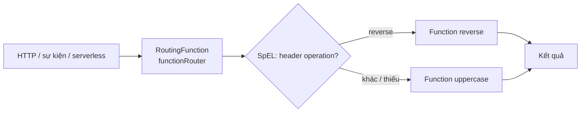

# Định tuyến động bằng `spring.cloud.function.routing-expression`

## Mục tiêu học tập

Sau bài này, bạn có thể:

1. Giải thích cách `RoutingFunction` dùng Spring Expression Language (SpEL) để **tính tên hàm đích từ nội dung của từng `Message`**.
2. Viết `spring.cloud.function.routing-expression` trong `application.yml`, `application.properties` hoặc Message header.
3. Định tuyến nhiều request đến các bean `Function` khác nhau thông qua một điểm vào `functionRouter`.
4. Phân biệt routing theo **biểu thức**, routing theo **tên hàm trực tiếp** (`spring.cloud.function.definition`) và function composition.
5. Giải thích thứ tự ưu tiên nguồn chỉ dẫn, giới hạn reactive routing, xử lý lỗi, kiểm thử và kiểm soát đầu vào không tin cậy.

## 1. Bài toán: cùng điểm vào, chọn hàm theo dữ liệu

Spring Cloud Function tách logic nghiệp vụ thành `Supplier`, `Function` và `Consumer`, đăng ký qua `FunctionCatalog`. Các hàm có thể được sử dụng bởi HTTP adapter, nền tảng sự kiện hoặc môi trường serverless mà không cần biết cách bên ngoài vận chuyển yêu cầu.

Giả sử một ứng dụng có hai cách biến đổi văn bản:

- `uppercase`: chuyển chuỗi thành chữ hoa.
- `reverse`: đảo thứ tự ký tự.

Ở một số môi trường, người quản trị có thể chọn **một hàm cố định** ngay lúc triển khai. Nhưng nếu yêu cầu A cần `uppercase`, còn yêu cầu B cần `reverse`, ta phải đưa ra quyết định **theo từng thông điệp**. Lúc đó, `RoutingFunction` đọc metadata/payload và dùng một biểu thức SpEL để trả về tên function đích.

Ví dụ quy tắc nghiệp vụ:

> Nếu header `operation` bằng `reverse`, chọn hàm `reverse`; trong các trường hợp khác, chọn `uppercase`.

Quy tắc này có thể biểu diễn bằng một dòng:

```text
headers['operation'] == 'reverse' ? 'reverse' : 'uppercase'
```

Đây là **biểu thức định tuyến động**: cùng một biểu thức được tái sử dụng nhưng kết quả có thể khác nhau theo headers của mỗi message.



**Lợi ích:** quyết định định tuyến nằm ở lớp điều phối, trong khi các `Function` chỉ tập trung vào xử lý dữ liệu. Một hàm có thể được gọi trực tiếp, được ghép với hàm khác hoặc được chọn động tùy adapter và cấu hình.

## 2. `RoutingFunction` đánh giá `routing-expression` như thế nào?

Spring Cloud Function cung cấp sẵn `org.springframework.cloud.function.context.config.RoutingFunction`, được đăng ký trong `FunctionCatalog` với tên mặc định **`functionRouter`** (hằng `RoutingFunction.FUNCTION_NAME`).

Đối với input là `Message<?>`, router có thể sử dụng biểu thức trong:

- **Application/system property** `spring.cloud.function.routing-expression`: thiết lập một **quy tắc** cho ứng dụng. Quy tắc có thể chọn đích khác nhau theo headers/payload của từng message.
- **Message header** `spring.cloud.function.routing-expression`: cho phép mỗi message cung cấp **biểu thức** riêng, nếu adapter vận chuyển header đó.

Khi đánh giá SpEL trên `Message`, biểu thức có thể dùng các thuộc tính:

| Thành phần trong SpEL | Đại diện | Ví dụ |
| --- | --- | --- |
| `headers` | Tập header của `Message` | `headers['operation']` |
| `payload` | Nội dung `Message` | `payload == 'hello'` với payload dạng chuỗi |
| `?:` theo cú pháp điều kiện ba ngôi | Chọn kết quả dựa trên điều kiện | `headers['operation'] == 'reverse' ? 'reverse' : 'uppercase'` |
| String literal `'reverse'` | Tên function trả về dưới dạng chuỗi | `'reverse'` |

Kết quả biểu thức phải có ý nghĩa là **tên một function definition mà `FunctionCatalog` tra cứu được**, ví dụ `reverse` hoặc `uppercase|reverse`.

```text
Message(payload="hello", headers={operation="reverse"})
  -> RoutingFunction
  -> SpEL đánh giá thành "reverse"
  -> FunctionCatalog tra cứu "reverse"
  -> reverse.apply("hello")
  -> "olleh"
```

Nếu biểu thức không tạo ra tên hợp lệ, tên không tồn tại hoặc function đích không thể xử lý payload, lời gọi có thể thất bại. Router **không tự tạo** một hàm chỉ vì biểu thức trả về tên của hàm đó.

### Hai property trông giống nhau nhưng có vai trò khác nhau

| Tên | Nơi sử dụng | Chức năng |
| --- | --- | --- |
| `spring.cloud.function.definition` trong cấu hình adapter | Ứng dụng/adapter | Chọn function ở **điểm vào**, ví dụ `functionRouter` hoặc `uppercase` |
| `spring.cloud.function.definition` trong Message header | Router | Chọn **tên function đích trực tiếp**, không cần SpEL |
| `spring.cloud.function.routing-expression` trong property hoặc header | Router | **Đánh giá SpEL** để tính tên function đích |

Vì thế, `definition=functionRouter` có thể dùng chung với `routing-expression`: thuộc tính thứ nhất đưa yêu cầu đến router; thuộc tính thứ hai cho router biết **cách chọn hàm nghiệp vụ**.

## 3. Tạo hai hàm nghiệp vụ để thử nghiệm

Ví dụ dùng Spring Boot với dependency HTTP adapter `spring-cloud-starter-function-web`. Khi xây dựng dự án, sử dụng phiên bản Spring Cloud Function tương thích với Spring Boot, thường quản lý qua BOM:

```xml
<dependency>
    <groupId>org.springframework.cloud</groupId>
    <artifactId>spring-cloud-starter-function-web</artifactId>
</dependency>
```

Tạo hai bean cùng kiểu `Function<String, String>`:

```java
package com.example.dynamicrouting;

import java.util.Locale;
import java.util.function.Function;

import org.springframework.boot.SpringApplication;
import org.springframework.boot.autoconfigure.SpringBootApplication;
import org.springframework.context.annotation.Bean;

@SpringBootApplication
public class DynamicRoutingApplication {

    public static void main(String[] args) {
        SpringApplication.run(DynamicRoutingApplication.class, args);
    }

    @Bean
    public Function<String, String> uppercase() {
        return value -> value.toUpperCase(Locale.ROOT);
    }

    @Bean
    public Function<String, String> reverse() {
        return value -> new StringBuilder(value).reverse().toString();
    }
}
```

Framework đăng ký các bean với tên `uppercase` và `reverse` trong `FunctionCatalog`. Cả hai không phụ thuộc HTTP, Spring Messaging hay `RoutingFunction`. Nếu chuyển sang Spring Cloud Stream/serverless, ta có thể tái sử dụng phần xử lý này và thay adapter/cấu hình đầu vào.

## 4. Cách A — cấu hình biểu thức tại ứng dụng, dữ liệu thay đổi theo request

Đây là cách hữu ích khi **ứng dụng sở hữu luật định tuyến** và các client chỉ gửi thông tin nghiệp vụ, ví dụ `operation`.

```yaml
# application.yml
spring:
  cloud:
    function:
      definition: functionRouter
      routing-expression: "headers['operation'] == 'reverse' ? 'reverse' : 'uppercase'"
```

Giải thích:

1. `definition: functionRouter` chọn `RoutingFunction` làm function đầu vào của adapter.
2. `routing-expression` chứa **một biểu thức SpEL**, được đánh giá trên từng `Message`.
3. Header `operation` là metadata nghiệp vụ do client gửi; nó **không chứa tên property framework**.
4. Nếu `operation=reverse` thì router gọi `reverse`; mọi giá trị khác, kể cả thiếu header, đi đến `uppercase`.

Với Spring Cloud Function Web thông thường, definition được chọn có thể được ánh xạ tại URL gốc `/`:

```bash
# Thông điệp 1: chọn reverse
curl -X POST http://localhost:8080/ \
  -H "Content-Type: text/plain" \
  -H "operation: reverse" \
  --data-raw "hello"
# Kết quả dự kiến: olleh

# Thông điệp 2: chọn uppercase
curl -X POST http://localhost:8080/ \
  -H "Content-Type: text/plain" \
  -H "operation: uppercase" \
  --data-raw "hello"
# Kết quả dự kiến: HELLO

# Thông điệp 3: không có operation, dùng nhánh mặc định
curl -X POST http://localhost:8080/ \
  -H "Content-Type: text/plain" \
  --data-raw "hello"
# Kết quả dự kiến: HELLO
```

**Quan sát:** cả ba request dùng cùng URL và không cần gửi biểu thức SpEL. Router nhận **biểu thức từ application property**, còn quyết định cuối cùng phụ thuộc header của từng request.

Nếu adapter web xuất router theo tên, có thể gọi endpoint `/functionRouter` thay vì `/`. URL thực tế phụ thuộc `spring.cloud.function.web.path`, cấu hình xuất hàm và cách adapter ánh xạ function.

### Viết bằng `application.properties` hoặc biến môi trường

```properties
spring.cloud.function.definition=functionRouter
spring.cloud.function.routing-expression=headers['operation'] == 'reverse' ? 'reverse' : 'uppercase'
```

Trong Bash, nếu triển khai bằng biến môi trường:

```bash
export SPRING_CLOUD_FUNCTION_DEFINITION=functionRouter
export SPRING_CLOUD_FUNCTION_ROUTING_EXPRESSION="headers['operation'] == 'reverse' ? 'reverse' : 'uppercase'"
```

Ở `application.yml`, cặp nháy kép ngoài cùng là **cú pháp YAML** và không trở thành nội dung biểu thức. Cặp nháy đơn quanh `reverse`/`uppercase` là **cú pháp literal của SpEL**, phải còn nguyên khi ứng dụng đọc property.

## 5. Cách B — cung cấp biểu thức trực tiếp bằng Message header

Nếu luồng tích hợp cho phép nguồn gửi chọn **quy tắc định tuyến của từng message**, có thể đặt `spring.cloud.function.routing-expression` trong header.

Ví dụ ứng dụng chỉ chọn router làm điểm vào:

```yaml
spring:
  cloud:
    function:
      definition: functionRouter
```

Sau đó gửi request:

```bash
curl -X POST http://localhost:8080/ \
  -H "Content-Type: text/plain" \
  -H "operation: reverse" \
  -H "spring.cloud.function.routing-expression: headers['operation'] == 'reverse' ? 'reverse' : 'uppercase'" \
  --data-raw "hello"
# Kết quả dự kiến: olleh
```

Với Spring Cloud Function Web, adapter có thể chuyển HTTP headers thành Spring `Message` headers, để router đọc biểu thức trong header `spring.cloud.function.routing-expression`. Trong hệ thống event hoặc serverless, việc chuyển headers/metadata phải theo binder và adapter thực tế; không nên mặc nhiên cho rằng tất cả metadata HTTP được giữ nguyên.

**Khác biệt quan trọng:**

- Khi biểu thức nằm trong **application property**, ứng dụng quyết định *luật*; request chỉ cung cấp dữ liệu làm đầu vào cho luật.
- Khi biểu thức nằm trong **Message header**, người gửi có thể quyết định cả *luật* lẫn dữ liệu. Cách này linh hoạt nhưng cần kiểm soát nguồn tạo header.

### Định tuyến theo payload

Với payload đã được chuyển đổi thành `String`, biểu thức có thể đọc `payload`:

```yaml
spring:
  cloud:
    function:
      definition: functionRouter
      routing-expression: "payload == 'hello' ? 'uppercase' : 'reverse'"
```

Payload `hello` sẽ chọn `uppercase`; payload `spring` sẽ chọn `reverse`. Đối với JSON hoặc kiểu phức tạp, cách truy cập thuộc tính và phép so sánh phụ thuộc **kiểu payload sau chuyển đổi**. Đừng giả định body JSON luôn được chuyển thành đúng kiểu Java mong muốn chỉ vì biểu thức có tên trường đó.

## 6. Chọn composition bằng một biểu thức động

Đích của router cũng có thể là **definition ghép** từ `FunctionCatalog`, ví dụ `uppercase|reverse`:

```yaml
spring:
  cloud:
    function:
      definition: functionRouter
      routing-expression: "headers['operation'] == 'combo' ? 'uppercase|reverse' : 'uppercase'"
```

Với `operation: combo` và payload `hello`, kết quả là `OLLEH`:

```text
"hello" -> uppercase -> "HELLO" -> reverse -> "OLLEH"
```

Trong chuỗi kết quả `'uppercase|reverse'`, dấu `|` là thành phần của **tên definition composition**, không phải phép toán logic của SpEL vì nó nằm bên trong string literal. Composition thực thi **theo thứ tự**, và đầu ra của bước trước phải tương thích với đầu vào của bước sau.

So sánh ba lựa chọn:

| Cách viết | Ý nghĩa |
| --- | --- |
| `spring.cloud.function.definition=uppercase|reverse` trong application property | Adapter chọn composition **trực tiếp** làm điểm vào |
| `spring.cloud.function.definition: uppercase|reverse` trong Message header | Router chọn composition đích **theo tên** |
| `routing-expression: "headers['operation'] == 'combo' ? 'uppercase|reverse' : 'uppercase'"` | Router **tính toán** chọn composition hay một hàm tùy message |

Trong mọi trường hợp, Spring Cloud Function xử lý composition theo cơ chế `FunctionCatalog`. Router không cần tự viết một thuật toán gọi từng hàm.

## 7. Ngữ cảnh đánh giá SpEL: application property và header không giống nhau

Spring Cloud Function phân biệt nơi xuất phát của `routing-expression`:

| Nguồn biểu thức | SpEL evaluation context | Ý nghĩa thực tế |
| --- | --- | --- |
| **Message header** `spring.cloud.function.routing-expression` | `SimpleEvaluationContext` | Khả năng đánh giá **bị giới hạn** để giảm rủi ro khi biểu thức đến từ message |
| **Application/system property** `spring.cloud.function.routing-expression` | `StandardEvaluationContext` | Hỗ trợ tập tính năng SpEL **rộng hơn** cho biểu thức do ứng dụng quản lý |

Biểu thức đơn giản truy cập `headers['operation']`, so sánh chuỗi và toán tử ba ngôi thích hợp cho ví dụ trong cả hai ngữ cảnh. Tuy nhiên, không nên coi một biểu thức SpEL phức tạp dùng trong application property là chắc chắn chạy được nếu chuyển nguyên văn vào Message header. `SimpleEvaluationContext` cố ý không cho phép một số tính năng như tham chiếu kiểu Java và gọi constructor.

**Nguyên tắc thiết kế:** để quy tắc do ứng dụng tin cậy quản lý trong config khi có thể; để phía gửi truyền một header nghiệp vụ đơn giản, rồi dùng biểu thức có kiểm soát để ánh xạ sang danh sách hàm được cho phép. Không khuyến khích đưa nguyên một biểu thức tùy ý từ request công khai đến router.

## 8. Thứ tự ưu tiên khi có nhiều nguồn định tuyến

Đối với **imperative function**, `RoutingFunction` có các nguồn quyết định đích phổ biến:

| Mức ưu tiên | Nguồn | Ví dụ |
| --- | --- | --- |
| 1 — cao nhất | Bean `MessageRoutingCallback` | Java trả về `reverse` theo metadata |
| 2 | Message header `spring.cloud.function.definition` hoặc `spring.cloud.function.routing-expression` | Request mang chỉ dẫn trực tiếp hoặc SpEL |
| 3 | Application/system property định tuyến | `spring.cloud.function.routing-expression` khai báo quy tắc mặc định |

Một cấu hình mặc định:

```yaml
spring:
  cloud:
    function:
      definition: functionRouter
      routing-expression: "headers['operation'] == 'reverse' ? 'reverse' : 'uppercase'"
```

Nếu request truyền header `spring.cloud.function.definition: uppercase`, header chỉ dẫn trực tiếp có thể được ưu tiên hơn biểu thức trong property. Nếu ứng dụng đăng ký `MessageRoutingCallback`, callback có ưu tiên cao hơn cả message headers khi xác định đích.

Để tránh kết quả khó dự đoán, **không gửi đồng thời** `spring.cloud.function.definition` và `spring.cloud.function.routing-expression` trong cùng một message với hai chỉ dẫn khác nhau. Chọn một cơ chế routing cho mỗi message và ghi rõ chính sách chuyển tiếp header của adapter.

Khi dùng `MessageRoutingCallback`, có thể áp dụng bảng ánh xạ nghiệp vụ (ví dụ `operation=reverse` mới được phép gọi `reverse`) để việc chọn tên function không phụ thuộc trực tiếp vào chuỗi do client tự nhập.

## 9. Kịch bản triển khai thực tế

### 9.1. HTTP

Điểm vào web có thể là `/functionRouter` hoặc đường dẫn gốc khi adapter chọn `functionRouter` làm definition mặc định. HTTP headers được adapter xử lý và chuyển đổi thành metadata của `Message`. Vì thế cùng biểu thức `headers['operation']` có thể áp dụng cho các request khác nhau.

Điểm cần kiểm tra là **đường dẫn đang gọi**, **header thực tế đến router**, **kiểu payload sau chuyển đổi** và **tên function cuối cùng**. Routing expression đúng cú pháp vẫn không có tác dụng nếu request đi thẳng vào một endpoint hàm nghiệp vụ khác.

### 9.2. Event routing với Spring Cloud Stream

Một consumer nhận các event cùng destination có thể chọn xử lý khác nhau dựa trên headers. Với event routing, Spring Cloud Stream thường sử dụng `spring.cloud.stream.function.routing.enabled=true` và input binding theo quy ước `functionRouter-in-0`.

```text
Event A: operation=reverse, payload="hello" -> reverse -> "olleh"
Event B: operation=uppercase, payload="hello" -> uppercase -> "HELLO"
```

Tùy binder (Kafka, RabbitMQ, ...), cần xác nhận header nghiệp vụ `operation` được truyền thành Spring Message header, cách khai báo destination và output binding, cũng như cơ chế xử lý lỗi. **Tên binding** `functionRouter-in-0` khác tên router `functionRouter` trong `FunctionCatalog`.

### 9.3. Serverless

Adapter serverless có thể gọi `functionRouter` và chuyển payload/metadata từ event thành đầu vào cho framework. Biểu thức định tuyến chỉ hoạt động theo headers thực tế mà adapter cung cấp; một sự kiện JSON bất kỳ không tự nhiên có cấu trúc `Message` giống HTTP.

Nhờ tách `Function` nghiệp vụ khỏi adapter, ta có thể giữ nguyên `uppercase` và `reverse`, nhưng phải kiểm tra cách ánh xạ event, tên handler và cách nạp cấu hình của nền tảng serverless cụ thể.

### 9.4. Reactive routing là trường hợp riêng

Với `Function<String, String>`, router có thể định tuyến **theo từng `Message`**. Ngược lại, reactive function nhận `Flux<T>` hoặc `Publisher<T>` xử lý cả một luồng theo một lần gọi. Spring Cloud Function **không hỗ trợ chuyển đích theo routing header của từng phần tử trong cùng một reactive stream** theo cách imperative.

Vì vậy, với reactive function cần chọn route ở **cấp luồng** thông qua application property phù hợp, thường là một tên đích tĩnh (ví dụ `routing-expression: "'processStream'"`) thay vì biểu thức dựa trên header của từng event. Một binder Stream vẫn có thể định tuyến từng sự kiện nếu chính các hàm đích được tổ chức dưới dạng imperative function.

## 10. Thiết kế biểu thức an toàn và dễ bảo trì

Một biểu thức ngắn có thể hữu ích khi hệ thống nhỏ, nhưng vẫn cần quy tắc rõ ràng:

1. **Có nhánh dự phòng tường minh.** Ví dụ `headers['operation'] == 'reverse' ? 'reverse' : 'uppercase'` xử lý được cả khi thiếu header. Hãy chọn fallback theo yêu cầu nghiệp vụ; không tự động biến mọi operation không biết thành hợp lệ nếu quy trình đòi hỏi từ chối.
2. **Chỉ trả về tên hàm được đăng ký.** Lỗi chính tả như `'reversee'` không được router tự sửa; cần kiểm tra catalog và lỗi vận hành.
3. **Kiểm soát nguồn biểu thức.** Không mở một API để client tự gửi SpEL tùy ý nếu không cần. Biểu thức trong cấu hình ứng dụng dễ được review và kiểm soát phiên bản hơn.
4. **Giới hạn danh sách function có thể được gọi.** Nếu client gửi `operation` hoặc routing header từ nguồn công khai, cần xác thực, phân quyền và ánh xạ tới các function được phép. Endpoint router không tự thay thế chính sách truy cập.
5. **Không nhồi logic nghiệp vụ phức tạp vào SpEL.** Nếu quyết định route đòi hỏi nhiều phép tra cứu, trạng thái hoặc điều kiện, dùng `MessageRoutingCallback`/service chuyên trách để kiểm thử và quan sát tốt hơn.
6. **Quan sát lỗi và đích được chọn.** Ghi correlation ID, operation, tên function đích và lỗi ở mức phù hợp; tránh log dữ liệu nhạy cảm của payload.

Đặc biệt, nếu router không tìm thấy function đích, lời gọi có thể phát sinh ngoại lệ. Spring Cloud Function có điểm mở rộng `DefaultMessageRoutingHandler` cho tình huống không thể route; không nên cấu hình một cách xử lý bỏ qua message nếu dữ liệu quan trọng và cần retry, dead-letter channel hoặc cảnh báo.

## 11. Chẩn đoán lỗi bằng bảng kiểm

| Triệu chứng | Nguyên nhân có thể | Cách kiểm tra |
| --- | --- | --- |
| Thay `operation` nhưng luôn nhận một kết quả | Request không đi qua `functionRouter`, hoặc header không đến `Message` | Xem function đầu vào của adapter và metadata thực tế |
| SpEL báo không tìm thấy thuộc tính | Truy cập sai key hoặc nhầm payload/header | Kiểm tra `headers['operation']`, kiểu payload và key header |
| Trả về `null` hoặc tên hàm không tồn tại | Biểu thức thiếu nhánh mặc định hay sai tên bean | Dùng ternary rõ ràng và đối chiếu `FunctionCatalog` |
| Chuyển expression từ property sang Message header rồi lỗi | Hai nguồn dùng evaluation context khác nhau | Đơn giản hóa biểu thức cho `SimpleEvaluationContext` |
| Property routing không được áp dụng | Callback hoặc routing header của message có ưu tiên cao hơn | Xác minh thứ tự ưu tiên và nguồn cấu hình |
| Route đúng nhưng lỗi chuyển kiểu | `Content-Type`/payload không khớp chữ ký function | Kiểm tra kiểu Java, adapter conversion và composition |
| Header `spring.cloud.function.definition` làm lệch kết quả SpEL | Message chứa thêm chỉ dẫn routing khác | Chuẩn hóa còn một chỉ dẫn route trong mỗi message |
| Cố đổi hàm cho từng phần tử `Flux` nhưng không hoạt động | Đang dùng reactive routing theo luồng | Cấu hình route cho toàn luồng hoặc tổ chức xử lý imperative |
| Một client chọn được function ngoài mong muốn | Tên đích/biểu thức từ nguồn không tin cậy | Áp dụng allowlist, xác thực và kiểm soát truy cập |

Khi debug, chia đường đi thành bốn câu hỏi: **adapter gọi function nào? router nhận `Message` gì? SpEL trả về definition nào? function được tra cứu có nhận được payload đúng kiểu không?** Điều này giúp phân biệt lỗi tại giao thức, điều phối, catalog và logic nghiệp vụ.

## 12. Thực hành củng cố

1. Tạo hai bean `uppercase` và `reverse` như ví dụ. Cấu hình `definition=functionRouter` và `routing-expression` ở `application.yml`, rồi gửi ba HTTP request với `operation=uppercase`, `operation=reverse` và thiếu `operation`. Giải thích ba kết quả.
2. Bỏ property `routing-expression`, chuyển biểu thức vào HTTP header `spring.cloud.function.routing-expression`. So sánh bên nào kiểm soát *quy tắc* trong hai cách.
3. Thay biểu thức bằng `headers['operation'] == 'combo' ? 'uppercase|reverse' : 'uppercase'`. Gửi `hello` với `operation=combo`; ghi lại từng bước của composition.
4. Tạo một route dựa trên `payload == 'hello'`. Với payload dạng JSON, giải thích vì sao phải kiểm tra conversion trước khi truy cập các thuộc tính phức tạp.
5. Thiết lập một property route mặc định rồi gửi thêm header `spring.cloud.function.definition: reverse`. Dựa trên thứ tự ưu tiên, giải thích nguyên nhân của kết quả thực tế.
6. Thiết kế quy tắc cho `operation` chỉ chấp nhận `uppercase` và `reverse`, còn giá trị khác phải bị từ chối. Nêu lựa chọn giữa biểu thức SpEL đơn giản và `MessageRoutingCallback` có validation.
7. Chuyển ý tưởng sang hệ thống nhận event qua Spring Cloud Stream. Xác định rõ input binding, nguồn header, message payload và cách xử lý khi router không tìm thấy hàm.

## Ghi nhớ

- `spring.cloud.function.routing-expression` chứa **biểu thức SpEL**, được `RoutingFunction` đánh giá để tìm function đích trong `FunctionCatalog`.
- Biểu thức có thể nằm ở **application property** (ứng dụng sở hữu luật) hoặc **Message header** (nguồn gửi cung cấp luật); hai nguồn sử dụng evaluation context khác nhau.
- `headers['operation'] == 'reverse' ? 'reverse' : 'uppercase'` là định tuyến **động theo message**; trong khi `'uppercase'` là SpEL trả về một đích **cố định**.
- `spring.cloud.function.definition=functionRouter` chọn router làm điểm vào; `spring.cloud.function.definition` trong Message header chọn đích trực tiếp. Routing expression có thể trả về cả một composition như `uppercase|reverse`.
- Với imperative routing, ưu tiên cơ bản là **`MessageRoutingCallback` → message routing headers → application properties**.
- Viết biểu thức dễ hiểu, kiểm soát headers từ bên ngoài, có chiến lược lỗi và nhớ rằng reactive routing được chọn ở **cấp luồng**, không theo header của từng phần tử.

### Tài liệu tham khảo chính thức

- [Spring Cloud Function Reference — Function Routing and Filtering](https://docs.spring.io/spring-cloud-function/reference/spring-cloud-function/programming-model.html)
- [Spring Cloud Function Reference — Standalone Web Applications](https://docs.spring.io/spring-cloud-function/reference/spring-cloud-function/standalone-web-applications.html)
- [Spring Cloud Stream Reference — Event Routing](https://docs.spring.io/spring-cloud-stream/reference/spring-cloud-stream/event-routing.html)
