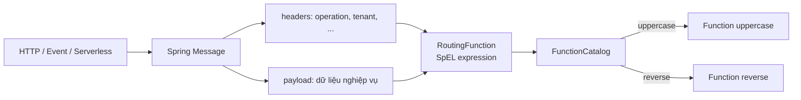

# Truy cập `payload` và `headers` trong biểu thức SpEL

## Mục tiêu học tập

Sau bài học, bạn có thể:

1. Giải thích vì sao `RoutingFunction` đánh giá biểu thức SpEL dựa trên `Message`, và phân biệt `payload` với `headers`.
2. Viết biểu thức truy cập `headers['key']`, `payload`, thuộc tính của đối tượng hoặc phần tử của `Map` đúng với kiểu dữ liệu thực tế.
3. Kết hợp điều kiện trên header và payload để trả về tên hàm nghiệp vụ trong `FunctionCatalog`.
4. Kiểm thử routing bằng `MessageBuilder`, HTTP adapter và các tình huống thiếu header, sai kiểu, lỗi chuyển đổi.
5. Phân biệt `SimpleEvaluationContext` với `StandardEvaluationContext`, đồng thời hạn chế rủi ro khi biểu thức hoặc dữ liệu đến từ nguồn không tin cậy.

## 1. Bối cảnh: dữ liệu và metadata cùng tham gia quyết định định tuyến

Trong **Spring Cloud Function**, logic nghiệp vụ được tổ chức thành `Supplier`, `Function` hoặc `Consumer`, tra cứu qua `FunctionCatalog`. Cùng một hàm có thể được kết nối với HTTP, sự kiện hay môi trường serverless nhờ các adapter; hàm nghiệp vụ không phải biết request đến từ đâu.

Khi hệ thống cần quyết định **hàm nào xử lý từng thông điệp**, Spring Cloud Function cung cấp `RoutingFunction`, có tên mặc định **`functionRouter`**. Ta có thể chọn đích bằng:

- Tên hàm đích trong Message header `spring.cloud.function.definition`.
- Biểu thức SpEL trong `spring.cloud.function.routing-expression`, cho phép đọc dữ liệu và tính toán tên đích.
- `MessageRoutingCallback` khi cần viết quy tắc bằng Java.

Ví dụ, một ứng dụng có hai hàm `uppercase` (in hoa) và `reverse` (đảo ký tự). Yêu cầu có thể gửi header `operation=reverse` hoặc payload chứa thông tin nào đó để quyết định sẽ chạy hàm nào. Thay vì nhét các điều kiện định tuyến vào `uppercase` hay `reverse`, ta giữ hàm nghiệp vụ đơn giản và đặt quyết định ở router.



**Ý chính:** `headers` chứa metadata, còn `payload` chứa dữ liệu nghiệp vụ. SpEL có thể đọc cả hai để tính **tên function definition** mà router sẽ tra cứu. Việc tra cứu và thực thi function là công việc của framework; biểu thức không cần tự gọi hàm nghiệp vụ.

## 2. `Message` là ngữ cảnh của biểu thức

Đối với **imperative message routing**, đầu vào của router là một Spring `Message<?>`. Một message thường có dạng:

```text
Message
├── payload: "hello"
└── headers:
    ├── operation: "reverse"
    ├── requestId: "req-42"
    └── contentType: "text/plain"
```

Trong biểu thức SpEL của `RoutingFunction`, **root object là `Message`**. Ta truy cập các thuộc tính của root object bằng tên:

| Biểu thức | Đọc gì? | Ví dụ kết quả |
| --- | --- | --- |
| `payload` | Toàn bộ payload của message | `hello` |
| `headers` | Tập `MessageHeaders` | Các cặp khóa/giá trị |
| `headers['operation']` | Giá trị header có key `operation` | `reverse` |
| `headers['requestId']` | Metadata truy vết | `req-42` |
| `headers['missing']` | Header chưa được cung cấp | Thường trả về `null` |

Ví dụ biểu thức:

```spel
headers['operation'] == 'reverse' ? 'reverse' : 'uppercase'
```

Giả sử message có `headers['operation'] = 'reverse'`, biểu thức trả về **chuỗi** `reverse`. Router dùng chuỗi đó để chọn bean `reverse` từ `FunctionCatalog`.

### Chú ý về cú pháp SpEL

1. `headers['operation']` là phép truy cập khóa trong đối tượng map-like `MessageHeaders`; tên key phân biệt chữ hoa/chữ thường theo metadata được adapter cung cấp.
2. `'reverse'` và `'uppercase'` là **string literal trong SpEL**. Nếu viết `reverse` không có nháy đơn ở vị trí giá trị trả về, SpEL có thể cố đọc một thuộc tính tên `reverse` thay vì trả về tên bean.
3. `==`, `!=`, `and`/`or` (hoặc `&&`/`||`) và `condition ? a : b` là những phép toán thường dùng để lựa chọn.
4. Biểu thức cần trả về **một tên function definition hợp lệ**, không phải `true`/`false` hay đối tượng payload.

Ví dụ viết `headers['operation'] == 'reverse'` chỉ tạo ra giá trị boolean. Router cần tên đích như `reverse`, vì vậy phải chuyển kết quả điều kiện thành tên bằng toán tử ba ngôi.

## 3. Chuẩn bị hai `Function` nghiệp vụ

Ví dụ dùng Spring Boot và dependency `spring-cloud-starter-function-web` của Spring Cloud Function. Chọn phiên bản tương thích với Spring Boot qua BOM hoặc cấu hình dependency management của dự án:

```xml
<dependency>
    <groupId>org.springframework.cloud</groupId>
    <artifactId>spring-cloud-starter-function-web</artifactId>
</dependency>
```

Tạo hai function thuần Java:

```java
package com.example.spelrouting;

import java.util.Locale;
import java.util.function.Function;
import org.springframework.boot.SpringApplication;
import org.springframework.boot.autoconfigure.SpringBootApplication;
import org.springframework.context.annotation.Bean;

@SpringBootApplication
public class SpelRoutingApplication {
    public static void main(String[] args) {
        SpringApplication.run(SpelRoutingApplication.class, args);
    }

    @Bean
    public Function<String, String> uppercase() {
        return value -> value.toUpperCase(Locale.ROOT);
    }

    @Bean
    public Function<String, String> reverse() {
        return value -> new StringBuilder(value).reverse().toString();
    }
}
```

`FunctionCatalog` đăng ký hai bean theo tên `uppercase` và `reverse`. Chúng chỉ chuyển đổi chuỗi; chúng **không cần đọc metadata định tuyến**.

## 4. Đọc `headers` trong biểu thức

Đầu tiên, chỉ dùng header để xác định đường đi. Cấu hình `application.yml`:

```yaml
spring:
  cloud:
    function:
      definition: functionRouter
      routing-expression: "headers['operation'] == 'reverse' ? 'reverse' : 'uppercase'"
```

Hai property có vai trò khác nhau:

- `definition: functionRouter` chọn router làm function đầu vào của adapter.
- `routing-expression: ...` quy định **cách router xác định function đích** từ `Message`.

Khi ứng dụng web có cấu hình mặc định và điểm vào này được ánh xạ tại `/`, thử:

```bash
# operation=reverse -> reverse
curl -X POST http://localhost:8080/ \
  -H "Content-Type: text/plain" \
  -H "operation: reverse" \
  --data-raw "hello"
# olleh

# operation=uppercase -> uppercase
curl -X POST http://localhost:8080/ \
  -H "Content-Type: text/plain" \
  -H "operation: uppercase" \
  --data-raw "hello"
# HELLO

# Thiếu operation -> nhánh mặc định uppercase
curl -X POST http://localhost:8080/ \
  -H "Content-Type: text/plain" \
  --data-raw "hello"
# HELLO
```

Nếu `functionRouter` được xuất theo tên, có thể dùng đường dẫn `/functionRouter`. URL thực tế phụ thuộc cấu hình web adapter và function filtering.

Trong cả ba yêu cầu, **payload giống nhau** nhưng header `operation` thay đổi, khiến router đưa yêu cầu đến đích khác nhau. Khi thiếu `operation`, biểu thức so sánh giá trị `null` với `'reverse'` cho kết quả sai và chọn nhánh `uppercase`.

### Truy cập nhiều header

Giả sử chỉ chấp nhận `reverse` với yêu cầu thuộc môi trường xem trước:

```spel
(headers['operation'] == 'reverse' and headers['channel'] == 'preview')
    ? 'reverse' : 'uppercase'
```

Biểu thức có thể đặt trên **một dòng** trong YAML:

```yaml
spring:
  cloud:
    function:
      routing-expression: "(headers['operation'] == 'reverse' and headers['channel'] == 'preview') ? 'reverse' : 'uppercase'"
```

Ví dụ chỉ minh họa điều kiện định tuyến. Header do bên gửi đặt có thể bị giả mạo, nên **không dùng `channel` hoặc `tenant` lấy thẳng từ request để thay cho xác thực/phân quyền**. Nếu một nhánh chứa chức năng đặc quyền, quyền được thực thi phải do phía server xác minh.

## 5. Đọc `payload` khi payload có kiểu dữ liệu phù hợp

Với payload thực sự là `String`, ta có thể dùng chính chuỗi đó:

```yaml
spring:
  cloud:
    function:
      definition: functionRouter
      routing-expression: "payload == 'hello' ? 'uppercase' : 'reverse'"
```

| Payload thực sự nhận được | Giá trị SpEL | Function đích |
| --- | --- | --- |
| Chuỗi `hello` | `payload == 'hello'` là `true` | `uppercase` |
| Chuỗi `spring` | `payload == 'hello'` là `false` | `reverse` |
| Chuỗi rỗng `""` | Điều kiện là `false` | `reverse` |

**Điều kiện quan trọng:** ví dụ trên giả sử payload tại thời điểm router đánh giá là Java `String`. Trong thực tế, adapter/binder có thể giao payload dạng `byte[]`, `String`, `Map`, POJO hoặc một kiểu khác tùy `Content-Type` và pipeline chuyển đổi. Nếu payload là `byte[]`, biểu thức so sánh với `'hello'` sẽ không có cùng ý nghĩa. Vì vậy phải kiểm tra **kiểu tại thời điểm routing**, không chỉ nhìn body của HTTP request.

### Payload là `Map`

Nếu adapter đã chuyển payload thành `Map<String, Object>`, ví dụ dữ liệu:

```json
{
  "action": "reverse",
  "text": "hello"
}
```

Ta có thể đọc key trong map:

```spel
payload['action'] == 'reverse' ? 'reverse' : 'uppercase'
```

Nếu đầu vào thực tế vẫn là chuỗi JSON thô hoặc mảng byte, `payload['action']` **không tự động phân tích JSON**. Cần xác định và cấu hình bước chuyển đổi dữ liệu trước khi đánh giá biểu thức, hoặc đưa `action` thành một header nghiệp vụ đã được xử lý rõ ràng.

### Payload là Java bean / POJO

Giả sử payload đã được chuyển thành:

```java
public class TextCommand {
    private String action;
    private String text;

    public String getAction() { return action; }
    public void setAction(String action) { this.action = action; }
    public String getText() { return text; }
    public void setText(String text) { this.text = text; }
}
```

Với đối tượng thật sự là `TextCommand`, SpEL có thể đọc property JavaBean:

```spel
payload.action == 'reverse' ? 'reverse' : 'uppercase'
```

Nhưng nếu payload là `Map`, cú pháp `payload['action']` sẽ rõ nghĩa hơn. Nếu property không tồn tại trên POJO hoặc thiếu quyền truy cập trong evaluation context, biểu thức có thể gây lỗi. Cú pháp phải dựa trên kiểu **được cung cấp tại lúc router chạy**.

### Trường hợp payload thiếu thuộc tính

Khi tên trường tùy chọn, bạn nên xác định fallback ở cấp nghiệp vụ. Với một `Map`, key không tồn tại thường trả về `null`, còn truy cập property không tồn tại trên POJO có thể làm SpEL ném ngoại lệ. Một số trường hợp có thể dùng toán tử điều hướng null-safe của SpEL như `payload?.action` khi đối tượng hợp lệ nhưng `null`; toán tử này **không thay thế việc kiểm tra kiểu hoặc xác nhận property tồn tại**.

## 6. Kết hợp `headers` và `payload` trong cùng biểu thức

Đây là điểm mạnh của `routing-expression`: metadata cung cấp ngữ cảnh, còn payload cung cấp dữ liệu nghiệp vụ.

Giả sử hệ thống xử lý văn bản theo quy tắc:

- Nếu header `operation=reverse` **hoặc** payload `mirror`, chọn `reverse`.
- Các trường hợp khác, chọn `uppercase`.

```yaml
spring:
  cloud:
    function:
      definition: functionRouter
      routing-expression: "(headers['operation'] == 'reverse' or payload == 'mirror') ? 'reverse' : 'uppercase'"
```

Giả sử payload đã là `String`, kết quả:

| Header `operation` | Payload | Đích đã chọn | Kết quả |
| --- | --- | --- | --- |
| `reverse` | `hello` | `reverse` | `olleh` |
| `uppercase` | `mirror` | `reverse` | `rorrim` |
| `uppercase` | `hello` | `uppercase` | `HELLO` |
| Không có | `spring` | `uppercase` | `SPRING` |

Các dấu ngoặc quanh điều kiện giúp tránh nhầm thứ tự ưu tiên của toán tử khi biểu thức trở nên phức tạp. Biểu thức chỉ **trả về tên route**; việc chuyển đổi văn bản vẫn thuộc `Function` được chọn.

Một lời khuyên vận hành là giữ biểu thức ngắn và xác định hành vi khi thiếu header, thiếu trường dữ liệu hoặc kiểu payload khác dự kiến. Nếu luật chọn hàm có nhiều nhánh, phụ thuộc hệ thống khác hoặc cần xác thực, hãy cân nhắc `MessageRoutingCallback` để viết và kiểm thử bằng Java.

## 7. Kiểm thử SpEL bằng `MessageBuilder`

Để tách lỗi truyền HTTP headers khỏi lỗi biểu thức, có thể tạo message trong Java:

```java
import org.springframework.messaging.Message;
import org.springframework.messaging.support.MessageBuilder;

Message<String> message = MessageBuilder.withPayload("mirror")
        .setHeader("operation", "uppercase")
        .setHeader("requestId", "req-42")
        .build();
```

Với biểu thức ở mục 6, message này chọn `reverse` **do điều kiện dựa trên payload**, dù header `operation` là `uppercase`. Khi kiểm thử, hãy xác nhận tên đích kỳ vọng từ biểu thức trước khi kiểm tra kết quả xử lý.

Một cách tra cứu router trong ứng dụng đã inject `FunctionCatalog`:

```java
import java.util.function.Function;
import org.springframework.cloud.function.context.FunctionCatalog;
import org.springframework.cloud.function.context.config.RoutingFunction;
import org.springframework.messaging.Message;

// functionCatalog đã được inject bởi Spring.
Function<Message<?>, ?> router =
        functionCatalog.lookup(RoutingFunction.FUNCTION_NAME);

// Thông tin định tuyến được cấu hình ở application property.
Object result = router.apply(message);
```

Đoạn minh họa trên dùng `Message<String>` đã tạo và giả định router có một `routing-expression` hợp lệ. Kiểu giá trị `result` thực tế có thể là payload hoặc `Message` đã được framework thích nghi tùy function và adapter. Khi xác minh, hãy đối chiếu cả payload, kiểu kết quả và nhánh được gọi.

Nếu muốn thử biểu thức riêng **trong header** thay vì lấy từ application property:

```java
Message<String> request = MessageBuilder.withPayload("hello")
        .setHeader("operation", "reverse")
        .setHeader(
                "spring.cloud.function.routing-expression",
                "headers['operation'] == 'reverse' ? 'reverse' : 'uppercase'")
        .build();
```

Điều kiện ở header sẽ được xem xét khi message đi qua `RoutingFunction`. Cách tiếp cận này hữu ích để minh họa metadata, nhưng trong hệ thống có client công khai, biểu thức thường nên được **quản lý ở cấu hình phía server**.

## 8. Nguồn biểu thức và các evaluation context

`routing-expression` có thể nằm ở application/system property hoặc Message header. Spring Cloud Function sử dụng **hai ngữ cảnh SpEL khác nhau**:

| Nguồn biểu thức | Context | Hệ quả |
| --- | --- | --- |
| Message header `spring.cloud.function.routing-expression` | `SimpleEvaluationContext` | Hạn chế khả năng SpEL vì biểu thức có thể do nguồn gửi cung cấp |
| Application/system property `spring.cloud.function.routing-expression` | `StandardEvaluationContext` | Cung cấp nhiều tính năng SpEL hơn cho cấu hình do ứng dụng kiểm soát |

Các biểu thức cơ bản `headers['operation']`, so sánh chuỗi và toán tử ba ngôi thích hợp cho ví dụ bài học. Một số cú pháp SpEL mạnh hơn như tham chiếu kiểu Java, gọi constructor hoặc gọi phương thức có thể không được phép trong `SimpleEvaluationContext`. Vì vậy không nên mặc nhiên chép biểu thức phức tạp từ cấu hình ứng dụng sang message header mà vẫn mong kết quả giống nhau.

**Hai tầng dữ liệu khác nhau:**

1. **Biểu thức được đánh giá:** mã SpEL do cấu hình hoặc header cung cấp.
2. **Dữ liệu biểu thức đọc:** `Message` hiện tại với payload và headers thực tế.

Ví dụ ứng dụng đặt cố định biểu thức ở property, nhưng `headers['operation']` thay đổi theo từng message. Đó vẫn là **định tuyến động**, ngay cả khi **chuỗi biểu thức không thay đổi**.

### Thứ tự ưu tiên khi có nhiều chỉ dẫn

Với imperative message routing, thứ tự ưu tiên tổng quát là:

1. Bean `MessageRoutingCallback` nếu có.
2. Chỉ dẫn routing trong Message header (`spring.cloud.function.definition` hoặc `spring.cloud.function.routing-expression`).
3. Application/system property routing phù hợp.

Ví dụ property quy định `headers['operation'] == 'reverse' ? 'reverse' : 'uppercase'`, nhưng Message lại chứa header `spring.cloud.function.definition: uppercase`. Khi không có callback chiếm ưu tiên, chỉ dẫn trực tiếp ở Message header có thể được dùng thay cho biểu thức trong property.

Tránh gửi **đồng thời hai header routing khác nhau** với các đích mâu thuẫn. Cần phân biệt `spring.cloud.function.definition=functionRouter` ở tầng chọn điểm vào với `spring.cloud.function.definition=reverse` nằm **trong Message header** để chọn hàm đích.

## 9. Chuyển đổi dữ liệu là điều kiện tiên quyết của truy cập `payload`

`RoutingFunction` chọn tên hàm bằng biểu thức, nhưng biểu thức **không bảo đảm** payload đã được chuyển sang kiểu cần thiết. Adapter quyết định message được tạo từ body/event và quá trình chuyển đổi xảy ra tại các giai đoạn khác nhau tùy môi trường.

| Dữ liệu đầu vào bên ngoài | Kiểu payload có thể gặp tại router | Cách viết SpEL phù hợp sau khi xác nhận kiểu |
| --- | --- | --- |
| HTTP `text/plain` | `String` hoặc `byte[]` tùy pipeline | `payload == 'hello'` chỉ khi thật sự là `String` |
| JSON object | Chuỗi JSON, `byte[]`, `Map` hoặc POJO | `payload['action']` với `Map`; `payload.action` với POJO |
| Event từ Kafka/RabbitMQ | Phụ thuộc binder, content type, converter | Kiểm tra `headers` và kiểu payload trước khi viết expression |
| Serverless event | Phụ thuộc adapter và serializer | Kiểm tra ánh xạ event vào `Message` của adapter |

Một tình huống đáng lưu ý: route sang `Function<Order, Receipt>` thành công, nhưng payload tại router vẫn là bytes. Nếu expression cố truy cập `payload.customer.tier` trước khi converter tạo `Order`, SpEL có thể báo lỗi. Hãy đưa dữ liệu dùng để route vào **header đáng tin cậy**, hoặc chuẩn hóa/chuyển đổi payload trước router bằng thiết kế adapter phù hợp.

Ngược lại, khi route chọn đúng function, framework vẫn có thể cần chuyển payload cho đúng kiểu đầu vào của function đích. **Lỗi routing expression** và **lỗi input conversion của function đích** là hai lớp sự cố khác nhau.

## 10. Giới hạn với reactive function

Trong ví dụ `Function<String, String>`, mỗi message có thể là một đơn vị xử lý độc lập: router đánh giá `headers`/`payload` và chọn đích cho lời gọi đó.

Với reactive function nhận `Flux<T>` hoặc `Publisher<T>`, đơn vị xử lý là **một luồng**. Spring Cloud Function không định tuyến lại theo routing header của từng phần tử bên trong cùng một reactive publisher theo cách của imperative message routing.

Trường hợp cần route **toàn bộ luồng** tới một reactive function, hãy xác định đích bằng application properties và không giả định `payload` của một phần tử là root message được đánh giá cho từng phần tử. Ngược lại, Spring Cloud Stream vẫn có thể xử lý từng event qua router nếu function đích là imperative.

## 11. Bảo mật, tính ổn định và khả năng kiểm soát

Truy cập `headers` và `payload` rất linh hoạt, nhưng cần hiểu các dữ liệu này có thể do client hoặc broker producer gửi:

- **Không tin tên hàm/biểu thức do client tự chọn.** Header `spring.cloud.function.definition` có thể yêu cầu gọi một function trong catalog; header `spring.cloud.function.routing-expression` có thể mang biểu thức SpEL. Cần phân quyền, xác thực và giới hạn tập hàm được phép.
- **Giữ expression ở phía ứng dụng khi có thể.** Client chỉ truyền giá trị nghiệp vụ như `operation=reverse`; server quyết định ánh xạ giá trị đó sang một bean nội bộ. Điều này giúp tránh client biết/tự chọn tên function.
- **Kiểm tra giá trị không hợp lệ.** Một biểu thức trả về mặc định `uppercase` khi `operation` sai có thể phù hợp trong ví dụ demo, nhưng không đúng cho các giao dịch cần từ chối operation không nhận biết.
- **Không sử dụng header tự khai báo làm bằng chứng phân quyền.** Các trường như `tenant`, `role`, `userId` hoặc `admin` cần được xác thực ở phía server, không chỉ so sánh trong SpEL.
- **Có đường xử lý lỗi rõ ràng.** Function đích không tồn tại, SpEL sai cú pháp hoặc conversion lỗi có thể làm request/event thất bại. Thiết kế log, retry, dead-letter queue hoặc xử lý lỗi của adapter theo độ quan trọng của dữ liệu.
- **Đo lường quyết định định tuyến.** Gắn correlation ID, ghi đích được chọn và nguyên nhân lỗi khi cần, tránh log payload hoặc headers chứa thông tin nhạy cảm.

Khi luật định tuyến trở nên phức tạp, `MessageRoutingCallback` giúp viết logic Java có kiểm thử, xác nhận dữ liệu đầu vào và áp dụng allowlist rõ hơn biểu thức SpEL dài.

## 12. Chẩn đoán lỗi thường gặp

| Hiện tượng | Nguyên nhân khả dĩ | Hướng kiểm tra |
| --- | --- | --- |
| Header `operation` thay đổi nhưng đích không đổi | Request không đi vào `functionRouter`, key không được chuyển tiếp, hoặc callback có ưu tiên cao hơn | Kiểm tra adapter, Message headers và thứ tự nguồn định tuyến |
| `payload == 'hello'` không khớp dù body là `hello` | Payload tại router là `byte[]`/kiểu khác | Xác minh kiểu Java thực tế trước khi so sánh |
| `payload['action']` gây lỗi | Payload không phải `Map` hoặc chưa parse JSON | Kiểm tra converter/serializer và dùng cú pháp đúng kiểu |
| `payload.action` gây lỗi | Payload là `Map`, dữ liệu thiếu property hoặc JavaBean không có getter phù hợp | Xem kiểu/thuộc tính của object được đánh giá |
| Header chưa có làm biểu thức chọn nhánh ngoài mong đợi | Giá trị đọc là `null`, nhánh mặc định chưa rõ | Viết ternary có fallback phù hợp và test message thiếu header |
| Biểu thức chạy trong property nhưng lỗi ở header | `StandardEvaluationContext` và `SimpleEvaluationContext` khác khả năng | Đơn giản hóa SpEL, xem tính năng được phép của từng context |
| SpEL trả về `true`/`false` rồi router không tìm được đích | Biểu thức chỉ so sánh, chưa trả về tên hàm | Dùng `? 'reverse' : 'uppercase'` |
| Router chọn được function nhưng function lỗi input | Payload không tương thích chữ ký hàm đích | Kiểm tra `Content-Type`, conversion và thứ tự composition |
| Không route từng phần tử của `Flux` | Reactive function xử lý cả luồng | Định tuyến cấp luồng hoặc dùng imperative event routing |

Khi debug, hãy kiểm tra theo thứ tự **điểm vào của adapter → `Message` thật sự → kiểu payload và headers → kết quả SpEL → tên đích trong catalog → chuyển đổi đầu vào của function**. Cách này giúp không nhầm lỗi expression với lỗi HTTP/binder hoặc lỗi nghiệp vụ.

## 13. Bài tập thực hành

1. Với hai bean `uppercase` và `reverse`, cấu hình router dùng `headers['operation'] == 'reverse' ? 'reverse' : 'uppercase'`. Gửi ba HTTP request: `operation=reverse`, `operation=uppercase`, không có header. Ghi lại kết quả và giải thích nhánh mặc định.
2. Viết `MessageBuilder.withPayload("mirror")` với header `operation=uppercase`. Áp dụng biểu thức kết hợp `headers` và `payload` ở mục 6, xác định function được chọn và kết quả cuối cùng.
3. Thay điều kiện trên header bằng `payload == 'hello'`. Thử với payload `String` rồi giả định payload là `byte[]`; giải thích vì sao cùng dữ liệu hiển thị nhưng kết quả so sánh có thể khác nhau.
4. Với payload `Map` gồm `action` và `text`, viết biểu thức trả về `reverse` khi `action=reverse`. Nêu điều kiện cần có để expression `payload['action']` chạy được.
5. Thử định tuyến theo hai header `operation` và `channel`. Thiết kế fallback rõ ràng khi thiếu `channel`; giải thích tại sao header từ client không đủ cho quyết định phân quyền.
6. So sánh expression đặt trong application property và đặt trong Message header. Nêu sự khác nhau về chủ thể kiểm soát luật định tuyến và evaluation context.
7. Mô tả các bước debug nếu router nhận JSON event, expression `payload.action` báo lỗi, nhưng khi chuyển sang `headers['operation']` lại hoạt động.
8. Thiết kế một chính sách chỉ chấp nhận operation `uppercase` hoặc `reverse`, từ chối mọi operation khác và không cho client đặt tên function trực tiếp. Cho biết khi nào bạn sẽ dùng `MessageRoutingCallback` thay cho SpEL.

## Ghi nhớ

- Trong imperative message routing, **root object của SpEL là `Message`**: `payload` là nội dung, `headers['key']` là metadata.
- `spring.cloud.function.routing-expression` phải **trả về tên function definition**, ví dụ `'reverse'` hoặc `'uppercase|reverse'`; so sánh boolean đơn thuần không đủ.
- Header và payload có thể kết hợp trong điều kiện, nhưng phải biết **kiểu payload thực tế tại router**, đặc biệt khi dùng JSON, `byte[]`, `Map` hoặc POJO.
- Biểu thức trong Message header dùng `SimpleEvaluationContext`; biểu thức do application/system property cung cấp dùng `StandardEvaluationContext`.
- `functionRouter` được chọn ở điểm vào; biểu thức quyết định hàm **đích** trong `FunctionCatalog`. Cùng các bean nghiệp vụ có thể tái sử dụng qua HTTP, sự kiện và serverless khi adapter bảo toàn metadata cần thiết.
- Không tin header bên ngoài để phân quyền; với dữ liệu quan trọng, hãy kiểm soát tập hàm được phép và có cách xử lý lỗi, quan sát, kiểm thử phù hợp.

### Tài liệu tham khảo chính thức

- [Spring Cloud Function — Programming model: Function Routing and Filtering](https://docs.spring.io/spring-cloud-function/reference/spring-cloud-function/programming-model.html)
- [Spring Cloud Function — Standalone Web Applications](https://docs.spring.io/spring-cloud-function/reference/spring-cloud-function/standalone-web-applications.html)
- [Spring Framework — Spring Expression Language (SpEL)](https://docs.spring.io/spring-framework/reference/core/expressions.html)
- [Spring Framework — Integration: Message](https://docs.spring.io/spring-integration/reference/message.html)
