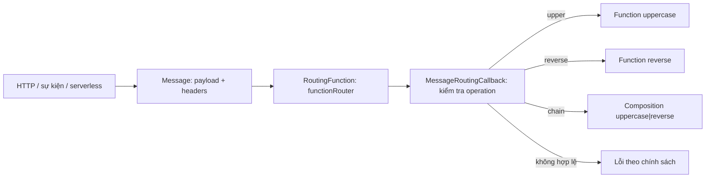

# Tùy chỉnh lựa chọn hàm bằng `MessageRoutingCallback`

## Mục tiêu học tập

Sau bài này, bạn có thể:

1. Giải thích vai trò của `MessageRoutingCallback` trong cơ chế `RoutingFunction` của Spring Cloud Function.
2. Viết một bean `MessageRoutingCallback` để ánh xạ metadata nghiệp vụ sang tên `Function` hoặc composition trong `FunctionCatalog`.
3. Phân biệt callback định tuyến với `Function` nghiệp vụ, Message header `spring.cloud.function.definition` và `spring.cloud.function.routing-expression`.
4. Xử lý giá trị route không hợp lệ, lựa chọn nhánh mặc định và kiểm tra tính tương thích của các hàm đích.
5. Kiểm thử quy tắc chọn đích bằng `MessageBuilder`, quan sát kết quả qua HTTP và giải thích phạm vi áp dụng trong hệ thống sự kiện/serverless.

## 1. Vì sao cần một callback chọn hàm?

**Spring Cloud Function** hỗ trợ khai báo logic nghiệp vụ dưới dạng `Supplier`, `Function` và `Consumer`, sau đó đăng ký, tra cứu và ghép chúng thông qua `FunctionCatalog`. Một hàm có thể được sử dụng lại qua HTTP, luồng sự kiện hoặc môi trường serverless nhờ các adapter mà không phải gắn nghiệp vụ vào giao thức cụ thể.

Khi một điểm vào cần quyết định thực thi hàm nào cho từng thông điệp, Spring Cloud Function cung cấp `RoutingFunction` (tên trong catalog là **`functionRouter`**). Ta có thể chỉ định route bằng header hoặc biểu thức SpEL. Nhưng những cách đó chưa phải lúc nào cũng phù hợp:

- Ứng dụng phải kiểm tra nhiều quy tắc và có nhánh xử lý lỗi rõ ràng.
- Client chỉ được gửi một giá trị nghiệp vụ như `operation=upper`, không được tự chỉ định tên bean nội bộ `uppercase`.
- Danh sách route hợp lệ phải được quản lý tập trung bằng mã Java.
- Quy tắc cần được kiểm thử đơn vị mà không phải khởi chạy HTTP server.

Trong những tình huống này, `MessageRoutingCallback` cho phép **ứng dụng quyết định tên đích bằng Java**, dựa trên `Message<?>` hiện tại.



Callback **không xử lý nghiệp vụ thay `Function`**. Nó trả về tên một definition để `RoutingFunction` tra cứu và gọi qua `FunctionCatalog`.

## 2. `MessageRoutingCallback` là gì?

Giao diện được Spring Cloud Function cung cấp trong package:

```java
import org.springframework.cloud.function.context.MessageRoutingCallback;
```

Về mặt ý tưởng, callback có một phương thức nhận `Message<?>` và trả về tên route:

```java
// Chữ ký trọng tâm của interface:
String routingResult(Message<?> message);
```

Trong đó:

| Thành phần | Ý nghĩa |
| --- | --- |
| `Message<?>` | Thông điệp hiện tại, gồm `payload` và `headers` |
| `routingResult(...)` | Hàm tính toán và trả về tên definition đích |
| Chuỗi trả về `"uppercase"` | Tra cứu function `uppercase` trong `FunctionCatalog` |
| Chuỗi trả về `"uppercase|reverse"` | Tra cứu composition chạy `uppercase` rồi `reverse` |
| `RoutingFunction` | Thành phần sử dụng kết quả callback để chuyển điều khiển |

Đăng ký implementation dưới dạng **Spring bean `MessageRoutingCallback`** để router phát hiện và sử dụng. Đây là hook do framework cung cấp; thông thường không cần tự tạo bean `RoutingFunction`, cũng không cần tự thực thi thao tác `FunctionCatalog.lookup(...)` trong callback.

Một ví dụ tối giản:

```java
@Bean
public MessageRoutingCallback routeByOperation() {
    return message -> {
        Object operation = message.getHeaders().get("operation");
        return "reverse".equals(operation) ? "reverse" : "uppercase";
    };
}
```

Với header `operation=reverse`, callback trả về `reverse`; trường hợp còn lại trả về `uppercase`. Đây là **fallback chủ động**, không phải hành vi tự động của framework. Đối với quy trình yêu cầu kiểm soát chặt, một operation không hợp lệ nên được từ chối thay vì đưa tới hàm mặc định.

## 3. Chuẩn bị ứng dụng mẫu có hai hàm nghiệp vụ

Ví dụ sử dụng Spring Boot và HTTP adapter `spring-cloud-starter-function-web`. Hãy quản lý phiên bản Spring Cloud Function phù hợp với Spring Boot của dự án, thường thông qua BOM hoặc dependency management:

```xml
<dependency>
    <groupId>org.springframework.cloud</groupId>
    <artifactId>spring-cloud-starter-function-web</artifactId>
</dependency>
```

Tạo ứng dụng với hai `Function<String, String>` và callback:

```java
package com.example.callbackrouting;

import java.util.Locale;
import java.util.function.Function;

import org.springframework.boot.SpringApplication;
import org.springframework.boot.autoconfigure.SpringBootApplication;
import org.springframework.cloud.function.context.MessageRoutingCallback;
import org.springframework.context.annotation.Bean;

@SpringBootApplication
public class CallbackRoutingApplication {

    public static void main(String[] args) {
        SpringApplication.run(CallbackRoutingApplication.class, args);
    }

    @Bean
    public Function<String, String> uppercase() {
        return value -> value.toUpperCase(Locale.ROOT);
    }

    @Bean
    public Function<String, String> reverse() {
        return value -> new StringBuilder(value).reverse().toString();
    }

    @Bean
    public MessageRoutingCallback routeByOperation() {
        return message -> {
            Object raw = message.getHeaders().get("operation");
            String operation = raw instanceof String
                    ? ((String) raw).trim().toLowerCase(Locale.ROOT)
                    : "";

            switch (operation) {
                case "upper":
                    return "uppercase";
                case "reverse":
                    return "reverse";
                case "chain":
                    return "uppercase|reverse";
                default:
                    throw new IllegalArgumentException(
                            "operation khong duoc ho tro: " + operation);
            }
        };
    }
}
```

Ứng dụng cố ý sử dụng tên giao thức/nghiệp vụ `upper`, `reverse`, `chain` làm đầu vào, nhưng callback chỉ trả về các definition được cho phép. Bên gửi **không cần biết** bean được đặt tên `uppercase` hay definition composition có cú pháp gì.

Sự phân chia trách nhiệm:

| Thành phần | Trách nhiệm | Có phụ thuộc thông tin định tuyến? |
| --- | --- | --- |
| `uppercase` | Đổi chuỗi sang chữ hoa | Không |
| `reverse` | Đảo ký tự | Không |
| `routeByOperation` | Kiểm tra `operation` và chọn tên definition | Có |
| `functionRouter` | Gọi callback, tra cứu và ủy quyền cho definition đích | Có |
| HTTP/Stream/serverless adapter | Nhận dữ liệu và ánh xạ vào framework | Tùy adapter |

Callback trả về một chuỗi được framework hiểu là **definition**, nên `"uppercase|reverse"` là một lựa chọn hợp lệ nếu hai function có kiểu dữ liệu tương thích. `FunctionCatalog` giải quyết composition; callback không cần tự chạy `uppercase` rồi `reverse`.

## 4. Chọn `functionRouter` làm điểm vào

Ở tầng triển khai, adapter phải thực sự gọi `RoutingFunction` thì callback mới tham gia định tuyến. Với ví dụ HTTP, có thể chọn router làm definition mặc định:

```yaml
# application.yml
spring:
  cloud:
    function:
      definition: functionRouter
```

Property `spring.cloud.function.definition` trong file cấu hình nói với adapter: **hãy gọi `functionRouter` tại điểm vào đã định nghĩa**. Callback sau đó quyết định route đích.

Với Spring Cloud Function Web thông thường, definition mặc định có thể được ánh xạ vào endpoint gốc `/`. Gửi ba request:

```bash
# operation=upper -> uppercase
curl -X POST http://localhost:8080/ \
  -H "Content-Type: text/plain" \
  -H "operation: upper" \
  --data-raw "hello"
# Kết quả dự kiến: HELLO

# operation=reverse -> reverse
curl -X POST http://localhost:8080/ \
  -H "Content-Type: text/plain" \
  -H "operation: reverse" \
  --data-raw "hello"
# Kết quả dự kiến: olleh

# operation=chain -> uppercase|reverse
curl -X POST http://localhost:8080/ \
  -H "Content-Type: text/plain" \
  -H "operation: chain" \
  --data-raw "hello"
# Kết quả dự kiến: OLLEH
```

Cả ba request đi qua **cùng điểm vào** nhưng chọn các definition khác nhau. HTTP adapter chịu trách nhiệm chuyển header `operation` thành metadata của Spring `Message`, còn `MessageRoutingCallback` đọc header đó và trả về tên đích.

Nếu adapter xuất router theo tên, cũng có thể gọi `/functionRouter`; URL thực tế phụ thuộc chức năng web mapping và cấu hình như `spring.cloud.function.web.path`. Trong môi trường không dùng HTTP, không có `curl` nhưng cách callback quyết định đích vẫn cùng nguyên tắc nếu adapter cung cấp `Message`.

### Request có operation không hợp lệ

Ví dụ sau **cố ý thất bại**:

```bash
curl -X POST http://localhost:8080/ \
  -H "Content-Type: text/plain" \
  -H "operation: delete-all" \
  --data-raw "hello"
```

Callback ném `IllegalArgumentException` vì `delete-all` không thuộc danh sách được phép. Việc lỗi này được HTTP adapter chuyển thành status nào, hoặc được message binder xử lý qua retry/error channel ra sao, phụ thuộc cách ứng dụng cấu hình exception handling. Nếu cần trả HTTP 400 với body rõ ràng, phải có cơ chế ánh xạ lỗi tương ứng ở tầng web; **không mặc định** mọi `IllegalArgumentException` đều thành HTTP 400.

## 5. Quy tắc Java có thể đọc cả `headers` lẫn `payload`

`MessageRoutingCallback.routingResult(Message<?> message)` nhận toàn bộ Spring Message, nên ngoài `operation`, callback có thể đọc:

```java
Object payload = message.getPayload();
Object tenant = message.getHeaders().get("tenant");
Object contentType = message.getHeaders().get("contentType");
```

Ví dụ một chính sách chọn theo **cả header và payload dạng chuỗi**:

```java
@Bean
public MessageRoutingCallback routeUsingHeaderAndPayload() {
    return message -> {
        Object raw = message.getHeaders().get("operation");
        Object payload = message.getPayload();

        if ("reverse".equals(raw)) {
            return "reverse";
        }
        if ("upper".equals(raw) && payload instanceof String) {
            return "uppercase";
        }
        throw new IllegalArgumentException("Thong diep khong duoc chap nhan");
    };
}
```

**Chỉ đăng ký một bean callback chủ động cho cùng cấu hình router trong ví dụ.** Đoạn `routeUsingHeaderAndPayload` là một **phương án thay thế** cho `routeByOperation`, không phải bean bổ sung cần khai báo song song trong cùng ứng dụng.

Phần kiểm tra `payload instanceof String` minh họa sự khác biệt giữa nội dung HTTP nhìn thấy và **kiểu Java thực sự được adapter cung cấp tại lúc route**. Với JSON, payload có thể là `byte[]`, `String`, `Map` hoặc POJO tùy quá trình chuyển đổi. Nếu quyết định dựa vào một trường JSON, callback phải kiểm tra đúng kiểu hoặc dựa trên dữ liệu đã được chuẩn hóa trước.

### Ví dụ thực tế: định tuyến sự kiện nghiệp vụ

Một ứng dụng nhận các thông điệp theo loại sự kiện:

| Header `eventType` | Definition đích | Mục đích |
| --- | --- | --- |
| `CUSTOMER_CREATED` | `createCustomerProjection` | Cập nhật mô hình đọc khách hàng |
| `CUSTOMER_UPDATED` | `updateCustomerProjection` | Cập nhật dữ liệu khách hàng |
| `CUSTOMER_DELETED` | `deleteCustomerProjection` | Đánh dấu/xử lý xóa theo chính sách |
| Giá trị khác | Từ chối hoặc gửi lỗi theo chính sách | Tránh âm thầm nhận sự kiện lạ |

Callback có thể thực hiện phép ánh xạ `eventType → tên function`. Cả ba bean xử lý sự kiện nên có kiểu dữ liệu đầu vào tương thích hoặc được thiết kế chuyển đổi thích hợp. Nếu một event không hợp lệ, cần thống nhất xử lý lỗi với message broker/binder để tránh mất sự kiện hoặc lặp vô hạn.

## 6. Thứ tự ưu tiên: callback khác header và SpEL

Khi một `Message` được gửi tới `RoutingFunction`, Spring Cloud Function có thể nhận chỉ dẫn từ nhiều nguồn. Với **imperative routing**, thứ tự ưu tiên tổng quát là:

| Ưu tiên | Nguồn lựa chọn | Ví dụ |
| --- | --- | --- |
| **1 — cao nhất** | Bean `MessageRoutingCallback` | Callback trả về `reverse` |
| 2 | Message header `spring.cloud.function.definition` hoặc `spring.cloud.function.routing-expression` | Client yêu cầu `uppercase` |
| 3 | Application/system property định tuyến phù hợp | `routing-expression: "'uppercase'"` |

Giả sử callback ở mục 3 nhận `operation=reverse`, trong khi request chứa header:

```text
operation: reverse
spring.cloud.function.definition: uppercase
```

Vì **callback có ưu tiên cao hơn chỉ dẫn routing trong Message header**, router chọn `reverse` nếu callback trả về tên `reverse` như mã mẫu. Đây là cơ sở để server tập trung hóa chính sách routing và không chỉ dựa vào tên hàm mà client tự cung cấp.

Tuy nhiên, thứ tự này chỉ có ý nghĩa **khi lời gọi đã đến `RoutingFunction`**. Nếu adapter cho phép client gọi trực tiếp endpoint `/uppercase`, request đó không đi qua callback của router. Để bảo đảm một chính sách “chỉ được chọn các hàm cho phép”, cần kiểm soát luôn các điểm vào mà adapter công bố và quyền truy cập tương ứng.

### So sánh các cách chọn hàm

| Cơ chế | Ai quyết định hàm đích? | Ưu thế | Lưu ý |
| --- | --- | --- | --- |
| `spring.cloud.function.definition` ở tầng adapter | Cấu hình triển khai | Cố định function đầu vào đơn giản | Có thể gọi trực tiếp, không đi qua router |
| Header `spring.cloud.function.definition` | Bên gửi message | Dễ route theo tên từng message | Cần kiểm soát tên đích client được phép yêu cầu |
| `spring.cloud.function.routing-expression` | Biểu thức SpEL từ config/header | Điều kiện trên `headers` và `payload` ngắn gọn | Phân biệt evaluation context, tránh expression phức tạp |
| `MessageRoutingCallback` | Java code do ứng dụng cung cấp | Validation, allowlist, kiểm thử, xử lý nhánh rõ ràng | Cần quản lý lỗi và tránh logic nghiệp vụ quá lớn ở callback |

Khi chỉ có một điều kiện ngắn, SpEL có thể đơn giản hơn. Khi yêu cầu nhiều bước kiểm tra, mapping, logging, cấu hình whitelist hoặc kiểm thử nghiệp vụ, Java callback thường rõ ràng hơn.

## 7. Kiểm thử riêng callback mà không cần HTTP

Một lợi thế thực tế là `MessageRoutingCallback` nhận `Message<?>` và trả về một `String`. Ta có thể tạo message và kiểm thử kết quả của **quy tắc chọn đích** một cách độc lập.

Ví dụ với JUnit Jupiter:

```java
import static org.junit.jupiter.api.Assertions.assertEquals;
import static org.junit.jupiter.api.Assertions.assertThrows;

import org.junit.jupiter.api.Test;
import org.springframework.cloud.function.context.MessageRoutingCallback;
import org.springframework.messaging.Message;
import org.springframework.messaging.support.MessageBuilder;

class CallbackPolicyTest {

    private final MessageRoutingCallback routing =
            new CallbackRoutingApplication().routeByOperation();

    @Test
    void routesToReverse() {
        Message<String> message = MessageBuilder.withPayload("hello")
                .setHeader("operation", "reverse")
                .build();

        assertEquals("reverse", routing.routingResult(message));
    }

    @Test
    void routesToComposition() {
        Message<String> message = MessageBuilder.withPayload("hello")
                .setHeader("operation", "chain")
                .build();

        assertEquals("uppercase|reverse", routing.routingResult(message));
    }

    @Test
    void rejectsUnknownOperation() {
        Message<String> message = MessageBuilder.withPayload("hello")
                .setHeader("operation", "unknown")
                .build();

        assertThrows(IllegalArgumentException.class,
                () -> routing.routingResult(message));
    }
}
```

Đây là **unit test của callback**, kiểm tra chính xác chuỗi tên đích được trả về và nhánh lỗi. Nó chưa chứng minh `FunctionCatalog` tìm được function, payload chuyển đổi đúng hay HTTP/binder phản hồi đúng. Để kiểm tra các lớp đó, cần thêm một thử nghiệm tích hợp với adapter và function thực tế.

### Thử trực tiếp `FunctionCatalog`

Trong một thành phần Spring đã được inject `FunctionCatalog`, có thể tra cứu router:

```java
import java.util.function.Function;
import org.springframework.cloud.function.context.FunctionCatalog;
import org.springframework.cloud.function.context.config.RoutingFunction;
import org.springframework.messaging.Message;
import org.springframework.messaging.support.MessageBuilder;

// functionCatalog được inject từ ApplicationContext.
Function<Message<?>, ?> router =
        functionCatalog.lookup(RoutingFunction.FUNCTION_NAME);

Message<String> request = MessageBuilder.withPayload("hello")
        .setHeader("operation", "reverse")
        .build();

Object result = router.apply(request);
```

Khi dùng router ở cấp framework, `routingResult` giúp chọn function, rồi `RoutingFunction` dùng `FunctionCatalog` để gọi hàm đích. Kiểu dữ liệu của `result` phụ thuộc function và cơ chế thích nghi message; vì vậy trong bài thử tích hợp cần kiểm tra cả **function đã chọn, payload kết quả, kiểu trả về và ngoại lệ**.

## 8. Quyết định chính sách cho các trường hợp biên

Một callback sản xuất cần hành vi xác định cho các tình huống thường gặp:

| Tình huống | Cách xử lý khả dĩ | Lưu ý |
| --- | --- | --- |
| Thiếu header `operation` | Từ chối hoặc dùng một default **được quy định rõ** | Không âm thầm route sai chức năng |
| Header có khoảng trắng/chữ hoa | Chuẩn hóa `trim()` và `toLowerCase(Locale.ROOT)` nếu giao thức cho phép | Quy định tập giá trị hợp lệ |
| Giá trị `operation` không phải chuỗi | Từ chối hoặc chuyển đổi có kiểm soát | Không ép kiểu vô điều kiện |
| Tên definition trả về không tồn tại | Phát sinh lỗi; phát hiện sớm qua test/khởi động | `FunctionCatalog` không tự tạo bean |
| Composition có kiểu không tương thích | Thất bại khi xây dựng/thực thi pipeline | Kiểm tra input/output từng hàm |
| Payload/Content-Type không đúng | Hàm đích hoặc converter có thể báo lỗi | Tách lỗi route khỏi lỗi dữ liệu |
| Callback cần I/O mạng hoặc truy vấn dài | Cân nhắc chuyển dữ liệu cần thiết sang bước chuẩn hóa trước router | Tránh đặt thao tác chậm/blocking trong đường định tuyến |

Đặc biệt, đừng cho callback trả về tên bất kỳ do client đưa vào mà không kiểm tra. Việc đó chỉ **đổi nơi truyền tên hàm** từ header sang callback, không thực sự tạo chính sách bảo vệ.

### Callback bị lỗi thì sao?

Nếu callback ném ngoại lệ, kết quả sẽ phụ thuộc adapter và cấu hình xử lý lỗi. Trong HTTP, cần chủ động cấu hình cách ánh xạ lỗi nếu muốn mã trạng thái cụ thể; trong hệ thống sự kiện, cần xem retry, dead-letter topic/queue hoặc error channel của binder.

Nếu callback trả về một definition không có trong catalog, router có thể không tra cứu được hàm đích. Framework có một cơ chế mở rộng `DefaultMessageRoutingHandler` cho một số tình huống route thất bại; không nên mặc định bỏ qua sự kiện quan trọng khi route sai. Với dữ liệu giao dịch, nên ghi log nguyên nhân và có cách xử lý/đưa message vào luồng lỗi phù hợp.

## 9. `MessageRoutingCallback` trong HTTP, Stream và serverless

Ưu thế của callback là **không phụ thuộc phương tiện vận chuyển**, nhưng dữ liệu nó nhận được chịu ảnh hưởng của adapter.

| Môi trường | Điểm vào | Điều cần xác nhận |
| --- | --- | --- |
| Spring Cloud Function Web | `/functionRouter` hoặc route mặc định của adapter | Header HTTP `operation` được chuyển thành Spring Message header |
| Spring Cloud Stream | Binding đầu vào router, thường `functionRouter-in-0` | Binder chuyển metadata sự kiện vào headers và cách cấu hình destination |
| Serverless adapter | Handler/adapter đưa event vào `functionRouter` | Cách event/metadata được ánh xạ thành `Message`; mỗi nền tảng có quy ước riêng |
| Java nội bộ | `FunctionCatalog.lookup(RoutingFunction.FUNCTION_NAME)` | Lời gọi truyền `Message` có header nghiệp vụ phù hợp |

Trong Spring Cloud Stream, event routing thường dùng `spring.cloud.stream.function.routing.enabled=true`. Chỉ viết bean `MessageRoutingCallback` không có nghĩa mọi luồng sự kiện đã được nối đến router: vẫn cần binding đúng và route đầu vào phù hợp.

### Giới hạn với reactive function

Ví dụ `Function<String, String>` là **imperative**; mỗi `Message` được xử lý độc lập, nên callback có thể quyết định đích theo headers/payload của từng message.

Với reactive function nhận `Flux<T>` hoặc `Publisher<T>`, đơn vị xử lý là **cả luồng**, không phải một message riêng lẻ. Không dùng callback/header như ví dụ trên để đổi function cho từng phần tử của một reactive stream. Khi cần route toàn luồng tới một reactive function, cấu hình đích ở **application properties** theo quy tắc của reactive routing; nếu cần route từng event, cân nhắc thiết kế imperative event routing.

## 10. Những điểm cần cân nhắc trong hệ thống thực tế

**Kiểm soát truy cập.** Callback có thể đóng vai trò ánh xạ từ operation bên ngoài tới tập function nội bộ. Tuy nhiên, nó không thay thế xác thực/phân quyền. Nếu adapter còn xuất trực tiếp các function endpoint, client có thể truy cập một đường đi khác, nên phải kiểm soát điểm vào và quyền thực thi ở tầng thích hợp.

**Không coi header client là dữ liệu tin cậy.** Những thông tin như `role`, `tenant`, `isAdmin` do bên gửi tự khai báo phải được xác minh. Callback không nên dùng header tùy ý như bằng chứng để gọi function nhạy cảm.

**Giữ callback nhỏ.** Callback nên tập trung vào việc **xác định tên definition**. Các phép biến đổi, kiểm tra nghiệp vụ sâu, ghi database hoặc tương tác hệ thống ngoài nên nằm trong thành phần có trách nhiệm rõ ràng. Điều này giúp dễ test, truy vết và dự đoán độ trễ.

**Quan sát được quyết định.** Ghi operation đã chuẩn hóa, tên route được chọn, correlation ID và loại lỗi (nếu có) là hữu ích cho vận hành. Tránh ghi toàn bộ payload hoặc các headers nhạy cảm.

**Khả năng bảo trì.** Với nhiều nhánh route, cân nhắc tách chính sách thành lớp riêng, dùng một tập enum hoặc bảng ánh xạ rõ ràng và kiểm thử tất cả operation. Cẩn trọng khi trả về composition có input/output không tương thích.

## 11. Chẩn đoán lỗi thường gặp

| Triệu chứng | Nguyên nhân có thể | Hướng kiểm tra |
| --- | --- | --- |
| Callback không được gọi | Request đi thẳng vào một hàm, không qua `functionRouter` | Kiểm tra function được adapter chọn và endpoint |
| Header `operation` đọc ra `null` | Adapter không chuyển header hoặc sai tên key | Kiểm tra Message headers thực tế và cách binder/adapter hoạt động |
| Callback trả về `reverse` nhưng kết quả không đúng | Hàm đích lỗi hoặc payload/chữ ký không khớp | Kiểm tra catalog, kiểu dữ liệu và converter |
| Có header `spring.cloud.function.definition` nhưng vẫn theo callback | Callback có ưu tiên cao hơn | Kiểm tra quy tắc `routingResult` và thứ tự ưu tiên |
| Một operation lạ được xử lý bằng hàm mặc định | Callback có fallback quá rộng | Dùng allowlist/từ chối rõ ràng theo nghiệp vụ |
| Chạy được ở HTTP nhưng không ở Stream | Binding chưa nối vào router hoặc binder không cung cấp cùng headers | Kiểm tra `functionRouter-in-0`, metadata và destination |
| Route tới composition thất bại | Tên definition hoặc kiểu giữa các hàm không tương thích | Thử composition độc lập từ `FunctionCatalog` |
| Reactive stream không đổi hàm theo từng event | Reactive routing xử lý ở cấp luồng | Chuyển routing sang cấp toàn luồng hoặc tổ chức imperative |

Khi debug, hãy kiểm tra theo thứ tự: **adapter có gọi router? callback có được Spring đăng ký? `Message` có header cần thiết? callback trả về tên gì? `FunctionCatalog` có tìm được definition và function có xử lý được payload?**

## 12. Bài tập thực hành

1. Tạo hai bean `uppercase`, `reverse` và một `MessageRoutingCallback` như mục 3. Gửi `operation=upper` và `operation=reverse` tới cùng endpoint router; giải thích vì sao URL không đổi nhưng kết quả khác nhau.
2. Thêm `operation=chain` trả về `uppercase|reverse`. Với payload `hello`, giải thích thứ tự thực thi và kết quả `OLLEH`.
3. Gửi message có `operation=reverse` nhưng cũng có header `spring.cloud.function.definition: uppercase`. Trình bày thứ tự ưu tiên và dự đoán hàm được chọn.
4. Thử thiếu `operation`, giá trị không hợp lệ và header không phải chuỗi. So sánh chiến lược **fallback** với chiến lược **từ chối**, rồi chọn cách phù hợp cho một giao dịch thanh toán.
5. Viết unit test với `MessageBuilder` cho các route `upper`, `reverse`, `chain` và `unknown`. Xác định điều gì đã được kiểm tra trong callback và điều gì vẫn cần integration test.
6. Thử gọi trực tiếp endpoint `/uppercase` khi router cũng được đăng ký. Giải thích lý do callback không thể tự mình chặn những đường gọi không đi qua router.
7. Phác thảo một `MessageRoutingCallback` cho các event `CUSTOMER_CREATED`, `CUSTOMER_UPDATED`, `CUSTOMER_DELETED`. Quy định cách xử lý event lạ và lỗi message broker.
8. So sánh ba cách route: header `spring.cloud.function.definition`, property SpEL `spring.cloud.function.routing-expression` và Java callback. Nêu tình huống cụ thể bạn chọn từng cách.

## Ghi nhớ

- `MessageRoutingCallback` là **điểm mở rộng bằng Java** để `RoutingFunction` quyết định tên function definition theo `Message` hiện tại.
- Callback nhận `Message<?>` và trả về chuỗi như `uppercase`, `reverse` hoặc `uppercase|reverse`; `FunctionCatalog` chịu trách nhiệm tra cứu và composition.
- Với imperative routing, **callback có ưu tiên cao hơn message routing header và application properties**.
- Callback chỉ hoạt động khi điểm vào thực sự là `functionRouter`; adapter và policy truy cập phải được cấu hình phù hợp.
- Kiểm tra operation, allowlist, dữ liệu thiếu/sai kiểu và hành vi khi route thất bại. Không dùng metadata do client tự khai báo để thay thế xác thực/phân quyền.
- Quy tắc Java được kiểm thử độc lập và các `Function` nghiệp vụ được tái sử dụng qua HTTP, sự kiện hoặc serverless; cần kiểm tra mapping `Message` của từng adapter.

### Tài liệu tham khảo chính thức

- [Spring Cloud Function — Function Routing and Filtering](https://docs.spring.io/spring-cloud-function/reference/spring-cloud-function/programming-model.html)
- [Spring Cloud Function — Standalone Web Applications](https://docs.spring.io/spring-cloud-function/reference/spring-cloud-function/standalone-web-applications.html)
- [Spring Cloud Stream — Event Routing](https://docs.spring.io/spring-cloud-stream/reference/spring-cloud-stream/event-routing.html)
