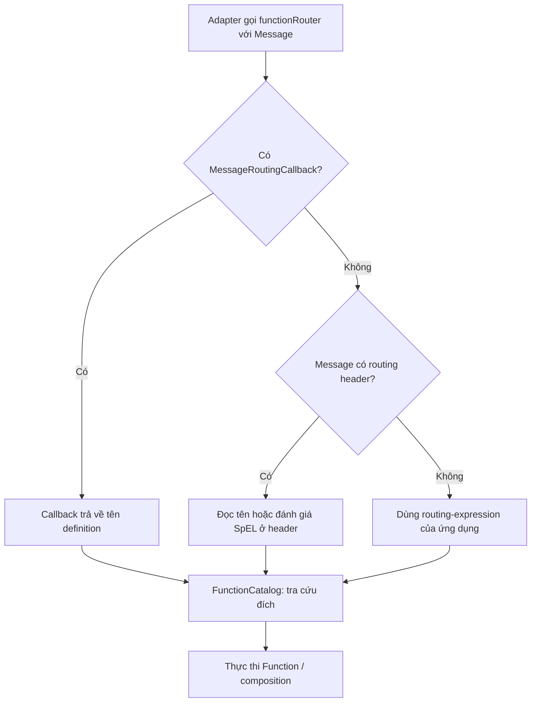

# Thứ tự ưu tiên callback, header và thuộc tính ứng dụng

## Mục tiêu học tập

Sau bài này, bạn có thể:

1. Mô tả thứ tự ưu tiên mà `RoutingFunction` sử dụng khi cùng một `Message` có nhiều nguồn chỉ dẫn chọn hàm.
2. Phân biệt `MessageRoutingCallback`, routing header và application property; giải thích vì sao `spring.cloud.function.definition` có hai vai trò ở hai tầng.
3. Dự đoán function đích cho các tình huống xung đột giữa callback, Message header và `spring.cloud.function.routing-expression`.
4. Xây dựng ứng dụng Spring Cloud Function có thể bật/tắt callback theo profile, quan sát độ ưu tiên qua HTTP và `FunctionCatalog`.
5. Xử lý tình huống thiếu route, route sai, phản hồi lỗi và nguồn header không tin cậy; hiểu giới hạn của reactive routing.

## 1. Bối cảnh: nhiều nguồn đều muốn chọn hàm

Trong **Spring Cloud Function**, nghiệp vụ có thể viết thành `Supplier`, `Function` và `Consumer` độc lập với giao thức. `FunctionCatalog` đăng ký các bean này theo tên, hỗ trợ composition; adapter kết nối cùng logic với HTTP, sự kiện hoặc nền tảng serverless.

Khi muốn **một điểm vào nhưng nhiều cách xử lý**, ứng dụng gọi `RoutingFunction` — được đăng ký với tên **`functionRouter`**. Router cần biết function đích, chẳng hạn `uppercase` hoặc `reverse`.

Thông tin chọn đích có thể đến từ **ba nguồn**:

1. Một bean Java `MessageRoutingCallback` chủ động tính tên hàm.
2. Message header `spring.cloud.function.definition` hoặc `spring.cloud.function.routing-expression` do nguồn gửi/adapter cung cấp.
3. Thuộc tính cấu hình ứng dụng `spring.cloud.function.routing-expression`.

Ba nguồn này có thể **đồng thời xuất hiện và mâu thuẫn**. Chẳng hạn:

- Ứng dụng có route mặc định là `uppercase`.
- Request gửi header yêu cầu `reverse`.
- Callback Java căn cứ vào header nghiệp vụ `operation=upper` và trả về `uppercase`.

Router không được chọn tùy tiện một trong các giá trị. Spring Cloud Function đặt ra thứ tự ưu tiên rõ ràng cho **imperative message routing**, giúp việc chọn đích có thể dự đoán.

## 2. Thứ tự ưu tiên chính thức

Đối với `RoutingFunction` xử lý các **imperative function**, thứ tự từ cao đến thấp là:

| Ưu tiên | Nguồn chỉ dẫn | Ví dụ | Kết quả khi có nguồn ưu tiên thấp hơn |
| --- | --- | --- | --- |
| **1 — cao nhất** | Bean `MessageRoutingCallback` | `routingResult(message)` trả về `reverse` | Callback quyết định đích |
| **2** | `Message` header định tuyến | `spring.cloud.function.definition: uppercase` hoặc `spring.cloud.function.routing-expression: ...` | Header được xét trước property |
| **3 — thấp nhất** | Application/system property định tuyến | `spring.cloud.function.routing-expression: "'uppercase'"` | Được dùng khi không có chỉ dẫn ưu tiên cao hơn |

Quy tắc ghi nhớ:

```text
MessageRoutingCallback
          ↓ nếu không áp dụng
Message routing headers
          ↓ nếu không có
Application routing properties
```

**Lưu ý về cách đọc bảng:** đây là **thứ tự quyết định đích bên trong `RoutingFunction`**, không phải thứ tự Spring Boot nạp file cấu hình, profile, biến môi trường hoặc tham số dòng lệnh. Những nguồn cấu hình đó được Spring `Environment` kết hợp thành một property trước khi router sử dụng.



Nếu callback **ném ngoại lệ** hoặc một nguồn ưu tiên cao trả về **tên function không tồn tại**, đó là lỗi cần xử lý. Không nên giả định router sẽ tự bỏ qua lỗi để thử lại các nguồn thấp hơn như cơ chế dự phòng. Muốn có fallback, hãy thiết kế quy tắc trả về một đích hợp lệ hoặc chính sách xử lý lỗi tường minh.

## 3. Phân biệt hai vai trò của `spring.cloud.function.definition`

Đây là điểm rất dễ nhầm khi phân tích ưu tiên.

| Cùng tên `spring.cloud.function.definition` nhưng ở đâu? | Thuộc lớp nào? | Ý nghĩa |
| --- | --- | --- |
| Trong `application.yml`, `application.properties` hoặc biến môi trường | **Adapter/triển khai** | Chọn definition được đưa ra điểm vào, ví dụ `functionRouter` |
| Trong **Message header** gửi đến `functionRouter` | **Định tuyến bên trong router** | Chọn đích cho message đó, ví dụ `reverse` |

Ví dụ:

```yaml
spring:
  cloud:
    function:
      definition: functionRouter
      routing-expression: "'uppercase'"
```

Khi một request đi vào router với Message header:

```text
spring.cloud.function.definition: reverse
```

thì:

- Property `definition: functionRouter` **chọn router làm điểm vào**.
- Message header `definition: reverse` **chọn hàm nghiệp vụ đích**.
- Property `routing-expression: "'uppercase'"` là **quy tắc định tuyến mặc định** và có ưu tiên thấp hơn Message header.

Khi không có callback, request này được định tuyến đến `reverse`. Sự xuất hiện của cùng một tên property/header **không có nghĩa** rằng hai tầng đang trực tiếp ghi đè lẫn nhau.

Ngược lại, nếu application property là `spring.cloud.function.definition=uppercase` và adapter gọi trực tiếp `uppercase`, lời gọi **không đi qua `functionRouter`** nên thứ tự ưu tiên routing của bài này không áp dụng.

## 4. Hai loại routing header ở cùng cấp ưu tiên

Router có thể nhận một trong hai loại chỉ dẫn trong `Message`:

| Header | Giá trị mẫu | Ý nghĩa |
| --- | --- | --- |
| `spring.cloud.function.definition` | `reverse` | Chọn một function definition trực tiếp |
| `spring.cloud.function.definition` | `uppercase|reverse` | Chọn một composition từ `FunctionCatalog` |
| `spring.cloud.function.routing-expression` | `headers['operation'] == 'reverse' ? 'reverse' : 'uppercase'` | Đánh giá SpEL để tính tên definition |

Hai header này cùng thuộc **tầng Message headers** trong bảng ưu tiên. Bảng callback → header → property **không phải một cam kết** về thứ tự giải quyết khi **cả hai routing header** cùng tồn tại nhưng chỉ tới các đích khác nhau.

Vì vậy, hãy thống nhất **một cơ chế chỉ dẫn router cho mỗi message**. Nếu client có thể gửi đồng thời hai header, nên chuẩn hóa/xóa bớt header tại gateway hoặc adapter theo chính sách đã định, thay vì dựa vào hành vi xung đột.

Biểu thức trong `spring.cloud.function.routing-expression` được đánh giá bằng SpEL; `spring.cloud.function.definition` chứa **tên definition**, không phải biểu thức SpEL. Vì vậy:

```text
spring.cloud.function.definition: uppercase
spring.cloud.function.routing-expression: 'uppercase'
```

Hai giá trị đều có thể đưa đến `uppercase`, nhưng **khác cú pháp**: giá trị thứ hai chứa cặp nháy đơn của string literal SpEL.

## 5. Ứng dụng mẫu để quan sát độ ưu tiên

Ứng dụng dưới đây đăng ký hai `Function<String, String>` và một callback có thể **bật bằng Spring profile**. Ta sẽ dùng cùng đoạn code để quan sát cả ba mức ưu tiên.

Dependency HTTP adapter:

```xml
<dependency>
    <groupId>org.springframework.cloud</groupId>
    <artifactId>spring-cloud-starter-function-web</artifactId>
</dependency>
```

Chọn phiên bản Spring Cloud Function tương thích với Spring Boot của dự án; nên quản lý qua BOM hoặc cơ chế dependency management.

```java
package com.example.routingpriority;

import java.util.Locale;
import java.util.function.Function;

import org.springframework.boot.SpringApplication;
import org.springframework.boot.autoconfigure.SpringBootApplication;
import org.springframework.cloud.function.context.MessageRoutingCallback;
import org.springframework.context.annotation.Bean;
import org.springframework.context.annotation.Profile;

@SpringBootApplication
public class RoutingPriorityApplication {

    public static void main(String[] args) {
        SpringApplication.run(RoutingPriorityApplication.class, args);
    }

    @Bean
    public Function<String, String> uppercase() {
        return text -> text.toUpperCase(Locale.ROOT);
    }

    @Bean
    public Function<String, String> reverse() {
        return text -> new StringBuilder(text).reverse().toString();
    }

    // Chỉ xuất hiện khi bật profile "with-callback".
    @Bean
    @Profile("with-callback")
    public MessageRoutingCallback routeByOperation() {
        return message -> {
            Object raw = message.getHeaders().get("operation");

            if ("upper".equals(raw)) {
                return "uppercase";
            }
            if ("reverse".equals(raw)) {
                return "reverse";
            }

            throw new IllegalArgumentException(
                    "operation phai la upper hoac reverse");
        };
    }
}
```

Ba đặc điểm cần quan sát:

1. Cả `uppercase` và `reverse` là logic Java độc lập, không đọc routing header.
2. `MessageRoutingCallback` nhận `Message<?>`, đọc **header nghiệp vụ** `operation` và trả về **tên bean/definition** mà router cần gọi.
3. Profile `with-callback` giúp kiểm tra lúc **có** hoặc **không có** bean callback. Để kết quả dễ đọc, ví dụ dùng chuỗi `hello` với `Content-Type: text/plain`.

### Cấu hình application property mặc định

```yaml
# application.yml
spring:
  cloud:
    function:
      definition: functionRouter
      routing-expression: "'uppercase'"
```

Biểu thức SpEL `'uppercase'` trả về một chuỗi cố định `uppercase`. Cặp nháy kép ngoài cùng trong YAML dùng để bảo toàn **dấu nháy đơn** của literal SpEL.

Nếu không có callback hoặc routing header, router sẽ chọn `uppercase`. Trong ví dụ này, `spring.cloud.function.definition=functionRouter` chỉ định **điểm vào** của HTTP adapter.

## 6. Kiểm nghiệm từng mức ưu tiên qua HTTP

Với Spring Cloud Function Web ở cấu hình mặc định, khi adapter chọn một definition chính, có thể gọi qua đường dẫn gốc `/`. Nếu ứng dụng cấu hình path/filter khác, hãy dùng URL thực tế được adapter xuất.

### Tình huống A: chỉ có application property

Khởi động **không bật** profile `with-callback`, và gửi request **không có routing header**:

```bash
curl -X POST http://localhost:8080/ \
  -H "Content-Type: text/plain" \
  --data-raw "hello"
# Kết quả dự kiến: HELLO
```

Router không tìm thấy callback và message không đưa thêm routing header nên dùng `spring.cloud.function.routing-expression="'uppercase'"` trong cấu hình.

### Tình huống B: Message header ghi đè application property

Vẫn **không bật** profile callback, thêm routing header:

```bash
curl -X POST http://localhost:8080/ \
  -H "Content-Type: text/plain" \
  -H "spring.cloud.function.definition: reverse" \
  --data-raw "hello"
# Kết quả dự kiến: olleh
```

Dù cấu hình mặc định trỏ đến `uppercase`, Message header có mức ưu tiên **2** cao hơn application property mức **3**, nên function đích là `reverse`.

### Tình huống C: callback ghi đè header và property

Bật profile `with-callback` (ví dụ thêm tham số `--spring.profiles.active=with-callback` khi khởi động), rồi gọi:

```bash
curl -X POST http://localhost:8080/ \
  -H "Content-Type: text/plain" \
  -H "operation: upper" \
  -H "spring.cloud.function.definition: reverse" \
  --data-raw "hello"
# Kết quả dự kiến: HELLO
```

Ở đây ba nguồn có thể cho các lựa chọn sau:

| Nguồn | Lựa chọn |
| --- | --- |
| Callback (đọc `operation: upper`) | `uppercase` |
| Message routing header | `reverse` |
| Application routing expression | `uppercase` |

Callback có ưu tiên cao nhất nên route kết thúc ở `uppercase`, dù Message header yêu cầu `reverse`.

Thử thêm một trường hợp để tách callback khỏi property:

```bash
curl -X POST http://localhost:8080/ \
  -H "Content-Type: text/plain" \
  -H "operation: reverse" \
  -H "spring.cloud.function.definition: uppercase" \
  --data-raw "hello"
# Kết quả dự kiến: olleh
```

Lúc này callback trả về `reverse`, còn header và property đều chỉ `uppercase`. Router vẫn gọi `reverse` nhờ mức ưu tiên **1**.

### Tình huống D: callback ném ngoại lệ

Khi profile `with-callback` đang bật, gửi request thiếu `operation`:

```bash
curl -X POST http://localhost:8080/ \
  -H "Content-Type: text/plain" \
  -H "spring.cloud.function.definition: reverse" \
  --data-raw "hello"
```

Callback trong ví dụ không chấp nhận `operation` rỗng và ném `IllegalArgumentException`. **Không nên kỳ vọng router tự chuyển sang `reverse` từ header hoặc `uppercase` từ property.** Ứng dụng phải có chính sách xử lý lỗi; status HTTP hay cơ chế retry ở binder phụ thuộc adapter/cấu hình thực tế.

## 7. Bảng tình huống dự đoán function đích

Trong bảng dưới đây, mặc định application routing expression là `'uppercase'`, và callback (nếu có) dùng đúng logic `routeByOperation` ở mục 5:

| Có callback? | Header `operation` | Routing header trong Message | Kết quả |
| --- | --- | --- | --- |
| Không | — | Không có | `uppercase` từ property |
| Không | — | `definition: reverse` | `reverse` từ header |
| Không | `reverse` | Không có | `uppercase` từ property: header nghiệp vụ một mình không tự có quyền định tuyến |
| Có | `upper` | Không có | `uppercase` từ callback |
| Có | `upper` | `definition: reverse` | `uppercase` từ callback |
| Có | `reverse` | `definition: uppercase` | `reverse` từ callback |
| Có | Thiếu | `definition: reverse` | Callback ném ngoại lệ; không mặc định rơi xuống header |
| Không | — | `definition: uppercase|reverse` | Composition `uppercase|reverse` |

Một điểm đặc biệt quan trọng: header nghiệp vụ `operation` **không tự có độ ưu tiên routing**. Nó chỉ có tác dụng khi **callback hoặc routing expression được cấu hình** đọc header này rồi chuyển thành tên function. Vì vậy, trong trường hợp không có callback và property chỉ trả về chuỗi hằng `'uppercase'`, gửi `operation: reverse` không đổi route.

## 8. Message header so với routing expression trong property

Nếu không có callback, router có thể dùng Message routing header trước application property. Property không nhất thiết chỉ chứa một tên cố định; nó cũng có thể là **biểu thức động**:

```yaml
spring:
  cloud:
    function:
      definition: functionRouter
      routing-expression: "headers['operation'] == 'reverse' ? 'reverse' : 'uppercase'"
```

Giờ đây, dù **chuỗi biểu thức trong file cấu hình không đổi**, hai message có headers khác nhau vẫn có thể được định tuyến tới hai hàm đích khác nhau. Về mức ưu tiên, đây vẫn là **application property** vì biểu thức nằm trong cấu hình.

Nếu một Message gửi header `spring.cloud.function.definition: reverse`, header này thuộc mức **2**, được ưu tiên so với property SpEL mức **3**, trừ khi có callback mức **1**.

### Khi biểu thức nằm trong Message header

Ví dụ:

```text
spring.cloud.function.routing-expression: headers['operation'] == 'reverse' ? 'reverse' : 'uppercase'
```

Khi gửi đến router, biểu thức có thể được đánh giá trên `Message` để tính tên đích. Chỉ dẫn này cũng thuộc mức ưu tiên **2**, vì nguồn của nó là **Message header**, không phải application property.

Spring Cloud Function dùng `SimpleEvaluationContext` cho routing expression từ Message header và `StandardEvaluationContext` cho expression từ application/system property. `SimpleEvaluationContext` hạn chế một số khả năng SpEL, vì message có thể do hệ thống ngoài cung cấp. Vì vậy, biểu thức phức tạp hoạt động trong application property chưa chắc hoạt động nếu được đưa nguyên văn vào header.

Đối với client công khai, nên để **ứng dụng sở hữu biểu thức**, còn client chỉ gửi dữ liệu nghiệp vụ đơn giản như `operation=reverse`. Điều này giúp quy tắc routing có thể kiểm tra bằng code review và hạn chế việc nguồn ngoài tự quyết định luật thực thi.

## 9. Thực thi qua `FunctionCatalog`: điểm vào và đích là hai bước

Trong Spring Cloud Function, `FunctionCatalog` có thể tra cứu router bằng tên mặc định:

```java
import java.util.function.Function;
import org.springframework.cloud.function.context.FunctionCatalog;
import org.springframework.cloud.function.context.config.RoutingFunction;
import org.springframework.messaging.Message;
import org.springframework.messaging.support.MessageBuilder;

// functionCatalog được inject vào một thành phần Spring.
Function<Message<?>, ?> router =
        functionCatalog.lookup(RoutingFunction.FUNCTION_NAME);

Message<String> request = MessageBuilder.withPayload("hello")
        .setHeader("operation", "upper")
        .setHeader("spring.cloud.function.definition", "reverse")
        .build();

Object result = router.apply(request);
```

Nếu đã bật callback `routeByOperation`, router chọn `uppercase` do `operation=upper`. Nếu không có callback, routing header `spring.cloud.function.definition=reverse` được ưu tiên hơn expression mặc định.

**Chú ý:** ví dụ gọi router ở cấp Java; kiểu chính xác của kết quả sau thích nghi message có thể khác `String` tùy chữ ký hàm và adapter. Khi kiểm thử tích hợp, hãy kiểm tra cả payload kết quả và function đích thực tế, thay vì suy đoán kiểu bao ngoài.

Nếu thay bằng `functionCatalog.lookup("uppercase")`, bạn gọi **thẳng** `uppercase`, bỏ qua cả callback, routing headers và property dành cho `RoutingFunction`. Đó là một đường thực thi khác.

### Khi router chọn composition

Header `spring.cloud.function.definition: uppercase|reverse` hoặc callback trả về `"uppercase|reverse"` đều có thể chỉ đến một composition nếu các hàm tương thích. Với payload `hello`:

```text
hello -> uppercase -> HELLO -> reverse -> OLLEH
```

Composition không thay đổi thứ tự ưu tiên giữa ba nguồn; nó chỉ thay đổi **định nghĩa đích** mà nguồn đang được chọn trả về.

## 10. Phân biệt thứ tự routing với thứ tự cấu hình Spring Boot

Một ứng dụng có thể nạp các property từ nhiều nơi:

- `application.yml` / `application.properties`.
- File theo profile như `application-prod.yml`.
- Biến môi trường.
- Tham số dòng lệnh khi khởi chạy.

Spring Boot giải quyết độ ưu tiên giữa các nguồn property bằng quy tắc của `Environment`. Sau khi ứng dụng xác định được **giá trị effective của `spring.cloud.function.routing-expression`**, giá trị đó mới được router dùng tại mức ưu tiên **3**.

Ví dụ, nếu biến môi trường thay đổi `SPRING_CLOUD_FUNCTION_ROUTING_EXPRESSION` từ `'uppercase'` sang `'reverse'`, đây vẫn là **mức 3**. Message routing header ở mức 2 và callback ở mức 1 vẫn được xem xét trước khi dùng expression từ property.

Không được nhầm rằng biến môi trường có độ ưu tiên cao hơn file YAML trong Spring Boot thì sẽ luôn thắng routing header hoặc callback. Hai cơ chế ưu tiên nằm ở **hai tầng khác nhau**.

## 11. Giới hạn theo kiểu function và adapter

### Imperative và reactive routing

Thứ tự ở trên áp dụng cho **imperative message routing**, ví dụ các bean `Function<String, String>` trong ứng dụng mẫu. Router có thể chọn hàm đích **theo từng message** dựa trên callback và headers.

Với reactive function nhận `Flux<T>` hoặc `Publisher<T>`, framework xử lý một function cho **toàn bộ luồng**, không định tuyến lại theo header của từng phần tử trong publisher theo cùng cách. Đối với reactive routing, nên chọn đích cho cả luồng bằng application property phù hợp. Không dùng bảng ưu tiên cho imperative message như một cam kết rằng callback/header sẽ được đánh giá cho từng phần tử của `Flux`.

### HTTP, sự kiện và serverless

| Adapter | Điều kiện để quan sát thứ tự ưu tiên |
| --- | --- |
| Spring Cloud Function Web | HTTP endpoint thực sự gọi `functionRouter`; HTTP headers được chuyển thành `Message` headers |
| Spring Cloud Stream | Binding đầu vào được kết nối tới router, thường dùng `spring.cloud.stream.function.routing.enabled=true` và binding `functionRouter-in-0`; binder bảo toàn metadata cần thiết |
| Serverless adapter | Handler/adapter chuyển event và metadata thành dạng được router xử lý; tên function/route phụ thuộc cấu hình adapter |
| Java gọi trực tiếp | `FunctionCatalog.lookup(RoutingFunction.FUNCTION_NAME)` và `Message` mang đúng header |

**Điểm vào quan trọng hơn thứ tự ưu tiên:** callback không chặn được một endpoint gọi thẳng `/uppercase` hoặc một adapter được cấu hình chọn trực tiếp `uppercase`. Muốn tập trung hóa chính sách route, cần bảo đảm điểm vào đi qua router và kiểm soát function nào được phép công bố ra bên ngoài.

## 12. Xử lý xung đột, lỗi và độ tin cậy

| Tình huống | Cách hiểu đúng | Cách xử lý khuyến nghị |
| --- | --- | --- |
| Callback trả về `reverse`, header trỏ `uppercase` | Callback thắng theo mức 1 | Kiểm tra logic callback và thử với `MessageBuilder` |
| Header trỏ `reverse`, property trỏ `uppercase` | Header thắng theo mức 2 | Loại header ngoài ý muốn ở gateway nếu cần giữ đích mặc định |
| Thiếu callback/header, property có route hợp lệ | Dùng mức 3 | Viết fallback rõ ràng và test |
| Callback ném ngoại lệ | Không mặc định tìm nguồn thấp hơn | Xử lý lỗi ở tầng web/binder, quyết định retry hay trả lỗi |
| Header có tên hàm không tồn tại | Router không tìm được definition | Kiểm tra danh sách tên hợp lệ và `FunctionCatalog` |
| Có cả `definition` và `routing-expression` trong cùng message | Cùng cấp 2; có thể mâu thuẫn | Chuẩn hóa để chỉ còn một loại routing header |
| Client gọi thẳng endpoint nghiệp vụ | Bỏ qua cơ chế routing | Kiểm soát exposure, authentication và authorization của adapter |
| Route chọn đúng nhưng dữ liệu không hợp lệ | Lỗi conversion hoặc nghiệp vụ khác với lỗi route | Kiểm tra `Content-Type`, kiểu payload và chữ ký function |

Trong ứng dụng có yêu cầu bảo mật, **không để client tự do chọn function nội bộ** qua `spring.cloud.function.definition` hoặc tự gửi một biểu thức SpEL. Dù callback có ưu tiên cao hơn, nó chỉ hoạt động trên đường gọi qua router. Tốt hơn là để client gửi một operation nghiệp vụ được kiểm tra, còn phía server ánh xạ operation tới một danh sách tên definition được phép.

Với event quan trọng, phải có cách xử lý khi route sai: logging có correlation ID, quy tắc retry phù hợp, error channel hoặc dead-letter queue/topic của binder. Tránh chọn fallback âm thầm nếu nó có thể thực hiện sai nghiệp vụ hoặc làm thất lạc sự kiện.

## 13. Cách kiểm thử và chẩn đoán

Để chứng minh thứ tự ưu tiên, cần kiểm thử **nhiều nguồn khác nhau**, không chỉ thử một route đúng:

1. Chạy không có callback và không có routing header để kiểm tra property mặc định.
2. Chạy không có callback nhưng có routing header trái với property để kiểm tra mức 2 thắng mức 3.
3. Bật callback, gửi `operation` trái với routing header để kiểm tra mức 1 thắng mức 2.
4. Bật callback, gửi operation thiếu/không hợp lệ; xác minh ngoại lệ và cơ chế xử lý ở adapter.
5. Gọi trực tiếp `/uppercase` (nếu adapter xuất endpoint này) để kiểm chứng đường gọi đó **không đi qua router**.

Một cách debug hiệu quả là xác định tuần tự:

```text
1. Adapter chọn function đầu vào nào?
2. Có bean MessageRoutingCallback đang hoạt động không?
3. Message thực tế có những routing headers gì?
4. Giá trị effective của routing-expression trong Environment là gì?
5. Nguồn nào thắng và trả về tên definition nào?
6. FunctionCatalog có tìm được đích và payload có tương thích không?
```

Phân tách như vậy giúp tránh nhầm **route không được xét** với **route được xét nhưng lỗi khi thực thi function**.

## 14. Bài tập thực hành

1. Dùng ứng dụng mẫu, không bật `with-callback`. Gửi request `hello` không có routing header, rồi gửi lại với `spring.cloud.function.definition: reverse`. Ghi kết quả và xác định nguồn thắng.
2. Bật profile `with-callback`. Gửi `operation: upper` và `spring.cloud.function.definition: reverse`. Dự đoán kết quả trước khi gọi `curl`, rồi giải thích bằng bảng ưu tiên.
3. Bật callback và gửi `operation: reverse` cùng routing header `uppercase`. Đổi property mặc định thành `'uppercase'` hoặc `'reverse'`; phân tích vì sao callback vẫn được ưu tiên.
4. Tắt callback, đổi property route mặc định thành `headers['operation'] == 'reverse' ? 'reverse' : 'uppercase'`. Chứng minh property vẫn ở mức 3 nhưng có thể tạo kết quả động dựa trên message.
5. Gửi request có đồng thời header `spring.cloud.function.definition` và `spring.cloud.function.routing-expression` trỏ hai đích khác nhau. Thiết kế chính sách gateway loại bớt một loại header; giải thích vì sao bảng ba mức không đủ để kết luận trường hợp này.
6. Trong callback, đổi hành vi với operation không hợp lệ từ `throw` sang fallback `uppercase`. So sánh độ an toàn của hai lựa chọn với một hệ thống xử lý giao dịch thanh toán.
7. Xây dựng bảng kiểm khi deployment có cả `application.yml`, `application-prod.yml` và biến môi trường. Xác định nguồn nào quyết định **giá trị property cuối cùng**, rồi phân biệt với nguồn nào thắng **bên trong router**.
8. Thử chuyển cùng logic sang Spring Cloud Stream: nêu tên binding đầu vào router, nguồn cung cấp Message headers, cách kiểm chứng từng event và cách xử lý event không định tuyến được.

## Ghi nhớ

- Với **imperative `RoutingFunction`**, thứ tự ưu tiên là **`MessageRoutingCallback` → Message routing headers → application routing properties**.
- Tầng **adapter** chọn `functionRouter` làm điểm vào; chỉ dẫn ở **Message header** hoặc callback mới chọn definition đích. Hai tầng không được nhầm với nhau.
- `spring.cloud.function.definition` trong Message header cung cấp **tên definition**; `spring.cloud.function.routing-expression` cung cấp **SpEL trả về tên definition**.
- Header nghiệp vụ như `operation` chỉ ảnh hưởng route khi callback hoặc expression chủ động đọc nó.
- Callback/route không hợp lệ có thể gây lỗi; không nên giả định framework tự fallback sang nguồn ưu tiên thấp hơn.
- Trong hệ thống thực tế, cần kiểm soát các function endpoint được công bố, kiểm tra nguồn routing header và thiết kế xử lý lỗi của adapter. Các `Function` nghiệp vụ tiếp tục được tái sử dụng qua HTTP, sự kiện và serverless.

### Tài liệu tham khảo chính thức

- [Spring Cloud Function — Programming model: Function Routing and Filtering](https://docs.spring.io/spring-cloud-function/reference/spring-cloud-function/programming-model.html)
- [Spring Cloud Function — Standalone Web Applications](https://docs.spring.io/spring-cloud-function/reference/spring-cloud-function/standalone-web-applications.html)
- [Spring Cloud Stream — Event Routing](https://docs.spring.io/spring-cloud-stream/reference/spring-cloud-stream/event-routing.html)
- [Spring Boot — Externalized Configuration](https://docs.spring.io/spring-boot/reference/features/external-config.html)
