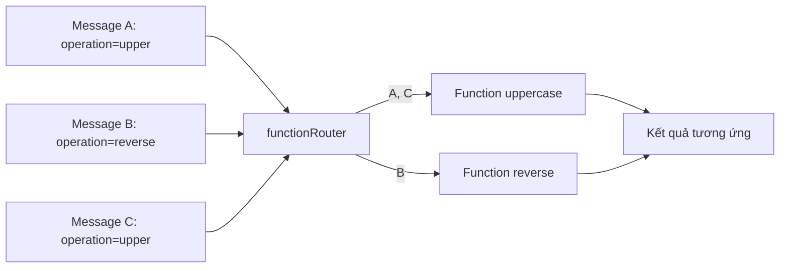
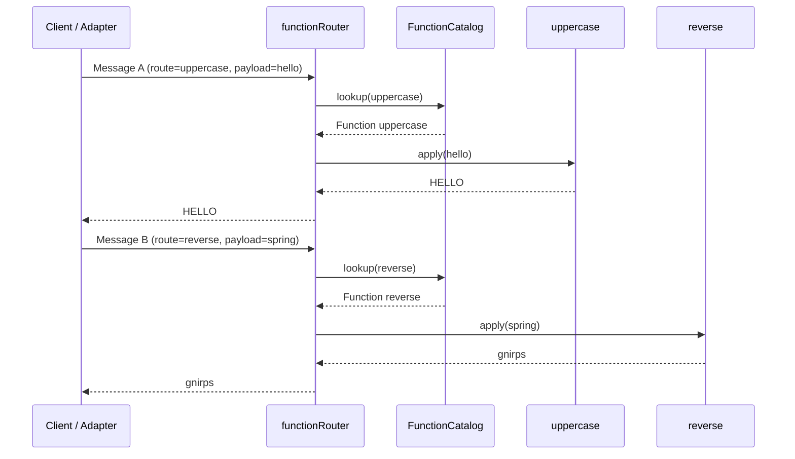

# Định tuyến từng thông điệp với hàm đồng bộ

## Mục tiêu học tập

Sau bài học, bạn có thể:

1. Giải thích cơ chế **định tuyến theo từng `Message`** của Spring Cloud Function khi hàm đích dùng mô hình imperative (đồng bộ).
2. Phân biệt **một thông điệp**, **một payload chứa nhiều phần tử** và **một reactive stream** để chọn đúng mức định tuyến.
3. Xây dựng các bean `Function<String, String>`, gọi cùng `functionRouter` nhiều lần và chọn đích khác nhau bằng Message header.
4. Dùng `spring.cloud.function.routing-expression` hoặc `MessageRoutingCallback` để quyết định hàm đích từ thông tin nghiệp vụ.
5. Kiểm tra kết quả qua HTTP, `FunctionCatalog` và Spring Cloud Stream; nhận biết các vấn đề về thứ tự xử lý, chuyển đổi kiểu, lỗi và an toàn.

## 1. Bài toán: mỗi sự kiện cần một xử lý khác nhau

Spring Cloud Function cho phép viết logic nghiệp vụ tái sử dụng dưới dạng `Supplier`, `Function` và `Consumer`, đăng ký trong `FunctionCatalog` và sử dụng qua các adapter HTTP, sự kiện hoặc serverless. Các hàm nghiệp vụ không cần tự biết request đến từ giao thức nào.

Giả sử một dịch vụ nhận nhiều thông điệp văn bản:

| Thông điệp | Payload | Header `operation` | Kết quả mong muốn |
| --- | --- | --- | --- |
| A | `hello` | `upper` | `HELLO` |
| B | `spring` | `reverse` | `gnirps` |
| C | `function` | `upper` | `FUNCTION` |

Ta muốn cả ba thông điệp đi qua **một điểm vào** và được chuyển đến **hàm phù hợp với từng thông điệp**. Spring Cloud Function cung cấp `RoutingFunction`, đăng ký trong catalog với tên `functionRouter`, để giải quyết yêu cầu này.



**Định tuyến theo từng thông điệp** nghĩa là router đưa ra một quyết định **cho mỗi lần nhận `Message`**, dựa trên header, payload hoặc chính sách được cấu hình. Hai message liên tiếp có thể đến hai hàm đích khác nhau, dù cùng dùng một router.

## 2. “Hàm đồng bộ” có nghĩa gì trong Spring Cloud Function?

Với Spring Cloud Function, ta thường phân biệt:

- **Imperative function:** một lần gọi nhận một giá trị `T` và trả một giá trị `R`, ví dụ `Function<String, String>` hoặc `Function<Message<Order>, Receipt>`. Một `Consumer<Order>` imperative nhận một giá trị và thực hiện tác dụng phụ; một `Supplier<Order>` tạo dữ liệu khi được gọi.
- **Reactive function:** một lần gọi xử lý một luồng `Publisher<T>`/`Flux<T>`, ví dụ `Function<Flux<Order>, Flux<Receipt>>`.

Bài này dùng **hàm đồng bộ/imperative `Function<T,R>`** làm đích. Mỗi lời gọi hoàn thành bằng một giá trị hoặc ném lỗi, nên router có thể chọn đích riêng cho từng message đầu vào. “Đồng bộ” ở đây mô tả **kiểu giao diện lập trình**; nó không có nghĩa tất cả request phải được xử lý tuần tự trên đúng một thread.

| Cách xử lý | Đơn vị nhận vào | Mức router quyết định | Ví dụ |
| --- | --- | --- | --- |
| `Function<String, String>` | Một lời gọi chứa một chuỗi | Theo từng message/lời gọi | Message A đến `uppercase`, B đến `reverse` |
| `Function<Message<Order>, Receipt>` | Một message chứa một đơn hàng | Theo từng message/lời gọi | Header `orderType` quyết định hàm đích |
| `Function<List<Order>, List<Receipt>>` | Một message chứa cả danh sách | Một lần cho **cả message** | Không tự chia danh sách thành nhiều route |
| `Function<Flux<Order>, Flux<Receipt>>` | Một publisher chứa nhiều phần tử | Ở cấp **luồng**, theo cấu hình phù hợp | Không route bằng header của từng phần tử theo cơ chế imperative |

**Điểm dễ nhầm:** “từng message” không đồng nghĩa “từng phần tử trong payload”. Nếu một message chứa danh sách 100 đơn hàng, router mặc định **không** đánh giá lại route 100 lần; nó chọn đích cho **một message chứa danh sách đó**. Nếu muốn quyết định cho từng đơn hàng, hệ thống cần phát từng đơn hàng thành message riêng, hoặc xử lý việc chia/định tuyến bên trong nghiệp vụ.

## 3. Luồng thực thi của `functionRouter`

Một lần định tuyến imperative đi qua các bước:

1. Adapter hoặc mã Java gọi `functionRouter` với một `Message<?>` có payload và headers.
2. Router xác định tên function definition từ `MessageRoutingCallback`, routing header hoặc routing property theo thứ tự ưu tiên.
3. `FunctionCatalog` tra cứu definition được chọn, chẳng hạn `uppercase`, `reverse` hoặc composition `uppercase|reverse`.
4. Hàm đích xử lý dữ liệu; kết quả hoặc ngoại lệ được trả về cho bên gọi/adapter.
5. **Message kế tiếp** đi qua quá trình trên với thông tin định tuyến của chính nó.



Sơ đồ trình bày hai lần gọi nối tiếp để dễ hiểu. Trong HTTP server hoặc message binder có xử lý đồng thời, **các message có thể được xử lý trên nhiều thread**; routing không tự bảo đảm thứ tự giao hàng hay thứ tự hoàn tất của các request độc lập.

## 4. Tạo ứng dụng mẫu với hai hàm đồng bộ

Ví dụ sử dụng Spring Boot và HTTP adapter `spring-cloud-starter-function-web`, với các phiên bản Spring Cloud Function/Spring Boot được quản lý tương thích qua BOM hoặc cơ chế dependency management:

```xml
<dependency>
    <groupId>org.springframework.cloud</groupId>
    <artifactId>spring-cloud-starter-function-web</artifactId>
</dependency>
```

Định nghĩa hai bean Java:

```java
package com.example.permessagerouting;

import java.util.Locale;
import java.util.function.Function;

import org.springframework.boot.SpringApplication;
import org.springframework.boot.autoconfigure.SpringBootApplication;
import org.springframework.context.annotation.Bean;

@SpringBootApplication
public class PerMessageRoutingApplication {

    public static void main(String[] args) {
        SpringApplication.run(PerMessageRoutingApplication.class, args);
    }

    @Bean
    public Function<String, String> uppercase() {
        return text -> text.toUpperCase(Locale.ROOT);
    }

    @Bean
    public Function<String, String> reverse() {
        return text -> new StringBuilder(text).reverse().toString();
    }
}
```

Trong `FunctionCatalog`, hai function có tên mặc định `uppercase` và `reverse`. Cả hai là imperative function: cùng nhận một `String` và trả một `String`. Chúng không chứa `if/else` chọn route, không đọc HTTP headers và có thể được kiểm thử riêng.

Framework cũng cung cấp router mặc định tên `functionRouter`; thông thường không cần tự viết bean `RoutingFunction`.

## 5. Cách 1: chọn function cho từng message bằng routing header

Đây là cách dễ quan sát nhất khi phía gửi đã biết **tên function đích**. Đặt property sau để web adapter chọn router làm điểm vào:

```yaml
# application.yml
spring:
  cloud:
    function:
      definition: functionRouter
```

Với adapter HTTP mặc định, function được chọn có thể được ánh xạ tại đường dẫn gốc `/`. Mỗi request mang một header định tuyến:

```bash
# Message A
curl -X POST http://localhost:8080/ \
  -H "Content-Type: text/plain" \
  -H "spring.cloud.function.definition: uppercase" \
  --data-raw "hello"
# Kết quả dự kiến: HELLO

# Message B
curl -X POST http://localhost:8080/ \
  -H "Content-Type: text/plain" \
  -H "spring.cloud.function.definition: reverse" \
  --data-raw "spring"
# Kết quả dự kiến: gnirps

# Message C
curl -X POST http://localhost:8080/ \
  -H "Content-Type: text/plain" \
  -H "spring.cloud.function.definition: uppercase" \
  --data-raw "function"
# Kết quả dự kiến: FUNCTION
```

**Vì sao ba request không ảnh hưởng lẫn nhau?** Vì chỉ dẫn `spring.cloud.function.definition` nằm trong **Message header của từng request**. Router đọc metadata của mỗi message, không đặt lại một property toàn cục cho các request tiếp theo.

Hai cách dùng cùng chuỗi tên cần phân biệt:

| Nguồn | Ví dụ | Tác dụng |
| --- | --- | --- |
| **Application property** `spring.cloud.function.definition` | `functionRouter` | Chọn router làm **điểm vào** của adapter |
| **Message header** `spring.cloud.function.definition` | `reverse` | Router chọn **hàm đích** cho message hiện tại |

Nếu bạn gọi trực tiếp `/uppercase` trên một web adapter có xuất endpoint này, request có thể đi thẳng vào `uppercase` và **bỏ qua router**. Chỉ dẫn trong header chỉ được xử lý bởi `RoutingFunction` khi lời gọi đã thực sự đi qua router. URL thực tế có thể thay đổi theo `spring.cloud.function.web.path` và các tùy chọn xuất function.

### Chọn một composition cho một message

Header có thể mang definition ghép:

```bash
curl -X POST http://localhost:8080/ \
  -H "Content-Type: text/plain" \
  -H "spring.cloud.function.definition: uppercase|reverse" \
  --data-raw "hello"
# Kết quả dự kiến: OLLEH
```

Khi đó **riêng message này** được xử lý bằng pipeline:

```text
"hello" -> uppercase -> "HELLO" -> reverse -> "OLLEH"
```

Các message khác vẫn có thể chỉ định `uppercase` hoặc `reverse`. Composition phải tương thích về kiểu: đầu ra của bước trước trở thành đầu vào của bước sau.

## 6. Cách 2: giữ luật ở ứng dụng, đọc header nghiệp vụ

Không phải hệ thống nào cũng nên cho client gửi **tên bean nội bộ**. Một cách khác là dùng `spring.cloud.function.routing-expression` làm luật do ứng dụng kiểm soát:

```yaml
spring:
  cloud:
    function:
      definition: functionRouter
      routing-expression: "headers['operation'] == 'reverse' ? 'reverse' : 'uppercase'"
```

Ở đây, `routing-expression` là biểu thức **Spring Expression Language (SpEL)**. Khi biểu thức được đánh giá trên một Spring `Message`, root object có các thuộc tính `payload` và `headers`. Biểu thức đọc `headers['operation']` và trả về **chuỗi tên function**.

```bash
# Message A: operation nghiệp vụ là reverse
curl -X POST http://localhost:8080/ \
  -H "Content-Type: text/plain" \
  -H "operation: reverse" \
  --data-raw "hello"
# Kết quả dự kiến: olleh

# Message B: operation nghiệp vụ là upper
curl -X POST http://localhost:8080/ \
  -H "Content-Type: text/plain" \
  -H "operation: upper" \
  --data-raw "hello"
# Kết quả dự kiến: HELLO
```

Biểu thức **không đổi giữa hai lời gọi**; giá trị của `operation` trên từng message làm đích thay đổi. Đây vẫn là định tuyến **theo từng message**, dù rule nằm trong application property.

Ví dụ coi mọi `operation` khác `reverse` là `uppercase`. Trong ứng dụng thật, nếu operation không hợp lệ phải bị từ chối, hãy viết chính sách kiểm tra tường minh thay vì mặc định cho phép một nhánh.

### Định tuyến theo payload

Một biểu thức cũng có thể truy cập payload:

```yaml
spring:
  cloud:
    function:
      definition: functionRouter
      routing-expression: "payload == 'mirror' ? 'reverse' : 'uppercase'"
```

Điều kiện này chỉ có ý nghĩa như dự kiến nếu **payload ở thời điểm router đánh giá thực sự là Java `String`**. Với JSON, binary event hoặc broker binder, payload có thể vẫn là `byte[]`, `Map` hoặc POJO. Khi cần route theo một thuộc tính bên trong JSON, phải xác minh kiểu dữ liệu đã được chuyển đổi tại giai đoạn routing.

## 7. Cách 3: kiểm soát từng route bằng `MessageRoutingCallback`

Khi quy tắc phải kiểm tra dữ liệu hoặc từ chối operation không hợp lệ, dùng callback Java:

```java
import org.springframework.cloud.function.context.MessageRoutingCallback;
import org.springframework.context.annotation.Bean;

@Bean
public MessageRoutingCallback routeByOperation() {
    return message -> {
        Object operation = message.getHeaders().get("operation");

        if ("upper".equals(operation)) {
            return "uppercase";
        }
        if ("reverse".equals(operation)) {
            return "reverse";
        }
        throw new IllegalArgumentException("operation khong hop le");
    };
}
```

Hãy đặt phương thức `@Bean` này trong một class `@Configuration` hoặc `@SpringBootApplication`. Đây là **phương án thay thế** cho property route ở mục 6: không cần thêm đồng thời nhiều nguồn chỉ dẫn khi mục tiêu chỉ là minh họa một chính sách.

Mỗi lần router nhận message, callback đọc `operation` của message đó và trả về một tên function. Nếu `operation` không hợp lệ, callback ném lỗi; không giả định Spring Cloud Function tự bỏ qua lỗi và định tuyến sang một nhánh khác.

Ưu điểm của callback là có thể chuẩn hóa, kiểm tra danh sách route được phép và unit test bằng `MessageBuilder`. Đặt code xử lý nghiệp vụ thực sự trong các `Function` đích, còn callback chỉ đưa ra quyết định điều phối.

## 8. Thứ tự ưu tiên khi có nhiều chỉ dẫn

Với **imperative message routing**, các nguồn chỉ dẫn được ưu tiên theo thứ tự:

| Thứ tự | Nguồn chỉ dẫn đích | Ví dụ |
| --- | --- | --- |
| 1 — cao nhất | `MessageRoutingCallback` | Code trả về `reverse` |
| 2 | Message header định tuyến | `spring.cloud.function.definition: uppercase` |
| 3 | Application/system routing property | `spring.cloud.function.routing-expression: "'reverse'"` |

Ví dụ, nếu property định tuyến mặc định đến `reverse` nhưng Message header yêu cầu `uppercase`, router chọn `uppercase` khi **không có callback**. Nếu callback có mặt và trả về `reverse`, callback được ưu tiên, kể cả khi message có header chỉ đến `uppercase`.

Lưu ý:

- `spring.cloud.function.definition=functionRouter` trong **cấu hình adapter** là chọn điểm vào, không phải một nguồn tranh chấp trong bảng trên.
- Header `spring.cloud.function.definition` chứa tên định nghĩa trực tiếp; header `spring.cloud.function.routing-expression` chứa SpEL. Cả hai đều thuộc tầng Message header. Không gửi đồng thời hai header có chỉ dẫn mâu thuẫn.
- Nếu một nguồn ưu tiên cao gây lỗi, không mặc định coi router sẽ âm thầm thử các nguồn thấp hơn. Hãy thiết kế xử lý lỗi rõ ràng.

## 9. Gọi nhiều message trực tiếp qua `FunctionCatalog`

HTTP chỉ là một adapter. Trong ứng dụng Spring, có thể tra cứu router rồi gửi nhiều Spring `Message` có header khác nhau:

```java
import java.util.function.Function;

import org.springframework.cloud.function.context.FunctionCatalog;
import org.springframework.cloud.function.context.config.RoutingFunction;
import org.springframework.messaging.Message;
import org.springframework.messaging.support.MessageBuilder;

// Đoạn mã đặt trong một thành phần đã được inject functionCatalog.
Function<Message<String>, Object> router =
        functionCatalog.lookup(RoutingFunction.FUNCTION_NAME);

Message<String> first = MessageBuilder.withPayload("hello")
        .setHeader("spring.cloud.function.definition", "uppercase")
        .build();

Message<String> second = MessageBuilder.withPayload("spring")
        .setHeader("spring.cloud.function.definition", "reverse")
        .build();

Object firstResult = router.apply(first);
Object secondResult = router.apply(second);
```

Trong ví dụ không có callback và không có routing expression khác ghi đè, kết quả nghiệp vụ mong đợi lần lượt là `HELLO` và `gnirps`. Kiểu đối tượng trả về có thể là payload hoặc Spring `Message` tùy cách framework thích nghi chữ ký, vì vậy khi kiểm thử nên xác minh **payload kết quả** thay vì luôn ép kết quả về `String`.

### Kiểm thử tích hợp hai route bằng JUnit

Ví dụ một kiểm thử với Spring context và hai bean của mục 4:

```java
import static org.junit.jupiter.api.Assertions.assertEquals;

import java.util.function.Function;
import org.junit.jupiter.api.Test;
import org.springframework.beans.factory.annotation.Autowired;
import org.springframework.boot.test.context.SpringBootTest;
import org.springframework.cloud.function.context.FunctionCatalog;
import org.springframework.cloud.function.context.config.RoutingFunction;
import org.springframework.messaging.Message;
import org.springframework.messaging.support.MessageBuilder;

@SpringBootTest
class PerMessageRoutingTest {
    @Autowired
    FunctionCatalog catalog;

    @Test
    void choosesDifferentFunctionsForDifferentMessages() {
        Function<Message<String>, Object> router =
                catalog.lookup(RoutingFunction.FUNCTION_NAME);

        Message<String> first = MessageBuilder.withPayload("hello")
                .setHeader("spring.cloud.function.definition", "uppercase")
                .build();
        Message<String> second = MessageBuilder.withPayload("spring")
                .setHeader("spring.cloud.function.definition", "reverse")
                .build();

        assertEquals("HELLO", payloadOf(router.apply(first)));
        assertEquals("gnirps", payloadOf(router.apply(second)));
    }

    private static Object payloadOf(Object result) {
        return result instanceof Message<?>
                ? ((Message<?>) result).getPayload()
                : result;
    }
}
```

Kiểm thử giả định ứng dụng có dependency `spring-boot-starter-test` và **không đăng ký callback** thay đổi luật định tuyến của hai message. Nó kiểm tra kết quả của router trong Spring context, nhưng không thay thế kiểm thử HTTP mapping, message binder, serializer hay chính sách lỗi của adapter ngoài thực tế.

## 10. Ứng dụng với Spring Cloud Stream: mỗi event là một message

Trong kiến trúc hướng sự kiện, nhiều event có thể đến cùng một topic/queue:

```text
Event #101: headers={operation=upper},   payload="hello"
Event #102: headers={operation=reverse}, payload="spring"
Event #103: headers={operation=upper},   payload="function"
```

Nếu Spring Cloud Stream chuyển **mỗi event thành một Spring `Message` imperative** rồi đưa đến `functionRouter`, ứng dụng có thể chọn function đích khác nhau theo header của từng event. Một cấu hình routing phổ biến ở tầng Stream là:

```yaml
spring:
  cloud:
    stream:
      function:
        routing:
          enabled: true
      bindings:
        functionRouter-in-0:
          destination: text-requests
    function:
      routing-expression: "headers['operation'] == 'reverse' ? 'reverse' : 'uppercase'"
```

Đây là **minh họa luồng vào và biểu thức route**; để chạy trong dự án thực tế vẫn cần starter của binder (Kafka/RabbitMQ...), địa chỉ broker, output binding nếu có kết quả, cùng chính sách retry/error phù hợp. `functionRouter-in-0` là **tên input binding** theo quy ước của Stream; còn `functionRouter` là **tên function** trong `FunctionCatalog`.

Quan trọng: message broker có thể phân phối event song song qua các partition/consumer. Việc router chọn đích riêng cho mỗi event **không đồng nghĩa** đảm bảo thứ tự hoàn tất, exactly-once hay tự động retry. Những yêu cầu đó do binder, broker và thiết kế nghiệp vụ đảm trách.

### Trong serverless

Một adapter serverless cũng có thể gọi cùng các function qua `FunctionCatalog`. Khả năng định tuyến mỗi lần invocation phụ thuộc adapter có chuyển metadata sự kiện thành `Message` và gọi đúng `functionRouter` hay không. Ví dụ HTTP header `operation` không tự xuất hiện trong mọi event JSON; cần thiết kế mapping sự kiện tương ứng.

## 11. Giới hạn quan trọng: reactive routing

Một `Function<String, String>` xử lý một giá trị trong một lời gọi; với **imperative routing**, từng Message có thể mang chỉ dẫn khác nhau. Ngược lại:

```java
@Bean
public Function<reactor.core.publisher.Flux<String>,
                reactor.core.publisher.Flux<String>> reactiveUppercase() {
    return values -> values.map(String::toUpperCase);
}
```

Reactive function này nhận **một `Flux<String>`** cho một lần gọi, chứa có thể nhiều phần tử. Spring Cloud Function không áp dụng cùng cơ chế routing header cho từng phần tử trong `Flux` để thay hàm đích ở giữa luồng. Khi chọn một reactive function làm đích, nên cấu hình route ở **cấp luồng** bằng application properties phù hợp.

| Nhu cầu | Hướng tiếp cận |
| --- | --- |
| Mỗi event cần một function khác nhau | Dùng imperative event routing, một `Message` cho mỗi sự kiện |
| Cả luồng reactive cần chạy một function cố định | Chọn function/reactive route bằng cấu hình ứng dụng |
| Một message chứa danh sách cần tách từng mục ra xử lý | Thiết kế bước tách message hoặc xử lý bên trong hàm nghiệp vụ |
| Muốn ghép hai xử lý cho một message | Dùng composition như `uppercase|reverse`, nếu kiểu tương thích |

Sự khác nhau là **ranh giới của một lời gọi**, không đơn thuần do ứng dụng đang dùng HTTP, Kafka hay Reactor.

## 12. Xử lý lỗi, chuyển đổi dữ liệu và bảo mật

### Tên hàm đích không hợp lệ

Nếu một message chỉ đến `spring.cloud.function.definition: unknown`, nhưng `FunctionCatalog` không có definition đó, lời gọi có thể phát sinh lỗi. Không nên giả định router sẽ chuyển sang `uppercase` hoặc bỏ qua message. Đối với HTTP, xác định cách trả lỗi; với broker, cấu hình retry, error channel hoặc dead-letter queue/topic theo yêu cầu.

### Kiểu dữ liệu không tương thích

Router có thể tìm đúng `reverse` nhưng function vẫn lỗi nếu adapter cung cấp payload không phù hợp với `String`. Dùng `Content-Type` đúng và kiểm tra conversion ở **hai giai đoạn**: dữ liệu mà biểu thức routing nhìn thấy và dữ liệu được truyền vào function đích. JSON, `byte[]`, `Map` và POJO có thể khác nhau tùy adapter.

### Độ trễ và tương tranh

Một imperative function chạy đồng bộ có thể thực hiện I/O chặn thread, khiến throughput bị giới hạn nếu mỗi message phải chờ. Khi nhiều request hoặc event xử lý đồng thời, các bean `Function` có thể được gọi cùng lúc. Hãy tránh giữ trạng thái mutable dùng chung không được bảo vệ; routing không tự tạo cơ chế khóa hoặc giao dịch.

### Header từ bên ngoài

Header `spring.cloud.function.definition` là **chỉ dẫn thực thi**, nên không nên cho client công khai gọi bất kỳ bean nào có trong catalog. Với nguồn không tin cậy, nên:

1. Chỉ nhận giá trị nghiệp vụ như `operation=upper` hoặc `operation=reverse`.
2. Ánh xạ giá trị đó sang một tập definition được cho phép bằng property SpEL do server quản lý hoặc `MessageRoutingCallback`.
3. Kiểm soát các HTTP function endpoint được xuất, xác thực và phân quyền ở lớp adapter/gateway; callback không áp dụng với request gọi thẳng function ngoài router.
4. Ghi nhận correlation ID, tên route và lỗi khi cần, tránh log payload hoặc headers nhạy cảm.

Định tuyến theo từng message tạo **sự linh hoạt trong lựa chọn hàm**, không phải bảo đảm an toàn, tính đúng thứ tự hay tính idempotent của tác vụ nghiệp vụ.

## 13. Bảng chẩn đoán sự cố

| Triệu chứng | Nguyên nhân có thể | Hướng kiểm tra |
| --- | --- | --- |
| Hai request có header khác nhau nhưng luôn vào một function | Request không đi qua `functionRouter` hoặc header không được chuyển tới `Message` | Xác minh function điểm vào và metadata tại router |
| Header nghiệp vụ `operation` không đổi route | Chưa có `routing-expression` hoặc callback đọc `operation` | Cấu hình quy tắc ánh xạ operation sang tên function |
| Header bị bỏ qua khi có callback | Callback có ưu tiên cao hơn routing header | Kiểm tra `routingResult` và bean callback đang hoạt động |
| Một message có nhiều phần tử nhưng chỉ chọn một đích | Router định tuyến ở cấp `Message`, không tự tách payload | Tách thành nhiều message nếu muốn route từng phần tử |
| Event đến sai thứ tự so với mong đợi | Binder/broker hoặc consumer xử lý đồng thời | Kiểm tra partition, concurrency và bảo đảm thứ tự của broker |
| Route tên đúng nhưng kết quả sai/lỗi | Conversion, `Content-Type` hoặc function đích có vấn đề | Kiểm tra kiểu đầu vào, composition và ngoại lệ |
| Chỉ định `unknown` không chạy | Function definition không tồn tại | Kiểm tra `FunctionCatalog`, chính sách xử lý lỗi |
| Thử route từng phần tử trong `Flux` thất bại | Đang dùng reactive function theo cả luồng | Dùng route ở cấp luồng hoặc chuyển sang imperative event routing |

Để debug, kiểm tra theo chuỗi: **adapter → một `Message` cụ thể → nguồn routing ưu tiên → tên đích → `FunctionCatalog` → chuyển đổi payload → kết quả hoặc ngoại lệ**. Cách này giúp phân biệt lỗi quyết định route với lỗi nghiệp vụ trong function.

## 14. Thực hành và câu hỏi tự kiểm tra

1. Chạy hai bean `uppercase` và `reverse`. Gửi ba HTTP request như mục 5 với ba routing header, ghi kết quả và giải thích vì sao mỗi message chọn đích độc lập.
2. Gửi `spring.cloud.function.definition: uppercase|reverse` với payload `hello`. So sánh **route một message tới composition** với **route hai message tới hai hàm**.
3. Dùng `routing-expression` đọc `headers['operation']` thay vì gửi tên bean trực tiếp; gửi `operation=upper`, `operation=reverse` và thiếu `operation`. Xác định nhánh mặc định.
4. Thêm `MessageRoutingCallback` từ mục 7, sau đó gửi `operation=reverse` kèm routing header `uppercase`. Dự đoán đích và giải thích thứ tự ưu tiên.
5. Dùng `MessageBuilder` tạo hai message, cùng gọi `FunctionCatalog.lookup(RoutingFunction.FUNCTION_NAME)`. Kiểm tra kết quả của mỗi message và bổ sung một trường hợp tên function không tồn tại.
6. Giả sử một Message mang payload `List<Order>` gồm 100 đơn hàng. Giải thích vì sao routing không tự đánh giá lại từng `Order`; thiết kế một cách tạo nhiều message nếu yêu cầu là route từng đơn hàng.
7. Phác thảo cấu hình Spring Cloud Stream nhận event từ một destination. Nêu điều kiện để routing header của từng event đến được `functionRouter`, và giải thích ai chịu trách nhiệm về thứ tự, retry và dead-letter queue.
8. So sánh `Function<String, String>` với `Function<Flux<String>, Flux<String>>`: ranh giới một lời gọi khác nhau thế nào, và vì sao routing từng message không tương đương routing từng phần tử `Flux`?

## Ghi nhớ

- Với **imperative `Function<T,R>`**, `RoutingFunction` có thể chọn **một hàm đích cho mỗi Spring `Message`**. Các message khác nhau có thể đi qua cùng router nhưng được xử lý bởi các function khác nhau.
- `functionRouter` là điểm vào của router trong `FunctionCatalog`; header `spring.cloud.function.definition`, property `spring.cloud.function.routing-expression` hoặc `MessageRoutingCallback` cung cấp chỉ dẫn chọn đích.
- Với imperative routing, thứ tự ưu tiên chính là **callback → Message routing headers → application routing properties**.
- **Một message có danh sách** vẫn là một message. **Một reactive `Publisher`** là một luồng; không thể dùng routing header của từng phần tử để chọn lại hàm theo cách imperative.
- HTTP, Stream và serverless đều có thể sử dụng cùng logic `Function` nhưng phải cấu hình đúng adapter, mapping message, chuyển đổi dữ liệu và xử lý lỗi.
- Mỗi-message routing không tự bảo đảm thứ tự, retry, giao dịch hoặc phân quyền; cần giải quyết các yêu cầu đó ở tầng vận chuyển và thiết kế ứng dụng.

### Tài liệu tham khảo chính thức

- [Spring Cloud Function — Function Routing and Filtering](https://docs.spring.io/spring-cloud-function/reference/spring-cloud-function/programming-model.html)
- [Spring Cloud Function — Standalone Web Applications](https://docs.spring.io/spring-cloud-function/reference/spring-cloud-function/standalone-web-applications.html)
- [Spring Cloud Stream — Event Routing](https://docs.spring.io/spring-cloud-stream/reference/spring-cloud-stream/event-routing.html)
- [Spring Framework — Messaging](https://docs.spring.io/spring-framework/reference/integration.html)
