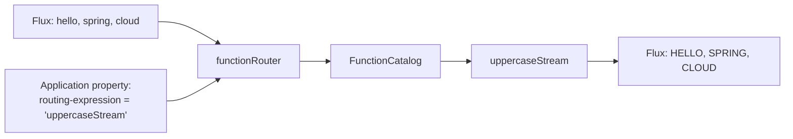
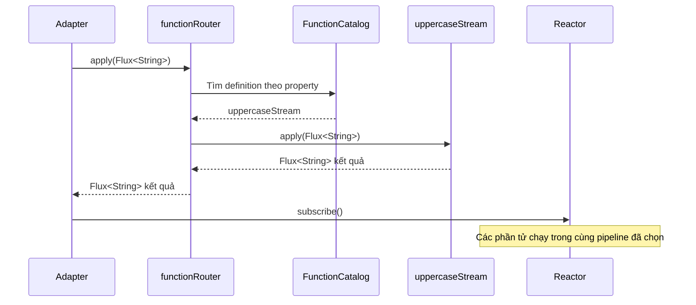

# Định tuyến cả luồng với hàm phản ứng

## Mục tiêu học tập

Sau bài học, bạn có thể:

1. Phân biệt đơn vị định tuyến của hàm **imperative** (`Function<T, R>`) và hàm **reactive** (`Function<Flux<T>, Flux<R>>`).
2. Giải thích vì sao `RoutingFunction` chỉ chọn **một định nghĩa hàm cho toàn bộ luồng** khi đầu vào là `Publisher`, thay vì đọc routing header của từng phần tử.
3. Viết các bean reactive `Function<Flux<String>, Flux<String>>` và cấu hình route bằng **application properties**.
4. Phân biệt chọn trực tiếp một hàm, chọn composition và đi qua `functionRouter` với `spring.cloud.function.routing-expression`.
5. Kiểm tra chức năng với Reactor `StepVerifier`, nhận diện lỗi thiết kế khi cố định tuyến từng sự kiện trong `Flux`, và chọn giải pháp phù hợp cho HTTP, sự kiện hoặc serverless.

## 1. Bài toán: một luồng dữ liệu được xử lý bởi một hàm

Spring Cloud Function khuyến khích đóng gói nghiệp vụ bằng `Supplier`, `Function` và `Consumer`, đăng ký các bean trong `FunctionCatalog`. Bộ catalog giúp adapter HTTP, Spring Cloud Stream hoặc môi trường serverless dùng lại logic mà không buộc logic nghiệp vụ phụ thuộc giao thức vận chuyển.

Ví dụ, một hệ thống nhận liên tục chuỗi văn bản và cung cấp hai cách xử lý:

- `uppercaseStream`: biến tất cả chuỗi trong luồng thành chữ in hoa.
- `reverseStream`: đảo thứ tự ký tự của tất cả chuỗi trong luồng.

Môi trường *staging* cần chạy `uppercaseStream`, còn một môi trường kiểm thử khác cần chạy `reverseStream`. Quyết định lựa chọn hàm có thể được đưa ra bằng cấu hình ứng dụng, còn **toàn bộ các phần tử của một luồng** đều đi qua hàm đã chọn.



Đặc điểm của ví dụ là **route được quyết định ở cấp `Flux`**, sau đó chính reactive function xử lý từng phần tử của `Flux`. Router không liên tục chọn lại hàm đích cho mỗi chuỗi khi luồng đang chạy.

## 2. Đơn vị xử lý quyết định phạm vi định tuyến

Spring Cloud Function hỗ trợ hai mô hình chức năng quan trọng:

| Khía cạnh | Hàm imperative (đồng bộ) | Hàm reactive (phản ứng) |
| --- | --- | --- |
| Chữ ký điển hình | `Function<String, String>` | `Function<Flux<String>, Flux<String>>` |
| Đầu vào mỗi lần gọi | Một giá trị hoặc một `Message` | Một `Publisher`, có thể phát nhiều giá trị |
| Đơn vị định tuyến của `RoutingFunction` | **Từng Message** | **Toàn bộ luồng** được truyền vào |
| Header trên từng Message | Có thể chọn đích riêng cho message đó | Không dùng làm chỉ dẫn route lại từng phần tử |
| Nguồn chỉ dẫn route | Callback, routing header hoặc application property | **Application properties** |
| Ví dụ | Message A đến `uppercase`, B đến `reverse` | `Flux(A, B, C)` cùng đi qua `uppercaseStream` |

Một imperative `Function<T, R>` nhận một giá trị rồi trả một kết quả. Với mỗi Message đầu vào, framework có cơ hội đọc metadata, quyết định hàm cần gọi và thực hiện nó.

Ngược lại, `Function<Flux<T>, Flux<R>>` nhận **một đối tượng `Publisher` cho một lần gọi** và trả về một Publisher kết quả. Framework kết nối pipeline ở cấp lời gọi đó; các phần tử sẽ được Reactor phát và xử lý **sau khi đã chọn hàm**. Điều này dẫn tới quy tắc:

> Với reactive function, Spring Cloud Function chỉ áp dụng chỉ dẫn định tuyến từ **application properties** cho **cả luồng**, không route lại theo `Message` headers của từng phần tử.

Đây là giới hạn được nêu rõ trong tài liệu Spring Cloud Function về Function Routing. <https://docs.spring.io/spring-cloud-function/reference/spring-cloud-function/programming-model.html>

### “Một lần gọi” không có nghĩa cả ứng dụng chỉ chạy một lần

Một adapter có thể tạo nhiều Publisher ở các thời điểm khác nhau; mỗi lần kết nối một Publisher tới reactive function là một lần thiết lập xử lý. Khi một luồng được subscribe, Reactor có thể thực thi các toán tử theo thời gian, xử lý hàng nghìn sự kiện và dùng nhiều thread tùy scheduler/toán tử.

Điều cần ghi nhớ là: **không có quyết định routing mới của `functionRouter` cho từng phần tử bên trong Publisher đó**. Nếu cần đổi đích cho phần tử 1, 2, 3 trong cùng luồng, phải chọn kiến trúc khác ở phía xử lý sự kiện.

## 3. Chuẩn bị các hàm reactive

Ví dụ dưới đây dùng Spring Boot, Spring Cloud Function và Project Reactor. Khi xây dựng ứng dụng, chọn phiên bản Spring Cloud Function tương thích với Spring Boot qua BOM/dependency management. Đối với thử nghiệm HTTP có thể dùng `spring-cloud-starter-function-web`; với Spring Cloud Stream còn cần binder thích hợp.

```xml
<dependency>
    <groupId>org.springframework.cloud</groupId>
    <artifactId>spring-cloud-starter-function-web</artifactId>
</dependency>
```

Các hàm dưới đây dùng `Flux` từ Reactor:

```java
package com.example.reactivestreamrouting;

import java.util.Locale;
import java.util.function.Function;

import org.springframework.boot.SpringApplication;
import org.springframework.boot.autoconfigure.SpringBootApplication;
import org.springframework.context.annotation.Bean;
import reactor.core.publisher.Flux;

@SpringBootApplication
public class ReactiveRoutingApplication {

    public static void main(String[] args) {
        SpringApplication.run(ReactiveRoutingApplication.class, args);
    }

    @Bean
    public Function<Flux<String>, Flux<String>> uppercaseStream() {
        return values -> values.map(value -> value.toUpperCase(Locale.ROOT));
    }

    @Bean
    public Function<Flux<String>, Flux<String>> reverseStream() {
        return values -> values.map(
                value -> new StringBuilder(value).reverse().toString());
    }
}
```

`uppercaseStream` và `reverseStream` là các **bean `Function` có chữ ký reactive**, được đăng ký vào `FunctionCatalog` theo tên phương thức `@Bean`. Chúng không tự biết dữ liệu đến từ HTTP, message broker hay serverless.

Khi hàm nhận `Flux.just("hello", "spring", "cloud")`:

| Function | Publisher kết quả khi được subscribe |
| --- | --- |
| `uppercaseStream` | `HELLO`, `SPRING`, `CLOUD` |
| `reverseStream` | `olleh`, `gnirps`, `duolc` |

Các phép biến đổi chỉ được thực hiện khi Publisher được **subscribe**. Việc gọi `Function.apply(flux)` thường xây dựng một pipeline mới; không nên mặc định rằng mọi phần tử đã được xử lý ngay tại dòng `apply`.

### Backpressure và luồng

Với một reactive Publisher, bên tiêu thụ có thể phát yêu cầu dữ liệu theo khả năng xử lý (backpressure). Toán tử `map` của Reactor bảo toàn mô hình tín hiệu `onNext`, `onError` và `onComplete`, không cần thu toàn bộ luồng vào bộ nhớ. Router lựa chọn **một pipeline chức năng**, còn Reactor điều phối cách các phần tử chạy qua pipeline.

Tính chất backpressure phụ thuộc các nguồn Publisher và toán tử của cả chuỗi xử lý; chỉ dùng `Flux` không tự động bảo đảm mọi bộ phận bên ngoài đều hỗ trợ backpressure.

## 4. Cách đơn giản nhất: chọn reactive function trực tiếp bằng cấu hình

Nếu chỉ cần triển khai **một** reactive function cho toàn bộ luồng, có thể không cần `RoutingFunction`. Chọn definition trực tiếp:

```yaml
# application.yml
spring:
  cloud:
    function:
      definition: uppercaseStream
```

Adapter/binding sẽ sử dụng function có tên `uppercaseStream` làm điểm vào được cấu hình. Khi cần chạy `reverseStream` trong một môi trường khác, thay thành:

```yaml
spring:
  cloud:
    function:
      definition: reverseStream
```

Điểm quan trọng: đây là **chọn function ở tầng adapter**, chưa có bước đi qua `functionRouter`. Nó thường là lựa chọn phù hợp khi chỉ muốn triển khai một pipeline xử lý đã biết trước.

Thay đổi property giữa các môi trường không yêu cầu sửa code của `uppercaseStream` hay `reverseStream`. Tuy nhiên, không nên giả định chỉnh một file YAML lúc ứng dụng đang chạy sẽ lập tức chuyển toàn bộ Publisher hiện tại sang function khác; cấu hình được xác định theo quá trình khởi tạo/triển khai trừ khi ứng dụng có cơ chế refresh riêng.

## 5. Định tuyến cả luồng qua `functionRouter`

Khi môi trường cần giữ một điểm vào dạng router (ví dụ một số mô hình FaaS) nhưng muốn route **một Publisher đến một reactive function**, Spring Cloud Function hỗ trợ đặt chỉ dẫn ở **application properties**.

Tên router mặc định trong `FunctionCatalog` là `functionRouter`, tương ứng hằng `RoutingFunction.FUNCTION_NAME`.

Ví dụ:

```yaml
# application.yml
spring:
  cloud:
    function:
      definition: functionRouter
      routing-expression: "'uppercaseStream'"
```

Cần phân biệt:

1. `definition: functionRouter` yêu cầu adapter gọi **router** tại điểm vào được cấu hình.
2. `routing-expression: "'uppercaseStream'"` là **biểu thức SpEL trả về chuỗi hằng** `uppercaseStream`. Router dùng tên này để tra cứu hàm đích trong `FunctionCatalog`.
3. Khi input là một `Publisher`, **cả Publisher** đi qua `uppercaseStream`; mỗi phần tử phát ra không làm router đánh giá lại một routing header.



Sơ đồ mô tả ranh giới định tuyến về mặt khái niệm. Việc adapter subscribe lúc nào, cách chuyển đổi dữ liệu và kiểu Publisher kết quả phụ thuộc adapter/binding đang sử dụng.

### Vì sao phải viết `"'uppercaseStream'"`?

`spring.cloud.function.routing-expression` chứa SpEL, nên tên function cố định phải là một **string literal** SpEL:

| Đoạn cấu hình | Ý nghĩa |
| --- | --- |
| `definition: uppercaseStream` | Chọn trực tiếp definition ở tầng adapter; không dùng SpEL |
| `definition: functionRouter` | Chọn router làm điểm vào |
| `routing-expression: "'uppercaseStream'"` | SpEL trả về tên đích `uppercaseStream` |
| `routing-expression: uppercaseStream` | Không phải literal chuỗi; SpEL có thể cố truy cập một thuộc tính tên `uppercaseStream` |

Hai dấu nháy kép bên ngoài là cú pháp YAML, còn dấu nháy đơn bên trong là cú pháp SpEL. Trong `application.properties`, ta có thể viết:

```properties
spring.cloud.function.definition=functionRouter
spring.cloud.function.routing-expression='uppercaseStream'
```

Khi chuyển sang môi trường khác, muốn cả luồng qua `reverseStream` chỉ cần thay biểu thức cố định thành `'reverseStream'` trong cấu hình được triển khai.

## 6. Vì sao không dùng header từng phần tử để route reactive stream?

Xét một `Flux<Message<String>>` có ba phần tử:

```text
Flux<Message<String>>
  Message(payload="hello",  header definition="uppercaseStream")
  Message(payload="spring", header definition="reverseStream")
  Message(payload="cloud",  header definition="uppercaseStream")
```

**Không được kỳ vọng** `functionRouter` tự tách ba message và gọi ba reactive function khác nhau theo header `spring.cloud.function.definition` của mỗi phần tử. Dù phần tử của Publisher là một `Message`, router nhận một Publisher ở **cấp lời gọi**; `MessageRoutingCallback` và routing headers phục vụ định tuyến theo từng message của **imperative function**.

Tài liệu Spring Cloud Function quy định rõ các chỉ dẫn:

- Header `spring.cloud.function.definition`.
- Header `spring.cloud.function.routing-expression`.
- Bean `MessageRoutingCallback`.

không dùng theo cách **route từng phần tử** của một reactive stream. Đối với reactive function, hãy đặt route ở **application properties** và xem cả stream là một đơn vị xử lý.

### Cẩn thận với SpEL đọc `headers` và `payload`

Biểu thức như:

```text
headers['operation'] == 'reverse' ? 'reverseStream' : 'uppercaseStream'
```

phù hợp khi router đang xét **một Spring `Message`** theo mô hình imperative. Trong trường hợp reactive, đối tượng cấp lời gọi là Publisher; không thể giả định biểu thức được đánh giá độc lập với từng `Message` nằm trong Publisher và có `headers`/ `payload` của mỗi phần tử. Đối với lựa chọn route cả luồng, dùng **tên đích tĩnh bằng application property** là cách dễ dự đoán.

## 7. Composition cũng áp dụng cho toàn bộ luồng

Hai hàm `uppercaseStream` và `reverseStream` tương thích kiểu `Flux<String> → Flux<String>`, nên có thể ghép:

```yaml
spring:
  cloud:
    function:
      definition: uppercaseStream|reverseStream
```

Khi đó adapter chọn **một composition reactive trực tiếp**:

```text
Flux("hello", "spring")
  -> uppercaseStream -> Flux("HELLO", "SPRING")
  -> reverseStream   -> Flux("OLLEH", "GNIRPS")
```

Nếu môi trường cần đi qua `functionRouter`, có thể dùng expression cố định trả về tên composition:

```yaml
spring:
  cloud:
    function:
      definition: functionRouter
      routing-expression: "'uppercaseStream|reverseStream'"
```

Trong chuỗi literal SpEL `'uppercaseStream|reverseStream'`, dấu `|` thuộc về **cú pháp composition của Spring Cloud Function**, không phải toán tử của SpEL. Pipeline sẽ kết nối hai hàm theo thứ tự; nó **không route riêng từng phần tử** đến các hàm khác nhau.

Đầu ra Publisher của hàm trước cần phù hợp với đầu vào Publisher của hàm sau. Khi trộn `Flux<String>` với các hàm có kiểu `Flux<Order>` hoặc `Mono<Receipt>`, cần xem lại tính tương thích và cách chuyển đổi; không phải mọi composition đều hợp lệ chỉ vì cả hai hàm đều reactive.

## 8. Kiểm thử bằng Reactor `StepVerifier`

Vì reactive function trả về Publisher, một lệnh `assertEquals` trên chính đối tượng `Flux` không chứng minh nội dung kết quả. Ta cần subscribe và kiểm tra các tín hiệu phát ra.

Ví dụ dùng `reactor-test` và JUnit Jupiter để thử hàm nghiệp vụ trực tiếp:

```java
import static org.junit.jupiter.api.Assertions.assertNotNull;

import java.util.function.Function;
import org.junit.jupiter.api.Test;
import org.springframework.beans.factory.annotation.Autowired;
import org.springframework.boot.test.context.SpringBootTest;
import org.springframework.cloud.function.context.FunctionCatalog;
import reactor.core.publisher.Flux;
import reactor.test.StepVerifier;

@SpringBootTest
class ReactiveFunctionTest {

    @Autowired
    private FunctionCatalog catalog;

    @Test
    void uppercaseStreamTransformsEveryElement() {
        Function<Flux<String>, Flux<String>> uppercaseStream =
                catalog.lookup("uppercaseStream");
        assertNotNull(uppercaseStream);

        Flux<String> result =
                uppercaseStream.apply(Flux.just("hello", "spring", "cloud"));

        StepVerifier.create(result)
                .expectNext("HELLO", "SPRING", "CLOUD")
                .verifyComplete();
    }

    @Test
    void reverseStreamTransformsEveryElement() {
        Function<Flux<String>, Flux<String>> reverseStream =
                catalog.lookup("reverseStream");
        assertNotNull(reverseStream);

        StepVerifier.create(
                reverseStream.apply(Flux.just("hello", "spring")))
                .expectNext("olleh", "gnirps")
                .verifyComplete();
    }
}
```

Đoạn test giả định dự án đã có các dependency test cần thiết (ví dụ `spring-boot-starter-test` và `reactor-test`) và hai bean ở mục 3. Hai test trên kiểm tra **chức năng của từng reactive function được tìm qua `FunctionCatalog`**. Chúng chưa kiểm tra adapter có chọn `functionRouter` hay giá trị property route có đúng hay không.

### Kiểm thử tích hợp route cả luồng

Để chứng minh router chọn đúng đích, bổ sung kiểm thử tích hợp theo adapter của ứng dụng:

1. Khởi động một application context với `spring.cloud.function.definition=functionRouter` và `spring.cloud.function.routing-expression='uppercaseStream'`.
2. Đưa một Publisher có nhiều phần tử đến **đúng điểm vào** mà adapter cung cấp, thay vì gọi trực tiếp bean `uppercaseStream`.
3. Subscribe vào Publisher kết quả; xác nhận tất cả phần tử tuân theo `uppercaseStream`.
4. Khởi động **một context cấu hình khác** với route `'reverseStream'` và kiểm tra tất cả phần tử đi qua `reverseStream`.
5. Kiểm tra cả lỗi, completion, conversion và thời điểm subscribe. Đừng dùng kết quả của một function riêng để kết luận router đã được gọi.

Cách kích hoạt điểm vào, kiểu kết quả và phép chuyển đổi message tùy Spring Cloud Function Web, Spring Cloud Stream hoặc adapter serverless. Vì vậy cần kiểm thử trên adapter thật của dự án.

## 9. Spring Cloud Stream: route cả luồng khác event routing từng message

Một broker có thể phát hàng nghìn event, nhưng cách **function được khai báo** quyết định đơn vị làm việc:

| Kiểu function của Spring Cloud Stream | Lựa chọn route cần thiết | Cách hiểu |
| --- | --- | --- |
| `Function<String, String>` | Event routing theo từng Message (nếu bật router phù hợp) | Mỗi event có thể đến một hàm khác qua routing header/callback |
| `Function<Flux<String>, Flux<String>>` | Chọn **reactive function cho cả Publisher** bằng application property | Các event trong Publisher cùng đi qua function đã chọn |

Chẳng hạn, với một ứng dụng chỉ cần xử lý một luồng `uppercaseStream`, có thể khai báo binding trực tiếp:

```yaml
spring:
  cloud:
    function:
      definition: uppercaseStream
    stream:
      bindings:
        uppercaseStream-in-0:
          destination: text-requests
        uppercaseStream-out-0:
          destination: text-results
```

Đây là **minh họa** tên binding theo quy ước của Spring Cloud Stream; còn cần binder tương ứng, cấu hình kết nối broker và xử lý lỗi. Trong trường hợp này, toàn bộ dữ liệu của một lần thiết lập reactive pipeline được xử lý bằng `uppercaseStream`.

Không nên trộn một cách máy móc cấu hình **event routing từng message** `spring.cloud.stream.function.routing.enabled=true` với mục tiêu route **cả reactive Publisher**. Cơ chế event routing nhằm chọn đích ở mức Message imperative; việc chọn một reactive function cho stream thường rõ ràng hơn khi được quản lý bằng `spring.cloud.function.definition` hoặc route property ở tầng framework/adaptor phù hợp.

### Thứ tự và backpressure

Router không áp đặt thứ tự giao nhận, thứ tự hoàn tất hay exactly-once. Broker, binder, partition, concurrency, các toán tử Reactor và cách triển khai function đều ảnh hưởng đến các tính chất đó.

Ví dụ `map` giữ thứ tự phát ra với một source tuần tự, nhưng `flatMap` thực hiện nhiều thao tác bất đồng bộ có thể làm kết quả đến không đúng thứ tự đầu vào. Nếu thứ tự là yêu cầu nghiệp vụ, cần chọn toán tử như `concatMap` hoặc một cấu hình xử lý bảo toàn thứ tự phù hợp. Không thể dùng routing property để thay thế một chính sách xử lý sự kiện đúng đắn.

## 10. HTTP và serverless: cần phân biệt một request với một stream

Spring Cloud Function Web có thể ánh xạ function thành HTTP endpoint; nếu dùng reactive function, cách adapter dựng input Publisher và stream response phụ thuộc module HTTP, content type và phương thức được sử dụng.

**Một loạt request HTTP riêng biệt không tự động tạo thành một `Flux` chung.** Mỗi request có thể được adapter đưa qua function một cách độc lập. Vì thế, không nên lấy ví dụ `curl` gửi nhiều request với header route khác nhau rồi kết luận rằng chúng minh họa định tuyến từng phần tử của **cùng một reactive Publisher**.

Tương tự với serverless: mỗi invocation có thể mang một event, một batch hoặc một Publisher tùy adapter và nền tảng. Khi function đích nhận Publisher, quyết định định tuyến của framework ở cấp Publisher phải đến từ cấu hình ứng dụng; việc event JSON có trường `operation` không làm router tự chọn một reactive function khác cho từng phần tử.

Nhờ tách nghiệp vụ thành các `Function`, logic `uppercaseStream`/`reverseStream` có thể được tái sử dụng trong các adapter khác nhau. Cần xác nhận mapping input/output, serialization và quản lý subscription của adapter cụ thể.

## 11. Nếu thật sự cần chọn hàm theo từng sự kiện thì làm gì?

Không nên cố biến cấu hình reactive routing thành định tuyến từng phần tử. Có hai lựa chọn thiết kế:

### Cách A — dùng imperative event routing

Nếu mỗi event phải chọn **một hàm đích trong `FunctionCatalog`** theo header:

```java
@Bean
public Function<String, String> uppercase() {
    return value -> value.toUpperCase();
}

@Bean
public Function<String, String> reverse() {
    return value -> new StringBuilder(value).reverse().toString();
}
```

Khi adapter tạo **mỗi event thành một `Message` imperative**, `functionRouter` có thể đọc `spring.cloud.function.definition` hoặc dùng routing expression/callback để chọn `uppercase` hay `reverse` riêng cho mỗi event. Đây là mô hình routing theo message.

### Cách B — chọn nhánh bên trong reactive function

Nếu cần giữ **một reactive stream** nhưng chia cách xử lý theo nội dung mỗi phần tử, có thể thực hiện điều kiện ngay trong một reactive function:

```java
record TextCommand(String operation, String text) {}

@Bean
public Function<Flux<TextCommand>, Flux<String>> processCommands() {
    return commands -> commands.map(command -> {
        if ("reverse".equals(command.operation())) {
            return new StringBuilder(command.text()).reverse().toString();
        }
        if ("upper".equals(command.operation())) {
            return command.text().toUpperCase(Locale.ROOT);
        }
        throw new IllegalArgumentException("Unsupported operation");
    });
}
```

Ở cách B, **một function reactive** xử lý cả Publisher và tự quyết định logic cho từng phần tử. Đây là **nhánh xử lý bên trong nghiệp vụ**, **không phải `RoutingFunction` route mỗi event đến một bean khác trong catalog**.

Nếu xử lý mỗi phần tử cần gọi service bất đồng bộ, có thể sử dụng `flatMap` hoặc `concatMap` với các Publisher tương ứng; cần cân nhắc concurrency, thứ tự và backpressure của hệ thống.

### Chọn cách tiếp cận

| Yêu cầu | Phương án phù hợp |
| --- | --- |
| Toàn bộ một Publisher đi qua cùng một pipeline được chọn theo môi trường | Reactive function + application property |
| Muốn giữ `functionRouter` làm điểm vào nhưng đích của cả Publisher cố định | `functionRouter` + routing expression hằng trong application property |
| Mỗi Message cần gọi một bean khác dựa trên header | Imperative message routing |
| Mỗi phần tử trong một `Flux` cần một nhánh xử lý riêng | Logic điều kiện/toán tử trong reactive function, hoặc thiết kế tách từng Message |
| Cần hai bước xử lý reactive nối tiếp với nhau | Function composition nếu kiểu tương thích |

## 12. Lỗi thường gặp và chẩn đoán

| Dấu hiệu | Nguyên nhân khả dĩ | Cách kiểm tra |
| --- | --- | --- |
| `Flux` có header khác nhau nhưng mọi phần tử vẫn qua một hàm | Router chỉ chọn **toàn bộ Publisher** | Chuyển sang imperative routing nếu cần chọn từng message |
| Gửi header `spring.cloud.function.definition` trong mỗi event mà reactive route không đổi | Header chỉ dẫn route theo message không áp dụng cho reactive per-element | Đặt chỉ dẫn ở application properties |
| `routing-expression: uppercaseStream` không chọn được đích | Thiếu string literal SpEL | Dùng `routing-expression: "'uppercaseStream'"` |
| Chỉ đổi cấu hình mà kết quả của một Publisher đang chạy vẫn như cũ | Pipeline đã được thiết lập với function cũ; không có cơ chế hot-swap | Khởi tạo luồng/context mới theo quy trình triển khai |
| Không nhận được dữ liệu khi gọi `apply(Flux)` | Publisher chưa có subscriber hoặc source chưa phát | Dùng `StepVerifier` hoặc subscribe đúng cách |
| Route đúng nhưng conversion báo lỗi | Kiểu phần tử hoặc Content-Type không khớp function đích | Kiểm tra chữ ký `Flux<T>`, MessageConverter và adapter |
| Composition route thành công nhưng đầu ra bất thường | Thứ tự composition hoặc kiểu dữ liệu giữa các bước không phù hợp | Kiểm tra `A|B` và thử mỗi function riêng |
| Sự kiện đến sai thứ tự | Toán tử đồng thời, binder/partition hoặc scheduler | Kiểm tra `flatMap`, concurrency, yêu cầu ordering |
| `functionRouter` không được gọi | Adapter đang chọn trực tiếp `uppercaseStream` | Phân biệt `definition=uppercaseStream` và `definition=functionRouter` |

Khi kiểm tra, xác định theo thứ tự: **adapter đang gọi function nào → đơn vị đầu vào là Message hay Publisher → routing property có hiệu lực là gì → `FunctionCatalog` tìm được đích nào → Publisher đã subscribe chưa → phần tử có đúng kiểu và tín hiệu không**.

## 13. Lưu ý về ổn định và an toàn

- **Không dùng metadata bên ngoài làm quyền thực thi.** Nếu hệ thống cho client quyết định route theo tên function hoặc expression, cần xác thực, phân quyền và giới hạn tập function được phép; riêng reactive routing nên quản lý chỉ dẫn qua cấu hình ứng dụng.
- **Cẩn trọng với SpEL.** Biểu thức lấy từ application/system property dùng `StandardEvaluationContext` và linh hoạt hơn biểu thức trong Message header (`SimpleEvaluationContext`). Kiểm soát nơi ai có thể sửa cấu hình; đặc biệt chú ý các endpoint quản trị cho phép thay đổi environment.
- **Giải quyết lỗi từ Publisher.** Lỗi trong một phần tử có thể trở thành tín hiệu `onError` và kết thúc một pipeline, tùy toán tử. Thiết kế cơ chế bắt lỗi, retry, dead-letter hoặc xử lý từng phần tử phù hợp nghiệp vụ.
- **Hỗ trợ vận hành.** Gắn correlation ID, theo dõi tên pipeline đã chọn, độ trễ, tỉ lệ lỗi và tình trạng subscription. Tránh log payload nhạy cảm hoặc các token trong headers.
- **Không nhầm tính chất route với bảo đảm vận chuyển.** Reactive routing không tự bảo đảm transaction, exactly-once, ordering hay retry. Cần xử lý những vấn đề đó ở binder, broker và logic nghiệp vụ.

## 14. Bài tập thực hành

1. Viết hai bean `uppercaseStream` và `reverseStream` như mục 3. Dùng `StepVerifier` kiểm tra kết quả của `Flux.just("hello", "spring", "cloud")` cho cả hai hàm.
2. Cấu hình `spring.cloud.function.definition=uppercaseStream` rồi thay thành `reverseStream`. Giải thích vì sao đây là lựa chọn trực tiếp ở tầng adapter.
3. Cấu hình `definition=functionRouter` và `routing-expression: "'uppercaseStream'"`. Vẽ đường đi từ adapter → router → catalog → reactive function → Publisher kết quả.
4. Thử literal `'uppercaseStream|reverseStream'` làm route của router. Giải thích vì sao tất cả phần tử đi qua **hai bước liên tiếp**, chứ không chia ra hai nhánh.
5. Tạo `Flux<Message<String>>` với các header route khác nhau trên mỗi phần tử. Dự đoán vì sao reactive routing **không** chọn từng function khác nhau từ những header đó.
6. Dùng `Function<String, String>` imperative để thiết kế lại ví dụ khi yêu cầu là **mỗi event có route riêng**. Xác định header, callback hoặc routing expression sẽ lấy từ đâu.
7. Viết một `Function<Flux<TextCommand>, Flux<String>>` có điều kiện theo `operation`. Giải thích rõ đây là logic xử lý bên trong function, không phải `functionRouter` định tuyến per-element.
8. Chọn một hệ thống Spring Cloud Stream nhận sự kiện liên tục. Thiết kế sơ đồ binding/reactive pipeline, chỉ ra ai chịu trách nhiệm về ordering, backpressure, retry và lỗi.
9. Thiết kế test tích hợp với hai application context có route property khác nhau. Nêu vì sao kiểm tra trực tiếp bean `uppercaseStream` chưa đủ chứng minh adapter gọi `functionRouter`.

## Ghi nhớ

- Với **hàm phản ứng**, đơn vị xử lý của Spring Cloud Function là **cả `Publisher`**, nên `RoutingFunction` chọn **một definition cho toàn bộ luồng**.
- Định tuyến reactive qua `RoutingFunction` phải dùng **application properties**, chẳng hạn `spring.cloud.function.routing-expression: "'uppercaseStream'"`; routing header/callback của từng message là cơ chế dành cho **imperative routing**.
- Chọn trực tiếp `spring.cloud.function.definition=uppercaseStream` là một phương án không cần router; chọn `definition=functionRouter` rồi cấu hình route hằng là phương án có điểm vào router.
- Một composition reactive như `uppercaseStream|reverseStream` áp dụng pipeline tuần tự cho Publisher, không phải hai route độc lập theo từng phần tử.
- Reactor quản lý subscription và các tín hiệu của luồng; `StepVerifier` giúp kiểm tra dữ liệu, hoàn tất và lỗi sau khi Publisher được subscribe.
- Nếu thật sự cần chọn một bean khác **cho từng sự kiện**, hãy dùng **imperative message routing**; nếu muốn đổi cách xử lý **bên trong một `Flux`**, đặt logic đó trong reactive function một cách tường minh.

### Tài liệu tham khảo chính thức

- [Spring Cloud Function — Programming model: Function Routing and Filtering](https://docs.spring.io/spring-cloud-function/reference/spring-cloud-function/programming-model.html)
- [Spring Cloud Function — Function Composition](https://docs.spring.io/spring-cloud-function/reference/spring-cloud-function/programming-model.html)
- [Spring Cloud Stream — Reference](https://docs.spring.io/spring-cloud-stream/reference/)
- [Project Reactor — Reference Guide](https://projectreactor.io/docs/core/release/reference/)
- [Reactor Test — Testing](https://projectreactor.io/docs/core/release/reference/testing.html)
