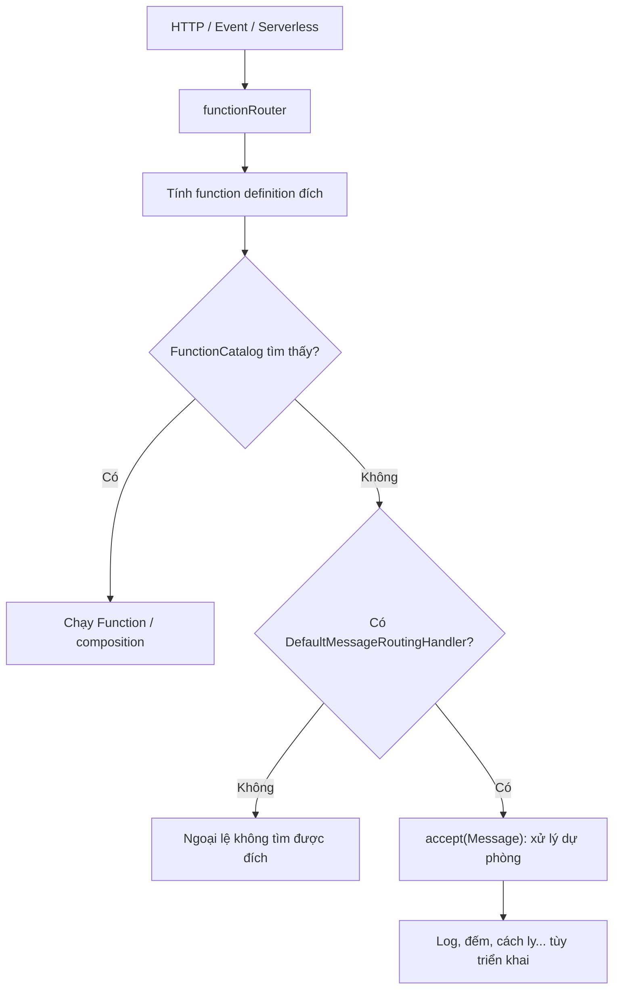

# Xử lý không tìm thấy hàm bằng `DefaultMessageRoutingHandler`

## Mục tiêu học tập

Sau bài học, bạn có thể:

1. Giải thích khi nào `RoutingFunction` gặp thông điệp **không thể định tuyến** vì không tìm được function definition trong `FunctionCatalog`.
2. Phân biệt hành vi mặc định phát sinh ngoại lệ với cơ chế mở rộng `DefaultMessageRoutingHandler`.
3. Đăng ký một bean `DefaultMessageRoutingHandler`, ghi nhận message không định tuyến được và lựa chọn chính sách xử lý phù hợp.
4. Phân biệt handler dự phòng với `MessageRoutingCallback`, một function `Consumer` dùng làm nhánh loại bỏ chủ động và cơ chế retry/dead-letter của adapter.
5. Kiểm thử trường hợp route hợp lệ, tên đích không tồn tại, cấu hình sai hoặc lỗi trong hàm nghiệp vụ mà không đưa ra giả định sai về HTTP status hay khả năng phát lại thông điệp.

## 1. Vì sao cần xử lý thông điệp không định tuyến được?

Trong **Spring Cloud Function**, nghiệp vụ được đóng gói bằng `Supplier`, `Function` và `Consumer` rồi đăng ký, tra cứu và ghép qua `FunctionCatalog`. Cùng một logic có thể được adapter gọi qua HTTP, sự kiện từ broker hoặc môi trường serverless mà không phải viết lại nghiệp vụ theo từng giao thức.

Khi một hệ thống chỉ muốn một điểm vào nhưng nhiều chức năng xử lý, Spring Cloud Function cung cấp `RoutingFunction` với tên mặc định **`functionRouter`**. Router nhận chỉ dẫn định tuyến từ header, SpEL hoặc callback rồi tra cứu function definition đích.

Ví dụ có hai function hợp lệ:

- `uppercase`: đổi chuỗi thành chữ in hoa.
- `reverse`: đảo chuỗi.

Một message gửi `spring.cloud.function.definition: uppercase` được xử lý bình thường. Nhưng một message khác gửi `spring.cloud.function.definition: normalize` khi ứng dụng **không đăng ký** function `normalize` sẽ không có đích để router ủy quyền thực thi.

Theo mặc định, trường hợp **hàm đích không có trong catalog** có thể dẫn tới ngoại lệ tra cứu. Trong hệ thống HTTP, bên gọi cần biết yêu cầu thất bại; trong hệ thống sự kiện, ta có thể muốn ghi nhận, chuyển sang kênh cách ly hoặc áp dụng chiến lược nghiệp vụ khác. Spring Cloud Function cung cấp **`DefaultMessageRoutingHandler`** cho phần xử lý này.



Điểm cần hiểu: **handler dự phòng nhận thông điệp không có route hợp lệ**, không phải một cách tự động để tìm một function khác có tên gần giống, và cũng không tự giải quyết mọi lỗi xảy ra sau khi function đã được chọn.

## 2. API và hành vi của `DefaultMessageRoutingHandler`

Spring Cloud Function định nghĩa chiến lược trong package:

```java
import org.springframework.cloud.function.context.DefaultMessageRoutingHandler;
```

API quan trọng là phương thức `accept`:

```java
// Hình thức sử dụng API (rút gọn):
@Bean
public DefaultMessageRoutingHandler defaultRoutingHandler() {
    return new DefaultMessageRoutingHandler() {
        @Override
        public void accept(Message<?> message) {
            // Xử lý message không thể định tuyến.
        }
    };
}
```

| Thành phần | Trách nhiệm |
| --- | --- |
| `RoutingFunction` (`functionRouter`) | Đọc chỉ dẫn và tìm function đích |
| `FunctionCatalog` | Tra cứu function definition hoặc composition theo tên |
| `DefaultMessageRoutingHandler` | Nhận `Message<?>` khi router không tìm được đích theo cơ chế hỗ trợ |
| `accept(Message<?> message)` | Điểm mở rộng để ghi log, thu thập metric hoặc áp dụng xử lý dự phòng do ứng dụng thiết kế |
| Adapter/binder | Chuyển kết quả hoặc lỗi sang HTTP, broker, serverless và thực hiện chính sách transport |

Theo [tài liệu chính thức về *Unroutable Messages*](https://docs.spring.io/spring-cloud-function/reference/spring-cloud-function/programming-model.html), chỉ cần đăng ký `DefaultMessageRoutingHandler` dưới dạng Spring bean để framework sử dụng. Hành vi triển khai mặc định của handler là **ghi log message không định tuyến được và cho luồng xử lý tiếp tục mà không ném ngoại lệ tra cứu**, về thực chất **bỏ qua thông điệp**.

Nếu cần hành vi phức tạp hơn, ta **override `accept`** trong bean. Đây là một chiến lược xử lý message, với phương thức có kiểu trả về `void`: không nên mong handler tự tạo ra một kết quả nghiệp vụ thay cho function đích.

### Không nhầm “bỏ qua” với “xử lý thành công”

Nếu handler chỉ log rồi kết thúc:

- Không có function nghiệp vụ nào xử lý payload đó.
- Không có bằng chứng rằng message đã được lưu vào hệ thống dự phòng.
- Adapter có thể coi lời gọi framework đã kết thúc mà không có lỗi, nhưng **HTTP status, response body, acknowledgment và retry** tùy từng adapter/binder.
- Một thông điệp quan trọng như lệnh thanh toán hoặc cập nhật đơn hàng có thể bị mất về mặt nghiệp vụ nếu luồng đã ghi nhận hoàn tất.

Vì vậy, chọn cách **drop**, **từ chối**, **cách ly**, hoặc **thực hiện xử lý bù** phải dựa trên ý nghĩa của thông điệp, không chỉ dựa vào mong muốn tránh stack trace.

## 3. Ví dụ Spring Boot: đếm và ghi log các route không tồn tại

Để thấy rõ cách dùng, ta tạo hai function nghiệp vụ, một bộ đếm và một handler tùy chỉnh. Ví dụ dùng Spring Boot với HTTP adapter `spring-cloud-starter-function-web`; chọn các phiên bản Spring Cloud Function và Spring Boot tương thích bằng dependency management/BOM.

```xml
<dependency>
    <groupId>org.springframework.cloud</groupId>
    <artifactId>spring-cloud-starter-function-web</artifactId>
</dependency>
```

```java
package com.example.unroutable;

import java.util.Locale;
import java.util.concurrent.atomic.AtomicLong;
import java.util.function.Function;

import org.slf4j.Logger;
import org.slf4j.LoggerFactory;
import org.springframework.boot.SpringApplication;
import org.springframework.boot.autoconfigure.SpringBootApplication;
import org.springframework.cloud.function.context.DefaultMessageRoutingHandler;
import org.springframework.context.annotation.Bean;
import org.springframework.messaging.Message;

@SpringBootApplication
public class UnroutableApplication {

    private static final Logger log =
            LoggerFactory.getLogger(UnroutableApplication.class);

    public static void main(String[] args) {
        SpringApplication.run(UnroutableApplication.class, args);
    }

    @Bean
    public Function<String, String> uppercase() {
        return text -> text.toUpperCase(Locale.ROOT);
    }

    @Bean
    public Function<String, String> reverse() {
        return text -> new StringBuilder(text).reverse().toString();
    }

    @Bean
    public AtomicLong unroutableTotal() {
        return new AtomicLong();
    }

    @Bean
    public DefaultMessageRoutingHandler defaultRoutingHandler(
            AtomicLong unroutableTotal) {
        return new DefaultMessageRoutingHandler() {
            @Override
            public void accept(Message<?> message) {
                unroutableTotal.incrementAndGet();
                log.warn(
                        "Không tìm thấy function đích, messageId={}, definition={}",
                        message.getHeaders().getId(),
                        message.getHeaders().get("spring.cloud.function.definition"));
            }
        };
    }
}
```

Trong mẫu này:

1. `uppercase` và `reverse` là các bean nghiệp vụ, đều được đăng ký trong `FunctionCatalog`.
2. `AtomicLong` là bộ đếm an toàn khi nhiều request hoặc event đồng thời cập nhật. Đây là công cụ minh họa; một hệ thống thực tế thường xuất metric qua Micrometer/Actuator và hệ thống giám sát.
3. `defaultRoutingHandler` là bean triển khai chiến lược `DefaultMessageRoutingHandler`. Khi route đích không tồn tại và handler được gọi, nó tăng counter và log một số metadata.
4. Handler **không** trả về payload nghiệp vụ và **không** lưu message để xử lý lại. Với quy trình cần bảo đảm không mất dữ liệu, đoạn handler này chưa đủ.

Log mẫu cố ý tránh ghi toàn bộ payload hoặc headers. Với dữ liệu nhạy cảm, ngay cả `definition` hay correlation metadata cũng cần được đánh giá trước khi đưa vào log.

### Vì sao khai báo hai function?

Trong một số cấu hình Spring Cloud Function có **single-function fallback**: khi catalog chỉ có đúng một function hợp lệ, việc lookup bằng tên bất kỳ có thể chọn function duy nhất đó. Điều này khiến một bài kiểm tra tên không tồn tại không thể hiện được tình huống thiếu đích.

Ví dụ khai báo hai function và **tắt single-function fallback** trong mục tiếp theo để kiểm tra route sai rõ ràng, có thể lặp lại. Không nên đánh đồng mọi chuỗi tên sai với một lỗi tra cứu nếu ứng dụng vẫn cho phép cơ chế fallback nói trên.

## 4. Chọn router làm điểm vào và thử qua HTTP

Ví dụ cấu hình:

```yaml
# application.yml
spring:
  cloud:
    function:
      definition: functionRouter
      single-function-fallback-enabled: false
```

`spring.cloud.function.definition=functionRouter` trong cấu hình ứng dụng có nhiệm vụ **chọn router làm function ở điểm vào**. Header cùng tên gửi theo từng request, chẳng hạn `spring.cloud.function.definition: reverse`, mới là **chỉ dẫn đích bên trong router**.

Khi Spring Cloud Function Web ánh xạ definition được chọn tới đường dẫn gốc `/`, ta có thể thử:

```bash
# Route hợp lệ: gọi uppercase
curl -i -X POST http://localhost:8080/ \
  -H "Content-Type: text/plain" \
  -H "spring.cloud.function.definition: uppercase" \
  --data-raw "hello"
# Payload nghiệp vụ mong đợi: HELLO

# Route hợp lệ: gọi reverse
curl -i -X POST http://localhost:8080/ \
  -H "Content-Type: text/plain" \
  -H "spring.cloud.function.definition: reverse" \
  --data-raw "hello"
# Payload nghiệp vụ mong đợi: olleh

# Route không tồn tại: kích hoạt handler dự phòng
curl -i -X POST http://localhost:8080/ \
  -H "Content-Type: text/plain" \
  -H "spring.cloud.function.definition: normalize" \
  --data-raw "hello"
# Kiểm tra log/counter thay vì giả định một response body cụ thể.
```

Với request cuối, tên `normalize` không có trong hai function đã đăng ký, vì vậy handler dự phòng có cơ hội nhận message. Hãy quan sát log `Không tìm thấy function đích` và giá trị counter.

Không khẳng định trước HTTP status hay nội dung response của request không định tuyến được: việc handler `accept` trả về `void` và hành vi chuyển đổi kết quả/lỗi của web adapter có thể khác tùy phiên bản và cấu hình. Nếu ứng dụng cần quy ước HTTP 4xx/5xx cụ thể, hãy xây dựng và kiểm thử cơ chế ánh xạ lỗi ở lớp HTTP.

**Lưu ý về URL:** `/` là minh họa khi adapter ánh xạ function được chọn vào đường dẫn mặc định. Với web path khác hoặc cách xuất function khác, có thể cần dùng `/functionRouter` hoặc endpoint tương ứng của ứng dụng.

### Thử khi chưa đăng ký handler

Để so sánh:

1. Chạy ứng dụng ở cấu hình **không có bean `DefaultMessageRoutingHandler`**.
2. Gửi request có route `normalize` không tồn tại.
3. Ghi nhận ngoại lệ do không tìm thấy definition tại router và cách adapter biểu diễn lỗi.
4. Khởi động lại với bean handler được đăng ký, gửi cùng message.
5. Kiểm tra handler có được gọi và quyết định đây có phải hành vi nghiệp vụ chấp nhận được hay không.

So sánh nên được thực hiện với **cùng function catalog, cùng dữ liệu và cùng cách đi vào router**, tránh so kết quả của endpoint gọi trực tiếp một function với endpoint router.

## 5. Kiểm thử handler bằng `FunctionCatalog`

Để kiểm tra route và handler riêng khỏi HTTP serialization, có thể tạo Spring `Message` từ `MessageBuilder`.

```java
import static org.junit.jupiter.api.Assertions.assertEquals;
import static org.junit.jupiter.api.Assertions.assertNotNull;

import java.util.concurrent.atomic.AtomicLong;
import java.util.function.Function;
import org.junit.jupiter.api.Test;
import org.springframework.beans.factory.annotation.Autowired;
import org.springframework.boot.test.context.SpringBootTest;
import org.springframework.cloud.function.context.FunctionCatalog;
import org.springframework.cloud.function.context.config.RoutingFunction;
import org.springframework.messaging.Message;
import org.springframework.messaging.support.MessageBuilder;

@SpringBootTest
class UnroutableHandlerTest {

    @Autowired
    private FunctionCatalog catalog;

    @Autowired
    private AtomicLong unroutableTotal;

    @Test
    void unknownFunctionIsDeliveredToHandler() {
        Function<Message<String>, ?> router =
                catalog.lookup(RoutingFunction.FUNCTION_NAME);
        assertNotNull(router);

        long before = unroutableTotal.get();
        Message<String> request = MessageBuilder.withPayload("hello")
                .setHeader("spring.cloud.function.definition", "normalize")
                .build();

        router.apply(request);

        assertEquals(before + 1, unroutableTotal.get());
    }
}
```

Đây là bài kiểm tra **tích hợp với Spring context và FunctionCatalog** ở mức tối thiểu. Test phụ thuộc vào bean handler và hai function đã định nghĩa trong ứng dụng mẫu. Nó xác minh handler được gọi một lần đối với tên không tồn tại, không khẳng định response HTTP, retry hoặc message đã được lưu bền vững.

Nếu có nhiều test thực thi đồng thời chia sẻ `AtomicLong`, phải cách ly context/trạng thái hoặc thiết kế assertion thích hợp để tránh kết quả bị tác động bởi những message ngoài test.

### Kiểm tra route hợp lệ không đi qua handler

Có thể bổ sung một test gọi route `uppercase` và xác minh bộ đếm không tăng:

```java
Message<String> valid = MessageBuilder.withPayload("hello")
        .setHeader("spring.cloud.function.definition", "uppercase")
        .build();

long before = unroutableTotal.get();
router.apply(valid);
assertEquals(before, unroutableTotal.get());
```

Đoạn này được đặt trong một test đã có biến `router` và `unroutableTotal` như ví dụ ở trên. Kiểm tra này chỉ chứng minh **không dùng đường xử lý thiếu đích** cho một message hợp lệ; việc xác minh payload kết quả cần assertion riêng.

## 6. Ranh giới: những lỗi nào handler xử lý?

Tên `DefaultMessageRoutingHandler` dễ gây hiểu nhầm rằng nó là **global exception handler** cho mọi lỗi của Spring Cloud Function. Cần phân loại:

| Tình huống | Ví dụ | Có phải chức năng chính của `DefaultMessageRoutingHandler`? |
| --- | --- | --- |
| Tên function đích không tìm thấy trong `FunctionCatalog` | Header `definition: normalize` khi không có function này | **Có** — trường hợp *unroutable message* được tài liệu mô tả |
| Composition chứa function không tồn tại | `uppercase|normalize` | Có thể dẫn tới definition không tra cứu được; cần kiểm chứng theo đường lookup/composition của phiên bản |
| Không gửi chỉ dẫn routing nào | Message không có header và không có property route | Phụ thuộc quy tắc chọn hàm mặc định; **không mặc nhiên kết luận** handler sẽ được gọi |
| SpEL sai cú pháp hoặc đánh giá lỗi | `routing-expression` không hợp lệ | Lỗi biểu thức; **không mặc nhiên được handler thu hồi** |
| Function đã tìm thấy nhưng ném ngoại lệ | `reverse` ném `IllegalArgumentException` | **Không** — đó là lỗi thực thi nghiệp vụ |
| Payload sai kiểu hoặc lỗi chuyển đổi | JSON không phù hợp chữ ký `Function<Order, ...>` | **Không** — đó là lỗi chuyển đổi dữ liệu |
| HTTP gọi đường dẫn không tồn tại | `POST /no-such-endpoint` | **Không** — thường là lỗi ánh xạ đường dẫn của web adapter |
| Broker kết nối lỗi hoặc timeout | Kafka/RabbitMQ không khả dụng | **Không** — lỗi transport/binder |

**Nguyên tắc:** trước khi quyết định xử lý dự phòng, xác định lỗi nằm ở **chọn tên route**, **tra cứu catalog**, **chuyển đổi dữ liệu**, **thực thi function** hay **tầng giao thức**. Handler chỉ nhằm hỗ trợ trường hợp không thể định tuyến theo cơ chế router, không thay thế error handler của các lớp còn lại.

## 7. Chọn chính sách xử lý: bỏ qua, từ chối, cách ly hay dự phòng

Một ứng dụng có thể chọn nhiều chiến lược; mỗi chiến lược có hệ quả khác nhau:

| Chiến lược | Khi nào phù hợp | Rủi ro cần quản lý |
| --- | --- | --- |
| **Ghi log rồi bỏ qua** | Dữ liệu tham khảo/telemetry có thể loại bỏ theo chính sách | Mất dữ liệu nếu thông điệp quan trọng bị drop |
| **Đếm metric và cảnh báo** | Muốn theo dõi tỷ lệ route sai | Metric không thay thế cơ chế xử lý/lưu trữ |
| **Từ chối bằng ngoại lệ** | Caller cần thấy lỗi và sửa route; broker có retry phù hợp | Retry không giới hạn có thể gây vòng lặp |
| **Cách ly vào hàng đợi/kho lưu trữ** | Cần điều tra hoặc phát lại message sau khi sửa cấu hình | Cần bảo đảm ghi nhận bền vững, retry, chống trùng lặp và kiểm soát dữ liệu |
| **Chuyển đến function dự phòng có chủ đích** | Có logic nghiệp vụ được xác định rõ cho mọi route lạ | Có thể làm sai nghiệp vụ nếu fallback quá rộng |

### A. Log và đo lường: dễ triển khai, nhưng không bảo toàn dữ liệu

Bean ở mục 3 ghi log và tăng counter. Cách này phù hợp khi **chính sách đã cho phép bỏ qua** message không được định tuyến. Trong một hệ thống nhận sự kiện giao dịch quan trọng, việc handler kết thúc bình thường có thể khiến tầng transport đánh dấu message đã xử lý, tùy binder và acknowledgment mode.

Không nên diễn giải “framework không ném exception” là “event đã được xử lý thành công về mặt nghiệp vụ”.

### B. Cách ly để xem lại và phát lại

Nếu cần giữ thông điệp để xử lý sau, một implementation của `accept(Message<?> message)` có thể gọi thành phần ứng dụng để gửi vào **quarantine queue/topic** hoặc kho lưu trữ bền vững:

```java
@Bean
public DefaultMessageRoutingHandler defaultRoutingHandler(
        UnroutableMessageStore store) {
    return new DefaultMessageRoutingHandler() {
        @Override
        public void accept(Message<?> message) {
            // Interface UnroutableMessageStore là thành phần ứng dụng tự thiết kế.
            // Phương thức phải có hợp đồng lỗi/độ bền rõ ràng.
            store.persist(message);
        }
    };
}
```

Đây là **phác thảo kiến trúc**, không phải code độc lập chạy ngay: `UnroutableMessageStore` cần được cài đặt, đăng ký bean và kiểm chứng độ bền. Hãy xác định rõ:

- Message được xác nhận ở binder **trước hay sau** khi ghi thành công?
- Ghi thất bại có làm handler ném lỗi để kích hoạt chính sách retry hay không?
- Có cơ chế chống xử lý trùng khi broker phát lại cùng một message không?
- Có cần loại bỏ hoặc mã hóa dữ liệu nhạy cảm khi lưu thông điệp lỗi không?
- Người vận hành sửa route bằng cách nào và phát lại vào điểm vào nào?

Chỉ log, gửi bất đồng bộ theo kiểu *fire-and-forget* rồi trả về từ `accept` chưa tạo ra bảo đảm lưu trữ bền vững.

### C. Chủ động từ chối và để adapter xử lý lỗi

Nếu route không hợp lệ phải được coi là lỗi, ứng dụng có thể chọn **không đăng ký handler** để giữ hành vi ngoại lệ tra cứu, hoặc viết chiến lược có chủ đích phát sinh lỗi theo hợp đồng ứng dụng. HTTP adapter cần ánh xạ lỗi thành status/body phù hợp; Stream binder cần retry/dead-letter phù hợp. Không nên thiết kế logic dựa trên một mã status HTTP cố định khi chưa kiểm tra adapter thực tế.

## 8. Phân biệt với `MessageRoutingCallback` và function `devNull`

Ba cơ chế thường bị nhầm khi thấy trong cùng tài liệu Function Routing and Filtering:

| Cơ chế | Hoạt động ở bước nào? | Nhiệm vụ |
| --- | --- | --- |
| `MessageRoutingCallback` | **Trước tra cứu** tên function | Tính definition đích cho message bằng Java |
| `DefaultMessageRoutingHandler` | **Khi không tra cứu được** route-to function theo cơ chế hỗ trợ | Xử lý thông điệp không định tuyến được |
| Function `Consumer<?> devNull` | **Sau khi router chọn một nhánh hợp lệ** | Chủ động nhận và loại bỏ message theo chính sách lọc |

Ví dụ function lọc chủ động:

```java
@Bean
public java.util.function.Consumer<Object> devNull() {
    return ignored -> {
        // Trường hợp này đã được chính sách cho phép bỏ qua.
    };
}
```

```yaml
spring:
  cloud:
    function:
      definition: functionRouter
      routing-expression: "headers['enabled'] == true ? 'uppercase' : 'devNull'"
```

Trong ví dụ filtering, `devNull` là **function đích tồn tại trong catalog** và nhánh loại bỏ là **kết quả được dự liệu trước**, không phải lỗi không tìm thấy function. Cần lưu ý kiểu dữ liệu đầu vào của `uppercase` và `devNull`, cùng việc adapter xử lý kết quả của `Consumer`, có thể khác nhau. Ví dụ `enabled` cũng giả định header thực tế mang kiểu boolean `true`, không phải chuỗi `"true"`.

Nếu muốn xử lý fallback nghiệp vụ có kết quả hữu ích, hãy thiết kế một **function đích hợp lệ** (và một routing expression/callback chọn nó) thay vì kỳ vọng `DefaultMessageRoutingHandler.accept` trả về một payload thay thế.

## 9. Vai trò của thứ tự ưu tiên khi một route bị lỗi

Với **imperative message routing**, thứ tự chọn đích thường là:

1. Bean `MessageRoutingCallback`.
2. Message headers `spring.cloud.function.definition` hoặc `spring.cloud.function.routing-expression`.
3. Application/system routing properties.

Ví dụ ứng dụng đặt route mặc định:

```yaml
spring:
  cloud:
    function:
      definition: functionRouter
      routing-expression: "'uppercase'"
```

Nhưng một Message gửi header `spring.cloud.function.definition: normalize`. Khi không có callback, header được ưu tiên và chỉ dẫn đích không tồn tại có thể đưa tới `DefaultMessageRoutingHandler`.

**Không nên cho rằng framework thấy `normalize` không tồn tại thì tự thử `uppercase` từ property.** Thứ tự ưu tiên dùng để **chọn nguồn chỉ dẫn**, không phải chuỗi thử lại nhiều nguồn cho đến khi thành công.

Nếu đăng ký `MessageRoutingCallback`, callback có thể chọn một tên route từ dữ liệu nghiệp vụ, ví dụ chỉ cho phép `upper` và `reverse`. Callback có ưu tiên cao hơn routing header. Tuy nhiên, nếu callback trả về tên không tồn tại, kết quả vẫn là tình huống **đích không có trong catalog**, không phải một cơ chế bảo vệ tự động.

## 10. Áp dụng qua HTTP, sự kiện và serverless

| Môi trường | Đặc điểm khi gặp route không tồn tại | Việc cần quyết định |
| --- | --- | --- |
| Spring Cloud Function Web | Adapter gọi `functionRouter`, chuyển HTTP headers vào Spring Message | Trả lỗi HTTP hay xử lý mềm? Body/status xác định ở tầng web |
| Spring Cloud Stream | Event được binder chuyển thành Spring Message, có thể định tuyến theo header hoặc SpEL | Retry, acknowledgment, dead-letter, idempotency, thứ tự phát lại |
| Serverless adapter | Mỗi invocation/batch được adapter đưa vào framework | Có trả lỗi để nền tảng retry không, và metadata/response được ánh xạ ra sao |
| Java nội bộ | Gọi router tra cứu qua `FunctionCatalog` | Caller kiểm tra kết quả, quan sát handler và xử lý ngoại lệ thế nào |

Với Spring Cloud Stream, event routing thường sử dụng `spring.cloud.stream.function.routing.enabled=true` và binding đầu vào `functionRouter-in-0`. Khi binder thông báo đã xử lý một event, liệu việc đó đồng nghĩa ứng dụng đã lưu event vào kho cách ly hay chưa phụ thuộc **hợp đồng xử lý đồng bộ/bất đồng bộ, acknowledgment và lỗi thực tế**.

### Reactive function là trường hợp khác

Với imperative `Function<T,R>`, router có thể chọn đích theo từng `Message`. Với `Function<Flux<T>, Flux<R>>` hoặc `Publisher`, framework định tuyến ở **cấp luồng** bằng application properties, không đọc routing header cho mỗi phần tử trong `Flux`.

Không giả định `DefaultMessageRoutingHandler` sẽ được gọi riêng cho từng phần tử của một reactive stream có metadata route sai. Nếu cần ghi nhận từng sự kiện không hợp lệ, hãy xử lý từng event ở mô hình imperative hoặc thiết kế luồng reactive có nhánh kiểm tra/lưu lỗi rõ ràng.

## 11. Chẩn đoán lỗi đúng tầng

| Triệu chứng | Nguyên nhân có thể | Hướng kiểm tra |
| --- | --- | --- |
| Header `definition: normalize` không phát sinh handler | Adapter không gọi `functionRouter`; callback chọn route khác; hoặc single-function fallback đang hoạt động | Kiểm tra điểm vào, nguồn chỉ dẫn ưu tiên và catalog |
| Handler được gọi nhưng không có output nghiệp vụ | `accept` không trả kết quả và message không tới function đích | Kiểm tra chính sách drop/quarantine, không mặc định đây là success |
| Tên route chính xác vẫn thất bại | Function đã tìm thấy nhưng lỗi chuyển đổi hoặc exception nghiệp vụ | Kiểm tra chữ ký function, `Content-Type`, stack trace |
| Lỗi SpEL nhưng handler không được gọi | Lỗi xảy ra khi đánh giá expression, trước bước tra cứu bình thường | Kiểm tra cú pháp/kiểu payload, log đánh giá expression |
| Message bị xử lý lại nhiều lần sau khi handler ném lỗi | Binder hoặc nền tảng có retry | Kiểm tra cấu hình retry, poison message và DLQ |
| Không có exception nhưng mất sự kiện | Handler chỉ log/đếm rồi trả về bình thường | Bổ sung đường lưu trữ bền vững hoặc chính sách từ chối |
| `POST /unknown` báo 404 | Không có HTTP mapping, chưa vào router | Gọi đúng endpoint của router trước khi thử route sai |
| Route sai không tái hiện khi catalog chỉ có một function | Cơ chế single-function fallback | Tắt fallback hoặc tạo nhiều function hợp lệ trong môi trường test |

Để debug, đi theo chuỗi: **adapter chọn điểm vào → nguồn định tuyến thắng → tên definition nhận được → tra cứu catalog → handler (nếu thiếu đích) hoặc function nghiệp vụ → adapter xử lý kết quả/lỗi**.

## 12. Bài tập thực hành

1. Dùng hai bean `uppercase`, `reverse`. Không đăng ký `DefaultMessageRoutingHandler`, gửi header `spring.cloud.function.definition: normalize`. Ghi nhận hành vi khi catalog không có đích.
2. Đăng ký handler ở mục 3. Gửi lại message không hợp lệ, kiểm tra counter và log; giải thích vì sao không xuất hiện output nghiệp vụ từ `normalize`.
3. Gửi hai message hợp lệ đến `uppercase` và `reverse`, rồi gửi một message sai. Xác minh handler chỉ được dùng cho message không có route hợp lệ.
4. Bật property `spring.cloud.function.single-function-fallback-enabled=false`, sau đó thay đổi số lượng bean function trong context. Giải thích vì sao thiết lập này hữu ích để kiểm thử tên không tồn tại.
5. Đặt `routing-expression: "'uppercase'"` làm mặc định nhưng gửi header `spring.cloud.function.definition: normalize`. Dự đoán nguồn route được ưu tiên, không giả định framework tự thử property thấp hơn.
6. Sửa handler để gọi một thành phần `UnroutableMessageStore` giả lập. Thiết kế test mô phỏng lỗi ghi, xác định khi nào cần ném exception và cách broker nên retry.
7. Viết một `Consumer<Object> devNull` và routing expression có nhánh loại bỏ có chủ đích. So sánh **filtering** với **route không tồn tại**, nêu khi nào dùng mỗi cách.
8. Chọn một sự kiện quan trọng như `OrderPaid`. Quy định metadata, cơ chế lưu cách ly, idempotency key, retry và khả năng phát lại nếu function đích chưa được triển khai.
9. Nêu ví dụ một lỗi `Function` nghiệp vụ hoặc lỗi JSON conversion mà `DefaultMessageRoutingHandler` không giải quyết. Đề xuất vị trí error handler phù hợp trong kiến trúc.

## Ghi nhớ

- **`DefaultMessageRoutingHandler`** là điểm mở rộng của Spring Cloud Function cho thông điệp không thể định tuyến **vì function đích không tìm thấy trong `FunctionCatalog`**.
- Đăng ký bean chiến lược và override **`accept(Message<?> message)`** để kiểm soát việc ghi log, đếm metric, cách ly hoặc xử lý tùy nhu cầu.
- Hành vi handler mặc định **ghi log rồi cho luồng đi tiếp**, về thực chất có thể bỏ message; không xem đó là bằng chứng nghiệp vụ đã xử lý thành công.
- Handler **khác** `MessageRoutingCallback` (chọn đích trước lookup) và một `Consumer` `devNull` (nhánh lọc chủ động có definition hợp lệ).
- Route sai và lỗi SpEL, conversion, business logic hoặc lỗi HTTP/binder là các loại sự cố khác nhau; cần chọn điểm xử lý lỗi phù hợp.
- Cần kiểm tra riêng **HTTP status, acknowledgment, retry và độ bền lưu trữ** ở adapter thực tế, đặc biệt khi thông điệp không được phép mất.

### Tài liệu tham khảo chính thức

- [Spring Cloud Function — Programming model: Unroutable Messages, Function Routing and Filtering](https://docs.spring.io/spring-cloud-function/reference/spring-cloud-function/programming-model.html)
- [Spring Cloud Function — Standalone Web Applications](https://docs.spring.io/spring-cloud-function/reference/spring-cloud-function/standalone-web-applications.html)
- [Spring Cloud Stream — Event Routing](https://docs.spring.io/spring-cloud-stream/reference/spring-cloud-stream/event-routing.html)
- [Spring Boot — Externalized Configuration](https://docs.spring.io/spring-boot/reference/features/external-config.html)
