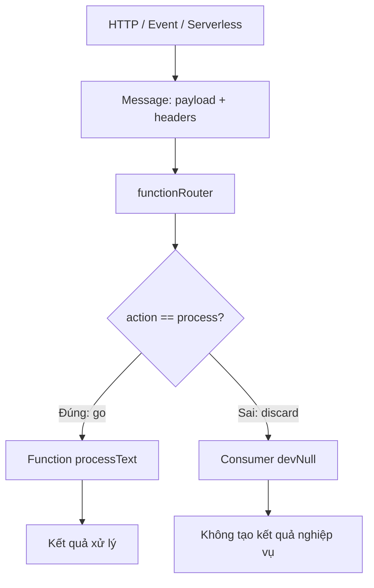

# Lọc dữ liệu bằng nhánh xử lý và nhánh loại bỏ

## Mục tiêu bài học

Sau bài này, bạn có thể:

1. Giải thích vì sao **filtering** trong Spring Cloud Function là một dạng định tuyến với hai lựa chọn: **xử lý** (*go*) hoặc **loại bỏ có chủ đích** (*discard*).
2. Tạo một `Function` xử lý dữ liệu và một `Consumer` loại bỏ, sau đó dùng `functionRouter` cùng `spring.cloud.function.routing-expression` để chọn nhánh theo từng `Message`.
3. Phân biệt thông điệp được **chủ động đưa vào nhánh loại bỏ** với thông điệp **không tìm thấy function đích**; hiểu vì sao `DefaultMessageRoutingHandler` không thay thế nhánh lọc.
4. Kiểm thử cả hai nhánh bằng HTTP và `FunctionCatalog`, đồng thời hiểu giới hạn của kiểu trả về, message conversion và reactive routing.
5. Thiết kế chính sách lọc an toàn khi áp dụng cho sự kiện, dữ liệu nghiệp vụ hoặc môi trường serverless: theo dõi số lượng bỏ qua, kiểm soát dữ liệu mất và xử lý sai điều kiện.

## 1. Bài toán: không phải mọi thông điệp đều cần xử lý

Spring Cloud Function tổ chức logic nghiệp vụ dưới dạng `Supplier`, `Function` và `Consumer`. `FunctionCatalog` đăng ký và tra cứu các hàm, hỗ trợ composition và cho phép adapter đưa cùng một logic tới HTTP, sự kiện hoặc serverless mà không phải viết lại mã nghiệp vụ theo giao thức.

Giả sử một ứng dụng tiếp nhận thông điệp văn bản. Chỉ những thông điệp có header `action=process` mới cần chuyển thành chữ hoa; những thông điệp được đánh dấu `action=discard` là dữ liệu thử nghiệm đã có quyết định loại bỏ và **không cần chuyển đổi**.

| Thông điệp | Payload | Header `action` | Quyết định |
| --- | --- | --- | --- |
| A | `hello` | `process` | Gọi `processText`, cho kết quả `HELLO` |
| B | `noise` | `discard` | Gọi `devNull`, ghi nhận đã bỏ qua |
| C | `spring` | `process` | Gọi `processText`, cho kết quả `SPRING` |

Nếu đặt điều kiện `if/else` trong `processText`, hàm nghiệp vụ phải biết cả chính sách loại bỏ. Thay vào đó, **`RoutingFunction`** (tên mặc định `functionRouter`) có thể chọn một trong hai function definition:



Đây là **lọc dữ liệu ở tầng điều phối**. Cả `processText` và `devNull` đều là bean thực sự tồn tại trong `FunctionCatalog`; router chọn một đích hợp lệ, không phải cố tình gây ra lỗi tra cứu để bỏ qua dữ liệu.

## 2. Function filtering hoạt động ra sao?

Theo tài liệu Spring Cloud Function, *function filtering* là trường hợp đặc biệt của *function routing*: thay vì chọn giữa nhiều nghiệp vụ, ta chỉ cần hai hướng:

- **Go:** thông điệp đáp ứng điều kiện, được chuyển cho hàm cần xử lý.
- **Discard:** thông điệp không đáp ứng điều kiện, được chuyển cho một `Consumer` do ứng dụng định nghĩa để bỏ qua, ghi log, đếm hoặc áp dụng hành động tương đương.

Framework không áp đặt một cách cấu hình “drop” chung cho mọi ứng dụng, vì “loại bỏ” có thể có ý nghĩa rất khác nhau: bỏ hẳn, đếm số lượng, ghi nhận lý do, hoặc gửi sang một luồng kiểm tra. Cách được khuyến nghị là **định nghĩa một `Consumer` đại diện cho nhánh discard**.

```java
@Bean
public Consumer<Object> devNull() {
    return ignored -> {
        // Không thực hiện xử lý nghiệp vụ.
    };
}
```

Trong ví dụ trên, tên bean `devNull` là một **tên theo quy ước của ứng dụng**, không phải từ khóa đặc biệt của framework. Có thể đặt là `discardMessage` hoặc `skipTelemetry`, miễn là routing expression trả đúng tên function trong catalog.

Chữ ký `Consumer<Object>` giúp nhánh loại bỏ không cần biết cấu trúc payload cụ thể. Tài liệu Spring Cloud Function còn minh họa `Consumer<?>` và nêu lợi ích tránh cố chuyển đổi dữ liệu sang một kiểu payload nghiệp vụ hẹp; cần nhớ adapter bên ngoài vẫn có thể thực hiện các bước chuyển đổi/giải mã khác trước khi message tới router.

### Một `Consumer` không trả về payload nghiệp vụ

Sự khác nhau về chữ ký rất quan trọng:

| Loại function | Chữ ký Java | Đầu ra nghiệp vụ |
| --- | --- | --- |
| Nhánh xử lý bằng `Function` | `Function<String, String>` | Có, ví dụ `HELLO` |
| Nhánh loại bỏ bằng `Consumer` | `Consumer<Object>` | Không, phương thức `accept` trả về `void` |
| Nhánh xử lý bằng `Consumer` | `Consumer<Order>` | Không, có thể ghi DB/gửi lệnh |

Nếu một adapter đang mong có kết quả để trả HTTP hoặc xuất sang broker, nhánh `Consumer` loại bỏ **không thể mặc nhiên tạo ra một giá trị thay thế**. Cách adapter biểu diễn trường hợp này (status, response body, acknowledgment, output binding) tùy cách triển khai và cần được kiểm thử.

## 3. Ứng dụng Spring Boot: nhánh xử lý và nhánh loại bỏ

Ví dụ sử dụng Spring Boot, Spring Cloud Function Web và hai bộ đếm để kiểm tra xem nhánh nào đã được gọi. Hãy quản lý các phiên bản Spring Cloud Function/Spring Boot tương thích thông qua BOM hoặc dependency management của dự án.

```xml
<dependency>
    <groupId>org.springframework.cloud</groupId>
    <artifactId>spring-cloud-starter-function-web</artifactId>
</dependency>
```

Tạo ứng dụng:

```java
package com.example.filterrouting;

import java.util.Locale;
import java.util.concurrent.atomic.AtomicLong;
import java.util.function.Consumer;
import java.util.function.Function;

import org.springframework.boot.SpringApplication;
import org.springframework.boot.autoconfigure.SpringBootApplication;
import org.springframework.context.annotation.Bean;

@SpringBootApplication
public class FilteringApplication {

    public static void main(String[] args) {
        SpringApplication.run(FilteringApplication.class, args);
    }

    // Chỉ chứa bộ đếm minh họa; production có thể dùng Micrometer.
    public static final class FilterCounters {
        public final AtomicLong processed = new AtomicLong();
        public final AtomicLong discarded = new AtomicLong();
    }

    @Bean
    public FilterCounters filterCounters() {
        return new FilterCounters();
    }

    @Bean
    public Function<String, String> processText(FilterCounters counters) {
        return text -> {
            counters.processed.incrementAndGet();
            return text.toUpperCase(Locale.ROOT);
        };
    }

    @Bean
    public Consumer<Object> devNull(FilterCounters counters) {
        return ignored -> counters.discarded.incrementAndGet();
    }
}
```

Ba bean có ba trách nhiệm riêng:

1. `processText` xử lý dữ liệu nghiệp vụ bằng một `Function<String, String>`.
2. `devNull` **chủ động tiêu thụ** mọi payload được gửi đến nhánh discard và chỉ tăng bộ đếm. Trong ví dụ này, không lưu trữ payload và không trả kết quả.
3. `filterCounters` cho phép đo riêng số lần đi vào hai nhánh; `AtomicLong` hỗ trợ tăng bộ đếm an toàn khi có nhiều request đồng thời.

**Lưu ý:** bộ đếm chạy trong bộ nhớ ứng dụng sẽ mất khi khởi động lại và không gộp số liệu giữa nhiều instance. Nếu cần monitoring thực tế, hãy xuất counter/metric tập trung (ví dụ bằng Micrometer) và gắn nhãn lý do lọc ở mức an toàn.

## 4. Cấu hình hai nhánh bằng routing expression

Tạo `application.yml`:

```yaml
spring:
  cloud:
    function:
      definition: functionRouter
      routing-expression: "headers['action'] == 'process' ? 'processText' : 'devNull'"
```

Giải thích:

- `definition: functionRouter`: yêu cầu adapter dùng `RoutingFunction` làm **điểm vào**.
- `routing-expression`: biểu thức **Spring Expression Language (SpEL)** được đánh giá khi router nhận một `Message`.
- `headers['action']`: đọc header nghiệp vụ `action` từ `Message`.
- `? 'processText' : 'devNull'`: trả về **tên function definition** được đăng ký trong `FunctionCatalog`.

```text
Message(action=process, payload="hello")
    → SpEL = "processText"
    → FunctionCatalog.lookup("processText")
    → Function.apply("hello")
    → "HELLO"

Message(action=discard, payload="noise")
    → SpEL = "devNull"
    → FunctionCatalog.lookup("devNull")
    → Consumer.accept(payload)
    → không có kết quả nghiệp vụ
```

Nếu `action` thiếu hoặc khác `process`, biểu thức trên **mặc định đi vào `devNull`**. Đây là hành vi minh họa theo kiểu *allow process, otherwise discard*, không phải chính sách luôn phù hợp cho ứng dụng thật. Trong môi trường có dữ liệu quan trọng, một giá trị sai chính tả như `proccess` cũng sẽ bị loại bỏ — có thể là mất dữ liệu ngoài ý muốn.

### Cách bảo toàn một số tiêu chí lọc khác

Theo ví dụ trong tài liệu Spring Cloud Function, có thể route theo content type:

```properties
spring.cloud.function.routing-expression=headers.contentType.toString().equals('text/plain') ? 'processText' : 'devNull'
```

Tuy nhiên, cần bảo đảm `contentType` thực sự tồn tại. Nếu header này thiếu, phép `toString()` có thể ném lỗi trước khi route được chọn. Đồng thời, HTTP `Content-Type` có thể được adapter chuyển thành kiểu MIME thay vì một chuỗi thuần; `text/plain;charset=UTF-8` cũng có thể không khớp so sánh chuỗi chính xác với `text/plain`.

Với mục tiêu giáo dục và việc định nghĩa chính sách nghiệp vụ, một header đã được chuẩn hóa như `action` thường dễ kiểm tra hơn. Khi lọc theo content type, hãy xem xét **kiểu Java và giá trị chuẩn hóa thực tế của header** trước khi viết expression.

## 5. Thử hai nhánh qua HTTP

Với Spring Cloud Function Web thông thường, khi `spring.cloud.function.definition=functionRouter` đã chọn router làm điểm vào, định nghĩa được chọn có thể được ánh xạ tại đường dẫn gốc `/`. Gửi:

```bash
# Nhánh GO: xử lý
curl -i -X POST http://localhost:8080/ \
  -H "Content-Type: text/plain" \
  -H "action: process" \
  --data-raw "hello"
# Payload kết quả nghiệp vụ mong đợi: HELLO

# Nhánh DISCARD: loại bỏ có chủ đích
curl -i -X POST http://localhost:8080/ \
  -H "Content-Type: text/plain" \
  -H "action: discard" \
  --data-raw "noise"
# Không mong đợi có payload nghiệp vụ do devNull tạo ra.
```

Sau request thứ nhất, bộ đếm `processed` tăng; sau request thứ hai, bộ đếm `discarded` tăng. Tên function được router chọn là khác nhau nhưng **URL đầu vào không đổi**.

Không ấn định trước **HTTP status, body rỗng hay giá trị null** của nhánh `Consumer` vì hành vi biểu diễn kết quả phụ thuộc adapter, phiên bản và cấu hình. Hãy xác minh chính xác trong ứng dụng mục tiêu. Nếu có web path riêng hoặc mapping theo tên, endpoint có thể là `/functionRouter` thay vì `/`.

### Thử thiếu header

```bash
curl -i -X POST http://localhost:8080/ \
  -H "Content-Type: text/plain" \
  --data-raw "hello"
```

Vì `headers['action']` không bằng `'process'`, message được chuyển đến `devNull`. Đây là một ví dụ tốt để kiểm tra **fallback có chủ đích** trước khi sử dụng cấu hình ngoài thực tế.

Nếu chính sách là **không có header thì phải từ chối**, cần thêm validation ở gateway, adapter hoặc `MessageRoutingCallback` thay vì để nhánh `devNull` âm thầm tiếp nhận.

## 6. Kiểm thử bằng `FunctionCatalog` và `MessageBuilder`

HTTP chỉ là một giao thức gọi. Để chứng minh chính `RoutingFunction` chọn đúng hai nhánh, ta có thể tạo Message trong Java và tra cứu router bằng tên mặc định:

```java
import java.util.function.Function;

import org.springframework.cloud.function.context.FunctionCatalog;
import org.springframework.cloud.function.context.config.RoutingFunction;
import org.springframework.messaging.Message;
import org.springframework.messaging.support.MessageBuilder;

// functionCatalog được inject trong một thành phần Spring.
Function<Message<String>, Object> router =
        functionCatalog.lookup(RoutingFunction.FUNCTION_NAME);

Message<String> keep = MessageBuilder.withPayload("hello")
        .setHeader("action", "process")
        .build();

Message<String> drop = MessageBuilder.withPayload("noise")
        .setHeader("action", "discard")
        .build();

Object keepResult = router.apply(keep);
Object dropResult = router.apply(drop);
```

Trong mã trên, router dùng biểu thức cấu hình để chọn `processText` hoặc `devNull`. Kết quả của `keepResult` gắn với xử lý chuỗi `hello`; còn `dropResult` **không có giá trị nghiệp vụ được Consumer trả ra**. Không nên ép cứng kiểu `String` cho cả hai nhánh.

### Kiểm thử tích hợp với bộ đếm

Ví dụ một test khi ứng dụng có `spring-boot-starter-test`:

```java
import static org.junit.jupiter.api.Assertions.assertEquals;
import static org.junit.jupiter.api.Assertions.assertNotNull;

import java.util.function.Function;
import org.junit.jupiter.api.Test;
import org.springframework.beans.factory.annotation.Autowired;
import org.springframework.boot.test.context.SpringBootTest;
import org.springframework.cloud.function.context.FunctionCatalog;
import org.springframework.cloud.function.context.config.RoutingFunction;
import org.springframework.messaging.Message;
import org.springframework.messaging.support.MessageBuilder;

@SpringBootTest
class FilteringIntegrationTest {

    @Autowired
    FunctionCatalog functionCatalog;

    @Autowired
    FilteringApplication.FilterCounters counters;

    @Test
    void routesToProcessAndDiscard() {
        Function<Message<String>, Object> router =
                functionCatalog.lookup(RoutingFunction.FUNCTION_NAME);
        assertNotNull(router);

        long processedBefore = counters.processed.get();
        long discardedBefore = counters.discarded.get();

        Message<String> keep = MessageBuilder.withPayload("hello")
                .setHeader("action", "process")
                .build();
        Message<String> drop = MessageBuilder.withPayload("noise")
                .setHeader("action", "discard")
                .build();

        router.apply(keep);
        router.apply(drop);

        assertEquals(processedBefore + 1, counters.processed.get());
        assertEquals(discardedBefore + 1, counters.discarded.get());
    }
}
```

Test trên kiểm tra cả hai **nhánh đã được gọi**; không dựa trên một HTTP response không được quy định. Nếu nhiều test chia sẻ Spring context hoặc chạy song song, cần cách ly bộ đếm hoặc thực thi theo điều kiện giúp phép so sánh `before + 1` không bị ảnh hưởng bởi request khác.

Một thử nghiệm đầy đủ hơn nên kiểm tra thêm payload của nhánh `processText`, đặc biệt nếu function kết quả có thể được framework bao trong `Message`. Hãy phân biệt **kiểm thử đường đi của router** với **kiểm thử logic nghiệp vụ của từng function**.

## 7. Nhánh discard khác gì một route không tồn tại?

Đây là phân biệt quan trọng nhất khi ứng dụng lọc dữ liệu:

| Đặc điểm | Lọc có chủ đích qua `devNull` | Route không tìm thấy đích |
| --- | --- | --- |
| Definition đích có tồn tại? | **Có**, `devNull` là bean `Consumer` | **Không**, tên hàm tra cứu không hợp lệ |
| Router có tra cứu được function? | Có | Không |
| Message được chuyển tới mã ứng dụng nào? | `Consumer.accept(payload)` | Có thể tới `DefaultMessageRoutingHandler.accept(Message<?>)` nếu đăng ký |
| Đây có phải một lỗi định tuyến? | Không, nếu nhánh loại bỏ là chính sách dự kiến | Có, tên đích không tìm thấy |
| Kết quả nghiệp vụ | Không có kết quả từ Consumer, có thể đếm/log | Tùy chính sách xử lý route sai |
| Khi nào chọn? | Biết rõ thông điệp không cần xử lý | Không thể xác định/chạy function được chỉ định |

`DefaultMessageRoutingHandler` là một **cơ chế xử lý message không định tuyến được** của Spring Cloud Function, không phải nhánh discard được chọn chủ động. Handler có thể ghi log rồi bỏ qua thông điệp khi tra cứu thất bại, nhưng việc cố ý gửi tên function không tồn tại để “lọc” là một thiết kế dễ nhầm lỗi cấu hình với hành vi nghiệp vụ.

**Khuyến nghị:** khi điều kiện lọc đưa ra lựa chọn “bỏ qua” một cách hợp lệ, hãy trả về tên `devNull` (hoặc một Consumer discard khác) có trong catalog. Chỉ xử lý `DefaultMessageRoutingHandler` khi gặp tình huống **không tìm được function đích**.

### Vì sao không dùng `null` làm tên route?

`routing-expression` phải trả về **một tên function definition** mà catalog tra cứu được, không phải tín hiệu “đừng gọi hàm” chung chung. Trả về `null` hoặc một tên giả không bảo đảm lọc an toàn; có thể sinh lỗi, đi vào fallback hoặc cho hành vi phụ thuộc phiên bản. Một `Consumer` được đăng ký là cách rõ ràng để mô hình hóa **nhánh loại bỏ**.

## 8. Bảo đảm chọn đúng điều kiện: allowlist, denylist và trường hợp không hợp lệ

Một biểu thức ngắn:

```spel
headers['action'] == 'process' ? 'processText' : 'devNull'
```

có nghĩa **chỉ nhận một giá trị vào nhánh xử lý; mọi giá trị khác bị bỏ qua**. Đây là chiến lược allowlist cho nhánh *go*, nhưng không nhất thiết là chiến lược quản lý lỗi đúng.

Ví dụ nếu `action` chỉ có ba trạng thái nghiệp vụ:

| `action` | Hành vi mong muốn |
| --- | --- |
| `process` | Xử lý |
| `discard` | Bỏ qua có chủ đích |
| Không có/sai giá trị | Từ chối hoặc đưa vào luồng kiểm tra, **không tự động bỏ qua** |

Ta có thể viết một `MessageRoutingCallback` để phân biệt rõ trạng thái:

```java
import org.springframework.cloud.function.context.MessageRoutingCallback;
import org.springframework.context.annotation.Bean;

@Bean
public MessageRoutingCallback filterPolicy() {
    return message -> {
        Object action = message.getHeaders().get("action");

        if ("process".equals(action)) {
            return "processText";
        }
        if ("discard".equals(action)) {
            return "devNull";
        }
        throw new IllegalArgumentException("Invalid action");
    };
}
```

**Lưu ý:** đây là một **phương án thay thế** cho chính sách SpEL đơn giản ở mục 4; nếu thêm callback vào cùng ứng dụng, callback có **ưu tiên cao hơn** routing expression ở property. Hãy ghi rõ nguồn điều khiển chính sách thay vì kỳ vọng hai cơ chế cùng quyết định route.

Khi callback ném ngoại lệ, việc HTTP trả status nào hay broker retry ra sao phụ thuộc adapter và cách cấu hình xử lý lỗi. Không mặc định mọi `IllegalArgumentException` sẽ thành HTTP 400, hoặc tự động vào dead-letter queue.

## 9. Thứ tự ưu tiên các chỉ dẫn routing

Với imperative message routing, router ưu tiên theo thứ tự:

1. Bean `MessageRoutingCallback` nếu có.
2. Message header `spring.cloud.function.definition` hoặc `spring.cloud.function.routing-expression`.
3. Application/system property định tuyến như `spring.cloud.function.routing-expression`.

Giả sử application property đang chọn `processText` khi `action=process`, còn message có header:

```text
action: process
spring.cloud.function.definition: devNull
```

Nếu không có callback, **routing header từ message có thể thắng biểu thức trong property**, làm message được chuyển thẳng tới nhánh loại bỏ. Vì thế, không thể xem `routing-expression` của ứng dụng là **bảo đảm không thể ghi đè** trong mọi hoàn cảnh.

Để hệ thống bên ngoài không tự thay đổi lựa chọn:

- Không cho phép client tùy ý gửi các header điều khiển framework khi không cần.
- Loại bỏ hoặc chuẩn hóa chúng ở gateway/adapter, hoặc sử dụng callback có **danh sách route được phép**.
- Kiểm soát những function endpoint được xuất trực tiếp. Nếu client có thể gọi `/processText` mà không đi qua router thì chính sách lọc ở router **không được thực thi**.

**Định tuyến không phải cơ chế phân quyền.** Header do client khai báo như `action`, `tenant` hoặc `role` không thể thay thế việc xác thực/phân quyền phía server.

## 10. Khi đưa filtering vào Spring Cloud Stream

Trong hệ thống sự kiện, nguồn gửi có thể phát các message như:

```text
Event #1: action=process, payload="hello"   -> processText
Event #2: action=discard, payload="noise"   -> devNull
Event #3: action=process, payload="spring"  -> processText
```

Với Spring Cloud Stream, event routing có thể được bật bằng `spring.cloud.stream.function.routing.enabled=true`; tên input binding mặc định của router thường là `functionRouter-in-0`.

```yaml
spring:
  cloud:
    stream:
      function:
        routing:
          enabled: true
      bindings:
        functionRouter-in-0:
          destination: incoming-text
    function:
      routing-expression: "headers['action'] == 'process' ? 'processText' : 'devNull'"
```

Cấu hình này chỉ minh họa **đầu vào của router**. Để chạy thực tế, cần thêm starter binder (Kafka/RabbitMQ...), kết nối broker, quy ước content type, consumer group và **cách phát đầu ra của nhánh xử lý** nếu cần. Vì nhánh xử lý trong ví dụ là `Function<String, String>` còn nhánh loại bỏ là `Consumer<Object>`, không nên giả định mọi message đều có output hoặc một output binding chung sẽ hoạt động giống hệt với hai nhánh.

Trong ứng dụng chỉ thực hiện tác dụng phụ, có thể dùng cả hai nhánh là `Consumer`: một Consumer ghi dữ liệu được chấp nhận, Consumer còn lại ghi nhận dữ liệu bỏ qua. Khi ấy không có nhánh nào phải trả kết quả nghiệp vụ; điều này có thể làm thiết kế event consumer rõ ràng hơn.

### Hậu quả của việc bỏ qua event

Một thông điệp đã vào `devNull` có thể được binder xem là xử lý xong, tùy cơ chế acknowledgment. Nếu vậy, dữ liệu có thể **không còn được phát lại** ngay cả khi người dùng sau đó nhận ra điều kiện lọc bị sai.

Đối với sự kiện quan trọng:

1. Xác định chính sách loại bỏ: loại sự kiện nào có thể bỏ và vì sao.
2. Đo số lượng/tỷ lệ discard, theo dõi đột biến và đặt cảnh báo.
3. Khi cần giữ để kiểm tra, gửi message sang một nguồn cách ly bền vững thay vì `devNull` chỉ đếm.
4. Kiểm thử retry, dead-letter, acknowledgment và idempotency với binder đang dùng; không giả định một Consumer đồng bộ đã đủ bảo đảm giao dịch.

## 11. HTTP, serverless và sự khác nhau về kết quả

Một `Function` trả `R`, còn một `Consumer` trả `void`. Khi cùng router có thể chọn một trong hai:

| Adapter | Nhánh xử lý | Nhánh discard | Cần kiểm tra |
| --- | --- | --- | --- |
| Spring Cloud Function Web | Có thể tạo response từ kết quả Function | Không có payload nghiệp vụ từ Consumer | HTTP status/body cụ thể khi Consumer được gọi |
| Spring Cloud Stream | Có thể cần đẩy kết quả ra destination | Không có dữ liệu đầu ra từ Consumer | Binding, serialization, ack, retry và DLQ |
| Serverless adapter | Handler chuyển kết quả Function sang đáp ứng nền tảng | Có thể không trả kết quả nghiệp vụ | Hợp đồng response/error của nền tảng |
| Java nội bộ | `router.apply(message)` có thể tạo giá trị hoặc Message được thích nghi | `Consumer.accept(...)` không trả payload | Kiểu trả về và bộ đếm/side effect |

Nên kiểm thử từng adapter với cả **message được chấp nhận** và **message bị loại bỏ**, nhất là khi giao thức yêu cầu response luôn có cấu trúc cố định.

## 12. Lọc từng message hay lọc từng phần tử trong một reactive stream?

Ví dụ `Function<String, String>` và `Consumer<Object>` ở trên là **imperative**. Mỗi Spring `Message` được router đánh giá riêng; vì vậy một message đi vào `processText`, message tiếp theo có thể đi vào `devNull`.

Với `Function<Flux<T>, Flux<R>>`, **đơn vị routing là toàn bộ Publisher**, không phải từng phần tử. Spring Cloud Function không dùng routing header của mỗi phần tử trong Publisher để đổi bean đích theo cơ chế imperative.

Nếu mục tiêu là **lọc các phần tử ngay bên trong một reactive stream**, hãy dùng các toán tử Reactor:

```java
import java.util.function.Function;
import reactor.core.publisher.Flux;

@Bean
public Function<Flux<String>, Flux<String>> filterThenUppercase() {
    return values -> values
            .filter(value -> !value.startsWith("#"))
            .map(value -> value.toUpperCase(java.util.Locale.ROOT));
}
```

Với `Flux.just("hello", "#ignore", "spring")`, Publisher kết quả phát ra `HELLO` và `SPRING` khi được subscribe. Đây là **lọc phần tử bằng Reactor trong một function**, **không phải `RoutingFunction` chọn `processText` hoặc `devNull` cho từng phần tử**.

Hai mô hình đều hợp lý nhưng đáp ứng nhu cầu khác nhau:

| Mục tiêu | Cơ chế nên dùng |
| --- | --- |
| Mỗi event trong broker có quyết định go/discard riêng | Imperative message routing tới hai nhánh |
| Một Publisher có các phần tử cần `filter` | Một reactive function dùng toán tử `Flux.filter` |
| Cả Publisher cần chạy một pipeline được chọn theo môi trường | Chọn reactive function bằng application property |
| Message cần được cách ly để kiểm tra lại | Một nhánh Consumer **ghi bền vững**/luồng lỗi do ứng dụng thiết kế |

## 13. Chẩn đoán những lỗi thường gặp

| Hiện tượng | Nguyên nhân khả dĩ | Cách xử lý |
| --- | --- | --- |
| Mọi message đều bị discard | Thiếu header `action`, sai giá trị hoặc biểu thức có nhánh mặc định quá rộng | Xem Message headers thật sự; test với `action=process` |
| Request có header process nhưng vẫn vào discard | Header `spring.cloud.function.definition` hoặc callback ưu tiên hơn property | Kiểm tra thứ tự ưu tiên và các nguồn chỉ dẫn |
| Router không tìm được `devNull` | Bean chưa đăng ký hoặc tên trong expression không khớp | Kiểm tra `@Bean` và `FunctionCatalog` |
| `devNull` bị yêu cầu chuyển payload sang loại dữ liệu không phù hợp | Consumer có type quá hẹp hoặc adapter conversion xảy ra trước router | Dùng chữ ký rộng khi discard, kiểm tra pipeline chuyển đổi |
| HTTP response của nhánh discard khác dự đoán | `Consumer` không trả dữ liệu và adapter có hợp đồng riêng | Kiểm thử status/body thực tế, không suy đoán giá trị |
| Sự kiện quan trọng biến mất mà không có lỗi | Nhánh discard được gọi và kết thúc bình thường | Ghi metric, thêm cảnh báo; dùng cách ly bền vững khi cần |
| Route `unknown` đi vào handler khác với devNull | Không tồn tại function đích | Phân biệt `DefaultMessageRoutingHandler` với nhánh discard hợp lệ |
| Nội dung JSON không lọc được theo trường | Payload tại router chưa phải POJO/Map mong muốn | Kiểm tra conversion và điều kiện SpEL trên kiểu thực tế |
| Header từng phần tử `Flux` không đổi nhánh | Reactive routing theo cả luồng | Dùng `Flux.filter` hoặc imperative message routing |

Khi debug, lần lượt kiểm tra **adapter có gọi `functionRouter` không → header/payload nào đến router → nguồn chỉ dẫn nào thắng → expression trả về `processText` hay `devNull` → catalog có đích không → side effect/đầu ra có phù hợp không**.

## 14. Bài tập thực hành

1. Tạo ứng dụng có `processText` và `devNull`. Gửi hai Message bằng `MessageBuilder` với `action=process` và `action=discard`; xác nhận hai bộ đếm thay đổi độc lập.
2. Gọi HTTP `/functionRouter` hoặc endpoint router theo cấu hình, thay header `action`. So sánh payload của nhánh process với trạng thái phản hồi của nhánh Consumer trên adapter bạn dùng.
3. Thử gửi thiếu `action` và gửi `action=proccess` (sai chính tả). Giải thích vì sao biểu thức nhị phân hiện tại loại bỏ cả hai và hậu quả nếu đó là event quan trọng.
4. Viết `MessageRoutingCallback` chỉ chấp nhận `process` và `discard`, còn giá trị khác ném exception. So sánh hành vi với expression có nhánh mặc định discard.
5. Thử gửi Message chứa `spring.cloud.function.definition: devNull` trong khi header `action=process`. Giải thích thứ tự ưu tiên khi không có callback, và đề xuất cách chống client tự bỏ qua chính sách.
6. Xóa bean `devNull` khỏi ứng dụng **trong một nhánh thí nghiệm riêng** rồi gửi action discard. Phân tích vì sao đây là lỗi thiếu đích chứ không còn là filtering hợp lệ.
7. Chuyển ví dụ sang Spring Cloud Stream nhận event từ `incoming-text`. Thiết kế output nếu nhánh process cần phát kết quả và xác định cách giám sát discard/acknowledgment.
8. Thay nhánh `devNull` bằng một Consumer ghi message vào quarantine store đã được kiểm thử. Nêu chiến lược xử lý khi lưu thất bại, retry, idempotency và phát lại.
9. Viết một `Function<Flux<String>, Flux<String>>` dùng `filter` để loại các phần tử bắt đầu bằng `#`. Giải thích vì sao đây không phải route từng phần tử bằng `functionRouter`.

## Ghi nhớ

- **Function filtering** là một trường hợp đặc biệt của routing: điều kiện chọn **nhánh xử lý** hoặc **nhánh loại bỏ**.
- Spring Cloud Function khuyến nghị mô hình hóa nhánh loại bỏ thành **một `Consumer` có tên rõ ràng**, ví dụ `devNull`, rồi để `routing-expression` trả về `processText` hoặc `devNull`.
- Nhánh `devNull` là **function definition hợp lệ**, không phải lỗi catalog; `DefaultMessageRoutingHandler` dành cho trường hợp **không tìm thấy hàm đích**.
- `Consumer` không trả về payload nghiệp vụ, nên HTTP/broker/serverless adapter cần được kiểm thử để hiểu response, output binding và acknowledgment.
- Biểu thức mặc định discard có thể làm mất dữ liệu khi header thiếu/sai. Hãy xác định rõ điều kiện từ chối, giám sát, lưu cách ly và mức độ tin cậy của metadata.
- Với imperative function, router chọn nhánh **theo từng `Message`**; còn lọc **từng phần tử của `Flux`** nên dùng toán tử Reactor hoặc thiết kế tách message, không dựa vào per-element routing header.

### Tài liệu tham khảo chính thức

- [Spring Cloud Function — Programming model: Function Routing and Filtering](https://docs.spring.io/spring-cloud-function/reference/spring-cloud-function/programming-model.html)
- [Spring Cloud Function — Standalone Web Applications](https://docs.spring.io/spring-cloud-function/reference/spring-cloud-function/standalone-web-applications.html)
- [Spring Cloud Stream — Event Routing](https://docs.spring.io/spring-cloud-stream/reference/spring-cloud-stream/event-routing.html)
- [Project Reactor — Reference Guide](https://projectreactor.io/docs/core/release/reference/)
