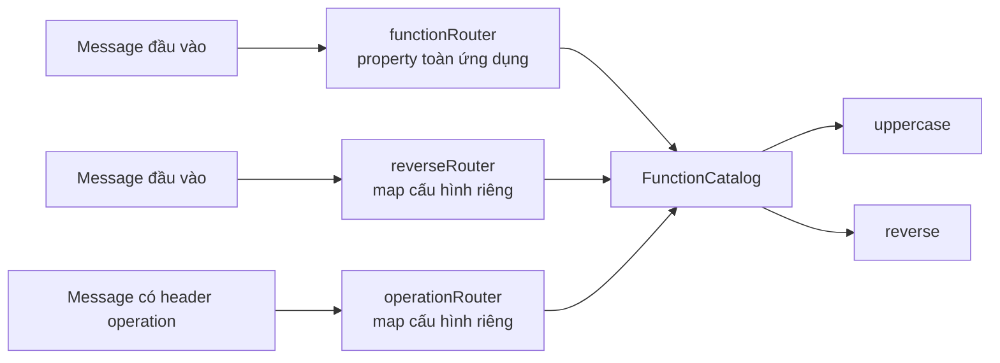

# Tạo nhiều router với tên và cấu hình riêng

## Mục tiêu học tập

Sau bài học, bạn có thể:

1. Giải thích vì sao một ứng dụng Spring Cloud Function có thể cần **nhiều `RoutingFunction`** thay vì chỉ router mặc định `functionRouter`.
2. Khai báo thêm các bean `RoutingFunction` có **tên duy nhất**, truyền cấu hình riêng bằng `Map<String, String>` trong constructor.
3. Phân biệt cấu hình **chọn router làm điểm vào** với cấu hình **chọn function đích bên trong mỗi router**.
4. Tra cứu router mặc định và router tùy chỉnh theo tên trong `FunctionCatalog`, gọi thử các route tĩnh và route theo header.
5. Nhận diện tác động của `MessageRoutingCallback`, routing headers, application properties, function composition và giới hạn reactive routing trong môi trường nhiều router.
6. Thiết kế kiểm thử, bảo mật và xử lý lỗi khi ứng dụng phục vụ các nhóm nghiệp vụ qua nhiều router.

## 1. Vì sao phải tạo nhiều router?

**Spring Cloud Function** tổ chức nghiệp vụ thành các bean `Supplier`, `Function` và `Consumer`, tra cứu qua `FunctionCatalog`. Nhờ đó, cùng một logic có thể phục vụ HTTP, event broker hoặc serverless qua những adapter tương ứng mà không phụ thuộc giao thức gọi.

Spring Cloud Function tạo sẵn **một router mặc định** mang tên `functionRouter`. Router này nhận chỉ dẫn, tìm function đích trong `FunctionCatalog` rồi ủy quyền thực thi.

Một router có thể đủ cho ứng dụng đơn giản. Tuy nhiên, khi nhiều điểm vào cần **chính sách định tuyến riêng**, sử dụng chung một property `spring.cloud.function.routing-expression` có thể không diễn đạt rõ ý định.

Ví dụ:

- **Điểm vào mặc định:** mọi thông điệp được đưa tới `uppercase`.
- **Điểm vào đảo chuỗi:** luôn chuyển tới `reverse`.
- **Điểm vào theo hoạt động:** đọc header `operation`; `reverse` thì đảo chuỗi, còn lại in hoa.

Ta có thể tổ chức:



Ba router dùng chung catalog và các bean nghiệp vụ, nhưng **mỗi router có tên riêng** và có thể giữ **chỉ dẫn route riêng**. Đây là mô hình *Multiple Routers* được Spring Cloud Function hỗ trợ chính thức.

## 2. Router mặc định và router do ứng dụng đăng ký

Theo phần **Multiple Routers** của tài liệu Spring Cloud Function, framework luôn có router mặc định và cho phép **tạo thêm bean `RoutingFunction`** nếu bean mới có **tên khác `functionRouter`**.

| Thành phần | Tên trong catalog | Được tạo từ đâu? | Chỉ dẫn route |
| --- | --- | --- | --- |
| Router mặc định | `functionRouter` | Auto-configuration Spring Cloud Function | Application/system property, Message header hoặc callback |
| Router tùy chỉnh thứ nhất | `reverseRouter` | Bean `@Bean RoutingFunction` | Map thuộc về instance router này |
| Router tùy chỉnh thứ hai | `operationRouter` | Bean `@Bean RoutingFunction` | Một map khác thuộc về instance này |
| Hàm nghiệp vụ | `uppercase`, `reverse` | Bean `Function<String, String>` | Không cần biết router đã chọn mình |

Tên `functionRouter` cũng có thể được tham chiếu qua hằng:

```java
RoutingFunction.FUNCTION_NAME
```

**Nguyên tắc đặt tên:** không khai báo thêm một router mới với tên `functionRouter` nếu ý định là **giữ router mặc định và bổ sung router khác**. Làm như vậy có thể tạo xung đột định nghĩa bean hoặc thay đổi hành vi auto-configuration tùy thiết lập Spring Boot. Hãy dùng tên rõ nghĩa, ví dụ `reverseRouter` và `operationRouter`.

Các router là **những function có thể tra cứu được trong `FunctionCatalog`**, không phải nhiều catalog tách biệt. Vì thế cần phân biệt **cấu hình lựa chọn** với **quyền được phép gọi hàm**; các router không tự cô lập hoặc giới hạn danh sách bean nội bộ.

## 3. Constructor và map cấu hình của `RoutingFunction`

Tài liệu chính thức minh họa việc tạo `RoutingFunction` với constructor gồm:

```java
new RoutingFunction(
        functionCatalog,
        propertiesMap,
        new BeanFactoryResolver(beanFactory),
        routingCallback);
```

Ý nghĩa các đối số:

| Đối số | Vai trò |
| --- | --- |
| `FunctionCatalog functionCatalog` | Nơi router tra cứu function definition đích |
| `Map<String, String> propertiesMap` | Các chỉ dẫn định tuyến dành riêng cho instance router này |
| `BeanFactoryResolver(beanFactory)` | Hỗ trợ phân giải tham chiếu bean trong ngữ cảnh biểu thức khi framework cần |
| `MessageRoutingCallback routingCallback` | Chiến lược định tuyến bằng Java, có thể vắng mặt; cần lưu ý mức ưu tiên của callback |

Hai key được tài liệu chính thức hỗ trợ trong map:

```properties
spring.cloud.function.routing-expression='reverse'
spring.cloud.function.definition=reverse
```

Đây là **hai cách diễn đạt hướng chọn đích**, không cần đặt đồng thời cho cùng một router. Với `routing-expression`, giá trị phải là biểu thức Spring Expression Language (SpEL) có kết quả là **tên function**, nên chuỗi tĩnh có dấu nháy đơn: `'reverse'`. Với `definition`, giá trị trực tiếp là `reverse`, **không cần** dấu nháy đơn của SpEL.

Ví dụ map:

```java
Map<String, String> routing = new HashMap<>();
routing.put("spring.cloud.function.routing-expression", "'reverse'");
```

Đây là **map được truyền vào một instance `RoutingFunction` cụ thể**, không phải một mục YAML được tự động phân tách theo tên router. Đừng giả định cấu hình như `spring.cloud.function.routing-expression.reverseRouter` tự tạo router riêng; cách được tài liệu mô tả là **tạo bean và truyền map**.

## 4. Ứng dụng mẫu có ba router

Ví dụ sử dụng Spring Boot với Spring Cloud Function. Nếu cần thử trực tiếp qua HTTP, thêm dependency `spring-cloud-starter-function-web` theo BOM/phiên bản Spring Boot tương thích:

```xml
<dependency>
    <groupId>org.springframework.cloud</groupId>
    <artifactId>spring-cloud-starter-function-web</artifactId>
</dependency>
```

Ứng dụng đăng ký hai function nghiệp vụ và **hai router tùy chỉnh**; router mặc định `functionRouter` tiếp tục do framework cung cấp:

```java
package com.example.multiplerouters;

import java.util.HashMap;
import java.util.Locale;
import java.util.Map;
import java.util.function.Function;

import org.springframework.beans.factory.BeanFactory;
import org.springframework.boot.SpringApplication;
import org.springframework.boot.autoconfigure.SpringBootApplication;
import org.springframework.cloud.function.context.FunctionCatalog;
import org.springframework.cloud.function.context.MessageRoutingCallback;
import org.springframework.cloud.function.context.config.RoutingFunction;
import org.springframework.context.annotation.Bean;
import org.springframework.context.expression.BeanFactoryResolver;
import org.springframework.lang.Nullable;

@SpringBootApplication
public class MultipleRoutersApplication {

    public static void main(String[] args) {
        SpringApplication.run(MultipleRoutersApplication.class, args);
    }

    // Logic nghiệp vụ độc lập với HTTP, broker và router.
    @Bean
    public Function<String, String> uppercase() {
        return text -> text.toUpperCase(Locale.ROOT);
    }

    @Bean
    public Function<String, String> reverse() {
        return text -> new StringBuilder(text).reverse().toString();
    }

    // Router số 2: luôn chuyển tới reverse, theo map riêng.
    @Bean
    public RoutingFunction reverseRouter(
            FunctionCatalog catalog,
            BeanFactory beanFactory,
            @Nullable MessageRoutingCallback callback) {
        Map<String, String> properties = new HashMap<>();
        properties.put(
                "spring.cloud.function.routing-expression",
                "'reverse'");

        return new RoutingFunction(
                catalog, properties, new BeanFactoryResolver(beanFactory),
                callback);
    }

    // Router số 3: chọn đích theo header nghiệp vụ operation.
    @Bean
    public RoutingFunction operationRouter(
            FunctionCatalog catalog,
            BeanFactory beanFactory,
            @Nullable MessageRoutingCallback callback) {
        Map<String, String> properties = new HashMap<>();
        properties.put(
                "spring.cloud.function.routing-expression",
                "headers['operation'] == 'reverse' ? 'reverse' : 'uppercase'");

        return new RoutingFunction(
                catalog, properties, new BeanFactoryResolver(beanFactory),
                callback);
    }
}
```

Trong ứng dụng mẫu:

- `uppercase` xử lý chuỗi thành chữ in hoa.
- `reverse` đảo thứ tự ký tự.
- `reverseRouter` có map cố định trỏ tới `reverse`.
- `operationRouter` có map dùng SpEL để chọn giữa `reverse` và `uppercase`.
- `functionRouter` vẫn là router **mặc định**, không cần một method `@Bean` thứ ba.

Phần `@Nullable MessageRoutingCallback callback` theo mẫu tài liệu chính thức cho phép Spring truyền callback nếu ứng dụng có bean chiến lược, hoặc `null` khi không có. **Các kết quả dự đoán dưới đây giả định không đăng ký bean `MessageRoutingCallback`** và không gửi routing header framework lấn át map. Nếu thêm callback, hãy xem mục về ưu tiên và tác động toàn cục.

## 5. Cấu hình router mặc định mà không ảnh hưởng map riêng

Để router mặc định chọn `uppercase`, đặt:

```yaml
# application.yml
spring:
  cloud:
    function:
      routing-expression: "'uppercase'"
```

Giá trị này thuộc **application properties** mà router mặc định sử dụng. Nó không thay đổi các map đã được truyền trực tiếp cho `reverseRouter` và `operationRouter`.

Với cùng input `Message(payload="hello")`, kết quả mong đợi:

| Router được gọi | Nguồn chỉ dẫn thông thường | Đích chọn | Kết quả |
| --- | --- | --- | --- |
| `functionRouter` | Application property `'uppercase'` | `uppercase` | `HELLO` |
| `reverseRouter` | Map `'reverse'` của bean | `reverse` | `olleh` |
| `operationRouter` | Map SpEL; thiếu header `operation` | `uppercase` | `HELLO` |
| `operationRouter` | Map SpEL; `operation=reverse` | `reverse` | `olleh` |

Đây là ví dụ quan trọng về **một FunctionCatalog chung, nhiều điểm điều phối riêng**. Cấu hình của router phụ trợ không đòi hỏi sửa logic nghiệp vụ trong `uppercase` hay `reverse`.

### Application property `definition` có thể chọn router làm điểm vào

Nếu adapter chỉ nên công bố một router mặc định, có thể thêm:

```yaml
spring:
  cloud:
    function:
      definition: functionRouter
      routing-expression: "'uppercase'"
```

Lúc này, `definition=functionRouter` ở **tầng adapter** chọn router mặc định làm điểm vào, còn `routing-expression` chọn function nghiệp vụ đích bên trong nó.

Muốn adapter sử dụng `reverseRouter` làm điểm vào thay vì router mặc định, cấu hình có thể là `spring.cloud.function.definition=reverseRouter` **nếu adapter cụ thể hỗ trợ xuất/chọn function đó**. Điều này không tự động thay đổi biểu thức route bên trong `reverseRouter` và cũng không có nghĩa cả ba router tự trở thành ba endpoint trên mọi nền tảng.

## 6. Kiểm tra cả ba router từ `FunctionCatalog`

Đây là cách kiểm tra rõ nhất, không phụ thuộc HTTP endpoint mapping hay binder. Tra cứu đúng tên router, tạo `Message` và gọi `apply`:

```java
import java.util.function.Function;

import org.springframework.cloud.function.context.FunctionCatalog;
import org.springframework.cloud.function.context.config.RoutingFunction;
import org.springframework.messaging.Message;
import org.springframework.messaging.support.MessageBuilder;

// Ví dụ trong bean/service đã inject FunctionCatalog.
Function<Object, Object> defaultRouter =
        functionCatalog.lookup(RoutingFunction.FUNCTION_NAME);
Function<Object, Object> reverseRouter =
        functionCatalog.lookup("reverseRouter");
Function<Object, Object> operationRouter =
        functionCatalog.lookup("operationRouter");

Message<String> simple = MessageBuilder.withPayload("hello").build();
Message<String> reverseOperation = MessageBuilder.withPayload("hello")
        .setHeader("operation", "reverse")
        .build();

Object a = defaultRouter.apply(simple);          // HELLO
Object b = reverseRouter.apply(simple);          // olleh
Object c = operationRouter.apply(simple);        // HELLO
Object d = operationRouter.apply(reverseOperation); // olleh
```

Ở đây, `FunctionCatalog.lookup(...)` giúp dùng function đã được framework thích nghi, bao gồm xử lý metadata/chuyển đổi kiểu khi cần. Tùy chữ ký và adapter, kết quả có thể là payload thuần hoặc một `Message` bao ngoài. Khi so sánh test, nên chuẩn hóa lấy payload thay vì luôn ép kết quả về `String`.

### Kiểm thử tích hợp bằng JUnit Jupiter

Kiểm thử sau dùng context của ứng dụng mẫu và khai báo route mặc định ngay ở thuộc tính test:

```java
import static org.junit.jupiter.api.Assertions.assertEquals;
import static org.junit.jupiter.api.Assertions.assertNotNull;

import java.util.function.Function;
import org.junit.jupiter.api.Test;
import org.springframework.beans.factory.annotation.Autowired;
import org.springframework.boot.test.context.SpringBootTest;
import org.springframework.cloud.function.context.FunctionCatalog;
import org.springframework.cloud.function.context.config.RoutingFunction;
import org.springframework.messaging.Message;
import org.springframework.messaging.support.MessageBuilder;

@SpringBootTest(
        classes = MultipleRoutersApplication.class,
        properties = "spring.cloud.function.routing-expression='uppercase'")
class MultipleRoutersTest {

    @Autowired
    FunctionCatalog catalog;

    @Test
    void routersHaveDifferentConfiguredTargets() {
        Function<Object, Object> basic =
                catalog.lookup(RoutingFunction.FUNCTION_NAME);
        Function<Object, Object> special =
                catalog.lookup("reverseRouter");
        Function<Object, Object> conditional =
                catalog.lookup("operationRouter");

        assertNotNull(basic);
        assertNotNull(special);
        assertNotNull(conditional);

        Message<String> message =
                MessageBuilder.withPayload("hello").build();
        Message<String> reverseMessage =
                MessageBuilder.withPayload("hello")
                        .setHeader("operation", "reverse")
                        .build();

        assertEquals("HELLO", payloadOf(basic.apply(message)));
        assertEquals("olleh", payloadOf(special.apply(message)));
        assertEquals("HELLO", payloadOf(conditional.apply(message)));
        assertEquals("olleh", payloadOf(conditional.apply(reverseMessage)));
    }

    private static Object payloadOf(Object value) {
        return value instanceof Message<?>
                ? ((Message<?>) value).getPayload()
                : value;
    }
}
```

Ví dụ yêu cầu các dependency thử nghiệm thông thường (như `spring-boot-starter-test`) và môi trường không có callback hoặc routing headers xung đột. Nếu chỉ thử `catalog.lookup("reverse")`, ta mới kiểm tra **hàm nghiệp vụ**, chưa chứng minh rằng tên `reverseRouter` đã được đăng ký và map của nó đang hoạt động.

### Thử route dùng `definition` thay cho SpEL

Trong `reverseRouter`, có thể thay map:

```java
Map<String, String> properties = new HashMap<>();
properties.put("spring.cloud.function.definition", "reverse");
```

Đây là cách cấu hình **đích tĩnh** khác mà tài liệu Multiple Routers nêu rõ. Không có dấu nháy đơn quanh `reverse`, vì `definition` không phải biểu thức SpEL. Nên chọn **một** cơ chế cho một router để chính sách rõ ràng, tránh đặt cả `definition` và `routing-expression` mâu thuẫn trong cùng map.

## 7. Cách sử dụng với HTTP, Stream và serverless

Việc có nhiều bean `RoutingFunction` **không đồng nghĩa mọi adapter đều tự xuất tất cả router**.

### HTTP

Spring Cloud Function Web có thể xuất các function có tên thành HTTP endpoints. Trong cấu hình phù hợp, tên `reverseRouter` và `operationRouter` có thể được ánh xạ thành các đường dẫn tương ứng; ví dụ:

```bash
# Tùy cấu hình web adapter và các function được phép công bố.
curl -X POST http://localhost:8080/reverseRouter \
  -H "Content-Type: text/plain" \
  --data-raw "hello"
# Nghiệp vụ dự kiến: olleh

curl -X POST http://localhost:8080/operationRouter \
  -H "Content-Type: text/plain" \
  -H "operation: reverse" \
  --data-raw "hello"
# Nghiệp vụ dự kiến: olleh
```

Nếu ứng dụng chọn một definition mặc định qua `spring.cloud.function.definition`, dùng `spring.cloud.function.web.path`, giới hạn function được xuất hoặc có security filter, URL thực tế có thể khác. **Hãy xác minh mapping của phiên bản web adapter đang triển khai**. Thử qua `FunctionCatalog` ở mục 6 không phụ thuộc các mapping đó.

### Spring Cloud Stream

Mỗi function/router được chọn làm điểm vào một luồng sự kiện cần được liên kết với **binding phù hợp**. Ví dụ Spring Cloud Stream thường sử dụng `functionRouter-in-0` cho event routing mặc định, nhưng điều đó **không tự tạo binding cho mọi custom router**.

Muốn sử dụng `reverseRouter` hoặc `operationRouter` trong Stream, cần xem adapter/binder chấp nhận definition nào, quy ước tên binding tương ứng, tính tương thích output, content type và chính sách retry/dead-letter. Không nên tự suy luận rằng ba router luôn có ba input topic chỉ vì có ba bean cùng loại.

### Serverless

Một số môi trường serverless có một handler/entrypoint cho mỗi deployment hoặc function. Trong trường hợp đó, có thể:

- Chọn một router theo tên qua cấu hình handler/adapter.
- Giữ các function nghiệp vụ chung trong catalog.
- Dùng map router để quy định route nội bộ của điểm vào đã chọn.

Việc một nền tảng có thể đồng thời công bố nhiều router thành nhiều cloud functions/URLs hay không phụ thuộc adapter cụ thể. Đừng biến một ví dụ Java có ba bean thành cam kết rằng nền tảng serverless sẽ tạo ba endpoint tự động.

## 8. Thứ tự ưu tiên: cấu hình riêng không phải quy tắc bất khả xâm phạm

Trong **imperative message routing**, thứ tự chỉ dẫn thông thường của Spring Cloud Function là:

1. `MessageRoutingCallback`.
2. Routing headers của `Message` (`spring.cloud.function.definition` hoặc `spring.cloud.function.routing-expression`).
3. Routing properties được router sử dụng.

Điều này đặc biệt quan trọng khi tạo **nhiều router**. Các map `properties` trong constructor tạo **đích mặc định/chính sách cấu hình riêng**; chúng không có nghĩa header bên ngoài không thể tác động đến đích.

Ví dụ `reverseRouter` được cấu hình `'reverse'`, nhưng một message đến router có:

```text
spring.cloud.function.definition: uppercase
```

Trong mô hình imperative và **không có callback**, header chỉ dẫn có thể được ưu tiên hơn expression của router, khiến `reverseRouter` gọi `uppercase`. Do vậy, cái tên `reverseRouter` và map riêng **không phải cơ chế bảo mật bắt buộc chỉ chạy `reverse`**.

### Một `MessageRoutingCallback` có thể ảnh hưởng tới nhiều router

Trong code mẫu, cả `reverseRouter` và `operationRouter` đều được truyền **cùng bean callback** nếu nó tồn tại trong Spring context. Theo thứ tự ưu tiên, callback của mỗi instance có thể chi phối route và làm kết quả khác map ban đầu.

Nếu muốn mỗi router tuân thủ một chính sách Java riêng, hãy **thiết kế callback phù hợp cho từng instance**, quản lý rõ cách inject/truyền callback, và kiểm thử hành vi thực tế. Tránh vô tình sử dụng một callback toàn ứng dụng rồi kết luận map của các router “không hoạt động”.

Với ví dụ minh họa ở bài này, **không khai báo callback tùy chỉnh** để tập trung vào cách cấu hình map độc lập.

### Reactive function

Với `Function<Flux<T>, Flux<R>>`, đơn vị xử lý là **toàn bộ Publisher**. Routing function không chọn đích theo header của từng phần tử như imperative function. Khi dùng custom router cho reactive function, chỉ dẫn định tuyến cần đến từ **function/application properties thích hợp cho cả luồng**; không dùng ví dụ `operationRouter` đọc header từng message rồi mong đổi function giữa các phần tử `Flux`.

## 9. Khi nào nhiều router là lựa chọn tốt?

| Yêu cầu | Gợi ý |
| --- | --- |
| Chỉ cần chọn một hàm cố định cho cả ứng dụng | Dùng trực tiếp `spring.cloud.function.definition=uppercase`, thường không cần router |
| Một điểm vào chọn function theo từng Message | Dùng `functionRouter` mặc định + header/property/callback |
| Nhiều điểm vào cần những quy tắc route độc lập | Khai báo các bean `RoutingFunction` **có tên và map riêng** |
| Muốn hai bước xử lý tuần tự | Dùng composition `uppercase|reverse`; không cần tạo router thứ hai chỉ để ghép hàm |
| Muốn giới hạn function được phép gọi theo vai trò người dùng | Dùng authorization/gateway và chính sách server rõ ràng; nhiều router **không tự tạo security boundary** |
| Phân luồng sự kiện quan trọng với lỗi/retry riêng | Kết hợp route với cấu hình binder, error channel, DLQ, idempotency và quan sát |

Một router riêng nên có lý do nghiệp vụ và chủ sở hữu cấu hình rõ ràng. Nếu tạo nhiều router chỉ vì mỗi function có một tên khác, việc gọi thẳng function hoặc composition có thể đơn giản hơn.

## 10. Các lỗi thường gặp và cách chẩn đoán

| Dấu hiệu | Nguyên nhân có thể | Cách kiểm tra |
| --- | --- | --- |
| Ứng dụng lỗi do trùng tên `functionRouter` | Bean mới chiếm tên router mặc định | Đổi tên bean tùy chỉnh, không ghi đè router mặc định |
| `catalog.lookup("reverseRouter")` không có kết quả | Bean chưa được scan/đăng ký hoặc bị loại khỏi catalog | Kiểm tra `@Bean`, component scan và filtering của catalog |
| Router tùy chỉnh luôn dùng default route toàn ứng dụng | Map chưa truyền đúng, key sai hoặc callback/header ưu tiên cao hơn | Kiểm tra constructor, map key và nguồn chỉ dẫn đang thắng |
| Expression `reverse` bị lỗi SpEL | Thiếu dấu nháy đơn của string literal | Dùng `"'reverse'"` trong YAML hoặc `"'reverse'"` như Java string chứa dấu nháy đơn |
| Hai router có vẻ dùng chung một expression | Dùng chung map mutable, truyền cùng callback hoặc tra cứu sai tên | Cấp map riêng cho từng bean, test hai tên khác nhau |
| `operationRouter` không đọc được header | Adapter không chuyển header vào Spring `Message` | Dùng `MessageBuilder` để tách lỗi adapter khỏi lỗi router |
| Gọi URL `/reverseRouter` báo 404 | Web adapter không xuất route đó hoặc path đã đổi | Kiểm tra mapping/definition ở tầng web; thử trực tiếp catalog |
| Router route đúng nhưng function lỗi | Conversion hoặc function nghiệp vụ thất bại | Kiểm tra kiểu payload, `Content-Type`, stack trace |
| Thử route từng phần tử `Flux` nhưng đích không đổi | Reactive routing chọn cả luồng | Chuyển sang imperative message routing nếu cần per-event |

Quy trình debug ngắn:

```text
1. Adapter/caller đang gọi tên router nào?
2. Bean RoutingFunction với tên đó có nằm trong catalog?
3. Map cấu hình của instance chứa key/value nào?
4. Có MessageRoutingCallback hoặc routing header ưu tiên hơn không?
5. Definition đích có tồn tại, kiểu đầu vào có tương thích không?
6. Kết quả/lỗi được adapter chuyển thành HTTP/event/response như thế nào?
```

## 11. Bảo mật và vận hành

**Tách cấu hình không có nghĩa tách quyền.** Tất cả các router mẫu cùng sử dụng một `FunctionCatalog`. Nếu công khai endpoint router và cho người dùng tùy ý gửi `spring.cloud.function.definition` hoặc SpEL routing header, họ có thể cố gọi một function khác trong catalog. Cần xác thực, phân quyền, kiểm soát endpoint được xuất và giới hạn các operation/route được phép ở phía server.

**Tránh thay đổi map lúc đang phục vụ request.** Tạo map khi khởi động và coi đó là cấu hình bất biến trong vòng đời router. Nếu cần thay chính sách lúc runtime, dùng quy trình quản trị cấu hình có kiểm thử, quan sát và kiểm soát truy cập; không coi việc sửa YAML đang chạy sẽ tự động thay đổi router đã tạo.

**Quan sát theo tên router và tên function đích.** Ghi metric số lần gọi `functionRouter`, `reverseRouter`, `operationRouter`, tỷ lệ lỗi và độ trễ. Khi dùng message broker, thêm thông tin về retry, dead-letter và correlation ID nhưng tránh ghi dữ liệu nhạy cảm.

**Không coi router là bộ xử lý lỗi toàn cục.** Khi tên function đích không có trong catalog, framework có thể ném lỗi hoặc chuyển tới `DefaultMessageRoutingHandler` nếu đăng ký. Lỗi SpEL, conversion hoặc exception nghiệp vụ thuộc các giai đoạn khác; cần xử lý phù hợp với adapter và luồng nghiệp vụ.

## 12. Bài tập thực hành

1. Chạy ứng dụng mẫu và cấu hình router mặc định với expression `'uppercase'`. Dùng `FunctionCatalog` gọi `functionRouter` và `reverseRouter` cùng payload `hello`; giải thích vì sao kết quả lần lượt là `HELLO` và `olleh`.
2. Gọi `operationRouter` với hai `Message`: một message có `operation=reverse`, một message không có header. Dự đoán kết quả và chỉ ra expression thuộc **map của router nào**.
3. Đổi tên `reverseRouter` thành `mySpecialRouter` trong `@Bean`. Tìm hai chỗ cần sửa trong code test và lời gọi; giải thích vì sao không cần đổi bean `reverse`.
4. Thay key map `spring.cloud.function.routing-expression` bằng `spring.cloud.function.definition` và giá trị `reverse`. Phân biệt tên definition trực tiếp với literal SpEL.
5. Gửi header `spring.cloud.function.definition: uppercase` vào `reverseRouter` dù map của nó chọn `reverse`. Với imperative routing và không có callback, dự đoán nguồn chỉ dẫn nào có ưu tiên cao hơn.
6. Đăng ký một `MessageRoutingCallback` và truyền nó vào hai custom routers. Quan sát kết quả, giải thích lý do cần thiết kế callback và map đồng bộ để tránh quy tắc xung đột.
7. Dùng web adapter thử `/reverseRouter`; nếu gặp 404 nhưng `FunctionCatalog.lookup("reverseRouter")` vẫn có kết quả, hãy tìm nguyên nhân ở **tầng mapping adapter** thay vì sửa map.
8. Phác thảo một ứng dụng dùng hai router để phục vụ hai nhóm sự kiện. Nêu cách bố trí binding, quyền truy cập, retry/DLQ và các kiểm thử cần thiết trước khi triển khai.
9. Thêm một composition `uppercase|reverse` làm đích cho router thứ ba. Giải thích sự khác biệt giữa **nhiều router** và **nhiều bước xử lý trong một composition**.

## Ghi nhớ

- Spring Cloud Function tạo **`functionRouter` mặc định** và cho phép khai báo **thêm `RoutingFunction` beans với tên khác**.
- Mỗi router tùy chỉnh nhận **`FunctionCatalog`**, **map cấu hình riêng**, **`BeanFactoryResolver`** và callback tùy chọn trong constructor được framework hỗ trợ.
- Map có thể chứa `spring.cloud.function.routing-expression` (SpEL trả về tên đích) hoặc `spring.cloud.function.definition` (definition trực tiếp).
- Tạo nhiều router **không tạo nhiều FunctionCatalog**; các router có thể dùng lại `Function` nghiệp vụ và composition chung.
- **Chọn router ở tầng adapter** và **chọn function đích bên trong router** là hai bước khác nhau. Không nên suy đoán tất cả router tự xuất thành endpoint/binding trên mọi adapter.
- Cấu hình riêng không ngăn callback hoặc routing header ưu tiên cao hơn; cần kiểm soát quyền, sai route và chuyển đổi dữ liệu trong hệ thống thực tế.

### Tài liệu tham khảo chính thức

- [Spring Cloud Function — Programming model, Multiple Routers](https://docs.spring.io/spring-cloud-function/reference/spring-cloud-function/programming-model.html)
- [Spring Cloud Function — Function Catalog và Function Composition](https://docs.spring.io/spring-cloud-function/reference/spring-cloud-function/programming-model.html)
- [Spring Cloud Function — Standalone Web Applications](https://docs.spring.io/spring-cloud-function/reference/spring-cloud-function/standalone-web-applications.html)
- [Spring Cloud Stream — Reference](https://docs.spring.io/spring-cloud-stream/reference/)
