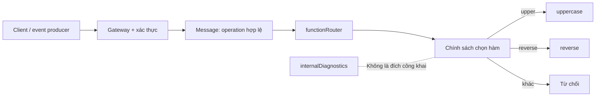

# Giới hạn hàm đích và nguồn cung cấp biểu thức

## Mục tiêu học tập

Sau bài này, bạn có thể:

1. Nhận diện những nơi Spring Cloud Function lấy **tên hàm đích** và **biểu thức SpEL** để điều khiển `RoutingFunction`.
2. Phân biệt `spring.cloud.function.definition` trong cấu hình ứng dụng với cùng tên xuất hiện trong `Message` header.
3. Giải thích tại sao biểu thức từ `Message` header được đánh giá bằng `SimpleEvaluationContext`, còn biểu thức từ application/system property dùng `StandardEvaluationContext`.
4. Giới hạn các hàm được đăng ký trong `FunctionCatalog` bằng `spring.cloud.function.ineligible-definitions` và giới hạn đích theo chính sách bằng `MessageRoutingCallback`.
5. Phân biệt **giới hạn catalog**, **giới hạn function được công bố qua adapter** và **xác thực/phân quyền**.
6. Kiểm thử trường hợp header bị can thiệp, tên function nội bộ bị yêu cầu, biểu thức không hợp lệ, composition không được phép và reactive routing.

## 1. Tại sao kiểm soát nguồn định tuyến quan trọng?

Spring Cloud Function tổ chức logic nghiệp vụ thành các `Supplier`, `Function` và `Consumer`, được tra cứu và ghép qua `FunctionCatalog`. Các adapter HTTP, event broker hoặc serverless có thể gọi lại cùng logic mà không làm các function nghiệp vụ phụ thuộc vào giao thức.

Để một điểm vào có thể gọi nhiều hàm, framework cung cấp `RoutingFunction` dưới tên **`functionRouter`**. Router nhận chỉ dẫn, tính tên function definition rồi tra cứu đích trong `FunctionCatalog`.

Ví dụ, một ứng dụng có:

- `uppercase`: chuyển văn bản thành chữ hoa, được phép gọi từ API công khai.
- `reverse`: đảo chuỗi, cũng được phép gọi.
- `internalDiagnostics`: chức năng phụ trợ cho môi trường nội bộ, **không muốn được gọi qua catalog công khai**.

Một client hợp lệ chỉ nên được yêu cầu thao tác `upper` hoặc `reverse`. Nếu client có thể tự gắn header `spring.cloud.function.definition: internalDiagnostics` hoặc tự đưa SpEL tùy ý, việc chỉ công bố một URL `/functionRouter` **chưa bảo đảm** client không gọi được chức năng ngoài dự kiến.



Vấn đề của bài này là kiểm soát **cả hai phía**: tập function có thể được tra cứu và những nguồn dữ liệu/biểu thức có quyền quyết định route.

## 2. Ba khái niệm dễ bị nhầm

| Khái niệm | Câu hỏi nó trả lời | Ví dụ |
| --- | --- | --- |
| **Ứng viên của `FunctionCatalog`** | Bean nào được đăng ký để có thể tra cứu như function? | `uppercase`, `reverse`; loại `internalDiagnostics` bằng `ineligible-definitions` |
| **Điểm vào adapter công bố** | Function/route nào được phép gọi qua HTTP, Stream hoặc serverless? | Chỉ xuất `functionRouter` hoặc chỉ các endpoint đã liệt kê |
| **Chính sách định tuyến và phân quyền** | Với message này, người gọi được yêu cầu đích nào? | Header `operation=upper` được ánh xạ sang `uppercase` |

Đây là những lớp khác nhau. Giới hạn endpoint HTTP không nhất thiết xóa bean khỏi catalog. Một function có trong catalog không nhất thiết có endpoint HTTP riêng. Và dù một route chỉ xuất hiện sau gateway, vẫn cần kiểm tra người gọi có quyền thực hiện nghiệp vụ hay không.

> Nguyên tắc thiết kế: **không dùng tên function, đường dẫn endpoint hoặc biểu thức SpEL như bằng chứng phân quyền**. Xác thực và ủy quyền phải được thực hiện ở lớp phù hợp, độc lập với cơ chế lựa chọn hàm.

## 3. Những nguồn cung cấp chỉ dẫn định tuyến

Spring Cloud Function hỗ trợ ba nguồn chính cho **imperative message routing**:

| Ưu tiên | Nguồn | Dữ liệu được cung cấp | Mức kiểm soát |
| --- | --- | --- | --- |
| **1** | Bean `MessageRoutingCallback` | Tên function definition do Java code trả về | Ứng dụng sở hữu luật định tuyến |
| **2** | `Message` headers | `spring.cloud.function.definition` hoặc `spring.cloud.function.routing-expression` | Phụ thuộc ai được phép tạo/sửa message |
| **3** | Application/system properties | Thường là `spring.cloud.function.routing-expression` | Cấu hình triển khai và quyền quản trị |

Ví dụ cùng tên key nhưng ở hai tầng:

```yaml
# application.yml: chọn router làm điểm vào của adapter
spring:
  cloud:
    function:
      definition: functionRouter
      routing-expression: "'uppercase'"
```

```text
# Message header gửi ĐẾN router:
spring.cloud.function.definition: reverse
```

Property `definition: functionRouter` chọn **điểm vào**; header `definition: reverse` chọn **đích bên trong router**. Khi không có `MessageRoutingCallback`, header thường thắng property `routing-expression` dù property đang trả về `uppercase`.

Một nguồn có ưu tiên cao hơn **không phải lời yêu cầu thử trước** rồi tự quay về cấu hình thấp hơn khi thất bại. Nếu header chọn một tên không có trong catalog, router có thể báo lỗi không tìm thấy function; không nên mặc nhiên kỳ vọng nó tự rơi về route mặc định.

### Tên đích và biểu thức là hai loại chỉ dẫn khác nhau

| Chỉ dẫn | Ví dụ | Ý nghĩa |
| --- | --- | --- |
| Header `spring.cloud.function.definition` | `uppercase` | Chọn trực tiếp một definition |
| Header `spring.cloud.function.definition` | `uppercase|reverse` | Chọn một composition |
| Header `spring.cloud.function.routing-expression` | `headers['operation'] == 'upper' ? 'uppercase' : 'reverse'` | Đánh giá SpEL từ message rồi chọn definition |
| Application property `spring.cloud.function.routing-expression` | `'uppercase'` | SpEL trả về tên đích cố định |

Không cần nháy đơn kiểu SpEL quanh giá trị header `spring.cloud.function.definition`. Ngược lại, muốn `routing-expression` trả về chuỗi cố định `uppercase`, biểu thức cần literal `'uppercase'`.

## 4. Nguồn SpEL: `SimpleEvaluationContext` và `StandardEvaluationContext`

Spring Cloud Function phân biệt **nguồn biểu thức**, vì SpEL là một ngôn ngữ biểu thức có thể có khả năng truy cập thuộc tính/phương thức của các đối tượng Java.

| Nơi lấy `routing-expression` | Evaluation context | Phạm vi tính năng |
| --- | --- | --- |
| `Message` header | **`SimpleEvaluationContext`** | Một phần giới hạn của SpEL, hướng tới đánh giá dữ liệu từ message |
| Application/system property hoặc biến môi trường | **`StandardEvaluationContext`** | Khả năng SpEL rộng hơn, dành cho cấu hình được quản lý |

Ví dụ một biểu thức đơn giản do **ứng dụng** sở hữu:

```yaml
spring:
  cloud:
    function:
      definition: functionRouter
      routing-expression: "headers['operation'] == 'reverse' ? 'reverse' : 'uppercase'"
```

Root object của SpEL với message imperative là chính `Message`, nên `headers['operation']` đọc metadata được adapter cung cấp. Có thể đọc `payload` tương tự, **nếu biết đúng kiểu payload tại lúc đánh giá**.

Tài liệu Spring Framework nêu rằng `SimpleEvaluationContext` loại bỏ những khả năng như tham chiếu kiểu Java, gọi constructor và bean reference. Tuy nhiên, **context bị giới hạn không phải bảo đảm rằng mọi biểu thức từ nguồn không tin cậy đều an toàn**. Vì vậy, tránh tiếp nhận SpEL do client tự viết nếu một header nghiệp vụ đơn giản và rule phía server đã đáp ứng yêu cầu.

Ở chiều ngược lại, `StandardEvaluationContext` linh hoạt hơn nên **không dùng để đánh giá biểu thức do nguồn ngoài không tin cậy cung cấp**. Khi expression đến từ biến môi trường hay application property, phải giới hạn những người và hệ thống có quyền thay đổi cấu hình đó.

### Cẩn thận với endpoint quản trị cấu hình

Thông thường end user không sửa trực tiếp `application.yml` hoặc biến môi trường. Nhưng một deployment có thể công bố Actuator endpoint, công cụ cấu hình động hoặc API quản trị do ứng dụng tự tạo. Nếu chúng cho phép thay đổi expression, kẻ tấn công có thể chuyển **nguồn bên ngoài** thành **application property được đánh giá trong context mạnh hơn**.

Spring Cloud Function không tự công bố một API quản trị để sửa những expression này. Trách nhiệm bảo vệ các endpoint quản trị do thành phần triển khai và cấu hình bảo mật của ứng dụng đảm nhiệm.

## 5. Giới hạn ứng viên của `FunctionCatalog`

Một Spring `ApplicationContext` có thể có những bean triển khai `Function`, `Consumer` hoặc `Supplier` nhưng **không nên là ứng viên đăng ký trong `FunctionCatalog`**. Spring Cloud Function hỗ trợ property:

```properties
spring.cloud.function.ineligible-definitions=internalDiagnostics
```

Có thể cung cấp một danh sách tên bean, phân tách bằng dấu phẩy:

```properties
spring.cloud.function.ineligible-definitions=internalDiagnostics,legacyMaintenance
```

Mục tiêu là loại những bean này khỏi các **ứng viên đăng ký vào catalog**, chứ không xóa bean khỏi Spring `ApplicationContext` hoặc làm cho mã Java đã inject bean đó không thể gọi được.

Lưu ý:

- Giá trị là **tên bean definition**, không phải package, class name hay URL.
- Property ảnh hưởng đến khả năng được khám phá/đăng ký trong catalog; không phải một hệ thống RBAC.
- Các function khác có thể vẫn bị gọi bằng tên hoặc composition nếu chúng nằm trong catalog.
- Chỉ kiểm tra `lookup` với tên không tồn tại khi đã hiểu hành vi *single-function fallback* của phiên bản đang dùng. Với một catalog chỉ có một function, một tên bất kỳ có thể được ánh xạ đến function duy nhất; hãy kiểm tra cả danh sách tên có trong catalog.

### So sánh với giới hạn endpoint HTTP

Trong Spring Cloud Function Web, `spring.cloud.function.definition` có thể được sử dụng để **liệt kê các function xuất thành endpoint**, phân tách bằng dấu chấm phẩy. Ví dụ trong một deployment không cần router:

```properties
spring.cloud.function.definition=uppercase;reverse
```

Cấu hình này nhắm đến việc chỉ xuất `uppercase` và `reverse` trong HTTP adapter; nó **không phải** cú pháp khai báo hai route đích cho một `functionRouter`, cũng **không đồng nghĩa** loại function khác ra khỏi catalog.

Nếu deployment chủ yếu dùng một router:

```properties
spring.cloud.function.definition=functionRouter
```

thì cần hiểu rõ adapter đang công bố endpoint nào và liệu còn các đường gọi trực tiếp khác hay không. **Không coi việc chọn một router làm điểm vào là tường lửa nội bộ cho mọi function.**

## 6. Ứng dụng mẫu: hai function công khai và một bean nội bộ

Ví dụ dùng Spring Boot với `spring-cloud-starter-function-web`. Hãy chọn các phiên bản Spring Cloud Function và Spring Boot tương thích thông qua BOM/dependency management của dự án.

```xml
<dependency>
    <groupId>org.springframework.cloud</groupId>
    <artifactId>spring-cloud-starter-function-web</artifactId>
</dependency>
```

Ba function đơn giản minh họa phạm vi catalog:

```java
package com.example.routepolicy;

import java.util.Locale;
import java.util.function.Function;

import org.springframework.boot.SpringApplication;
import org.springframework.boot.autoconfigure.SpringBootApplication;
import org.springframework.context.annotation.Bean;

@SpringBootApplication
public class RoutePolicyApplication {

    public static void main(String[] args) {
        SpringApplication.run(RoutePolicyApplication.class, args);
    }

    @Bean
    public Function<String, String> uppercase() {
        return text -> text.toUpperCase(Locale.ROOT);
    }

    @Bean
    public Function<String, String> reverse() {
        return text -> new StringBuilder(text).reverse().toString();
    }

    // Ví dụ bean phụ trợ: không được dùng làm endpoint công khai.
    @Bean
    public Function<String, String> internalDiagnostics() {
        return text -> "[INTERNAL] " + text;
    }
}
```

Ở đây `internalDiagnostics` chỉ trả về một chuỗi để kiểm chứng đường gọi; nó **không chứa dữ liệu bí mật**. Trong hệ thống thật, việc loại khỏi catalog là biện pháp giảm diện tiếp xúc, **không được xem là biện pháp duy nhất** để bảo vệ chức năng nội bộ có tác dụng nhạy cảm.

Cấu hình:

```yaml
# application.yml
spring:
  cloud:
    function:
      definition: functionRouter
      ineligible-definitions: internalDiagnostics
      routing-expression: "headers['operation'] == 'reverse' ? 'reverse' : 'uppercase'"
```

Ứng dụng đã xác định:

1. Adapter chọn `functionRouter` làm điểm vào.
2. Bean `internalDiagnostics` không là ứng viên của catalog.
3. Application property cung cấp một luật SpEL mặc định: header nghiệp vụ `operation=reverse` chọn `reverse`, các giá trị khác chọn `uppercase`.

**Điểm yếu cố ý để học:** luật SpEL ở application property thuộc mức ưu tiên thấp hơn routing header của Message. Do đó, **chỉ cấu hình expression phía server chưa đủ** để ngăn client yêu cầu một function catalog khác qua `spring.cloud.function.definition`, nếu adapter chuyển tiếp header đó.

## 7. Kiểm chứng catalog và hành vi của routing header

Trong Spring component đã được inject `FunctionCatalog`, có thể quan sát:

```java
import java.util.Set;
import org.springframework.cloud.function.context.FunctionCatalog;

// functionCatalog được inject từ Spring context.
Set<String> names = functionCatalog.getNames(null);
System.out.println(names);
```

Kiểm tra rằng danh sách tên catalog chứa các function nghiệp vụ `uppercase`, `reverse` và không chứa `internalDiagnostics` theo cấu hình ở trên. Tùy phiên bản, danh sách có thể có thêm `functionRouter` hoặc các function do framework cung cấp; không cần giả định catalog chỉ gồm đúng hai tên.

Với Spring Cloud Function Web được cấu hình để gọi router qua endpoint gốc `/`, thử:

```bash
# Header nghiệp vụ: dùng luật SpEL trong application property.
curl -X POST http://localhost:8080/ \
  -H "Content-Type: text/plain" \
  -H "operation: reverse" \
  --data-raw "hello"
# Kết quả nghiệp vụ dự kiến: olleh

# Header routing framework: chỉ dẫn trực tiếp ở ưu tiên cao hơn property.
curl -X POST http://localhost:8080/ \
  -H "Content-Type: text/plain" \
  -H "operation: reverse" \
  -H "spring.cloud.function.definition: uppercase" \
  --data-raw "hello"
# Nếu không có callback: kết quả dự kiến HELLO.
```

Trong request thứ hai, client đặt hai nguồn chỉ dẫn **mâu thuẫn**. Property SpEL muốn gọi `reverse`, nhưng header `spring.cloud.function.definition` trực tiếp yêu cầu `uppercase` nên có ưu tiên cao hơn.

Hãy thử tiếp một tên không có trong catalog:

```bash
curl -i -X POST http://localhost:8080/ \
  -H "Content-Type: text/plain" \
  -H "spring.cloud.function.definition: internalDiagnostics" \
  --data-raw "hello"
```

Với catalog không đăng ký function này và không có logic fallback đặc biệt, router không tra cứu được đích và có thể phát sinh lỗi. **Không ấn định HTTP status/body cụ thể**, vì việc biểu diễn lỗi tùy web adapter và cấu hình exception handling. Nếu ứng dụng đăng ký `DefaultMessageRoutingHandler`, handler có thể nhận thông điệp không định tuyến được và áp dụng chính sách xử lý riêng; tránh để handler âm thầm bỏ những sự kiện quan trọng.

## 8. Giới hạn function đích bằng `MessageRoutingCallback`

Một cách trực tiếp để buộc router lựa chọn từ tập **đã cho phép** là đăng ký `MessageRoutingCallback` và chỉ trả về tên định nghĩa tương ứng với các **operation nghiệp vụ hợp lệ**.

Ví dụ thêm method dưới đây vào class `RoutePolicyApplication`:

```java
import org.springframework.cloud.function.context.MessageRoutingCallback;
import org.springframework.context.annotation.Bean;
import org.springframework.context.annotation.Profile;

@Bean
@Profile("strict-routing")
public MessageRoutingCallback allowedOperationRouter() {
    return message -> {
        Object operation = message.getHeaders().get("operation");

        if ("upper".equals(operation)) {
            return "uppercase";
        }
        if ("reverse".equals(operation)) {
            return "reverse";
        }

        throw new IllegalArgumentException("Unsupported operation");
    };
}
```

Đây là **phương án tăng cường khi bật profile `strict-routing`**. Có thể đặt code này trong class cấu hình riêng nếu ứng dụng tổ chức nhiều module; điều kiện cần là Spring nhìn thấy một bean `MessageRoutingCallback` hoạt động.

Vì callback có ưu tiên cao nhất trong **imperative routing**, nó quyết định đích kể cả khi message chứa header framework trỏ tới function khác. Với callback trên, chỉ hai giá trị nghiệp vụ chính xác `upper` và `reverse` hợp lệ. Giá trị sai hoặc thiếu `operation` bị từ chối, không tự chuyển sang một nhánh mặc định.

```text
Message(operation=upper, header definition=reverse)
    -> callback trả về uppercase
    -> router gọi uppercase

Message(operation=delete, header definition=uppercase)
    -> callback ném ngoại lệ
    -> adapter áp dụng cơ chế xử lý lỗi
```

Đây là chính sách **allowlist theo tên operation**, tránh việc client tự nhập một bean name hoặc composition bất kỳ. Tuy nhiên, callback chỉ kiểm soát **những lời gọi thực sự đi qua router**; nếu adapter vẫn công bố endpoint gọi trực tiếp một function, caller có thể đi đường khác.

### Vì sao phải kiểm soát cả composition?

Header `spring.cloud.function.definition` có thể chứa `uppercase|reverse` hoặc composition phức tạp hơn nếu các hàm tương thích. Nếu client được tự nhập definition, kiểm tra rằng “tên bắt đầu bằng uppercase” hoặc “chuỗi chứa reverse” **không đủ** để giới hạn toàn bộ pipeline.

Thay vì thử phân tích cú pháp tùy ý từ client, hãy ánh xạ một số `operation` được duyệt như `upper`, `reverse`, `chain` sang **những definition chính xác** trong mã phía server:

```java
// Ví dụ bổ sung một nhánh vào callback, nếu nghiệp vụ cho phép:
if ("chain".equals(operation)) {
    return "uppercase|reverse";
}
```

Đây vẫn là một tập đích hữu hạn, có thể review và test, thay vì cho client tự tạo chuỗi composition.

## 9. Thử chính sách bằng `MessageBuilder` và JUnit

Để kiểm tra chính sách mà không phụ thuộc HTTP, có thể thử callback ở mức đơn vị:

```java
import static org.junit.jupiter.api.Assertions.assertEquals;
import static org.junit.jupiter.api.Assertions.assertThrows;

import org.junit.jupiter.api.Test;
import org.springframework.cloud.function.context.MessageRoutingCallback;
import org.springframework.messaging.Message;
import org.springframework.messaging.support.MessageBuilder;

class AllowedOperationRouterTest {

    private final MessageRoutingCallback callback =
            new RoutePolicyApplication().allowedOperationRouter();

    @Test
    void allowlistedOperationChoosesUppercase() {
        Message<String> message = MessageBuilder.withPayload("hello")
                .setHeader("operation", "upper")
                .setHeader("spring.cloud.function.definition", "reverse")
                .build();

        assertEquals("uppercase", callback.routingResult(message));
    }

    @Test
    void invalidOperationIsRejected() {
        Message<String> message = MessageBuilder.withPayload("hello")
                .setHeader("operation", "internalDiagnostics")
                .build();

        assertThrows(IllegalArgumentException.class,
                () -> callback.routingResult(message));
    }
}
```

Đây là **unit test của chính sách chọn tên đích**: nó chứng minh callback không tin header `spring.cloud.function.definition` và không biến một operation lạ thành tên bean. Nó chưa chứng minh endpoint công khai đã được giới hạn, catalog đã loại `internalDiagnostics` hay cơ chế xử lý lỗi của HTTP/binder là đúng.

Kiểm thử tích hợp cần thêm:

1. Khởi động context với profile `strict-routing`.
2. Kiểm tra catalog không có `internalDiagnostics` trong `getNames(null)`.
3. Gửi request có `operation: upper` nhưng thêm header framework `spring.cloud.function.definition: reverse`; xác nhận router vẫn gọi `uppercase`.
4. Gửi operation không hợp lệ; xác minh adapter trả lỗi theo **hợp đồng API** đã định nghĩa.
5. Kiểm thử các đường gọi **không đi qua router** (nếu được công bố) với các quy tắc xác thực/phân quyền riêng.

Không suy rằng kiểm thử callback đơn lẻ đã bảo đảm mọi chức năng nội bộ không thể được gọi.

## 10. Các lớp bảo vệ nên kết hợp

| Lớp | Cơ chế | Giới hạn mà nó giải quyết | Điều nó **không** giải quyết |
| --- | --- | --- | --- |
| Catalog | `spring.cloud.function.ineligible-definitions` | Không cho một số bean trở thành ứng viên của catalog | Không xóa bean khỏi ứng dụng hoặc thay thế phân quyền |
| HTTP adapter | Chỉ công bố function/route cần thiết | Thu hẹp URL/entrypoint có thể được gọi | Router vẫn có thể tra cứu nhiều đích trong catalog |
| Luật routing | `MessageRoutingCallback` + operation allowlist | Không cho tùy ý chọn tên function/composition qua router | Không chặn đường gọi bypass router |
| Cấu hình | Giữ SpEL ở property có quyền thay đổi giới hạn | Kiểm soát ai có thể sửa **luật** | Không làm header nghiệp vụ tự trở thành đáng tin |
| Gateway/security | Xác thực, ủy quyền, hạn mức, kiểm tra headers | Quyền gọi và độ tin cậy của đầu vào | Không thay thế validation trong function nghiệp vụ |
| Vận hành | Metrics, audit, error handling, DLQ | Quan sát/điều tra/khôi phục lỗi | Không biến một route trái phép thành hợp lệ |

### Chính sách mẫu cho một API công khai

Một thiết kế thực tế có thể là:

1. **Gateway** chỉ cho phép `POST` tới endpoint được phê duyệt, xác thực caller và loại các header điều khiển router do client gửi, trừ những header đã được cho phép.
2. **Adapter** chuyển `operation` (giá trị nghiệp vụ đã được kiểm tra sơ bộ) thành Spring Message header.
3. **Callback phía server** kiểm tra allowlist `upper`/`reverse`, quyết định definition đích hoặc ném ngoại lệ.
4. **Catalog** loại những function không nên được tra cứu; các bean nghiệp vụ vẫn thực thi kiểm tra quyền phù hợp nếu cần.
5. **Hệ thống quan sát** theo dõi số request bị từ chối, function đích được chọn, bất thường và lỗi adapter/binder.

Trong kiến trúc này, **không có một lớp đơn lẻ** gánh trách nhiệm bảo mật. Ngay cả khi client không thể gửi routing-expression, việc thiếu authorization ở endpoint nhạy cảm vẫn có thể gây sự cố.

## 11. Event routing, serverless và reactive routing

### HTTP

Spring Cloud Function Web có thể chuyển HTTP headers `spring.cloud.function.definition` và `spring.cloud.function.routing-expression` thành Spring `Message` headers. Vì vậy, cần coi các header này là **đầu vào điều khiển luồng thực thi** nếu endpoint nhận request từ bên ngoài.

Không thể chỉ chặn một URL gọi thẳng function rồi kết luận router an toàn; cần kiểm tra cả những header router nhận.

### Spring Cloud Stream

Trong Spring Cloud Stream, mỗi sự kiện thường được binder biểu diễn dưới dạng Spring `Message`. Nếu cấu hình event routing qua `functionRouter`, routing metadata có thể xuất phát từ producer, broker headers hoặc bước xử lý trung gian.

Với event đến từ nguồn không tin cậy, hãy xác minh chính xác binder chuyển header nào, có thể ghi đè chúng ở đâu và ai có quyền publish. Các nguyên tắc allowlist và loại khỏi catalog vẫn hữu ích, nhưng **acknowledgment, retry, dead-letter queue và idempotency** phải được thiết kế theo binder và mức quan trọng của message.

### Serverless

Một môi trường FaaS có thể chỉ công bố một handler, rồi dùng `functionRouter` để chọn đích. Nguồn điều khiển route ở đây có thể nằm trong event metadata hoặc cấu hình deployment, phụ thuộc adapter. Chỉ có một handler **không đồng nghĩa** chỉ có một function nghiệp vụ có thể được gọi.

### Reactive function

Với imperative `Function<T, R>`, route có thể được chọn **theo từng Message** từ callback/header/property. Với reactive `Function<Flux<T>, Flux<R>>`, đơn vị xử lý là **toàn bộ Publisher**; Spring Cloud Function dùng chỉ dẫn từ **application properties**, không route lại theo header của từng phần tử trong cùng luồng.

Vì vậy, những thí nghiệm dùng HTTP routing header trên từng Message **không phải mô hình** để đặt chính sách route từng phần tử trong reactive stream. Nếu cần quyết định cho từng event, chọn thiết kế imperative event routing hoặc để một reactive function tự phân nhánh theo dữ liệu của các phần tử.

## 12. Khi có lỗi hoặc cố tình gửi route không hợp lệ

| Hiện tượng | Khả năng cần kiểm tra | Cách xử lý |
| --- | --- | --- |
| Client yêu cầu `internalDiagnostics` nhưng không tìm được đích | Bean bị loại khỏi `FunctionCatalog` hoặc không tồn tại | Kiểm tra `getNames(null)` và policy route |
| Header `definition` thắng property SpEL | Không có callback, Message header có ưu tiên cao hơn property | Dùng callback có allowlist hoặc kiểm soát header ở gateway |
| Callback từ chối operation lạ | Chính sách phía server đang hoạt động | Ánh xạ lỗi thành HTTP/broker response theo hợp đồng |
| Biểu thức chạy trong property nhưng lỗi khi gửi bằng Message header | `StandardEvaluationContext` và `SimpleEvaluationContext` khác khả năng | Không chuyển expression phức tạp giữa hai nguồn mà chưa đánh giá lại |
| Một function nội bộ không có endpoint vẫn được router gọi | Đích vẫn nằm trong catalog | Xem lại catalog eligibility, callback và phân quyền |
| Route sai không phát sinh ngoại lệ như mong đợi | Có `DefaultMessageRoutingHandler` hoặc single-function fallback | Kiểm tra handler, số function hợp lệ và kết quả nghiệp vụ |
| HTTP trả về lỗi nhưng event vẫn tiếp tục retry | Hợp đồng adapter/binder khác nhau | Kiểm tra retry, DLQ, acknowledgment và xử lý exception |
| Chỉ chặn endpoint router mà function trực tiếp vẫn truy cập được | Adapter còn xuất đường gọi khác | Kiểm kê các endpoint và yêu cầu bảo mật cho từng đường |

Lưu ý: `DefaultMessageRoutingHandler` dành cho trường hợp router **không tìm được function đích**. Handler không phải công cụ phân quyền và không nên dùng cách âm thầm drop cho một giao dịch quan trọng cần phát hiện việc bị từ chối.

### Quy trình chẩn đoán có hệ thống

```text
1. Caller có quyền đến endpoint/binding này không?
2. Adapter đang gọi functionRouter hay function trực tiếp?
3. Message thật có những routing headers nào?
4. Có MessageRoutingCallback được đăng ký không?
5. Biểu thức đến từ Message header hay application property?
6. Definition được chọn có thuộc tập cho phép không?
7. Definition có trong FunctionCatalog không?
8. Chữ ký function, payload conversion và xử lý lỗi có phù hợp không?
```

Thứ tự kiểm tra này giúp phân biệt **lỗi chọn route**, **lỗi thiếu function trong catalog**, **lỗi thực thi nghiệp vụ** và **vấn đề phân quyền**.

## 13. Bài tập thực hành

1. Khai báo `uppercase`, `reverse`, `internalDiagnostics`, rồi dùng `spring.cloud.function.ineligible-definitions=internalDiagnostics`. Kiểm tra `FunctionCatalog.getNames(null)` và giải thích vì sao bean vẫn có thể tồn tại trong Spring context.
2. Không bật callback. Cấu hình property expression chọn `reverse` khi `operation=reverse`; gửi một Message có thêm `spring.cloud.function.definition: uppercase`. Dự đoán nguồn nào thắng và vì sao.
3. Bật profile `strict-routing` với callback `upper`/`reverse`. Gửi `operation=upper` và header framework `definition: reverse`. Xác định function được chọn và chứng minh bằng test.
4. Gửi operation thiếu hoặc `internalDiagnostics` khi callback hoạt động. Đề xuất HTTP status/response body phù hợp và một integration test để xác nhận hợp đồng API đó.
5. Giải thích khác biệt giữa `spring.cloud.function.ineligible-definitions=internalDiagnostics` và `spring.cloud.function.definition=uppercase;reverse` trong Spring Cloud Function Web.
6. Thiết kế chính sách cho phép composition `uppercase|reverse` với một operation `chain` nhưng không cho client tự tạo chuỗi definition. Chứng minh callback chỉ trả về những tên đã được duyệt.
7. Giả sử hệ thống công bố một endpoint quản trị có khả năng sửa cấu hình `routing-expression`. Nêu các kiểm soát xác thực, phân quyền, audit, và quy trình duyệt thay đổi cần có.
8. Phân biệt `SimpleEvaluationContext` và `StandardEvaluationContext`. Vì sao việc dùng context giới hạn không khiến expression do client gửi trở thành hoàn toàn an toàn?
9. Chuyển kiến trúc sang Spring Cloud Stream. Liệt kê các nơi producer có thể can thiệp metadata routing, cơ chế đảm bảo chỉ những event hợp lệ được xử lý, và yêu cầu retry/DLQ.
10. Giải thích vì sao chính sách routing theo từng header Message không dùng để đổi function cho từng phần tử bên trong `Flux` của một reactive function.

## Ghi nhớ

- `functionRouter` tìm đích trong **`FunctionCatalog`**; **tên đích**, **biểu thức SpEL** và **quyền được gọi** là ba vấn đề cần tách riêng.
- Với imperative routing, ưu tiên là **`MessageRoutingCallback` → Message routing headers → application routing properties**.
- Biểu thức từ Message header dùng **`SimpleEvaluationContext`**; từ application/system property dùng **`StandardEvaluationContext`**. Context giới hạn không thay thế việc kiểm soát dữ liệu đầu vào.
- `spring.cloud.function.ineligible-definitions` loại bean không phù hợp khỏi **ứng viên catalog**; cấu hình export endpoint của adapter và authorization là các lớp khác.
- Dùng **callback có allowlist** để ánh xạ operation nghiệp vụ sang tên function/composition được phép, nhưng vẫn phải kiểm soát mọi đường gọi trực tiếp ngoài router.
- Không công bố cho người dùng quyền tự sửa SpEL ở application properties, và không coi route fallback hoặc `DefaultMessageRoutingHandler` là cơ chế bảo mật.

### Tài liệu tham khảo chính thức

- [Spring Cloud Function — Programming Model: Function Routing and Filtering, Filtering Ineligible Functions](https://docs.spring.io/spring-cloud-function/reference/spring-cloud-function/programming-model.html)
- [Spring Cloud Function — Standalone Web Applications](https://docs.spring.io/spring-cloud-function/reference/spring-cloud-function/standalone-web-applications.html)
- [Spring Framework — SpEL Evaluation Context và Security Considerations](https://docs.spring.io/spring-framework/reference/core/expressions/evaluation.html)
- [Spring Cloud Stream — Event Routing](https://docs.spring.io/spring-cloud-stream/reference/spring-cloud-stream/event-routing.html)
