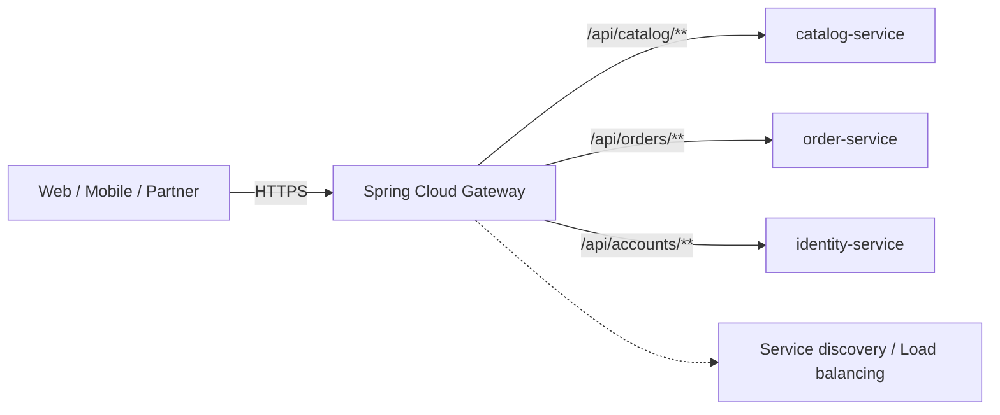
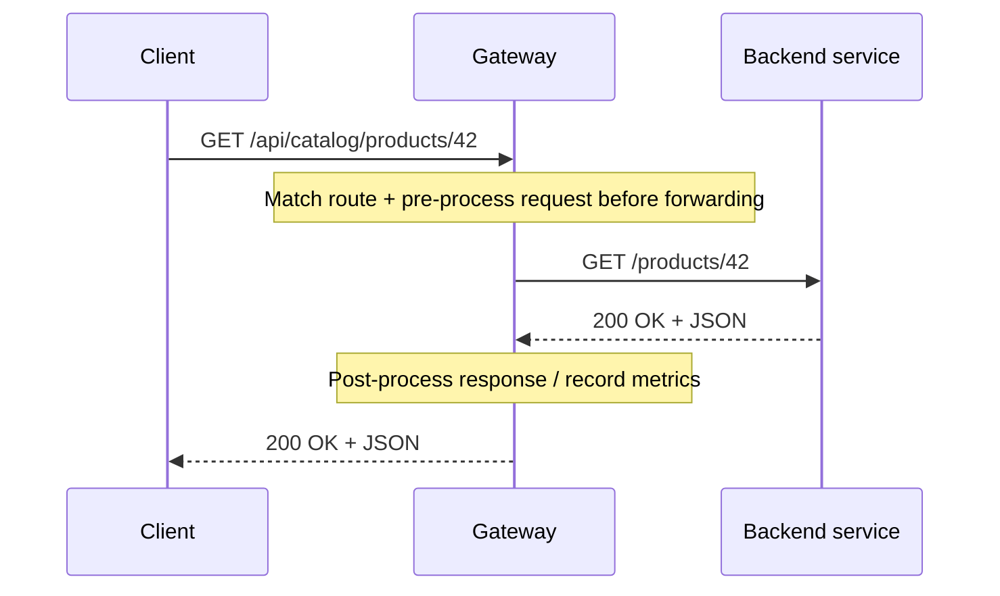

# What Is Spring Cloud Gateway and the API Gateway Problem

When an application transitions from a monolithic architecture to microservices, a request from a browser or mobile app may need to go through multiple services: product catalog, shopping cart, orders, accounts, and payments. If the client has to know the address of each service, any change in the backend system risks affecting the client. An **API Gateway** creates a unified entry point that receives external requests and routes them to the appropriate service.

**Spring Cloud Gateway** is the component in the Spring ecosystem for building that entry point. It allows you to describe routing rules using **route predicates**, process requests and responses using a **filter chain**, modify paths/headers, integrate **service discovery**, and incorporate protection and operational mechanisms such as authentication, rate limiting, circuit breakers, retries, TLS, and request observability.

This is the introductory lesson of the **Overview** chapter: it focuses on the problems a gateway solves, the foundational concepts, and how to identify the responsibilities of a gateway in a microservices architecture.

## 1. Why Does a Microservices System Need an Entry Point?

Suppose an e-commerce application has independent services:

| Service | Primary Responsibility | Example Internal Address |
| --- | --- | --- |
| `catalog-service` | Look up products and categories | `catalog-service:8080` |
| `order-service` | Create and look up orders | `order-service:8080` |
| `identity-service` | Login and account information | `identity-service:8080` |

If a client connects directly to each service, it must manage multiple URLs, authentication mechanisms, error formats, and API versions. When `order-service` is scaled to multiple instances or changes addresses, the client also needs a way to find an active instance. Additionally, each service might have to implement the same technical rules on its own, such as CORS, rate limiting, and access logging.

Common problems include:

1. **Dependency on internal infrastructure:** clients know too much about service names, addresses, ports, and deployment details.
2. **Inconsistent policies:** one API checks tokens or enforces rate limits, while another lacks those steps.
3. **Wide attack surface:** many services must expose endpoints directly to the outside, complicating access control.
4. **Hard to trace requests:** a client-side error may involve multiple services without a common point to record latency, status codes, and correlation IDs.
5. **Hard-to-control changes:** moving services, changing paths, or refactoring the backend can force many clients to update.

An API Gateway solves most of these problems at the **boundary between client and backend** by exposing a stable API address, such as `https://api.example.com`, then applying policies and forwarding requests to the right service.



In the diagram, the gateway is the **logical entry point**; in production deployments, multiple gateway instances can run behind a load balancer to avoid a single point of failure.

## 2. What Is Spring Cloud Gateway Actually?

Spring Cloud Gateway is a **programmable API gateway and reverse proxy**. It receives an HTTP request, finds a matching route, runs the configured processing steps, and forwards the request to the upstream service. After the upstream responds, the gateway can continue processing the response before returning it to the client.

Three core questions the gateway answers:

- **Where does this request go?** Routes and predicates determine the target service.
- **What steps must the request/response go through?** Filters apply operations such as rewriting paths, modifying headers, checking conditions, or recording tracing information.
- **How is forwarding made reliable and secure?** The gateway integrates service instance discovery, security, traffic control, and resilience when upstreams fail.

Spring Cloud Gateway offers implementation options built on **Spring WebFlux** and **Spring Web MVC** in their respective supported release lines. WebFlux typically uses an asynchronous, non-blocking model to serve high-concurrency I/O requests; the MVC variant runs on the servlet stack. Because configuration APIs, dependency names, and certain capabilities differ across release lines, you should consult the documentation for the exact Spring Boot/Spring Cloud version you are using when creating a project.

The gateway **does not replace business logic** in individual microservices: the order service still decides whether an order can be placed; the payment service still validates the transaction. The gateway should only handle API boundary concerns and appropriate routing and orchestration rules.

### How Does a Gateway Differ from Easily Confused Components?

| Component | Typical Role | Relationship to Spring Cloud Gateway |
| --- | --- | --- |
| **Reverse proxy** | Receives requests and forwards them to backend servers | The gateway is a reverse proxy with added route/filter rules and Spring ecosystem integration. |
| **Load balancer** | Distributes traffic across multiple instances | Can be placed in front of the gateway; the gateway can also select backend instances via Spring Cloud LoadBalancer. |
| **Service discovery** | Registers and looks up active service instances | The gateway can use service discovery results to resolve names like `lb://catalog-service`. |
| **Kubernetes Ingress** | Exposes and routes HTTP(S) traffic into the cluster | Can sit in front of the gateway; functionality overlaps partially, so responsibilities must be separated to avoid duplicate configuration. |
| **Service mesh** | Manages inter-service communication, often including network policies and internal traffic observability | The gateway primarily serves ingress and client-facing API traffic; a mesh focuses more on service-to-service communication. |

Not every project needs all of the components above. A small system with few APIs may only need a simple reverse proxy; a gateway proves its value as the number of services, shared policies, and frequency of changes grow.

## 3. Core Building Blocks

A Spring Cloud Gateway route is built from the following components:

| Concept | Meaning | Example |
| --- | --- | --- |
| **Route** | Defines a route: ID, destination URI, and associated predicates and filters. | `catalog-route` forwards to `catalog-service`. |
| **Route predicate** | Condition for a request to match a route. Multiple predicates on the same route usually must all be satisfied simultaneously. | Path starts with `/api/catalog/`, method `GET`. |
| **GatewayFilter** | Processes requests/responses scoped to a single route. | Strip `/api/catalog` prefix, add or modify headers. |
| **GlobalFilter** | Filter applied across routes through the gateway's global filter chain. | Record shared tracing information when configured appropriately. |
| **Target URI** | Upstream address to which the route forwards requests. | `http://localhost:8081` or `lb://catalog-service`. |
| **Filter chain** | Chain of filters executed before and after forwarding, in order of application. | Pre-process request → call upstream → post-process response. |

### 3.1. Route Predicate: Which Requests Are Selected?

Predicates can be based on path, host, HTTP method, header, query parameter, or other conditions. For example:

- `Path=/api/catalog/**`: matches requests belonging to the catalog API.
- `Method=GET`: matches only GET requests.
- `Header=X-Client-Type, mobile`: matches when the header value matches the configured expression.

When combining `Path` and `Method` on the same route, a `POST /api/catalog/products` request will not match a route restricted to `GET`. If multiple routes could match the same request, **route ordering/priority** must be designed clearly to avoid forwarding to the wrong service.

Not matching any route typically results in `404 Not Found` if no other handler accepts the request. However, once a route is matched and the backend fails, the error status code depends on the forwarding result and enabled filters; you should not assume every error is a 404.

### 3.2. Filter Chain: What Does the Gateway Process?

Filters can intervene both before and after calling the upstream:



Examples of what filters can do:

- **`StripPrefix`:** removes a specified number of leading path segments.
- **`RewritePath`:** rewrites the path using a regular expression and replacement rule.
- **`SetRequestHeader` / `AddRequestHeader`:** sets or appends headers sent to the upstream.
- **`RemoveRequestHeader` / `RemoveResponseHeader`:** removes headers that should not be forwarded or exposed.
- **`RequestRateLimiter`, `CircuitBreaker`, `Retry`:** applies traffic control and resilience policies once the required integrations are installed.

In the filter chain, processing before and after calling the backend follows a specific order. If you write custom filters, you must understand this order and avoid blocking the processing thread with blocking work, especially in the WebFlux variant.

## 4. First Routing Example

Suppose a client calls:

```http
GET https://api.example.com/api/catalog/products/42
```

We want the catalog service to receive a shorter path:

```http
GET http://catalog-service:8080/products/42
```

One way to define a route in a gateway application using Spring Cloud Gateway Server WebFlux is with the Java DSL:

```java
import org.springframework.cloud.gateway.route.RouteLocator;
import org.springframework.cloud.gateway.route.builder.RouteLocatorBuilder;
import org.springframework.context.annotation.Bean;
import org.springframework.context.annotation.Configuration;

@Configuration
public class GatewayRoutes {
    @Bean
    RouteLocator apiRoutes(RouteLocatorBuilder builder) {
        return builder.routes()
            .route("catalog-route", route -> route
                .path("/api/catalog/**")
                .filters(filters -> filters
                    .stripPrefix(2)
                    .setRequestHeader("X-Edge-Source", "gateway"))
                .uri("lb://catalog-service"))
            .build();
    }
}
```

Part-by-part explanation:

1. `catalog-route` is the ID used to identify the route.
2. `path("/api/catalog/**")` selects requests with a matching path.
3. `stripPrefix(2)` removes the **first two segments**: `api` and `catalog`; thus `/api/catalog/products/42` becomes `/products/42`.
4. `setRequestHeader(...)` sets the `X-Edge-Source` header before forwarding. This custom header only assists observability/context; **do not use it as authentication proof** because a trusted mechanism between the gateway and backend is required.
5. `lb://catalog-service` instructs the gateway to pick a service instance by logical name. This requires Spring Cloud LoadBalancer and an appropriate instance source, such as service discovery; simply writing `lb://` does not automatically create a registry.

| Client Request | Path Received by Backend After `stripPrefix(2)` |
| --- | --- |
| `GET /api/catalog/products` | `GET /products` |
| `GET /api/catalog/products/42` | `GET /products/42` |
| `GET /api/catalog/categories?active=true` | `GET /categories?active=true` |

If service discovery/load balancing is not yet configured, in a practice environment you can use a static URI like `http://localhost:8081` to test the route, provided a backend is actually running at that address. URLs and ports in examples are illustrative only.

Manual test example when the development gateway runs on `localhost:8080`:

```bash
curl -i http://localhost:8080/api/catalog/products/42
```

The expected result is that the request is forwarded to the backend's `/products/42` endpoint. The actual status code and body depend on the backend, not on the route definition itself.

> **Version note:** Different versions of Spring Cloud Gateway may use different starter names and YAML configuration prefixes. The Java DSL here illustrates the routing concept of the WebFlux variant; when implementing, choose dependencies compatible with your project's Spring Boot and Spring Cloud versions.

## 5. Flow of an HTTP Request

Consider the request `GET /api/catalog/products/42` when the system is fully configured:

1. **The client connects to the public address.** HTTPS connections are typically terminated at a load balancer, ingress, or at the gateway, depending on the TLS topology.
2. **The security layer checks the request.** For example, Spring Security can validate a JWT before allowing the request to proceed; invalid requests can be rejected right here.
3. **The gateway finds a matching route.** Predicates determine that the request belongs to `catalog-route`.
4. **Filters process the request.** The gateway can enforce rate limits, normalize headers, or rewrite `/api/catalog/products/42` to `/products/42`.
5. **The gateway resolves an upstream instance.** With `lb://catalog-service`, load balancing fetches available instances from configuration or discovery and selects one instance.
6. **The request is forwarded.** The backend receives the request with the processed method, path, body, and headers.
7. **The response returns through the gateway.** Post-processing steps can update headers, finalize traces/metrics, and return the response to the client.

The steps above describe the logical flow; the exact order depends on the security chain, filter order, protocol, and implementation. For example, security validation via Spring Security is not the same as a route's `GatewayFilter`.

## 6. Problems the Gateway Commonly Handles

### 6.1. Hiding Topology and Service Discovery

Clients call `api.example.com` instead of depending directly on backend hostnames or IPs. When a service scales from one to multiple instances, backend discovery/load balancing can update forwarding targets without requiring clients to change public endpoints. If discovery finds no instances, the gateway must return an appropriate error and the monitoring system should detect this condition.

### 6.2. Standardizing URLs, Headers, and API Conventions

The gateway can group APIs under clear prefixes:

| Public API | Target Service | Example Handling |
| --- | --- | --- |
| `/api/catalog/**` | `catalog-service` | Strip `/api/catalog`. |
| `/api/orders/**` | `order-service` | Strip `/api/orders`. |
| `/api/accounts/**` | `identity-service` | Rewrite path according to the published contract. |

This lets the backend change internal structure without forcing clients to know the details. However, the **public API contract** still requires version and compatibility management; the gateway does not automatically make a breaking API change safe.

### 6.3. Authentication and Authorization

The gateway is a convenient place to reject requests missing credentials or carrying invalid tokens early. In Spring, you can use Spring Security and OAuth 2.0 Resource Server to verify JWTs by issuer, signature, expiration, and required claims. CORS, per-route access policies, and stripping sensitive headers are also commonly placed at this boundary.

**Do not put all authorization in the gateway.** For example, the gateway may know that a user is logged in and permitted to call `/api/orders/**`, but only `order-service` has enough context to decide **which specific order** the user can view. The backend must still enforce resource-level authorization and must never blindly trust identity data sent by clients via headers.

### 6.4. Rate Limiting and Spike Protection

The gateway can enforce request quotas by user, API key, IP, or other criteria depending on how keys are resolved. In Spring Cloud Gateway, `RequestRateLimiter` can combine a rate limiter such as `RedisRateLimiter` with an appropriate `KeyResolver`. When the limit is exceeded, the system typically returns `429 Too Many Requests`.

Rate limiting protects the backend from excessive access; it does not replace network-layer DDoS protection, CDNs, or edge security services. Pay attention to the real client IP when proxies sit in front, and only trust forwarded headers from controlled proxies.

### 6.5. Circuit Breaker, Timeout, and Retry

When a backend is slow or unreachable, the gateway must stop holding resources for too long and limit error amplification:

| Mechanism | Purpose | Things to Watch Out For |
| --- | --- | --- |
| **Timeout** | Caps connection/response read wait time beyond a threshold. | Define a time budget across the request path. |
| **Circuit breaker** | Temporarily stops calling an upstream with a high error rate and can return an appropriate fallback. | Requires integrating/configuring a corresponding implementation, such as Resilience4j via Spring Cloud CircuitBreaker. |
| **Retry** | Retries when selected error conditions occur. | Only retry when semantically safe, with bounded attempts and total time control. |

In particular, **do not arbitrarily retry state-mutating requests** such as `POST /payments` or order creation: the first call may have succeeded on the backend even if the response was lost, causing retries to create duplicate transactions. For such operations, design idempotency keys and proper backend handling before considering retries.

### 6.6. TLS and Network Edge Protection

The gateway can participate in terminating incoming HTTPS, forwarding HTTPS to upstreams, normalizing redirects, and configuring certificates. Some systems terminate TLS at the ingress/load balancer and use a private channel to the gateway; others maintain TLS across multiple hops. You must know clearly where TLS is terminated and what constitutes the trusted network.

Do not forward security-sensitive headers verbatim from unauthenticated clients. Headers like `Forwarded`, `X-Forwarded-For`, and `X-Forwarded-Proto` must be handled according to trusted proxy configuration; otherwise, clients can spoof source information.

### 6.7. Request Observability and Error Tracing

At the gateway, operations teams typically want to observe:

- Request count, error rate, status codes, and latency per route.
- Requests rejected due to authentication, authorization, or rate limiting.
- Timeout rates, retry counts, open circuit breakers, and upstream connection errors.
- Trace/correlation IDs to follow a request from the gateway across services.

You can combine Micrometer, Spring's metrics and tracing systems with observability platforms like Prometheus, Grafana, or OpenTelemetry depending on the architecture. Log route IDs and safe metadata; **do not log tokens, passwords, payment data, or full sensitive bodies**. When choosing metric tags, avoid high-cardinality values such as individual user IDs or URLs containing random IDs.

## 7. What Should and Should Not Be in the Gateway?

| Should Be Placed in the Gateway | Should Be Placed in Microservices |
| --- | --- |
| Exposing and routing public endpoints. | Business logic and domain rule validation. |
| Common edge authentication, boundary access policies. | Resource ownership checks and fine-grained authorization. |
| Path/header transformations for API contracts. | Data management, transactions, and business consistency. |
| Rate limiting, timeouts, protection, and entry-point observability. | Resource protection, idempotency, and internal recovery mechanisms. |
| Forwarding requests to appropriate instances. | Deciding business outcomes and returning meaningful domain errors. |

Avoid putting heavy processing such as querying customer data, calculating prices, or updating orders into filters. That couples the gateway to many business domains, making it hard to scale independently and hard to test. When a client needs an endpoint that aggregates multiple services, consider a **Backend for Frontend (BFF)** layer or a dedicated API aggregation service.

## 8. Design Example for an E-Commerce Application

Suppose a system has web, mobile, three business services, and a gateway. An initial design might look like this:

1. Clients only call the public API domain `https://api.shop.example`.
2. The gateway routes `/api/catalog/**` to `catalog-service`, `/api/orders/**` to `order-service`, and `/api/accounts/**` to `identity-service`.
3. Product browsing endpoints can allow public access while applying appropriate rate limits; order viewing endpoints require a valid access token.
4. `order-service` further verifies that the caller is authorized to access each individual order and handles idempotency during order creation.
5. The gateway sets timeouts, retries only scenarios that are safe to retry, and exports metrics/traces per route.
6. The gateway runs multiple instances; in front of it is a load balancer or ingress with TLS and health checks.

This design gives the frontend a relatively stable contract and centralizes shared protection policies. Internal communication between microservices can still travel over private paths inside a trusted network if the architecture requires it, rather than forcing all internal calls through the public gateway.

### Scenarios to Address Before Going to Production

| Scenario | Operational Expectation |
| --- | --- |
| Client calls an unpublished path | Do not misroute; return an appropriate route error. |
| Invalid or expired token | Reject before the request reaches protected APIs. |
| Call volume exceeds quota | Limit requests according to configured keys and policies; return a clear response. |
| A backend instance dies | Select a remaining healthy instance if available; track upstream errors and health. |
| Backend is slow or overloaded | Appropriate timeouts/circuit breakers; avoid retries that worsen overload. |
| A gateway instance fails | Other instances remain to handle traffic; monitor gateway readiness. |
| Trace spans multiple services | Propagate trace context and link observability data across the entire chain. |

## 9. Common Misconceptions

**“Having a gateway means the backend no longer needs security.”** False. The gateway provides centralized edge checks, but the backend must maintain business authorization, input validation, and protection for internal access paths.

**“Being able to route to a service means service discovery is already set up.”** False. Routes using static URIs do not need a registry; `lb://...` URIs require load-balancing infrastructure and a compatible instance source.

**“Enabling retries always makes the system more reliable.”** False. Unbounded retries can amplify load and cause side effects on write operations. You must consider idempotency, timeouts, and retry budgets.

**“An API Gateway automatically makes microservices faster.”** False. It adds a network hop and processing overhead. Its benefits are centralized management and client/backend decoupling; speed depends on configuration, infrastructure, and actual load.

**“Using a gateway eliminates the need for an ingress, load balancer, or service mesh.”** Not necessarily. These components can complement each other; responsibilities should be clearly separated to avoid duplicating work and creating hard-to-maintain configurations.

## 10. Check Your Understanding

Try answering the following three questions before diving deep into individual predicates and filters:

1. Why does an application with multiple microservices typically want to provide a single shared API domain for clients?
2. In the `/api/catalog/**` route, what does the predicate decide, what does `stripPrefix(2)` change, and what role does `lb://catalog-service` play?
3. Why is validating a token at the gateway not enough to guarantee a user can only view their own orders?

If you can explain **route selection conditions**, **filter processing steps**, and the **responsibility boundary between the gateway and backend**, you have the foundation to move on to route predicate configuration, path/header transformations, service discovery, and advanced operational policies in Spring Cloud Gateway.
