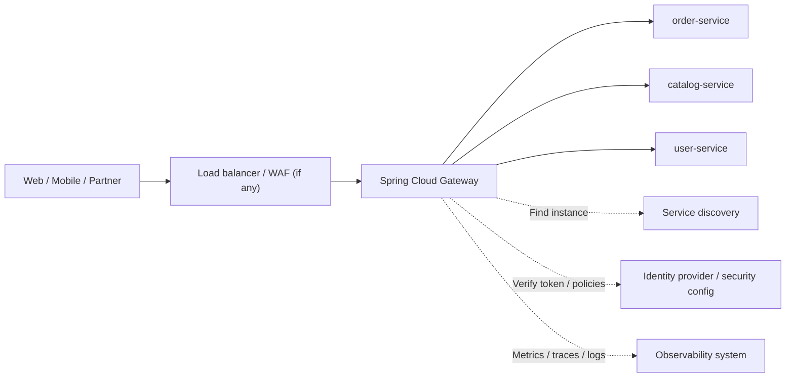
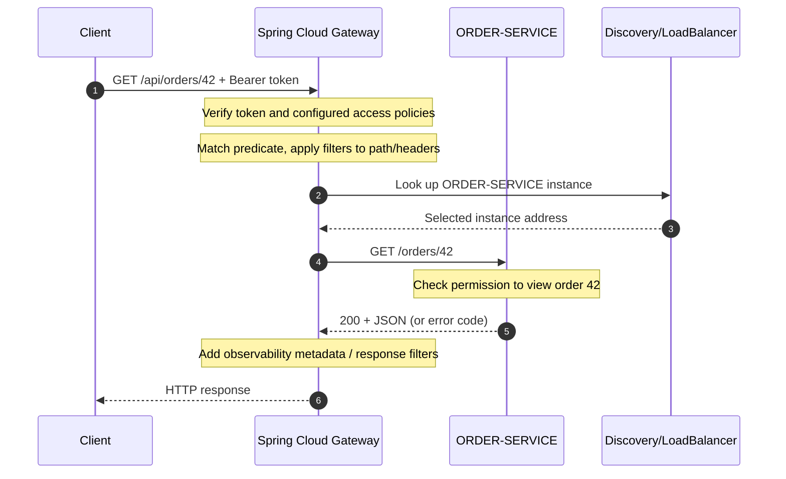

# Role of the Gateway in a Microservices Architecture

## 1. Context: Why Do Microservices Need a Shared Entry Point?

In a microservices architecture, an application is split into multiple services with distinct responsibilities, such as `catalog-service`, `order-service`, `payment-service`, and `user-service`. Each service can be deployed, scaled, and change network addresses independently. If a web or mobile application calls each service directly, the client side must know multiple addresses, handle multiple authentication mechanisms, track infrastructure changes itself, and depend on the internal structure of the system.

An **API Gateway** sits at the system's request-ingestion boundary, providing a unified access point and forwarding requests to the appropriate service. In the Spring ecosystem, **Spring Cloud Gateway** implements this model through **routes**, **predicates** (conditions for matching a route), **filters** (request/response processing), and integration with service discovery, security, fault tolerance, and telemetry.

For example, the client only knows `https://api.example.com`:

| Client Request | Target Service | Meaning |
| --- | --- | --- |
| `GET /api/products/18` | `catalog-service` | Fetch product information |
| `GET /api/orders/42` | `order-service` | View an order |
| `POST /api/payments` | `payment-service` | Initiate a payment |

The client does not need to know how many instances `order-service` currently has or which machine they are running on. The gateway receives the public URL, selects a route, and forwards to the appropriate address.

### Gateway Position Diagram



In the diagram, the gateway is the entry point **for the API flows that pass through it**, not necessarily the only component at the network edge: real systems may also use DNS, CDN, WAF, ingress, or a load balancer in front. Internal communication between services also does not have to go around through the gateway.

## 2. Core Roles of an API Gateway

### 2.1. Request Routing and Hiding Internal Topology

The gateway inspects a request against conditions such as path, HTTP method, host, or headers, and selects the target service. For example:

- `/api/orders/**` is forwarded to the order service.
- `/api/products/**` is forwarded to the catalog service.
- A route can accept only `GET` or `POST`.

When combined with **service discovery** and **Spring Cloud LoadBalancer**, a URI like `lb://ORDER-SERVICE` can be resolved to an available instance of `ORDER-SERVICE`. As a result, clients do not depend directly on the IP/port of individual instances; the gateway still needs to be properly configured for lookup and load balancing.

**Limitation to understand:** the gateway can hide service locations, but the public API remains a contract with clients. Changing field names, error codes, or endpoint semantics still requires version and compatibility management.

### 2.2. Enforcing Shared Policies at the Entry Point

The gateway is a convenient place to centralize shared policies:

| Need | Common Gateway Handling | Things to Note |
| --- | --- | --- |
| Authentication | Validate access tokens before forwarding requests | Must actually configure security; simple routing does not authenticate on its own |
| Rate limiting | Limit request counts by client, account, or API key | Derive rate-limit keys from a trusted identity source |
| TLS | Provide HTTPS to clients and configure secure upstream connections when needed | Terminating TLS at the gateway does not automatically encrypt every internal hop |
| CORS | Respond with cross-origin policies for browser applications | CORS does not replace authentication and authorization |
| Request modification | Add/remove headers, rewrite or strip paths | Avoid relying on client-supplied headers as proof of identity |
| Resilience | Timeouts, circuit breakers, controlled retries | Retries can amplify load and cause side effects on write requests |
| Observability | Record metrics, trace IDs, and appropriate logs | Avoid logging tokens, passwords, or sensitive personal data |

Centralizing policies at the gateway reduces duplication across multiple services and delivers consistent behavior to users. However, **the target service must still check business permissions**. For example, the gateway may verify that a user is logged in, but `order-service` must still check whether that user is allowed to view order number 42.

### 2.3. Adapting Public Interfaces to Internal Interfaces

Public paths can be designed to be more stable and ergonomic than internal addresses:

```text
Client:   GET /api/orders/42
Gateway:  StripPrefix=1
Upstream: GET /orders/42  -> order-service
```

The gateway can also normalize certain headers, attach a request ID, or append headers for operations. These actions are useful during system migrations or API standardization. Even so, the gateway should not contain complex business rules or turn into a dumping ground for logic from all services.

### 2.4. Providing an Observability Point for API Traffic

Because client request flows pass through it, the gateway has a good vantage point to measure:

- Traffic volume by route, HTTP status, and client group.
- Latency at the gateway and forwarding time to upstreams.
- `4xx`/`5xx` error rates, rate-limited requests, and timeouts.
- Traces spanning the gateway and target services via correlation/trace IDs.

Metrics, logs, and distributed tracing help distinguish errors caused by routing, rate limiting, upstream connectivity, or the target service itself. Avoid high-cardinality labels: instead of tagging a metric for each `/orders/42`, use the route name or a pattern like `/orders/{id}`.

## 3. How Does Spring Cloud Gateway Implement This Role?

Three concepts are foundational when reading a gateway configuration:

| Concept | Question Answered | Example |
| --- | --- | --- |
| **Route** | Where will the request be forwarded? | `uri: lb://ORDER-SERVICE` |
| **Predicate** | Which requests are matched to the route? | `Path=/api/orders/**`, `Method=GET,POST` |
| **Filter** | How will the request/response be processed? | `StripPrefix=1`, adding headers, auth/rate limiting via corresponding configured mechanisms |

In the **Spring Cloud Gateway Server WebFlux** variant, the general flow is:

1. The gateway receives an HTTP request; the system identifies a route whose predicates match.
2. The filter chain is applied to the matched request. Filters can modify paths/headers, check conditions, or short-circuit the request with an appropriate response.
3. The gateway forwards the request to the resolved upstream, optionally via load balancing.
4. The response from the upstream travels back through the post-processing phase of the filters and is returned to the client.

Route-level filters and global filters participate together in the processing chain with an execution order; post-processing runs in the reverse order of pre-processing when filters follow that model. Configuring filter order affects the state in which a header, log record, or policy sees the request.

Spring Cloud Gateway also has a **Server MVC** variant; its dependencies, configuration style, and processing mechanics differ from WebFlux. When implementing, choose the right variant and consult documentation matching the Spring Cloud version in use.

### Basic Route Configuration Example

The snippet below illustrates the `spring.cloud.gateway.routes` configuration style commonly seen with **Spring Cloud Gateway Server WebFlux 4.x**:

```yaml
spring:
  cloud:
    gateway:
      routes:
        - id: order-route
          uri: lb://ORDER-SERVICE
          predicates:
            - Path=/api/orders/**
            - Method=GET,POST
          filters:
            - StripPrefix=1
            - AddRequestHeader=X-Gateway-Source, spring-cloud-gateway
```

Suppose `ORDER-SERVICE` exposes `GET /orders/42`; when sending:

```http
GET /api/orders/42 HTTP/1.1
Host: api.example.com
```

The gateway will match `Path` and `Method`, strip the first path segment (`/api`), and forward `GET /orders/42` to an instance of `ORDER-SERVICE`. With an `lb://...` URI, the application needs a load-balancing component and a matching instance source (service registry/discovery or static instance configuration).

The example above only illustrates **routing and request-transformation filters**. It does **not** automatically configure JWT authentication, authorization, rate limiting, circuit breakers, or TLS. The `X-Gateway-Source` header only illustrates transformation; if using a header as a trust marker between services, spoofed values from clients must be stripped and a clear trust boundary must be established.

> **Version note:** configuration keys, starters, and APIs can change across Spring Cloud Gateway generations (especially when moving between WebFlux and Server MVC). Check the official documentation for your project's version before copying configurations into production.

## 4. Real-World Request Flow: Viewing an Order

Suppose a user accesses `GET https://api.example.com/api/orders/42` with an access token. A complete gateway design might process it in the following flow:



Distinguish **steps that can be configured** from **default behavior**: token verification, rate limiting, timeout enforcement, or tracing only happen when the relevant components and policies are enabled. The basic route in Section 3 does not perform all of these steps.

Some possible outcomes:

| Scenario | Typical Response | Where to Check |
| --- | --- | --- |
| No matching route | `404 Not Found` | Predicates, path, method |
| Missing or invalid token when security is enabled | `401 Unauthorized` | Authentication config, issuer/JWK, token |
| User lacks sufficient permissions | `403 Forbidden` | Authorization policies at gateway/service |
| Exceeded rate-limiter quota | `429 Too Many Requests` | Rate limiter, key resolver, quota |
| No available upstream found | Potentially `503 Service Unavailable` | Discovery, health, LoadBalancer |
| Upstream slow or unresponsive | Timeout/`5xx` error depending on config | Timeouts, connectivity, circuit breaker |

The status codes in the table are common illustrative examples. Actual codes depend on configuration, exceptions, handlers, and systems sitting in front of the gateway.

## 5. How Does the Gateway Support Security and Fault Tolerance?

### Authentication and Authorization

For APIs requiring login, the Gateway can integrate **Spring Security** to verify JWTs under the OAuth2 Resource Server model, or use another appropriate authentication mechanism. Verification typically covers signature, expiration, issuer, and required claims per policy. If there are multiple endpoint types, public routes and protected routes must be clearly specified.

However, a valid token does not prove the user is authorized to act on every resource. For example, `GET /orders/42` needs to verify that order 42 belongs to the caller or that they hold an appropriate admin role. Passing through the gateway should not be treated as proof that every internal request is trustworthy; services must authenticate/authorize according to the chosen security model.

### Rate Limiting

Rate limiting protects the system when clients send too many requests or traffic spikes suddenly. Spring Cloud Gateway provides the `RequestRateLimiter` filter; a common implementation is the Redis rate limiter, paired with a `KeyResolver` to choose keys by user or client. A key taken directly from an arbitrary client header can be forged and render the policy ineffective. Quotas should differentiate sensitive endpoints, regular clients, and SLA-backed clients if the product requires it.

### Circuit Breaker, Timeout, and Retry

- **Timeout** caps wait time so requests do not hold resources indefinitely.
- **Circuit breaker** temporarily stops sending requests to a continuously failing upstream, helping reduce cascading failures and optionally returning a pre-designed fallback.
- **Retry** retries certain transient errors, but must be bounded in attempt count and duration; consider backoff and overload risk.

Retries require special caution on `POST /payments` or order-creation operations: a request may have succeeded at the upstream even though the gateway did not receive the response. Repeating the request without an idempotency mechanism can create duplicate transactions. Even for `GET`, excessive retries when an upstream is overloaded can make the situation worse.

### TLS and Trust Boundaries

HTTPS between the client and gateway protects external connections. In systems with strict security requirements, consider HTTPS/mTLS between the gateway and upstreams or controlling traffic through internal infrastructure. Clearly identify where TLS terminates, who is allowed to call services directly, and which forwarded headers are considered trustworthy. Headers related to origin IP or identity, such as `X-Forwarded-For`, must not be blindly trusted when clients can fabricate them.

## 6. How Does a Gateway Differ from Adjacent Components?

| Component | Typical Responsibility | Relationship to API Gateway |
| --- | --- | --- |
| **L4/L7 Load balancer** | Distributes connections/requests across instances | Can sit in front of the gateway or be used by the gateway to select service instances |
| **Ingress controller** | Brings external HTTP(S) into Kubernetes workloads | Can handle basic routing; the gateway adds API policies as needed |
| **API Gateway** | API routing, entry-point policies, request transformation and observability | Serves as the entry point designed around the public API contract |
| **Service mesh** | Governs service-to-service communication such as mTLS, traffic policies, telemetry | Complements the gateway; typically handles deeper internal traffic |
| **Backend for Frontend (BFF)** | Builds APIs tailored to a specific UI type, optionally aggregating data | Can sit behind the gateway or consolidate some roles in smaller applications |

Not every system needs all of these components. With a few services and minimal policies, an ingress or reverse proxy may already suffice. When there are many clients, many services, and a need for centralized API control, a gateway provides clearer benefits.

## 7. Trade-offs and Design Principles

A shared gateway also becomes a concentration point for load and risk. Prepare an operational architecture to match:

1. **Avoid a single point of failure:** run multiple gateway replicas behind a load balancer, with health checks and a safe deployment strategy; monitor connection and resource limits.
2. **Keep business logic out of the gateway:** routes, technical policies, and simple transformations belong in the gateway; pricing rules, ownership checks, and order-status updates belong in their respective services.
3. **Manage the API contract:** organize path prefixes, API documentation, compatibility, and versioning strategy; changing a route does not mean a service can accept a new schema.
4. **Configure timeouts and retries deliberately:** establish an end-to-end request time budget; fallbacks must preserve business semantics and avoid masking dangerous errors.
5. **Protect data and identity:** prevent internal routes from being exposed externally, manage secrets, sanitize untrusted headers, control CORS, and never log credentials.
6. **Monitor per route:** measure p95/p99 latency, `4xx`/`5xx` rates, rate-limited requests, connection errors, and circuit breakers; link traces from the gateway to target services.
7. **Test from the outside:** test path rewrites, methods, valid/invalid tokens, CORS preflight, rate limits, loss of service discovery, and slow upstreams before going to production.

### Practical Scenarios

**Scenario A — Scaling the order service:** during peak hours, `order-service` scales from 2 to 6 instances. If the gateway uses discovery and LoadBalancer properly, clients keep calling `/api/orders/**` without updating addresses. The team should monitor load balancing effectiveness, timeouts, and individual instance health.

**Scenario B — Burst API abuse:** a client sends a flood of requests to `/api/login`. Rate-limiting policies at the gateway can reduce traffic reaching the service. However, you must choose an appropriate rate-limit key, coordinate with infrastructure-level protection, and handle cases where multiple IPs/clients share an identifier.

**Scenario C — Intermittent payment service failures:** the gateway can use timeouts or a circuit breaker to stop requests from waiting too long. For payment commands, automatic retries should only be enabled when idempotency is designed in and safe-to-retry errors are clearly defined.

## 8. Summary

The primary role of a gateway in microservices is to **provide a stable API entry point**, **route to the appropriate service**, and **consistently enforce technical policies at the system edge**. Spring Cloud Gateway provides routes, predicates, and filters to build this pipeline, while integrating with service discovery, load balancing, Spring Security, rate limiters, circuit breakers, TLS, and observability.

When designing, answer three questions: **which route is a request matched to**, **which filters/policies are actually being applied**, and **what checks remain the responsibility of the target service**. Clearly separating these three layers of responsibility keeps the gateway easy to operate, better protects the system, and prevents it from becoming an unintended home for business logic.
