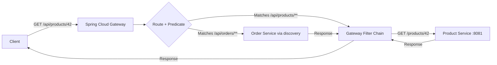
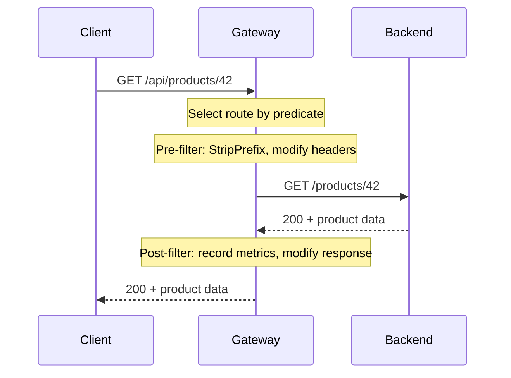

# Route, Predicate, Filter, and Backend Services in Spring Cloud Gateway

In a microservices architecture, client applications may need to call multiple services such as products, orders, and accounts. **Spring Cloud Gateway** provides an entry point to receive requests, determine the target service, transform requests/responses, and apply shared policies. To configure an entry point accurately, you need to distinguish four concepts: **route**, **predicate**, **filter**, and **backend/upstream service**.

This forms the foundation for subsequently implementing authentication, rate limiting, circuit breakers, retries, TLS, and request observability when operating an API Gateway safely.

## 1. The Big Picture

Imagine a system with a gateway at `http://localhost:8080`, a product service at `http://localhost:8081`, and an order service registered under the name `order-service`:



At a conceptual level:

| Component | Question Answered | Role |
| --- | --- | --- |
| **Route** | Where will this request go? | Associates a route identifier with a target URI, predicates, filters, and priority order. |
| **Predicate** | Does the request belong to this route? | Evaluates conditions such as path, HTTP method, host, header, or query parameter. |
| **Filter** | How should the request/response be processed? | Modifies paths, headers, applies policies, measures timing, or handles errors in the processing chain. |
| **Backend service** | Who executes the business logic? | Receives the request forwarded by the gateway, executes business logic, and returns the result. |

**Rule of thumb:** predicates **select** the route; filters **process** data passing through the route; the route's URI **points to the destination**; the backend **executes business logic**. One route can have multiple predicates and multiple filters, while multiple routes can point to the same backend.

## 2. Route: The Routing Configuration Unit

A route describes the **selection conditions** and **forwarding target** for a group of requests. Common properties include:

- `id`: a unique name to identify the route, such as `product-read`.
- `uri`: destination address or service name, such as `http://localhost:8081` or `lb://order-service`.
- `predicates`: list of conditions for the route to be selected.
- `filters`: operations executed on requests and responses once the route is selected.
- `order` (optional): priority order when multiple routes might match; smaller values take precedence first.

For example, a route might mean: "`GET` requests with paths starting with `/api/products/` are forwarded to the product service; before forwarding, strip the `/api` segment from the path." This route does not define endpoints, product data, or backend business rules itself.

### Static Target URIs and Service-Discovery URIs

| Example URI | Routing Mechanism | When Appropriate |
| --- | --- | --- |
| `http://localhost:8081` | Forwards directly to the declared host and port. | Local development, testing, or backends with fixed addresses. |
| `https://catalog.internal.example` | Forwards over HTTPS to a specific upstream. | Backends with stable DNS that require encrypted connections. |
| `lb://order-service` | Looks up instances named `order-service` and picks one via load balancing. | Microservices with multiple instances or dynamic addresses. |

With `lb://`, the gateway must integrate **Spring Cloud LoadBalancer** and have a suitable instance list source, such as a `DiscoveryClient` connected to a registry or a pre-configured instance list. Simply writing `lb://order-service` does not make the service appear automatically; if no instance is found, forwarding fails.

**A route is not synonymous with a microservice.** You can create `product-read` and `product-write` with different predicates that both point to the product service. Conversely, one gateway application typically manages many routes corresponding to many backends.

## 3. Predicate: Deciding Which Requests Match a Route

A predicate is a test returning *true/false* over request information. Spring Cloud Gateway provides **Route Predicate Factories** to express common conditions:

| Predicate | Example | Meaning |
| --- | --- | --- |
| `Path` | `Path=/api/products/**` | Request path matches the declared pattern. |
| `Method` | `Method=GET,HEAD` | Accepts only the listed HTTP methods. |
| `Host` | `Host=**.example.com` | Request host matches the domain pattern. |
| `Header` | `Header=X-Client-Type, mobile` | Header exists and its value matches the configured expression. |
| `Query` | `Query=version, v2` | Query parameter `version` has a matching value. |
| `Cookie` | `Cookie=region, vn` | Cookie satisfies the condition. |
| `RemoteAddr` | `RemoteAddr=192.0.2.0/24` | Remote address falls within the allowed CIDR range. |

**Predicates within the same route are combined with AND logic.** For example:

```yaml
predicates:
  - Path=/api/products/**
  - Method=GET
```

The route matches only when **both path and method** satisfy their conditions. For `GET /api/products/42`, both conditions are true. For `POST /api/products/42`, `Method=GET` is false, so the gateway must look for another matching route. If no route matches, the request typically receives `404 Not Found` from the gateway.

Predicates are not an authorization mechanism. `Header=X-Role, admin` only checks the header value carried by the request; it does not prove the caller is actually an administrator. Identity and permission checks belong in an appropriate security layer, such as Spring Security paired with token verification.

### When Multiple Routes Match

For example, `Path=/api/**` and `Path=/api/products/**` can both match `/api/products/42`. If the two routes point to different backends, design distinct predicates or configure `order` deliberately. Do not assume the route with the "more specific" path always wins without explicit precedence rules.

## 4. Filter: Processing Before and After Forwarding

Once a route is selected, the gateway runs the **filter chain**. Filters can inspect, transform, or reject requests; some filters also process the backend response before sending it to the client.

There are two groups of filters to distinguish in the **Spring Cloud Gateway Server WebFlux** variant:

- **`GatewayFilter`**: attached to a specific route. For example, the product route needs `StripPrefix`, while the account route needs a distinct header operation.
- **`GlobalFilter`**: applied at the gateway level to requests handled by routes; commonly used for correlation IDs, controlled logging, or uniform policies.

Global filters and route filters are combined and then sorted by execution order. Under `Ordered` precedence, a higher-priority filter runs earlier in the **pre** phase and later in the **post** phase. In the WebFlux model, they operate on `ServerWebExchange` and the reactive chain; mutating a request is typically done via `mutate()` rather than modifying an immutable object directly.



### Some Common Filters

| Filter | Effect | Things to Watch Out For |
| --- | --- | --- |
| `StripPrefix` | Removes a number of leading path segments. | `StripPrefix=1`: `/api/products/42` becomes `/products/42`. |
| `PrefixPath` | Prepends a prefix to the path. | Useful when the backend expects an internal prefix different from the public API. |
| `RewritePath` | Rewrites the path using a regular expression. | Watch regex capture groups and placeholder escaping in YAML. |
| `SetRequestHeader` | Sets/replaces a header sent to the backend. | Do not use a self-set header as authentication proof without a trust boundary. |
| `AddResponseHeader` | Adds a header to the response. | Can be used to append technical metadata safe for public exposure. |
| `RemoveRequestHeader` | Removes a header before forwarding. | Know whether the backend needs that header for business logic. |
| `RequestRateLimiter` | Rate-limits calls by an identity key. | Requires a key resolution strategy and corresponding rate-limiter configuration. |
| `CircuitBreaker` / `Retry` | Limits impact when an upstream fails or retries requests. | Requires extra dependencies/config; retries are only safe when idempotency is understood. |

**Not all processing in the gateway is a GatewayFilter.** For example, a `WebFilter` from Spring Security can handle authentication before route selection; a `GatewayFilter` operates inside the filter chain of a matched route. Separating these two layers helps avoid confusion when designing security and diagnosing rejected requests.

## 5. Backend Service: Where Business Logic Executes

The backend (upstream) is the service that actually handles the request after the gateway routes it. For instance, the product service returns product details, and the order service executes order-placement logic. The gateway may transform paths or headers, but the backend remains responsible for data validation, business permissions, transactions, and resource state.

Two different paths may exist between client and backend:

```text
Client -> Gateway: GET /api/products/42
Gateway -> Backend: GET /products/42
```

The difference comes from the `StripPrefix=1` filter, not because the backend inherently knows the public path `/api/products/42`. Therefore, the **gateway's public API** and **each backend's internal API** must stay aligned. If a filter rewrites the path incorrectly, the gateway still matches the right route, but the backend may return `404` because the endpoint does not exist.

A backend can run multiple instances. When using `lb://`, selecting an instance is the responsibility of the load-balancing mechanism integrated with the gateway; the registry only supplies service-discovery information and does not replace routing logic, filters, or business processing.

## 6. Complete Introductory Configuration Example

Consider the model:

- Gateway listens on port `8080`.
- Product Service listens on port `8081`, exposing `GET /products/{id}`.
- Order Service publishes the service name `order-service`, exposes `/orders/{id}`, and may have multiple instances.

The following `application.yml` example illustrates configuring **Spring Cloud Gateway Server WebFlux** using the `spring.cloud.gateway.routes` style commonly found in earlier release lines:

```yaml
server:
  port: 8080

spring:
  application:
    name: edge-gateway
  cloud:
    gateway:
      routes:
        - id: product-read
          uri: http://localhost:8081
          predicates:
            - Path=/api/products/**
            - Method=GET
          filters:
            - StripPrefix=1
            - SetRequestHeader=X-Gateway-Source, edge-gateway
          order: 0

        - id: order-api
          uri: lb://order-service
          predicates:
            - Path=/api/orders/**
          filters:
            - StripPrefix=1
          order: 10
```

**Version compatibility note:** newer versions of Spring Cloud Gateway Server WebFlux organize route configuration under `spring.cloud.gateway.server.webflux.routes`. Use the **exact configuration namespace and starter** for the Spring Boot/Spring Cloud version you are running. This example applies only to the WebFlux variant; Spring Cloud Gateway Server MVC has its own configuration model and programmatic API. Do not declare both namespaces simultaneously expecting them to behave identically.

### Reading the Configuration Request by Request

| Request to Gateway | Matched Route | Active Filters | Post-Processing Destination |
| --- | --- | --- | --- |
| `GET /api/products/42` | `product-read` | Strip `/api`, set `X-Gateway-Source` header | `http://localhost:8081/products/42` |
| `POST /api/products/42` | No matching route in example | `product-read` filters do not run | Gateway does not forward; typically returns 404. |
| `GET /api/orders/7` | `order-api` | Strip `/api` | `/orders/7` on a selected instance of `order-service`. |
| `GET /unknown` | No matching route | No route filters | Gateway does not forward; typically returns 404. |

Two client test commands:

```bash
curl -i http://localhost:8080/api/products/42
curl -i http://localhost:8080/api/orders/7
```

These commands only return successful data when the corresponding backends are running; the `order-api` route specifically also requires service discovery and load-balancer configuration. To test the example completely locally without a registry, you can temporarily replace `lb://order-service` with `http://localhost:8082`, assuming Order Service listens on port `8082`.

Tracing the first request:

1. The gateway receives `GET /api/products/42` on port `8080`.
2. Both `Path` and `Method` predicates evaluate to true, so the `product-read` route is selected.
3. `StripPrefix=1` removes the `api` segment; `SetRequestHeader` sets the `X-Gateway-Source` header.
4. The gateway forwards `GET /products/42` to `localhost:8081`.
5. Product Service generates the response; the gateway runs response-phase processing and returns the result to the client.

One common pitfall is that the `X-Gateway-Source` header in the example only **illustrates header transformation**, not proof that the request has been authenticated. If a backend relies on a header to make security decisions, the system must establish and protect an appropriate trust boundary.

## 7. Key Design Decisions

### 7.1. Distinguishing Route Matching from Authorization

`Path=/api/orders/**` only means "this request belongs to the orders API group." It does not mean "the caller is permitted to view orders." For APIs requiring login, the gateway can validate tokens and enforce entry access controls; the backend still needs to enforce business permissions, such as whether the user may read order `7`. Avoid using client-supplied headers in place of identity verification.

### 7.2. Distinguishing Route-Selection Errors from Backend Errors

- **No matching route:** the request is not forwarded; you typically see a `404` at the gateway.
- **Route matches but no instance for `lb://`:** forwarding fails at destination lookup; status code depends on configuration (commonly `503`).
- **Backend exists but rewritten path is wrong:** the backend may return `404` even though the gateway routed to the right service.
- **Backend timeout or unavailability:** outcome depends on timeout, retry, circuit breaker, and error-handling configuration; never assume every error is a predicate failure.

When investigating, check in order: **original request → matched predicate/route → post-filter path and headers → target URI/instance → backend response**.

### 7.3. Path Transformations Need a Clear Contract

Suppose the gateway exposes `/api/products/42` while the backend expects `/internal/catalog/42`. `StripPrefix=1` only yields `/products/42`, which does not satisfy this contract. In that case, use an appropriate path-rewriting mechanism and test multiple scenarios: root path, parameterized paths, trailing `/`, query strings, and HTTP methods.

### 7.4. Shared Filters Must Be Designed Carefully

Global filters enable shared logic, but they also affect every routed request. Reading bodies, logging excessively, or adding blocking calls into the WebFlux chain can easily raise latency and resource usage. Log only information needed for operations; avoid logging tokens, passwords, and sensitive data.

## 8. Connection to API Gateway Operational Capabilities

The four concepts above are the starting point for common Spring Cloud Gateway capabilities:

| Need | Position in Flow | Questions to Answer Before Implementing |
| --- | --- | --- |
| Authentication and authorization | Security layer and/or appropriate filters | Who issues tokens, where are they verified, and what does the backend trust? |
| Rate limiting | Filter before calling backend | Limit by IP, API key, or user identity; how to handle quota exceeded? |
| Circuit breaker | Filter protecting upstream calls | When the backend fails repeatedly, when to stop trying and what fallback to return? |
| Retry | Filter controlling repeat calls | Are the HTTP method and business operation safe to repeat? |
| TLS | Client–gateway and gateway–backend connections | How is each hop encrypted, and is internal mTLS required? |
| Request observability | Metrics, traces, and logging around the pipeline | How to trace the same request across the gateway and backends? |

For example, automatic retries for `GET /products/42` are usually easier to control than retries for payment creation. If the backend already executed the business action but the gateway lost the response, retrying a non-idempotent request can cause duplicate side effects. Similarly, circuit breakers and rate limiters are only effective when keys, thresholds, and failure behaviors are tuned for each route.

For observability, use a consistent correlation ID/trace ID between the gateway and backends, combining latency, status code, and route name in metrics or logs. When enabling actuator endpoints to inspect routes, configure and restrict access appropriately for the operating environment.

## 9. Self-Check

**Scenario A.** A gateway has route `Path=/api/users/**`, `Method=GET`, URI `http://localhost:8083`, filter `StripPrefix=1`. Under what path is `GET /api/users/15` sent to the backend?

**Answer:** `/users/15`. Predicates select the route; the filter strips the `api` segment; the backend receives the transformed path.

**Scenario B.** A client sends `POST /api/users/15` and there is no other route. Why does the backend not receive the request?

**Answer:** The `Method=GET` predicate does not match. The filters for that route do not run for that request either.

**Scenario C.** Route `lb://inventory-service` matches, but the gateway finds no instances. Should you change the `Path` predicate?

**Answer:** There is no basis for that. The predicate already matched; check the registry, service name, instance list, and load-balancer integration first.

**Scenario D.** The backend receives header `X-User-Id: 123` from a client and allows reading order `123`. Is this safe?

**Answer:** You cannot conclude it is safe from a header alone. The backend must rely on verified identity and check access permissions; the gateway and backend must agree on how trusted context is propagated.

## 10. Concept Summary

When designing an API Gateway with Spring Cloud Gateway, ask in exact order: **which requests should be handled (`predicate`), which routing rule receives them (`route`), how requests/responses must be transformed or protected (`filter`), and which service executes the business logic (`backend`)**. Clearly distinguishing these four layers makes configurations easier to read, helps troubleshoot routing failures, and lets you incrementally add security, reliability, and observability policies to your microservices entry point.
