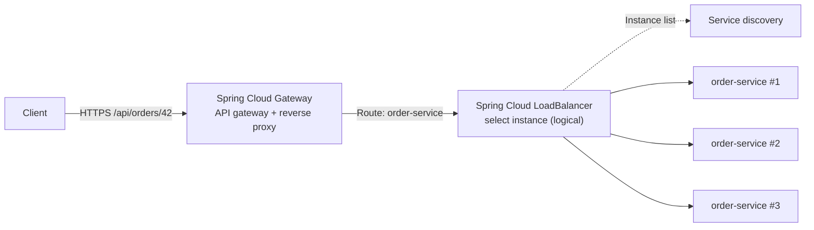
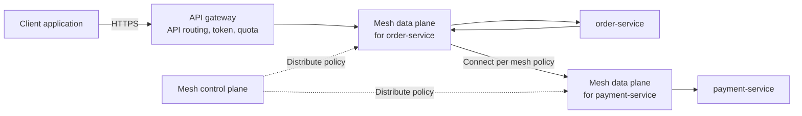

# Distinguishing API Gateway, Reverse Proxy, Load Balancer, and Service Mesh

When building microservices, a request from a mobile app may pass through several components before reaching the business service. An **API gateway**, **reverse proxy**, **load balancer**, and **service mesh** can all forward traffic, yet they solve problems at different scopes. Understanding their differences accurately helps you choose a right-sized architecture and avoid duplicating network policies.

In the **SPRING_CLOUD_GATEWAY** module, the focus is on using **Spring Cloud Gateway** as the API entry point: routing by route predicates, applying a filter chain to modify paths/headers, integrating service discovery, authentication, rate limiting, circuit breakers, retries, TLS, and request monitoring. This article places Spring Cloud Gateway in the broader landscape to distinguish its role from the other three concepts.

## 1. Starting from a Real-World Scenario

Suppose an e-commerce system has three services: `order-service`, `payment-service`, and `catalog-service`. Each service may have multiple instances; for example, `order-service` runs across three different machines or containers.

A request `GET /api/orders/42` raises separate questions:

1. **Which public address should the client call?** The browser should not need to know every internal microservice hostname.
2. **Which service does the request belong to?** The path `/api/orders/**` should route to `order-service`, while `/api/payments/**` routes to `payment-service`.
3. **Which instance of `order-service` should be chosen?** If there are multiple replicas, a healthy instance must be selected and load distributed appropriately.
4. **Who verifies tokens, request quotas, and shared API policies?** Edge policies must be enforced consistently, while services remain responsible for their own data-access permissions.
5. **How do services communicate with each other?** Calls from `order-service` to `payment-service` may require mTLS, timeouts, retries, and unified telemetry.

These questions explain why multiple component layers exist. They **can collaborate or overlap in functionality**, and are not necessarily four separate products that must all be installed independently.

## 2. The Four Core Concepts

### 2.1. Reverse Proxy: A Server Standing in Front of the Backend

A **reverse proxy** accepts requests from clients and forwards them to one or more backends. The client communicates only with the proxy's address, while the proxy opens connections to the target service and relays responses back.

A reverse proxy can provide:

- TLS termination at the edge, managing certificates for public domains.
- Request forwarding based on host or path; URL and header rewriting.
- Load balancing, caching, compression, or connection limits, depending on the product and configuration.
- Hiding backend server addresses from clients; on its own, this **does not** replace network access control.

For example, `https://api.example.test/orders/42` enters Nginx or Envoy and is proxied to an internal HTTP backend. On the return path, the response also travels through the proxy.

The primary identifying trait is **position in the request path**: a reverse proxy sits in front of servers and acts on their behalf. An HTTP reverse proxy typically operates at the application layer (L7); some products can also proxy TCP streams (L4).

### 2.2. Load Balancer: Choosing Where a Request or Connection Goes

A **load balancer** distributes requests or connections across instances capable of serving the same work. Typical goals are load distribution, horizontal scaling, and avoiding sending traffic to unhealthy instances.

There are two familiar classifications:

| Type | Decision Basis | Illustration |
| --- | --- | --- |
| **L4 load balancing** | Connection info such as IP, port, TCP/UDP; does not inspect HTTP path. | Distributes TCP connections across multiple servers. |
| **L7 load balancing** | Application info such as HTTP host, path, headers, or cookies. | Routes `/images/**` to an image server pool. |

Selection algorithms can be round robin, weighted routing, least connections, or other strategies depending on the system. Health checks, timeouts, and outlier ejection also depend on the implementation.

Load balancing can occur in two places:

- **Server-side load balancing:** a proxy or network appliance receives traffic and chooses a backend, such as an HTTP load balancer sitting in front of service instances.
- **Client-side load balancing:** the calling component receives an instance list and picks a target. In Spring Cloud Gateway, the URI `lb://order-service` can use **Spring Cloud LoadBalancer** to pick an instance of that logical service name.

**Service discovery** and load balancing are related yet distinct: discovery finds **which instances exist**, whereas load balancing decides **which instance to use**. The instance list may come from a registry, Kubernetes, or another configuration source. An `lb://...` URI requires a load-balancer integration and an appropriate instance-resolution mechanism; simply writing this URI does not create a registry automatically.

### 2.3. API Gateway: Entry Point and Policy Layer for APIs

An **API gateway** is an entry point aware of APIs and client requirements. It is commonly built atop L7 reverse-proxy capabilities, adding rules tailored to publishing and governing APIs.

Responsibilities commonly placed in an API gateway include:

- **API routing:** matching requests to routes by path, method, host, header, or other predicates.
- **Request/response transformation:** adding, removing, or modifying headers; rewriting paths; applying filters in a defined order.
- **API edge protection:** integrating token validation, rate limiting, CORS controls, quotas, and API-level access policies.
- **Failure handling:** timeouts, circuit breakers, conditional retries, and returning appropriate errors or fallbacks.
- **Operations:** generating or propagating correlation IDs, exporting metrics, logs, and distributed traces.

**Spring Cloud Gateway** falls into this category. A route combines **predicates** (when to match), **filters** (processing before/after calling downstream), and a **target URI** (where to forward). Beyond HTTP routing, it can integrate Spring Security, Spring Cloud LoadBalancer, Resilience4j, or equivalent components to enforce policies; **capabilities like authentication and circuit breakers must be configured/integrated**—they do not appear automatically just by installing a gateway.

A gateway is useful at the boundary between client apps and backend systems (*north–south traffic*), though it can also serve as an internal API entry layer. Having a gateway does not mean every internal call between microservices must loop back through the gateway.

### 2.4. Service Mesh: Managing Inter-Service Communication

A **service mesh** is an infrastructure layer managing *service-to-service* traffic, often called *east–west traffic*. Rather than having each application team implement all connectivity policies themselves, a mesh provides a centralized way to apply mechanisms such as:

- Encrypting and authenticating connections between workloads, typically via **mutual TLS (mTLS)**.
- Target selection, traffic splitting across versions, timeouts, retries, and circuit breaking depending on the deployment capabilities.
- Traffic observability: metrics, tracing, and data on errors, latency, and connections.
- Communication policies between workloads by identity or namespace.

A mesh typically has a **data plane** (proxies or forwarding mechanisms enforcing policies) and a **control plane** (distributing configuration/policies). The sidecar model places a proxy alongside each workload; other architectures can operate without a sidecar per pod. Istio and Linkerd are examples of service mesh platforms.

A mesh is **not inherently** a public API entry point. A system with a mesh may still need an API gateway or ingress gateway to validate end-user tokens, apply per-API quotas, and publish external endpoints. Conversely, having an API gateway does not mean internal calls automatically have mTLS or mesh policies.

## 3. Quick Comparison Table

| Criterion | Reverse proxy | Load balancer | API gateway | Service mesh |
| --- | --- | --- | --- | --- |
| **Primary problem** | Represents backends, accepts and forwards traffic | Selects target instance or endpoint | Exposes, routes, and enforces policies for APIs | Manages communication and policies between workloads |
| **Typical placement** | In front of one or more backends | In front of an instance pool or on the service caller side | At the API system edge, sometimes internally | Distributed across services; may include ingress/egress |
| **Unit of concern** | Requests/connections to backend | Connections, requests, and instance lists | Routes, APIs, consumers, tokens, quotas | Workload identity, service-to-service traffic, policies |
| **Representative capabilities** | TLS termination, proxying, rewrites, caching | Health checks, load-distribution algorithms, failover | Predicates, filters, auth, rate limits, API transformation and observability | mTLS, traffic policies, telemetry, internal traffic splitting |
| **Examples** | Nginx, Envoy acting as a reverse proxy | L4/L7 load balancer, Spring Cloud LoadBalancer | Spring Cloud Gateway, Kong | Istio, Linkerd |

**How to remember:** a reverse proxy answers *"who stands in front to receive and forward requests?"*; a load balancer answers *"which instance receives it?"*; an API gateway answers *"where is this API request allowed to go and what policies apply?"*; a service mesh answers *"under what policies do workloads communicate with each other?"*.

The columns describe **roles**, not strictly disjoint feature sets. An Envoy instance can serve as both a reverse proxy and a load balancer. Spring Cloud Gateway is an API gateway that also acts as a reverse proxy and can pick instances via Spring Cloud LoadBalancer. Proxies inside a service mesh can also perform load balancing or apply retries.

## 4. Tracing a Request Through Spring Cloud Gateway

Consider a request from a client app to `order-service`:

```http
GET /api/orders/42 HTTP/1.1
Host: api.example.test
Authorization: Bearer <access-token>
```

The diagram below illustrates a deployment with a gateway and multiple service instances:



The **Spring Cloud LoadBalancer** box represents the target-selection function inside the processing flow, **not necessarily a separate server/proxy**. Once the request is processed, the response returns through the gateway to the client.

General flow:

1. **Incoming connection:** the client establishes HTTPS with the gateway or a proxy/TLS-termination layer placed in front of the gateway. Where TLS terminates depends on the actual architecture.
2. **Route matching:** the gateway evaluates predicates; for example, the path `/api/orders/**` matches the orders route.
3. **Applying policies and filters:** if integrated, the system verifies tokens and quotas; route filters can strip the `/api` prefix, replace headers, or add diagnostic info. Exact execution order depends on the filters and configuration.
4. **Target resolution:** `lb://order-service` is resolved to an instance via the load balancer and the configured instance-list source.
5. **Forwarding and receiving the result:** the gateway calls the backend, receives the response, and executes any required response processing before returning it to the client.
6. **Observability:** logs/metrics/traces, if enabled and connected to a collection backend, show which route was matched, latency, and errors at each hop.

### 4.1. Route Configuration Example

The YAML example below uses the **configuration key style commonly seen in Spring Cloud Gateway Server WebFlux 4.x**. Starter names and property prefixes may differ in other major versions; when implementing, check the documentation for the exact version in use.

```yaml
spring:
  cloud:
    gateway:
      routes:
        - id: orders-route
          uri: lb://order-service
          predicates:
            - Path=/api/orders/**
          filters:
            - StripPrefix=1
```

With this route:

- `Path=/api/orders/**` is a **route predicate**: it decides whether a request belongs to the route.
- `StripPrefix=1` is a **gateway filter**: the request `/api/orders/42` is forwarded down to the backend with path `/orders/42`.
- `lb://order-service` is the **logical target**: the load balancer picks a resolved instance for `order-service`.

Separating each responsibility prevents confusion: **predicates do not choose instances**, **filters are not a registry**, and **service discovery does not enforce API access permissions on its own**.

This snippet only illustrates **routing and path transformation**. To run, it needs a target service along with an instance-resolution mechanism and appropriate dependencies; to check JWTs, rate limits, TLS, or circuit breakers, you must add the corresponding configuration/integrations. The gateway does not automatically replace authentication and business authorization in `order-service`.

## 5. When Do These Components Work Together?

### Architecture with Only a Reverse Proxy and Load Balancer

A small website or API system can use a reverse proxy for TLS termination and load balancing across a few backends. If centralized token policies, multi-group API routing, or consumer management are not needed yet, adding a dedicated API gateway may not be necessary.

### Architecture with Spring Cloud Gateway

When an application exposes many APIs to web/mobile/partners, Spring Cloud Gateway can provide a single public hostname, declare routes via predicates, transform requests with filters, validate tokens at the edge, and enforce rate limits. Spring Cloud LoadBalancer selects instances when using `lb://`; underneath may be Kubernetes service discovery, a registry, or another instance source. An L4 load balancer in front of the gateway may still be needed to distribute traffic across **replicas of the gateway itself**.

### Architecture with Both API Gateway and Service Mesh

With many microservices and a need for uniform internal connectivity policies, the two layers typically complement each other:



Simplified diagram: connections between components may be handled by sidecars, an ambient data plane, or corresponding infrastructure. **The gateway handles API/consumer policies**, whereas **the mesh mainly handles connectivity policies between workloads**. A mesh may include an ingress gateway, yet the ingress role must still be clearly designed if public API management is required.

### Choosing a Solution Based on Needs

| Primary Need | Component to Consider First | Reason |
| --- | --- | --- |
| Put one hostname in front of a few backends, TLS termination, rewrites | Reverse proxy | Directly solves edge forwarding. |
| Distribute load across multiple replicas of the same service | Load balancer | Selects target instances; may be built into a proxy/gateway. |
| Many APIs needing path routing, auth, rate limits, filters | API gateway, e.g., Spring Cloud Gateway | Centralizes API policies at the entry point and standardizes the API surface. |
| Many internal calls needing mTLS, telemetry, and uniform traffic policies | Service mesh | Applies inter-workload communication policies at the infrastructure layer. |
| Multiple gateway replicas, multiple backend replicas | Combine load balancing at appropriate hops | Distributing load into the gateway and from the gateway to backends are two distinct decisions. |

## 6. Common Misconceptions That Cause Architecture Bugs

### "Having a gateway means no load balancer is needed"

A gateway is a role; **load balancing is a target-selection capability**. A gateway can use internal load balancing, yet when the gateway runs multiple replicas you may still need load balancing in front of it. Conversely, `lb://` selects backend instances; it does not handle how clients locate a healthy gateway replica.

### "A reverse proxy and an API gateway are two completely different server types"

An API gateway typically acts as a reverse proxy. The difference lies in **API awareness and accompanying policies**. Nginx or Envoy can provide many capabilities commonly seen in gateways when configured appropriately; the product name alone does not dictate the entire role.

### "Using a service mesh completely replaces an API gateway"

A mesh can perform HTTP routing and provide ingress/egress, yet publishing APIs, validating end-user identity, managing client quotas, and governing API versions still need dedicated design. Conversely, Spring Cloud Gateway does not automatically encrypt and authenticate connections between two backends that do not pass through the gateway.

### "Validating JWTs at the gateway is enough to protect all data"

The gateway can verify signatures, issuers, audiences, or scopes per security configuration, but **each business service must protect its own resources**. For example, a valid token does not mean a user is allowed to view order `42`. Block unauthorized direct access to backends and sanitize identity headers sent by clients. Headers like `X-Forwarded-*` should only be trusted when coming from a trusted hop and handled properly.

### "Adding retries at every layer makes the system more resilient"

If the gateway, service client, and mesh all retry independently, one failing request can multiply into many backend calls, worsening an outage. Retries should have an **overall timeout, bounded attempts, backoff/jitter**, and apply only when operations are safe or **idempotent**. Be especially cautious with payments and write requests. A circuit breaker helps stop sending additional traffic in certain failure scenarios, but it does not replace timeouts or application-level recovery design.

### "Having TLS at the gateway means every hop is encrypted"

HTTPS from client to gateway only protects that hop. The connection from gateway to backend may be HTTP, HTTPS, or mTLS depending on configuration and trust boundaries. If using a mesh, internal mTLS must be enabled and verified under mesh policy; it does not appear automatically from HTTPS at the entry point.

## 7. How to Observe and Verify the Architecture

When operating a system using Spring Cloud Gateway, clearly establish the **start and end points** of every hop. Practical questions to ask:

1. **Routing:** which route does `/api/orders/42` match? Which predicate decided it? After filters, what path and headers does the backend see?
2. **Discovery/load balancing:** does the route use a fixed URI or `lb://`? Where does the instance list come from? When an instance becomes unhealthy, which component removes it from selection?
3. **Security:** where is TLS terminated, where are tokens verified, and where is access to an order checked? Can backends be called directly from the outside?
4. **Resilience:** do timeouts, retries, and circuit breakers live in the gateway, service client, or mesh? Is there a risk of compounding retries across layers?
5. **Observability:** do gateway logs and metrics include route ID, HTTP status, and latency? Is trace context propagated from the gateway to backends to link spans?

For example, when investigating a failed request, inspect along the path **client → gateway route/filter → selected instance → backend**. If a mesh is present, include mesh-managed proxies or hops in the trace. This perspective distinguishes a `404` due to no matching route from a `404` returned by the backend, a `503` due to no available instances from a downstream timeout, and a `401` from gateway auth policy from a `403` from business permission checks.

## 8. Knowledge Self-Check

**Scenario A:** `order-service` has four replicas, yet all requests still go to one fixed replica. Which capability is missing? **Hint:** inspect instance selection and discovery/load-balancing configuration; adding a new API gateway will not necessarily fix a target-selection issue.

**Scenario B:** a user calls `/api/orders/42`, the gateway validates the JWT, yet the user can still view someone else's order. Which policy is missing? **Hint:** check resource-level authorization inside `order-service`, not just token validation at the edge.

**Scenario C:** microservices need mTLS and unified telemetry for internal calls; currently Spring Cloud Gateway only receives requests from mobile clients. Which layer should be evaluated? **Hint:** a service mesh or an equivalent internal connectivity policy solution, depending on scale and operational cost.

**Scenario D:** both the gateway and the mesh retry a write operation three times. What risk arises? **Hint:** backend execution count is multiplied and may create duplicate side effects; assign retry ownership clearly and apply idempotency, timeouts, and retry budgets.

**Key takeaway:** In a Spring Cloud Gateway architecture, route predicates decide **which route a request matches**, gateway filters decide **how requests/responses are processed**, the load balancer decides **which instance receives it**, and a service mesh (if used) manages **connectivity policies between workloads**. A reverse proxy is the traffic-forwarding foundation an API gateway typically builds upon; the four concepts describe responsibilities that can coexist within one system.
