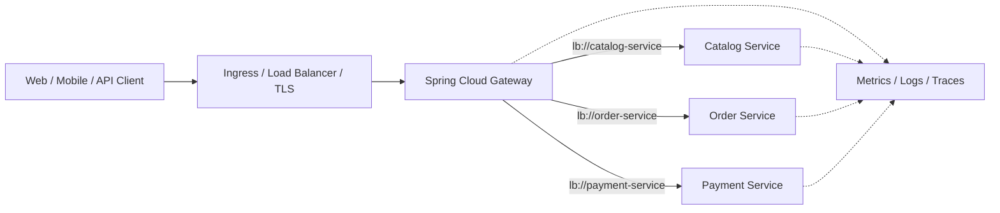

# Shared Responsibilities and Business Boundaries at the Gateway

In a microservices architecture, a request from a web or mobile app may need to reach multiple services such as `catalog-service`, `order-service`, and `payment-service`. If every service independently implements Internet request ingestion, input authentication, rate limiting, logging, and public path management, policies quickly become duplicated and inconsistent.

**Spring Cloud Gateway** provides a centralized entry point for enforcing shared technical policies. Even so, the gateway is not the place to decide every business rule. For instance, the gateway can validate a token before forwarding an order lookup request, but whether the user **owns that order** must be checked by the order service.

When building an API Gateway with Spring Cloud Gateway, clearly distinguish **edge-layer responsibilities** (routing, predicates, filter chain, URL/header transformations, service discovery, security, traffic control, resilience, and observability) from **each business domain's responsibilities** (access permissions on specific resources, data validation, transactions, and state correctness).

## 1. Where Does the Gateway Sit in the Request Flow?



Clients know the gateway's public address, such as `https://api.example.com`, rather than the deployment address of each service. The gateway evaluates **route predicates** such as path, HTTP method, or headers to select a route. Route **filters** and global filters process the request before forwarding; after the backend returns a response, filters can continue processing on the return path.

A typical flow when calling `GET /api/orders/42`:

1. The edge layer accepts the HTTPS connection, enforcing TLS configuration wherever deployed (ingress/load balancer or the gateway itself).
2. Spring Security at the gateway checks whether the request requires authentication; if so, it verifies the token according to configuration.
3. The gateway locates a route whose predicates match `GET /api/orders/42`.
4. Applicable filters enforce rate limits, normalize or strip untrusted headers, transform the path, and attach observability metadata.
5. The gateway uses a static address or `lb://` with discovery/load balancing to select an instance of `order-service`.
6. `order-service` verifies permissions for **order number 42**, executes the business logic, and returns the result; the response travels back through the gateway.

The exact execution order depends on the filter type and `Ordered` configuration. In Spring Cloud Gateway Server WebFlux, gateway filters are arranged in a chain; higher-priority filters run earlier before calling the backend and later on the response-processing path. Spring Security `WebFilter` operates at the WebFlux layer and should not be treated as an ordinary `GatewayFilter`.

## 2. Responsibilities That Should Be Centralized at the Gateway

| Responsibility Group | What Should the Gateway Do? | Limits to Remember |
| --- | --- | --- |
| **Routing and service discovery** | Match path/method/headers with predicates, forward to the target URI, use `lb://service-name` to pick instances when discovery and load balancing exist. | Predicates only select the destination; they do not prove the client has permission on data. |
| **HTTP protocol transformation** | `StripPrefix`, `RewritePath`, adding/removing headers, aligning public paths with internal paths. | Avoid turning the gateway into a complex business data-model converter. |
| **Edge authentication** | Verify JWT/OAuth2 access tokens or secure connections as required, rejecting invalid requests early. | Services must still enforce access controls appropriate for resources they own. |
| **Coarse-grained authorization** | E.g., only logged-in users can call `/api/orders/**`, only ops roles can access `/internal/**`. | Rules like "may only edit one's own order" belong in `order-service`. |
| **Traffic control** | Rate limiting by user, client, or API key; request size limits; early overload shedding. | Quotas tied to subscription plans, balances, or paid entitlements need a trusted business data source. |
| **Network-layer resilience** | Timeouts, circuit breakers, conditional retries, appropriate fallbacks during backend outages. | Do not guess the outcome of a payment transaction or arbitrarily retry side-effecting operations. |
| **Edge protection and policy standardization** | TLS, CORS, header protection, public endpoint access policies, coordinating with WAF/ingress if present. | CORS does not replace authentication; TLS outside the gateway does not mean internal hops are encrypted. |
| **Observability and diagnostics** | Record route ID, HTTP status, latency, correlation/trace IDs, export metrics and traces. | Do not log tokens, sensitive cookies, full bodies, or personal data. |

These responsibilities share a common trait: they rely primarily on **request metadata, verified identity, and infrastructure policies**. They should be consistent across services, changeable without modifying each service, and are often most effective when enforced early before backends expend resources.

## 3. Business Boundaries: What Must Stay in Services?

One way to draw the boundary is to ask: **does this decision require understanding the state or rules of a specific business domain?** If yes, the service owning that domain should normally make the final decision.

| Scenario | Gateway Decides | Service Decides |
| --- | --- | --- |
| `GET /api/orders/42` | Is the token valid? Which route handles the request? Has the client exceeded the rate limit? | Is the caller allowed to view order 42? Does the order exist? |
| `POST /api/orders` | Allow access to endpoint, enforce request size/rate limits. | Is the cart valid? Are prices, inventory, promotions, and ordering rules satisfied? |
| `POST /api/payments` | Authenticate client, route to payment service, timeouts and monitoring. | Can the payment proceed? Is this a duplicate transaction? What is the final payment status? |
| `GET /api/catalog/products` | Possibly allow public access, HTTP caching if policy permits. | Which products are visible, current pricing, and stock levels. |
| Tenant-scoped data access | Identify tenant from verified credentials and apply shared edge policies. | Ensure all queries, updates, and record access are strictly scoped to the right tenant. |

Anti-pattern example: the gateway inspects `userId` in the JWT, compares it with a `userId` query/path parameter in the URL, and grants access to the order. That approach is **not secure enough**: actual ownership lives in `order-service`'s data, not in a client-supplied parameter name. The service must verify permissions using the authenticated user and the actual record.

The gateway should also not compute prices, orchestrate multi-step transactional writes, update inventory, maintain cart state, or confirm payment success without reliable confirmation from the owning domain. UI-specific data aggregation needs can be handled in a BFF or a dedicated aggregation service rather than cramming everything into gateway filters.

### Practical Rules for Placing Logic

- **Need to know where a request goes and apply shared HTTP policies?** Put it in the gateway.
- **Need to know who is calling?** The gateway can authenticate; the service receives trusted identity context and checks permissions as needed.
- **Need to know who owns a resource, whether it may be updated, or whether a transaction succeeded?** Put it in the service that owns that data/rule.
- **Need to process cross-domain data with business consistency?** Design workflow/orchestration at an appropriate application layer; do not hide business logic in filters.

## 4. Routing and Filter Example for the Order Service

The example below illustrates route configuration syntax commonly seen in **Spring Cloud Gateway Server WebFlux 4.x**. Depending on your Spring Cloud Gateway version, the configuration prefix may be `spring.cloud.gateway.routes` or `spring.cloud.gateway.server.webflux.routes`; check against the version and starter you are using.

```yaml
spring:
  cloud:
    gateway:
      routes:
        - id: orders-route
          uri: lb://order-service
          predicates:
            - Path=/api/orders/**
          filters:
            - StripPrefix=1
            - RemoveRequestHeader=X-User-Id
            - RemoveRequestHeader=X-Tenant-Id
```

With this configuration:

| Step | Value |
| --- | --- |
| Client sends | `GET /api/orders/42` to the gateway |
| Predicate | `Path=/api/orders/**` matches route `orders-route` |
| `StripPrefix=1` | Strips the first segment (`api`) so the backend receives `/orders/42` |
| `RemoveRequestHeader` | Strips `X-User-Id` and `X-Tenant-Id` that a client might set itself |
| `lb://order-service` | Requires discovery and Spring Cloud LoadBalancer integration to resolve an instance of the service |
| Backend returns | Business result and HTTP status relayed back through the gateway |

Stripping client-supplied identity headers is essential: the backend **must not trust** an `X-User-Id: admin` header merely because it came through the gateway. If identity must be propagated, prefer a signed, verified token, or a strictly protected internal-header scheme where the gateway strips incoming headers, sets values from verified identity itself, and only services inside the trust zone can receive those headers. Backends still need corresponding security policies.

`lb://order-service` does not work purely from the URI string. The application must include the appropriate dependencies and an available instance source (e.g., discovery client or configured service instances). Without service discovery, a route can point to a concrete HTTP/HTTPS URI; avoid hard-coding instance lists in dynamic deployments where proper discovery is already available.

### Distinguishing Extension Points

- **Route predicate** determines whether a route matches, based on request attributes like `Path`, `Method`, `Header`, or `Host`.
- **`GatewayFilter`** is attached to a route and transforms requests/responses or enforces a policy for that route; for example, `StripPrefix` and `RequestRateLimiter`.
- **`GlobalFilter`** participates in the gateway pipeline for matched routes, suited for cross-cutting technical logic such as timestamps or correlation IDs; it does not necessarily run for requests rejected prior to routing.
- **Spring Security `WebFilter`** integrates security at the WebFlux layer, suitable for edge authentication and authorization.

Write custom filters only when built-in filters cannot meet the requirement. With Gateway WebFlux, avoid synchronous JDBC calls, `Thread.sleep()`, or blocking HTTP clients inside filters, as these can block the event loop and degrade throughput across the entire gateway.

## 5. Centralized Authentication Does Not Mean Fully Centralized Authorization

Suppose policy requires users to log in to access `/api/orders/**`. The gateway can configure Spring Security Reactive Resource Server to verify JWT signatures, expiration, issuer/audience per system policy, and reject requests lacking a valid token. Illustrative example for an API using Bearer tokens:

```java
@Bean
SecurityWebFilterChain securityWebFilterChain(ServerHttpSecurity http) {
    return http
        .csrf(ServerHttpSecurity.CsrfSpec::disable)
        .authorizeExchange(exchange -> exchange
            .pathMatchers("/actuator/health").permitAll()
            .pathMatchers("/api/orders/**").authenticated()
            .anyExchange().denyAll())
        .oauth2ResourceServer(oauth2 -> oauth2.jwt(Customizer.withDefaults()))
        .build();
}
```

The snippet assumes appropriate Spring Security beans/dependencies and JWT public-key/issuer sources are configured. `csrf(...disable)` is only appropriate for Bearer-token APIs that do not use browser session cookies for authentication; cookie-based applications need a separate CSRF assessment. Other public endpoints must be explicitly permitted in rules if needed.

The gateway handles the shared part: "Is the JWT valid?", "Does this endpoint require login?", "Are route-level scopes/roles permitted?". Afterward, `order-service` still handles: "Is this principal allowed to view **order 42**?" and "Does the state of order 42 allow cancellation?". If backends can be reached directly from another network or from a compromised service, relying solely on gateway authentication is insufficient. Restrict internal access paths and apply authentication/authorization at services matching the system's trust model.

**Never** treat client-sent URLs, `X-Forwarded-*`, `X-User-Id`, or `X-Tenant-Id` as proof of identity. When the gateway sits behind a reverse proxy, explicitly define which proxies are trusted before relying on forwarded headers to infer client address, scheme, or host.

## 6. Rate Limiting: Protecting Shared Resources, Not Replacing Business Quotas

The gateway is the right place to block requests exceeding thresholds before they reach backends. Spring Cloud Gateway supports `RequestRateLimiter`; a common implementation is the Redis token-bucket rate limiter. Example adding the filter to the route from the previous section:

```yaml
filters:
  - StripPrefix=1
  - name: RequestRateLimiter
    args:
      redis-rate-limiter.replenishRate: 20
      redis-rate-limiter.burstCapacity: 40
      redis-rate-limiter.requestedTokens: 1
      key-resolver: "#{@principalKeyResolver}"
```

`replenishRate: 20` adds 20 tokens per second per key; `burstCapacity: 40` allows accumulating up to 40 tokens; each request costs one token. These are illustrative values, not universal defaults suitable for every system. Redis, the corresponding reactive dependencies, and a `KeyResolver` bean are required. A resolver based on the authenticated principal can be written as:

```java
@Bean
KeyResolver principalKeyResolver() {
    return exchange -> exchange.getPrincipal()
        .map(Principal::getName);
}
```

The Java snippet assumes imports for `java.security.Principal`, `org.springframework.context.annotation.Bean`, and `org.springframework.cloud.gateway.filter.ratelimit.KeyResolver`. When the key cannot be resolved, `RequestRateLimiter` denies the request by default (typically returning `403` under the filter's default configuration); for authenticated routes, authenticate first and define clear policy for requests without a principal. When the limit is exceeded, the response is typically `429 Too Many Requests`.

Choose keys carefully. IP-based limits can group many users behind NAT into one bucket and are easily bypassed or broken if trusting addresses from spoofable client headers. User/API-key limits work well only once identity is verified. Gateway-level limits protect infrastructure against traffic spikes; policies like "Basic plan allows 1,000 business operations per month" should be managed by the business domain or a dedicated quota service backed by consistent data and transactions.

## 7. Timeouts, Circuit Breakers, and Retries: Fault Tolerance Within Safe Bounds

The gateway can reduce the impact of troubled backends via timeouts and circuit breakers. When a backend is slow or failing repeatedly, a circuit breaker can temporarily stop calling it to relieve load; a fallback can return a pre-designed response if a genuinely safe option exists.

Retries must be evaluated based on **operation semantics**, not just HTTP status. Read operations like `GET` are usually easier to retry, yet still require bounded retry counts and total wait-time caps. `POST /api/payments` might already have been processed successfully by the backend before the gateway lost the connection: blind retries will cause duplicate transactions if the system lacks idempotency and reliable transaction state.

| Mechanism | Value at Gateway | Risk If Misused |
| --- | --- | --- |
| Timeout | Bounds backend wait time, avoiding holding connections indefinitely. | A timeout does not guarantee the backend operation failed or was rolled back. |
| Circuit breaker | Limits calls to a persistently failing backend, aiding recovery. | A fallback returning fake success can mask severe business failures. |
| Retry | Can recover from transient network glitches for safe operations. | Retrying write operations can create duplicate records/transactions or amplify load during cascading failures. |
| Rate limit | Protects backends and gateway under overload. | Too-low limits or bad key selection can block legitimate users. |

For systems handling financial transactions, configuring timeouts and circuit breakers is an operational concern; **determining payment status, preventing duplicate transactions, and processing refunds** still belong to the payment domain. Never let a filter decide "paid" solely because a network response succeeded or failed.

## 8. Headers, TLS, CORS, and Trusted Metadata

Protocol policies should be clearly defined at the edge:

1. **TLS:** use HTTPS on public paths; if an ingress terminates TLS before the gateway, define protection for the ingress → gateway and gateway → service hops (HTTPS/mTLS if the architecture requires it). Enable `trust` only for environment-appropriate certificates; never disable certificate verification to work around connection errors.
2. **Headers:** strip externally supplied identity headers; manage `Host`, `Forwarded`, and `X-Forwarded-*` according to topology and trusted proxies. Consider blocking CRLF/malformed headers at the ingress or corresponding infrastructure layer.
3. **CORS:** control allowed origins, methods, and headers for browser applications; `Access-Control-Allow-Origin` does not grant data access to unauthenticated users.
4. **Sizes and payloads:** configure request body limits as needed; avoid reading, buffering, or logging large raw bodies inside reactive filters, which wastes memory and risks data exposure.
5. **Infrastructure endpoints:** separate public routes from `/actuator/**`, admin pages, and internal endpoints. Expose only required endpoints publicly, and enforce separate access controls on management information.

The gateway is a **policy enforcement point**, not the sole line of defense. Systems need network policies, service-to-service authorization, and permission checks where data actually lives to mitigate risks of bypassing the gateway.

## 9. Observing Requests Without Exposing Sensitive Data

Because it sits in front of multiple backends, the gateway is an advantageous point to build a system-wide view of traffic. With Micrometer/observability and proper trace configuration, you can track:

- **Routes and outcomes:** route ID, method, status code, request count, `4xx/5xx` rates.
- **Latency:** total duration at the gateway and upstream latency, distinguishing gateway overload from slow backends.
- **Resilience:** rate-limit rejections, timeouts, retries, and circuit breaker state.
- **Request correlation:** trace ID/correlation ID propagated across the gateway and services to trace requests in a distributed system.

Log fields and metric labels should have low cardinality, such as **route ID** or path templates rather than raw URLs containing order IDs. Never use raw `Authorization` headers, cookies, tokens, card numbers, or personal payloads as log fields or metric labels. Trust incoming trace/forwarded headers only after establishing acceptance and normalization rules at the edge.

A `503` at the gateway can have multiple causes: no instances from discovery, unreachable backend, open circuit breaker, or network failure. Therefore, diagnosing incidents requires combining **route ID + trace ID + backend metrics**, not just looking at the client's HTTP status. A `404` can likewise come from no matching route at the gateway or a "resource not found" from the backend; trace data helps tell them apart.

## 10. Practice Splitting Responsibilities for a Sample System

Suppose a product has three APIs:

| Public API | Policy at Gateway | Policy at Service |
| --- | --- | --- |
| `GET /api/catalog/products` | Route to `catalog-service`, appropriate CORS, public rate limit, latency monitoring. | Filter publicly visible products and return accurate pricing/inventory per business rules. |
| `GET /api/orders/{id}` | Require valid token, per-principal rate limit, rewrite path and route to `order-service`. | Check whether the user may view `{id}`; prevent leaking orders of other users/tenants. |
| `POST /api/payments` | Require authentication, size and rate limits, timeout; configure retries with extreme caution. | Validate idempotency key, order state, exact amount, transaction, and persist payment result. |

**Design exercise:** A client tries sending `X-User-Id: another-user` when calling `GET /api/orders/42`; meanwhile, the service receives a valid access token for `user-a`.

- The gateway must handle arbitrary client headers per trust policy, verify the token, and route the request accurately.
- `order-service` must use the verified identity and order ownership data to allow or deny. If the order belongs to `user-b`, `user-a`'s request must be rejected regardless of the spoofed header.

### Pre-Production Readiness Checklist for the Gateway

- Do route predicates and path transformations match internal contracts, including `404` cases, trailing `/`, and different HTTP methods?
- Does the gateway authenticate early, strip untrusted identity headers, restrict management endpoints, and apply TLS/forwarded-header settings matching the topology?
- Do the gateway and backends clearly separate endpoint-level authorization from authorization on actual resources? Can backends be called around the gateway?
- Does rate limiting use a trusted key and get tested for both users behind NAT and requests without a principal?
- Do retries, timeouts, and circuit breakers match read/write semantics and the total latency budget?
- Do logs, metrics, and traces provide sufficient diagnostics without leaking tokens, personal data, or creating high-cardinality labels?
- Are there integration tests for missing routes, missing/expired tokens, unauthorized users, exceeded rate limits, and disconnected backends?

## Conclusion

Spring Cloud Gateway is well-suited to unifying **edge technical policies**: predicate-based routing, filter chains, path/header transformations, discovery, initial authentication, rate limiting, connection protection, fault tolerance, and request observability. The critical boundary is that **the gateway controls how requests enter the system, while services owning business rules and state control what requests are allowed to do with specific data**. Preserving this boundary ensures protocol or infrastructure changes do not force services to duplicate policies, while preventing the gateway from becoming overloaded with logic and hard to maintain.
