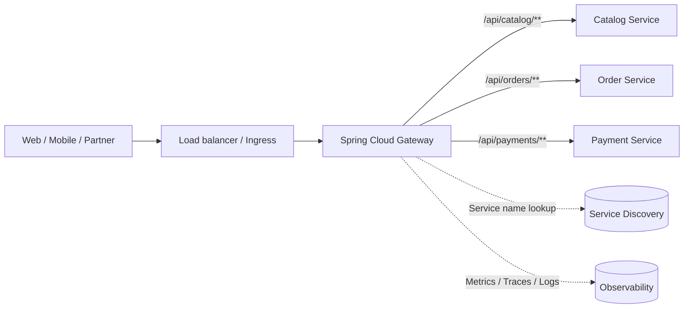
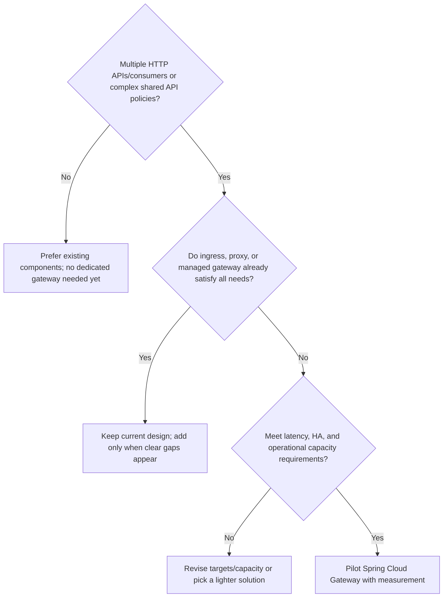

# Benefits, Operational Costs, and When You Don't Need a Gateway

## Lesson Objectives

After this lesson, you will be able to:

- Explain the value of an **API Gateway** for a microservices system and distinguish that value from what individual services can do on their own.
- Identify the costs introduced by putting **Spring Cloud Gateway** in the request path: latency, resources, availability, security, and operational work.
- Recognize scenarios where **a dedicated gateway is unnecessary**, or where existing infrastructure components already meet the need.
- Make a grounded decision using concrete criteria, rather than assuming every microservices system must have an API Gateway.

## 1. What Problems Does a Gateway Solve?

In a system with a single backend application, clients usually call a single API address directly. When a system splits into multiple services—such as `catalog-service`, `order-service`, and `payment-service`—clients may need to know multiple addresses, multiple authentication rules, and multiple API versions. Every change in how a service is deployed risks impacting web apps, mobile apps, or integration partners.

**Spring Cloud Gateway** places an HTTP processing entry point in front of services. A request enters the gateway, gets matched to a **route** via **predicates** (conditions such as path, host, or method), is processed by a **filter chain**, and is then forwarded to the target service. The gateway can modify paths/headers, integrate service discovery, authentication, rate limiting, circuit breakers, retries, TLS, and request observability tools.



The diagram illustrates only one possible architecture: not every system needs a load balancer, ingress, service discovery, and gateway all at once. These components can coexist when their responsibilities genuinely differ.

Because the gateway sits on the path of many requests, **every benefit centralized at the gateway brings centralized operational responsibility**. Both sides must be weighed before adding this component.

## 2. Key Benefits

### 2.1. A Stable Entry Point Decoupling Clients from Internal Structure

Clients only need to know one public API domain, such as `api.example.com`, rather than the address of each container or service. The gateway maps external requests to internal services.

| Public Request | Rule at Gateway | Request Received by Backend |
| --- | --- | --- |
| `GET /api/catalog/items/42` | Match path `/api/catalog/**`, strip two leading segments `api/catalog` | `GET /items/42` at Catalog Service |
| `POST /api/orders` | Match path `/api/orders/**`, select Order Service | `POST /` if using the same two-segment strip rule; redesign mapping if backend expects `/orders` |
| `GET /api/catalog/items?sort=price` | Select Catalog Service, preserve query string | `GET /items?sort=price` |

The example shows that path transformation can be helpful, but the **contract** with the backend must be aligned. Do not apply the same path-rewriting filter to every route when services have different endpoint structures.

When a service changes host, port, or replica count, route configuration and service discovery can hide the change from clients. With Spring Cloud Gateway, URIs like `lb://catalog-service` can use Spring Cloud LoadBalancer to select an instance from a suitable service-info source. This requires a service discovery component or configured instance list; simply writing `lb://` does not create a service registry automatically.

**Practical value:** reduces client coupling to deployment topology, simplifies API publishing, and supports incremental service migrations.

### 2.2. Centralizing Shared Policies for External Requests

Needs such as token validation, request size limits, header normalization, CORS control, and rate limiting commonly appear across multiple services. Lifting **shared, stable** rules to the gateway prevents each development team from implementing them differently.

For example, an application with three services might standardize that:

- Requests from the Internet must go over TLS and pass an appropriate authentication mechanism.
- Clients are rate-limited by user, API key, or another trusted identifier.
- Requests with payloads exceeding a threshold are rejected at the edge before consuming backend resources.
- Certain administrative routes are blocked from the public network.

Even so, **the gateway does not replace authorization checks in services**. The gateway can verify identity and reject requests lacking broad access permissions; Order Service must still determine whether the caller is allowed to read a **specific order**. That is data- and business-coupled authorization and should not all be moved to the gateway.

Similarly, when the gateway processes JWTs, it must verify signature, issuer, audience, and expiration per the security contract; a self-sent client header must never be treated as proof of authentication. If backends have access paths other than the gateway, protect those paths and enforce appropriate authentication at the backend.

### 2.3. Protecting the System with Traffic Shaping and Resilience

The gateway is a fitting place to absorb part of a failure **before requests put pressure on multiple backends**:

| Mechanism | Benefit | Points Requiring Caution |
| --- | --- | --- |
| **Rate limiting** | Stops a single client from monopolizing resources; can return HTTP `429 Too Many Requests` | IP-based limits can unfairly penalize users sharing NAT; consider user or API key. Multiple gateway replicas usually need a shared counter for cluster-wide quotas. |
| **Timeout** | Caps stalled requests, freeing resources | Too-short timeouts cause false errors; load balancer, gateway, and backend timeouts must align. |
| **Circuit breaker** | Stops sending requests to a failing backend based on configured thresholds | Fallback policies must not return misleading data, especially for payments or accuracy-critical operations. |
| **Retry** | Recovers from some transient network or temporary errors | Retries can amplify load and create duplicate actions; consider idempotency, retry budgets, and backoff. |

For example: a `GET /catalog/items/42` request can be retried once on a transient connection error if the backend exhibits safe read behavior. Automatically retrying `POST /payments` without knowing whether the previous call already recorded payment can cause double charging. For write operations, establish a clear idempotency contract and consider whether the gateway is the right place to retry.

A circuit breaker at the gateway also protects **only traffic flowing through the gateway**. Direct inter-service calls, background jobs, and message consumers need their own recovery strategies.

### 2.4. Unified Traffic Observability

The gateway can record metrics such as request volume per route, status codes, response times, active connections, and rejected or timed-out requests. Combined with trace IDs and distributed tracing, operations teams can easily tell which requests are slow at the gateway versus slow downstream.

For instance, a spike in HTTP `502` on the `orders` route could stem from connection errors to Order Service, a misconfigured route, or an overloaded backend. Per-route metrics and cross-service traces help distinguish these causes.

**Limitation:** gateway logs usually only show where requests went and what came back; they do not explain all backend business logic. Never write raw tokens, sensitive cookies, payment details, or personal content into access logs. Propagating trace IDs and client IP metadata across proxies must also follow header trust policies.

### 2.5. Controlled API Evolution

With route predicates and filter chains, engineering teams can gradually shift slices of traffic, adjust paths/headers, or maintain legacy entry points while evolving architecture. This is a major advantage when clients release on different schedules, especially mobile apps that are hard to force-update simultaneously.

Do not turn the gateway into a home for complex business logic, multi-service database queries, or multi-step transactions. If a request requires assembling data for a UI screen, a **Backend for Frontend (BFF)** or an API composition service is usually a better fit.

## 3. Operational Costs: What Does a Gateway Add?

### 3.1. An Extra Network Hop and Processing Time

A direct flow might be:

```text
Client → Load Balancer → Backend
```

Adding a gateway changes the path to:

```text
Client → Load Balancer → Gateway → Backend
```

The gateway spends time receiving requests, evaluating predicates, running filters, authenticating, picking an upstream, forwarding data, and returning responses. TLS, fetching auth key stores, remote rate-limit counters, or I/O-performing filters can add further latency. Actual milliseconds depend on hardware, network placement, traffic, configuration, and software version; **there is no fixed overhead figure that holds for every application**.

A *hypothetical* example measured under identical load and backend:

| Metric | Direct | Through Gateway | Observed Increase |
| --- | ---: | ---: | ---: |
| Latency p50 | 40 ms | 44 ms | +4 ms |
| Latency p99 | 180 ms | 202 ms | +22 ms |

The numbers above illustrate how to compare, **not a Spring Cloud Gateway benchmark**. Differences at p99 often matter more to real-world experience than averages. Measure latency, throughput, error rates, and resource consumption under both normal and burst load.

### 3.2. Additional Resources and Capacity Limits

The gateway consumes CPU, memory, network connections, and bandwidth. Depending on design, a request can hold connections open while waiting for the backend to respond. Concurrent request count therefore depends on arrival rate and how long requests reside inside the gateway.

A rough estimate via Little's Law when the system is relatively steady:

```text
In-flight requests ≈ requests/sec × average residence time (seconds)
```

If peak hours bring **2,000 requests/second** and a request stays in the gateway for an average of **0.05 seconds**, concurrent requests are roughly **100**. This is a planning starting point; it does not yet account for peak bursts, long-lived requests, streaming, connection pools, retries, or limits of specific filters. Run load tests to determine real thresholds and configure autoscaling.

The gateway can also become a **shared bottleneck**: a thread-blocking filter, a slow Redis connection, an exhausted upstream connection pool, or overly tight limit settings can affect many routes at once. When using the WebFlux-based Spring Cloud Gateway variant, take special care to keep long blocking tasks out of the reactive processing loop. Spring Cloud Gateway also has a variant for Spring Web MVC; configuration style and execution model must match the variant and version in use.

### 3.3. More Components to Maintain and Monitor

A gateway in production typically requires:

- **High availability:** multiple replicas, health checks, load distribution, upgrade schedules, and rollbacks.
- **Configuration:** managing routes/filters per environment, reviewing changes, avoiding overlapping routes or accidentally exposing internal endpoints.
- **Security:** TLS certificates, trust stores, CORS policies, authentication, key/JWKS rotation, securing actuator/admin endpoints, and patching vulnerable dependencies.
- **External dependencies:** service discovery, quota state stores (e.g., Redis when configuring distributed rate limits), config servers, or identity providers.
- **Observability:** dashboards, alerts, logs, traces, separating gateway errors from upstream errors.
- **Incident operations:** on-call rotation, procedures to bypass faulty routes, config rollbacks, fault-tolerance drills, and fallback plans when dependencies go down.

With a rate limiter backed by a shared state store, you must also choose behavior when that store fails: **fail-open** continues serving with the risk of exceeding limits, or **fail-closed** protects resources at the risk of rejecting legitimate users. The choice depends on API risk, and should never be left to an untested default.

The gateway is a critical attack surface. Headers such as `X-Forwarded-For`, `X-Forwarded-Proto`, or `Forwarded` should only be trusted when coming from controlled proxies; clients can spoof them if infrastructure does not sanitize them. Enforce header/body size limits, configure CORS properly, avoid leaking upstream details, and lock down management endpoints.

### 3.4. Impact on Availability

When every request passes through the gateway, a gateway outage can leave external APIs unreachable even while backends remain healthy. Adding replicas and load balancers mitigates single-machine failures, but does not by itself prevent shared configuration mistakes, dependency failures, or rolling out a broken filter version cluster-wide.

To visualize the risk, if both the gateway and backend have **99.95%** availability and assuming independent failures, the availability of a serial chain requiring both is approximately:

```text
A_chain ≈ A_gateway × A_backend
        ≈ 0.9995 × 0.9995
        ≈ 99.90%
```

This calculation is illustrative only: real systems also experience correlated failures, load balancers, networks, availability zones, and recovery behavior. The takeaway is that **adding a mandatory component to the request path introduces another failure source**, so availability and SLOs must be designed for the entire path.

### 3.5. Monetary and Organizational Costs

The total cost of ownership of a gateway is more than pods or VMs. You can outline a budget using a general formula:

```text
TCO_gateway ≈ compute + memory + network/load balancing
            + external dependencies (if any)
            + monitoring/logging/tracing
            + maintenance, upgrades, incident on-call
```

Account for network traffic traversing an extra tier, per-request log storage costs, cross-zone bandwidth if misplaced, and team time spent supporting route changes. Conversely, a gateway can **save** duplicated effort when protection and telemetry logic previously lived inside many backends. A sound decision weighs *net cost and risk reduction*, not initial setup cost alone.

| Value Gained | Corresponding Price Paid | How to Verify |
| --- | --- | --- |
| One stable API address | Route configuration, change-management process | How often clients must update when backends move |
| Centralized auth and rate limiting | Resources to run filters, auth/rate-limit dependencies | True-positive block rate, false positives, filter latency |
| Circuit breaker and retry | Configuration complexity, risk of load spikes on retries | Error rate, retry count, recovery under load |
| Unified logging/tracing | Storage cost, controlling sensitive data | Percentage of traces linking gateway to backend, time to root cause |
| Reduced client coupling | A single entry point with wide blast radius | End-to-end availability, rollback capability |

## 4. When Is Adding Spring Cloud Gateway Unnecessary?

**Not running a dedicated gateway is also a valid architectural choice.** The critical question is: is there a concrete requirement that existing components do not already solve well enough?

### 4.1. Monolith or a Single Backend

If a product has only one backend and one client group, a reverse proxy or load balancer may be enough for TLS termination, request forwarding, and basic rate limiting. Putting Spring Cloud Gateway in front just to proxy all requests to the same application adds latency and deployment overhead without commensurate benefit.

If the system later splits into multiple backends, gains independent clients, or develops cross-service policies to govern, you can revisit the decision.

### 4.2. An Existing Ingress or Reverse Proxy Already Meets Needs

For example, an internal Kubernetes system only needs host/path routing and TLS at the cluster edge; an ingress controller is already running stably and handling those requirements. When custom filters or API-specific policies are not needed yet, adding an application gateway may duplicate functionality.

This **does not mean ingress and API Gateway are always equivalent**. Ingress mainly addresses exposing traffic into a cluster; a gateway can add API processing logic, authentication, rate limiting, and per-route policies. Verify the actual capabilities of your ingress product rather than assuming from its name.

### 4.3. Primarily Asynchronous Communication, Few Public HTTP APIs

If services communicate via message brokers or event streaming and expose only a tiny admin API, an HTTP gateway may not address the primary bottleneck. Invest in broker authentication, publish/subscribe permissions, retry/dead-letter handling, consumer observability, and appropriate schema governance. A gateway is only needed when there are HTTP APIs that genuinely need protection or routing.

### 4.4. Very Low Traffic, Simple System, and Small Ops Team

For an experimental product or low-user internal tool, the cost of deploying, monitoring, and debugging a gateway can outweigh its benefits. A sensible approach is to minimize moving parts, keep API paths clean, and preserve clear boundaries so a gateway can be introduced if demand emerges.

Never use "low traffic" as an excuse to skip security requirements. Even without Spring Cloud Gateway, the application must still have proper authentication, authorization, TLS, and access control in other layers.

### 4.5. Existing API Management or Managed Gateway Satisfies Requirements

If the organization already uses a managed API Gateway service covering routes, auth, quotas, API policies, and monitoring, standing up Spring Cloud Gateway as well requires a clear justification—such as custom features, on-premises deployment mandates, or request filtering unsupported by the existing platform.

Stacking two gateway layers is sometimes intentional, but you must assign which layer owns TLS, auth, rate limiting, timeouts, logging, and identity propagation. Without clear ownership, policies can conflict or run redundantly.

### 4.6. Ultra-Low-Latency Processing Paths

For a processing path where every millisecond counts, measure whether an added gateway tier fits within the latency budget. A lightweight reverse proxy or direct connection path may be preferable; conversely, a gateway remains worthwhile if traffic control and protection deliver value exceeding the measured cost. Never decide based on technology names alone.

## 5. Distinguishing a Gateway from Commonly Confused Components

| Component | Typical Responsibility | When Appropriate |
| --- | --- | --- |
| **Load balancer / reverse proxy** | Load distribution, HTTP/TCP forwarding, optionally TLS and simple policies | Need a basic entry point and forwarding |
| **Kubernetes Ingress / Gateway API implementation** | Declarative and operational traffic routing into cluster workloads per controller capabilities | Already running on Kubernetes, need network/HTTP rules at cluster edge |
| **Spring Cloud Gateway** | Route predicates, filter chain, request/response transformations, and per-route API policies | Multiple HTTP APIs and application-level request flow control needed |
| **API management / managed API gateway** | Publishing, protecting, monitoring, quotas, and sometimes developer portal/API subscriptions | Many consumers or formal API lifecycle governance required |
| **Service mesh** | Inter-service traffic management, mTLS, retries, telemetry depending on deployment | Need consistent policies for service-to-service communication |
| **Backend for Frontend (BFF)** | Aggregates/transforms data tailored to web, mobile, or another channel | Clients need an aggregated API optimized for a specific experience |

Components can **complement** one another. For instance, ingress routes traffic from the Internet to Spring Cloud Gateway; the gateway enforces API policies; a service mesh enforces mTLS between services. However, if current requirements are already fully met by one layer, adding a new layer must demonstrate clear benefit.

## 6. Decision Framework: When to Add a Gateway?

Before picking technology, write down **observable requirements**:

1. **How many HTTP APIs and client types are there?** More independent backends/consumers increase the value of a stable entry point.
2. **Which components currently handle routing, TLS, authentication, and rate limiting?** List only capabilities that are genuinely missing.
3. **Are different policies needed per route or consumer?** E.g., partners get dedicated quotas, sensitive endpoints need stricter auth.
4. **Is there sufficient latency budget and operational capacity?** Define SLOs, peak traffic, resource budget, and on-call staffing.
5. **How many business flows would a gateway outage impact?** Plan for multiple replicas, failover testing, and rollbacks.
6. **Which policies belong in the gateway, and which are mandatory in backends?** Do not move data-level permission checks or transactions into filters.
7. **Do measurable benefits outweigh the cost of an added component?** Compare against using only existing ingress/reverse proxy/managed gateway.

You can summarize the decision with a decision tree:



The diagram helps **screen** options; it does not replace load testing, risk assessment, and real cost comparisons.

## 7. Three Practical Scenarios

### Scenario A — Multi-Client E-Commerce Platform

A system serves web, mobile, and retail partners; the backend is split into catalog, order, payment, and account services. Teams are duplicating token validation, partner quotas, and access logging. Changing a service address forces multiple clients to update configurations.

**Assessment:** a gateway delivers clear value. You can define prefix-based routes, use service discovery, unify incoming request checks, rate limiting, and tracing. However, order read permissions and payment creation must still be checked in backends. Test retries, pick dedicated timeouts for payment routes, and run multiple gateway replicas.

**Success criteria:** fewer client changes when backends move addresses; consistent quota policies; per-route error visibility; meeting p95/p99 latency and availability targets after introducing the gateway.

### Scenario B — Single-Backend Internal Application

A small admin application with one Spring Boot service, users on a private network, an existing reverse proxy already handling TLS, and authorization implemented in the backend. No complex routing, header rewriting, or partner quotas are needed.

**Assessment:** Spring Cloud Gateway is not needed yet. Keep using the existing proxy, monitor the application, and manage auth/authz in the backend. Revisit if the system expands into multiple APIs or acquires edge requirements the proxy cannot fulfill.

### Scenario C — Microservices Already Using Kubernetes Ingress and Service Mesh

A company runs many services, yet public traffic hits only a few endpoints. Ingress already handles routing and TLS; the service mesh handles mTLS, internal telemetry, and certain resilience policies.

**Assessment:** do not add Spring Cloud Gateway by default just because you run microservices. Check whether API-key quotas, route-specific custom filters, or dedicated API publishing capabilities are missing. If so, a gateway can complement the stack; if not, it merely adds another configuration layer and failure point.

## 8. If You Decide to Use a Gateway: Minimum Checks to Measure and Operate

Before releasing to production, run a pilot with realistic routes and representative load, capturing at least:

| Verification Group | What to Prove |
| --- | --- |
| **Routing** | Predicates match the right routes; path/header transformations match contracts; default and internal routes are not exposed |
| **Performance** | Throughput, p50/p95/p99 latency, CPU, memory, connection pools under normal, peak, and burst load |
| **Failures** | How the system reacts when a gateway replica dies, backends time out, discovery is unavailable, or the rate-limit store fails |
| **Security** | TLS, JWT/token validation where applicable, header/body limits, CORS, trusted proxy headers, and management endpoint protection |
| **Load control** | Quotas behave accurately per consumer; retries do not trigger load storms or duplicate writes |
| **Observability** | End-to-end trace IDs, per-route metrics, alerts on error rate/latency/saturation; logs free of sensitive data |
| **Changes** | Configurations are reviewed, tested in suitable environments, rolled out progressively, and rolled back quickly |

Define a **latency budget** for the entire request—for example, an endpoint with a p99 SLO under an agreed threshold. Allocate budgets across external connections, the gateway, and backends based on measurements; do not configure timeouts or retries independently at each layer such that total wait time exceeds the SLO.

On ownership, the gateway-owning team should publish a clear contract to backend teams: routing and path-rewrite rules, which headers are added/stripped, how identity and trace metadata are propagated, request limits, error codes when blocked, and timeout/retry policies. Each service still owns its API schema, data-level authorization, idempotency, and business logic.

## 9. Misconceptions to Avoid

- **"Having a gateway means backends are already secure."** False: a gateway is only one layer of defense; backends still need authorization and protection on other access paths.
- **"The more filters, the better."** False: every filter adds complexity, processing cost, and failure potential.
- **"A gateway automatically solves cascading failures."** False: misconfigured timeouts, circuit breakers, and retries can make things worse; traffic bypassing the gateway still needs protection.
- **"A gateway replaces a service mesh or ingress."** Not always: responsibility boundaries and actual capabilities of each component dictate whether they replace or complement each other.
- **"Microservices systems must have a gateway."** False: the decision depends on traffic ingestion needs, policy duplication, existing infrastructure, and operational cost.

## Conclusion

Spring Cloud Gateway is most valuable when a system needs **a stable API entry point**, **flexible routes/filters**, **shared request-protection policies**, and **centralized traffic observability**. In exchange, a gateway adds a network hop, consumes resources, creates operational dependencies, and can become a wide-impact failure point.

Choose a gateway when there are **concrete needs, verifiable benefits, and matching operational capacity**. When there is only one backend, ingress/reverse proxy already suffices, or HTTP APIs are not central, a simpler design is usually better. Revisit the decision as service counts, consumer counts, security requirements, or traffic levels change.
