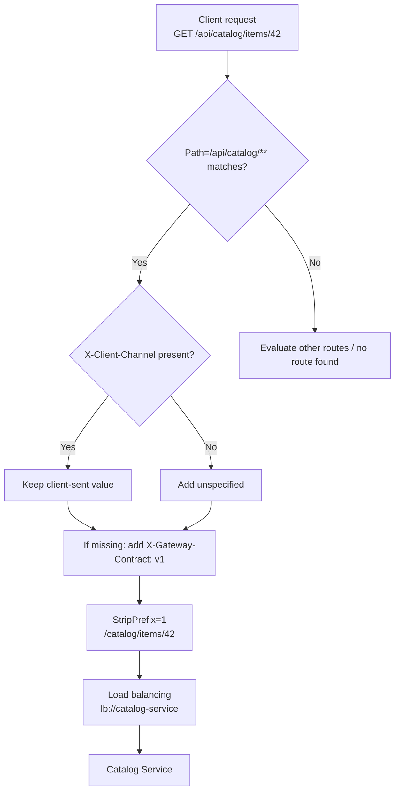

# AddRequestHeadersIfNotPresent and Conditional Header Addition

## Lesson Objectives

In the **Request Headers** chapter of **Spring Cloud Gateway**, this lesson explains how to add **a default value to an HTTP request header when that header is not yet present** using the `AddRequestHeadersIfNotPresent` GatewayFilter Factory. This is a small yet important operation in API Gateway design: many microservices rely on a header to know which mode a client is using, while not every client sends that header.

After this lesson, you will be able to:

- Understand the exact difference between a **missing header** and a **header that is present but carries an empty, invalid, or client-supplied value**.
- Configure `AddRequestHeadersIfNotPresent` for one or multiple name–value pairs, including multiple values for the same header name.
- Use URI variables captured from `Path` or `Host` predicates in header values.
- Distinguish `AddRequestHeadersIfNotPresent` from `AddRequestHeader`, `SetRequestHeader`, and `RemoveRequestHeader`.
- Predict the outcome when combining multiple filters, using route-specific/default filters, and passing requests through load balancing.
- Test the headers actually received by the backend without treating client-sent headers as trusted authentication data.

> Examples are scoped to **Spring Cloud Gateway Server WebFlux**. Different Spring Cloud Gateway release lines may change configuration namespaces and APIs; the article explicitly shows how to verify versions in the configuration section.

## 1. The Problem: Adding a Default Without Overriding Client Choice

Suppose the Catalog Service needs an `X-Client-Channel` header to pick a default response format. Web clients send `X-Client-Channel: web`, mobile clients send `X-Client-Channel: mobile`, while some legacy clients do not send the header at all.

We want the Gateway to enforce this rule:

```text
If the request already has X-Client-Channel:
    keep the existing value
If the request does not have X-Client-Channel:
    add X-Client-Channel: unspecified
```

For example:

| Header sent by client | Header forwarded to backend after filter |
| --- | --- |
| Missing `X-Client-Channel` | `X-Client-Channel: unspecified` |
| `X-Client-Channel: web` | `X-Client-Channel: web` |
| `X-Client-Channel: mobile` | `X-Client-Channel: mobile` |
| `x-client-channel: partner` | Keeps `partner`; HTTP header names are case-insensitive |

This is the exact purpose of **`AddRequestHeadersIfNotPresent`**: providing a **default value when a header is missing**. This filter does not validate whether the client-sent value is business-valid, does not authenticate who sent it, and does not guarantee that the preserved value is trustworthy.

The filter name has a plural **`Headers`**: `AddRequestHeadersIfNotPresent`. Distinguish that name from `AddRequestHeader`, which handles already-present headers differently.

## 2. Basic Configuration Syntax

`AddRequestHeadersIfNotPresent` accepts a **set of `name:value` pairs**, separated by commas.

### 2.1. Adding One Header When Missing

In the traditional Spring Cloud Gateway Server WebFlux configuration style:

```yaml
spring:
  cloud:
    gateway:
      routes:
        - id: catalog
          uri: http://localhost:9001
          predicates:
            - Path=/api/catalog/**
          filters:
            - AddRequestHeadersIfNotPresent=X-Client-Channel:unspecified
```

Conditions of execution:

1. The request must match the `Path=/api/catalog/**` predicate so that the `catalog` route is selected.
2. Within the route's filter chain, `AddRequestHeadersIfNotPresent` checks for the **presence** of the name `X-Client-Channel` on the request at the moment the filter runs.
3. If that header is absent, the Gateway adds `X-Client-Channel: unspecified` to the **request sent to the backend**.
4. If it is already present, the existing value is kept; the filter does not overwrite it with the default value.

In the example, `localhost:9001` is a mock backend you need to run yourself. If you want the backend to receive `/catalog/...` instead of `/api/catalog/...`, you must add a filter such as `StripPrefix=1`; adding a header **does not change the path on its own**.

### 2.2. Adding Multiple Independent Headers

A single route can supply multiple defaults on **one line**:

```yaml
filters:
  - AddRequestHeadersIfNotPresent=X-Client-Channel:unspecified,X-Gateway-Contract:v1
```

When the request lacks both headers, the backend receives:

```http
X-Client-Channel: unspecified
X-Gateway-Contract: v1
```

When the request already has `X-Client-Channel: mobile`, the Gateway **keeps `mobile`** and still adds `X-Gateway-Contract: v1` if that header is missing. Pairs are evaluated **per header name**, not as an all-or-nothing group condition.

| State before filter | Result |
| --- | --- |
| Both missing | Adds both `X-Client-Channel` and `X-Gateway-Contract` |
| Has `X-Client-Channel`, missing `X-Gateway-Contract` | Adds only `X-Gateway-Contract` |
| Missing `X-Client-Channel`, has `X-Gateway-Contract` | Adds only `X-Client-Channel` |
| Both already present | Adds neither default |

Values containing commas or complex colons can cause ambiguity in shortcut syntax. When special structures are required, check the syntax supported by your factory version and test with real requests; never assume arbitrary strings containing delimiters are preserved verbatim.

### 2.3. Providing Multiple Values for the Same Header

HTTP can represent a single header with **multiple values**. Spring Cloud Gateway supports repeating the same name in configuration:

```yaml
filters:
  - AddRequestHeadersIfNotPresent=X-Accepted-Mode:json,X-Accepted-Mode:csv
```

If the request **does not yet have** `X-Accepted-Mode`, the filter adds both `json` and `csv` values for that header name. If the client already sent `X-Accepted-Mode: xml`, the client's value is preserved rather than automatically appending the two default values.

| Initial request | Values of `X-Accepted-Mode` the backend may read |
| --- | --- |
| Header missing | List `["json", "csv"]` |
| `X-Accepted-Mode: xml` | Existing value: `["xml"]` |
| `x-accepted-mode: json` | Existing value: `["json"]` |

Depending on the proxy/HTTP library, multiple values may be represented on the wire as multiple header lines or in a manner compatible with the header type; applications should read header semantics properly rather than assuming there is always a single string. Headers with special semantics like `Set-Cookie` or `Authorization` should not be treated as an arbitrary string list.

## 3. What Does the "If Not Present" Condition Actually Check?

The core check is **whether the header name exists in the current set of HTTP headers**. This is a presence check, not a custom business condition.

### 3.1. Distinguishing Missing, Empty, and Invalid

Suppose the filter is configured as:

```yaml
- AddRequestHeadersIfNotPresent=X-Client-Channel:unspecified
```

| Input | Interpretation | Is `unspecified` added? |
| --- | --- | --- |
| Header name absent | Header missing | Yes |
| `X-Client-Channel: mobile` | Header already present | No |
| `X-Client-Channel: UNKNOWN` | Header already present even if value is outside expected set | No |
| `X-Client-Channel:` with an empty value actually retained by the HTTP stack | Header is still present | No |
| `x-client-channel: web` | Same header name under case-insensitive rules | No |
| Two values with the same name | Header already has multiple values | Does not add default |

Do not expect that "an empty value will be fixed to the default." If the business requirement is that **both missing and blank values must become `unspecified`**, you need a different policy: for example, a custom filter that inspects the data and actively normalizes it, or rejects invalid requests. You can distinguish them in Java:

```java
HttpHeaders headers = exchange.getRequest().getHeaders();

boolean absent = !headers.containsKey("X-Client-Channel");
String firstValue = headers.getFirst("X-Client-Channel");
boolean blank = firstValue == null || firstValue.isBlank();
```

`absent` and `blank` do not mean the same thing. This snippet requires `org.springframework.http.HttpHeaders` and only **illustrates the condition**; it is not a complete custom `GatewayFilter`. For multi-value headers, inspect all values according to the contract rather than relying solely on `getFirst`.

### 3.2. Header Names Are Case-Insensitive

Under HTTP semantics, `X-Client-Channel`, `x-client-channel`, and `X-CLIENT-CHANNEL` refer to the exact same **header field name**. Therefore, do not try to use casing differences to create two independent business headers.

Conversely, **values** may be case-sensitive depending on each header's definition. `web` and `WEB` can carry different meanings if the API contract requires it. `AddRequestHeadersIfNotPresent` neither normalizes case nor validates values.

### 3.3. Headers Are Checked at the Moment the Filter Runs

Think of filters as a chain of transformations:

```text
Initial request
  ↓
Filter 1 modifies request headers
  ↓
Filter 2: AddRequestHeadersIfNotPresent
  ↓
Filter 3 may modify or delete headers
  ↓
HTTP routing to backend
```

`AddRequestHeadersIfNotPresent` does not "lock" the header in its post-filter state. **A later filter can still overwrite or remove it**; an earlier filter can cause the header to appear or disappear. Therefore, the backend outcome must be verified after the **entire filter chain**.

## 4. Comparison with Commonly Confused Filters

Suppose a client sends:

```http
X-Client-Channel: mobile
```

And the Gateway aims to set the value `unspecified`.

| Filter | When header is **missing** | When header is **already present** | Purpose |
| --- | --- | --- | --- |
| `AddRequestHeadersIfNotPresent` | Adds default | Keeps existing value unchanged | Provide a fallback value |
| `AddRequestHeader` | Adds value | Appends another value, potentially creating a multi-value header | Append a route header |
| `SetRequestHeader` | Sets value | Replaces existing values of the same name with the new value | Standardize/overwrite a header |
| `RemoveRequestHeader` | Nothing to remove | Drops the header from the forwarded request | Strip headers that should not be forwarded |

Example:

```yaml
filters:
  - AddRequestHeader=X-Client-Channel, from-gateway
```

If the client sent `mobile`, downstream may receive **both `mobile` and `from-gateway`**. This differs from `AddRequestHeadersIfNotPresent`, which keeps `mobile` without adding the default.

```yaml
filters:
  - SetRequestHeader=X-Client-Channel, from-gateway
```

When a value must definitely be established by the Gateway, `SetRequestHeader` is more suitable **as a replacement operation**, though you still need a trusted data source and an overall security policy.

```yaml
filters:
  - RemoveRequestHeader=X-Client-Channel
```

This filter fits when you must prevent a header from being forwarded—such as redundant headers or internal headers that clients must not supply themselves. It is distinct from supplying a default.

**Quick selection rule:** use `AddRequestHeadersIfNotPresent` to **keep the value if present**; use `AddRequestHeader` to **always append**; use `SetRequestHeader` to **replace the value**; use `RemoveRequestHeader` to **strip it**.

## 5. Filter Ordering Can Change the Outcome

In Spring Cloud Gateway Server WebFlux, after route matching, `FilteringWebHandler` combines `GlobalFilter` instances with the route's `GatewayFilter` instances and sorts them using the `Ordered` mechanism. Route filters declared in sequence can interact with one another; `GlobalFilter`s, `default-filters`, or custom ordering can also intervene.

### 5.1. Add Default First, Then Overwrite

```yaml
filters:
  - AddRequestHeadersIfNotPresent=X-Client-Channel:unspecified
  - SetRequestHeader=X-Client-Channel, internal
```

Assuming execution follows the order above, after the first step `X-Client-Channel` holds either the old value or `unspecified`; the subsequent `SetRequestHeader` step **replaces it with `internal`**. Thus the backend always receives `internal`, even if the client sent `mobile`.

If your goal was only a fallback default, the `SetRequestHeader` step invalidates the original intent.

### 5.2. Overwrite First, Then "Add If Missing"

```yaml
filters:
  - SetRequestHeader=X-Client-Channel, internal
  - AddRequestHeadersIfNotPresent=X-Client-Channel:unspecified
```

The second filter sees that `X-Client-Channel` already exists, so it **does not add `unspecified`**. The result is still `internal`.

### 5.3. Remove First, Then Add Default

```yaml
filters:
  - RemoveRequestHeader=X-Client-Channel
  - AddRequestHeadersIfNotPresent=X-Client-Channel:unspecified
```

Assuming no other filter intervenes, the client-sent header is removed first; `AddRequestHeadersIfNotPresent` sees the header name is missing and adds `unspecified`. This can be useful when **intentionally discarding untrusted input** and then setting a controlled static value.

However, if the goal is user authentication or assigning an actual role, **a static value does not prove identity or permissions**. You must derive such data from a trusted authentication result, pass it through an appropriate security mechanism, and protect the path to the backend.

### 5.4. Adding a Value First Causes the Default to Be Skipped

```yaml
filters:
  - AddRequestHeader=X-Client-Channel, mobile
  - AddRequestHeadersIfNotPresent=X-Client-Channel:unspecified
```

After `AddRequestHeader`, the header name is already present. The `AddRequestHeadersIfNotPresent` step does not add `unspecified`, even if the client did not originally send that header.

| Filter sequence | Initial request missing header | Initial request has `web` |
| --- | --- | --- |
| Add-if-absent → Set `internal` | `internal` | `internal` |
| Set `internal` → Add-if-absent | `internal` | `internal` |
| Remove → Add-if-absent `unspecified` | `unspecified` | `unspecified` |
| Add `mobile` → Add-if-absent | `mobile` | Typically appends `mobile` to `web` |

This is the logical model when filters run in the order shown in the table. With custom `Ordered` beans, route filters from `default-filters`, or multiple reverse-proxy layers, inspect the **effective runtime order** rather than reading an isolated YAML snippet.

## 6. Adding Values from URI Variables

`AddRequestHeadersIfNotPresent` supports **URI variables** captured by predicates such as `Path` or `Host`. Variables are expanded when the filter runs.

Example:

```yaml
spring:
  cloud:
    gateway:
      routes:
        - id: item-detail
          uri: http://localhost:9001
          predicates:
            - Path=/api/items/{itemId}
          filters:
            - AddRequestHeadersIfNotPresent=X-Requested-Item:item-{itemId}
```

Suppose a client sends:

```http
GET /api/items/42 HTTP/1.1
Host: api.example.com
```

If the request lacks `X-Requested-Item`, the backend can receive:

```http
X-Requested-Item: item-42
```

If the client already sent `X-Requested-Item: custom`, the filter preserves `custom` because the header **is already present**. The `{itemId}` variable does not mean the Gateway forces replacement of client-supplied data.

**Important notes:**

- The variable must be captured by the corresponding predicate; the variable name in the value must match the name in the route pattern.
- If the route does not match, its route filters do not run.
- Values captured from path/host originate from the request; **they are not trusted data for verifying identity, organization, or access permissions**.
- If you want to pass a trusted business ID, the backend must verify access permissions and the validity of that ID.
- URI variables differ from Spring property placeholders `${...}`. When combining them with placeholder resolvers, pay attention to syntax/escaping and test the configuration.

Depending on your needs, you can also use the `Host` predicate:

```yaml
predicates:
  - Host={region}.api.example.com
filters:
  - AddRequestHeadersIfNotPresent=X-Requested-Region:region-{region}
```

For example, with host `apac.api.example.com`, if the header is missing, the default value can be `region-apac`. `Host` is also supplied by the HTTP stream and can be influenced by proxies; do not use `region` from `Host` as proof of tenant access permissions.

## 7. Combined Example with Route, Rewrite, and Service Discovery

Suppose a public Catalog API receives:

```http
GET /api/catalog/items/42?currency=VND HTTP/1.1
Host: api.example.com
X-Client-Channel: mobile
```

The Gateway needs to:

1. Select the route by `Path=/api/catalog/**`.
2. Add `X-Client-Channel: unspecified` **only when missing**.
3. Add `X-Gateway-Contract: v1` **only when missing**.
4. Strip the `/api` prefix, keeping the path `/catalog/items/42`.
5. Use the service name `catalog-service` to locate an instance, assuming Spring Cloud LoadBalancer/service discovery is configured.

```yaml
spring:
  cloud:
    gateway:
      routes:
        - id: catalog-api
          uri: lb://catalog-service
          predicates:
            - Path=/api/catalog/**
          filters:
            - AddRequestHeadersIfNotPresent=X-Client-Channel:unspecified,X-Gateway-Contract:v1
            - StripPrefix=1
```

High-level processing flow:



In this example:

| Header from client | Expected final header at backend |
| --- | --- |
| Missing `X-Client-Channel` | `X-Client-Channel: unspecified` |
| `X-Client-Channel: mobile` | `X-Client-Channel: mobile` |
| Missing `X-Gateway-Contract` | `X-Gateway-Contract: v1` |
| `X-Gateway-Contract: experimental` | Keeps `experimental` |

**Be careful with names like `X-Gateway-Contract`:** if the backend treats that header as a trusted signal that the request truly came from the Gateway, an add-if-absent configuration is **not secure enough** because a client can pre-send `experimental`. Treat this header only as default metadata; if you need to mark a trusted source, you must actively strip/rewrite the header from a controlled source and protect the network path to the backend. Better yet, use dedicated service identity and authentication mechanisms.

### 7.1. Which Stages Does the Header Survive?

```text
Client
  │  request headers
  ▼
Ingress / Reverse proxy (if any)
  ▼
Route predicate matching
  ▼
GatewayFilter: AddRequestHeadersIfNotPresent
  ▼
GatewayFilter: StripPrefix
  ▼
RouteToRequestUrlFilter: builds target URI
  ▼
ReactiveLoadBalancerClientFilter: resolves lb:// if used
  ▼
HTTP routing to upstream
  ▼
Backend reads request headers
```

A filter adds headers to the **HTTP request**; it does not place values into `GATEWAY_REQUEST_URL_ATTR` and does not influence how `lb://` selects an instance. Similarly, `StripPrefix` changes the path rather than overwriting `X-Client-Channel`. These steps compose cleanly without touching backend business logic.

In practice, proxies, route settings, and other filters may remove or alter headers later in the pipeline. To know what the backend receives, **observe at the backend or an HTTP stub**, rather than only reading the filter configuration.

## 8. Route-Specific Filters and `default-filters`

When only one API needs a default value, declare it on **that route** so responsibilities stay clear:

```yaml
routes:
  - id: catalog-api
    uri: http://localhost:9001
    predicates:
      - Path=/api/catalog/**
    filters:
      - AddRequestHeadersIfNotPresent=X-Client-Channel:unspecified
```

If multiple routes share a header convention, Spring Cloud Gateway also provides **`default-filters`**, which apply by default to routes within the configuration scope:

```yaml
spring:
  cloud:
    gateway:
      default-filters:
        - AddRequestHeadersIfNotPresent=X-Client-Channel:unspecified
      routes:
        - id: catalog-api
          uri: http://localhost:9001
          predicates:
            - Path=/api/catalog/**

        - id: orders-api
          uri: http://localhost:9002
          predicates:
            - Path=/api/orders/**
```

The example above uses the traditional Server WebFlux namespace. Do not apply a default header across the entire Gateway if some routes (such as admin APIs or partner APIs) have different contracts. When route `GatewayFilter`s and custom `GlobalFilter`s are also present, verify the effective order assembled in the filter chain.

### 8.1. Choosing the Right Namespace for Your Version

Across Spring Cloud Gateway Server WebFlux lines, configuration namespaces may differ:

| Example config line | Route prefix | Notes |
| --- | --- | --- |
| Some 4.x versions | `spring.cloud.gateway.routes` | Appears in official documentation for 4.x lines |
| 5.x Server WebFlux line | `spring.cloud.gateway.server.webflux.routes` | Specific namespace for Server WebFlux |

Example configuration in the newer Server WebFlux namespace:

```yaml
spring:
  cloud:
    gateway:
      server:
        webflux:
          routes:
            - id: catalog-api
              uri: http://localhost:9001
              predicates:
                - Path=/api/catalog/**
              filters:
                - AddRequestHeadersIfNotPresent=X-Client-Channel:unspecified
```

**Do not mix namespaces between versions** and do not guess configuration paths from dependency names. Check the documentation for the Spring Cloud Gateway version your project runs and confirm whether routes actually load. If a configuration has no effect, the cause may be the wrong prefix rather than a broken header filter.

## 9. Testing Actual Received Headers over HTTP

A good test runs the Gateway pointing to a mock backend capable of returning or logging the received headers. Never just assert that the YAML config contains `AddRequestHeadersIfNotPresent`.

For the `catalog-api` route in section 7, suppose the Gateway runs at `localhost:8080` and the backend supports `GET /catalog/items/42`:

```bash
# Without sending X-Client-Channel:
curl -i "http://localhost:8080/api/catalog/items/42"

# Client already sends its own value:
curl -i \
  -H "X-Client-Channel: mobile" \
  "http://localhost:8080/api/catalog/items/42"

# Different casing in header name:
curl -i \
  -H "x-client-channel: web" \
  "http://localhost:8080/api/catalog/items/42"

# Client already sends a value different from the default:
curl -i \
  -H "X-Gateway-Contract: experimental" \
  "http://localhost:8080/api/catalog/items/42"
```

These commands **do not automatically display the request headers received by the backend**. You need a test stub/backend that safely logs headers or returns a test response containing the values to inspect.

### 9.1. Test-Only Backend Stub

Example of a Spring Boot controller for testing:

```java
import java.util.LinkedHashMap;
import java.util.Map;

import org.springframework.http.HttpHeaders;
import org.springframework.web.bind.annotation.GetMapping;
import org.springframework.web.bind.annotation.RequestHeader;
import org.springframework.web.bind.annotation.RestController;

@RestController
class HeaderEchoController {

    @GetMapping("/catalog/items/42")
    Map<String, Object> inspect(@RequestHeader HttpHeaders headers) {
        Map<String, Object> result = new LinkedHashMap<>();
        result.put("channel", headers.getFirst("X-Client-Channel"));
        result.put("contract", headers.getFirst("X-Gateway-Contract"));
        return result;
    }
}
```

The test backend might return JSON:

```json
{
  "channel": "mobile",
  "contract": "v1"
}
```

The output above corresponds to a request carrying `X-Client-Channel: mobile` without `X-Gateway-Contract`. **Never deploy an arbitrary endpoint that echoes all headers to the public Internet**, especially when requests carry `Authorization`, `Cookie`, tokens, or personal data.

### 9.2. Minimum Test Matrix

| Case | Client request | Expected observation at backend |
| --- | --- | --- |
| Missing header | Do not send `X-Client-Channel` | `unspecified` is present |
| Header already present | Send `X-Client-Channel: mobile` | Remains `mobile` |
| Different casing | Send `x-client-channel: web` | Remains `web`, default not added |
| Unexpected value | Send `X-Client-Channel: anything` | Keeps `anything`; filter does not validate |
| Empty value | Send empty header via an HTTP client that supports it | Header is present, so not replaced with default |
| Other header missing | Has channel but missing contract | Adds only contract |
| Two default values | Use same name twice in config, client omits it | Backend reads both values |
| Existing multi-value header | Client sends multiple values with same name | Does not add default for that name |
| Route mismatch | Request to path outside `/api/catalog/**` | This route's filter is not applied |
| Filter conflict | `SetRequestHeader` runs later | Outcome follows the final overwriting filter |
| With path variable | `/api/items/42`, header missing | Header expands to `item-42` |
| With reverse proxy | Proxy adds/removes headers | Inspect values **after the entire chain** |

### 9.3. Example Assertions with `WebTestClient`

Once an integration test runs the Gateway and a backend stub returning the `channel` field, you can test:

```java
// WebTestClient already pointed at the Gateway test server.
webTestClient.get()
    .uri("/api/catalog/items/42")
    .exchange()
    .expectStatus().isOk()
    .expectBody()
    .jsonPath("$.channel").isEqualTo("unspecified");

webTestClient.get()
    .uri("/api/catalog/items/42")
    .header("X-Client-Channel", "mobile")
    .exchange()
    .expectStatus().isOk()
    .expectBody()
    .jsonPath("$.channel").isEqualTo("mobile");
```

These are example assertions, not a standalone test class: you still need route config, a backend test server, dependencies, and matching JSON output. The key goal is verifying **downstream behavior**. If using `lb://`, provide service instances in the test environment or configure an equivalent test target.

## 10. Security: An Existing Header Is Not Automatically Trustworthy

This is the single most important limitation of `AddRequestHeadersIfNotPresent`. The filter intentionally **does not overwrite** when a header is already present, even when the value was supplied by the client.

### 10.1. Do Not Use for Gateway-Authenticated Identity or Roles

The following configuration can be misleading:

```yaml
# Risky example: do not use for identity verification.
filters:
  - AddRequestHeadersIfNotPresent=X-User-Role:guest
```

A client can send:

```http
X-User-Role: admin
```

Because the header is already present, the filter **does not replace `admin` with `guest`**. If the backend trusts `X-User-Role` as an authenticated role, a caller can bypass authorization checks.

Security principles:

1. Authenticate identity using a genuinely trusted mechanism (e.g., valid JWT via Spring Security, OAuth2, or mTLS depending on architecture).
2. Enforce route or scope authorization at the Gateway where appropriate; the backend must still enforce **resource and business-level** authorization.
3. Never trust client-supplied identity headers. If internal headers are needed, strip values coming from untrusted zones, generate values from the authenticated security context, and protect the connection to the backend.
4. Do not leave another public path open to the backend that bypasses Gateway protection policies.

`AddRequestHeadersIfNotPresent` should be used for **non-sensitive default metadata**, not to establish guarantees about request origin.

### 10.2. Do Not Arbitrarily Manipulate Sensitive or Protocol Headers

Avoid setting the following headers with a simple default rule unless you fully understand their semantics:

| Header/group | Risk if mishandled |
| --- | --- |
| `Authorization`, `Proxy-Authorization`, `Cookie` | May forward credentials to the wrong target or blur authentication boundaries |
| `Host`, `:authority` (HTTP/2) | May affect virtual hosting, routing, and TLS |
| `Content-Length`, `Transfer-Encoding` | May conflict with framing/body, causing protocol errors or security risks |
| `Forwarded`, `X-Forwarded-*` | Can be spoofed by clients without a trusted proxy policy |
| `X-User-*`, `X-Role-*`, `X-Tenant-*` | Not proof of identity/permissions if clients can send them directly |
| `X-Request-Id`, `traceparent` | Have dedicated propagation specs/contracts; setting a static value does not create valid traces |

For instance, do not use a shared static value as a correlation ID for every request. Correlation IDs should be **generated or normalized per request** in an appropriate filter/observability layer and propagated via HTTP headers after verifying source, format, length, and trust policies. Distributed tracing should use proper instrumentation and propagation standards.

### 10.3. URI Variables Are Input Data, Not Verified Data

A value like `{tenant}` extracted from a URL or host may be convenient for attaching metadata, yet a client can request a different tenant. The backend must verify tenant access permissions, and the Gateway must never treat `X-Tenant: foo` as proof that the user is allowed to act on tenant `foo`.

When logging, avoid printing full headers containing tokens, cookies, or personal data. Even static default headers should enforce length and character-set limits per the contract; URL inputs must pass appropriate validation boundaries.

## 11. Observability and Troubleshooting

### 11.1. When the Backend Does Not Receive the Default Header

Investigate in order:

1. **Did the route match?** Check the actual route ID, `Path`/`Host` predicates, and `order`. If another route was selected, this filter may not have run.
2. **Was the header already present before the filter ran?** The client, ingress, or an earlier filter may have added the header, which is why the default was skipped.
3. **Did a later filter replace or delete it?** Look for `SetRequestHeader`, `RemoveRequestHeader`, custom `GlobalFilter`s, or reverse proxy rules.
4. **Does the configuration namespace match your version?** A wrong YAML prefix can prevent the route/filter from loading.
5. **Did the backend or an internal proxy filter out the header?** Observe directly at the backend to separate Gateway issues from downstream issues.
6. **Does the value use a URI variable?** If using `{itemId}` or `{region}`, ensure the predicate captures that variable and the corresponding route is matching.

Do not assume a missing header at the backend proves `AddRequestHeadersIfNotPresent` is broken; the change may happen at other points along the path.

### 11.2. When the Default Header Appears with the Wrong Value

| Symptom | Possible cause | How to verify |
| --- | --- | --- |
| Client value always wins | Filter works as designed under "if not present" | Send a test request without the header |
| Empty header is not replaced | Header is present, only its value is empty | Inspect the header map after the HTTP parser receives the request |
| Backend sees multiple values | `AddRequestHeader` or multi-value config is present | Log `getAll`/`headers.get(name)` list at the backend |
| Value is overwritten | `SetRequestHeader` or custom filter runs afterward | Check effective filter chain and order |
| `{var}` does not expand | Predicate with variable did not match, or config/escaping error | Use a test route with an explicit path/host variable |
| Only some routes have the header | Filter is route-specific or another route matched | Check route ID in logs/metrics |
| Route does not pick up new config | Wrong prefix or app did not reload config | Cross-check version, source config, and runtime routes |

### 11.3. What Should Metrics and Logs Record?

For a Gateway with rate limiting, retries, circuit breakers, TLS, and service discovery, monitor:

- Request counts by **route ID**, status, and latency; never put per-client header values into high-cardinality metric labels.
- Rate of requests missing required headers under your API policy, if your organization needs to track it.
- Downstream errors after filters run; a successfully added header does not prove upstream received and processed the request successfully.
- Controlled trace ID/correlation ID to link Gateway and backend records.

Log only **header names and present/missing states** or safely categorized values. Never log raw `Authorization`, `Cookie`, bearer tokens, or full request headers for production debugging.

## 12. Practice Exercise

Given the route:

```yaml
spring:
  cloud:
    gateway:
      routes:
        - id: books
          uri: http://localhost:9100
          predicates:
            - Path=/api/books/{bookId}
          filters:
            - AddRequestHeadersIfNotPresent=X-Client-Channel:unspecified,X-Book-Key:book-{bookId}
            - StripPrefix=1
```

Assume the backend receives GET `/books/7` and no other filter alters headers. Determine what headers the backend sees for each request below:

1. `GET /api/books/7` with neither header.
2. `GET /api/books/7` with `X-Client-Channel: mobile`.
3. `GET /api/books/7` with `X-Book-Key: custom`.
4. `GET /api/books/7` with `x-client-channel: web` and `X-Book-Key: custom`.
5. `GET /api/magazines/7` with no headers.

**Answers:**

| Case | `X-Client-Channel` | `X-Book-Key` | Route |
| --- | --- | --- | --- |
| 1 | `unspecified` | `book-7` | `books` |
| 2 | `mobile` | `book-7` | `books` |
| 3 | `unspecified` | `custom` | `books` |
| 4 | `web` | `custom` | `books` |
| 5 | Filter of this route not applied | Not applied | Does not match `books` |

**Extension exercise:** add `RemoveRequestHeader=X-Client-Channel` before `AddRequestHeadersIfNotPresent`. Predict why cases 2 and 4 change to `unspecified`, then verify using a backend stub that logs headers. Next, reverse the order of the two filters and explain why the result differs when the client sends the header.

## Summary

In Spring Cloud Gateway, `AddRequestHeadersIfNotPresent` is a filter that provides **default request headers per header name** if that header is not yet present in the request when the filter runs:

```yaml
- AddRequestHeadersIfNotPresent=X-Client-Channel:unspecified
- AddRequestHeadersIfNotPresent=X-Accepted-Mode:json,X-Accepted-Mode:csv
```

The filter supports multiple name–value pairs, multiple values for the same name, and URI variables from route predicates. The final result can be affected by `AddRequestHeader`, `SetRequestHeader`, `RemoveRequestHeader`, `default-filters`, custom filters, and proxies downstream of the Gateway.

Use this feature for **non-sensitive fallback metadata**, test downstream, and always remember that **client-sent headers must never be implicitly trusted**. Authentication, authorization, TLS, rate limiting, retries, circuit breakers, and tracing require dedicated mechanisms coordinated in the proper filter chain order.

## References

- [Spring Cloud Gateway 4.3 — AddRequestHeadersIfNotPresent GatewayFilter Factory](https://docs.spring.io/spring-cloud-gateway/reference/4.3/spring-cloud-gateway-server-webflux/gatewayfilter-factories/addrequestheadersifnotpresent-factory.html): `name:value` pair syntax, multiple values, and URI variables.
- [Spring Cloud Gateway — AddRequestHeader GatewayFilter Factory](https://docs.spring.io/spring-cloud-gateway/reference/spring-cloud-gateway-server-webflux/gatewayfilter-factories/addrequestheader-factory.html): comparison with unconditional header addition.
