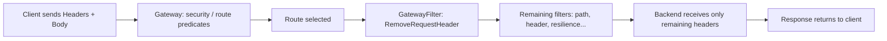

# RemoveRequestHeader and Stripping Data Not Meant to Be Forwarded

**Chapter:** Request Headers  
**Module:** `SPRING_CLOUD_GATEWAY` — Spring Cloud Gateway

In a microservices architecture, Spring Cloud Gateway receives a request, selects a route using **route predicates**, executes the **filter chain**, and then forwards the request to a backend service. HTTP headers can carry routing data, authentication credentials, request traces, debug settings, or data intended only for the edge layer. If all of them are forwarded downstream indiscriminately, a service might receive unnecessary data, mistakenly trust a self-declared client identity, or leak sensitive data into logs.

**`RemoveRequestHeader`** is a *GatewayFilter factory* used to **remove a header by name from the request sent downstream**. It is a simple yet vital tool for establishing trust boundaries between clients, the API Gateway, and microservices. This lesson focuses on declaration syntax, execution order, hands-on verification with an echo backend, and security boundaries of header removal—connecting them to authentication, rate limiting, service discovery, retries, TLS, and request observability.

The main examples target **Spring Cloud Gateway Server WebFlux**. Gateway Server Web MVC and Proxy Exchange use different APIs and mechanisms; check the documentation for your specific flavor and version before reusing configurations.

## 1. Learning Objectives

After this lesson, you will be able to:

1. Explain accurately that `RemoveRequestHeader` modifies the **request sent downstream**, as opposed to removing headers from the original request the client sent.
2. Declare multiple `RemoveRequestHeader` entries in YAML routes, use the Java DSL, and apply default rules across routes when appropriate.
3. Distinguish between secret headers, internal headers, hop-by-hop headers, and proxy-related headers.
4. Verify header removal using an echo backend, safe logging, and `curl`.
5. Understand interactions with `Path`/`Header` predicates, Spring Security, `AddRequestHeader`, HTTP/HTTPS, and WebSocket.
6. Design a header-forwarding policy that sends downstream only the data each service actually needs.

## 2. Which HTTP Headers Should You Care About?

Headers are name/value pairs sent with an HTTP request, for example:

```http
GET /api/catalog/products/42 HTTP/1.1
Host: gateway.example.test
Authorization: Bearer demo-placeholder
X-Internal-Debug: enabled
X-Lab-Trace: request-042
Accept: application/json
```

In an API Gateway, classify headers **by purpose and trust source**, not merely by name prefixes:

| Header group | Examples | Considerations |
|---|---|---|
| Client data needed by downstream | `Accept`, `Content-Type`, `If-None-Match` | Keep if required by the API/backend contract |
| Edge credentials/session | `Authorization`, `Cookie` | May be stripped before the backend if the Gateway handles auth and the backend does not need them; understand delegation semantics |
| Debug or administrative-only headers | `X-Internal-Debug`, `X-Client-Secret` | Do not forward unless the backend has an explicit need |
| Internal identity headers set by infrastructure | `X-Authenticated-User`, `X-Internal-Role` | Strip client-supplied values before **re-generating from verified identity**, if the trust model permits |
| Proxy/origin address headers | `Forwarded`, `X-Forwarded-For`, `X-Forwarded-Proto` | Trust only from trusted proxies; requires proper trust policy and regeneration |
| Connection control headers | `Connection`, `Keep-Alive`, `Transfer-Encoding`, `Upgrade` | Part of HTTP/proxy transport; typically handled by the framework under hop-by-hop rules |
| Observability headers | `traceparent`, `tracestate`, `X-Request-Id` | Consider tracing policy, trust level, and exposure prevention |

**There is no universal "strip everywhere" list valid for all applications.** For instance, removing `Authorization` when the backend is a Resource Server validating JWTs on its own will break authentication. Keeping `Authorization` when the backend does not need tokens increases the risk of accidental leaks. Decisions must follow the **contract between the Gateway and the target service**, rather than an arbitrary header blacklist.

## 3. Where Does RemoveRequestHeader Sit in the Request Pipeline?



A request to `/api/catalog/products/42` with header `X-Internal-Debug: enabled` is processed as follows:

1. The Gateway accepts the original request and finds a route matching `Path`, `Method`, `Header`, etc. (security filters run in their corresponding pipeline).
2. Once the route is selected, `RemoveRequestHeader=X-Internal-Debug` strips that header from the **request being built for downstream**.
3. Subsequent filters and the routing filter operate on the modified request and may continue adding or removing other headers.
4. The backend receives a request with `X-Internal-Debug` removed, unless a **later** step explicitly re-adds it.

**Distinguishing timing:**

- The `Header` **Route Predicate** inspects request data during route selection. Removing a header inside a **route GatewayFilter** does not undo the match that has already been evaluated.
- `RemoveRequestHeader` does not erase historical request data the client sent, does not revoke tokens already processed by Spring Security, and does not prevent clients from calling the backend directly if the backend is reachable outside the Gateway.
- `RemoveRequestHeader` acts on **request headers**; it does not remove cookies inside bodies, query strings, response headers, or data already written to earlier logs.
- HTTP header names are **case-insensitive**. A rule removing `X-Internal-Debug` must also remove `x-internal-debug` when the HTTP stack follows standards.

### 3.1. How Does the Pipeline Differ Between Predicates and Filters?

| Component | Example configuration | Role |
|---|---|---|
| `Header` predicate | `Header=X-API-Version, v2` | Selects a route based on a request header |
| `RemoveRequestHeader` filter | `RemoveRequestHeader=X-Internal-Debug` | Strips a request header **before sending to the backend** |
| `AddRequestHeader` filter | `AddRequestHeader=X-Edge-Lab, gateway` | Adds a header to the downstream request |
| `SetRequestHeader` filter | `SetRequestHeader=X-Env, lab` | Sets/overwrites header values per configuration |
| `RemoveResponseHeader` filter | `RemoveResponseHeader=Server` | Strips a header on the **response**, from backend/Gateway back to client |

If you use `Header=X-Internal-Debug, enabled` to select a route and attach `RemoveRequestHeader=X-Internal-Debug` to that same route, the predicate **can still match** based on the original header. That does not mean the backend will receive the header.

## 4. YAML Syntax for Gateway Server WebFlux

The example below uses the configuration prefix style of modern Spring Cloud Gateway Server WebFlux lines, such as Spring Cloud 2025.0+/Gateway 4.3+:

```yaml
server:
  port: 8080

spring:
  cloud:
    gateway:
      server:
        webflux:
          routes:
            - id: catalog-public
              uri: http://localhost:8081
              predicates:
                - Path=/api/catalog/**
              filters:
                - StripPrefix=2
                - RemoveRequestHeader=X-Internal-Debug
                - RemoveRequestHeader=X-Client-Secret
                - RemoveRequestHeader=Authorization
                - AddRequestHeader=X-Edge-Lab, gateway
```

Reading the configuration:

1. `Path=/api/catalog/**` matches requests arriving at the Gateway with the `/api/catalog` prefix.
2. `StripPrefix=2` transforms `/api/catalog/inspect/headers` into `/inspect/headers`.
3. Three `RemoveRequestHeader` entries delete three **specific header names**. Each entry specifies one name; `RemoveRequestHeader` is not a wildcard rule filter.
4. `AddRequestHeader` places an experimental marker `X-Edge-Lab` on the downstream request. This header **must not be used to authenticate** the Gateway's identity.
5. `uri` forwards requests to the HTTP backend at `8081`; with `https://...`, the same header policy must still be paired with trusted TLS.

Documentation may also express the filter in expanded form:

```yaml
filters:
  - name: RemoveRequestHeader
    args:
      name: X-Internal-Debug
  - name: RemoveRequestHeader
    args:
      name: X-Client-Secret
```

**Do not write** `RemoveRequestHeader=X-Internal-*` expecting the Gateway to remove every header starting with `X-Internal-`. The factory takes a **header name**, not a glob or regular expression. If you have a set of headers to control, list their names explicitly or design a thoroughly tested security filter.

> **Compatibility note:** in older Server WebFlux versions, route configuration may live under `spring.cloud.gateway.routes` and the starter used to be named `spring-cloud-starter-gateway`. Do not combine prefixes from newer release trains with older dependencies/versions without checking the corresponding documentation.

### 4.1. Can It Be Configured as a Default Filter?

When **all routes** in the same Gateway Server WebFlux application must strip debug headers, you can declare a default filter (using the right prefix for your version):

```yaml
spring:
  cloud:
    gateway:
      server:
        webflux:
          default-filters:
            - RemoveRequestHeader=X-Internal-Debug
          routes:
            - id: catalog
              uri: http://localhost:8081
              predicates:
                - Path=/api/catalog/**
              filters:
                - StripPrefix=2
            - id: orders
              uri: http://localhost:8082
              predicates:
                - Path=/api/orders/**
              filters:
                - StripPrefix=2
```

Default filters are attached to Gateway-managed routes; verify the exact behavior of your flavor/version and route definitions. **Do not treat default filters as network-level rules**: they do not protect against requests that bypass the Gateway or hit routes/handlers outside that pipeline.

If header-removal policies differ between `catalog` and `orders`, prefer explicit per-route declarations instead of a default filter that might break a backend contract.

### 4.2. Java DSL

If declaring routes with `RouteLocatorBuilder`:

```java
import org.springframework.cloud.gateway.route.RouteLocator;
import org.springframework.cloud.gateway.route.builder.RouteLocatorBuilder;
import org.springframework.context.annotation.Bean;
import org.springframework.context.annotation.Configuration;

@Configuration
public class GatewayRoutes {

    @Bean
    RouteLocator catalogRoutes(RouteLocatorBuilder builder) {
        return builder.routes()
            .route("catalog-public", r -> r
                .path("/api/catalog/**")
                .filters(f -> f
                    .stripPrefix(2)
                    .removeRequestHeader("X-Internal-Debug")
                    .removeRequestHeader("X-Client-Secret")
                    .removeRequestHeader("Authorization")
                    .addRequestHeader("X-Edge-Lab", "gateway"))
                .uri("http://localhost:8081"))
            .build();
    }
}
```

This is the **Gateway Server WebFlux Java DSL**: `removeRequestHeader(...)` belongs to the fluent `GatewayFilterSpec`. Use **only one** of the two illustrative route definitions for the same path and ID when testing; declaring both Java and YAML routes with the same ID makes it hard to tell which route is active and can cause conflicts.

## 5. Building an Echo Backend to Inspect Actual Received Headers

To verify header removal accurately, run a small Spring Boot backend on `8081`. The backend returns **the presence of certain headers** rather than returning credential values; this lets you observe filter behavior without leaking secrets in JSON.

On [Spring Initializr](https://start.spring.io/), create a Java/Spring Boot application with the **Spring Web** dependency, package `com.example.headerecho`. With Spring Boot 3.x, Java 17+ and Spring Web servlet are sufficient; if using Boot 4.x, select the corresponding starter provided by Initializr.

Create `application.yml` for the backend:

```yaml
server:
  port: 8081
spring:
  application:
    name: header-echo
```

Create `HeaderEchoApplication.java` in package `com.example.headerecho`:

```java
package com.example.headerecho;

import jakarta.servlet.http.HttpServletRequest;
import java.util.LinkedHashMap;
import java.util.Map;
import org.springframework.boot.SpringApplication;
import org.springframework.boot.autoconfigure.SpringBootApplication;
import org.springframework.web.bind.annotation.GetMapping;
import org.springframework.web.bind.annotation.RestController;

@SpringBootApplication
public class HeaderEchoApplication {
    public static void main(String[] args) {
        SpringApplication.run(HeaderEchoApplication.class, args);
    }
}

@RestController
class HeaderEchoController {

    @GetMapping("/inspect/headers")
    public Map<String, Object> headers(HttpServletRequest request) {
        Map<String, Object> result = new LinkedHashMap<>();
        result.put("backend", "header-echo");
        result.put("method", request.getMethod());
        result.put("requestUri", request.getRequestURI());
        result.put("debugPresent",
                request.getHeader("X-Internal-Debug") != null);
        result.put("clientSecretPresent",
                request.getHeader("X-Client-Secret") != null);
        result.put("authorizationPresent",
                request.getHeader("Authorization") != null);
        result.put("cookiePresent",
                request.getHeader("Cookie") != null);
        result.put("labTrace", request.getHeader("X-Lab-Trace"));
        result.put("edgeMarker", request.getHeader("X-Edge-Lab"));
        return result;
    }
}
```

**Why return booleans?** The response only indicates whether a header exists. It does not serialize `Authorization`, `Cookie`, or any secret into JSON strings. When testing real systems, you must also check query/body handling, access logs, tracing, and reverse-proxy logs; this example is not a complete production log filter.

### 5.1. Starting and Calling the Backend Directly

In the backend directory, use Maven Wrapper:

```bash
./mvnw spring-boot:run
```

On Windows:

```powershell
.\mvnw.cmd spring-boot:run
```

Once the app starts on `8081`, test using **dummy** values, not real credentials:

```bash
curl -i "http://localhost:8081/inspect/headers" \
  -H "X-Internal-Debug: demo" \
  -H "X-Client-Secret: placeholder" \
  -H "Authorization: Bearer not-a-real-token" \
  -H "X-Lab-Trace: direct-001"
```

Abbreviated JSON response:

```json
{
  "backend": "header-echo",
  "method": "GET",
  "requestUri": "/inspect/headers",
  "debugPresent": true,
  "clientSecretPresent": true,
  "authorizationPresent": true,
  "cookiePresent": false,
  "labTrace": "direct-001",
  "edgeMarker": null
}
```

This confirms the backend works and test headers arrived. If the direct request fails, fix the backend before debugging the Gateway.

## 6. Sending Requests Through the Gateway and Comparing Results

In a **separate Gateway application** running on port `8080`, add the `spring-cloud-starter-gateway-server-webflux` starter managed by the Spring Boot–compatible Spring Cloud BOM. Use the route from section 4 and start the Gateway after the `8081` backend is ready.

Call the Gateway with test data that is **not real credentials**:

```bash
curl -i "http://localhost:8080/api/catalog/inspect/headers" \
  -H "X-Internal-Debug: demo" \
  -H "X-Client-Secret: placeholder" \
  -H "Authorization: Bearer not-a-real-token" \
  -H "X-Lab-Trace: gateway-001"
```

Expected backend response (abbreviated):

```json
{
  "backend": "header-echo",
  "method": "GET",
  "requestUri": "/inspect/headers",
  "debugPresent": false,
  "clientSecretPresent": false,
  "authorizationPresent": false,
  "cookiePresent": false,
  "labTrace": "gateway-001",
  "edgeMarker": "gateway"
}
```

| Field | Direct call to `8081` | Through Gateway `8080` |
|---|---|---|
| `requestUri` at backend | `/inspect/headers` | `/inspect/headers` after `StripPrefix` |
| `debugPresent` | `true` | `false` |
| `clientSecretPresent` | `true` | `false` |
| `authorizationPresent` | `true` | `false` |
| `labTrace` | `direct-001` | `gateway-001` |
| `edgeMarker` | `null` | `gateway` |

**Key proof:** the client still sent those test headers to the Gateway, yet the backend never saw the headers removed by `RemoveRequestHeader`. `X-Lab-Trace` stayed intact because the route did not remove it; `X-Edge-Lab` appeared because the filter added it.

If the Gateway has Spring Security enabled, a request with a dummy token may be rejected with HTTP `401`/`403` before reaching the route. This lab assumes the test endpoint requires no auth; never disable real system security just to observe the output above.

### 6.1. Windows PowerShell

In Windows PowerShell, `curl` is sometimes an alias for `Invoke-WebRequest`. Use `curl.exe`:

```powershell
curl.exe -i "http://localhost:8080/api/catalog/inspect/headers" `
  -H "X-Internal-Debug: demo" `
  -H "X-Client-Secret: placeholder" `
  -H "Authorization: Bearer not-a-real-token" `
  -H "X-Lab-Trace: gateway-001"
```

### 6.2. Header Names Are Case-Insensitive

```bash
curl -i "http://localhost:8080/api/catalog/inspect/headers" \
  -H "x-internal-debug: first" \
  -H "X-Internal-Debug: second" \
  -H "X-Lab-Trace: case-check-002"
```

With `RemoveRequestHeader=X-Internal-Debug`, `debugPresent` must still be `false`. A removal rule by name must strip all values matching that name, not just one casing variation. HTTP/2 and proxies may normalize header names to lowercase; never rely on letter casing for security conditions.

### 6.3. Distinguishing Route Mismatch from Filter Non-Execution

```bash
# Matching prefix, can select route:
curl -i http://localhost:8080/api/catalog/inspect/headers

# Wrong prefix, does not match catalog route:
curl -i http://localhost:8080/api/unknown/inspect/headers
```

The second request typically returns `404` if no other route exists. This is a case of the **predicate not selecting the route**; the catalog route's `RemoveRequestHeader` filter is not executed.

## 7. Filter Ordering and the Risk of Re-Adding Headers

A route can both **remove** and **add** or **set** headers. The final result depends on the executing filter chain:

```yaml
filters:
  - RemoveRequestHeader=X-Edge-Lab
  - AddRequestHeader=X-Edge-Lab, gateway-lab
```

With the route filter order in this example, the intent is to delete any client-supplied `X-Edge-Lab` value and then add `gateway-lab` for downstream. If you reverse the order and remove **afterward**, the newly added value can also be deleted.

**Note:** if `GlobalFilter`s, `Ordered` filters, or specialized components are involved, pipeline order follows the sorting enforced by the framework, not just YAML line order. Whenever a security rule depends on ordering, always verify with an echo backend.

### 7.1. How Do Remove, Add, and Set Differ?

| Filter | Effect |
|---|---|
| `RemoveRequestHeader=X-Foo` | Removes header `X-Foo` along with all its existing values |
| `AddRequestHeader=X-Foo, new` | Appends a value; if the header already exists, may produce multiple values |
| `SetRequestHeader=X-Foo, new` | Replaces existing values of the header with the new value |

If a client sends `X-Authenticated-User`, **merely adding** a header with the same name does not guarantee the backend uses the Gateway-authenticated identity: the backend might receive multiple values and pick the wrong one. You must design a mechanism that **strips untrusted values first**, then **re-creates them from a trusted security context**, while also protecting the backend against paths that bypass the Gateway.

`X-Edge-Lab: gateway-lab` is a static observability marker; it **does not prove the client is authenticated**. Never use a static `AddRequestHeader=X-Is-Admin, true` to grant backend permissions.

### 7.2. A Header Predicate Can Match Before the Header Is Removed

```yaml
- id: api-v2
  uri: http://localhost:8081
  predicates:
    - Path=/v2/**
    - Header=X-API-Version, v2
  filters:
    - StripPrefix=1
    - RemoveRequestHeader=X-API-Version
```

When a client sends `X-API-Version: v2`, the route can match **before** the filter removes that header. If the header is omitted, the route does not match, so `RemoveRequestHeader` does not run either. This clearly illustrates the difference between **route selection** and **preparing the downstream request**.

An `X-API-Version` header can select an API version per contract; by itself it does not prove access authorization.

## 8. Policies for Removing Sensitive Headers

### 8.1. Authorization: Does the Gateway or Backend Validate the Token?

Suppose a client sends `Authorization: Bearer ...`. There are two classic models:

**Model A — Gateway authenticates, backend does not need the original token.** The Gateway can strip `Authorization` after authenticating, then forward the verified identity via a trusted mechanism (such as an internal token with the proper audience or mTLS with authorization). The backend must still enforce appropriate authorization, and network/infrastructure controls must prevent clients from calling the backend directly to spoof internal headers.

**Model B — Backend validates the JWT/access token itself.** The backend is a Resource Server that needs the client's token to verify signature, audience, scopes, and expiration. Removing `Authorization` will cause the backend to return `401 Unauthorized` or `403 Forbidden`. In that case, retain the token with clear target boundaries, or design proper token exchange/delegation.

| Scenario | Reasonable decision | Reason |
|---|---|---|
| Gateway handles auth, backend needs no client credentials | Consider stripping `Authorization` | Avoids forwarding secrets where unneeded |
| Backend verifies client JWTs itself | Usually keep token per policy | Removing it breaks auth |
| Calling a third-party service | Do not forward internal tokens unconditionally | Tokens could leak or be used outside their audience |
| Propagating user permissions across services | Design explicit delegation | Never trust self-declared client role headers |

`RemoveRequestHeader` is **not** a Spring Security filter: it does not validate JWTs, scopes, accounts, or principals; nor does it erase headers already logged by an earlier component.

### 8.2. Cookies and Session Information

`Cookie` is a request header. If the backend has zero need for browser cookies, it can be stripped:

```yaml
filters:
  - RemoveRequestHeader=Cookie
```

However, if the backend needs its own session cookie or session-based SSO, removing the entire `Cookie` header breaks functionality. `RemoveRequestHeader=Cookie` strips the **entire header**, not an individual cookie by name. To transform cookies selectively according to policy, use dedicated cookie-handling mechanisms and test thoroughly.

`Set-Cookie` is a **response header**. Removing `Cookie` from the request **does not remove** `Set-Cookie` sent by the backend back to the client. When response handling is needed, look into `RemoveResponseHeader`, cookie policies, and cache/CORS behavior.

### 8.3. Risk of Spoofed Internal Identity Headers

Headers such as `X-Internal-User`, `X-Internal-Role`, and `X-Trusted-Tenant` are dangerous if the backend treats them as proof of authentication and the Gateway forwards them as-is:

```text
Client sends: X-Internal-Role: administrator
        |
        v
Gateway fails to sanitize header -> Backend trusts value -> Privilege escalation risk
```

A more trustworthy flow:

```text
Client
  -> Gateway authentication / authorization
  -> Strip identity header values that clients could supply
  -> Re-create identity info from verified principal/token
  -> Forward over trusted channel and/or internal token
  -> Backend authenticates/authorizes per service contract
```

Do not use `AddRequestHeader` with a **hardcoded** username or role to implement this model. Real identity propagation requires a security context, trusted tokens/claims, and backend-side verification.

### 8.4. Debug Headers and Internal Data

Test headers like `X-Internal-Debug` or `X-Client-Secret` should be stripped from requests bound for backends that have no need for them. If an internal debug feature genuinely needs a header, accept it only from authenticated and controlled sources—never blindly trust arbitrary client-supplied values.

In multi-tenant applications, do not turn a client-declared tenant ID into a trusted header merely by renaming it. Compare the tenant against token claims and backend data access permissions before routing or authorizing.

## 9. Headers That Should Not Be Removed Mechanically

### 9.1. Hop-by-Hop Headers and HTTP Protocol

Headers bound to **a single HTTP connection** differ from headers meant to travel across multiple proxies. Commonly cited examples include:

```text
Connection
Keep-Alive
Proxy-Authenticate
Proxy-Authorization
TE
Trailer
Transfer-Encoding
Upgrade
```

Spring Cloud Gateway Server WebFlux includes **HTTP Headers Filters**, which handle hop-by-hop headers before routing depending on version and configuration. For an HTTP proxy, these headers normally need protocol-compliant handling and forwarding policy rather than verbatim copying from clients.

**Do not unconditionally add** `RemoveRequestHeader=Connection` and `RemoveRequestHeader=Upgrade` to all routes, especially WebSocket routes: the WebSocket handshake relies on upgrade semantics and its own pipeline. The Gateway has dedicated WebSocket routing components; improperly stripping protocol fields can break handshakes. Likewise, `Host`, `Content-Length`, `Content-Type`, and `Transfer-Encoding` govern authority and body framing; let the HTTP stack and official filters handle them properly rather than deleting them arbitrarily.

Some headers look "unnecessary" yet belong to the API contract: `If-Match`/`If-None-Match` govern conditional requests, `Range` governs byte ranges, and `Accept-Encoding` governs content negotiation. Removing them can alter caching, bandwidth usage, or backend response statuses.

### 9.2. Forwarded and X-Forwarded-*

`Forwarded`, `X-Forwarded-For`, `X-Forwarded-Host`, and `X-Forwarded-Proto` typically carry information about the client and intermediate proxies. They are useful for logging, redirects, `Secure` cookies, and determining the original scheme/host, yet clients can also forge them.

A trustworthy policy must answer:

1. Which proxies in front of the Gateway are authenticated/trusted?
2. Which headers does the edge proxy **overwrite or normalize**, and which could still be client-spoofed?
3. Does the Gateway have trusted proxies and HTTP headers filters configured appropriately for its version?
4. What does the backend use that data for: rendering links, logging source addresses, or making access decisions?

Stripping `X-Forwarded-For` on a route can reduce data leakage, but it can also erase necessary audit trails. Conversely, forwarding unverified client-supplied headers invites IP spoofing. **Never rely directly on `X-Forwarded-For` as the sole basis for rate limiting or authentication** if the proxy chain is uncontrolled.

### 9.3. CORS, Origin, and WebSocket Handshakes

`Origin`, `Access-Control-Request-Method`, and `Access-Control-Request-Headers` play a role in CORS preflight; these are **request headers**. Stripping them blindly can prevent CORS policies or backends from recognizing requests properly. Configure CORS at the appropriate layer and test `OPTIONS` preflight requests separately.

For WebSockets, inspect `Origin` during the handshake when cross-site protection is required, alongside authentication, cookies/tokens, and connection-upgrade policies. Do not copy a REST JSON header-stripping policy wholesale onto `ws://`/`wss://` routes without checking protocol requirements.

### 9.4. Request Observability Headers

`traceparent`/`tracestate` (W3C Trace Context) and certain correlation ID headers allow correlating requests across the Gateway and microservices. Stripping them can break distributed tracing; keeping them from untrusted sources requires sampling, trust, and data-protection policies.

In the lab, `X-Lab-Trace` is a client-set string for easy comparison. It is **not a trusted identifier** and can collide. In real deployments, use a consistent observation/tracing setup aligned with your Spring Boot/Gateway versions, with appropriate data filtering.

## 10. Interaction with Other Gateway Features

`RemoveRequestHeader` is usually just one step in an API Gateway operational strategy. Consider each feature individually:

| Component | Relationship to RemoveRequestHeader | Key considerations |
|---|---|---|
| `Path`/`Header` predicates | Select route before filters | Cannot strip data already used to choose the route |
| `StripPrefix`/`RewritePath` | Modify path, independent of header names | Verify both path and headers at the backend |
| Service discovery / `lb://service-id` | Resolves how the backend is located | Removed headers must still be absent on the request sent to the chosen instance |
| Spring Security authentication | Checks user/token via security pipeline | Stripping tokens after auth does not replace backend authorization |
| `RequestRateLimiter` | Limits request frequency | Key resolver must never trust self-declared client headers |
| `CircuitBreaker` | Handles backend errors/health | Does not restore stripped headers; verify fallbacks |
| `Retry` | May resend requests after failures | Ensure headers remain sanitized on every backend retry attempt |
| Outbound TLS / HTTPS | Encrypts the Gateway → backend leg | TLS protects transport but does not decide which headers should be sent |
| Metrics/tracing | Observes routes and errors | Never create metric labels from tokens, cookies, or sensitive headers |

### 10.1. Difference Between TLS and Header Removal

`uri: https://backend.internal` secures the connection with TLS when properly configured. It **does not make a header necessary or safe to share**: a credential outside the backend's audience can still leak into downstream application logs even over an encrypted link.

Conversely, removing `Authorization` does not replace TLS. If the backend consumes internal identity data, the communication leg still requires network security controls and mutual server/service authentication.

### 10.2. Retries and Multiple Backend Attempts

If `Retry` is enabled on a route with `RemoveRequestHeader`, the client may send one request while the backend receives multiple attempts. Every attempt must follow the same policy of omitting prohibited credentials/headers. Check logs of **each downstream attempt**, especially when custom filters or request-body handling are present.

For POST requests creating orders or payments, evaluate idempotency before enabling retries. `RemoveRequestHeader` does not handle duplicate transactions, timeouts, or backpressure.

### 10.3. Fallbacks and Alternate Paths

A primary HTTP route may have a circuit breaker with a fallback (such as `forward:/fallback`). When a fallback is handled by an internal handler, determine at which stage that handler can access request headers, what data has already been stripped, and where raw data might have been logged. Do not assume a route filter's behavior applies across **every alternate path** or handler outside that route.

## 11. Safe Observability: Checking Presence Instead of Printing Secrets

When debugging header forwarding, distinguish three perspectives:

| Perspective | What it shows | Limitation |
|---|---|---|
| Client using `curl -v` | Headers the client **sent to the Gateway** | Does not prove which headers the backend received |
| Gateway route/filter config, logs | Which filters should apply and which route matched | Valid config does not prove runtime forwarded as intended |
| Echo Backend | Presence of headers on the **actually received** request | Only proves behavior for the tested path and that backend |

The test in section 6 uses an echo backend returning booleans so tokens never need to be printed. In production systems:

- Never write raw `Authorization`, `Cookie`, API keys, or sensitive bodies into access logs, debug logs, traces, or metrics.
- For metrics, use only bounded-cardinality labels like route ID, status class, method, and service ID. Never use header or token contents as label values.
- When verifying that a secret header was stripped, prefer checking **present/absent** at a test backend rather than printing raw values.
- Never turn on detailed HTTP body/header wiretap logging in production just to debug one route; for deep diagnostics, use an isolated environment with synthetic data.
- Audit backend logs, ingress logs, and intermediate proxies alike: data may have been logged before the Gateway filter stripped it.

### 11.1. A Sufficiently Strong Verification Test

A test proving `RemoveRequestHeader` works must answer all of the following:

1. Did the request **select the intended route**?
2. Was the header **actually present** from the client/Gateway before the filter ran?
3. Did the backend receive that request, and is `requestUri` right after path transformations?
4. Does the backend report the removed header as **absent**, while permitted headers remain **present**?
5. If the same header name appears multiple times or with mixed casing, do any values leak through?
6. When other filters re-add headers, does the final state match policy?

Answering these six questions is far more reliable than looking at YAML alone and declaring it "protected."

## 12. Common Issues and Root-Cause Analysis

| Symptom | Likely cause | How to verify |
|---|---|---|
| Backend still sees `X-Internal-Debug` | Filter not applied; different route matched; later filter re-added it | Check route ID, predicates, filter chain, backend echo |
| Backend receives `Authorization` despite YAML removal rule | Calling backend directly or request hit another route | Compare ports `8080` and `8081`, route paths, logs |
| Removing `Authorization` causes backend to return `401` | Backend needs the token to authenticate itself | Re-evaluate token forwarding/authorization model |
| Backend loses login session | Accidentally stripped `Cookie` when backend relies on cookies | Review session/cookie contract |
| `AddRequestHeader` produces duplicate values | Client already sent the header and filter only appended | Strip first or use `SetRequestHeader` appropriately |
| Header arrives with lowercase name | HTTP/2, servlet container, or proxy normalized casing | Compare names case-insensitively |
| Request returns `404`, backend never receives it | `Path` mismatch or wrong path rewrite | Inspect predicate, `StripPrefix`, and backend mapping |
| Backend sees header gone, yet logs still show its value | Logging occurs at ingress/security/earlier filter before removal | Audit logging and masking across every layer |
| CORS preflight fails | CORS/`OPTIONS`/`Origin` handled improperly | Check CORS config; do not strip protocol headers arbitrarily |
| WebSocket fails to upgrade | Stripped `Upgrade`/`Connection` or wrong WS route | Test with a WebSocket client and inspect handshake |
| `X-Forwarded-For` contains unexpected IP | Client may be spoofing header; trusted proxy config incomplete | Inspect proxy chain and trust configuration |
| Header disappears only on some requests | Multiple routes/instances, filter order, or different paths | Use route ID, trace ID, inspect all instances |
| Filter missing from route list | Wrong YAML prefix for the Spring Cloud release train | Check version and loaded configuration |

### Step-by-Step Debugging Workflow

1. Call the backend `/inspect/headers` directly on `8081` with test data to confirm it receives headers.
2. Verify Gateway `8080` is running and route `catalog-public` matches `/api/catalog/inspect/headers`.
3. Send a request through the Gateway with test headers; verify `requestUri` in the JSON output.
4. Check the booleans for stripped headers while confirming `X-Lab-Trace` is preserved.
5. If the filter has no effect, inspect the order of route/default/global filters and where headers might be re-added.
6. If `401`, `403`, `404`, or handshake errors occur, separate **security, routing, backend mapping, and protocol** issues before changing header policies.
7. Once behavior is right in the lab, test in a realistic deployment with multiple proxies/instances and confirm policy against your exact Gateway version.

## 13. Designing a Header-Forwarding Policy for a Multi-Service System

Suppose the Gateway serves:

```text
/api/catalog/**      -> catalog-service
/api/orders/**       -> order-service
/api/partner/**      -> partner-adapter
```

Each service has different needs:

| Route | Data the backend needs | Data to consider stripping |
|---|---|---|
| Public Catalog | `Accept`, conditional headers, appropriate trace context | Debug headers, client tokens when catalog does not validate tokens |
| Orders requiring user permissions | Token/identity per auth contract, correlation ID | Gateway session cookies, self-declared role headers |
| Partner adapter | Partner-specific credentials, business payload | Internal access tokens for another audience, internal headers |

This illustrates a **per-target policy**, not a single system-wide default filter. Before writing YAML, operations teams should maintain a header contract table:

| Question | Example answer |
|---|---|
| Who is the header source? | Client, trusted ingress, Gateway, internal service |
| Does the backend truly need it? | `Accept` yes, `X-Internal-Debug` no |
| Is it a credential or personal data? | `Authorization` is a credential; `X-Request-Id` might hold sensitive data if client-supplied |
| Does it need transformation or signing? | Internal identity derived only from verified principal |
| Who is responsible for validation? | Gateway and backend each have distinct responsibilities |
| Does it affect retries/tracing/CORS? | Trace headers require policy; cookies can affect sessions |

### 13.1. Implementation Priority Order

1. **Define API contracts and auth responsibilities** for each backend.
2. **Block bypass paths** for backends that trust Gateway-generated headers.
3. **Strip untrusted input** for internal header names susceptible to spoofing.
4. **Re-create required data from trusted sources** if the backend contract needs it.
5. **Test at the backend** to confirm headers are right after the full filter chain.
6. **Observe and protect logs/traces** so late header removal does not leave sensitive values logged elsewhere.

Security cannot be guaranteed simply by adding `RemoveRequestHeader=Authorization` to every route. Some services need tokens; some receive identity over another protocol; some require mTLS only. Policies must be verified per traffic flow.

## 14. Hands-On Practice Exercises

Use the Echo Backend from section 5 and the Gateway application from section 4. Make changes **one at a time**, recording the request/response after each change:

1. **Strip debug headers:** keep `RemoveRequestHeader=X-Internal-Debug`; send `X-Internal-Debug` in various letter casings. Why must `debugPresent` still be `false`?
2. **Preserve needed headers:** send `X-Lab-Trace` and prove downstream still sees it. Then add `RemoveRequestHeader=X-Lab-Trace`, retest, and restore the config.
3. **Filter ordering:** have the client send `X-Edge-Lab: spoofed`. Test `RemoveRequestHeader=X-Edge-Lab` followed by `AddRequestHeader=X-Edge-Lab, gateway-lab`, then reverse the order. Explain the result using `edgeMarker`.
4. **Where are tokens validated?:** test the route stripping `Authorization` while the echo backend requires no auth. Then discuss what happens if the backend is a JWT Resource Server.
5. **Cookies:** use a dummy cookie value to observe `cookiePresent` before and after adding `RemoveRequestHeader=Cookie`. Never test with real session cookies.
6. **Unmatched route:** send a path outside `/api/catalog/**`. Why can that response not be used to prove the header-removal filter ran?
7. **Header predicate:** create a route with `Header=X-API-Version, v2` and then remove that same header in filters. Explain why the predicate still matches when a request carries `X-API-Version: v2`.
8. **Switch to HTTPS or `lb://`:** keep the same header rules while changing the target URI to match available infrastructure. Observe whether the header policy changes, and why TLS/discovery are separate concerns.

### Self-Assessment Table

| Item | Passing criteria |
|---|---|
| Echo backend ready | Direct call to `8081/inspect/headers` returns JSON |
| Correct route selected | `/api/catalog/inspect/headers` enters `catalog-public` |
| Path transformed properly | Backend sees `/inspect/headers` |
| RemoveRequestHeader effective | `debugPresent=false` and `clientSecretPresent=false` via Gateway |
| Authorization matches lab policy | `authorizationPresent=false` via Gateway |
| Preserved header | `labTrace=gateway-001` |
| Added header | `edgeMarker=gateway` |
| Understands pipeline | Can explain predicates run before route filters |
| Understands security limits | Does not use static headers for authorization; backend cannot be bypassed |
| Avoids data leaks | Tests only placeholders, never logs raw tokens/cookies |

## 15. Review Questions

1. Is `RemoveRequestHeader` a **route predicate**, a **GatewayFilter**, or a **response filter**?
2. Why does a request match `Header=X-API-Version, v2` even when a route filter later strips `X-API-Version`?
3. Does `RemoveRequestHeader=Cookie` remove a single specific cookie or the entire header?
4. If the Gateway adds `X-Authenticated-User` without stripping any client-sent value first, what risk does the backend face?
5. Why should you not strip `Authorization` everywhere when backends need to validate JWTs?
6. What problem can `RemoveRequestHeader=Upgrade` cause for WebSocket routes?
7. Can `RemoveRequestHeader=X-Internal-*` be used to strip every header sharing that prefix?
8. Once a header is stripped from the downstream request, is it guaranteed not to appear in ingress logs?

**Suggested answers:** (1) GatewayFilter; (2) predicates are evaluated before filters; (3) the entire header; (4) identity spoofing / multiple values; (5) the backend would lack the credentials required for authentication; (6) breaks the upgrade handshake if applied to the wrong pipeline; (7) no wildcards are supported in this factory's syntax; (8) no—logging must be controlled at every layer.

## 16. Summary

`RemoveRequestHeader` helps Spring Cloud Gateway **strip a header name and its values from the downstream request**. Configuring the filter per route or as a default filter provides a straightforward way to prevent debug headers, unneeded credentials, or spoofable client data from reaching services that must not trust them.

Its security effectiveness holds only within the scope of **traffic flowing through the Gateway and the effective filter order**. Predicates and security steps may already have seen the header before removal; another filter could re-add it; and the backend might still be reachable via another path. Therefore, header policies must be combined with authentication, authorization, network isolation, TLS, log hygiene, rate limiting, circuit breakers/retries, and tracing tailored to your microservices architecture.

## References

1. [Spring Cloud Gateway Server WebFlux — RemoveRequestHeader GatewayFilter Factory](https://docs.spring.io/spring-cloud-gateway/reference/spring-cloud-gateway-server-webflux/gatewayfilter-factories/removerequestheader-factory.html).
2. [Spring Cloud Gateway Server WebFlux — AddRequestHeader GatewayFilter Factory](https://docs.spring.io/spring-cloud-gateway/reference/spring-cloud-gateway-server-webflux/gatewayfilter-factories/addrequestheader-factory.html).
3. [Spring Cloud Gateway Server WebFlux — SetRequestHeader GatewayFilter Factory](https://docs.spring.io/spring-cloud-gateway/reference/spring-cloud-gateway-server-webflux/gatewayfilter-factories/setrequestheader-factory.html).
4. [Spring Cloud Gateway Server WebFlux — RemoveResponseHeader GatewayFilter Factory](https://docs.spring.io/spring-cloud-gateway/reference/spring-cloud-gateway-server-webflux/gatewayfilter-factories/removeresponseheader-factory.html).
5. [Spring Cloud Gateway Server WebFlux — HTTP Headers Filters](https://docs.spring.io/spring-cloud-gateway/reference/spring-cloud-gateway-server-webflux/httpheadersfilters.html).
6. [Spring Cloud Gateway Server WebFlux — Global Filters](https://docs.spring.io/spring-cloud-gateway/reference/spring-cloud-gateway-server-webflux/global-filters.html).
7. [Spring Framework — WebFlux Security](https://docs.spring.io/spring-security/reference/reactive/index.html).
8. [RFC 9110 — HTTP Semantics](https://www.rfc-editor.org/rfc/rfc9110.html).

> **Version note:** Spring Cloud Gateway ships in Server WebFlux, Server Web MVC, and Proxy Exchange flavors; filter names, Java DSL, or configuration prefixes may differ across release trains. Always consult the official documentation for your exact release train. This article completes the conceptual scope and illustrative lab; production security assessments require real configurations, end-to-end testing, and trust-boundary reviews for each service.
