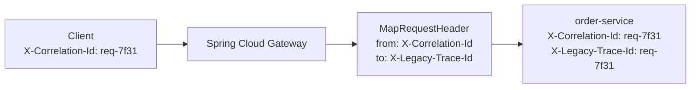
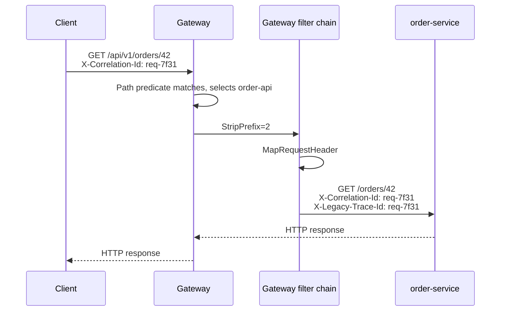
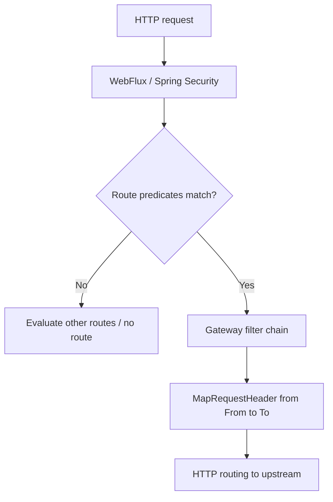

# MapRequestHeader and Mapping Values Between Headers

In a microservices architecture, clients and target services do not always use the same HTTP request header names. For instance, an external application sends `X-Correlation-Id` to trace a request, whereas a legacy backend only reads `X-Legacy-Trace-Id`. When building **Spring Cloud Gateway**, you can use the **`MapRequestHeader` GatewayFilter Factory** to copy values from a source header to a target header directly on the forwarded request.

This lesson belongs to the **Request Headers** chapter and focuses on the **mapping mechanism between two request header names**, handling missing headers, multi-value headers, append behavior when the target header already exists, filter combination order, and how to verify what actually reaches upstream. The examples are placed in the context of an API Gateway using route predicates, filter chains, service discovery, and microservice protections such as Spring Security, rate limiting, retries, circuit breakers, and TLS.

> **Scope:** This content applies to **Spring Cloud Gateway Server WebFlux**. Do not copy WebFlux Java DSL verbatim to Spring Cloud Gateway Server MVC. `MapRequestHeader` is a **header value** copying mechanism, not a lookup-table value translator or an identity authenticator.

## 1. The Problem: Two Systems Using Different Header Names

Suppose an application calls the API:

```http
GET /api/v1/orders/42 HTTP/1.1
Host: api.example.test
X-Correlation-Id: req-7f31
Accept: application/json
```

The Gateway forwards the request to `order-service`. This service evolved from a legacy system and reads `X-Legacy-Trace-Id` instead of `X-Correlation-Id`.

Without mapping, the backend will not receive the correlation ID under the header name it expects. A simple solution is to declare:

```yaml
filters:
  - MapRequestHeader=X-Correlation-Id,X-Legacy-Trace-Id
```

When `X-Correlation-Id` is present, the filter takes **all values of the source header** and **appends them to the target header** on the forwarded request. When the target header does not yet exist, upstream receives:

```http
GET /orders/42 HTTP/1.1
X-Correlation-Id: req-7f31
X-Legacy-Trace-Id: req-7f31
Accept: application/json
```

The `/orders/42` path in this example is the result of a **separately** configured `StripPrefix` filter; `MapRequestHeader` itself does not modify the path.



**Remember:** The source header **remains present** after mapping. The filter **copies and appends**; by default it does not rename by deleting the source header.

## 2. Syntax and Parameters

`MapRequestHeader` takes two parameters:

| Parameter | Meaning | Example |
| --- | --- | --- |
| `fromHeader` | Request header name from which values are read | `X-Correlation-Id` |
| `toHeader` | Request header name that receives the copied values | `X-Legacy-Trace-Id` |

Shortcut syntax:

```yaml
- MapRequestHeader=fromHeader,toHeader
```

Example:

```yaml
- MapRequestHeader=X-Correlation-Id,X-Legacy-Trace-Id
```

You can add a space after the comma in the YAML shortcut for readability, though you should keep syntax consistent and verify that the configuration loads in your Gateway version.

**Left of the comma is the source header name; right is the target header name.** Reversing them will cause requests not to be mapped because the header the filter tries to read does not exist.

Header names are HTTP field names such as `X-Request-Id`, `X-Client-Version`, or `X-Legacy-Trace-Id`. They are **not regex expressions** and **not literal values** to assign. `MapRequestHeader=Gold,Blue` means: find the header named `Gold`, take its values, and append them to the header named `Blue`.

### Comparison with a Simple Assignment

Logically, you can picture it as:

```text
if the request has fromHeader:
    take the entire list of values of fromHeader
    append that list to toHeader
if fromHeader is absent:
    leave the request unchanged
```

This describes behavior at the **HTTP headers** level; in practice, WebFlux builds a new request via the appropriate mutation/decorator mechanism because server HTTP requests are fundamentally immutable within the pipeline.

## 3. Configuring a Practical Route in YAML

Suppose a public API `/api/v1/orders/**` is routed to the order service and needs trace ID mapping:

```yaml
spring:
  cloud:
    gateway:
      routes:
        - id: order-api
          uri: http://localhost:8081
          predicates:
            - Path=/api/v1/orders/**
          filters:
            - StripPrefix=2
            - MapRequestHeader=X-Correlation-Id,X-Legacy-Trace-Id
```

For the request `GET /api/v1/orders/42` carrying `X-Correlation-Id: req-7f31`:

1. WebFlux/Spring Security processes the request per application configuration.
2. The `Path` predicate matches the public path `/api/v1/orders/42`, and the Gateway selects the `order-api` route.
3. `StripPrefix=2` drops the two segments `api` and `v1` so upstream receives `/orders/42`.
4. `MapRequestHeader` reads `X-Correlation-Id` and appends its value to `X-Legacy-Trace-Id`.
5. The Gateway forwards the request to `http://localhost:8081/orders/42`.



In this configuration, `uri` is a static URL for easy testing. When using service discovery, you can set `uri: lb://order-service`. Header mapping works the same way; you just need LoadBalancer and an instance source configured so the service name resolves to a real backend.

**Version note:** `spring.cloud.gateway.routes` is the familiar prefix from earlier Gateway WebFlux releases. Some newer Spring Cloud Gateway Server WebFlux releases use `spring.cloud.gateway.server.webflux.routes`. Choose the prefix matching your actual starter and version, then verify that the route is loaded. Changing the config prefix does not change the filter's `fromHeader`/`toHeader` arguments.

## 4. Distinguishing Copy, Append, and Overwrite

The easiest mistake is assuming `MapRequestHeader` **overwrites** the target header. In reality, if `toHeader` already has values, the new values are **appended to the existing list of values**.

Given the configuration:

```yaml
- MapRequestHeader=X-Correlation-Id,X-Legacy-Trace-Id
```

The table below shows the logical values in `HttpHeaders` after the filter runs:

| Source header entering Gateway | Target header before filter | Target header after filter | Explanation |
| --- | --- | --- | --- |
| `X-Correlation-Id: req-1` | Absent | `[req-1]` | Creates new target header |
| Missing `X-Correlation-Id` | Absent | Absent | Nothing to copy |
| Missing `X-Correlation-Id` | `[old]` | `[old]` | No source: filter leaves target unchanged |
| `X-Correlation-Id: req-1` | `[old]` | `[old, req-1]` | Appends, **does not overwrite** |
| `X-Correlation-Id: req-1`, `req-2` | Absent | `[req-1, req-2]` | Copies all source values |
| `X-Correlation-Id: req-1`, `req-2` | `[old]` | `[old, req-1, req-2]` | Keeps old value and adds source values |

**Representation note:** The table uses list notation such as `[old, req-1]`. On the wire over HTTP, server/client libraries may represent a header's values across multiple lines or as one field with combined values, depending on per-header rules and HTTP version. Never assume the wire format always contains literal commas exactly as illustrated in the table.

Two practical consequences:

- If downstream requires the target header to have **only a single value**, do not assume `MapRequestHeader` satisfies that when the client already sends the target header.
- If mapping logic runs repeatedly on the same request data, values can be appended multiple times. Check chains with retries or custom filters and avoid redundant configurations.

### Header Names Are Case-Insensitive

Under HTTP semantics, header names are case-insensitive. `X-Correlation-Id` and `x-correlation-id` refer to the same HTTP header name. However, header **values** can be case-sensitive per the application contract; `req-A` and `req-a` are not treated as identical by default.

If the source header is absent, the filter does not invent a default value. To ensure a correlation ID is always present, the system needs an earlier mechanism to **generate or populate the source header**, such as an inbound `WebFilter` or a tracing system.

### Using the Same `fromHeader` and `toHeader` Is Discouraged

If you configure:

```yaml
- MapRequestHeader=X-Correlation-Id,X-Correlation-Id
```

there is no name-mapping purpose. With append behavior, such a configuration can even produce duplicate values. Use `MapRequestHeader` for **two distinct header names** and keep mapping rules clear.

## 5. MapRequestHeader Does Not Transform Value Content

Suppose the Gateway receives:

```http
X-Channel: mobile
```

But the backend wants:

```http
X-Backend-Channel: app
```

`MapRequestHeader=X-Channel,X-Backend-Channel` **cannot** automatically convert `mobile` into `app`. It only produces `X-Backend-Channel: mobile` if the source has the value `mobile`.

This marks an important boundary between:

- **Header name mapping:** copying values from `X-Channel` to `X-Backend-Channel`.
- **Value transformation:** such as replacing `mobile` with `app`, normalizing strings, checking a whitelist, or looking up business data.

For regex-based value transformation, consider `RewriteRequestHeader` or an appropriate custom filter. When verifying tokens/identities, do not rely on simple string substitution; rely on security mechanisms instead.

### Comparison of Common Gateway Filters

| Filter | Input | Primary effect |
| --- | --- | --- |
| `MapRequestHeader=From,To` | Value(s) of request header `From` | Appends `From`'s values to `To`; keeps `From` intact |
| `AddRequestHeader=To,value` | Configured value or factory-supported variable | Appends a new value to header `To` |
| `SetRequestHeader=To,value` | Configured value | Resets header `To` to the new value, replacing existing values |
| `RemoveRequestHeader=From` | Header name to delete | Removes header `From` from the request |
| `RewriteRequestHeader=name,regexp,replacement` | Value of one header and regex | Transforms a header's content using regex, rather than copying to another name |

These filters operate on **request headers**. **Response header** filters like `AddResponseHeader`, `SetResponseHeader`, or `DedupeResponseHeader` serve the opposite traffic direction.

When you only need the same ID to appear under two names, `MapRequestHeader` is shorter and clearer than a hand-written Java filter. When you need source validation, content normalization, merging multiple sources, or identity-based decisions, build a dedicated solution.

## 6. Filter Ordering Affects the Result

Gateway filters run in chain order after a route has been selected. If multiple filters touch either the source or target header, **order** determines what upstream sees.

### Case A: Strip Client-Sent Target Header Before Copying

If the system wants to discard any old value in the target header, you can configure:

```yaml
filters:
  - RemoveRequestHeader=X-Legacy-Trace-Id
  - MapRequestHeader=X-Correlation-Id,X-Legacy-Trace-Id
```

If the incoming request contains:

```http
X-Correlation-Id: req-123
X-Legacy-Trace-Id: attacker-supplied
```

then following the illustrated order:

1. `RemoveRequestHeader` deletes `X-Legacy-Trace-Id`.
2. `MapRequestHeader` copies `req-123` from source to target.

The target header on the forwarded request receives only the source value, rather than `[attacker-supplied, req-123]`.

**Security limit:** This only strips values from the **client-controlled target header**. If `X-Correlation-Id` can also be arbitrarily set by the client, the copied value is still untrusted. To guarantee a trusted header, you must validate or replace the **source** data with a value issued by a trusted Gateway or identity service.

### Case B: Copy First, Then Delete the Source Header

If the backend only wants the legacy name `X-Legacy-Trace-Id`:

```yaml
filters:
  - MapRequestHeader=X-Correlation-Id,X-Legacy-Trace-Id
  - RemoveRequestHeader=X-Correlation-Id
```

After this chain, the source header is gone from the upstream request, while the target header holds the copied value. This is an **intentional rename achieved via two filters**, distinct from `MapRequestHeader` alone.

### Case C: SetRequestHeader Overwrites the Mapped Result

```yaml
filters:
  - MapRequestHeader=X-Correlation-Id,X-Legacy-Trace-Id
  - SetRequestHeader=X-Legacy-Trace-Id,fixed
```

Running `SetRequestHeader` afterward can replace the mapped value with `fixed`, rendering the source value unused. If you reverse the order, `SetRequestHeader` sets `fixed` first, and then `MapRequestHeader` can append the source value, resulting in a multi-value target header.

**What to check:** Within the Gateway chain, `GlobalFilter`s, route `GatewayFilter`s, and other filters are sorted by order. When using only standard filter factories on a single route, declaration order reflects expected execution order; when explicit orders, custom filters, or retries are involved, verify the actual runtime chain instead of guessing from YAML lines.

### MapRequestHeader Runs After Route Predicates



A `Header` route predicate cannot see the output of `MapRequestHeader` on **the same route being evaluated**, because predicates execute before filters run. For example:

```yaml
predicates:
  - Path=/api/orders/**
  - Header=X-Legacy-Trace-Id
filters:
  - MapRequestHeader=X-Correlation-Id,X-Legacy-Trace-Id
```

If the client sends only `X-Correlation-Id` and **does not send** `X-Legacy-Trace-Id`, the route above does not match due to `Header=X-Legacy-Trace-Id`; `MapRequestHeader` never gets a chance to run and create the target header. Base predicates on the incoming data you actually want to inspect, or normalize data at the `WebFilter` layer before route matching if that is truly required.

## 7. Java RouteLocator DSL

You can configure the same behavior using the Gateway WebFlux Java DSL:

```java
@Configuration
public class OrderGatewayRoutes {

    @Bean
    RouteLocator orderRoutes(RouteLocatorBuilder builder) {
        return builder.routes()
            .route("order-api", route -> route
                .path("/api/v1/orders/**")
                .filters(filters -> filters
                    .stripPrefix(2)
                    .mapRequestHeader(
                        "X-Correlation-Id",
                        "X-Legacy-Trace-Id"))
                .uri("http://localhost:8081"))
            .build();
    }
}
```

Required imports include `Configuration`, `Bean`, `RouteLocator`, and `RouteLocatorBuilder`. Available Java DSL methods depend on version; the example shows `mapRequestHeader(fromHeader, toHeader)` on a supporting builder.

If requirements go beyond copying values, you can write a custom `GatewayFilter` or `GlobalFilter`, using `ServerHttpRequest.mutate()` to create a header-modified request and forwarding via `exchange.mutate()`. However, writing a custom filter for simple mapping adds maintenance overhead; use it only when genuine validation or transformation is needed.

## 8. Multi-Value Headers and HTTP Limits

In Spring WebFlux, `HttpHeaders` can store a **list of values** for one header name. `MapRequestHeader` works by copying the source's values to the target.

For example, if the Gateway reads:

```http
X-Feature: a
X-Feature: b
```

and is configured with:

```yaml
- MapRequestHeader=X-Feature,X-Upstream-Feature
```

then logically `X-Upstream-Feature` will hold both values `a` and `b`. If the target already had `base`, the target list will contain `base` followed by the copied values.

**Do not naively join every header type with commas.** Different HTTP fields follow different syntax rules. For instance, `Cookie`, `Set-Cookie`, `Authorization`, `Content-Length`, `Host`, and hop-by-hop headers carry specific semantics; blindly copying them to another name can break the protocol, corrupt auth logic, or leak sensitive data.

Safety principles when designing header mappings:

1. **Map only permitted header names** defined in the integration contract between Gateway and backend.
2. Never copy `Authorization`, cookies, API keys, or tokens into custom headers just for logging or diagnostics convenience; doing so widens where secrets appear.
3. Never arbitrarily create or overwrite `Host`, `Content-Length`, `Transfer-Encoding`, `Connection`, or protocol-level headers; let the HTTP client and routing layer control them properly.
4. Never treat client-sent `X-Forwarded-For`, `Forwarded`, `X-User-Id`, or `X-Role` as trustworthy without verification.
5. Enforce sensible limits on header count and size at proxies and the Gateway; oversized input can cause errors or resource pressure.
6. Confirm whether the backend accepts multi-value headers or only a single value, and pick an appropriate append/overwrite policy.

HTTP header names are case-insensitive, yet upstream libraries may parse complex values differently. Test multi-value behavior with real HTTP requests through your exact HTTP stack version instead of inferring from log printouts.

## 9. Header Mapping and Security Boundaries

### MapRequestHeader Does Not Authenticate Identity

A configuration like:

```yaml
- MapRequestHeader=X-Client-Role,X-Internal-Role
```

does **not** mean `X-Internal-Role` holds a Gateway-verified role. If the client sends `X-Client-Role: admin`, the Gateway simply copies the literal string `admin`. If the backend trusts `X-Internal-Role` as proof of authorization, that is a severe vulnerability.

Separate responsibilities clearly:

| Need | Appropriate mechanism |
| --- | --- |
| Validating JWTs, scopes, roles, login sessions | Reactive Spring Security, trusted authorization policies |
| Forwarding access tokens in OAuth2 architectures | Configured token relay / security mechanisms |
| Copying correlation IDs between two header names | `MapRequestHeader`, after controlling the source |
| Passing verified identity to downstream | Dedicated filter reading from security context, stripping spoofed headers, using a trusted channel |
| Rate limiting by user/API key | Request rate limiter with a key resolver using verified identity |
| Protecting backend connections | TLS/mTLS, network policies, and HTTP client settings |

A safe pattern for correlation IDs is to let an **early `WebFilter`** generate a new ID or validate the incoming ID and place it on the source header used by the Gateway. `MapRequestHeader` then solely handles header-name compatibility for the legacy backend. When propagating identity, use signed/verified mechanisms or a trusted internal channel; the target microservice must still enforce proper access controls.

### Spoofed Headers and Security Ordering

Spring Security in WebFlux typically executes as a `WebFilter` before `RoutePredicateHandlerMapping` and the Gateway filter chain. Hence a route-level `MapRequestHeader` is **not** a substitute for authentication and authorization. A request rejected by Spring Security may never reach `MapRequestHeader`.

If a `WebFilter` running before Security alters request headers, ensure those changes never allow the security context to be derived from headers a client could spoof. Likewise, if route policies depend on the principal, extract the principal after authentication rather than trusting unverified public headers.

### Retries, Circuit Breakers, and Service Discovery

`MapRequestHeader` does not enable retries, set timeouts, or switch connections to TLS. When combined on a route with `Retry` or `CircuitBreaker`, verify header values on **each attempt sent upstream**, especially if custom filters mutate requests. If the mapped value is a correlation ID, you typically want the same ID preserved across attempts; if you need a distinct per-attempt ID, design that policy at the observability/execution layer.

With `lb://order-service`, service discovery/load balancing selects the instance, while `MapRequestHeader` only transforms request headers before routing. A `503` error caused by no available instances does not mean header mapping failed; inspect the route ID, target URI, and actual request received upstream.

## 10. Testing with curl and a Mock Upstream

Assume:

- Gateway at `http://localhost:8080`.
- Test `order-service` at `http://localhost:8081`.
- Route `/api/v1/orders/**` configured with `StripPrefix=2` and `MapRequestHeader=X-Correlation-Id,X-Legacy-Trace-Id`.
- The test backend logs the method, path, and received headers without logging tokens or sensitive data.

### Case 1: Source Header Present

```bash
curl -i 'http://localhost:8080/api/v1/orders/42' \
  -H 'X-Correlation-Id: req-123'
```

Expected backend receipt:

```text
method = GET
path = /orders/42
X-Correlation-Id = ["req-123"]
X-Legacy-Trace-Id = ["req-123"]
```

### Case 2: Source Header Missing

```bash
curl -i 'http://localhost:8080/api/v1/orders/42'
```

Expected: `MapRequestHeader` **does not invent** `X-Legacy-Trace-Id` when the source is absent. However, if another filter or proxy attaches that header, the backend may still see it; you must know the entire processing chain configuration to determine the cause.

### Case 3: Target Header Already Present

```bash
curl -i 'http://localhost:8080/api/v1/orders/42' \
  -H 'X-Correlation-Id: req-123' \
  -H 'X-Legacy-Trace-Id: old'
```

With **only `MapRequestHeader`** (no `RemoveRequestHeader` or `SetRequestHeader`), the target header after mapping logically contains `[old, req-123]`. This case requires special testing if the backend reads only the first or last value.

If a single target value is required, control the source and strip any pre-existing target value before mapping, or use a replacement filter with explicit rules. Never make authorization decisions that depend on value ordering.

### Case 4: Two Source Values

```bash
curl -i 'http://localhost:8080/api/v1/orders/42' \
  -H 'X-Correlation-Id: req-123' \
  -H 'X-Correlation-Id: req-456'
```

Expected: both `req-123` and `req-456` are appended to the target header's list of values if the HTTP stack preserves them as such. Some proxies may merge or normalize headers before the Gateway receives them; verify at upstream to confirm actual behavior.

**Windows PowerShell:** You can use `curl.exe` when `curl` is a PowerShell alias; the `\` line continuations here use Bash syntax.

### Integration Testing with WebTestClient and Mock Upstream

Illustrative test snippet using `WebTestClient` and WireMock:

```java
@Test
void mapsCorrelationIdToLegacyHeader() {
    wireMockServer.stubFor(
        get(urlPathEqualTo("/orders/42"))
            .willReturn(okJson("{\"id\":42}")));

    webTestClient.get()
        .uri("/api/v1/orders/42")
        .header("X-Correlation-Id", "req-123")
        .exchange()
        .expectStatus().isOk();

    wireMockServer.verify(1,
        getRequestedFor(urlPathEqualTo("/orders/42"))
            .withHeader(
                "X-Legacy-Trace-Id",
                equalTo("req-123")));
}
```

This snippet shows the **required assertions**, not a standalone runnable test class: your project must declare `wireMockServer`, `webTestClient`, dependencies, and static imports. If Spring Security is enabled on the Gateway, tests must supply valid credentials or use appropriate security test config; if a request fails with `401` before route selection, `MapRequestHeader` cannot be evaluated.

Another key test: send a pre-existing target header and verify the backend observes **both the old value and the copied value**. To avoid depending on how the HTTP stack joins headers, use a test server API that reads the actual list of received values or a multi-value matcher.

### Recommended Test Matrix

| Input | Expected at upstream | What to observe |
| --- | --- | --- |
| Has `fromHeader`, lacks `toHeader` | Creates `toHeader` with source value | Exact name and value copied |
| Missing `fromHeader` | No new mapping produced | Filter is a no-op |
| Has both source and target | Existing target values are appended to | Not an overwrite |
| Source has multiple values | Values copied as a list | No lost values / improper merging |
| `RemoveRequestHeader=To` before map | Client-sent `To` value is not kept | Filter ordering |
| `SetRequestHeader=To` after map | Mapped result may be replaced | Filter ordering |
| Does not match `Path`/`Method` route | That route's mapping does not run | Route ID/handler |
| Security returns `401`/`403` | No request reaches upstream | Security boundary |
| Route uses `lb://` with no instances | Mapping cannot make routing succeed | LoadBalancer/discovery |

## 11. Debugging When Headers Do Not Appear as Expected

| Symptom | Common cause | How to check/fix |
| --- | --- | --- |
| Backend does not see target header | Source header does not exist | Inspect actual headers received by the Gateway |
| Backend does not see target header | Request did not match the route | Check predicates, route ID, and security |
| Target header has two values | Map filter appended to an existing target header | Clarify policy and apply remove/set accordingly |
| Target value disappears after mapping | A later filter overwrote or removed it | Inspect Gateway filter chain ordering |
| Backend still sees source header | `MapRequestHeader` does not delete the source | Add `RemoveRequestHeader` after mapping if required by contract |
| Data flows in the wrong direction | `fromHeader` and `toHeader` were swapped | Verify order of the two shortcut arguments |
| `mobile` does not become `app` | `MapRequestHeader` does not transform content | Use rewrite/custom filter suited to the requirement |
| Works locally but missing behind ingress | Proxy blocked, renamed, or normalized the header | Compare inbound headers at Gateway vs. proxy |
| `lb://` route returns `503` | No upstream instance found | Check discovery and service health |
| Request returns `401`/`403` | Security blocked before Gateway routing | Check tokens/permissions instead of blaming mapping |
| Header looks right but backend ignores it | Backend expects single value, different name, or format | Check downstream contract and raw inbound request |
| YAML has no effect | Wrong config for version/profile | Verify loaded Gateway routes via safe logs/Actuator |

In development environments, you can use `/actuator/gateway/routes` on versions that support it with Actuator enabled to inspect loaded routes and filters. Management endpoints must be secured and never exposed publicly. When logging, log only **mapped header names, route ID, status, safe correlation ID, and processing duration**; never log all headers, as they may contain `Authorization`, cookies, tokens, PII, or sensitive data.

To verify the final outcome, **never look solely at HTTP status**. An upstream may return `200` even when a header is missing, or return `400` due to business validation even when mapping succeeded. Record the request received by your test upstream along with the specific headers under inspection.

## 12. Practice Exercise: Forwarding Requests to a Legacy Service

You manage a Gateway serving two microservices:

- The public API `/api/v1/invoices/**` must proxy to `invoice-service`; the backend only understands `X-Legacy-Request-Id`.
- Clients or upstream layers may send `X-Request-Id`. Operations wants to map this ID to the legacy header for traceability, while **forbidding clients from injecting spoofed values into the target header**.
- The backend exposes `/invoices/{id}`, while clients call `/api/v1/invoices/{id}`.
- JWT security and scope-based authorization must be handled independently of header renaming.

**An illustrative configuration:**

```yaml
spring:
  cloud:
    gateway:
      routes:
        - id: invoice-api
          uri: lb://invoice-service
          predicates:
            - Path=/api/v1/invoices/**
          filters:
            - StripPrefix=2
            - RemoveRequestHeader=X-Legacy-Request-Id
            - MapRequestHeader=X-Request-Id,X-Legacy-Request-Id
```

Here, `RemoveRequestHeader` prevents retaining any **target header value** sent by the client, and then `MapRequestHeader` appends the source. However, **if the source ID must be trusted**, the system must verify or generate a trusted `X-Request-Id` at an earlier layer; the YAML snippet above **does not validate** the ID on its own.

When receiving:

```http
GET /api/v1/invoices/88 HTTP/1.1
X-Request-Id: req-88
X-Legacy-Request-Id: spoofed
```

and after Security permits it, the upstream request per filter logic will contain:

```text
path = /invoices/88
X-Request-Id = ["req-88"]
X-Legacy-Request-Id = ["req-88"]
```

### Self-Check Questions

1. Does `MapRequestHeader=From,To` delete `From`? Why or why not?
2. When `To` already has `old` and `From` has `new`, is the result only `new`?
3. If the client omits `From`, does the filter automatically generate a new ID?
4. Why is `MapRequestHeader=X-Role,X-Trusted-Role` insufficient for authorization?
5. What changes if `RemoveRequestHeader=X-Legacy-Request-Id` is placed **after** `MapRequestHeader`?
6. Can a `Header` predicate on the same route see the header added by a subsequent `MapRequestHeader` filter?
7. If upstream requires converting `mobile` into `app`, which filter or logic type is more appropriate?
8. When a `503` response occurs, what should you inspect to distinguish a mapping issue from a discovery or backend issue?

**Key takeaway:** `MapRequestHeader` **copies values from a source request header to a target request header and appends them to any existing target values**. It does not delete the source by itself, does not overwrite by default, does not transform values, does not authenticate identity, and runs only when its Gateway route is selected. Configuring the right `fromHeader → toHeader` direction, controlling pre-existing target headers, trusting the source data properly, and testing what upstream actually receives are essential to using this filter safely.
