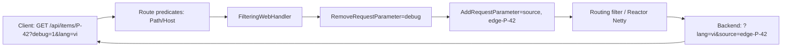

# AddRequestParameter and RemoveRequestParameter in Spring Cloud Gateway

## 1. Objectives and Problem Statement

In **SPRING_CLOUD_GATEWAY**, route predicates decide which requests are forwarded to a target service, while **GatewayFilters** can alter the path, HTTP headers, and URL parameters before the Gateway sends the request to a microservice. Two commonly used filters are:

- **`AddRequestParameter`**: appends a **query parameter** to the forwarded request's URL.
- **`RemoveRequestParameter`**: deletes a **query parameter by name** from the forwarded request's URL.

For example, a client calls:

```http
GET /api/products/P-42?lang=vi&debug=true HTTP/1.1
Host: localhost:8080
```

The Gateway can remove `debug`, add `source=edge`, and forward to the backend:

```http
GET /api/products/P-42?lang=vi&source=edge HTTP/1.1
Host: 127.0.0.1:9001
```

The query parameters in this example appear **after the `?` in the URL**, not in the HTTP request headers. Even though this lesson sits in the **Request Headers** chapter, distinguishing these two kinds of metadata is essential to avoid configuring the wrong filter. A header has syntax like `X-Source: edge`; a query parameter has syntax like `?source=edge`.

After this lesson, you will be able to:

1. Properly configure both `GatewayFilter`s on a Gateway Server WebFlux route.
2. Explain the difference between **adding**, **removing**, and **replacing** query parameters.
3. Use `{itemId}` or `{tenant}` variables extracted by `Path`/`Host` predicates when adding parameters.
4. Inspect the actual request reaching downstream using an Echo backend and `curl`.
5. Spot issues when parameters are duplicated, contain special characters, get accidentally deleted, or involve sensitive data.
6. Connect query-string manipulation to authentication, caching, rate limiting, circuit breakers, retries, and request observability.

**Example scope:** Spring Cloud Gateway **Server WebFlux**, not Gateway Server MVC; using the `spring-cloud-starter-gateway-server-webflux` starter and configuring under the `spring.cloud.gateway.server.webflux` prefix of Spring Cloud 2025.0.x / Gateway 4.3.x. When applying to projects on a different release train, check starter names and prefixes in the corresponding documentation.

## 2. Where Do Query Parameters Live in an HTTP Request?

Consider the URL:

```text
http://gateway.example.test:8080/api/products/P-42?lang=vi&debug=true#details
```

Components:

| Part | Illustrative value | Meaning |
| --- | --- | --- |
| Scheme | `http` | HTTP protocol between client and Gateway. |
| Authority | `gateway.example.test:8080` | Host and port the client connects to. |
| Path | `/api/products/P-42` | Path evaluated by the `Path` predicate to match a route. |
| Query string | `lang=vi&debug=true` | List of name–value pairs after `?`. |
| Fragment | `#details` | Client-side portion, not sent in a normal HTTP request target. |

An actual request might look like:

```http
GET /api/products/P-42?lang=vi&debug=true HTTP/1.1
Host: gateway.example.test:8080
Accept: application/json
X-Request-Id: abc-123
```

`lang=vi` and `debug=true` are query parameters; `Accept` and `X-Request-Id` are headers. The two filters in this lesson operate on the **query string**. To modify headers, use other filters like `AddRequestHeader`, `SetRequestHeader`, or `RemoveRequestHeader`.

### A Parameter Name Can Have Multiple Values

A valid URL can contain:

```text
/api/products?tag=java&tag=spring&lang=vi
```

The HTTP server may treat `tag` as a list of two values. Therefore, `AddRequestParameter=tag, cloud` **appends** `tag=cloud`; it should not be treated as replacing `tag=java` or `tag=spring`. Some backends read the first value, some read the last, and others read the full list. Do not rely on a "last value wins" rule without controlling how upstream parses query parameters.

## 3. AddRequestParameter: Appending Query Parameters

`AddRequestParameter` is a built-in **GatewayFilterFactory**. It accepts two arguments:

```text
AddRequestParameter=<name>, <value>
```

- `name`: name of the query parameter to add.
- `value`: value to add, which may include URI template variables extracted by `Path`/`Host` predicates.
- The filter applies to requests **matching the configured route**, before the Gateway forwards them to the upstream URI.

Minimal configuration example:

```yaml
spring:
  cloud:
    gateway:
      server:
        webflux:
          routes:
            - id: catalog-route
              uri: http://127.0.0.1:9001
              predicates:
                - Path=/api/products/**
              filters:
                - AddRequestParameter=source, gateway
```

Client calls:

```text
GET /api/products/P-42?lang=vi
```

The backend receives the query string with the appended parameter:

```text
GET /api/products/P-42?lang=vi&source=gateway
```

When the client sends no query string, the filter creates the query portion accordingly:

```text
Before: /api/products/P-42
After:  /api/products/P-42?source=gateway
```

This modifies the **request forwarded upstream**; it does not mean the browser sees a new URL in the address bar or that the Gateway returns `302 Redirect`. The Gateway proxies the request using the transformed URI on the server side.

### 3.1. Using Variables from the Path Predicate

When a predicate contains `{itemId}`, the Gateway can extract that value from the path. `AddRequestParameter` supports substituting this variable into the parameter **value**.

```yaml
predicates:
  - Path=/api/products/{itemId}
filters:
  - AddRequestParameter=originItem, {itemId}
```

With the URL `/api/products/P-42`, the filter appends `originItem=P-42`. This variable comes from the **path**, not from the query string, and it is not a Java environment variable.

You can also combine it with a static string:

```yaml
filters:
  - AddRequestParameter=requestContext, edge-{itemId}
```

Then the target URI contains `requestContext=edge-P-42`. The variable name in the filter must match the `{itemId}` name in the predicate exactly, including case.

### 3.2. Using Variables from the Host Predicate

A route classifying requests by subdomain:

```yaml
predicates:
  - Host={tenant}.edge.example.test
  - Path=/api/orders/**
filters:
  - AddRequestParameter=tenantHint, {tenant}
```

If a request has `Host: alpha.edge.example.test`, the filter adds `tenantHint=alpha`. Both predicates on the route must match.

**Security warning:** `Host` comes from the request and can be manipulated directly by clients. The `tenantHint` value is merely routing metadata and **does not prove the client is authorized to access tenant alpha**. In multi-tenant setups, the Gateway or backend must verify it against authenticated identity and permissions.

## 4. RemoveRequestParameter: Removing Query Parameters

`RemoveRequestParameter` is also a built-in `GatewayFilterFactory`, but it only takes the **parameter name** to remove:

```text
RemoveRequestParameter=<name>
```

Configuration:

```yaml
spring:
  cloud:
    gateway:
      server:
        webflux:
          routes:
            - id: catalog-route
              uri: http://127.0.0.1:9001
              predicates:
                - Path=/api/products/**
              filters:
                - RemoveRequestParameter=debug
```

Request before and after the filter:

```text
Client:
  /api/products/P-42?lang=vi&debug=true&sort=price

Upstream:
  /api/products/P-42?lang=vi&sort=price
```

The filter identifies the name `debug` and removes it from the query string before sending the request to the backend. Other parameters such as `lang` and `sort` are preserved unless other filters modify them as well.

### 4.1. When a Parameter Appears Multiple Times

Example:

```text
/api/products/P-42?debug=1&lang=vi&debug=2
```

`RemoveRequestParameter=debug` strips all values associated with the name `debug`; downstream only receives `lang=vi` (assuming no other filter changes it).

This differs from removing only the first occurrence of `debug`. If the request lacks `debug`, the filter has nothing to remove and lets the request proceed along the route.

### 4.2. The Name to Remove Must Be Specified Explicitly

`RemoveRequestParameter=debug` deletes by **name**, not by filtering on value contents like `true` or `1`. Nor does it mean "remove all query parameters." If you need to restrict forwarding to an allowlist of parameters, design an explicit policy, use appropriate filters, or write a well-tested control filter.

Security note: removing `access_token` from the outbound URL does not make passing tokens in the query string safe. The original URL may already appear in access logs, traces, client history, or reverse proxies. **Never design authentication around tokens placed in query parameters**; with Spring Cloud Gateway, use Spring Security/OAuth2 Resource Server or an appropriate standard authentication mechanism.

## 5. Comparing Add, Remove, and RewriteRequestParameter

Three operations are easily confused:

| Filter | Arguments | Effect on query | Suitable use case |
| --- | --- | --- | --- |
| `AddRequestParameter` | Name, value | Appends a new name–value pair. | Adding metadata determined by the Gateway. |
| `RemoveRequestParameter` | Name | Removes the parameter with that name and its values. | Avoiding forwarding unnecessary metadata to the backend. |
| `RewriteRequestParameter` | Name, replacement value | Replaces the value of an existing parameter; for multiple values with the same name, collapses to one value. If absent, does not add a new one. | Normalizing the value of an already-present parameter. |

Illustration on the same input:

```text
Input:
  /search?campaign=old&lang=vi

AddRequestParameter=campaign, edge
  /search?campaign=old&campaign=edge&lang=vi
  (notice campaign is repeated)

RemoveRequestParameter=campaign
  /search?lang=vi

RewriteRequestParameter=campaign, edge
  /search?campaign=edge&lang=vi
```

The order of pairs in the query string is not the core point of the example; the resulting names and values are what to verify. `RewriteRequestParameter` is shown for comparison, while the hands-on focus remains **Add** and **Remove**.

**Do not confuse `RemoveRequestParameter` with `RemoveRequestHeader`.** A `debug` parameter in the URL is completely distinct from an `X-Debug` header in the HTTP message. Removing one does not remove the other.

### 5.1. Using Both Add and Remove on the Same Name

Suppose a route has:

```yaml
filters:
  - RemoveRequestParameter=source
  - AddRequestParameter=source, gateway
```

The usual intent is to discard any client-sent `source` value and then add the Gateway-defined value. When using both filters, **execution order** determines the outcome. If you swap the order so Add runs before Remove, the newly added value can also be deleted.

Route `GatewayFilter`s are merged with `GlobalFilter`s and sorted by order during processing. Within the same route, declare filters in the intended order, avoid having other global/custom filters alter the same name, and **verify with HTTP integration tests**. For the simpler requirement of replacing an existing parameter's value, consider `RewriteRequestParameter`; if clients might omit the parameter, remember rewrite does not add a new one on its own.

### 5.2. URL Encoding and Special Characters

Spaces, `&`, `=`, `+`, `%`, and Unicode characters in query strings must follow proper URI encoding rules. For instance, `hello world` will appear percent-encoded or plus-encoded in the URL. Never manually concatenate query strings using untrusted client input:

```java
// Avoid: user-supplied values may contain '&', '?', or special characters.
String url = existingUrl + "?source=" + untrustedValue;
```

Built-in filters use the framework's URI-building APIs, reducing bugs when adding or removing parameters. When requests involve signed URLs, cache keys, or signature verification (HMAC), test encoding/decoding, repeated parameters, and query ordering thoroughly, as all of these can alter signatures or cache keys.

## 6. Position of Both Filters in the Request-Processing Pipeline



Key points to remember:

- The route is chosen by predicates before route filters run. `AddRequestParameter` and `RemoveRequestParameter` are not `RoutePredicateFactory` implementations.
- They transform the request **before downstream receives it**. They do not alter the path or HTTP headers unless another filter does so.
- `GlobalFilter`s and route `GatewayFilter`s are combined by order; a filter running too late relative to the routing step may not affect the outbound URI as intended.
- Requests that fail to match a route do not run that route's GatewayFilters.
- If an earlier filter short-circuits (e.g., a rate limiter rejects the request), these two filters may not run, and upstream may never receive the request.
- When retries occur, the request is processed again per retry scope; distinguish the number of downstream attempts from the actual URI result on each attempt.

## 7. Hands-On Lab: Configuring a Gateway and Echo Backend to Observe Query Strings

We will build a Gateway Server WebFlux API listening on port `8080` and a JDK-based Echo backend on port `9001`. This lab confirms **which query parameters actually pass through the Gateway** without needing Eureka, Consul, Redis, or a database.

Scenario:

- Client calls `/api/items/{itemId}` with `debug` and `lang`.
- Gateway strips `debug` and adds `source=edge-{itemId}`.
- Backend receives the same path with `lang` and `source`, without `debug`.

### 7.1. Create the Spring Boot / Maven Project

Requires JDK 17+, Maven, and a compatible Spring Boot/Spring Cloud pair. The example below pins Spring Boot `3.5.0` and Spring Cloud `2025.0.0` for consistent configuration illustration, without implying these are the exact patch versions to run in production today.

Create `pom.xml`:

```xml
<?xml version="1.0" encoding="UTF-8"?>
<project xmlns="http://maven.apache.org/POM/4.0.0"
         xmlns:xsi="http://www.w3.org/2001/XMLSchema-instance"
         xsi:schemaLocation="http://maven.apache.org/POM/4.0.0
                             https://maven.apache.org/xsd/maven-4.0.0.xsd">
    <modelVersion>4.0.0</modelVersion>

    <parent>
        <groupId>org.springframework.boot</groupId>
        <artifactId>spring-boot-starter-parent</artifactId>
        <version>3.5.0</version>
        <relativePath/>
    </parent>

    <groupId>com.example</groupId>
    <artifactId>request-parameter-gateway</artifactId>
    <version>0.0.1-SNAPSHOT</version>

    <properties>
        <java.version>17</java.version>
    </properties>

    <dependencyManagement>
        <dependencies>
            <dependency>
                <groupId>org.springframework.cloud</groupId>
                <artifactId>spring-cloud-dependencies</artifactId>
                <version>2025.0.0</version>
                <type>pom</type>
                <scope>import</scope>
            </dependency>
        </dependencies>
    </dependencyManagement>

    <dependencies>
        <dependency>
            <groupId>org.springframework.cloud</groupId>
            <artifactId>spring-cloud-starter-gateway-server-webflux</artifactId>
        </dependency>
    </dependencies>

    <build>
        <plugins>
            <plugin>
                <groupId>org.springframework.boot</groupId>
                <artifactId>spring-boot-maven-plugin</artifactId>
            </plugin>
        </plugins>
    </build>
</project>
```

`spring-cloud-dependencies` is the BOM managing libraries in the Spring Cloud release train. The Gateway starter **omits an explicit version** to avoid mixing incompatible versions. This project uses WebFlux/Reactor Netty; do not add `spring-boot-starter-web` for this lab.

Create `src/main/java/com/example/gateway/GatewayApplication.java`:

```java
package com.example.gateway;

import org.springframework.boot.SpringApplication;
import org.springframework.boot.autoconfigure.SpringBootApplication;

@SpringBootApplication
public class GatewayApplication {
    public static void main(String[] args) {
        SpringApplication.run(GatewayApplication.class, args);
    }
}
```

### 7.2. Configure the Route and Both Filters

Create `src/main/resources/application.yml`:

```yaml
server:
  port: 8080

spring:
  application:
    name: request-parameter-gateway
  cloud:
    gateway:
      server:
        webflux:
          routes:
            - id: items-route
              uri: http://127.0.0.1:9001
              predicates:
                - Path=/api/items/{itemId}
              filters:
                - RemoveRequestParameter=debug
                - AddRequestParameter=source, edge-{itemId}
```

Explanation:

| Line | Behavior |
| --- | --- |
| `id: items-route` | Assigns the route ID for checking logs and config. |
| `uri: http://127.0.0.1:9001` | Targets the Echo backend on loopback. |
| `Path=/api/items/{itemId}` | Matches a single ID segment after `/api/items/`, extracting `itemId`. |
| `RemoveRequestParameter=debug` | Drops the `debug` query parameter from forwarding. |
| `AddRequestParameter=source, edge-{itemId}` | Appends the `source` query parameter containing the matched ID. |

This exercise does not alter the path using `StripPrefix` or `SetPath`; the backend receives `/api/items/P-42` so we can observe the query filter's effect in isolation.

### 7.3. Create the Echo Backend

Create `EchoBackend.java` in a separate test directory outside the Gateway source tree:

```java
import com.sun.net.httpserver.HttpServer;
import java.net.InetSocketAddress;
import java.nio.charset.StandardCharsets;

public class EchoBackend {
    public static void main(String[] args) throws Exception {
        HttpServer server = HttpServer.create(
                new InetSocketAddress("127.0.0.1", 9001), 0);

        server.createContext("/", exchange -> {
            String path = exchange.getRequestURI().getRawPath();
            String query = exchange.getRequestURI().getRawQuery();

            System.out.println("BACKEND RECEIVED path=" + path
                    + " query=" + query);

            String body = "path=" + path + "\n"
                    + "query=" + query + "\n"
                    + "x-debug-header=" + exchange.getRequestHeaders()
                            .getFirst("X-Debug") + "\n";

            byte[] payload = body.getBytes(StandardCharsets.UTF_8);
            exchange.getResponseHeaders().set(
                    "Content-Type", "text/plain; charset=UTF-8");
            exchange.sendResponseHeaders(200, payload.length);

            try (var stream = exchange.getResponseBody()) {
                stream.write(payload);
            }
        });

        server.start();
        System.out.println("EchoBackend listening on 127.0.0.1:9001");
    }
}
```

`EchoBackend` prints the **raw query string** from the request it receives. Depending on URI encoding, special characters may appear differently from decoded values; what we verify here is the presence or absence of **parameter names**.

Run the backend in **terminal A**:

```bash
java EchoBackend.java
```

Run the Gateway in the project directory containing `pom.xml` in **terminal B**:

```bash
mvn spring-boot:run
```

If Maven Wrapper is present, use `./mvnw spring-boot:run` on Linux/macOS or `mvnw.cmd spring-boot:run` on Windows. Ensure ports `8080` and `9001` are not occupied by other processes.

### 7.4. Test: Adding and Removing on the Same Request

In **terminal C**, run:

```bash
curl -i "http://127.0.0.1:8080/api/items/P-42?lang=vi&debug=true"
```

Expected output from the backend (parameter order may vary):

```http
HTTP/1.1 200 OK
Content-Type: text/plain; charset=UTF-8

path=/api/items/P-42
query=lang=vi&source=edge-P-42
x-debug-header=null
```

Three things can be observed:

1. The `Path` predicate matched, providing `itemId=P-42`.
2. `RemoveRequestParameter` removed `debug=true`.
3. `AddRequestParameter` added `source=edge-P-42`, while `lang=vi` remained intact.

If `source` appears before `lang` in the output, that does not change the test's meaning. For signed URLs or cache keys, whether parameter ordering matters depends on downstream's contract.

### 7.5. Testing Repeated Parameter Names

```bash
curl -i "http://127.0.0.1:8080/api/items/P-43?debug=1&debug=2&lang=en"
```

The backend still sees neither `debug=1` nor `debug=2`; the query has `lang=en` and `source=edge-P-43`.

Conversely, let the client try sending `source` itself:

```bash
curl -i "http://127.0.0.1:8080/api/items/P-44?source=client"
```

Because `AddRequestParameter` **appends** rather than replaces, the backend can see **both** `source=client` **and** `source=edge-P-44`. Watch out for this case to avoid confusion when downstream only reads a single value.

If you want `source` to be fully managed by the Gateway, configure **Remove first, Add second**:

```yaml
filters:
  - RemoveRequestParameter=debug
  - RemoveRequestParameter=source
  - AddRequestParameter=source, edge-{itemId}
```

After changing the config, retest both a request with `source=client` and one without `source`. Do not treat this rule as proof of authentication: a client can still send arbitrary other data, and the backend needs a clear contract regarding what data it trusts.

### 7.6. Verifying That Parameters and Headers Are Distinct

```bash
curl -i -H "X-Debug: client-value" \
  "http://127.0.0.1:8080/api/items/P-45?debug=1"
```

Even though `debug` in the query is removed, the backend still sees:

```text
x-debug-header=client-value
```

That is because `RemoveRequestParameter=debug` **does not remove the `X-Debug` header**. If the application needs to remove that header as well, configure `RemoveRequestHeader=X-Debug` separately and test its behavior.

On Windows PowerShell, use `curl.exe` if the `curl` alias points to a different PowerShell command.

### 7.7. Testing Routing Failures

Requests not matching the pattern:

```bash
curl -i "http://127.0.0.1:8080/api/items"
curl -i "http://127.0.0.1:8080/api/items/P-42/details"
```

When the application only defines `items-route` and no other handler for those paths, both requests typically return `404 Not Found`. The Add/Remove filters do not run because the route does not match.

If you stop the `9001` backend and call `/api/items/P-42`, the route still matches and filters can still rewrite the outbound URL, but the upstream connection step fails—typically producing a `5xx` error. Distinguish **no route matched** from **route matched but upstream unavailable**.

## 8. Extended Case: Parameters from Domain Names

Another configuration demonstrates combining the `Host` predicate with `AddRequestParameter`:

```yaml
spring:
  cloud:
    gateway:
      server:
        webflux:
          routes:
            - id: tenant-orders-route
              uri: http://127.0.0.1:9001
              predicates:
                - Host={tenant}.edge.example.test
                - Path=/api/orders/**
              filters:
                - RemoveRequestParameter=internal
                - AddRequestParameter=tenantHint, {tenant}
```

Test using `curl` against a Gateway running on port `8080` with the config above:

```bash
curl -i -H "Host: alpha.edge.example.test" \
  "http://127.0.0.1:8080/api/orders/99?internal=1&lang=vi"
```

When the route matches, the backend receives `tenantHint=alpha`, `lang=vi`, and no longer sees `internal=1`. `tenantHint` is populated from the `Host` predicate's `{tenant}` variable.

**Do not use `tenantHint` to make authorization decisions without authentication.** A client can forge `Host`; when multi-tenancy is required, verify that the host belongs to an allowed domain, compare the tenant against authenticated identity (such as token claims), and lock down a trusted connection channel to the backend.

## 9. Security and Microservices Operations Notes

### 9.1. Query Strings Are Not a Place for Secrets

Query strings can end up in:

- Reverse proxy or Gateway access logs.
- Tracing tools, monitoring dashboards, or error reports.
- Copied, bookmarked, cached, or accidentally shared URLs.

Never use `AddRequestParameter` to attach JWTs, API keys, passwords, or sensitive data to downstream URLs. Stripping a query parameter before proxying **does not guarantee** the original data was not already logged elsewhere in your infrastructure. For authentication, use TLS and properly designed mechanisms such as Spring Security WebFlux/OAuth2.

### 9.2. Do Not Treat Added Parameters as Verified Identity

`source=edge` or `tenantHint=alpha` are convenient metadata; adding a value does not establish a trust boundary. If a backend makes authorization decisions from a parameter, ensure that parameter is governed by a security contract with authentication, identity binding, and a protected Gateway–backend channel.

### 9.3. Impact on Caching, Request Signing, and Idempotency

Modifying the query string can alter:

- **Cache keys** on CDNs, proxies, or applications.
- **Canonical requests** used in HMAC/signature verification.
- **Metric cardinality** if every query value becomes a label.
- **Upstream business routing** if a parameter name collides with a special parameter.

For example, appending `source=edge-P-42` to a pre-signed URL can invalidate its signature. In systems using signatures or caching, clearly define the canonicalization step and filter position in the pipeline, and write integration tests covering duplicate parameters and encoded characters.

### 9.4. Interactions with Other Features

- **Route predicates:** `Path`, `Host`, and `Query` inspect the request to select a route before route filters run. `AddRequestParameter` cannot make a non-matching route suddenly match.
- **Filter chain:** route-level filters are ordered alongside global filters; if custom filters also alter query parameters, test their effective runtime order.
- **Service discovery:** when a route URI is `lb://inventory`, LoadBalancer/discovery selects the instance; Add/Remove still only manipulate the query sent upstream.
- **Rate limiter:** typically keys by client/identity; never use a trivially spoofable query parameter as the sole key for a security policy unless bound to verified identity.
- **Retry/circuit breaker:** requests may be replayed or hit fallbacks. Never treat the addition of a query parameter as proof that an upstream call succeeded.
- **TLS:** client–Gateway and Gateway–upstream connections are secured independently; altering query strings does not configure TLS.
- **Observability:** when logging route IDs, status, latency, and traces, avoid logging full query strings containing sensitive info; keep high-cardinality IDs out of metric labels.

## 10. Troubleshooting Common Issues

| Symptom | Possible cause | How to check |
| --- | --- | --- |
| `source` missing at backend | Route did not match; wrong YAML prefix; filter not registered. | Check route ID, `Path` predicate, starter, and prefix for your release train. |
| `source` still contains `{itemId}` | Placeholder name mismatches `Path`/`Host` or filter has no variable to substitute. | Use `Path=/api/items/{itemId}` and match variable spelling exactly. |
| `debug` still appears | Filter placed on another route; `debug` re-added by a later filter; backend called directly. | Check active route and Echo logs; inspect order and other filters. |
| `source` appears twice | `AddRequestParameter` appends a new value even when client sent `source`. | Check upstream contract; place Remove before Add if needed. |
| Removed `debug` but `X-Debug` remains | Query parameters and HTTP headers are separate constructs. | Use `RemoveRequestHeader` when you actually need to strip headers. |
| Backend receives unexpected `%` or `+` characters | URI encoding/decoding or special characters in query. | Compare raw query vs. decoded query; test Unicode, spaces, `&`, `=`. |
| `404` error | No route/handler matched the path or Host. | Verify predicates before inspecting filters. |
| `5xx` error when route matches | Upstream is down, timed out, or connection failed. | Call backend directly; verify `uri`, port, and routing logs. |
| Gateway fails to start after copying old example | Starter/prefix does not match your release train. | Check documentation for your current version and BOM. |
| Invalid request signature | URL changed after signing step or repeated query parameter. | Align canonicalization and filter placement; test end-to-end. |

## 11. Self-Check Questions

**1. Does `AddRequestParameter` modify HTTP headers or the query string?**

It appends a name–value pair to the **query string** of the upstream request. For headers, use `AddRequestHeader`.

**2. A request has `?tag=java`; does `AddRequestParameter=tag, cloud` replace `java` with `cloud`?**

No. It is an **append** operation, so downstream can receive both `tag=java` and `tag=cloud`.

**3. Does `RemoveRequestParameter=debug` remove `debug=1&debug=2`?**

Yes. The filter deletes parameters by name, including repeated values under that name.

**4. If a filter uses `AddRequestParameter=product, {itemId}`, where does `itemId` come from?**

From a URI template variable captured by the matched route's `Path` or `Host` predicate, such as `Path=/api/items/{itemId}`.

**5. A request `/api/items` does not match `Path=/api/items/{itemId}`. Does the filter run?**

It does not run for that route because the Gateway never selected that route.

**6. Is it safe to pass `access_token` in the query string and strip it with `RemoveRequestParameter` before calling the backend?**

No. The token may already appear in logs, URLs, or infrastructure before removal; use properly designed authentication mechanisms.

**7. To replace an existing `campaign` value in the URL, should you use Add alone?**

No. `RewriteRequestParameter` fits replacing an existing value. If you also need to handle clients that omit the parameter, design Remove followed by Add and test filter ordering.

**8. Does removing an `internal` parameter before forwarding automatically enforce rate limits or prevent SSRF?**

No. Remove only deletes a query parameter by name. You need separate route/upstream policies, authentication, rate limiting, and connection controls.

## Conclusion

In Spring Cloud Gateway Server WebFlux, **`AddRequestParameter`** appends query parameters to upstream HTTP requests, and **`RemoveRequestParameter`** removes parameters by name before forwarding. They belong to the processing chain **after route predicates match**, and they are not HTTP header filters. When applying them to microservices, account for repeated parameter names, URI template variables, encoding, and filter ordering; avoid putting secrets in URLs or treating query parameters as proof of authentication. Testing what the backend actually receives is the surest way to confirm behavior.

### Official References

- [Spring Cloud Gateway Server WebFlux 4.3 — AddRequestParameter GatewayFilter Factory](https://docs.spring.io/spring-cloud-gateway/reference/4.3/spring-cloud-gateway-server-webflux/gatewayfilter-factories/addrequestparameter-factory.html)
- [Spring Cloud Gateway Server WebFlux 4.3 — RemoveRequestParameter GatewayFilter Factory](https://docs.spring.io/spring-cloud-gateway/reference/4.3/spring-cloud-gateway-server-webflux/gatewayfilter-factories/removerequestparameter-factory.html)
- [Spring Cloud Gateway Server WebFlux 4.3 — RewriteRequestParameter GatewayFilter Factory](https://docs.spring.io/spring-cloud-gateway/reference/4.3/spring-cloud-gateway-server-webflux/gatewayfilter-factories/rewriterequestparameter-factory.html)
- [Spring Cloud Gateway Server WebFlux 4.3 — Route Predicate Factories](https://docs.spring.io/spring-cloud-gateway/reference/4.3/spring-cloud-gateway-server-webflux/request-predicates-factories.html)
- [Spring Cloud Gateway Server WebFlux 4.3 — How It Works](https://docs.spring.io/spring-cloud-gateway/reference/4.3/spring-cloud-gateway-server-webflux/how-it-works.html)
- [Spring Cloud — Release Train Compatibility with Spring Boot](https://spring.io/projects/spring-cloud/)
