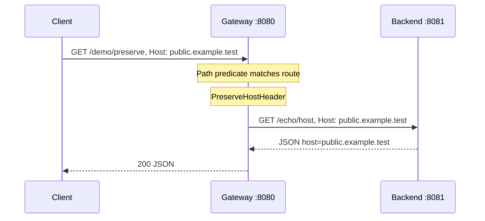

# PreserveHostHeader and SetRequestHostHeader

## 1. Why Does the Host Header Matter in an API Gateway?

**Spring Cloud Gateway** serves as the entry point for microservices: route predicates choose target services, the filter chain transforms paths/headers, and security, rate limiting, retries, circuit breakers, TLS, and request observability keep the system operating reliably. Within the **request headers** layer, one value that frequently causes confusion is HTTP **`Host`**.

`Host` describes the **hostname the client intends to access in the HTTP request**. It does not necessarily match the DNS name or IP that the Gateway uses to open a connection to the backend. Suppose:

```text
Client --> Gateway:
    GET /api/orders HTTP/1.1
    Host: api.example.test

Gateway --> backend:
    Upstream URI: http://10.20.30.40:8081
    HTTP Host can be:
        10.20.30.40:8081        (default from HTTP client)
        api.example.test        (preserving client Host)
        orders.internal.test    (fixed Host set by route)
```

Two Spring Cloud Gateway filters serve two distinct needs:

- **`PreserveHostHeader`:** instructs the routing filter to **keep the incoming request's Host** when building the downstream request.
- **`SetRequestHostHeader`:** **replaces the downstream Host** with a `host` value specified by the route.

After completing this lesson, you will distinguish inbound Host, outbound Host, route URI, the `Host` predicate, and TLS SNI; configure both filters; verify behavior using an echo backend; and prevent spoofing risks when applications rely on Host for tenant classification.

> **Scope:** Main examples use **Spring Cloud Gateway Server WebFlux 5.0.x** and the `spring.cloud.gateway.server.webflux` namespace. Server Web MVC 5.0.x also provides two filters with the same names, executed via Servlet/WebMvc.fn APIs; see section 8 for MVC configuration. Some 4.x releases use the `spring.cloud.gateway.routes` namespace. Choose the Boot/Cloud BOM and documentation matching your deployed release branch.

## 2. Five Concepts to Keep Separate

| Concept | Example | Function |
|---|---|---|
| **Inbound Host** | `Host: public.example.test` | Value on the request the client sends to the Gateway |
| **Route URI** | `http://127.0.0.1:8081` | Scheme, host, and port the Gateway uses to connect upstream |
| **Outbound Host** | `Host: orders.internal.test` | Host value received by the backend in the proxied HTTP request |
| **Forwarded host** | `X-Forwarded-Host: public.example.test` or `Forwarded: host=...` | Proxy-forwarded metadata, not the HTTP Host |
| **TLS SNI** | `orders.internal.test` | Name that may be sent during the TLS handshake for server certificate selection |

In **HTTP/1.1**, `Host` carries the request authority. With **HTTP/2**, authority primarily resides in the **`:authority`** pseudo-header; therefore, the lab uses `curl --http1.1` so `Host` is clearly visible.



**Rule:** changing HTTP `Host` **does not change** the DNS/IP/port in the route URI, does not rewrite the path, does not redefine TLS certificate identity, and does not verify permission to use a hostname. Each layer requires its own verification mechanism.

## 3. PreserveHostHeader: Keeping the Inbound Host

### 3.1. Mechanism

`PreserveHostHeader` is a **GatewayFilter Factory that takes no parameters**. In WebFlux, this factory sets a **request attribute** telling the routing filter to forward the incoming Host instead of letting the HTTP client derive Host from the backend URI. It does not open a network connection to the address in the input Host.

Example route:

```yaml
spring:
  cloud:
    gateway:
      server:
        webflux:
          routes:
            - id: preserve-host-route
              uri: http://127.0.0.1:8081
              predicates:
                - Path=/api/preserve/**
              filters:
                - StripPrefix=2
                - PreserveHostHeader
```

If a client sends `GET /api/preserve/products` with `Host: public.example.test`, the backend at `127.0.0.1:8081` receives path `/products` and Host `public.example.test` due to preservation. The `StripPrefix` filter only modifies the **path**; it does not determine Host.

**What PreserveHostHeader does not do:**

1. It does not check whether the client is authorized to use `public.example.test`.
2. It does not enforce a fixed Host value: the downstream Host can vary per request.
3. It does not automatically recover the original public Host if an ingress already replaced Host **before** the request reached the Gateway.
4. It does not alter the upstream connection address, TLS SNI, certificate validation, or `X-Forwarded-Host`.
5. It does not alter the outcome of the `Host` route predicate: predicates are evaluated **before** the Gateway filter chain.

### 3.2. When to Use It

Useful when the backend serves multiple **virtual hosts** or public domains and needs to know the exact hostname received by the Gateway:

```text
Host: shop-a.example.test  ->  virtual host A
Host: shop-b.example.test  ->  virtual host B
```

In **multi-tenant** applications, Host policy only helps route to the right virtual host. Determining **which tenant's data a user is allowed to read** must be authenticated and authorized independently by the backend/Gateway security chain; clients can easily forge arbitrary Host values.

If the backend only serves a fixed internal hostname, preserving the public Host may prevent the backend from selecting the intended virtual host. In that case, consider `SetRequestHostHeader`.

## 4. SetRequestHostHeader: Setting a New Host

### 4.1. Mechanism

`SetRequestHostHeader` accepts a **`host`** parameter and replaces the forwarded request's Host with the configured value. In Gateway Server WebFlux, use the expanded form for readability and clarity:

```yaml
spring:
  cloud:
    gateway:
      server:
        webflux:
          routes:
            - id: fixed-host-route
              uri: http://127.0.0.1:8081
              predicates:
                - Path=/api/fixed/**
              filters:
                - StripPrefix=2
                - name: SetRequestHostHeader
                  args:
                    host: orders.internal.test
```

If a client sends `Host: public.example.test`, the backend will see **`Host: orders.internal.test`**; the upstream network target remains **`127.0.0.1:8081`**. This fits when the backend checks virtual hosts against an operator-chosen hostname.

With HTTP/1.1, a valid Host may include a **port** (for example `orders.internal.test:8443`); the format must match what the backend endpoint expects. Never take the new Host directly from an untrusted header or query parameter and feed it into configuration or rewrite logic.

### 4.2. How Does It Differ from SetRequestHeader or AddRequestHeader?

`SetRequestHeader` is a general-purpose filter that replaces a header by name; `AddRequestHeader` appends a header. However, **`Host` carries special meaning** for the HTTP client/routing layer and `:authority` in HTTP/2. When your goal is controlling the Host sent to the backend, use the dedicated **`SetRequestHostHeader` filter** per your running version's documentation.

Do not use `AddRequestHeader=Host,...` as a way to replace Host: the result may produce duplicate values or be normalized by the HTTP client. Always verify the **Host actually received by the backend**.

## 5. Quick Selection Table

| Criterion | No Host filter | PreserveHostHeader | SetRequestHostHeader |
|---|---|---|---|
| Downstream HTTP Host | Determined by HTTP client, usually from backend URI | Keeps inbound Host | Overwrites with configured `host` |
| Parameter | None | None | `host` required |
| Two requests with different inbound Hosts | Not guaranteed backend sees different Hosts | Usually preserves each respective Host | Same fixed Host on the same route |
| Suitable scenario | Backend ignores public Host | Backend handles public virtual hosts | Backend requires an internal virtual host |
| Changes upstream connection address | No | No | No |
| Automatically changes TLS SNI/certificate | No | Not guaranteed | Not guaranteed |
| Validates hostname/tenant ownership | No | No | No |

**Choose one Host policy per route.** Do not arbitrarily declare both `PreserveHostHeader` and `SetRequestHostHeader` on the same route: one asks to keep the inbound Host while the other replaces Host with a different value. How they interact depends on the routing implementation and filter order; never build security or tenant routing on unverified behavior.

## 6. Hands-On Lab: Observing the Actual Host Received by the Backend

These examples use **local HTTP** to focus on the Host header without TLS certificate errors. Prepare two standalone Spring Boot applications:

| Application | Port | Primary dependency | Role |
|---|---:|---|---|
| `host-echo` | 8081 | Spring Web MVC matching Spring Boot version | Backend echoing request Host and path |
| `host-gateway` | 8080 | `spring-cloud-starter-gateway-server-webflux` | Declares three comparison routes |

Initialize using a Spring Cloud release train compatible with your Spring Boot version. Do not add the Servlet MVC starter into the Gateway Server WebFlux application itself unless intentionally running the MVC stack.

### 6.1. Echo Backend

In the `host-echo` project, create the class:

```java
package com.example.hostecho;

import java.util.Map;
import jakarta.servlet.http.HttpServletRequest;
import org.springframework.boot.SpringApplication;
import org.springframework.boot.autoconfigure.SpringBootApplication;
import org.springframework.web.bind.annotation.GetMapping;
import org.springframework.web.bind.annotation.RequestHeader;
import org.springframework.web.bind.annotation.RestController;

@SpringBootApplication
@RestController
public class HostEchoApplication {

    public static void main(String[] args) {
        SpringApplication.run(HostEchoApplication.class, args);
    }

    @GetMapping("/echo/host")
    public Map<String, String> echo(
            @RequestHeader(name = "Host", defaultValue = "absent") String host,
            @RequestHeader(name = "X-Forwarded-Host",
                           defaultValue = "absent") String forwardedHost,
            HttpServletRequest request) {
        return Map.of(
            "host", host,
            "forwardedHost", forwardedHost,
            "path", request.getRequestURI()
        );
    }
}
```

Set `server.port: 8081` in the **backend's** `application.yml`:

```yaml
spring:
  application:
    name: host-echo
server:
  port: 8081
```

Run the backend and test it **directly**:

```bash
curl --noproxy '*' --http1.1 -i \
  -H 'Host: public.example.test' \
  'http://127.0.0.1:8081/echo/host'
```

The backend is expected to return JSON containing `"host":"public.example.test"` and `"path":"/echo/host"`. The `--noproxy '*'` flag prevents `curl` from using an environment-defined HTTP proxy that would alter the assumed topology. On **PowerShell**, invoke `curl.exe` to avoid the `curl` alias.

### 6.2. Gateway with Three Different Routes

In the `host-gateway` project using Gateway Server WebFlux, configure `application.yml`:

```yaml
server:
  port: 8080

spring:
  application:
    name: host-gateway
  cloud:
    gateway:
      server:
        webflux:
          routes:
            # A. No Host filter
            - id: host-default
              uri: http://127.0.0.1:8081
              predicates:
                - Path=/demo/default
              filters:
                - SetPath=/echo/host

            # B. Preserve inbound Host
            - id: host-preserve
              uri: http://127.0.0.1:8081
              predicates:
                - Path=/demo/preserve
              filters:
                - SetPath=/echo/host
                - PreserveHostHeader

            # C. Set fixed Host
            - id: host-fixed
              uri: http://127.0.0.1:8081
              predicates:
                - Path=/demo/fixed
              filters:
                - SetPath=/echo/host
                - name: SetRequestHostHeader
                  args:
                    host: orders.internal.test
```

All three routes target **the same backend address and port**; `SetPath=/echo/host` makes them hit the same endpoint for a fair comparison. There is no `Host` predicate, so all three accept any HTTP-valid Host value. In production, enforce a hostname allowlist separately instead of treating lab settings as security rules.

### 6.3. Running Three Comparison Requests

Start the Gateway after the backend, then call:

```bash
# A. Host decided by routing HTTP client
curl --noproxy '*' --http1.1 -sS \
  -H 'Host: public.example.test' \
  'http://127.0.0.1:8080/demo/default'

# B. Client-sent Host is preserved
curl --noproxy '*' --http1.1 -sS \
  -H 'Host: public.example.test' \
  'http://127.0.0.1:8080/demo/preserve'

# C. Host overwritten with YAML value
curl --noproxy '*' --http1.1 -sS \
  -H 'Host: public.example.test' \
  'http://127.0.0.1:8080/demo/fixed'
```

**Expected results** for HTTP/1.1 when no other filter/ingress changes Host:

| Request | Backend echoed `host` field | Backend echoed `path` field |
|---|---|---|
| `/demo/default` | Typically `127.0.0.1:8081` generated by HTTP client | `/echo/host` |
| `/demo/preserve` | `public.example.test` | `/echo/host` |
| `/demo/fixed` | `orders.internal.test` | `/echo/host` |

Example JSON for the preserve route:

```json
{
  "host": "public.example.test",
  "forwardedHost": "absent",
  "path": "/echo/host"
}
```

The `forwardedHost` field is **purely illustrative**: that header may differ or be present depending on proxy configuration and Gateway `HttpHeadersFilter` settings. Actual output on the default route can also vary slightly by HTTP client, especially in port formatting. Base conclusions on the **Host received by the backend**, not on hardcoded expected strings.

> The commands and JSON here are a **hands-on guide with expected outputs**; this lesson does not claim to have launched the projects or executed `curl`.

### 6.4. Verifying the Difference Between Preserve and Set

Replace the input Host with `shop-b.example.test`:

```bash
curl --noproxy '*' --http1.1 -sS \
  -H 'Host: shop-b.example.test' \
  'http://127.0.0.1:8080/demo/preserve'

curl --noproxy '*' --http1.1 -sS \
  -H 'Host: shop-b.example.test' \
  'http://127.0.0.1:8080/demo/fixed'
```

The preserve route causes the backend to see `shop-b.example.test`; the fixed route still sends `orders.internal.test`. This demonstrates **preserving a dynamic value** versus **overwriting with a static value**.

## 7. Combining with Predicates, TLS, and Reverse Proxies

### 7.1. Host Predicate Runs Before Filters

Consider **part of a single route**:

```yaml
predicates:
  - Host=api.example.test
  - Path=/orders/**
filters:
  - name: SetRequestHostHeader
    args:
      host: orders.internal.test
```

`Host=api.example.test` uses the **inbound Host** to select the route. Only after the route matches does `SetRequestHostHeader` set the downstream Host to `orders.internal.test`. If a client sends a different Host, the route does not match even though the filter is declared. A `Host` predicate is not an identity-authentication header; an HTTP/1.1 client can still populate `Host` arbitrarily.

### 7.2. HTTPS: Host Differs from TLS SNI and Certificate Names

```yaml
# HTTPS route snippet, not a standalone config file.
uri: https://backend.internal.test
filters:
  - name: SetRequestHostHeader
    args:
      host: tenant-a.example.test
```

The Gateway connects using the upstream URI `https://backend.internal.test`. Setting HTTP `Host` to `tenant-a.example.test` **does not guarantee** that TLS SNI or certificate hostname verification changes along with it. If the server selects certificates via SNI or HTTP virtual hosts via `Host`, you must align **DNS, TLS certificate/SAN, SNI, and Host** consistently.

Depending on the backend, a mismatch between those layers can trigger TLS handshake/hostname verification errors, HTTP `404`, `421 Misdirected Request`, or responses from the wrong virtual host. With HTTP/2, also inspect `:authority`. **Never disable certificate validation** to mask this issue; instead, configure valid upstream DNS, trust stores, and certificates.

### 7.3. Host Behind an Ingress Can Differ from Client Host

```text
Client (Host: public.example.test)
       |
       v
Ingress (replaces Host: gateway.internal.test,
         may add X-Forwarded-Host: public.example.test)
       |
       v
Spring Cloud Gateway
       |
       v
Backend
```

`PreserveHostHeader` preserves the **Host received by the Gateway**, such as `gateway.internal.test`, rather than recovering `public.example.test` from a secondary header. `Forwarded` / `X-Forwarded-Host` headers have separate handling mechanisms and must be sanitized/normalized at a **trusted proxy**; never use client-supplied headers to verify domain or tenant identity.

To trace Host at each hop, check ingress access logs, Gateway routes/config, and backend echo output. Avoid broad logging of sensitive headers in production.

### 7.4. Host Header Injection and Multi-Tenancy

If a backend uses incoming `Host` values to build URLs in emails, redirects, or password-reset links, an attacker can forge `Host` to generate **links pointing to malicious domains**. When a backend uses `Host` to select a tenant, an unverified hostname can also enable cross-tenant access.

Essential mitigations:

1. Enforce a **Host allowlist** at the ingress/Gateway, restricting accepted hostnames and ports.
2. Bind tenant access to **authenticated identity and authorization**, never to `Host` alone.
3. Block direct access to internal hops so clients cannot bypass the ingress.
4. Use a controlled canonical public base URL when building redirects or sensitive links.
5. Test Host values containing ports, mixed casing, malformed syntax, or hosts outside the allowlist.

`SetRequestHostHeader` can prevent arbitrary client Hosts from reaching the backend by enforcing a fixed value, yet it **does not replace** Spring Security, rate limiting, mTLS, or network policies.

### 7.5. Service Discovery Does Not Change Host Semantics

With `uri: lb://orders-service`, Spring Cloud LoadBalancer selects an instance from configured service discovery; `PreserveHostHeader` and `SetRequestHostHeader` still govern the **HTTP Host** per route policy. `lb://` is neither the Host sent downstream nor does it automatically give the backend a DNS name like `orders.internal.test`. Configure LoadBalancer/DiscoveryClient dependencies properly and verify HTTP/TLS on the selected connection.

## 8. Gateway Server Web MVC Also Has Both Filters

In **Server Web MVC 5.0.x**, the Host filters share the same names but execute within **Servlet/WebMvc.fn**; YAML sits under `spring.cloud.gateway.server.webmvc.routes`:

```yaml
# For Gateway Server Web MVC applications only.
spring:
  cloud:
    gateway:
      server:
        webmvc:
          routes:
            - id: mvc-preserve
              uri: http://127.0.0.1:8081
              predicates:
                - Path=/mvc/preserve
              filters:
                - SetPath=/echo/host
                - PreserveHostHeader

            - id: mvc-fixed
              uri: http://127.0.0.1:8081
              predicates:
                - Path=/mvc/fixed
              filters:
                - SetPath=/echo/host
                - name: SetRequestHostHeader
                  args:
                    host: orders.internal.test
```

In the **MVC Java Routes API**, the corresponding before filter functions are `preserveHostHeader()` and `setRequestHostHeader("orders.internal.test")`. Do not copy WebFlux's `RouteLocatorBuilder` or `GlobalFilter` into MVC: the two stacks have distinct APIs, runtimes, and connection handling. As with any Host policy, test against your actual deployed Web MVC version, especially when proxying over HTTPS.

## 9. Observing and Debugging When Host Is Wrong

### 9.1. Gathering Three Types of Evidence

When the backend serves the wrong virtual host, collect evidence along the request path:

| Location | What to know | Suitable tools |
|---|---|---|
| **Client → Gateway** | Inbound Host, path, method, Gateway instance handling request | `curl -H 'Host: ...'`, ingress/Gateway access logs |
| **Gateway runtime** | Actual matched route ID, `uri`, Host filter, other path/header filters | Actuator route snapshot, logs with request ID |
| **Gateway → backend** | Host received by backend, `X-Forwarded-Host`, path, status | Backend echo, upstream access logs, tracing |
| **TLS when using HTTPS** | SNI, certificate CN/SAN, hostname validation | TLS debug, verified client tools and health checks |

**Do not deduce outbound Host solely from YAML** when running multiple instances, multiple profiles, default filters, or Gateway configs fetched from Config Server/DiscoveryClient. Inspect the config on the **exact instance handling the request**.

### 9.2. Using Actuator to Inspect Assembled Routes/Filters

Add Spring Boot Actuator to Gateway WebFlux and configure read access:

```yaml
management:
  endpoint:
    gateway:
      access: read-only
  endpoints:
    web:
      exposure:
        include: health,gateway
```

When running and permitted by security policy:

```bash
curl -sS 'http://127.0.0.1:8080/actuator/gateway/routes'
curl -sS 'http://127.0.0.1:8080/actuator/gateway/routes/host-default'
curl -sS 'http://127.0.0.1:8080/actuator/gateway/routes/host-preserve'
curl -sS 'http://127.0.0.1:8080/actuator/gateway/routes/host-fixed'
```

This endpoint returns the **assembled route and filter definitions**, which alone cannot prove what Host value the HTTP client actually transmitted. Combine Actuator inspection with the echo backend to confirm results. In production, lock down management endpoints with authentication and network policies; never expose internal route/URI details publicly.

### 9.3. Common Causes Table

| Symptom | Possible cause | Resolution |
|---|---|---|
| Backend sees `127.0.0.1:8081` instead of public Host | Missing `PreserveHostHeader` on the matched route, or another route matched | Inspect route ID and filters; compare backend echo |
| Backend still sees public Host when internal Host was expected | Used preserve instead of set, or `args.host` was not loaded | Switch to `SetRequestHostHeader` per backend policy and check snapshot |
| Preserve does not see original client Host | Ingress replaced Host before the Gateway | Inspect Host at the pre-Gateway hop and `X-Forwarded-Host` |
| Changing client `Host` stops route from matching | A `Host` predicate requires a different host | Remember **route matching runs before filters** |
| Backend returns `404` even on the right route | Virtual host does not exist or downstream path is wrong | Check `Host`, `SetPath`/`StripPrefix`, and backend endpoint |
| HTTPS reports certificate errors | Mismatched DNS/URI, TLS SNI, or SAN | Fix DNS/cert/trust store; never disable TLS verification |
| Local HTTP works but HTTP/2 fails | `:authority` / HTTP version handling differs | Test HTTP/2 against the actual backend |
| Redirect contains unexpected hostname | Backend trusts spoofed `Host`/`X-Forwarded-Host` | Use canonical URLs and trusted proxy policies |
| Two Gateway instances behave differently | Config revision, profile, route cache, or version out of sync | Compare route snapshots and image/config across instances |
| 5xx error before backend | Backend down, DNS, timeout, TLS, or discovery issue | Verify network and upstream health before changing Host filters |
| Client unintentionally hits a proxy during tests | `curl` picked up `HTTP_PROXY` env var | Use `--noproxy '*'` or control proxy environment |

When logging, record **request ID, route ID, status, and duration**. Never log Authorization tokens, cookies, personal data, or entire request header dumps in real environments without strict controls.

### 9.4. Recommended Deployment Test Cases

1. **Preserve with multiple valid Hosts:** call the same route with two allowed hostnames; backend receives each accurately.
2. **Set with varying input Hosts:** backend always receives the configured Host.
3. **Invalid or non-allowlisted Host:** request is clearly rejected or routed safely without entering another tenant.
4. **Reverse proxy rewriting Host:** ensure the Gateway preserves the Host it actually receives; never treat unverified forwarded headers as source of truth.
5. **HTTPS:** compare upstream DNS, certificate/SAN, SNI, `Host`, HTTP/2 `:authority`, and backend response.
6. **Multi-instance service discovery:** all backend instances share the same virtual host policy; load balancing never yields inconsistent results.
7. **Other protective layers:** confirm Spring Security, rate limiting, retry/circuit breaker, and TLS produce no surprises when Host is modified.

## 10. Exercises and Self-Check Questions

**Exercise 1 — Predict Host.** A route has URI `http://192.0.2.10:8080`; the client sends `Host: shop.example.test`. Predict the Host received by the backend with (a) no Host filter, (b) `PreserveHostHeader`, and (c) `SetRequestHostHeader(host=orders.internal.test)`. What stays unchanged across all three configs?

**Exercise 2 — Virtual hosting.** A backend routes multiple stores based on the public Host. Choose the filter and explain two protective layers needed to prevent cross-tenant access.

**Exercise 3 — Ingress changes Host.** A client sends `Host: public.example.test`, and the ingress replaces it with `Host: gateway.internal.test` while adding `X-Forwarded-Host: public.example.test`. If the Gateway uses `PreserveHostHeader`, which Host does the backend receive? Can `X-Forwarded-Host` be trusted unconditionally?

**Exercise 4 — Predicate and filter.** A route has `Host=api.example.test` and `SetRequestHostHeader` setting `orders.internal.test`. A client sends `Host: unknown.example.test`; is the route selected? Why or why not?

**Exercise 5 — TLS and Host.** The upstream URI is `https://service.internal.test` while Host after the filter is `tenant-a.example.test`. Which TLS and virtual-hosting factors must be checked before concluding the config works properly?

**Exercise 6 — Observability.** Write three `curl` commands to test default/preserve/fixed as in the lab. Which Actuator endpoint and backend data do you rely on to confirm the outcome?

### Suggested Answers

1. Default Host is typically derived from the backend URI; preserve keeps `shop.example.test`; set applies `orders.internal.test`. All three still connect to the upstream specified by the route URI.
2. Use `PreserveHostHeader`, while also enforcing a hostname allowlist and verifying tenant authentication/authorization on the backend.
3. The backend receives `gateway.internal.test` because that is the Host **the Gateway received**. `X-Forwarded-Host` is not a trusted source unless proxies sanitize client-injected headers.
4. **No.** Predicates run during route selection, before filters set the downstream Host.
5. Verify backend DNS/URI, SNI, certificate SAN/hostname validation, and the HTTP `Host` or `:authority` expected by the downstream virtual host.
6. Call `/demo/default`, `/demo/preserve`, `/demo/fixed` with the same `-H 'Host: public.example.test'`; inspect `/actuator/gateway/routes/{id}` and the `host` field in the echo backend's JSON.

## Official References

- [Spring Cloud Gateway Server WebFlux 5.0 — PreserveHostHeader](https://docs.spring.io/spring-cloud-gateway/reference/5.0/spring-cloud-gateway-server-webflux/gatewayfilter-factories/preservehostheader-factory.html) — request attribute mechanism and preserving inbound Host.
- [Spring Cloud Gateway Server WebFlux 5.0 — SetRequestHostHeader](https://docs.spring.io/spring-cloud-gateway/reference/5.0/spring-cloud-gateway-server-webflux/gatewayfilter-factories/setrequesthostheader-factory.html) — `host` parameter and downstream Host value.
- [Spring Cloud Gateway Server Web MVC 5.0 — PreserveHostHeader](https://docs.spring.io/spring-cloud-gateway/reference/5.0/spring-cloud-gateway-server-webmvc/filters/preservehostheader.html) — corresponding MVC filter and Java DSL.
- [Spring Cloud Gateway Server Web MVC 5.0 — SetRequestHostHeader](https://docs.spring.io/spring-cloud-gateway/reference/5.0/spring-cloud-gateway-server-webmvc/filters/setrequesthostheader.html) — configuring Host override filter in MVC.
- [Spring Cloud Gateway Server WebFlux 5.0 — HttpHeadersFilters](https://docs.spring.io/spring-cloud-gateway/reference/5.0/spring-cloud-gateway-server-webflux/httpheadersfilters.html) — handling `Forwarded`, `X-Forwarded-*`, and trusted proxies.
- [Spring Cloud Gateway Server WebFlux 5.0 — Actuator API](https://docs.spring.io/spring-cloud-gateway/reference/5.0/spring-cloud-gateway-server-webflux/actuator-api.html) — observing runtime routes and filters.
- [RFC 9110 — HTTP Semantics](https://www.rfc-editor.org/rfc/rfc9110) and [RFC 9113 — HTTP/2](https://www.rfc-editor.org/rfc/rfc9113) — HTTP authority, `Host`, and `:authority`.
