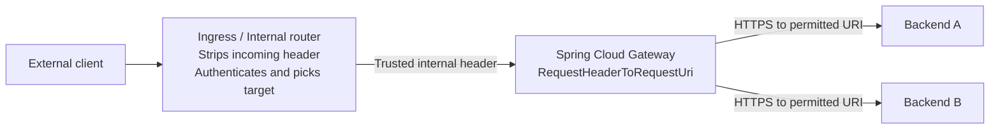
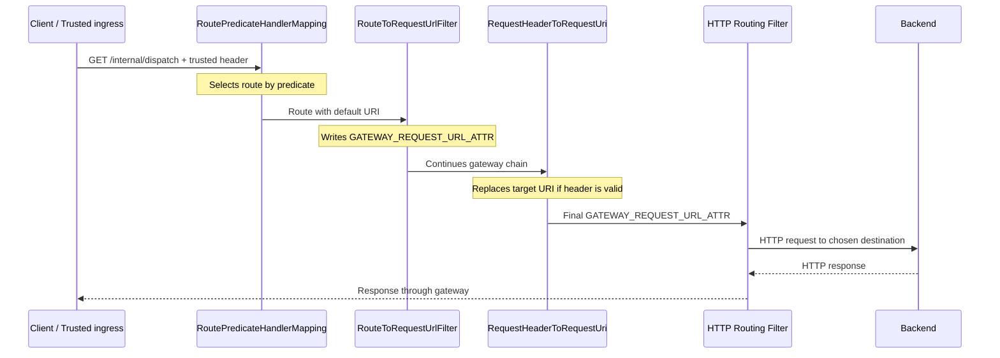
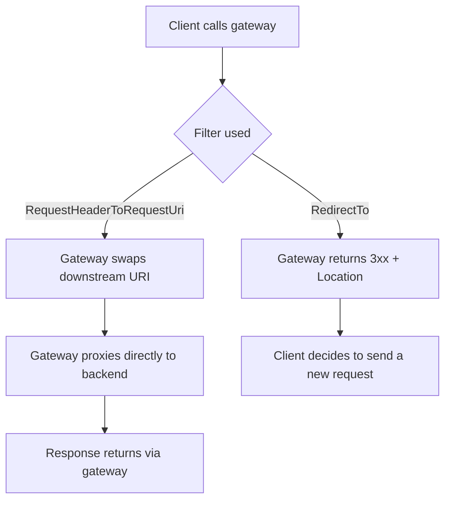
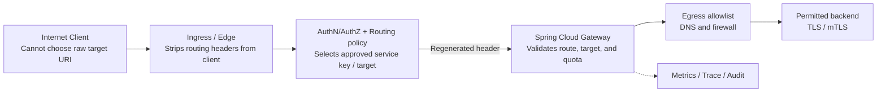

# RequestHeaderToRequestUri and Controlling the Forwarding Target

When building an API Gateway for microservices, we typically declare the backend URI directly on the route: `/api/catalog/**` forwards to `lb://catalog-service`, while `/api/orders/**` forwards to `lb://order-service`. Sometimes, however, a **trusted internal routing layer** has already decided the specific destination of a request and passes that decision to Spring Cloud Gateway via an HTTP header. **`RequestHeaderToRequestUri`** is a `GatewayFilter` that can read that header and use its value as the **target forwarding URI**.

This is a powerful capability and **highly security-sensitive**: if an external client can choose its own URI via a header, the gateway can become an **open proxy** or a **Server-Side Request Forgery (SSRF)** vector to reach hosts the client is not allowed to call directly. Spring Cloud Gateway's own documentation states that this filter is meant for **trusted environments** and requires stripping the target-controlling header from external requests before they reach the gateway.

This lesson belongs to the **Request Headers** chapter of the **SPRING_CLOUD_GATEWAY** module. It explains exactly what `RequestHeaderToRequestUri` does, how route predicates and the filter chain coordinate, fallback cases, how to define trust boundaries, URI validation, implementing a safer pattern, and verifying behavior in systems with service discovery, authentication, rate limiting, circuit breakers, retries, TLS, and observability.

> **Scope:** Interface examples, filter ordering, and request attributes below apply to **Spring Cloud Gateway Server WebFlux**. The **Server Web MVC** variant has its own filters and configuration style; do not copy WebFlux APIs verbatim to MVC. Property paths, starters, and operational details must be verified against your locked Spring Boot/Spring Cloud/Gateway versions.

## 1. The Problem: Static Route URIs vs. Per-Request Target URIs

A typical route:

```yaml
id: catalog-route
uri: lb://catalog-service
predicates:
  - Path=/api/catalog/**
filters:
  - StripPrefix=2
```

is declared upfront by the gateway. When a request matches, the gateway uses the route's URI, applies the required filters, and resolves instances of `catalog-service` if Spring Cloud LoadBalancer/discovery is configured.

In some systems, an **internal routing service** has already determined the specific destination. For instance, an authenticated ingress or orchestrator chooses one of two backend clusters and creates a header:

```http
X-Internal-Target-Uri: https://catalog-a.internal.example:8443/internal/v1/products/42
```

If `RequestHeaderToRequestUri` is configured to read `X-Internal-Target-Uri`, the gateway can use that full URI **in place of the route's default upstream URI**.



**Critical condition of this diagram:** the ingress/router must **strip or overwrite** any header sent by the client; the channel from this layer to the gateway must be controlled via private networking, ACLs, and/or mTLS. If clients can bypass the ingress and call the gateway directly, the header is no longer trustworthy.

### When Is It Worth Using?

- An internal routing layer must pick an endpoint that **static routes cannot fully express**.
- An orchestration system already makes region/instance/target selection decisions, and the gateway simply forwards within an **authorized scope**.
- You need to integrate with an existing routing tier that already has trusted header standards, authentication mechanisms, and explicit outbound controls.

If you only need to forward `/api/catalog/**` to `catalog-service` instances, prefer **a static route + `lb://catalog-service` + service discovery**. Do not pass backend URIs in headers just to solve standard load balancing.

## 2. How Exactly Does RequestHeaderToRequestUri Work?

`RequestHeaderToRequestUriGatewayFilterFactory` accepts **one parameter `name`**, which is the request header name to read. Once a request matches the route and the filter runs:

1. Look up the header value under the configured name.
2. If a value is recognized as a valid URI, use that URI to **override the target URI of the forwarded request**.
3. If the header is absent or the value is not a valid URI according to the running version's filter, **leave the previously determined target URI unchanged**; the request proceeds along the original route.
4. Subsequent routing steps use the effective target URI to process the request.

**"Valid URI" refers only to syntax/parsability**; it does not mean the destination is safe, authorized, or backed by a valid TLS certificate.

### 2.1. Distinguishing Three URIs

Consider a request:

```http
GET /internal/dispatch?trace=demo HTTP/1.1
Host: api.example
X-Internal-Target-Uri: https://catalog-a.internal.example:8443/internal/products/42?lang=vi
```

| URI | Source | Role |
| --- | --- | --- |
| **Client-side Request URI** | `https://api.example/internal/dispatch?trace=demo` | Used during request intake, security checks, and route predicates. |
| **Default Route URI** | e.g., `https://fallback.internal.example` | Declared via the route's `uri` property. |
| **Target URI from Header** | `https://catalog-a.internal.example:8443/internal/products/42?lang=vi` | If valid and the filter runs, overrides the downstream forwarding target. |

The header value is a **complete URI**, capable of carrying scheme, hostname, port, path, and query. When accepted, it can alter **both the authority and the path/query of the downstream URI**. Do not assume the client's `/internal/dispatch` path or `?trace=demo` query will be preserved.

### 2.2. Placement in the WebFlux Gateway Filter Chain

In the WebFlux architecture:

- `RoutePredicateHandlerMapping` selects the route using predicates like `Path`, `Method`, or `Header`.
- `RouteToRequestUrlFilter` builds the forwarding URI from the `Route` and stores it in the `GATEWAY_REQUEST_URL_ATTR` exchange attribute.
- `RequestHeaderToRequestUri` is designed to update the **downstream URI** from the header when an appropriate value is present, prior to the corresponding HTTP proxying step.
- For `http` or `https` URIs, an HTTP routing filter such as `NettyRoutingFilter` uses the resolved forwarding URL to send the request.



The diagram shows the **logical order** of a WebFlux line supporting this filter. Filters carry `Ordered` values and dedicated sorting rules; inspect the actual filter chain and dependencies before adding custom filters that edit URIs, modify headers, or alter ordering.

**Note:** this filter updates the **URI used for proxying** via an exchange attribute; it does not necessarily alter `ServerHttpRequest.getURI()` for all components, nor does it automatically rewrite the `Host` header, apply authentication, add new routes, or change the route ID.

## 3. Configuring RequestHeaderToRequestUri

### 3.1. Shortcut Form in YAML

The example below is for an **isolated POC or controlled internal network only**. It is unsafe if exposed directly to the public Internet where arbitrary clients can send any header value.

For Server WebFlux lines using the `spring.cloud.gateway.server.webflux.routes` property branch:

```yaml
spring:
  cloud:
    gateway:
      server:
        webflux:
          routes:
            - id: trusted-dispatch
              uri: http://localhost:9001
              predicates:
                - Path=/internal/dispatch/**
              filters:
                - RequestHeaderToRequestUri=X-Internal-Target-Uri
```

Explanation:

- `trusted-dispatch` is the route ID, not a backend name.
- `Path=/internal/dispatch/**` determines which requests match before filters run.
- `uri: http://localhost:9001` is the **default target** if no valid header is present.
- `RequestHeaderToRequestUri=X-Internal-Target-Uri` declares the **header name**, not a fixed URI.
- If the header contains `http://localhost:9002/backend/products/42` and the filter accepts that URI, the forwarding target can switch to `localhost:9002` with the path specified in the header.

`localhost:9001` and `localhost:9002` are two mock backends for local testing; never expose this configuration as a public gateway. Inside containers, `localhost` points to the container itself, not automatically to another backend container.

### 3.2. Expanded Form with Parameter Name

```yaml
filters:
  - name: RequestHeaderToRequestUri
    args:
      name: X-Internal-Target-Uri
```

The factory's argument is **`name`**. It is not `url`, `targetUri`, or `uri`. Using the wrong argument name can prevent the gateway from constructing the filter as expected or loading the route.

### 3.3. Configuration Across Different Version Lines

Some Spring Cloud Gateway WebFlux 4.x guides use:

```yaml
spring:
  cloud:
    gateway:
      routes:
        - id: trusted-dispatch
          uri: http://localhost:9001
          predicates:
            - Path=/internal/dispatch/**
          filters:
            - RequestHeaderToRequestUri=X-Internal-Target-Uri
```

Newer docs separate the `server.webflux` and `server.webmvc` namespaces explicitly. Do not assume both prefixes are active simultaneously. Check **Configuration Properties**, starters, the Spring Cloud BOM, and the exact Gateway version on your classpath. If a route fails to load, inspect property binding before investigating headers.

### 3.4. Behavior Matrix to Verify

Given the POC route in section 3.1 and request `GET /internal/dispatch/items?page=2`:

| `X-Internal-Target-Uri` value | Expected logical destination |
| --- | --- |
| **Header absent** | Continues via default route URI `http://localhost:9001`, using normal route path/query construction. |
| `http://localhost:9002/backend/items?lang=vi` | Downstream URI is overridden to `http://localhost:9002/backend/items?lang=vi` if parsed as valid. |
| Malformed value such as `not a uri` | Does not override; keeps previously determined URI. |
| Header has unapproved hostname with valid syntax | Default filter is **not an allowlist checker**; must not be accepted in a secure design. |
| Repeated multi-value header | Check how your version reads headers; at a security boundary, reject multi-value headers. |

Do not treat fallback behavior as protection. **A missing header can route to the default backend instead of being rejected.** If the contract requires a valid internal routing directive, implement a **fail-closed** check before the filter.

## 4. Distinguishing from Other Filters and Predicates

| Tool | Primary behavior | Selects upstream host from header value? |
| --- | --- | --- |
| `Header` route predicate | Decides if a route matches when a header meets a condition/regex. | Not directly; target URI is still defined by the route. |
| `AddRequestHeader` | Appends a header to the forwarded request. | No. |
| `SetRequestHeader` | Overwrites a header's value. | Not directly; may be paired with a header-reading filter. |
| `RemoveRequestHeader` | Removes a header from the request. | No, and if run before the URI filter it can strip the needed value. |
| `MapRequestHeader` | Copies values from one header to another. | Does not select target URI on its own. |
| **`RequestHeaderToRequestUri`** | Takes the target URI from a request header. | **Yes**, within the scope of filter behavior and URI validity. |
| `RewritePath` / `PrefixPath` | Alters the forwarded request path. | Does not select target hostname on its own. |
| `RedirectTo` | Returns HTTP 3xx with `Location` to the client. | Not header-based proxying like RequestHeaderToRequestUri. |
| `lb://catalog-service` | Uses LoadBalancer/discovery to pick an instance by service name. | Does not require a header containing an arbitrary URL. |

### RequestHeaderToRequestUri Is Not RedirectTo



Clients do not receive a `302` simply because the gateway uses `RequestHeaderToRequestUri`. Conversely, a backend can return a redirect in its response, and the gateway must check whether the `Location` header leaks internal addresses or permits redirects to external domains.

### A Header Predicate Is Insufficient to Prevent SSRF

Example:

```yaml
predicates:
  - Header=X-Internal-Target-Uri, .+
filters:
  - RequestHeaderToRequestUri=X-Internal-Target-Uri
```

The predicate above only verifies **that the header exists and matches a regex**; it does not check whether the hostname is allowlisted, whether the request originated from a trusted router, or whether the target routes into an internal network. This is **not** a secure configuration.

## 5. Trust Boundary: Who Is Allowed to Decide the Target?

The biggest hazard is when a client can send:

```http
X-Internal-Target-Uri: https://some-unapproved-host.example/path
```

If the gateway treats that string as the forwarding target unchecked, the client now controls the gateway's **server-side outbound requests**. Gateways usually have broader internal network access than external clients, making the impact far worse than a normal HTTP request.

### 5.1. Risk Categories

| Risk | Why it occurs | Core defense |
| --- | --- | --- |
| **SSRF into internal networks** | Client picks a URI reaching non-public services. | Accept decisions only from trusted sources; target allowlist and egress policies. |
| **Open proxy** | Gateway forwards to arbitrary hostnames per request. | Never let clients control raw URLs; restrict host/scheme/port/path. |
| **Access to sensitive endpoints** | URI may target admin services, loopback ranges, or metadata services. | Block private/loopback/link-local ranges and sensitive endpoints unless explicitly approved internal targets. |
| **DNS rebinding / DNS changes** | Hostname looks valid during check but later resolves to an out-of-scope IP. | Enforce DNS, outbound connection, proxy, and egress network ACLs at connection time. |
| **TLS bypass** | Header switches from HTTPS to HTTP or another host. | Require `https` scheme and verify TLS/certificates against the proper backend. |
| **Host/SNI mismatch** | New destination has a different authority from the public request. | Align Host header, TLS SNI, and `PreserveHostHeader` for your actual topology. |
| **Token/header leakage** | `Authorization` or cookies may be forwarded to an unintended target. | Block improper egress targets and define per-route header forwarding policies. |
| **Rate-limit bypass** | Arbitrary targets outside the expected upstream pool. | Rate limit by identity/route prior to proxying, alongside target restrictions. |
| **Resource exhaustion or cost** | Client picks slow-responding URLs or large payloads. | Enforce timeouts, body/response limits, quotas, and circuit breakers where appropriate. |

An `https` URI does not guarantee safety; it can still point to an unapproved hostname. Even an allowlisted hostname is insufficient if DNS configuration, target ports, or HTTP redirects allow traffic elsewhere.

### 5.2. Fundamental Rule

**Never use an untrusted client-supplied URL header directly to determine the target.** Two safer approaches exist:

1. **Best whenever possible:** static routes, or extract a logical key from the request and map it **on the server** to a managed/approved URI. Never accept raw URIs from clients.
2. **If RequestHeaderToRequestUri is strictly required:** allow only a trusted internal routing tier to generate the header; have the ingress strip client headers before adding the new one; have the gateway accept traffic only from that tier, enforce an allowlist, and apply egress network controls.

Application-code checks form one defensive layer. Pair them with network, TLS, and service-identity policies to contain blast radius if a filter is ever misconfigured.

## 6. Designing a Multi-Layer Trust Chain



In this model:

- **Ingress** receives external requests and strips any `X-Internal-Target-Uri` sent by the client, including repeated headers or mixed-case variations.
- **Internal router** re-adds the header only after authenticating the source and applying orchestration policy. Never rely on `X-Forwarded-For` IPs alone as proof that a request came from a trusted router.
- **Gateway** accepts ingress traffic only from permitted routers and can verify identity via component-to-component mTLS.
- **Egress controls** restrict the gateway to connecting only to approved hostnames, IPs, and ports, providing defense-in-depth against misconfiguration or code bugs.
- **Backend** enforces resource-level authentication/authorization and never trusts a client-supplied header like `X-User-Id` without origin verification.

### Why Stripping the Header on One Route Is Not Enough

If clients can reach the gateway directly over another network path, those requests can hit the `RequestHeaderToRequestUri` route without passing through the header-stripping ingress. Audit **all entry paths**: public load balancers, admin ports, service ports, mesh ingresses, staging environments, and internal call paths.

If internal routing involves multiple proxy hops, designate explicitly **which single tier is authorized to set the header**. Preceding hops must strip client-supplied values; subsequent hops must not add values from untrusted inputs.

## 7. A Better Design: Client Picks a Logical Key, Server Picks the URI

Suppose the system permits only two backends: `catalog` and `inventory`. Instead of letting the client send an arbitrary URL, it sends a **logical key**:

```http
X-Backend-Key: catalog
```

The Gateway or internal router looks up a **server-controlled** table:

| Key | Server-determined upstream URI |
| --- | --- |
| `catalog` | `https://catalog.internal.example/internal/query` |
| `inventory` | `https://inventory.internal.example/internal/query` |

A filter can reject unknown keys, delete any client-supplied target header values, and set `X-Internal-Target-Uri` to the URI **from the allowlist table**. `RequestHeaderToRequestUri` then reads only the regenerated header.

### 7.1. Example WebFlux GlobalFilter Building the Header from an Allowlist

This illustrates how **never to trust raw target URIs**. It guards only the `trusted-dispatch` route, runs before normal routing steps, and forces selection from URIs declared in code.

```java
import java.net.URI;
import java.util.Map;

import org.springframework.cloud.gateway.filter.GatewayFilterChain;
import org.springframework.cloud.gateway.filter.GlobalFilter;
import org.springframework.cloud.gateway.route.Route;
import org.springframework.cloud.gateway.support.ServerWebExchangeUtils;
import org.springframework.core.Ordered;
import org.springframework.http.HttpStatus;
import org.springframework.http.server.reactive.ServerHttpRequest;
import org.springframework.stereotype.Component;
import org.springframework.web.server.ServerWebExchange;
import reactor.core.publisher.Mono;

@Component
public class TrustedTargetHeaderFilter implements GlobalFilter, Ordered {

    private static final String TARGET_HEADER = "X-Internal-Target-Uri";
    private static final String KEY_HEADER = "X-Backend-Key";

    // URIs are trusted server-owned configuration, never supplied by clients.
    private static final Map<String, URI> ALLOWED_TARGETS = Map.of(
        "catalog",
        URI.create("https://catalog.internal.example/internal/query"),
        "inventory",
        URI.create("https://inventory.internal.example/internal/query")
    );

    @Override
    public int getOrder() {
        // Run before RequestHeaderToRequestUri in WebFlux filter order.
        return -100;
    }

    @Override
    public Mono<Void> filter(
            ServerWebExchange exchange,
            GatewayFilterChain chain) {

        Route route = exchange.getAttribute(
            ServerWebExchangeUtils.GATEWAY_ROUTE_ATTR);

        if (route == null || !"trusted-dispatch".equals(route.getId())) {
            return chain.filter(exchange);
        }

        var keys = exchange.getRequest().getHeaders().get(KEY_HEADER);
        String key = keys != null && keys.size() == 1
            ? keys.get(0) : null;

        URI target = key == null ? null : ALLOWED_TARGETS.get(key);
        if (target == null) {
            exchange.getResponse().setStatusCode(HttpStatus.BAD_REQUEST);
            return exchange.getResponse().setComplete();
        }

        ServerHttpRequest safeRequest = exchange.getRequest().mutate()
            .headers(headers -> {
                // Remove any target URI previously injected by the caller.
                headers.remove(TARGET_HEADER);
                headers.remove(KEY_HEADER);
                headers.set(TARGET_HEADER, target.toString());
            })
            .build();

        return chain.filter(exchange.mutate().request(safeRequest).build());
    }
}
```

Explanation:

1. The filter handles only route ID `trusted-dispatch`; other routes remain untouched.
2. Only a single `X-Backend-Key` present in the fixed map is accepted; missing or duplicate headers are rejected, and client-chosen URIs are never accepted.
3. The inbound target header is **deleted and recreated** from a URI in `ALLOWED_TARGETS`. The logical key header is also stripped from the forwarded request to avoid leaking unnecessary routing hints.
4. When a valid key is missing or invalid, the filter returns `400` and **does not invoke the chain**. Thus it never silently falls back to the default URI.
5. Returning `getOrder() = -100` ensures the filter runs early in a typical WebFlux pipeline. Verify ordering against your deployed Gateway version.

**Note:** This example only illustrates selecting a destination from an allowlist and handling fallback. If `catalog` and `inventory` have different authorization requirements, authenticate and **authorize whether the caller may pick that key** before proxying. Also add egress controls, TLS, endpoint protection, and policies to strip internal headers from backend requests when unneeded.

### 7.2. Route Paired with the Filter Above

```yaml
spring:
  cloud:
    gateway:
      server:
        webflux:
          routes:
            - id: trusted-dispatch
              uri: https://catalog.internal.example
              predicates:
                - Path=/internal/dispatch
              filters:
                - RequestHeaderToRequestUri=X-Internal-Target-Uri
```

In this illustrative configuration, `TrustedTargetHeaderFilter` prepares the header from the server table before `RequestHeaderToRequestUri` consumes it to replace the URI. If the route also includes another filter that reads or strips `X-Internal-Target-Uri`, verify the **actual runtime order** so the value is not deleted before being consumed.

The `*.internal.example` hostnames are placeholders only. A production system requires corresponding DNS, TLS certificates, and network policies. For local POCs, substitute isolated mock upstreams instead of letting the gateway make arbitrary outbound Internet connections.

### 7.3. An Even Simpler Alternative

If each logical key simply maps to one service, consider **declaring separate routes**:

```yaml
routes:
  - id: catalog-route
    uri: lb://catalog-service
    predicates:
      - Path=/api/catalog/**
  - id: inventory-route
    uri: lb://inventory-service
    predicates:
      - Path=/api/inventory/**
```

This abbreviated route configuration belongs under the proper version prefix. It eliminates the need for `RequestHeaderToRequestUri`, making auditing, rate limiting, metrics, and per-route authorization much clearer.

## 8. If You Must Accept Dynamic URIs: What Must Be Validated?

When a business requirement genuinely requires URIs chosen by a **trusted internal partner**, build strict validation before consuming the header:

| Attribute | Required check |
| --- | --- |
| **Scheme** | Only `https` if policy requires; reject all other schemes rather than just checking prefix `https`. |
| **Hostname** | Match an **exact** allowlist; avoid `endsWith("example.com")` which can accept spoofed subdomains. |
| **Port** | Permit only explicit ports; never allow the header to pick arbitrary internal network ports. |
| **Path** | Restrict allowed path prefixes/endpoints; do not allowlist an entire host if it also exposes admin APIs. |
| **Query** | Allow only needed parameters, validate encoding, and avoid forwarding arbitrary sensitive data to new targets. |
| **Userinfo/fragment** | Reject URIs containing `user:pass@host` or fragments unless explicitly justified; they complicate inspection and logging. |
| **DNS/IP** | Block loopback, link-local, metadata endpoints, and unapproved private IPs/subnets; prevent dangerous DNS changes at connection time. |
| **Upstream redirects** | Do not automatically follow redirects to other hostnames if egress policy excludes them. |
| **Multi-value headers** | Reject duplicate/ambiguous headers; never rely on "first value" conventions that differ across proxies. |
| **Length** | Bound header/URI size to protect parsers, logs, and HTTP clients from oversized inputs. |
| **Origin identity** | Authenticate the ingress/router or service identity (e.g., mTLS); never trust a header merely claiming to be "internal." |

### Why Simple Regex Is Not Enough

Checking:

```text
uri.contains("internal.example")
```

is unsafe because that substring can appear in the **path, query, or userinfo**, not the hostname. Parse the URI into structured components using a standard parser, validate the host against an exact allowlist, check port/scheme/path, and enforce egress ACLs.

Even when Java validates the hostname, the HTTP client may resolve DNS at a different moment; **DNS rebinding** or record updates can make the actual IP differ from expectations. Egress policies, managed internal DNS, and IP range restrictions at the network layer are essential additional defenses.

### Handle Errors by Failing Closed

In designs where a routing decision is mandatory:

| Scenario | Recommended policy |
| --- | --- |
| Missing target header or selection key | Return an error at the validation layer; never silently forward to fallback if the contract forbids it. |
| URI parses cleanly but host is not allowlisted | Reject, emit a security event, and make no outbound connection. |
| URI has an unexpected scheme or port | Reject. |
| Cannot authenticate the directive's source | Reject before forwarding. |
| Target DNS/IP violates egress policy | Do not establish an outbound connection. |
| Permitted backend is failing | Apply timeouts/circuit breakers and return policy-compliant errors; never fall back to a client-supplied hostname. |

Do not confuse **syntactically invalid** with **security-disallowed**. The default filter may fall back in the first case, whereas a syntactically valid URI may still need to be rejected by application policy.

## 9. Subtleties with Paths, Queries, and Headers

### 9.1. The Header URI Can Replace Both Path and Query

Suppose a client calls:

```http
GET /api/catalog/products/42?currency=VND
```

The internal tier provides:

```http
X-Internal-Target-Uri: https://catalog.internal.example/v2/products/42?locale=vi
```

When the header URI becomes the downstream URI, **do not assume** `currency=VND` is automatically merged with `locale=vi`. The header already supplies a URI with its own query. If preserving or merging query parameters is required, implement explicit rules in the trusted URI-construction layer and thoroughly test encoding, duplicate keys, empty values, and Unicode characters.

### 9.2. Host Header and TLS SNI

The downstream URI `https://catalog.internal.example/...` sets the connection destination used by the HTTP routing layer. However, the `Host` header seen by the backend still depends on the HTTP client, `PreserveHostHeader`, forwarded headers, and intermediate proxies.

Never set `Host` from client-supplied data just to work around backend errors; verify the exact host, TLS certificate, SNI, and trust boundary. Every new target hostname must be evaluated for TLS/mTLS policies and upstream authentication.

### 9.3. Should the Routing Header Be Sent to the Backend?

Internal orchestration metadata like `X-Internal-Target-Uri` rarely needs to reach the backend. If it must be removed, place removal **after `RequestHeaderToRequestUri` has read the value** but before sending the HTTP request; inspect the actual order of built-in and custom filters.

**Never assume "placing `RemoveRequestHeader` on a later YAML line guarantees it runs later"**: filters can carry independent `Ordered` values. If stripped too early, the URI filter sees no header and falls back. If stripped too late, the orchestration header leaks upstream. Verify with a mock backend rather than trusting YAML text order.

### 9.4. Avoid Leaking Credentials to Another Target

If the gateway receives `Authorization: Bearer ...` intended for one resource server and the header redirects traffic to a different service, the token could be sent somewhere that should never receive it. Authentication **client → gateway** and authorization **gateway → upstream** are two distinct relationships.

Restrict the set of forwarded headers, use controlled token relay or service-to-service credentials where needed, and avoid forwarding sensitive cookies/sessions/tokens to targets outside their authorized scope.

## 10. Interaction with Service Discovery, Timeouts, and the Filter Chain

| Mechanism | Relationship to `RequestHeaderToRequestUri` | What to verify |
| --- | --- | --- |
| **Route predicates** | Select the route from the request before URI filters run. | Client path/host/method and route precedence. |
| **`StripPrefix` / `RewritePath`** | May alter the request path, yet the header URI is a separate downstream URI. | Do not assume path rewrites automatically apply to the full URI in the header; test ordering. |
| **Spring Cloud LoadBalancer** | `lb://service` resolves logical names; an `https://host/...` header can bypass that path. | Avoid accidentally bypassing discovery/load balancing or routing policies. |
| **Spring Security** | Enforces identity and permissions before/at the gateway. | Protect orchestration routes, target-selection rights, and backend authorization. |
| **RequestRateLimiter** | Caps request rates per key/route. | Prevent target selection from bypassing quotas; keep quotas consistent across gateway replicas. |
| **CircuitBreaker** | Protects upstream calls per configuration. | Configure timeouts, fallbacks, and error handling per valid target group. |
| **Retry** | May re-invoke upstream on failure. | Never blindly retry writes, and prevent targets from changing unexpectedly across attempts. |
| **TLS/mTLS** | Secures connections per hop. | Permitted header URIs must match HTTPS, certificate, and SNI requirements. |
| **Observability** | Tracks route ID, upstream group, status, and latency. | Never log sensitive raw URIs or create high-cardinality metric tags. |

### A Header URI Can Bypass `lb://`

Suppose a route declares `uri: lb://catalog-service`, while the header points to `https://catalog-a.internal.example:8443/api`. If the filter uses the valid header URI to replace the downstream URL, requests can go directly to that **specific host** instead of going through standard `lb://catalog-service` instance selection.

Do not treat `lb://` on the route as a **security guardrail** restricting which hostnames the header may specify. Target enforcement belongs at header creation/validation and egress controls.

### Retries Lose Consistent Meaning If Targets Change

A request might be retried after a timeout or network error. With dynamic URIs, ensure:

- The target is chosen **once per policy** for the request, or target switching follows an approved rule.
- Retries do not duplicate side effects like order creation or payments.
- Total timeout covers all retry attempts, not just each individual attempt.
- Circuit breakers and metrics group upstreams into bounded labels, avoiding a separate time series per raw URI.

If failover across instances is what you need, controlled load balancing/discovery and resilience patterns are usually far cleaner than letting clients switch hostnames on retries.

## 11. POC Hands-On Lab in an Isolated Network

### 11.1. Environment

Set up a Spring Cloud Gateway **Server WebFlux** instance and two mock backends on a local machine or isolated internal test network:

| Component | Illustrative address | Mock endpoint |
| --- | --- | --- |
| Gateway | `http://localhost:8080` | `/internal/dispatch/**` |
| Default backend | `http://localhost:9001` | Echoes method, path, and query |
| Second backend | `http://localhost:9002` | Echoes method, path, and query |

Use the route from section 3.1 only inside an isolated POC. Never expose it to a public network.

### 11.2. Verify Fallback Without the Header

```bash
curl -i "http://localhost:8080/internal/dispatch/items?page=2"
```

Expected per default filter behavior: with no header overriding the URI, the request proceeds via the default route URI. Backend `9001` sees the path and query produced by standard route and filter rules. Verify via the mock backend, not HTTP status alone.

### 11.3. Verify Valid Header in the POC

```bash
curl -i \
  -H "X-Internal-Target-Uri: http://localhost:9002/backend/items?lang=vi" \
  "http://localhost:8080/internal/dispatch/items?page=2"
```

In the **isolated test environment**, the request should reach mock `9002` with URI `/backend/items?lang=vi` when the header value is accepted. Measure the exact path/query received by the mock; do not assume the client's `page=2` query is automatically merged.

### 11.4. Missing/Invalid Header and Unmatched Route

```bash
# Header with syntax unsuitable for building a downstream URI
curl -i \
  -H "X-Internal-Target-Uri: not a uri" \
  "http://localhost:8080/internal/dispatch/items"

# Request not matching the demo route's predicates
curl -i "http://localhost:8080/api/unknown"
```

For the invalid header, check whether the gateway falls back as documented for your version. For the unmatched path, the route's `RequestHeaderToRequestUri` does not run; you typically receive `404` if no other handler exists.

### 11.5. Verify the Safer Policy

Next, enable the **logical-key/allowlist** filter from section 7 and configure the matching route. Verify:

1. Client sends `X-Backend-Key: catalog` → gateway builds the `catalog` target from trusted configuration.
2. Client sends `X-Backend-Key: inventory` → gateway builds the `inventory` target from trusted configuration.
3. Client sends an unknown key → rejected, with no upstream connection.
4. Client injects `X-Internal-Target-Uri` → that value is stripped and replaced with the server-chosen target.
5. A user lacking permission for a sensitive backend is still blocked by authentication/authorization even when providing a valid key.
6. When backends lack real DNS/certificates, use local mock endpoints rather than assuming `*.internal.example` exists.

### 11.6. Results Recording Table

| Case | Input | Outcome to prove |
| --- | --- | --- |
| H01 | No target header | Filter fallback matches version behavior. |
| H02 | Target header is HTTP URI to second mock | Second mock receives request with expected URI. |
| H03 | Malformed target header | URI not overridden; observed fallback documented. |
| H04 | Multi-value target header | Safety policy rejects ambiguous input. |
| H05 | Allowlisted key | Target is server-determined, not client raw URI. |
| H06 | Non-allowlisted key | Fails closed, no upstream call. |
| H07 | Request bypassing ingress | Cannot reach header-controlled route. |
| H08 | HTTPS header to non-allowlisted host | Blocked before connection. |
| H09 | Valid target but failing upstream | Timeouts, circuit breakers, and metrics report appropriately. |
| H10 | Valid target returning redirect response | Does not reach out-of-policy host via unchecked redirect following. |
| H11 | Two gateway instances | Both enforce identical allowlists, security policies, and egress policies. |
| H12 | Header with credentials/sensitive query | Never logged raw into logs or metrics. |

For H08/H10, use mocks and test the denial policy; never probe real private systems or admin endpoints outside POC scope.

## 12. Request Observability and Troubleshooting

When investigating errors, separate **whether the route matched**, **whether the header target URI was accepted**, and **whether the HTTP client could connect to the target**.

| Symptom | Likely cause | Where to inspect |
| --- | --- | --- |
| Header present yet always hits default backend | Wrong header name, stripped by proxy, unparsable value, or filter not attached to route. | Runtime routes, filter chain, ingress, and safe validation logs. |
| Route does not appear | Wrong property prefix, starter, or unloaded config. | Configuration Properties, actuator route list, dependencies. |
| Routed to wrong path/query | Header carried a full URI differing from client URL. | Router-built URI, mock echo, encoding, and query contract. |
| Routed to unexpected host | Raw client header allowed or flawed allowlist. | Block egress immediately; audit header-setting flow and policy. |
| `404` from backend | Header URI points to a non-existent endpoint. | Distinguish gateway `404` (unmatched route) from upstream `404`. |
| TLS handshake failure | Mismatched certificate/hostname/SNI/trust store. | TLS on the gateway → backend leg. |
| `lb://` no longer used as expected | Absolute HTTP(S) header overwrote target URI. | Filter order, route URI, and effective destination. |
| `401`/`403` | AuthN/AuthZ rejected at gateway or backend. | Security chain, tokens, and resource permissions. |
| `429` | Rate limit quota exceeded. | `KeyResolver`/limiter and shared state across replicas. |
| Inconsistent behavior across gateway replicas | Out-of-sync policies/headers/configs/routes. | Config revisions, route IDs, per-instance network policies. |

### Recommended Logs and Metrics

An observability event template might look like:

```text
traceId: [trace ID]
routeId: trusted-dispatch
targetPolicy: allowlisted
targetService: catalog
targetScheme: https
status: 200
elapsedMs: [actual measurement]
```

Log a **bounded service name from a finite list**, the route ID, and the policy outcome rather than the full raw target URI. Paths and queries can contain sensitive data, dynamic IDs, and tokens, and using them as metric tags creates high cardinality. For distributed tracing, combine Micrometer, Actuator, and tracing standards chosen by your project.

### Limitations to Keep in Mind When Observing

`GATEWAY_REQUEST_URL_ATTR` can change across multiple routing steps, so inspecting it **before vs. after** `RequestHeaderToRequestUri` can yield different values. An early `Ordered` `GlobalFilter` might not see the final destination; a late observation filter could be skipped by short-circuiting or affected by retries. For real audits, check both HTTP routing-layer logs and mock upstream records while protecting sensitive data.

## 13. Version and Compatibility Checks

| Item | What to verify |
| --- | --- |
| Gateway variant | Server **WebFlux** for `RequestHeaderToRequestUriGatewayFilterFactory` in this lesson; MVC uses separate APIs/filters. |
| Spring Boot / Spring Cloud | Pick compatible release trains and a BOM managing dependency versions. |
| Property prefix | Some lines use `spring.cloud.gateway.routes`; others use `spring.cloud.gateway.server.webflux.routes`. |
| Factory argument | `name` is the header name; verify factory name and binding in your running version. |
| URI parsing behavior | How schemeless URIs, syntax errors, multi-value headers, and unusual schemes are handled. |
| Filter order | `RouteToRequestUrl`, `RequestHeaderToRequestUri`, custom header filters, `RemoveRequestHeader`, and HTTP routing. |
| HTTP/TLS client | `Host` header, SNI, pooled connections, timeouts, redirects, and egress policies. |
| Actuator and tracing | Which endpoints are enabled, access controls, response fields, and metric types. |
| Multi-replica deployments | Consistent target-check policies, allowlists, route configs, and config refresh. |

Official references to verify against your exact version:

- [Spring Cloud Gateway Server WebFlux — RequestHeaderToRequestUri GatewayFilter Factory](https://docs.spring.io/spring-cloud-gateway/reference/spring-cloud-gateway-server-webflux/gatewayfilter-factories/requestheadertorequesturi-factory.html)
- [Spring Cloud Gateway Server WebFlux — Global Filters](https://docs.spring.io/spring-cloud-gateway/reference/spring-cloud-gateway-server-webflux/global-filters.html)
- [Spring Cloud Gateway Server WebFlux — GatewayFilter Factories](https://docs.spring.io/spring-cloud-gateway/reference/spring-cloud-gateway-server-webflux/gatewayfilter-factories.html)
- [Spring Cloud Gateway — Configuration Properties](https://docs.spring.io/spring-cloud-gateway/reference/configprops.html)
- [Spring Cloud Gateway Server Web MVC — How It Works](https://docs.spring.io/spring-cloud-gateway/reference/spring-cloud-gateway-server-webmvc/how-it-works.html)

## 14. Checklist Before Enabling Request-Header-Based Routing

- [ ] Verified **why dynamic URIs are truly needed**; if static routes or `lb://service` suffice, do not introduce header-controlled routing.
- [ ] Only a single trusted internal routing tier is permitted to generate the target header.
- [ ] Every public ingress **strips or overwrites** client-supplied target headers, including mixed-case and multi-value variants.
- [ ] The gateway has no network bypass paths from clients to sensitive routes.
- [ ] Authentication/authorization is enforced for target or logical-key selection wherever required.
- [ ] Every target's scheme, hostname, port, and path match an allowlist; unexpected URI types are rejected.
- [ ] DNS/IP rules and egress network ACLs block out-of-scope destinations.
- [ ] Tested missing/malformed URIs and syntactically valid yet unauthorized URIs, confirming **fail-closed** behavior when a target is mandatory.
- [ ] Verified filter ordering, especially when stripping/modifying headers after reading.
- [ ] Verified header URIs include complete path/query; never assumed client URL preservation.
- [ ] Controlled `Host` headers, TLS/SNI, forwarded headers, and certificates across each hop.
- [ ] Prevented auth headers/cookies from reaching upstreams outside authorized scope.
- [ ] Verified rate limits, timeouts, retries, circuit breakers, and body/response limits under load.
- [ ] Metrics/tracing/auditing capture route and backend group without logging raw URIs or secrets.
- [ ] Gateway replicas share identical policies/allowlists with a rollback plan for config changes.

## 15. Self-Check Questions

1. What does the `name` parameter of `RequestHeaderToRequestUri` represent? Does it hold a header name or a target URI?
2. If the header is missing or cannot be parsed into a valid URI, how does Gateway Server WebFlux typically handle the forwarding destination?
3. Why is a `Header` route predicate matching any regex insufficient to protect the gateway from SSRF?
4. When a client calls `/internal/dispatch?x=1` while the header holds `https://catalog.internal.example/api/items?y=2`, why should you not assume `x=1` still reaches the backend?
5. If a route specifies `lb://catalog-service` while the header points to a different HTTPS URI, will load balancing necessarily work as you expect?
6. Why should `RemoveRequestHeader` never be added without checking filter ordering alongside `RequestHeaderToRequestUri`?
7. In the `X-Backend-Key` example, why is mapping `catalog` to a server-fixed URI safer than accepting a raw URL from the client?
8. Beyond checking hostnames in Java, what defensive layers are needed to prevent DNS rebinding and out-of-scope network access?
9. Why does authenticating a JWT at the gateway not automatically guarantee a user is allowed to select every backend in the allowlist?
10. When migrating from Gateway Server WebFlux to MVC or upgrading Spring Cloud release trains, which parts must be checked before reusing configurations?

**Key takeaway:** **`RequestHeaderToRequestUri` uses a URI value from a request header to replace the downstream proxy destination**, while route predicates still decide which route is selected. The filter does not authenticate the header's origin, does not enforce an allowlist on its own, and can fall back to the route URI when the header is invalid or absent. Therefore, at a microservices gateway, prefer **route/service-discovery routing** whenever possible; when header-driven routing is necessary, strictly control header creation, target-selection authorization, egress policies, and filter-chain behavior for your exact Spring Cloud Gateway version.
