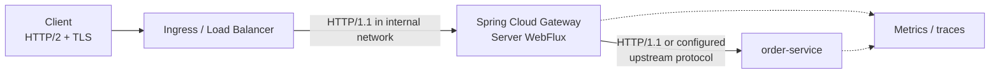
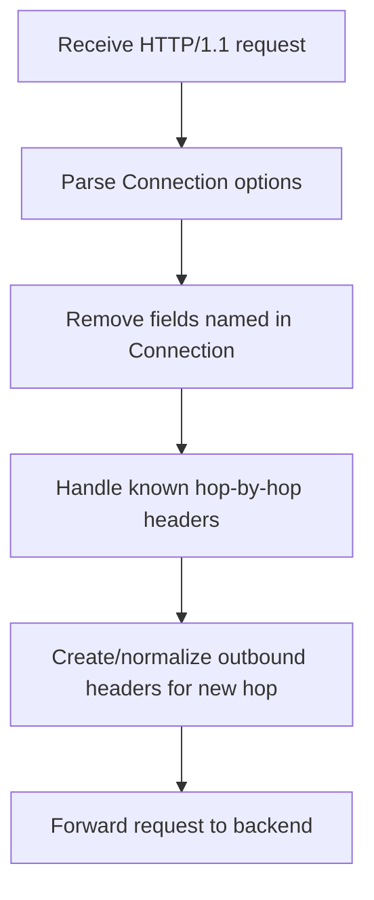
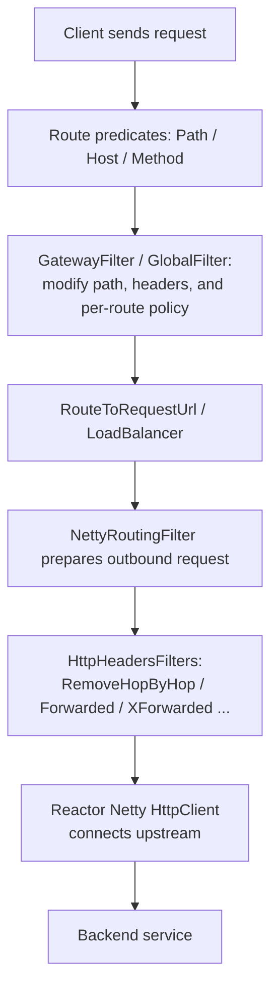

# RemoveHopByHop and Per-Hop Headers

When a client calls an API through **Spring Cloud Gateway**, the request is not sent directly from the client to the microservice. It crosses multiple distinct connections: client → load balancer/ingress (if any) → gateway → backend. Each connection may use a different HTTP version, connection-reuse mechanism, and body framing. Consequently, **not every HTTP header should be forwarded verbatim to the next hop**.

For example, a client sends `Connection: keep-alive` and `Keep-Alive: timeout=10`. Those two headers govern the **connection between the client and the component directly receiving the request**, not a valid directive for the fresh connection between the gateway and `order-service`. If the gateway forwards them unchecked, the backend can misinterpret header semantics, encounter protocol errors, or incur security risks.

In **Spring Cloud Gateway Server WebFlux**, `RemoveHopByHop` belongs to the **`HttpHeadersFilter`** group used to strip certain per-hop headers before proxying the request to the backend. This lesson belongs to the **Request Headers** chapter of the **SPRING_CLOUD_GATEWAY** module, where we learn to build an API Gateway with route predicates, filter chains, path/header transformations, service discovery, authentication, rate limiting, circuit breakers, retries, TLS, and request observability.

After this lesson, you will be able to:

1. Distinguish **hop-by-hop** from **end-to-end** headers and explain the role of `Connection`.
2. Recall the **eight headers in Gateway WebFlux's default `RemoveHopByHop` list** and the meaning of each.
3. Know how to configure the removal header list and recognize that customizing replaces the entire list rather than simply appending one item.
4. Distinguish `RemoveHopByHop` from `RemoveRequestHeader`, `SetRequestHeader`, `Forwarded`, and `X-Forwarded-*`.
5. Test outbound requests to the backend, including HTTP/1.1, HTTP/2, WebSocket, and `Connection` headers naming other fields.

> **Scope:** Content describes **Spring Cloud Gateway Server WebFlux** running on Spring WebFlux/Reactor Netty. Spring Cloud Gateway Server MVC integrates proxying differently. Certain configuration property names have changed across Spring Cloud Gateway generations; this article uses the namespaces in the WebFlux **4.3.x/5.x** documentation and highlights what to verify per version.

## 1. What Does "Hop" Mean in a Proxy Chain?

A **hop** is a single direct connection segment between two HTTP peers. A system may have the following hops:



If a client tells the ingress "after replying, keep this connection open," that instruction applies to **client ↔ ingress**. It says nothing about how long the ingress or gateway should hold the **gateway ↔ backend** connection open. Outbound connections are normally managed by the HTTP client, connection pool, keepalive/idle timeouts, and the gateway's own settings.

Under the HTTP model:

| Header category | Meaning | Examples | Proxy handling |
| --- | --- | --- | --- |
| **Hop-by-hop** | Scoped to one current connection, meaningless across the full chain | `Connection`, `Keep-Alive`, `Transfer-Encoding`, `Upgrade` | Intermediary strips/consumes them and only generates fresh per-hop fields when required by protocol |
| **End-to-end** | Describes the request, representation, or policy for the origin/final recipient | `Accept`, `Content-Type`, `Accept-Encoding`, `If-None-Match` | Typically preserved per contract unless policy dictates alteration |
| **Identity/authorization** | Carries data used for authentication/authorization | `Authorization`, cookies, internal identity headers | Must be verified and forwarded only per trust policy; absence from hop-by-hop list does not imply safe by default |
| **Proxy metadata** | Describes routing path or origin address | `Forwarded`, `X-Forwarded-For`, `X-Forwarded-Proto` | Trust only proxies configured as trusted; sanitize before use |
| **HTTP framing** | How a message is transmitted over a specific connection | `Content-Length`, `Transfer-Encoding` | Never alter arbitrarily; the HTTP server/client must handle them per protocol and actual body |

A header may need to be removed, added, or rewritten for **many different reasons**. `RemoveHopByHop` solves only one class of protocol-layer problems; it does not replace authentication policies, identity controls, or business-data rules.

## 2. RFC 9110: Why `Connection` Matters More Than a Fixed List

In HTTP/1.1, `Connection` lets the sender list **connection options**. Beyond connection-control tokens such as `close`, it can also list **other header names** that are valid only on the current hop.

Example:

```http
GET /api/orders/42 HTTP/1.1
Host: api.example.com
Connection: keep-alive, X-Hop-Trace
Keep-Alive: timeout=5
X-Hop-Trace: only-for-this-connection
Accept: application/json
X-Request-Id: 6c83e
```

Interpretation:

- `Connection: keep-alive` is an option for managing the current connection, not an end-to-end directive.
- `Connection: X-Hop-Trace` declares `X-Hop-Trace` as a field specific to this connection.
- `Keep-Alive` carries suggested parameters for the current connection.
- `Accept` and `X-Request-Id` are not declared hop-by-hop in this example; they can follow their own forwarding policies.

**Key normative rule in RFC 9110, Section 7.6.1:** an intermediary must parse the token list in `Connection`, remove all headers/trailers whose names match those tokens **before forwarding**, and then remove or replace `Connection` with options for the new connection.



**Two levels to distinguish:**

1. **The HTTP protocol requirement** mandates removing fields **dynamically nominated** inside `Connection`.
2. **Spring Cloud Gateway documentation for `RemoveHopByHop`** lists a **fixed set of default headers**. Do not infer from that list alone that this single filter handles every arbitrary field name listed in `Connection`. Verify the combined behavior of your HTTP server, header filters, and outbound HTTP client for your exact deployed version via integration testing.

A client intentionally sending `Connection: Authorization` or `Connection: X-User-Id` warrants serious attention: per the spec, the listed field is designated per-hop, yet those fields affect application security. Instead of designing authorization around whether a proxy strips a header, verify identity at the proper layer and **reject requests containing anomalous `Connection` directives** via edge security policies where appropriate.

## 3. What Is `RemoveHopByHop` in Spring Cloud Gateway?

**`RemoveHopByHop`** is an HTTP header processing filter applied by Gateway WebFlux when preparing to send a request to a downstream service. Documentation groups it under **`HttpHeadersFilters`**, which execute before `NettyRoutingFilter` dispatches the outbound request using the Reactor Netty HTTP client.

That means:

- The Gateway has already matched a route, resolved the final backend URL, and is preparing headers for the outbound HTTP request.
- `RemoveHopByHop` removes the configured header names from the set of forwarded headers.
- The gateway's HTTP client manages the new HTTP connection, body transmission, and corresponding framing headers itself.
- Stripping headers before proxying does not issue an HTTP redirect, alter the path, validate JWTs, or invoke additional business APIs.

### Position in the Request Pipeline



This diagram highlights **logical responsibilities** and does not imply every filter executes inside one fixed linear list. `HttpHeadersFilter`s are extension points shaping outbound headers; `GatewayFilter`s and `GlobalFilter`s govern broader filter-chain stages. Spring Security WebFlux normally operates in a separate `WebFilter` layer.

**Do not** configure `RemoveHopByHop` as an ordinary route filter entry:

```yaml
# Example NOT to use as route configuration:
filters:
  - RemoveHopByHop
```

Hop-by-hop header removal is already built into the `HttpHeadersFilter` layer. To customize the **list**, use the **dedicated configuration property** shown in section 5.

## 4. The Eight Default Removed Headers

According to official Spring Cloud Gateway Server WebFlux documentation, the default list is:

| Header | Role in protocol/hop | Why it should not be forwarded verbatim |
| --- | --- | --- |
| **`Connection`** | Lists HTTP/1.1 connection control options and field names scoped to the current hop | Those options and field names do not apply to the new connection |
| **`Keep-Alive`** | Timeout and request-count hints for persistent connections in older implementations | The gateway → backend connection is managed by its own HTTP client/connection pool |
| **`Proxy-Authenticate`** | Proxy server challenge asking client to authenticate to the proxy, tied to `407` | Not an authentication directive for the origin service on the next hop |
| **`Proxy-Authorization`** | Credentials used to authenticate with a proxy | Proxy credentials for one hop must never be forwarded arbitrarily to another hop |
| **`TE`** | Transfer coding/trailer acceptance capabilities of the current connection | Applies to the current link, not negotiated with every upstream |
| **`Trailer`** | Announces trailer fields expected at the end of a message | Must be handled appropriately when forwarding trailers and framing |
| **`Transfer-Encoding`** | Indicates message transfer coding on a hop, such as `chunked` | Outbound HTTP client must determine framing for the new hop |
| **`Upgrade`** | Proposes upgrading protocol on the current HTTP connection | Upgrade requests cannot simply be sent verbatim over another connection like standard HTTP |

These are the **eight specific header names** in Gateway WebFlux's default list. HTTP header matching is case-insensitive: `Connection` and `connection` refer to the same header semantically.

Several related headers **do not appear in the eight-item list**: `Proxy-Connection` (a non-standard header common in legacy systems), custom headers named inside `Connection`, or headers injected by a particular proxy. When handling them, evaluate protocol, topology, and policy; never claim the default list covers every case.

### Important Distinction: `Transfer-Encoding` Is Not `Content-Encoding`

Two similar-looking names carry very different meanings:

| Header | Description | Where does it normally apply? |
| --- | --- | --- |
| `Transfer-Encoding: chunked` | How data is framed over an HTTP/1.1 connection | **Hop**; transport must re-manage it when proxying |
| `Content-Encoding: gzip` | Representation payload compressed with gzip | **Representation**; usually preserved so the backend can decompress/read the body |
| `Accept-Encoding: gzip` | Client advertises acceptable content codings | End-to-end content negotiation; not in default RemoveHopByHop |
| `Content-Length: 123` | Message body length under corresponding framing | Must match actual body and HTTP framing rules at every hop |

If a client sends a `Transfer-Encoding: chunked` body, stripping the **inbound framing header** does not lose the **body**. The HTTP server has already decoded framing to hand the body to the pipeline; the Reactor Netty HTTP client sends the body upstream with valid framing of its own choosing. The backend can still observe a fresh `Transfer-Encoding` emitted by the outbound transport. **The goal is not copying stale hop headers**, not prohibiting that header name from ever appearing on any connection.

## 5. Configuring the `RemoveHopByHop` List

In Spring Cloud Gateway Server WebFlux **4.3.x and 5.x** documented today, the configuration property is:

```properties
spring.cloud.gateway.server.webflux.filter.remove-hop-by-hop.headers
```

This is a **gateway-level property** and does not belong inside any route's `filters` array.

For instance, if the system must also strip `Proxy-Connection`, declare the **entire list of headers to remove**, making sure to **retain all eight defaults**:

```yaml
spring:
  cloud:
    gateway:
      server:
        webflux:
          filter:
            remove-hop-by-hop:
              headers:
                - Connection
                - Keep-Alive
                - Proxy-Authenticate
                - Proxy-Authorization
                - TE
                - Trailer
                - Transfer-Encoding
                - Upgrade
                - Proxy-Connection
```

In this example, `Proxy-Connection` is added as an **additional policy for environments with legacy clients/proxies**, not as a ninth built-in Gateway default.

**Special note:** The `headers` property is the **configured list of header names to remove**. When overriding this list, treat it as **replacing the entire default list**, rather than assuming the framework automatically merges new entries into the original eight. A configuration like:

```yaml
# Avoid: easily drops headers that must be stripped by default
spring:
  cloud:
    gateway:
      server:
        webflux:
          filter:
            remove-hop-by-hop:
              headers:
                - Proxy-Connection
```

can stop removing `Connection`, `TE`, `Upgrade`, and so on under the default behavior. This affects **protocol correctness and security** and must be tested before deployment.

### Route Configuration Remains Independent

Example route forwarding requests to `order-service` using the Gateway WebFlux **5.x** namespace:

```yaml
spring:
  cloud:
    gateway:
      server:
        webflux:
          routes:
            - id: orders-api
              uri: http://localhost:8081
              predicates:
                - Path=/api/orders/**
              filters:
                - StripPrefix=1
```

When a client calls `GET /api/orders/42`, the backend is expected to receive `GET /orders/42`. `RemoveHopByHop` runs during outbound request preparation and does not need to be listed in the route's `filters`. On older WebFlux Gateway releases where routes live under `spring.cloud.gateway.routes`, match the route namespace to your actual version; do not confuse the `routes` namespace with the `remove-hop-by-hop` namespace.

### Should You Strip Every Unrecognized Header?

No. Stripping every header outside a tiny allowlist can break `Accept`, `Content-Type`, `If-Match`, `traceparent`, API-contract custom headers, and other necessary request metadata. Conversely, never blindly forward client-declared identity headers. Establish an **explicit header policy per trust boundary**, separating hop-by-hop cleanup from business/identity data.

## 6. Difference Between `RemoveHopByHop` and `RemoveRequestHeader`

Both reduce outbound headers, yet they differ in scope and purpose:

| Criterion | **`RemoveHopByHop` `HttpHeadersFilter`** | **`RemoveRequestHeader` `GatewayFilter`** |
| --- | --- | --- |
| Where configured? | Header processing tier before the HTTP client sends upstream | Inside a route's `filters` or `default-filters` |
| Primary goal | Remove connection/hop-scoped headers from a configured list | Remove any specific header per route or security policy |
| Typical scope | All HTTP routing passing through the corresponding header filtering | Configured route, or all routes if declared as a default filter |
| Examples | Strip `Connection`, `Keep-Alive`, `TE` | Strip client-spoofable `X-User-Id`, `X-Internal-Secret` |
| Replaces authentication? | No | No |
| Transforms body/path? | No | No |

For example, a client might send:

```http
GET /api/orders/42 HTTP/1.1
Host: api.example.com
Connection: keep-alive
X-User-Id: admin
Authorization: Bearer <token>
```

Per system policy, we can:

1. Use **Spring Security WebFlux** to verify the access token on the inbound connection.
2. Use `RemoveRequestHeader=X-User-Id` to strip spoofed user headers before forwarding.
3. Let `RemoveHopByHop` strip `Connection` and hop-by-hop headers on the outbound request.
4. Have the backend enforce **resource-level authorization**, never trusting an arbitrary client-sent `X-User-Id`.

Example route:

```yaml
spring:
  cloud:
    gateway:
      server:
        webflux:
          routes:
            - id: orders-api
              uri: http://localhost:8081
              predicates:
                - Path=/api/orders/**
              filters:
                - StripPrefix=1
                - RemoveRequestHeader=X-User-Id
```

`RemoveRequestHeader` is a route filter; it **cannot automatically enforce full `Connection`-listed header removal** unless you add logic inspecting those tokens. Anomalous cases must be tested and controlled per protocol and system policy.

## 7. Detailed Scenario: Inbound vs. Outbound Headers

Suppose an HTTP/1.1 request reaches the Gateway:

```http
GET /api/orders/42 HTTP/1.1
Host: api.example.com
Connection: keep-alive
Keep-Alive: timeout=5, max=100
TE: trailers
Proxy-Connection: keep-alive
Accept: application/json
X-Request-Id: abc-42
X-User-Id: forged-admin
Authorization: Bearer <access-token>
```

Configured route:

```yaml
- id: orders-api
  uri: http://localhost:8081
  predicates:
    - Path=/api/orders/**
  filters:
    - StripPrefix=1
    - RemoveRequestHeader=X-User-Id
```

This is a **route snippet** inside a `routes` list, not a standalone `application.yml`.

Before the HTTP client proxies the request:

| Inbound header | Handling filter/policy | What to verify at the backend |
| --- | --- | --- |
| `Connection` | In default RemoveHopByHop list | Client-hop `Connection` header is not copied verbatim |
| `Keep-Alive` | In default list | Inbound timeout/max parameters are not carried to upstream connection |
| `TE` | In default list | `TE: trailers` from client hop is not copied verbatim |
| `Proxy-Connection` | Not in the eight defaults; added in section 5 example | Verify removal if policy requires it |
| `Accept` | Typically an end-to-end header | Preserved unless another policy modifies it |
| `X-Request-Id` | Application correlation metadata | Per policy: may be sanitized or replaced with a trusted trace ID |
| `X-User-Id` | Route `RemoveRequestHeader` | Must not receive `forged-admin` from client |
| `Authorization` | Spring Security + token-forwarding policy | Forward only if needed and permitted; never log raw tokens |
| `Host` | HTTP client/proxy policy and `PreserveHostHeader` if applied | Matches host/upstream expectations; not assumed equal to public Host |

**Do not test by asserting that every header above is absent at the backend.** For instance, `Host` must exist and may be rewritten by the HTTP client; `Authorization` may need to be forwarded to the backend; `Accept` should normally stay. For `Connection` or `Transfer-Encoding`, the outbound HTTP client may generate fresh values appropriate for the new hop. Tests must verify **whether prohibited inbound data was copied verbatim**, rather than merely checking if the header name exists.

## 8. `Connection` Naming Another Header: An Easily Missed Case

Consider a test request:

```http
GET /api/orders/42 HTTP/1.1
Host: api.example.com
Connection: X-Hop-Debug
X-Hop-Debug: only-for-this-hop
Accept: application/json
```

Per **RFC 9110**, `X-Hop-Debug` is nominated in `Connection`, so an intermediary must not forward it as an end-to-end header. However, `X-Hop-Debug` **is not in the eight default names** of `RemoveHopByHop`.

Therefore, distinguish clearly between:

- **What the HTTP standard requires:** removing fields listed in `Connection` as well as connection-specific fields before forwarding.
- **The `RemoveHopByHop` config list:** fixed default names or explicitly configured names.
- **Actual system behavior:** also depends on how Reactor Netty's HTTP server/client and header filters handle messages. Only an integration test on your exact version fully confirms behavior.

When handling sensitive data, tests should cover at least `Connection` naming **an ordinary header** and **a sensitive header**. If the stack does not satisfy expected policy, handle it at a trusted HTTP edge, block anomalous requests, or add properly designed cleanup logic. Avoid writing a filter that strips/re-creates `Authorization` without understanding authentication order and upstream proxies.

### Why Is This a Security Issue?

Risks when intermediaries disagree on header semantics include:

- **Header spoofing:** backend trusts client-sent `X-User-Id` or `X-Tenant-Id`.
- **Header stripping:** one component removes a header based on `Connection` while another preserves it, giving two hops conflicting views.
- **HTTP request smuggling/desynchronization:** hops interpret message length or body framing differently, especially around `Content-Length`, `Transfer-Encoding`, or malformed requests.
- **Proxy auth confusion:** `Proxy-Authorization` reaches the wrong hop, leaking credentials.

**Note on request smuggling:** this cannot be solved reliably by "stripping `Transfer-Encoding` after the request has already been parsed." The edge HTTP server must **validate and reject messages with conflicting or malformed framing**, coordinated with upstream/downstream proxies so all hops parse requests consistently. Never test request-smuggling payloads against production infrastructure outside controlled scopes.

## 9. HTTP/1.1 and HTTP/2 Handle Connection Headers Differently

`Connection` is central to HTTP/1.1, whereas **HTTP/2 does not use HTTP/1.1-style connection-specific headers**.

Per **RFC 9113, Section 8.2.2**, an HTTP/2 endpoint **must not** generate messages containing `Connection` or connection-specific fields like `Proxy-Connection`, `Keep-Alive`, `Transfer-Encoding`, or `Upgrade`. Any message violating this must be treated as malformed. `TE` in HTTP/2 requests is a narrow exception: **only the value `trailers` is allowed**.

| Aspect | HTTP/1.1 | HTTP/2 |
| --- | --- | --- |
| `Connection` | Can list connection options | Forbidden from appearing |
| `Keep-Alive` | Exists in older implementations, tied to one hop | Not used as a connection-specific header |
| `Transfer-Encoding: chunked` | Body-framing mechanism on an HTTP/1.1 hop | Forbidden; HTTP/2 uses dedicated DATA frames |
| `TE` | Indicates transfer-coding/trailer support per HTTP/1.1 rules | Only `TE: trailers` permitted in requests |
| `Upgrade` | Used in HTTP/1.1 upgrade handshakes | Cannot be carried verbatim HTTP/1.1-style inside HTTP/2 messages |
| Client → gateway and gateway → backend links | May both be HTTP/1.1 or differ | One hop may translate HTTP/2 to HTTP/1.1 on the next hop |

This explains why you **cannot naively "copy headers" when proxying between HTTP/2 and HTTP/1.1**. The HTTP transport and filters must emit valid fields for each hop. For applications using **gRPC, HTTP/2 trailers, or streaming**, verify actual gateway/starter support and protocol requirements rather than disabling `RemoveHopByHop` just to "keep all headers."

### TLS Does Not Replace Header Filtering

TLS protects **connection confidentiality and integrity** over the encrypted hop. It does not turn a client's `Connection` directive into a valid directive for an upstream hop. Even when both legs use HTTPS, the gateway must still handle hop-by-hop headers properly and still enforce authentication and authorization.

## 10. Are WebSocket and `Upgrade` Exceptions?

HTTP/1.1 upgrade requests to WebSocket use:

```http
GET /chat HTTP/1.1
Host: api.example.com
Upgrade: websocket
Connection: Upgrade
Sec-WebSocket-Key: <handshake-key>
Sec-WebSocket-Version: 13
```

In a **standard HTTP reverse proxy**, `Upgrade` and `Connection` belong to the current hop and cannot simply be copied as end-to-end headers. WebSockets genuinely require a **dedicated handshake and protocol-proxying mechanism**.

With Spring Cloud Gateway, when WebSockets are needed, use **WebSocket routing** with an appropriate `ws://` or `wss://` URI (and supporting config) rather than expecting standard HTTP `NettyRoutingFilter` + custom `RemoveRequestHeader` rules to act as a WebSocket proxy. The Gateway routes handshake/upgrade traffic through its dedicated path.

Illustrative WebSocket routing example:

```yaml
spring:
  cloud:
    gateway:
      server:
        webflux:
          routes:
            - id: chat-ws
              uri: ws://localhost:8082
              predicates:
                - Path=/chat/**
```

Here, real WebSocket traffic enters the dedicated routing branch. Do not think "RemoveHopByHop strips `Upgrade` so it must break WebSockets." Conversely, simply **keeping `Upgrade`** in a normal outbound HTTP proxy will not make WebSockets work either. Test WebSocket handshakes and sessions end-to-end.

## 11. `Forwarded`, `X-Forwarded`, and `Host`: Not in the Eight Defaults

Especially in an ingress → gateway → service topology, learners easily confuse hop-by-hop headers with headers describing client/proxy location.

- `Forwarded` (RFC 7239) can carry `for`, `proto`, `host`, and `by`.
- `X-Forwarded-For`, `X-Forwarded-Proto`, and `X-Forwarded-Host` are common headers helping backends determine client addresses and public URLs.
- `Host` / HTTP authority names the target host in the request and affects routing, virtual hosting, and link generation.
- `X-Request-Id`, `traceparent`, and trace headers support tracing request flows across services.

These headers **are not among the eight default `RemoveHopByHop` names**, yet they still require explicit trust policies. For example, a client must never be able to send `X-Forwarded-For: 127.0.0.1` to trick the gateway into treating it as loopback traffic, or send `X-User-Id: admin` to gain privileges.

In current Gateway WebFlux documentation, generating/reading forwarded headers involves settings like `spring.cloud.gateway.server.webflux.trusted-proxies`, depending on the header filter and topology. Restrict trusted proxies, strip client-spoofed values at the edge, and inspect what the backend actually receives. `RemoveHopByHop` **does not establish a trust boundary for `Forwarded`/`X-Forwarded`**.

### `Authorization` Is Also Not `Proxy-Authorization`

| Header | Purpose | Policy |
| --- | --- | --- |
| `Authorization` | Authenticates the client to a protected origin/API | Verify tokens/credentials; forward only when required by the security contract |
| `Proxy-Authorization` | Authenticates to an HTTP proxy on one hop | Typically do not forward proxy credentials to the target service |
| `X-User-Id` | Application header with no universal trust semantics | Never trust client-set values; derive from verified identity |
| `Forwarded` / `X-Forwarded-*` | Carries metadata across proxies | Trust only identified and sanitized sources |

A durable principle: the gateway can **authenticate requests at the edge**, while the backend service must still verify **authorization on business resources**. Header cleanup is a protocol step; it does not turn remaining headers into trusted data.

## 12. Observing `RemoveHopByHop` Behavior with a Test Backend

**Goal:** verify that the gateway does not blindly copy hop-by-hop headers from inbound requests to the backend, while preserving necessary end-to-end headers.

### 12.1. Prepare Two Applications

Assume Gateway Server WebFlux runs at `http://localhost:8080`, and the test backend runs at `http://localhost:8081`. The route is:

```yaml
spring:
  cloud:
    gateway:
      server:
        webflux:
          routes:
            - id: orders-api
              uri: http://localhost:8081
              predicates:
                - Path=/api/orders/**
              filters:
                - StripPrefix=1
                - RemoveRequestHeader=X-User-Id
```

Create a simple test backend echoing only **target header names**, avoiding echoing tokens/cookies from real requests:

```java
import java.util.LinkedHashMap;
import java.util.Map;
import org.springframework.http.HttpHeaders;
import org.springframework.http.server.reactive.ServerHttpRequest;
import org.springframework.web.bind.annotation.GetMapping;
import org.springframework.web.bind.annotation.PathVariable;
import org.springframework.web.bind.annotation.RestController;
import reactor.core.publisher.Mono;

@RestController
class HeaderInspectController {

    @GetMapping("/orders/{id}")
    Mono<Map<String, Object>> inspect(
            @PathVariable String id,
            ServerHttpRequest request) {

        HttpHeaders headers = request.getHeaders();
        Map<String, Object> result = new LinkedHashMap<>();
        result.put("id", id);
        result.put("connection", headers.getFirst("Connection"));
        result.put("keepAlive", headers.getFirst("Keep-Alive"));
        result.put("te", headers.getFirst("TE"));
        result.put("proxyConnection", headers.getFirst("Proxy-Connection"));
        result.put("xHopDebug", headers.getFirst("X-Hop-Debug"));
        result.put("xUserId", headers.getFirst("X-User-Id"));
        result.put("accept", headers.getFirst("Accept"));
        return Mono.just(result);
    }
}
```

**Note:** This snippet fits a Spring WebFlux test backend. `LinkedHashMap` permits `null` values when a header is absent; `Map.of(...)` rejects `null`. Never use such an endpoint to reflect `Authorization`, cookies, or personal data in production.

### 12.2. Testing Headers in the Default List

Use `curl` over a local HTTP/1.1 connection:

```bash
curl --http1.1 -i \
  -H "Connection: keep-alive" \
  -H "Keep-Alive: timeout=5" \
  -H "TE: trailers" \
  -H "Accept: application/json" \
  -H "X-User-Id: forged" \
  http://localhost:8080/api/orders/42
```

Expected observations:

- The backend sees `/orders/42` due to `StripPrefix=1`.
- Client-sent `Keep-Alive: timeout=5` and `TE: trailers` are not blindly copied to the backend per the default cleanup list.
- Client-sent `X-User-Id` is absent due to `RemoveRequestHeader` on the route.
- `Accept: application/json` is normally forwarded since it is not hop-by-hop.
- If the backend sees `Connection`, verify **whether its value was generated by the outbound HTTP client for the new hop**, rather than concluding the filter failed merely from the header name.

With unusual headers, the gateway's HTTP server or `curl` itself may reject or modify the request before it reaches the filter; record outcomes accurately per the layer that actually handled them.

### 12.3. Testing `Connection` Nominating Another Header

```bash
curl --http1.1 -i \
  -H "Connection: X-Hop-Debug" \
  -H "X-Hop-Debug: hop-only" \
  http://localhost:8080/api/orders/42
```

Per RFC 9110, `X-Hop-Debug` must not pass through an intermediary as an end-to-end header. This test verifies the **behavior of the full Gateway/Netty stack in your actual version**. If the backend still sees `X-Hop-Debug`, do not treat that as desirable merely because it is absent from the eight defaults. Evaluate `Connection` handling or edge policies that block anomalous requests.

### 12.4. Testing Extended Configuration

Add `Proxy-Connection` to the **complete** list as shown in section 5, then send:

```bash
curl --http1.1 -i \
  -H "Proxy-Connection: keep-alive" \
  http://localhost:8080/api/orders/42
```

Verify the backend does not receive the inbound `Proxy-Connection` value. If the HTTP server blocks or strips the header before the gateway, note that clearly in your test log.

### 12.5. Comparing Request Before and After the Gateway

| Check field | Inbound from client | Expected at backend | What to observe |
| --- | --- | --- | --- |
| Path | `/api/orders/42` | `/orders/42` | Route filter active |
| `Keep-Alive` | `timeout=5` | Inbound value not forwarded | Hop-by-hop cleanup |
| `TE` | `trailers` | Inbound value not copied blindly | Protocol & transport |
| `Connection` | `keep-alive` | Inbound option not forwarded verbatim | Fresh header may be emitted by transport |
| `X-User-Id` | `forged` | Absent | Route-level policy |
| `Accept` | `application/json` | Preserved unless another policy alters | End-to-end |
| `Proxy-Connection` | `keep-alive` | Absent when added to config | Custom list |
| `X-Hop-Debug` | `hop-only`, named in `Connection` | Absent per RFC | Tests dynamic token handling |

## 13. When Requests Do Not Pass Through `NettyRoutingFilter`

`RemoveHopByHop` is documented as handling outbound headers before HTTP proxying. Not every response from the gateway originates from this HTTP client.

| Scenario | What happens | Implication for RemoveHopByHop |
| --- | --- | --- |
| Predicate fails to match a route | Gateway cannot select a matching HTTP route | No outbound request for that route |
| Spring Security returns `401`/`403` early | Request stops at the security layer | Cannot infer the backend was called |
| Rate limiter returns `429` | Filter may terminate the chain | No headers forwarded to backend |
| Internal circuit breaker fallback | May generate a local response | Separate fallback behavior from HTTP upstream |
| `forward://` | Uses internal forward dispatch | Does not apply outbound Netty behavior identically |
| WebSocket `ws://` | Uses WebSocket-specific routing | Handshake/upgrade follows its own flow |
| HTTP upstream `http://`/`https://` | Reactor Netty `HttpClient` performs proxying | `HttpHeadersFilter` group prepares outbound headers |

Diagnose using **route ID, trace ID, status, and actual outbound requests**, not merely logs from an isolated filter.

## 14. Implementation Pitfalls and Troubleshooting

| Symptom | Common cause | How to investigate |
| --- | --- | --- |
| Putting `RemoveHopByHop` in route `filters` throws an error | Confused `HttpHeadersFilter` with `GatewayFilter` | Use the `remove-hop-by-hop.headers` property for your version |
| After adding `Proxy-Connection`, `Connection` leaks to backend | Config list **overwrote** and dropped the eight defaults | Restore the full list and append the new header |
| Backend sees `Transfer-Encoding: chunked` | Outbound transport may emit fresh framing | Distinguish a **new** transport header from copied inbound values |
| Backend is missing `Authorization` | Security/header policy or anomalous `Connection` token intervened | Inspect all hops and handle malformed requests; never weaken auth to silence errors |
| Backend trusts spoofed `X-Forwarded-For` | Missing `trusted-proxies` config or ingress failed to sanitize | Establish trust boundaries; strip/regenerate forwarded metadata |
| WebSocket fails to upgrade | Wrong URI scheme, missing WebSocket routing, or incompatible TLS/proxy | Check `ws://`/`wss://`, handshake, and route definition |
| H2 request rejected when `Connection` is present | That header is forbidden in HTTP/2 | Do not try to allow it; fix the client/proxy to send compliant messages |
| Trailing headers go missing | HTTP version, framework, or proxy drops trailers | Test end-to-end under the exact protocol; never enable all TE/Trailer blindly |
| `400`/`502` with `Content-Length` and `Transfer-Encoding` | Ambiguous framing or mismatched hop parsing | Audit ingress/server validation and request framing per RFC |
| p95/p99 latency spikes after adding custom header filter | Filter performs blocking I/O or heavy string work | Use reactive APIs, minimize event-loop work, check profiler/metrics |

Never write an extra custom filter just because an unfamiliar header appeared; pinpoint whether the source is the **HTTP parser**, **gateway header filter**, **route filter**, **outbound client**, or **backend** before making changes.

## 15. Gateway Operations Checklist

- [ ] Confirmed **Spring Cloud Gateway Server WebFlux** and its matching configuration version.
- [ ] Distinguished **hop-by-hop** from **end-to-end** headers, identity headers, and proxy metadata.
- [ ] Understood the `Connection` rule: intermediaries must handle **dynamically listed field names**, not just a fixed set.
- [ ] Know the eight default `RemoveHopByHop` headers; do not mistake `Proxy-Connection` for a built-in default.
- [ ] When customizing `remove-hop-by-hop.headers`, retained the full list to avoid accidentally dropping defaults.
- [ ] Did not place `RemoveHopByHop` inside route filters; used the `HttpHeadersFilter` property instead.
- [ ] Tested outbound HTTP/1.1 and HTTP/2 (when deployed), separating stale inbound headers from newly generated transport headers.
- [ ] Verified protocol support and dedicated routing for WebSocket/gRPC/trailers instead of arbitrarily disabling header cleanup.
- [ ] Sanitized `Forwarded`, `X-Forwarded-*`, and `Host` via trusted proxies; never trusted spoofed client headers.
- [ ] Stripped client-set identity headers by policy, protected internal services, and enforced business authorization at the backend.
- [ ] Blocked or properly handled requests with conflicting framing/headers; did not rely on `RemoveHopByHop` to replace an HTTP parser.
- [ ] Logged route ID, trace ID, latency, status, and **masked/redacted** header test evidence.
- [ ] Preserved proper retries, timeouts, circuit breakers, TLS, and rate limiting; header policies do not replace them.

## 16. Self-Check Questions

**1. Why should `Keep-Alive: timeout=5` from the client not be forwarded verbatim to the backend?**

> Because it describes the current connection. The Gateway creates or borrows a separate outbound connection with its own pool and timeouts.

**2. Does the eight-header default list of `RemoveHopByHop` include `Proxy-Connection`?**

> No. The default list consists of `Connection`, `Keep-Alive`, `Proxy-Authenticate`, `Proxy-Authorization`, `TE`, `Trailer`, `Transfer-Encoding`, and `Upgrade`. You can add `Proxy-Connection` per policy using the full configuration list.

**3. If `Connection: X-Hop-Debug` is present, is stripping `Connection` alone enough?**

> Not per RFC 9110. The intermediary must also strip the field named `X-Hop-Debug` before forwarding. Test the actual behavior of your Gateway stack and proxies.

**4. Is `Content-Encoding: gzip` a hop-by-hop header removed by default?**

> No. It describes the representation's content coding, unlike `Transfer-Encoding`. Do not strip it blindly if the backend needs to decode the body.

**5. Why is `Authorization` absent from the `RemoveHopByHop` list?**

> It authenticates to the origin/API under application semantics, unlike `Proxy-Authorization` for a single proxy hop. Still, forwarding tokens must follow security policy, not merely whether the header is absent from that list.

**6. If the backend still sees `Transfer-Encoding` after proxying, does that prove the filter failed?**

> No. The HTTP client on the outbound hop may generate new framing. Check **whether the inbound value was copied verbatim** and whether the request is protocol-valid.

**7. Does HTTP/2 permit `Connection: keep-alive`?**

> No. HTTP/2 forbids connection-specific headers; `TE` is only a narrow exception when carrying `trailers` in requests.

**8. Does `RemoveHopByHop` replace checking authorization for `order 42`?**

> No. The Gateway handles header/protocol cleanup and edge authentication; `order-service` must still verify whether the caller is authorized for that specific order.

## Conclusion

**`RemoveHopByHop`** cleans up **per-hop request headers** in Spring Cloud Gateway Server WebFlux before the HTTP client forwards requests. Its default list covers eight familiar protocol headers: `Connection`, `Keep-Alive`, `Proxy-Authenticate`, `Proxy-Authorization`, `TE`, `Trailer`, `Transfer-Encoding`, and `Upgrade`. When extending the list, preserve all required defaults and test against your exact Gateway version.

In particular, **RFC 9110 requires handling headers dynamically nominated by `Connection`**; never assume a fixed list covers every scenario. Combining standards-compliant header filtering with trusted forwarded metadata, authentication, rate limiting, TLS, resilience, and observability turns the Gateway into a secure, maintainable microservices entry point without breaking HTTP semantics.

## References

- [Spring Cloud Gateway Server WebFlux 5.x — HttpHeadersFilters / RemoveHopByHop](https://docs.spring.io/spring-cloud-gateway/reference/spring-cloud-gateway-server-webflux/httpheadersfilters.html)
- [Spring Cloud Gateway Server WebFlux 4.3.x — HttpHeadersFilters](https://docs.spring.io/spring-cloud-gateway/reference/4.3/spring-cloud-gateway-server-webflux/httpheadersfilters.html)
- [Spring Cloud Gateway 5.x — Configuration Properties](https://docs.spring.io/spring-cloud-gateway/reference/configprops.html)
- [RFC 9110 — HTTP Semantics, Section 7.6.1 Connection](https://www.rfc-editor.org/rfc/rfc9110.html#section-7.6.1)
- [RFC 9112 — HTTP/1.1](https://www.rfc-editor.org/rfc/rfc9112.html)
- [RFC 9113 — HTTP/2, Section 8.2.2 Connection-Specific Header Fields](https://www.rfc-editor.org/rfc/rfc9113.html#section-8.2.2)
