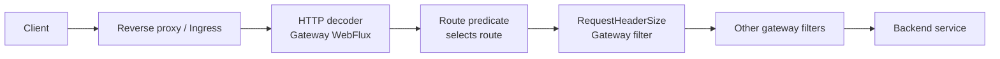
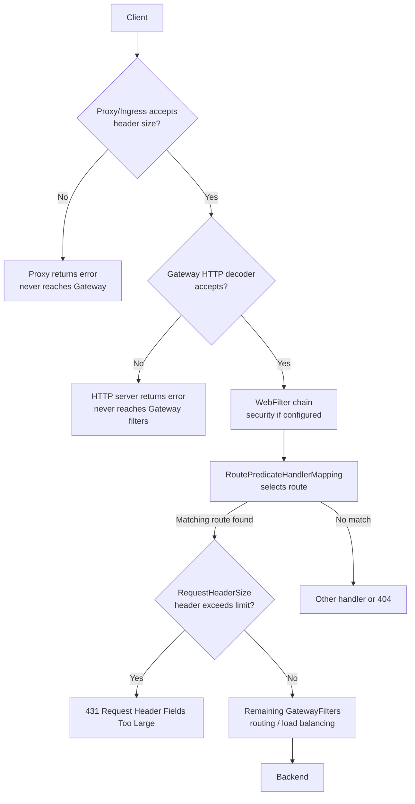

# Limiting Header Size with RequestHeaderSize When Supported

An API Gateway can receive requests carrying very large headers: long JWT authentication tokens, cookies accumulated across multiple sessions, tracing chains, client-generated headers, or anomalous payloads sent to stress-test the system. Even when the HTTP request body is small, oversized headers alone can cause proxies, HTTP decoders, or downstream services to fail, waste resources, and hinder diagnostics.

In **Spring Cloud Gateway**, when supported by the running version and variant, the **`RequestHeaderSize` GatewayFilter Factory** lets you limit the size of **each request header, including both name and value**. When any header exceeds the permitted limit, the gateway can reject the request with **HTTP 431 Request Header Fields Too Large** before forwarding it to the backend. This feature brings header-size rules into route configuration and catches certain anomalous requests early.

This lesson belongs to the **Request Headers** chapter of the **SPRING_CLOUD_GATEWAY** module. Alongside route predicates, the filter chain, path/header transformations, and service discovery, this configuration ties into authentication, rate limiting, circuit breakers, retries, TLS, and observability. Understanding the exact placement of `RequestHeaderSize` in the pipeline is essential for protecting APIs without breaking valid requests.

> **Scope:** Primary examples use **Spring Cloud Gateway Server WebFlux**. Filter names, configuration syntax, and namespaces must be verified against your running **Spring Cloud Gateway version** and starter. In current Server WebFlux docs, the `RequestHeaderSize` factory takes `maxSize` and `errorHeaderName` parameters and returns `431` when a header exceeds the threshold. For Server MVC or other versions, check the dedicated documentation. The phrase "when supported" is a practical deployment requirement: **never assume the filter exists simply because an app uses Spring Boot or Spring WebFlux**.

## 1. Why Limit HTTP Request Header Size?

An HTTP request consists of a request line or protocol equivalent, a set of headers, and an optional body. Headers carry metadata such as:

```http
GET /api/orders/42 HTTP/1.1
Host: api.example.test
Authorization: Bearer eyJhbGciOi...
Cookie: session=abc123; preferences=...
X-Correlation-Id: 1f7c2e30
Accept: application/json
```

In a microservices system, such a request can pass through several hops:



Each hop may enforce **its own header limits**. If an oversized request is rejected by a proxy or HTTP server during HTTP parsing, `RequestHeaderSize` in the Gateway **never gets a chance to run**. Only if the request clears earlier layers and matches a route carrying the filter does the Gateway's rule take effect.

Practical benefits of header limits:

- **Resource protection:** reduces the risk of an overly long header consuming excessive memory or processing overhead downstream.
- **API protocol governance:** defines how much metadata each API accepts—for instance, partner APIs may enforce stricter limits than internal APIs.
- **Early client-bug detection:** avoids sending bloated cookies or oversized tokens to the backend only to fail later.
- **Consistent error signaling:** for requests evaluated by the filter, returns status `431` tailored to oversized headers.

This limit is only **one control layer**. It does not validate token authenticity, cap body size, replace rate limiting, or stop every form of HTTP abuse.

## 2. What Is `RequestHeaderSize`?

In Spring Cloud Gateway Server WebFlux, `RequestHeaderSize` is a **GatewayFilter Factory** attached to a route or applied as a default filter for gateway routes.

According to Spring Cloud Gateway docs, the factory has two parameters:

| Parameter | Meaning | Example |
| --- | --- | --- |
| **`maxSize`** | Maximum allowed size for **each request header, including name and value**. | `1000B`, `1KB` |
| **`errorHeaderName`** | Name of the **response header** holding the error message when a request is rejected; defaults to `errorMessage`. | `X-Gateway-Header-Error` |

Shortest example from the docs:

```yaml
filters:
  - RequestHeaderSize=1000B
```

Meaning: if **any single request header** exceeds `1000B` as measured by the framework, the Gateway responds with **HTTP 431** instead of continuing to the backend on that route.

**Most important point:** The limit in this example applies **per header**. Do not interpret it as "the total size of all headers combined must be under 1000B." Limiting the **total byte size across all headers** or the **total header count** relies on the HTTP server/proxy or other dedicated mechanisms.

### 2.1. Both Name and Value Sizes Count

These two headers share the same idea yet differ in total size:

```http
X-A: abcdef
X-Very-Long-Custom-Header-Name: abcdef
```

Because the second header's name is longer, a limit measuring both **key** and **value** can cause the second header to cross the threshold earlier even though both values have equal length.

Likewise, `Authorization`, `Cookie`, or `X-Custom-Claims` usually have values much longer than their names. Never treat the header name length as "free" when picking a limit.

**Do not deduce an exact byte-counting formula from how text looks in an editor.** Character encoding, multiple values under the same header name, and proxy header normalization can make the framework's byte count differ from the character count a user sees. When choosing tight thresholds near a boundary, test on the exact HTTP stack you deploy.

### 2.2. What Does `431` Mean?

**HTTP 431 Request Header Fields Too Large** indicates the server refuses to process the request because the size of one or more HTTP request header fields is too large.

An illustrative response:

```http
HTTP/1.1 431 Request Header Fields Too Large
errorMessage: <message generated by Gateway>
Content-Length: 0
```

The `errorMessage` header name is the documented default. **The error message text, response body, and remaining response headers** can differ by version/framework and configuration, so never write clients that depend on exact message text. The snippet above only illustrates the **status** and where the message appears; it does not guarantee a fixed response wire format.

Do not confuse `431` with other status codes:

| Status | Usual meaning | When encountered in a Gateway |
| --- | --- | --- |
| **`431`** | Request header fields too large | `RequestHeaderSize` or an HTTP server/proxy layer rejects headers. |
| **`413`** | Content/payload too large | Request body exceeds `RequestSize` or HTTP server/proxy limits. |
| **`429`** | Too many requests | `RequestRateLimiter` or quota/rate controls. |
| **`401`** | Unauthenticated / invalid auth | Security system requires valid authentication credentials. |
| **`403`** | Forbidden | Authorization policy denies access. |
| **`400`** | Bad request | HTTP parser/proxy may reject malformed syntax or headers before Gateway filters run. |

Note: the actual HTTP status returned by a **proxy or HTTP decoder** when rejecting a request does not always match the `431` defined by the filter. Always identify **which layer** generated the response.

## 3. Configuring `RequestHeaderSize` by Version

### 3.1. Newer Server WebFlux Configuration Style

The example below uses the namespace from current Spring Cloud Gateway Server WebFlux documentation:

```yaml
spring:
  cloud:
    gateway:
      server:
        webflux:
          routes:
            - id: orders-api
              uri: lb://order-service
              predicates:
                - Path=/api/orders/**
              filters:
                - RequestHeaderSize=1000B
                - StripPrefix=1
```

Interpretation:

1. `Path=/api/orders/**` is the **route predicate**; the request must match this route first.
2. `RequestHeaderSize=1000B` checks header sizes inside the **gateway filter chain** of the matched route.
3. Passing requests continue through `StripPrefix=1` to drop the `api` segment from the path.
4. The `lb://order-service` URI is resolved via **Spring Cloud LoadBalancer** and an appropriate instance source before proxying to the backend.
5. Requests rejected at the filter do not proceed to calling the backend along the normal route flow.

This example uses `1000B` for **observing filter behavior in practice**. Never copy such a small threshold to production where APIs carry JWTs, cookies, or long tracing metadata without measuring real header sizes first. Modern authentication endpoints frequently produce valid headers larger than 1KB.

**Requirements for the route to actually run:** the application must use the proper Gateway Server WebFlux starter, load the route configuration, have a running backend at the target URI, and have Spring Cloud LoadBalancer/discovery configured when using `lb://`. Header-size limits themselves can be tested using a static HTTP URI to isolate them from discovery errors.

### 3.2. Namespace Common in 4.x Server WebFlux Releases

In Spring Cloud Gateway 4.2, official documentation uses:

```yaml
spring:
  cloud:
    gateway:
      routes:
        - id: orders-api
          uri: http://localhost:9090
          predicates:
            - Path=/api/orders/**
          filters:
            - RequestHeaderSize=1000B
            - StripPrefix=1
```

Here `localhost:9090` is an example backend so learners can test easily. **Do not declare both `spring.cloud.gateway.routes` and `spring.cloud.gateway.server.webflux.routes` simultaneously** "just to be safe": choose the namespace matching your dependency version.

### 3.3. Explicit Name and Arguments Form

When you also want to set the response error header name, declare the filter in expanded form:

```yaml
filters:
  - name: RequestHeaderSize
    args:
      maxSize: 1000B
      errorHeaderName: X-Gateway-Header-Error
```

In environments supporting this filter, the configuration expresses two intentions:

- `maxSize` sets the allowed threshold;
- `errorHeaderName` renames the response header carrying the error description from the default `errorMessage` to `X-Gateway-Header-Error`.

**Never echo raw sensitive header values** inside custom error messages or logs, especially for `Authorization` and `Cookie`. If consistent responses across tiers are required, standardize on **status 431** and a controlled application error code rather than coupling to error-header wording emitted by one framework version.

### 3.4. Applying Across Multiple Routes

If multiple routes share the same policy, Server WebFlux supports **default filters** under the version's namespace. Example for the newer configuration style:

```yaml
spring:
  cloud:
    gateway:
      server:
        webflux:
          default-filters:
            - RequestHeaderSize=8KB
          routes:
            - id: orders-api
              uri: http://localhost:9090
              predicates:
                - Path=/api/orders/**
            - id: catalog-api
              uri: http://localhost:9091
              predicates:
                - Path=/api/catalog/**
```

`default-filters` ensures **matched gateway routes** share a common filter, yet **it does not mean the limit applies to every HTTP request entering the process**. Requests rejected by the HTTP decoder, denied earlier by a Spring Security `WebFilter` before route mapping, or handled by another handler can **bypass the Gateway filter chain**.

Before rolling out a broad default, assess suitability across all APIs: login/OAuth2 flows, cookies, tracing, partner APIs, and upload endpoints with special headers. If certain APIs need different thresholds, design dedicated routes/policies and check **filter ordering**; avoid stacking two threshold filters expecting a later filter to "relax" a limit enforced by an earlier one.

## 4. What Does "When Supported" Require You to Verify?

Putting a filter name in configuration does not guarantee every Spring project recognizes it. Verify these differences:

| Verification question | Why does it matter? |
| --- | --- |
| Is the app running **Gateway Server WebFlux** or **Server MVC**? | The two stacks have distinct APIs/filters and configuration namespaces; never copy configs blindly between them. |
| Which Spring Cloud Gateway version is used? | Factory behavior and config binding must match the documentation for that exact version. |
| Are starters and dependencies declared correctly? | Having Spring Boot WebFlux alone does not provide GatewayFilterFactories. |
| Are the `routes` / `default-filters` prefixes right? | Wrong namespaces prevent routes from loading as expected. |
| Does the filter appear in the **runtime** route list? | Valid YAML syntax does not prove Spring successfully constructed the route/filter. |
| Do the backend or gateway HTTP server enforce lower limits? | Requests may be rejected before `RequestHeaderSize` ever runs. |

Typical symptoms of missing support or mismatched configuration:

- At startup, the framework reports no `GatewayFilterFactory` named `RequestHeaderSize`, or fails parameter binding.
- Configuration is never loaded into `RouteLocator`, causing requests to miss the route.
- Requests with oversized headers still reach the backend because the filter was not bound to the right route or another route matched.
- The Gateway returns `400`/`431` early from the proxy/server without `RequestHeaderSize`'s error header, because the request never entered the filter chain.

**How to handle:** confirm the exact dependencies/versions, check the matching reference docs, use the proper namespace, inspect runtime routes, and test an oversized-header request in a **test environment**. If your version/stack lacks this factory or you must block requests **before HTTP parsing**, enforce limits at the reverse proxy and HTTP server; you can also add an appropriate WebFlux/custom filter for app-level checks while carefully evaluating performance and security.

## 5. At Which Stage Is `RequestHeaderSize` Executed?

In the Server WebFlux processing flow:



The diagram depicts **one illustrative path**. A `WebFilter` such as Spring Security may reject a request before route matching, and other `GatewayFilter`s may be ordered before or after `RequestHeaderSize` depending on configuration.

Two important consequences follow:

**First: `RequestHeaderSize` checks only after the request has been parsed sufficiently to enter WebFlux.** It cannot replace socket/decoder limits that stop oversized requests from consuming resources before `ServerHttpRequest` is constructed.

**Second: filter scope depends on the selected route.** Attaching the filter solely to `orders-api` does not protect requests hitting `catalog-api`. If a broader `Path=/api/**` route with higher priority shadows the orders route, per-route filters on orders will never run.

### 5.1. Ordering with Header-Modifying Filters

Spring Cloud Gateway may also use `AddRequestHeader`, `SetRequestHeader`, and `RemoveRequestHeader`:

```yaml
filters:
  - RequestHeaderSize=1000B
  - RemoveRequestHeader=X-Client-Debug
```

Within a filter chain, the timing of **validation** vs. **mutation** affects the outcome. If an oversized header is already blocked by an earlier filter, a later filter never gets to remove it. Conversely, a check running after stripping an untrusted header sees the modified header set, depending on execution order.

Do not rely on `RemoveRequestHeader` to "sanitize" a gigantic header before the HTTP decoder reads the request; removal happens **only after parsing**. Safe edge/server caps remain mandatory, and exact filter ordering should be confirmed with integration tests.

### 5.2. Ordering with Authentication and Rate Limiting

A large JWT may be blocked before Spring Security or the backend authenticates it if the size filter runs early in the Gateway. In other deployments, a Spring Security `WebFilter` may parse the token before the Gateway selects a route, or reject the request before `RequestHeaderSize` runs.

`RequestRateLimiter` enforces request **frequency**, whereas `RequestHeaderSize` enforces header **size**. Both can coexist in an API gateway with distinct criteria and status codes. When testing, do not send a single request that violates both header limits and rate quotas expecting `431` every time; which status appears depends on execution order and upstream tiers.

## 6. Distinguishing Gateway Filter Limits from HTTP Server Limits

A well-defended backend layers limits from the outside in:

| Layer | Example mechanism | When applied | Purpose |
| --- | --- | --- | --- |
| **Ingress / reverse proxy / WAF** | Header size limits in Nginx, Envoy, load balancer, or WAF | Before request reaches Gateway | Block anomalous requests early; protect Gateway connections and resources. |
| **Gateway HTTP server** | Request header limits on Reactor Netty / embedded server | During HTTP decoding | Stop parsers from accepting requests beyond capacity. |
| **Spring Cloud Gateway filter** | `RequestHeaderSize` on routes / default filters | After WebFlux request exists and route matches | Enforce API/route-level thresholds and return `431` when executed. |
| **Backend service** | Parser limits, business header checks | After request is proxied | Protect the service against direct calls or traffic bypassing the gateway. |

For example, **Spring Boot 3.x** provides:

```yaml
server:
  max-http-request-header-size: 8KB
```

This is an **HTTP server setting**, not an alias for the `RequestHeaderSize` GatewayFilter. Spring Boot documents that limit enforcement depends on the embedded server: implementations vary in whether they measure **individual headers** or **the combined request line and headers**. In reactive Spring Cloud Gateway on Reactor Netty, verify decoder behavior for your exact version.

If you want the Gateway filter to test a `1000B` threshold, ensure **the proxy and HTTP server allow that test request through to the filter**. Conversely, when mitigating oversized-header DoS attacks, place strict limits early at the proxy and HTTP decoder; relying on a GatewayFilter alone is insufficient.

### 6.1. Do Not Confuse Per-Header Limits with Total Header Size

Suppose the filter is configured as `RequestHeaderSize=1000B`:

| Sample request | Expected per factory docs | What else to check |
| --- | --- | --- |
| One single header longer than 1000B | May be blocked by the Gateway filter with `431`. | Proxy/decoder might reject earlier. |
| Ten headers of 300B each | **Do not assume the filter blocks it just because the total is ~3000B.** | Total-size or header-count caps at the HTTP server or proxy. |
| Request with a 3MB body and tiny headers | Not what `RequestHeaderSize` addresses. | `RequestSize` / upload / body limits. |
| Request sent 1000 times/sec with tiny headers | Not rate-limited by request count via this filter. | `RequestRateLimiter` / WAF / quotas. |
| Valid JWT roughly 1500B long | May be blocked if threshold is 1000B. | Raise threshold per contract; never assume long tokens are malicious. |

In real systems, a solid safety policy combines **per-header size caps**, **header count limits**, **total header limits**, **body limits**, **request rate limits**, and **timeouts** at the appropriate layers.

## 7. Choosing an Appropriate Threshold

No single `maxSize` fits every API. Common drivers of legitimate large headers include:

- **`Authorization`:** JWTs with many claims, signing keys/structures, or identity-provider tokens.
- **`Cookie`:** session cookies, analytics, A/B testing, and web feature cookies.
- **Distributed tracing:** `traceparent`, `baggage`, or internal context-propagation headers.
- **Organization/API metadata:** custom metadata for partner APIs or legacy systems.
- **Proxies:** proxies injecting `Forwarded`, `X-Forwarded-*`, or transforming multiple headers before reaching the gateway.

Process for selecting a threshold:

1. **Measure sizes in a representative environment** using sanitized telemetry, including p95/p99 percentiles where helpful; never store raw sensitive tokens or cookies.
2. **Identify the largest valid request** under your contract, especially around login/OAuth2, partner APIs, and legacy clients.
3. **Pick a threshold with healthy headroom** for token/cookie growth and infrastructure changes; never pick exact p99 if the remaining 1% of valid requests would fail.
4. **Align proxy/decoder limits** so valid requests reach the route and filter while blocking extreme payloads before decoding.
5. **Test over-threshold behavior:** verify which status appears, which layer responds, and that the backend is not invoked.
6. **Monitor and tune** based on `431` counts, rejection rates, client types, and token size changes.

**Avoid picking `1000B` for production merely because it appears in documentation examples.** Many legitimate JWTs exceed 1000B, causing APIs to suddenly return `431` after deployment.

### 7.1. Limits Are Part of the API Contract

For mobile/web APIs, document or communicate header-size constraints to client teams. When lowering limits, account for older app versions still in the field. Changing a header limit does not alter a JSON schema, yet it can still be a **breaking change**.

For partner APIs, test with real partner tokens before enforcing blocks. If a client inadvertently sends unrelated cookies to the API, **fixing the client to reduce outbound metadata** is often better alongside enforcing server-side caps.

## 8. Hands-On Testing of `RequestHeaderSize`

### 8.1. Prepare the Gateway and Mock Backend

Assume an internal HTTP backend is running at `http://localhost:9090` and the gateway at `http://localhost:8080` with the route:

```yaml
spring:
  cloud:
    gateway:
      server:
        webflux:
          routes:
            - id: demo-header-limit
              uri: http://localhost:9090
              predicates:
                - Path=/api/demo/**
              filters:
                - RequestHeaderSize=1000B
                - StripPrefix=1
```

Due to `StripPrefix=1`, `GET /api/demo/ping` reaches the backend as `/demo/ping` when accepted. If the mock backend returns `200` and records calls, two outcomes are clearly distinguishable:

- **Normal request:** backend receives the request, and Gateway returns the upstream response.
- **Request with a header over 1000B:** if not stopped earlier by another layer, Gateway returns `431` and the backend **does not receive** the request.

### 8.2. Request Under the Threshold

```bash
curl -i "http://localhost:8080/api/demo/ping" \
  -H "X-Demo: small-value"
```

Expected: if the backend is healthy and no other policy blocks it, `RequestHeaderSize` lets the request pass.

### 8.3. Request Over the Threshold Using PowerShell

The command below uses **`curl.exe`** (not the PowerShell `curl` alias) and builds a header whose value is 1200 characters long:

```powershell
$largeHeader = "X-Demo: " + ("a" * 1200)
curl.exe -i "http://localhost:8080/api/demo/ping" -H $largeHeader
```

Expected when the request reaches the filter:

```http
HTTP/1.1 431 Request Header Fields Too Large
```

`X-Demo` clearly exceeds `1000B` even before counting its name. If you receive `400`, or `431` without the factory's error response header, or see no route ID in Gateway logs, investigate whether the **HTTP server/proxy rejected the request before the filter**.

Never test with a huge dummy `Authorization` header in an environment running Spring Security when isolating this filter: security may return `401` early, preventing the test from exercising the header-size policy.

### 8.4. Testing a Custom Error Header

Update the configuration:

```yaml
filters:
  - name: RequestHeaderSize
    args:
      maxSize: 1000B
      errorHeaderName: X-Gateway-Header-Error
```

Repeat the oversized `X-Demo` request and verify both **status 431** and the presence of `X-Gateway-Header-Error`. Do not assert exact message text if the API/framework does not guarantee a stable string format.

### 8.5. Essential Test Matrix

| Case | Input | Test expectation | What to confirm |
| --- | --- | --- | --- |
| A | Small header, matching route | Request proceeds to backend | Backend receives expected path/header. |
| B | One header clearly over limit | `431` if filter executes | Backend is not called. |
| C | Many small headers, large total | Do not assume per-header filter rejects | Do proxy/decoder enforce total-size or count limits? |
| D | Valid but very long `Authorization` | May be blocked if over limit | Does policy allow legitimate tokens? |
| E | Large header hitting route without filter | Not blocked by this filter | Which route was actually selected? |
| F | Header too large for HTTP decoder | Rejected before Gateway filter | Actual status and decoder-layer logs. |
| G | Large POST body, small headers | `RequestHeaderSize` does not govern body | Check `RequestSize`/body limits. |
| H | Syntactically invalid header | May be rejected by parser | Do not confuse with size policy. |
| I | Auth/rate-limit error response | May see `401`/`403`/`429` depending on pipeline | Order of `WebFilter`/`GatewayFilter`. |

## 9. Integration Testing That Verifies the Backend Is Not Called

In integration tests, run the gateway against a downstream stub that counts invocations. Asserting status `431` alone is insufficient if traffic passes through a proxy or server capable of emitting the same status before the GatewayFilter.

Example **response assertion** using `WebTestClient` with the gateway and mock backend running:

```java
String oversizedValue = "a".repeat(1200);

webTestClient.get()
    .uri("/api/demo/ping")
    .header("X-Demo", oversizedValue)
    .exchange()
    .expectStatus()
    .isEqualTo(431);
```

Then assert against the backend stub:

```java
// Pseudocode: API depends on the stubbing/mocking tool in use.
assertThat(backendCallCountFor("/demo/ping")).isZero();
```

This is an **illustrative test snippet**, not a complete test class: you still need `WebTestClient`, a backend stub, ports, and real route configuration. To confirm the filter itself issued the rejection, also assert the custom error header and compare with an under-threshold request.

A solid test suite also verifies that:

- The right route loads and matches the request;
- Test headers pass cleanly through the HTTP client and any proxies;
- Requests under the threshold succeed;
- Requests over the threshold are blocked;
- The backend receives zero blocked requests;
- Logs contain no raw large/sensitive token or cookie values.

Note that `@WebFluxTest` loading only a controller may **skip the full Gateway filter chain**. To verify end-to-end behavior, a full integration test with the Gateway and a mock backend is far more reliable.

## 10. Common Mistakes

### Mistake 1 — Treating `RequestHeaderSize` as a Total HTTP Request Limit

`RequestHeaderSize` checks **request headers**, not the request body or total request size. For large JSON bodies, configure dedicated body/request size limits.

### Mistake 2 — Assuming Every Request Passes Through `GatewayFilter`s

Unmatched routes, other handlers, early rejections from security `WebFilter`s, or early HTTP decoder blocks can all bypass `RequestHeaderSize`. Never assume "enabling default-filters" covers 100% of HTTP traffic.

### Mistake 3 — Setting Limits Too Low and Breaking Authentication

A bearer token exceeding 1000B can be completely legitimate. If the filter blocks `Authorization` before downstream validates it, clients receive `431` instead of expected auth behavior. Measure real tokens, pick contract-aligned thresholds, and test with your identity provider.

### Mistake 4 — Confusing `errorHeaderName` with the Request Header Name to Limit

`errorHeaderName` is **not** the incoming header name to inspect, nor is it an exemption list. It solely sets the **response header name carrying the error message**. `RequestHeaderSize` inspects request headers per size policy—it does not single out `X-Custom` just because you named the error header that.

### Mistake 5 — Expecting the Filter to Block Before the HTTP Parser

GatewayFilters run only after the HTTP server accepts and decodes the request. To protect resources during initial intake, configure limits on the HTTP decoder and reverse proxies.

### Mistake 6 — Wrong Namespace or Missing Factory

Using `spring.cloud.gateway.routes` on a stack expecting `spring.cloud.gateway.server.webflux.routes` (or vice versa) can stop routes from loading. If startup reports the factory is missing, verify version, starters, and WebFlux vs. MVC flavor. Never create your own filter class with a framework-like name and assume parity without thorough testing.

### Mistake 7 — Filter Ordering Mistakes Disabling Protection

If another filter modifies headers before the size check runs, `RequestHeaderSize` sees the modified version. If an earlier filter terminates the response, this filter may never run. Define clearly whether policy applies to **original edge headers** or **post-transformation headers**, and verify against the exact pipeline.

### Mistake 8 — Logging Raw JWTs/Cookies on `431` Errors

For diagnostics, you typically need only route ID, header name (when safe), normalized size, threshold, status, and correlation ID. Never store full `Authorization`, `Cookie`, or personal data in logs/metrics. Avoid returning sensitive details in error headers or error bodies.

## 11. Observability and Operations

In production, track **how many requests are rejected, why, and at which layer**.

| Metric / signal | Operational value |
| --- | --- |
| Count of `431` responses by endpoint/route ID | Spots clients exceeding header limits and regressions after deployments. |
| Count of `400`/`431` at proxy/HTTP decoder | Separates request-intake failures from Gateway filter rejections. |
| Sanitized header size distribution | Grounds thresholds in real traffic so valid JWTs/cookies do not break. |
| `401`/`403`/`429` rates | Reveals interactions with security or rate limiting. |
| Backend traffic during `431` events | Confirms rejected requests never reach downstream services. |
| Runtime routes/factories after config refresh | Verifies limit changes actually took effect. |

**Do not attribute every `431` to `RequestHeaderSize` by default.** Proxies, load balancers, or the HTTP server can return `431` before the Gateway runs. Application tracing might also **miss early-blocked requests** because no exchange/filter span was started yet.

When tightening limits, roll out methodically:

1. Measure baselines from valid traffic, covering web, mobile, and partner clients.
2. Align proxy and embedded server caps with the intended rejection range.
3. Enable the filter on one or a few pilot routes when available.
4. Compare `431` counts against backend call counts.
5. Watch for JWT/cookie failures and support tickets after rollout.
6. Expand to appropriate routes; keep config rollback ready and roll out consistently across gateway replicas.

Across multiple Gateway replicas, every instance must share the same version and limit settings. If two replicas enforce different thresholds, clients may see intermittent `431` errors depending on which replica handles the request.

## 12. Self-Review Scenarios

**Scenario A.** Configured `RequestHeaderSize=1000B`, and a client sends three headers of roughly 500B each. Will the Gateway filter definitely return `431` because the sum exceeds 1000B?

**Answer:** No. The factory is documented as checking **each individual request header's size**. Another limit at the proxy or HTTP decoder might enforce a total-size cap if configured, but do not attribute that behavior to `RequestHeaderSize`.

**Scenario B.** A POST request carries a 5MB JSON body with tiny headers. Can `RequestHeaderSize=1KB` block this payload?

**Answer:** No. You need a request-body limit such as `RequestSize` or HTTP server/proxy controls depending on requirements.

**Scenario C.** The `Authorization` header carries a 1400B JWT, while the Gateway filter limit is 1000B. Will the valid token be processed?

**Answer:** If the request reaches the route/filter and the header exceeds the measured limit, the Gateway returns `431` before proceeding downstream. Adjust the size contract so legitimate tokens are not blocked.

**Scenario D.** You configured the filter, yet oversized requests get `400` from the proxy and never appear in Gateway logs. Is the factory broken?

**Answer:** Not necessarily. The proxy may be rejecting requests before the Gateway; inspect access logs and limit configs at every hop.

**Scenario E.** You added `errorHeaderName: X-Limit`, yet another header still triggers the limit. Does that setting restrict checking only to `X-Limit`?

**Answer:** No. `errorHeaderName` specifies the **response header carrying the error message**, not the request header to inspect.

**Scenario F.** A `Path=/api/**` route takes precedence over the orders route carrying `RequestHeaderSize`. Will oversized requests to `/api/orders/42` be blocked by the orders filter?

**Answer:** Not necessarily. If the broader route wins and lacks that filter, the orders-specific filter does not run. Inspect route matching, `order`, and where the policy is attached.

**Scenario G.** An application runs Spring Cloud Gateway Server MVC, and you copy `spring.cloud.gateway.server.webflux.routes` YAML into it. Is the filter guaranteed to apply?

**Answer:** No. Server MVC has its own configuration and filter model. Consult documentation for that exact variant and verify at runtime.

## 13. Key Takeaways

1. **`RequestHeaderSize`** limits the size of **each individual request header, including name and value**, when the factory is supported by your Gateway version/stack.
2. **`maxSize`** sets the threshold (e.g., `1000B`); **`errorHeaderName`** sets the error response header name (default `errorMessage`).
3. When a header exceeds the limit and the request reaches the filter, the Gateway returns **HTTP 431**; proxies or HTTP decoders may respond earlier.
4. **Do not confuse with** `RequestSize` (body), `RequestRateLimiter` (request rate), or HTTP server/proxy limits (which protect before route filters run).
5. **Choose limits based on real JWTs, cookies, tracing, and clients**; test oversized headers, valid headers, other routes, and confirm the backend is not invoked.
6. **Verify namespace, starter, and version.** When the factory is unsupported, use HTTP server/edge limits and verified application-level controls rather than assuming a non-existent filter works.

**Operational principle:** Header protection should start at the proxy and HTTP decoder, supplemented by Gateway policies on routes where needed. `RequestHeaderSize` establishes API-level guardrails, yet works only once a request is accepted into the right filter chain; monitor `431`s per layer while keeping valid traffic flowing.

### References

- [Spring Cloud Gateway Server WebFlux — RequestHeaderSize GatewayFilter Factory](https://docs.spring.io/spring-cloud-gateway/reference/spring-cloud-gateway-server-webflux/gatewayfilter-factories/requestheadersize-factory.html): `maxSize`, `errorHeaderName`, `1000B` example, and `431` response.
- [Spring Cloud Gateway 4.2 — RequestHeaderSize GatewayFilter Factory](https://docs.spring.io/spring-cloud-gateway/reference/4.2/spring-cloud-gateway/gatewayfilter-factories/requestheadersize-factory.html): configuration in the `spring.cloud.gateway.routes` namespace.
- [Spring Cloud Gateway Server MVC — RequestHeaderSize Filter](https://docs.spring.io/spring-cloud-gateway/reference/spring-cloud-gateway-server-webmvc/filters/requestheadersize.html): dedicated reference when using Server MVC.
- [Spring Boot 3.5 — Common Application Properties](https://docs.spring.io/spring-boot/3.5/appendix/application-properties/): `server.max-http-request-header-size` property and differences across embedded servers.
