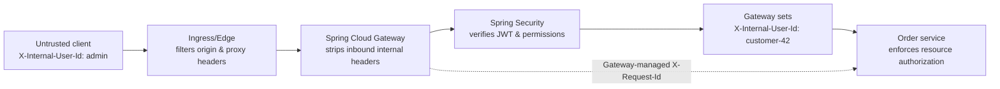
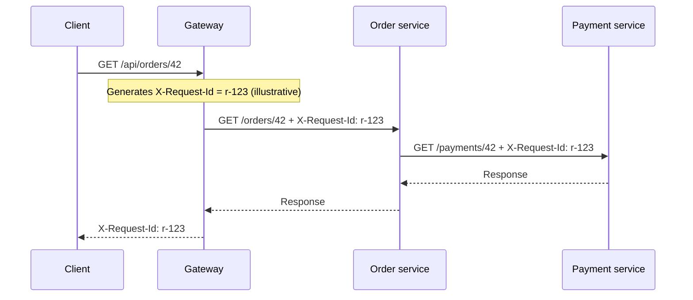

# Preserving Request Identity and Preventing Client Spoofing of Internal Headers in Spring Cloud Gateway

In a microservices system, a request might traverse **API Gateway → order-service → payment-service** before returning a response to the client. When an error occurs, operations teams need to know whether logs across different services belong to **the same request**. At the same time, backends often expect headers carrying user or tenant information supplied by the Gateway. If the Gateway forwards such headers verbatim from the Internet, an attacker can simply send `X-Internal-User-Id: admin` to **spoof identity**.

This lesson belongs to the **Request Headers** chapter of the **SPRING_CLOUD_GATEWAY** module. We will design a trust boundary: **preserve a consistent request ID for traceability, strip client-declared internal headers, and regenerate internal identity only from verified authentication data**. This forms the foundation for authentication, authorization, rate limiting, circuit breaking, retries, TLS, and request observability when Spring Cloud Gateway acts as a microservices entry point.

> **Version scope:** Gateway examples use **Spring Cloud Gateway Server WebFlux 5.0.x**, configured under `spring.cloud.gateway.server.webflux.routes` on Spring Cloud 2025.1 / Spring Boot 4. Older lines may use the `spring.cloud.gateway.routes` prefix; Server Web MVC uses a different filter API. Always verify the BOM/starters matching your actual release before deploying.

## 1. Learning Objectives

After this lesson, you will be able to:

1. Distinguish **request/correlation ID**, **trace ID**, **user ID**, and **tenant ID**.
2. Establish header-handling rules across the client → Gateway → backend boundary.
3. Use a Gateway Server WebFlux `GlobalFilter` to generate a fresh `X-Request-Id`, strip client-supplied internal identity headers, and return the request ID to the client.
4. Understand why `RemoveRequestHeader` or `SetRequestHeader` in YAML is helpful yet insufficient to authenticate a user.
5. Regenerate `X-Internal-User-Id` from a Spring Security–verified JWT rather than from cookies, query strings, or self-declared headers.
6. Verify behavior using an echo backend, `curl`, and logs; address issues around route matching, forwarded headers, retries, and Gateway bypass paths.

## 2. Which Identifiers Can a Request Carry?

Suppose a client sends:

```http
GET /api/orders/42 HTTP/1.1
Host: api.example.test
X-Request-Id: mobile-123
X-Internal-User-Id: admin
X-Internal-Tenant-Id: privileged
Authorization: Bearer <access-token>
```

These lines **do not share the same level of trust**:

| Field | Purpose | Can client set it? | Should backend trust it immediately? |
|---|---|---|---|
| `X-Request-Id` | Ties together logs/events for one logical request | Yes | Never treat as proof of identity; Gateway should generate or validate inbound input |
| `traceparent` | Distributed tracing context per W3C | Possible | Never use for identity authentication |
| `X-Internal-User-Id` | Verified user ID consumed by internal services | Can be spoofed | **No**; strip Internet input and regenerate from a trusted source |
| `X-Internal-Tenant-Id` | Verified tenant/organization | Can be spoofed | **No**; verify tenant permissions before generating |
| `Authorization: Bearer ...` | Authentication credential | Yes | Trusted only after **verifying** token signature, issuer, expiration, audience, and policies |
| `Forwarded` / `X-Forwarded-*` | Proxy, host, scheme, and IP metadata | Can be spoofed | Trust only from configured trusted reverse-proxy/ingress chains |

**A request ID is not a user ID.** A value like `82b2...` is great for finding a request in logs, yet anyone knowing that value gains no resource access rights.

**A trace ID is not strictly identical to a request ID either.** A distributed trace can span multiple spans, consecutive HTTP requests, and asynchronous jobs. `X-Request-Id` can serve as an application ID scoped to a specific Gateway boundary; `traceparent` is a dedicated standard for trace context. Both can be linked in logs/traces, but never assume they are always identical.

## 3. Threat Model: Client Spoofing Internal Headers

Suppose `order-service` trusts `X-Internal-User-Id` and uses it to fetch orders:

```text
GET /orders/42
X-Internal-User-Id: customer-42
```

If the Gateway **forwards client-sent headers verbatim**, an attacker can try:

```bash
curl -i http://localhost:8080/api/orders/42 \
  -H "X-Internal-User-Id: admin"
```

The vulnerability arises when `order-service` treats `admin` as a Gateway-verified identity. This is a **trust boundary** flaw, not solved merely by naming the header `X-Internal-*`.

A sound architecture:



Note on **actual execution order**: Spring Security WebFlux usually operates in the `WebFilter` layer, while `GlobalFilter` runs after the Gateway matches a route. This diagram shows **required responsibilities**, not the exact callback sequence of every framework filter. The system must ensure no component prior to sanitization trusts self-declared headers for security decisions.

### 3.1. Three Boundary Rules

1. **Never trust internal headers arriving from the Internet.** Strip `X-Internal-User-Id`, `X-Internal-Tenant-Id`, and any identity/permission header treated as trusted by backends.
2. **Re-attach only authenticated and authorized info.** For instance, read `sub` from a valid JWT; any tenant ID must belong to tenants the user is authorized to access.
3. **Protect the path from Gateway to backend.** Use private networking, network access controls, mTLS, or service-to-service authentication where needed. If clients can reach the backend directly and inject `X-Internal-User-Id`, Gateway sanitization is bypassed.

Never treat "passed through the Gateway" as a substitute for checking order ownership at the backend. For sensitive data, the backend must still enforce appropriate authorization policies.

## 4. Strategy for Generating and Propagating `X-Request-Id`

Two design patterns are common:

| Approach | How it works | When appropriate |
|---|---|---|
| **Gateway generates a fresh ID at the outer edge** | Ignores or replaces client-sent `X-Request-Id`, creates a new UUID, and forwards it | Public gateway with no trusted upstream proxy |
| **Accept ID from trusted ingress** | Ingress strips client ID and generates a fresh one; Gateway accepts IDs only over a locked-down ingress channel | Infrastructure with reverse proxies/ingresses enforcing path and policy controls |

In our hands-on exercise, we choose **Gateway generates a fresh UUID**. Even if a client sends `X-Request-Id: forged-id`, the backend still receives a Gateway-generated UUID. This is clean, prevents log injection from unsanitized inputs, avoids oversized values, and avoids treating client-supplied IDs as access proof.

A request crossing three components should keep the same ID:



**Important:** The Gateway can attach the header for the **Gateway → order-service** call, yet `order-service` must actively propagate the ID when calling `payment-service`. Framework HTTP clients do not automatically copy custom headers onto every outbound call. If you already use Micrometer Tracing/OpenTelemetry, prefer standard `traceparent`/span propagation and add request IDs only when explicitly required by applications.

### 4.1. Desirable Properties of a Request ID

- Generated by a trusted component with low collision risk, such as `UUID.randomUUID()`.
- Contains only characters safe for logs and HTTP headers.
- Contains no emails, phone numbers, access tokens, or personally identifiable information.
- Logged in a structured field such as `requestId`; never dump raw `Authorization` or `Cookie` headers.
- Follows lifecycle rules: each new client request gets a fresh ID; downstream calls keep the ID for correlation; retries may keep the same logical ID while adding `attempt`/span metadata to distinguish backend calls.

If accepting external IDs from an **authenticated, isolated proxy**, constrain length and character format (e.g., character allowlist and maximum size) to reject CR/LF characters or abnormally long strings. Syntactic validity never turns an ID into identity authentication.

## 5. Ways to Manipulate Headers in Spring Cloud Gateway

Server WebFlux provides common filters:

| Filter | Behavior | Use case |
|---|---|---|
| `RemoveRequestHeader` | Removes a header by **exact name** before proxying | Stripping spoofed `X-Internal-User-Id` |
| `SetRequestHeader` | Replaces all values of a header name with a configured value | Setting a static per-route header |
| `AddRequestHeader` | Appends a header value; can produce multi-value headers | Attaching non-sensitive demo metadata |
| Custom `GlobalFilter` | Operates on requests for matched routes; can compute dynamic values | Generating UUIDs, sanitizing header sets, regenerating identity from verified sources |
| Per-route `GatewayFilter` | Runs only when its specific route is selected | Backend-specific policies |

**Do not use** `AddRequestHeader=X-Internal-User-Id, ...` to override spoofed client values: `AddRequestHeader` can **append** a new value while leaving the old spoofed value intact. Backends may disagree on whether they read the first or last value. Use `remove` + `set` or `SetRequestHeader` when sourcing from trusted data.

### 5.1. Stripping in YAML Alone When Identity Regeneration Is Not Needed

Example standalone route that only **strips** two internal headers:

```yaml
server:
  port: 8080

spring:
  cloud:
    gateway:
      server:
        webflux:
          routes:
            - id: orders-sanitized
              uri: http://localhost:9001
              predicates:
                - Path=/api/orders/**
              filters:
                - StripPrefix=1
                - RemoveRequestHeader=X-Internal-User-Id
                - RemoveRequestHeader=X-Internal-Tenant-Id
```

For `GET /api/orders/42`, the backend receives `/orders/42` and **does not receive** the two stripped headers. However, this configuration **does not dynamically generate `X-Request-Id`** and **does not know who the user is**.

`RemoveRequestHeader` takes a single header name; it has **no wildcard support** to strip every header starting with `X-Internal-`. When a system has many sensitive headers, maintain a centralized list or write an explicit sanitizing filter.

> **Do not combine this YAML snippet directly with the `GlobalFilter` example regenerating `X-Internal-User-Id` in section 9.** If a route filter removes the header after the global filter just populated it, the backend loses the valid identity. When combining them, design and test exact filter ordering.

## 6. Main Example: A `GlobalFilter` Generating Request IDs and Stripping Spoofed Headers

Let's create a Gateway with a public `GET /api/orders/42` endpoint for easy observation. This filter performs three tasks:

1. Generates a fresh `X-Request-Id` for matched requests.
2. Removes headers clients **must never define themselves** (user ID, tenant ID, role, etc.).
3. Injects the ID into both the backend request and the client response.

### 6.1. Dependencies and Route Configuration

Create a Spring Boot application compatible with Spring Cloud 2025.1.x and add **Spring Cloud Gateway Server WebFlux**. Core Maven dependency:

```xml
<dependency>
    <groupId>org.springframework.cloud</groupId>
    <artifactId>spring-cloud-starter-gateway-server-webflux</artifactId>
</dependency>
```

A Spring Boot–compatible BOM is required in a manual Maven project; the snippet above is not a full `pom.xml`. With WebFlux, avoid accidentally adding `spring-boot-starter-webmvc`.

`src/main/resources/application.yml`:

```yaml
server:
  port: 8080

spring:
  application:
    name: request-header-gateway
  cloud:
    gateway:
      server:
        webflux:
          routes:
            - id: orders-route
              uri: http://localhost:9001
              predicates:
                - Path=/api/orders/**
                - Method=GET
              filters:
                - StripPrefix=1
```

**This config is for the header-sanitization demo**, with Resource Server not enabled yet; section 9 shows how to upgrade it into a JWT-authenticated route.

### 6.2. Writing `RequestBoundaryFilter`

Place the class inside a package scanned by `@SpringBootApplication`:

```java
import java.util.UUID;

import org.slf4j.Logger;
import org.slf4j.LoggerFactory;
import org.springframework.cloud.gateway.filter.GatewayFilterChain;
import org.springframework.cloud.gateway.filter.GlobalFilter;
import org.springframework.core.Ordered;
import org.springframework.http.server.reactive.ServerHttpRequest;
import org.springframework.stereotype.Component;
import org.springframework.web.server.ServerWebExchange;
import reactor.core.publisher.Mono;

@Component
public final class RequestBoundaryFilter implements GlobalFilter, Ordered {
    private static final Logger log =
            LoggerFactory.getLogger(RequestBoundaryFilter.class);

    public static final String REQUEST_ID = "X-Request-Id";
    public static final String INTERNAL_USER = "X-Internal-User-Id";
    public static final String INTERNAL_TENANT = "X-Internal-Tenant-Id";

    @Override
    public int getOrder() {
        return -100;
    }

    @Override
    public Mono<Void> filter(
            ServerWebExchange exchange,
            GatewayFilterChain chain) {

        // Do not rely on client-sent X-Request-Id.
        String requestId = UUID.randomUUID().toString();

        ServerHttpRequest request = exchange.getRequest().mutate()
                .headers(headers -> {
                    // Remove ALL values for each header name.
                    headers.remove(REQUEST_ID);
                    headers.remove(INTERNAL_USER);
                    headers.remove(INTERNAL_TENANT);
                    headers.remove("X-Internal-Role");
                    headers.remove("X-Authenticated-User");

                    // Set a single unique correlation ID.
                    headers.set(REQUEST_ID, requestId);
                })
                .build();

        ServerWebExchange sanitized =
                exchange.mutate().request(request).build();

        // Set response header before the response commits.
        sanitized.getResponse().beforeCommit(() -> {
            sanitized.getResponse().getHeaders()
                    .set(REQUEST_ID, requestId);
            return Mono.empty();
        });

        return chain.filter(sanitized)
                .doFinally(signal -> log.info(
                        "requestId={} method={} path={} signal={}",
                        requestId,
                        exchange.getRequest().getMethod(),
                        exchange.getRequest().getPath().value(),
                        signal));
    }
}
```

**Why does the code call `headers.remove()` followed by `headers.set()`?**

- `remove` guarantees no client-declared values under that name remain.
- `set` assigns **exactly one** fresh value for that name.
- `HttpHeaders` treats header names case-insensitively per HTTP semantics, so variants like `x-internal-user-id` are handled accordingly.
- `beforeCommit` ensures the request ID is added to the response before headers are flushed to the client.
- `doFinally` logs the reactive completion signal (success, error, or cancel); never log raw tokens or cookies.

**Ordering limitation:** `GlobalFilter` runs for requests that matched a Gateway route. It **does not sanitize headers before route predicates**; if a route uses `Header=X-Internal-User-Id, admin` as a security check, an attacker can still satisfy the predicate **before the filter executes**. Avoid that pattern altogether and enforce controls at ingress, Spring Security, or another proper layer.

Furthermore, `WebFilter`s or components running before the Gateway can still see inbound headers. Ensure none of them trust unverified `X-Internal-*` fields.

### 6.3. Minimal Spring Boot Entry Point

```java
import org.springframework.boot.SpringApplication;
import org.springframework.boot.autoconfigure.SpringBootApplication;

@SpringBootApplication
public class GatewayApplication {
    public static void main(String[] args) {
        SpringApplication.run(GatewayApplication.class, args);
    }
}
```

At startup, Spring registers `RequestBoundaryFilter` because of `@Component` in a scanned package.

## 7. Building an Echo Backend and Testing Spoofing

Create `OrderHeaderEcho.java` in a practice folder; use JDK 17+ and its built-in HTTP server so no extra backend framework is needed:

```java
import com.sun.net.httpserver.HttpServer;
import java.net.InetSocketAddress;
import java.nio.charset.StandardCharsets;

public class OrderHeaderEcho {
    public static void main(String[] args) throws Exception {
        HttpServer server = HttpServer.create(
                new InetSocketAddress("127.0.0.1", 9001), 0);

        server.createContext("/", exchange -> {
            String response =
                    "path=" + exchange.getRequestURI().getRawPath() + "\n" +
                    "requestId=" + exchange.getRequestHeaders()
                            .getFirst("X-Request-Id") + "\n" +
                    "userId=" + exchange.getRequestHeaders()
                            .getFirst("X-Internal-User-Id") + "\n" +
                    "tenantId=" + exchange.getRequestHeaders()
                            .getFirst("X-Internal-Tenant-Id") + "\n";

            byte[] body = response.getBytes(StandardCharsets.UTF_8);
            exchange.getResponseHeaders().set(
                    "Content-Type", "text/plain; charset=utf-8");
            exchange.sendResponseHeaders(200, body.length);
            try (var out = exchange.getResponseBody()) {
                out.write(body);
            }
        });

        server.start();
        System.out.println("Order header echo listening on :9001");
    }
}
```

Open the first terminal:

```bash
java --add-modules jdk.httpserver OrderHeaderEcho.java
```

Open a second terminal in the Gateway directory:

```bash
# Linux/macOS
./mvnw spring-boot:run

# Windows PowerShell
.\mvnw.cmd spring-boot:run
```

### 7.1. Request Without Internal Headers

```bash
curl -i http://localhost:8080/api/orders/42
```

Illustrative response:

```http
HTTP/1.1 200 OK
X-Request-Id: 3b60d615-871f-4cd3-b887-22b599e7f34f
Content-Type: text/plain; charset=utf-8

path=/orders/42
requestId=3b60d615-871f-4cd3-b887-22b599e7f34f
userId=null
tenantId=null
```

The UUID in the request and response **must match** for a given call; the next call will normally produce a different UUID. The UUID above is an example only—never hardcode it.

### 7.2. Intentionally Sending Spoofed Headers

```bash
curl -i "http://localhost:8080/api/orders/42" \
  -H "X-Request-Id: attacker-controlled" \
  -H "X-Internal-User-Id: admin" \
  -H "X-Internal-Tenant-Id: root-tenant"
```

Expected output:

```text
HTTP response: X-Request-Id = <new Gateway-generated UUID>
Backend body:
  path=/orders/42
  requestId=<same Gateway-generated UUID>
  userId=null
  tenantId=null
```

The Gateway replaced `attacker-controlled` with a fresh UUID and blocked both internal headers. If you call the backend **directly**:

```bash
curl -i http://localhost:9001/orders/42 \
  -H "X-Internal-User-Id: admin"
```

the echo backend will see `userId=admin` because this demo backend has **no network or auth protection**. This demonstrates why production systems must block Gateway bypass paths using network policies, mTLS, service-to-service authentication, or direct backend authentication.

> On Windows PowerShell 5.1, invoke `curl.exe` if `curl` is aliased to `Invoke-WebRequest`; flatten `\` line continuations onto a single line when running in PowerShell.

### 7.3. Repeated Calls and Comparing IDs

```bash
curl -i http://localhost:8080/api/orders/42
curl -i http://localhost:8080/api/orders/42
```

Both responses should carry two distinct `X-Request-Id` values. When Gateway logs include `requestId`, use it to correlate the exact ID across response and backend.

**Note:** This demo illustrates only **header hygiene** and request correlation. The route is currently public with no authenticated user, so `userId=null` is expected. To send a trusted user ID to the backend, add authentication in the next section.

## 8. Reusing the Request ID Across Services

The Gateway generates the ID once. Inside `order-service`, the app can read:

```java
String requestId = request.getHeader("X-Request-Id");
```

The snippet above illustrates a Servlet API backend. For a WebFlux backend, read equivalently from `ServerWebExchange.getRequest().getHeaders()`. When `order-service` calls `payment-service` via `WebClient`, it can propagate:

```java
webClient.get()
        .uri("http://payment-service/payments/42")
        .header("X-Request-Id", requestId)
        .retrieve()
        .bodyToMono(String.class);
```

This snippet only shows **how to attach an existing header** to an HTTP client call. In production apps, use shared interceptors/filters or tracing instrumentation to ensure every outbound call carries the right context. Handle missing, duplicate, and async propagation cases; avoid minting a new ID in each service and losing log correlation.

### 8.1. Preserving the ID Across Retries and Circuit Breakers

With `Retry`, one logical client request can trigger multiple backend calls:

```text
requestId = r-123 (client request)
  attempt=1 -> order-service -> timeout
  attempt=2 -> order-service -> 503
  attempt=3 -> order-service -> 200
```

All attempts can preserve the **same request ID** to tie back to the client request. Add an attempt counter or span ID to distinguish individual attempts. Do not count three log entries with `requestId=r-123` and conclude there were three separate client requests.

For circuit breakers/fallbacks, log route ID, circuit state, duration, and final outcome. Never log `Authorization`, `Cookie`, or access tokens to trace requests; request ID and trace ID are usually sufficient lookup keys.

### 8.2. Request ID vs. W3C Trace Context

When using Micrometer Tracing/OpenTelemetry, requests may carry:

```http
traceparent: 00-4bf92f3577b34da6a3ce929d0e0e4736-00f067aa0ba902b7-01
```

This is the W3C trace context structure for linking spans/traces, not user authentication. Tracing systems typically validate format and start a new trace when context is invalid. `tracestate` and `baggage` can carry extra data; restrict permitted keys and never put PII or credentials inside baggage.

Never treat `traceparent`, `X-Request-Id`, or `X-Forwarded-For` as trusted identity for authorization or per-user quotas.

## 9. Regenerating `X-Internal-User-Id` from a Verified JWT

Header sanitization solves only the **first half** of the problem. If the backend needs to know which user is logged in, the Gateway can validate a JWT and emit a header **of its own creation**.

With Spring Boot 4, the recommended resource server dependency is:

```xml
<dependency>
    <groupId>org.springframework.boot</groupId>
    <artifactId>spring-boot-starter-security-oauth2-resource-server</artifactId>
</dependency>
```

You must configure a **real** Authorization Server / issuer, for illustration:

```yaml
spring:
  security:
    oauth2:
      resourceserver:
        jwt:
          issuer-uri: https://identity.example.test/issuer
```

The `issuer-uri` uses a placeholder domain to show configuration placement; **it will not run without a real JWT issuer**. Production systems must also validate `aud` (audience), signing algorithms, scopes/authorities, and claims per your security contract. Verifying signature, expiration, and issuer is handled by a properly configured Resource Server; never merely base64-decode a JWT payload and treat it as authenticated.

### 9.1. Protecting Routes with Spring Security WebFlux

Example protecting all `/api/orders/**` routes with JWTs:

```java
import org.springframework.context.annotation.Bean;
import org.springframework.context.annotation.Configuration;
import org.springframework.security.config.Customizer;
import org.springframework.security.config.web.server.ServerHttpSecurity;
import org.springframework.security.web.server.SecurityWebFilterChain;

@Configuration
public class GatewaySecurityConfiguration {
    @Bean
    SecurityWebFilterChain securityWebFilterChain(ServerHttpSecurity http) {
        return http
                .authorizeExchange(exchanges -> exchanges
                        .pathMatchers("/api/orders/**").authenticated()
                        .anyExchange().permitAll())
                .oauth2ResourceServer(oauth -> oauth.jwt(
                        Customizer.withDefaults()))
                .build();
    }
}
```

Once enabled, requests to order routes **without a valid JWT** are rejected at the security layer (typically HTTP `401` for unauthenticated requests), so the unauthenticated `curl` commands from section 7 will no longer return `200`. Treat this as a **separate upgrade step** performed after confirming the sanitization demo works.

For apps using **cookie sessions + CSRF** or browser logins, security policies differ; never disable CSRF thoughtlessly. `authenticated()` only requires a logged-in identity; resource-specific access rights must still be enforced per business rules.

### 9.2. Filter Adding the User ID After Authentication

With `RequestBoundaryFilter` from section 6 already stripping spoofed input, add the filter below. It **does not read** `X-Internal-User-Id` from the client; instead it reads the `JwtAuthenticationToken` produced by Spring Security after verifying the JWT.

```java
import org.springframework.cloud.gateway.filter.GatewayFilterChain;
import org.springframework.cloud.gateway.filter.GlobalFilter;
import org.springframework.core.Ordered;
import org.springframework.http.server.reactive.ServerHttpRequest;
import org.springframework.security.oauth2.server.resource.authentication.JwtAuthenticationToken;
import org.springframework.stereotype.Component;
import org.springframework.web.server.ServerWebExchange;
import reactor.core.publisher.Mono;

@Component
public final class VerifiedUserHeaderFilter
        implements GlobalFilter, Ordered {

    @Override
    public int getOrder() {
        // Run after RequestBoundaryFilter (-100), before proxying.
        return -90;
    }

    @Override
    public Mono<Void> filter(
            ServerWebExchange exchange,
            GatewayFilterChain chain) {

        return exchange.getPrincipal()
                .ofType(JwtAuthenticationToken.class)
                .flatMap(auth ->
                    Mono.justOrEmpty(auth.getToken().getSubject()))
                .defaultIfEmpty("")
                .flatMap(subject -> {
                    ServerHttpRequest request = exchange.getRequest()
                            .mutate()
                            .headers(headers -> {
                                // Always strip all prior values before setting.
                                headers.remove("X-Internal-User-Id");
                                if (!subject.isBlank()) {
                                    headers.set("X-Internal-User-Id", subject);
                                }
                            })
                            .build();

                    return chain.filter(
                            exchange.mutate().request(request).build());
                });
    }
}
```

Key points to understand:

- The filter yields a `subject` only when the principal is a `JwtAuthenticationToken` with a non-null `sub`.
- When a request lacks a verified JWT, `defaultIfEmpty("")` makes the filter **strip** the header and proceed **without a user ID**; protected routes are still rejected by `SecurityWebFilterChain`.
- Wrapping `chain.filter(...)` inside `flatMap` guarantees the chain is invoked **once** on the chosen branch. Avoid `switchIfEmpty(chain.filter(...))` directly on `Mono<Void>`, because `Mono<Void>` completes empty on success and could trigger the chain a second time.
- `sub` must represent a stable user per your issuer contract; with multiple issuers, never assume `sub` alone is globally unique. You may need a composite issuer + subject identifier or a mapped internal ID.
- Never copy `roles`, `tenant`, or permissions from arbitrary request headers into trusted headers. For tenants, verify claims, tenant membership, and resource permissions before emitting `X-Internal-Tenant-Id`.

### 9.3. Blocking Bypass Paths and Verifying at the Backend

Even when the Gateway regenerates `X-Internal-User-Id` cleanly, the backend **does not automatically know the header came from the Gateway**. A client could call the backend directly if it is publicly reachable, or a compromised internal service could forge the header.

Options depending on sensitivity level:

- Allow the backend to accept traffic only from the trusted Gateway/ingress via private networking or network policies.
- Use mTLS or service-to-service authentication so the backend knows the caller is a trusted component.
- For sensitive data, the backend can **validate the JWT itself** or verify a short-lived signed internal token before enforcing resource authorization.
- Align contracts: who issues `X-Internal-User-Id`, which services may trust it, when it must be stripped, and how it is audited.

**A header reset by the Gateway is Gateway-supplied data, yet the mere presence of a header is not cryptographic proof.**

## 10. `Forwarded` and `X-Forwarded-*`: Another Boundary

Reverse proxies commonly attach headers such as:

```http
Forwarded: for=203.0.113.10;proto=https;host=api.example.test
X-Forwarded-For: 203.0.113.10
X-Forwarded-Proto: https
X-Forwarded-Host: api.example.test
```

These are used when the Gateway sits behind a load balancer or ingress to infer client IP, scheme, and original host. Yet **direct clients can also send headers with those exact names**.

Therefore:

1. At the public **ingress**, strip Internet-supplied forwarded headers; the ingress writes trustworthy metadata from the actual connection.
2. Configure the Gateway to trust only proxies within controlled networks/authentication; never treat every `X-Forwarded-For` as the real client IP.
3. On Gateway Server WebFlux 5.0, the `Forwarded`/`XForwarded` mechanism uses `spring.cloud.gateway.server.webflux.trusted-proxies` regexes to identify trusted proxies. Append/enable flags affect how headers are built and merged. Check docs and test against your real topology.
4. When using client IP for rate limiting, confirm the IP source was normalized by the ingress. For per-user limits, prefer authenticated user IDs.

Do not lump every `X-Forwarded-*` field into an arbitrary deletion list inside the Gateway without understanding what your reverse proxy does; that can break redirect URLs, TLS schemes, and IP logging. Sanitization policies must be applied consistently at the **first boundary capable of authenticating the proxy origin**.

## 11. Route Matching and Filter Ordering: Two Common Traps

### 11.1. A `GlobalFilter` Does Not Run Before Route Predicates

Spring Cloud Gateway matches routes using `Path`, `Host`, `Header`, and other predicates **before** the Gateway `GlobalFilter + GatewayFilter` chain executes.

Security-flawed configuration example:

```yaml
predicates:
  - Path=/api/admin/**
  - Header=X-Internal-Role, admin
```

A client can send `X-Internal-Role: admin` to satisfy the predicate. Stripping the header later in a `GlobalFilter` **does not undo** the route selection that already happened. Route predicates are routing logic only; use Spring Security and authentication/authorization policies to protect admin endpoints.

### 11.2. A Filter Can Strip the Trusted Header You Just Generated

Suppose a `GlobalFilter` emits `X-Internal-User-Id` after authentication, yet the route includes:

```yaml
filters:
  - RemoveRequestHeader=X-Internal-User-Id
```

If the route filter runs afterward, the backend never receives the ID. When designing, distinguish:

- **Inbound sanitization** (*sanitize ingress headers*) at a boundary before any component trusts them.
- **Trusted header regeneration** after authentication and before HTTP routing.
- **Never stripping/overwriting again** in another route, default, or global filter.

Gateway filters are merged and sorted by `Ordered`. A route's `routes[*].order` controls **route selection precedence**, **not** filter execution order. With `RequestBoundaryFilter=-100` and `VerifiedUserHeaderFilter=-90`, their relative order is explicit, yet you should still verify alongside all other filters in the app.

### 11.3. Requests That Do Not Match Any Route

Gateway `GlobalFilter`s run while processing a matched route; requests failing to match a route may not receive `X-Request-Id` from `RequestBoundaryFilter`. If you require correlation IDs for **all** requests—including pre-routing 404s—generate the ID in an appropriate **`WebFilter`/ingress** (before route matching) and pass the controlled ID to the Gateway. Never assume `GlobalFilter` is the earliest HTTP interception point in the application.

## 12. Observability and Verification in Real Environments

### 12.1. Gateway Actuator

When `spring-boot-starter-actuator` is included, Gateway 5.0.x allows enabling read-only endpoints:

```yaml
management:
  endpoint:
    gateway:
      access: read-only
  endpoints:
    web:
      exposure:
        include: health,info,gateway
```

Query:

```bash
curl -i http://localhost:8080/actuator/gateway/routes
curl -i http://localhost:8080/actuator/gateway/globalfilters
```

The `routes` endpoint confirms `orders-route` loaded; `globalfilters` lists active global filters and their orders. Neither **proves by itself** that headers were stripped or set properly. To verify data, combine `curl` requests, an echo backend, and structured logs/traces.

Never expose management endpoints to the public Internet without strict access controls; route URIs and filter settings can reveal internal architecture details.

### 12.2. Minimum Test Matrix

| Scenario | Backend should receive | Client should receive |
|---|---|---|
| Omit `X-Request-Id` | A fresh Gateway-generated ID | Same ID in response header |
| Send `X-Request-Id: forged` | A fresh ID, never `forged` | The fresh ID |
| Send `X-Internal-User-Id: admin` unauthenticated (demo) | No user ID | Response must not treat user as logged in |
| Send multiple `X-Internal-User-Id` values | Zero values remain | No spoofed user data in response |
| Valid JWT on protected route | Fresh ID and user ID from verified token | Response per API policy |
| Missing/expired JWT on protected route | No request proxied to backend | Typically HTTP `401` (depending on security config) |
| Authenticated user lacking permissions | No access to resource | Typically HTTP `403` when policy denies |
| Call backend directly with spoofed header | Backend would accept it without network/auth boundary | Must be blocked in production |
| Client calls unmatched path | Demo `GlobalFilter` may not run | `X-Request-Id` may be absent unless handled in `WebFilter`/ingress |

**Additional check:** when the backend returns `503`, the Gateway times out, retries trigger, or clients disconnect, verify `requestId` stays consistent across logs and attempts. For rate limiting, ensure the quota key comes from an authenticated source; request IDs exist for tracing and make terrible quota keys since every request differs.

## 13. Common Errors and Fixes

| Symptom | Cause | Resolution |
|---|---|---|
| Backend still receives client-sent `X-Internal-User-Id: admin` | Not sanitized, or a route bypasses the filter | Establish a stripping boundary and audit every route |
| Client sends `X-Request-Id: forged` and backend sees it verbatim | Used `AddRequestHeader` instead of overwriting, or filter not registered | Remove + reset; check global filter bean/order |
| `X-Internal-User-Id` arrives with two values | Called `add` instead of `set` after removal | Use `headers.remove` / `headers.set` |
| JWT login succeeds yet backend sees no user ID | `VerifiedUserHeaderFilter` not registered, or a route filter stripped it afterward | Check principal, `Ordered`, and route/default filters |
| Unmatched requests lack a request ID | `GlobalFilter` only runs after route matching | Generate request IDs at ingress/`WebFilter` to cover 404s |
| `Header=X-Internal-Role, admin` matches admin route | Predicate checks input before sanitization | Never use client headers for authorization; use Spring Security |
| User ID from JWT accesses wrong tenant | Trusted self-declared claim/tenant without checking membership | Verify claims and resource permissions before setting tenant identity |
| Direct calls to backend bypass Gateway | Backend has public endpoint or lacks service-to-service auth | Enforce network restrictions, mTLS, or backend authentication |
| Request ID does not reach `payment-service` | Backend does not propagate custom headers automatically | Add propagation in HTTP client/interceptor or tracing |
| Logs contain `Authorization`, `Cookie` | Logged all request headers for debugging | Redact secrets; log request ID, route ID, status, latency |
| Client spoofs `X-Forwarded-For` | Ingress/Gateway trusts forwarded headers from untrusted sources | Build trusted proxy list and overwrite/append policies |
| Retries inflate request metrics | Counting every backend attempt as a distinct client request | Distinguish logical request ID from attempt/span |

## 14. Self-Check Questions

**Question 1.** Do `X-Request-Id` and `X-Internal-User-Id` mean the same thing?

**Answer:** No. `X-Request-Id` correlates logs for a request; `X-Internal-User-Id` represents user identity under a service trust contract and must be created only after authentication.

**Question 2.** Why shouldn't you use `AddRequestHeader=X-Internal-User-Id, real-user` to overwrite a spoofed value?

**Answer:** `AddRequestHeader` appends another value, leaving the old spoofed value present. You must strip inbound values and use `set`/`SetRequestHeader` from a trusted source.

**Question 3.** If a client sends `X-Request-Id: attacker`, what does the `RequestBoundaryFilter` example do?

**Answer:** It strips the inbound ID and generates a fresh UUID; both the backend and the HTTP response receive that same fresh UUID for the request.

**Question 4.** Can `Header=X-Internal-Role, admin` protect an admin route if a `GlobalFilter` strips the header afterward?

**Answer:** No. Route predicates are evaluated **before** Gateway global filters; client-supplied values can match the route. Enforce authentication/authorization before granting access.

**Question 5.** What is `JwtAuthenticationToken` used for in the example?

**Answer:** To extract `sub` from a JWT already verified by Spring Security and **regenerate** the internal header, rather than reading a client-declared user ID.

**Question 6.** Why does the backend still need protective controls even after the Gateway sanitizes headers?

**Answer:** Because traffic could bypass the Gateway or arrive from an untrusted service. The backend must restrict network access or independently verify caller origin/identity/permissions per security requirements.

**Question 7.** If a request retries three times, should it use three different request IDs?

**Answer:** Normally keep one ID for the **logical request**, and attach attempt/span IDs to distinguish individual downstream calls.

**Question 8.** Is `X-Forwarded-For` a user ID or a verified client IP?

**Answer:** No. It is proxy metadata that can be spoofed from the Internet; trust it only per proxy/ingress configuration and never use it as user identity.

**Extension exercise:** Starting from the demo in section 6, (1) send both `X-Internal-Role: admin` and `X-Internal-User-Id: attacker` simultaneously and observe the backend receives neither spoofed header; (2) add `VerifiedUserHeaderFilter` after configuring a real JWT Resource Server; (3) verify the protected route returns `401` without a token and forwards the right `sub` with a valid token; (4) configure the backend to accept traffic only from the Gateway and test calling the backend directly to confirm it is blocked.

## 15. Official References

- [Spring Cloud Gateway Server WebFlux 5.0 — How It Works](https://docs.spring.io/spring-cloud-gateway/reference/5.0/spring-cloud-gateway-server-webflux/how-it-works.html).
- [Spring Cloud Gateway Server WebFlux 5.0 — Global Filters and `Ordered`](https://docs.spring.io/spring-cloud-gateway/reference/5.0/spring-cloud-gateway-server-webflux/global-filters.html).
- [Spring Cloud Gateway Server WebFlux 5.0 — Developer Guide: custom GlobalFilter](https://docs.spring.io/spring-cloud-gateway/reference/5.0/spring-cloud-gateway-server-webflux/developer-guide.html).
- [Spring Cloud Gateway Server WebFlux 5.0 — `RemoveRequestHeader`](https://docs.spring.io/spring-cloud-gateway/reference/5.0/spring-cloud-gateway-server-webflux/gatewayfilter-factories/removerequestheader-factory.html).
- [Spring Cloud Gateway Server WebFlux 5.0 — `SetRequestHeader`](https://docs.spring.io/spring-cloud-gateway/reference/5.0/spring-cloud-gateway-server-webflux/gatewayfilter-factories/setrequestheader-factory.html).
- [Spring Cloud Gateway Server WebFlux 5.0 — `HttpHeadersFilters` and trusted proxies](https://docs.spring.io/spring-cloud-gateway/reference/5.0/spring-cloud-gateway-server-webflux/httpheadersfilters.html).
- [Spring Security 7.0 — Reactive OAuth2 Resource Server JWT](https://docs.spring.io/spring-security/reference/7.0/reactive/oauth2/resource-server/jwt.html).
- [Spring Boot 4.0 — Security OAuth2 Resource Server starter](https://docs.spring.io/spring-boot/4.0/reference/using/build-systems.html).
- [W3C Trace Context](https://www.w3.org/TR/trace-context/).

**Key takeaway:** A trustworthy Gateway must make clear **who creates the request ID, who is permitted to create identity headers, and why the backend trusts the sender**. Generate or control `X-Request-Id` for cross-service tracing; strip all client-declared internal headers; regenerate user/tenant identity only from verified authentication data; and protect direct network paths to backends. That is how you preserve request observability without opening the door to identity spoofing.
