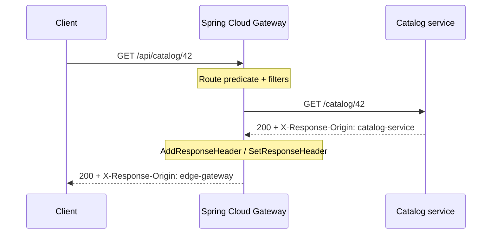
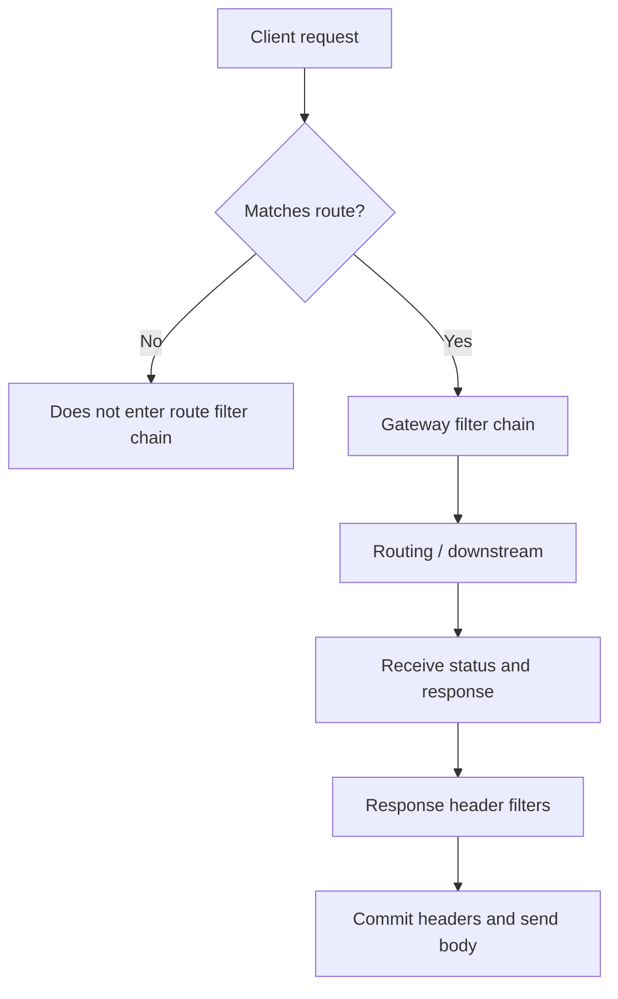

# AddResponseHeader and SetResponseHeader in Spring Cloud Gateway

## 1. The problem: should you append or overwrite a response header?

When building an **API Gateway with Spring Cloud Gateway**, a client request is routed to microservices via a **route predicate**, passes through a **filter chain**, and may have its path/headers transformed, be authenticated, rate-limited, or handled by a retry/circuit breaker. After the downstream service returns a result, the Gateway can also adjust **HTTP response headers** before sending them to the client.

Suppose the `catalog` service returns:

```http
HTTP/1.1 200 OK
Content-Type: application/json
X-Response-Origin: catalog-service
X-Edge-Hop: backend

{"id":"42"}
```

The Gateway wants to do two things: **replace** `X-Response-Origin` with `edge-gateway` so it does not expose the internal service name, while **appending** the value `gateway` to `X-Edge-Hop` to represent a processing hop. This is the core difference between **`SetResponseHeader`** and **`AddResponseHeader`**.

After this lesson, you will be able to distinguish the two filters, write YAML/Java DSL configurations, determine their scope of application, expand variables from routes, test responses, and recognize special cases involving CORS, security, caching, redirects, response commit, and status codes.

> **Version:** primary examples use **Spring Cloud Gateway Server WebFlux 4.3+/5.x** with the `spring.cloud.gateway.server.webflux.routes` namespace. In Gateway Server WebFlux 4.2 and earlier, the prefix is usually `spring.cloud.gateway.routes`. Gateway Server Web MVC uses `server.webmvc` and a different Java API; see section 8.

## 2. Distinguishing request headers, response headers, and HTTP status



| Goal | Common filter | Side receiving the change |
|---|---|---|
Add request header | `AddRequestHeader` | **Backend** receives the new header |
Replace request header | `SetRequestHeader` | **Backend** receives the replaced header |
Add response header value | **`AddResponseHeader`** | **Client** receives the additional value |
Replace all values with the same name on response | **`SetResponseHeader`** | **Client** receives the new value |
Remove response header | `RemoveResponseHeader` | Client does not receive the removed header name, unless another step adds it back |
Change HTTP status | `SetStatus` | Changes the **HTTP status code**, not a header |

For example, `SetResponseHeader=X-Status, 401` only creates an `X-Status` header with content `401`; **it does not return HTTP 401**. The response status still depends on the backend or other components in the Gateway.

## 3. `AddResponseHeader`: adding values

### 3.1. Short syntax and full form

```yaml
filters:
  - AddResponseHeader=X-Edge-Hop, gateway
```

The filter takes **`name`** (the header name) and **`value`** (the value to add). In full configuration form:

```yaml
filters:
  - name: AddResponseHeader
    args:
      name: X-Edge-Hop
      value: gateway
```

These two blocks are **alternative ways of writing it**; do not place both on the same route if you only want to add the value once.

When the response does not yet have `X-Edge-Hop`, the Gateway creates the value `gateway`. If the backend already sent `X-Edge-Hop: backend`, the value `gateway` is **added**, because Add does not mean deleting the old value.

| Backend sends | Filter | Logical result at client |
|---|---|---|
No `X-Edge-Hop` | `AddResponseHeader=X-Edge-Hop, gateway` | `X-Edge-Hop: gateway` |
`X-Edge-Hop: backend` | Same filter | Both `backend` and `gateway` values can coexist |
`X-Response-Origin: catalog` | Same filter | `X-Response-Origin` is not changed |

HTTP headers are **case-insensitive in their names**. However, some clients/proxies may represent two values as two lines or in merged form, and not every header is allowed to be comma-merged. In particular, `Set-Cookie` requires handling under separate rules.

### 3.2. The `override` option in newer releases

Gateway Server WebFlux **5.0.x** documentation describes a third parameter of `AddResponseHeader` as **`override`**, defaulting to `true`:

```yaml
filters:
  - AddResponseHeader=X-Build-Label, gateway
  - AddResponseHeader=X-Existing-Label, default-value, false
```

In the second example, when the response **already has** `X-Existing-Label`, `override=false` prevents adding `default-value`; when the header is not yet present, the value can be added. In default mode, the existence of the header does not automatically prevent the add operation.

**Note:** the word `override` in this parameter **does not turn Add into Set**. If you want to ensure only one value remains, use `SetResponseHeader`. Do not add the third parameter when a project is running an older Gateway version that does not have this option.

## 4. `SetResponseHeader`: replacing all values with the same name

```yaml
filters:
  - SetResponseHeader=X-Response-Origin, edge-gateway
```

`SetResponseHeader` takes `name` and `value`. If the backend already returned `X-Response-Origin: catalog-service`, the Gateway **replaces all values** of the header with the same name with `edge-gateway`.

```yaml
filters:
  - name: SetResponseHeader
    args:
      name: X-Response-Origin
      value: edge-gateway
```

| Backend sends | After `SetResponseHeader=X-Response-Origin, edge-gateway` |
|---|---|
No such header | Adds `X-Response-Origin: edge-gateway` |
`X-Response-Origin: catalog-service` | Only `X-Response-Origin: edge-gateway` remains |
Two values `catalog` and `legacy` for `X-Response-Origin` | Both are replaced with `edge-gateway` |
`X-Service-Version: v1` | Kept intact, because the header name is different |

When the requirement is "the client **must not receive** the internal service name", Set is usually more appropriate than Add. However, if the backend uses multiple meaningful values, Set can **cause data loss**: for example, overwriting `Set-Cookie` risks deleting session cookies or business cookies from the backend.

### 4.1. Comparing Add and Set

| Criterion | `AddResponseHeader` | `SetResponseHeader` |
|---|---|---|
Intent | Append a value | Replace all values of a name |
Header does not exist yet | Adds new header | Adds new header |
Header already exists | Can create an additional value | Replaces old value(s) |
Multi-value header | Can append to the value set | Reduces to a single configured value |
Basic parameters | `name`, `value` | `name`, `value` |
Version-dependent optional parameter | `override` in some newer releases | Not present in standard examples |
URI template variable expansion | Yes | Yes |
Common risk | Duplicate headers, HTTP contract forbids multiple values | Deleting important values created by backend |

## 5. WebFlux example: two routes and two response header patterns

Suppose the Gateway listens on port `8080`, `catalog-service` on `8081`, and `orders-service` on `8082`:

```yaml
# application.yml — Gateway Server WebFlux 4.3+/5.x
server:
  port: 8080

spring:
  application:
    name: edge-gateway
  cloud:
    gateway:
      server:
        webflux:
          routes:
            - id: catalog-route
              uri: http://localhost:8081
              predicates:
                - Path=/api/catalog/**
              filters:
                - StripPrefix=1
                - AddResponseHeader=X-Edge-Hop, gateway
                - SetResponseHeader=X-Response-Origin, edge-gateway

            - id: orders-route
              uri: http://localhost:8082
              predicates:
                - Path=/api/orders/{orderId}
              filters:
                - StripPrefix=1
                - AddResponseHeader=X-Order-Reference, order-{orderId}
                - SetResponseHeader=X-Response-Origin, edge-gateway
```

**Catalog flow:** client calls `GET /api/catalog/42` → predicate matches `catalog-route` → `StripPrefix=1` removes the `api` segment → backend receives `GET /catalog/42` → Gateway processes response headers.

**Orders flow:** client calls `GET /api/orders/17` → predicate extracts variable `orderId=17` → backend receives `GET /orders/17` → client additionally receives `X-Order-Reference: order-17`. The value `{orderId}` is a **URI template variable** captured from the predicate, not a `${orderId}` placeholder or Java regex replacement.

If the catalog backend sends:

```http
HTTP/1.1 200 OK
X-Response-Origin: catalog-service
X-Edge-Hop: backend
Content-Type: application/json

{"id":"42"}
```

A client going through the Gateway may receive the equivalent of:

```http
HTTP/1.1 200 OK
X-Response-Origin: edge-gateway
X-Edge-Hop: backend
X-Edge-Hop: gateway
Content-Type: application/json

{"id":"42"}
```

The two `X-Edge-Hop` lines above illustrate **two values**; a client or proxy may present them differently. Status code `200` and the body are still determined by the backend because neither Add nor Set **changes status/body on its own**.

### 5.1. Expanding URI variables in headers

`Path` and `Host` route predicates can provide variables to use in response header values:

```yaml
predicates:
  - Path=/api/orders/{orderId}
filters:
  - AddResponseHeader=X-Order-Reference, order-{orderId}
  - SetResponseHeader=X-Order-Scope, orders-{orderId}
```

`GET /api/orders/17` produces `order-17` and `orders-17` respectively. However, **do not expose tokens, cookies, or sensitive identifiers** in headers just because the filter allows variable expansion. Headers can appear in proxy logs, browser DevTools, or telemetry.

### 5.2. Applying to multiple routes with `default-filters`

When you want to add common headers to **route definitions**, you can use:

```yaml
spring:
  cloud:
    gateway:
      server:
        webflux:
          default-filters:
            - AddResponseHeader=X-Edge-Product, api-gateway
          routes:
            - id: catalog-route
              uri: http://localhost:8081
              predicates:
                - Path=/api/catalog/**
```

Gateway Server WebFlux `default-filters` are attached through the route definition creation mechanism. They **do not automatically apply to every WebFlux endpoint**, URLs that do not match a route, or every direct Java DSL route. When a policy must also cover errors before route matching, it should be designed at the appropriate WebFlux/Spring Security layer.

## 6. Filter order, short-circuiting, and response commit

When a request matches a route, the route's `GatewayFilter`s and `GlobalFilter`s are combined into a chain and sorted by order. Filters can execute logic on the way in and when the inner chain completes. The fact that they affect response headers **does not mean** they always run as the very last step after the entire response body has been downloaded.



This is a **logical** model for learning and does not describe the exact internal callback timing of each factory. When a filter returns a response immediately without calling the next filter in the chain, filters **inside** it may not run.

### 6.1. Do not Add and Set the same name without a policy

```yaml
filters:
  - AddResponseHeader=X-Mode, from-add
  - SetResponseHeader=X-Mode, from-set
```

These two filters can compete on `X-Mode`. The final value depends on execution order and may be affected by other filters. If you only want one value, use an appropriate **single `SetResponseHeader`**; if you want multiple values, use Add and check the specific HTTP contract.

### 6.2. Committed response

Once the response is **committed**, headers/status generally cannot be freely modified anymore. Built-in factories handle updates according to Gateway's lifecycle; if you write your own `GlobalFilter` in WebFlux, you can register `beforeCommit(...)` before invoking the chain:

```java
// Inside a WebFlux GlobalFilter:
exchange.getResponse().beforeCommit(() -> {
    exchange.getResponse().getHeaders()
        .set("X-Response-Stage", "gateway");
    return reactor.core.publisher.Mono.empty();
});
return chain.filter(exchange);
```

The snippet above is a partial method example, **not a complete Java class**. Do not modify headers inside `doFinally(...)` and expect them to always reach the client: the callback may run after commit or after the connection has been canceled.

## 7. HTTP errors and whether filters run

| Scenario | What to expect? |
|---|---|
Backend returns `200` | Add/Set can modify the response of the matched route |
Backend returns normal HTTP `404`/`500` | The response can still pass through filters; status is not changed automatically |
Request does not match any route | Route-specific filters do not run |
Security returns `401`/`403` **before** Gateway handler | May not have entered the Gateway filter chain yet |
Rate limiter returns `429` | Depends on filter position and commit timing; inspect the actual response |
Circuit breaker returns fallback | Fallback headers and filter order need to be cross-checked |
TLS connection to backend fails, client cancels connection | There may be no complete response to send headers |

`SetResponseHeader` does not change HTTP status. `SetStatus`, exception handlers, circuit breakers, and retries can affect status according to their own configuration. Do not assume a header such as `X-Status: 500` is proof that the actual HTTP code changed.

## 8. Java DSL: WebFlux vs. Web MVC differences

### 8.1. Gateway Server WebFlux

```java
package com.example.gateway;

import org.springframework.cloud.gateway.route.RouteLocator;
import org.springframework.cloud.gateway.route.builder.RouteLocatorBuilder;
import org.springframework.context.annotation.Bean;
import org.springframework.context.annotation.Configuration;

@Configuration
public class GatewayRoutes {
    @Bean
    RouteLocator catalogRoutes(RouteLocatorBuilder builder) {
        return builder.routes()
            .route("catalog-route", r -> r
                .path("/api/catalog/**")
                .filters(f -> f
                    .stripPrefix(1)
                    .addResponseHeader("X-Edge-Hop", "gateway")
                    .setResponseHeader("X-Response-Origin", "edge-gateway"))
                .uri("http://localhost:8081"))
            .build();
    }
}
```

This is how routes are created directly via `RouteLocatorBuilder`. If you want common headers, you can add the filter directly to each Java route or design an appropriate `GlobalFilter`; do not automatically assume every direct route inherits YAML `default-filters`.

### 8.2. Gateway Server Web MVC

Gateway Server Web MVC uses `RouterFunction` and `AfterFilterFunctions`:

```java
import org.springframework.context.annotation.Bean;
import org.springframework.context.annotation.Configuration;
import org.springframework.web.servlet.function.RouterFunction;
import org.springframework.web.servlet.function.ServerResponse;

import static org.springframework.cloud.gateway.server.mvc.filter.BeforeFilterFunctions.uri;
import static org.springframework.cloud.gateway.server.mvc.filter.AfterFilterFunctions.addResponseHeader;
import static org.springframework.cloud.gateway.server.mvc.filter.AfterFilterFunctions.setResponseHeader;
import static org.springframework.cloud.gateway.server.mvc.handler.GatewayRouterFunctions.route;
import static org.springframework.cloud.gateway.server.mvc.handler.HandlerFunctions.http;

@Configuration
class MvcGatewayRoutes {
    @Bean
    RouterFunction<ServerResponse> catalog() {
        return route("catalog-route")
            .GET("/api/catalog/**", http())
            .before(uri("http://localhost:8081"))
            .after(addResponseHeader("X-Edge-Hop", "gateway"))
            .after(setResponseHeader("X-Response-Origin", "edge-gateway"))
            .build();
    }
}
```

The MVC example **does not have `StripPrefix`**, so the backend must handle the `/api/catalog/**` path when called via this route. If path rewriting is needed, use a **Server Web MVC before-filter** with the version-appropriate API. Avoid mixing filter types or `server.webflux` and `server.webmvc` prefixes.

## 9. CORS, security, and caching: headers are more than just strings

### 9.1. CORS must be a unified policy

The following snippet is **not** a complete CORS configuration:

```yaml
filters:
  - AddResponseHeader=Access-Control-Allow-Origin, *
```

`OPTIONS` preflight, allowed origins, methods, headers, and credentials need to be handled by an appropriate CORS configuration. `Access-Control-Allow-Origin: *` is invalid for CORS requests with credentials. When both the Gateway and the backend generate CORS headers, `DedupeResponseHeader` may be needed:

```yaml
filters:
  - DedupeResponseHeader=Access-Control-Allow-Credentials Access-Control-Allow-Origin, RETAIN_FIRST
```

The main strategies are `RETAIN_FIRST` (default), `RETAIN_LAST`, and `RETAIN_UNIQUE`. They remove duplicate values according to the chosen strategy, **they cannot fix an incorrect CORS policy**.

### 9.2. Headers that require caution when using Set

| Header | Why caution is needed? |
|---|---|
`Set-Cookie` | There may be multiple independent cookies; improper Set will delete session/application cookies |
`Content-Length`, `Transfer-Encoding`, `Content-Encoding` | Must match the actual body and HTTP framing |
`ETag`, `Last-Modified` | Related to cache validation; must not contradict the representation |
`Cache-Control`, `Vary` | Can cause CDNs/browsers to mistakenly cache personal data |
`Location` | Used in redirects; consider `RewriteLocationResponseHeader` or `RewriteResponseHeader` |
`Strict-Transport-Security`, `Content-Security-Policy` | Requires a verified security policy; do not arbitrarily set one value for every API |
`Forwarded`, `X-Forwarded-*` | Requires a trusted proxies model; do not rely on spoofed client data |

**Inbound TLS** is usually configured via HTTPS/server; **outbound TLS to backends** is configured on the corresponding HTTP client. Adding a response header does not enable TLS, JWT validation, service discovery, rate limiting, or circuit breaking.

## 10. Hands-on verification with a sample backend

### 10.1. Backend returning two test headers

With a Spring Boot Web MVC backend on `8081`, you can create a controller:

```java
import java.util.Map;
import org.springframework.http.ResponseEntity;
import org.springframework.web.bind.annotation.GetMapping;
import org.springframework.web.bind.annotation.PathVariable;
import org.springframework.web.bind.annotation.RestController;

@RestController
class CatalogEchoController {
    @GetMapping("/catalog/{id}")
    ResponseEntity<Map<String, String>> item(@PathVariable String id) {
        return ResponseEntity.ok()
            .header("X-Response-Origin", "catalog-service")
            .header("X-Edge-Hop", "backend")
            .body(Map.of("id", id));
    }
}
```

This is a controller excerpt and needs to be placed inside a complete Spring Boot backend application running separately on `8081`. The Gateway on `8080` must use the `catalog-route` from section 5.

### 10.2. Comparing direct HTTP responses and responses through the Gateway

```bash
# Call backend directly
curl -i http://localhost:8081/catalog/42

# Call through Gateway
curl -i http://localhost:8080/api/catalog/42
```

| Check | Direct backend | Through Gateway |
|---|---|---|
`X-Response-Origin` | `catalog-service` | `edge-gateway` |
`X-Edge-Hop` | `backend` | Has `backend` and `gateway` |
Status | `200` | `200` if no other policy modifies it |
Body | `{"id":"42"}` | Same JSON content |

Try changing the backend so it does not return `X-Response-Origin`: Set still creates the header name with the new value. Try an unmatched route:

```bash
curl -i http://localhost:8080/api/unknown/42
```

If the application only has the two routes in section 5, this request does not match them, typically returns `404`, and **does not have** the two headers specific to `catalog-route`.

### 10.3. Checking loaded routes

When Spring Boot Actuator is installed and the Gateway endpoint is appropriately enabled/secured, you can inspect the route list:

```bash
curl -i http://localhost:8080/actuator/gateway/routes
```

This endpoint is not automatically available on every application. Grant access only to operators; combine route IDs, metrics/tracing, status, and downstream logs to identify when a filter was not applied because the route did not match, because security blocked before routing, or because the response had already committed.

## 11. Common errors

| Symptom | Possible cause | How to resolve |
|---|---|---|
Route exists in YAML but header does not appear | Wrong configuration prefix or request does not match | Check version, route ID, `server.webflux.routes`, and predicates |
Header has two values when only one is wanted | Used Add instead of Set | Switch to `SetResponseHeader` |
Backend header is lost | Set replaced all values with the same name | Use Add or remove the filter if old values must be kept |
Header is duplicated | Backend, `default-filters`, and route all add it | Inspect the chain and per-route policy |
Header differs from expectation when using both Add and Set | Filters operate on the same name | Design a single source of control, check ordering |
`401` response is missing header | Security handled it before the route handler | Place mandatory policy at the appropriate WebFilter/Security layer |
CORS rejected by browser | Missing preflight, wrong origin/credentials, or duplicate headers | Use proper CORS configuration and dedupe |
Client fails to read body after Set header | Incorrect `Content-Length`/encoding written | Do not arbitrarily alter framing/representation headers |
`SetResponseHeader=X-Status, 503` but HTTP is still 200 | Only modified a header, did not change status | Use `SetStatus`/corresponding exception handler |
Headers missing when downstream disconnects | There may be no complete HTTP response | Check timeout, TLS, retry, and error handling |

## 12. Self-check scenarios

**Exercise 1.** The backend returns `X-Response-Origin: inventory`. You want the client to only see `X-Response-Origin: edge`. What do you use?

**Answer:** `SetResponseHeader=X-Response-Origin, edge` to replace all old values with the same name.

**Exercise 2.** The backend already has `X-Edge-Hop: backend`, and the route adds `AddResponseHeader=X-Edge-Hop, gateway`. Is the client guaranteed to see only `gateway`?

**Answer:** No. Add appends a value, so `backend` and `gateway` can coexist. To get a single value, use Set.

**Exercise 3.** A route has `Path=/api/orders/{orderId}` and `AddResponseHeader=X-Order, order-{orderId}`. For `/api/orders/37`, what does the filter add?

**Answer:** `X-Order: order-37`, if the route matches and the response passes through the filter chain. `{orderId}` is a URI template variable.

**Exercise 4.** A team adds `Access-Control-Allow-Origin: *` using Add to all routes and needs to send cross-origin cookies. Is this configuration sufficient?

**Answer:** No. CORS with credentials cannot use wildcard `*`; you need to configure specific origins, preflight, methods/headers, and the proper credential policy.

**Exercise 5.** A request is blocked with `401` by Spring Security before the Gateway selects a route. Is the route's SetResponseHeader guaranteed to run?

**Answer:** No, route filters may not have participated yet. To apply policies on these responses, use the appropriate WebFlux/Security layer.

**Exercise 6.** Why can `SetResponseHeader=Set-Cookie, demo=1` break login sessions?

**Answer:** Set replaces all `Set-Cookie` values, which can discard cookies sent by the backend. Cookies must be handled under a separate policy.

## 13. Official documentation

- [Spring Cloud Gateway Server WebFlux – AddResponseHeader GatewayFilter Factory](https://docs.spring.io/spring-cloud-gateway/reference/spring-cloud-gateway-server-webflux/gatewayfilter-factories/addresponseheader-factory.html): `name`, `value`, version-dependent `override` option, and URI variables.
- [Spring Cloud Gateway Server WebFlux – SetResponseHeader GatewayFilter Factory](https://docs.spring.io/spring-cloud-gateway/reference/spring-cloud-gateway-server-webflux/gatewayfilter-factories/setresponseheader-factory.html): replacing all header values with the same name.
- [Spring Cloud Gateway Server WebFlux – DedupeResponseHeader](https://docs.spring.io/spring-cloud-gateway/reference/spring-cloud-gateway-server-webflux/gatewayfilter-factories/deduperesponseheader-factory.html): reducing duplicate headers and CORS headers.
- [Spring Cloud Gateway Server Web MVC – AddResponseHeader](https://docs.spring.io/spring-cloud-gateway/reference/spring-cloud-gateway-server-webmvc/filters/addresponseheader.html) and [SetResponseHeader](https://docs.spring.io/spring-cloud-gateway/reference/spring-cloud-gateway-server-webmvc/filters/setresponseheader.html): MVC after-filter API.
- [Spring Cloud Gateway 5.1 – Configuration Properties](https://docs.spring.io/spring-cloud-gateway/reference/5.1/configprops.html): `server.webflux.routes`/`server.webmvc.routes` prefixes.
- [Spring Cloud Gateway – Global Filters](https://docs.spring.io/spring-cloud-gateway/reference/spring-cloud-gateway-server-webflux/global-filters.html): filter chain, ordering, and response lifecycle.

**Remember:** **`AddResponseHeader` appends values**, **`SetResponseHeader` replaces all values with the same name**. Both filters operate on **responses sent back to the client of a matched route**, and do not automatically change HTTP status or protect requests blocked before routing. Always check whether the header already exists, verify the HTTP rules of the specific header, and observe actual responses before deploying on a production Gateway.
