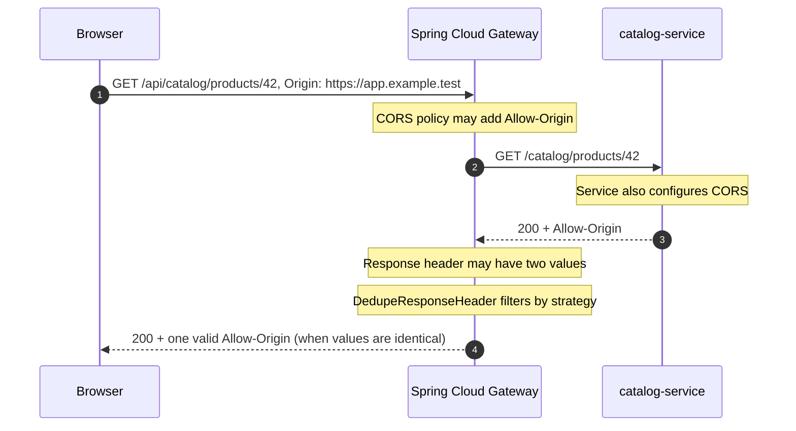

# DedupeResponseHeader When Gateway and Services Both Write Headers

## 1. Context: multiple layers can add headers to an HTTP response

In a microservices architecture, **Spring Cloud Gateway** receives a client request, selects a route using predicates, runs a filter chain, and forwards to the target service. The response path travels back: the microservice returns a status, headers, and a body; the Gateway can add or transform the response before sending it to the client. A reverse proxy, ingress, or CDN outside the Gateway may also modify headers again.

This creates situations where a single **response header name** is written by multiple components. For example:

- The Gateway configures a **CORS** policy and writes `Access-Control-Allow-Origin`.
- `catalog-service` also enables CORS and returns the same header.
- A `GatewayFilter` uses `AddResponseHeader` to add a header that upstream already sent.
- Both layers emit `Access-Control-Allow-Credentials: true`.

If a browser sees two `Access-Control-Allow-Origin` values, even if they are identical, the response may be rejected because CORS requires a single valid value. The service response may be `200 OK`, yet JavaScript in the browser still cannot read the response.

**`DedupeResponseHeader`** is a `GatewayFilter` in **Spring Cloud Gateway Server WebFlux** used to resolve response headers that have multiple values. It takes a list of **header names** and a retention strategy (`RETAIN_FIRST`, `RETAIN_LAST`, `RETAIN_UNIQUE`) to remove redundant values on the response path.

This lesson belongs to the **Headers and Status** chapter of the **Spring Cloud Gateway** module. You will learn how to configure the filter, choose an appropriate strategy, test CORS, read status codes, and debug interactions among the Gateway, upstream, and other filters. Policies such as JWT authentication, rate limiting, circuit breaker, retry, TLS, service discovery, and observability still require separate configuration; `DedupeResponseHeader` does not automatically enable those features.

> **Scope:** the YAML examples follow the `spring.cloud.gateway.routes` declaration style common in **Spring Cloud Gateway Server WebFlux 4.x**. Configuration namespaces, dependencies, and some API details may differ across versions or when using Gateway Server MVC. Always check the documentation for your exact project version.

## 2. Distinguishing header names, multiple values, and CORS errors

An HTTP header has a **name** and a **value**. The same name can appear on multiple lines or be represented as multiple values in the framework's `HttpHeaders` structure.

Example response from a system with two layers writing CORS:

```http
HTTP/1.1 200 OK
Content-Type: application/json
Access-Control-Allow-Origin: https://app.example.test
Access-Control-Allow-Origin: https://app.example.test
Access-Control-Allow-Credentials: true
Access-Control-Allow-Credentials: true

{"id":42,"name":"Notebook"}
```

Two identical `Access-Control-Allow-Origin` lines still form an invalid configuration for the browser. Some proxies/HTTP clients may display multiple values as a list or a merged single line; **do not rely on a single-line display to conclude with certainty that the data only has one value**.

Terminology table:

| Concept | Meaning | Example |
| --- | --- | --- |
| Header name | HTTP key, matched case-insensitively per HTTP | `Access-Control-Allow-Origin` |
| Header value | Content added by each layer | `https://app.example.test` |
| Multiple values for one name | More than one value in the header list | Two occurrences of `Access-Control-Allow-Origin` |
| Duplicate values | Two identical values | `true`, `true` |
| Conflicting values | Two different values with the same name | `https://a.example`, `https://b.example` |
| Dedupe | Filtering the value list according to a chosen policy | Keeping one or unique values |

You should distinguish **deduping values** from **merging header contents**. For example, `Vary: Origin` and `Vary: Accept-Encoding` are two distinct values that require considering caching semantics; dropping one value just to see "one header line" can break caching behavior. `DedupeResponseHeader` is not an analyzer of the full semantics of every HTTP header type.

## 3. At which step are headers duplicated?

Example response flow:



Here `DedupeResponseHeader` performs **response processing** on the routes that have this filter. If no route matches, or if the response is handled in another WebFlux chain and does not pass through Gateway filters, you should not assume the filter will intervene.

Note further: an ingress or CDN **positioned after the Gateway on the response path** can add headers after the Gateway has already processed them. In that case, `DedupeResponseHeader` inside the Gateway cannot see values added by the outer layer. You must pinpoint which system writes the header by comparing responses hop-by-hop.

## 4. Configuring DedupeResponseHeader per route

### 4.1. Short declaration form

Suppose `catalog-service` runs at `http://localhost:8081` and the Gateway runs at `http://localhost:8080`. The client calls `/api/catalog/products/42`; the service handles `/catalog/products/42`. We want to remove duplicate CORS values when both layers add them:

```yaml
spring:
  cloud:
    gateway:
      routes:
        - id: catalog-route
          uri: http://localhost:8081
          predicates:
            - Path=/api/catalog/**
          filters:
            - StripPrefix=1
            - DedupeResponseHeader=Access-Control-Allow-Origin Access-Control-Allow-Credentials
```

Reading the configuration:

1. `Path=/api/catalog/**` is the predicate determining which requests are selected.
2. `StripPrefix=1` removes the `api` segment before forwarding upstream.
3. `DedupeResponseHeader` processes **response headers**; it does not change URLs, request body, or status.
4. The two header names are separated by a space; the filter can accept multiple names in the `name` parameter.
5. Without passing `strategy`, the default strategy is **`RETAIN_FIRST`**.

This example does not enable CORS at the Gateway on its own. It only describes the value-filtering step if the response actually has multiple values to handle.

### 4.2. Explicit declaration form specifying strategy

```yaml
spring:
  cloud:
    gateway:
      routes:
        - id: catalog-route
          uri: http://localhost:8081
          predicates:
            - Path=/api/catalog/**
          filters:
            - StripPrefix=1
            - name: DedupeResponseHeader
              args:
                name: Access-Control-Allow-Origin Access-Control-Allow-Credentials
                strategy: RETAIN_UNIQUE
```

In this form:

- The outer `name` specifies the **GatewayFilter factory name**.
- `args.name` is the **space-separated list of HTTP header names** to process.
- `args.strategy` determines how values for each header are retained.

The explicit form is suitable when a team wants every option to be clear to read and review. An equivalent short form:

```yaml
filters:
  - DedupeResponseHeader=Access-Control-Allow-Origin Access-Control-Allow-Credentials, RETAIN_UNIQUE
```

Use one of the two `filters` forms for the same route. The examples are not meant to create multiple `catalog-route` entries with duplicate IDs in the same configuration.

## 5. Three value-retention strategies

`DedupeResponseHeader` supports the following common strategies:

| Strategy | Behavior | Suitable when |
| --- | --- | --- |
| **`RETAIN_FIRST`** | Keeps only the first value in the header's value list | Order is verified and you want to prioritize the leading value |
| **`RETAIN_LAST`** | Keeps only the last value | Order is verified and you want to prioritize the trailing value |
| **`RETAIN_UNIQUE`** | Keeps distinct values, removing exact duplicates | Sources repeat the exact same value; you do not want to drop differing values |

Example response with a value list:

```text
X-Deployment: alpha
X-Deployment: beta
X-Deployment: beta
```

Result:

| Strategy | Remaining values |
| --- | --- |
| `RETAIN_FIRST` | `alpha` |
| `RETAIN_LAST` | `beta` |
| `RETAIN_UNIQUE` | `alpha`, `beta` |

The examples above illustrate behavior at the **header value list** level. Do not confuse `RETAIN_UNIQUE` with "always only one value remains": when values are **different**, it retains multiple values.

### 5.1. Why might RETAIN_UNIQUE not fix CORS?

Case where two sources write the **same origin**:

```http
Access-Control-Allow-Origin: https://app.example.test
Access-Control-Allow-Origin: https://app.example.test
```

With `RETAIN_UNIQUE`, the list has one value left, so this duplication is resolved.

However, if two sources write **different origins**:

```http
Access-Control-Allow-Origin: https://app.example.test
Access-Control-Allow-Origin: https://other.example.test
```

`RETAIN_UNIQUE` keeps **both** because they differ; CORS is still invalid for a single response. `RETAIN_FIRST` or `RETAIN_LAST` can reduce the result to one value, but that choice only makes sense once you have established **who is the trusted source** and which value must be present.

Do not rely on "Gateway always adds first" or "upstream always adds last" to pick a strategy. Actual value ordering can depend on global filters, route filters, CORS handling, intermediate infrastructure, and versions. Inspect actual responses before deciding.

### 5.2. No arbitrary value normalization

`DedupeResponseHeader` is a **value-filtering** mechanism, not a tool to normalize URLs, origins, whitespace characters, or multi-token list fields. Two values that look semantically equivalent but differ in representation may not be treated as a duplicate. If headers conflict due to differing configurations, fix the policy at the source.

### 5.3. Single value or missing header

If a response only has one `Access-Control-Allow-Origin`, there is no duplicate to remove. If the header is completely absent, `DedupeResponseHeader` **does not synthesize** a replacement value. The filter is not a mechanism to "guarantee browsers are always allowed to call the API".

## 6. CORS: real-world case requiring DedupeResponseHeader

### 6.1. Enabling CORS at the Gateway

Example Gateway Server WebFlux serving a web app at `https://app.example.test` and proxying `catalog-service`. Test configuration:

```yaml
spring:
  cloud:
    gateway:
      globalcors:
        cors-configurations:
          '[/**]':
            allowedOrigins:
              - https://app.example.test
            allowedMethods:
              - GET
              - POST
              - OPTIONS
            allowedHeaders:
              - Authorization
              - Content-Type
            allowCredentials: true
      routes:
        - id: catalog-route
          uri: http://localhost:8081
          predicates:
            - Path=/api/catalog/**
          filters:
            - StripPrefix=1
            - DedupeResponseHeader=Access-Control-Allow-Origin Access-Control-Allow-Credentials, RETAIN_UNIQUE
```

In this example:

- `globalcors` is the CORS configuration section on the Gateway for requests passing through the corresponding mechanism.
- `allowCredentials: true` requires specifying explicit allowed origins; **do not configure `allowedOrigins: '*'` with credentials true**.
- `DedupeResponseHeader` handles cases where both the Gateway and backend return a CORS header value.
- Proper Spring Security configuration is still needed if the API requires authentication. CORS governs browser response-reading permissions; it **does not replace authentication or authorization**.

Suppose upstream also returns the two headers:

```http
Access-Control-Allow-Origin: https://app.example.test
Access-Control-Allow-Credentials: true
```

After the Gateway adds the corresponding two headers, an un-deduped response may contain two copies of each name; `RETAIN_UNIQUE` keeps one value of each type **if the values are genuinely identical**.

**Preferred design:** designate a single owner for the CORS policy on the API route, such as the Gateway. Whenever possible, disable duplicate CORS emission upstream; `DedupeResponseHeader` is useful for legacy systems or migration phases, not as a substitute for policy governance.

### 6.2. Other CORS headers and their meanings

| Header | Main meaning | Notes when checking |
| --- | --- | --- |
| `Access-Control-Allow-Origin` | Which origin is allowed to read the response | Only one specific origin or `*` per CORS semantics |
| `Access-Control-Allow-Credentials` | Whether credentials are permitted | Use `true` when needed with an appropriate origin policy |
| `Access-Control-Allow-Methods` | Methods allowed during preflight | Can be a list; do not arbitrarily delete valid entries |
| `Access-Control-Allow-Headers` | Request headers allowed during preflight | Can be a list; must match actual requirements |
| `Access-Control-Expose-Headers` | Which response headers JavaScript may read | Can be a list; evaluate semantics rather than blindly dropping duplicates |
| `Vary` | Affects cache keys by request headers | Do not arbitrarily remove `Origin` or preflight-related values |

With origin-dynamic CORS, pay attention to `Vary: Origin` and related variants. A CORS response that works without caching can become broken when a shared CDN caches responses across different origins if `Vary` is mismanaged.

### 6.3. OPTIONS preflight: route filters may not run

A browser may send a **preflight request**:

```http
OPTIONS /api/catalog/products/42 HTTP/1.1
Origin: https://app.example.test
Access-Control-Request-Method: GET
Access-Control-Request-Headers: authorization
```

Some preflights are handled by Spring WebFlux **before or outside** the Gateway route filter chain; a route predicate restricted to `GET` can also prevent `OPTIONS` from matching. In that case, **do not assume `DedupeResponseHeader` will run on every preflight** just because the GET route has the filter.

In some Gateway Server WebFlux configurations, the following option helps handle CORS for requests that do not match route-level predicates:

```yaml
spring:
  cloud:
    gateway:
      globalcors:
        add-to-simple-url-handler-mapping: true
```

This option supplements CORS mapping; it is **not a toggle that dedupes every OPTIONS response**. If Spring Security is used, ensure preflight is handled properly in the security chain. Test both `OPTIONS` and actual browser requests before declaring CORS working.

## 7. Put the filter on one route or default for many routes?

### 7.1. Apply only on routes that need handling

```yaml
spring:
  cloud:
    gateway:
      routes:
        - id: catalog-route
          uri: http://localhost:8081
          predicates:
            - Path=/api/catalog/**
          filters:
            - DedupeResponseHeader=Access-Control-Allow-Origin Access-Control-Allow-Credentials
```

Advantage: clear scope, does not affect other APIs. Suitable when only one legacy upstream duplicates CORS headers.

### 7.2. Configuring default-filters

If multiple routes genuinely share the same issue:

```yaml
spring:
  cloud:
    gateway:
      default-filters:
        - name: DedupeResponseHeader
          args:
            name: Access-Control-Allow-Origin Access-Control-Allow-Credentials
            strategy: RETAIN_UNIQUE
```

`default-filters` attaches default filters to **routes handled by the Gateway**. It does not guarantee execution for responses handled independently by WebFlux/Spring Security before route selection, nor does it affect headers added by a CDN after the Gateway.

Choose a global default scope only after understanding the policies of all upstreams. In particular, avoid configuring a long list of sensitive headers just because duplicate values appeared on one API.

### 7.3. When to use AddResponseHeader or SetResponseHeader?

Other filters serve different roles:

| Filter | Typical behavior | When to use |
| --- | --- | --- |
| `AddResponseHeader` | Appends a value to a response header | Intentionally adding a new header; may create multiple values if already present |
| `SetResponseHeader` | Sets/overwrites a header's value | Gateway must be the authoritative source of the value, in verified execution order |
| `RemoveResponseHeader` | Removes a header from the response | Prevent header leakage or strip unwanted headers |
| `DedupeResponseHeader` | Selects or retains distinct values of an existing header | Multiple layers add values and duplicates must be filtered |

For example, if a microservice always sends an untrusted `X-Environment`, the right fix may be for the Gateway to **overwrite** it with a deployment-supplied value, rather than "picking the first one" and hoping it is authentic. If you want consistent CORS, fixing CORS configuration at the source is usually cleaner than relying on header ordering.

## 8. Be careful with headers that should not be arbitrarily deduped

Not every repeated header name is a bug. HTTP allows certain headers to have multiple values with distinct semantics; careless handling can break functionality or introduce security risks.

| Header | Why caution is needed? | How to handle |
| --- | --- | --- |
| `Set-Cookie` | A response may intentionally set multiple distinct cookies; cookie merging also has special rules | Do not put `Set-Cookie` into a broad dedupe list just to keep one value |
| `Vary` | Each value can affect the cache key | Keep all necessary cache differentiation dimensions |
| `Cache-Control` | Directives jointly govern caching; removing one part can alter policy | Identify the cache policy owner and check semantics |
| `Content-Security-Policy` | Multiple policies can simultaneously enforce constraints; keeping one can alter security | Standardize policy at the source, test in browsers |
| `WWW-Authenticate` | Multiple authentication challenges may be required | Do not force a single value if it drops valid challenges |
| `Warning` and other list headers | May contain multiple elements with independent meanings | Handle according to each header's specification |
| `Content-Length`, `Transfer-Encoding` | Tied to HTTP framing and transport body handling | Let the HTTP stack/transport manage them; investigate infra config if abnormal |

A typical case: a service sends two `Set-Cookie` headers for `session` and `preferences`. Choosing `RETAIN_FIRST` drops the second cookie, breaking login or user experience. Even `RETAIN_UNIQUE` requires care because headers with identical strings appearing multiple times cannot automatically be dropped without checking semantics.

If a header specifies **a single unique value** (such as `Access-Control-Allow-Origin`), resolve conflicts between sources. If a header represents a **list or composite policy**, merge per its specification rather than mechanically applying one of the three strategies.

## 9. Filter order, response write timing, and status codes

### 9.1. When does the filter process?

`DedupeResponseHeader` is a filter that operates on the route's **response**. It participates in the Gateway filter chain alongside other filters such as `AddResponseHeader`, `SetResponseHeader`, retry filters, or framework `GlobalFilter`s.

Order matters:

- If another filter adds a value **after the dedupe step**, the response can still end up duplicated.
- If the dedupe filter runs before a layer inserts its value into the response, it cannot remove a value that does not exist yet.
- If the response has already been **committed/flushed to the network**, a late-running filter cannot freely modify sent headers.
- If a request does not pass through the route filter chain, this filter may not be invoked.

When writing custom filters or trying to arrange ordering in Java DSL, do not rely purely on declaration position. Gateway has `GlobalFilter`, `GatewayFilter`, and pre/post ordering; some CORS/security layers in WebFlux also operate outside the `GatewayFilter` chain. Verify the actual order and response for your project version.

### 9.2. DedupeResponseHeader does not change status

Filtering headers is not equivalent to changing HTTP status. For example:

| Status returned by system | After deduping duplicate CORS headers | Meaning |
| --- | --- | --- |
| `200 OK` | Typically still 200 | Browser can read response if overall CORS is valid |
| `401 Unauthorized` | Typically still 401 | Does not turn an invalid token into a valid request |
| `403 Forbidden` | Typically still 403 | Does not grant resource access |
| `429 Too Many Requests` | Typically still 429 | Rate limiting is independent of dedupe |
| `503 Service Unavailable` | Typically still 503 | Fixing headers does not bring upstream back up |

"Typically" emphasizes that the actual status can still be affected by other filters/handlers. `DedupeResponseHeader` **is not an error-mapping filter**: it does not turn 500 into 200, does not retry, and does not create fallbacks.

For error responses generated **before a route is selected**, CORS/header policies should be tested separately because a route's `DedupeResponseHeader` will not necessarily run. This is why both success and error cases must be tested.

### 9.3. Filter order is distinct from authentication responsibility

An invalid JWT should be blocked by the appropriate Spring Security policy. Even if a 401 response includes valid CORS headers, the client still lacks authorization. Conversely, a 200 response with broken CORS headers does not mean the service skipped processing the request: the browser may simply block JavaScript from reading the result.

If the system authenticates users, rate-limits by identity, terminates HTTPS at the Gateway, or uses TLS to upstream, keep those policies independent. Client-supplied headers must not be trusted for identity decisions simply because the Gateway has a response-modifying filter.

## 10. Testing with curl and a browser

### 10.1. Comparing upstream and Gateway

Suppose the Gateway runs at `http://localhost:8080`, upstream `catalog-service` runs at `http://localhost:8081`, and the route strips `/api`.

Call upstream directly:

```bash
curl -i \
  -H "Origin: https://app.example.test" \
  http://localhost:8081/catalog/products/42
```

Call through the Gateway:

```bash
curl -i \
  -H "Origin: https://app.example.test" \
  http://localhost:8080/api/catalog/products/42
```

Compare the values of `Access-Control-Allow-Origin`, `Access-Control-Allow-Credentials`, `Vary`, status, and response body. Calling directly shows which headers upstream emits; calling through the Gateway shows the Gateway's final response **before any infrastructure sitting outside the Gateway**.

The URLs are examples. If upstream does not yet have an endpoint, a `404` does not prove dedupe is broken; use an actual responding endpoint and inspect headers on both success and error responses.

### 10.2. Testing before and after enabling the filter

Create a test matrix with simulated upstream responses:

| Case | Value list before filter | Strategy | Expected |
| --- | --- | --- | --- |
| H1 | `[https://app.example.test]` | `RETAIN_UNIQUE` | Keeps one value |
| H2 | `[https://app.example.test, https://app.example.test]` | `RETAIN_UNIQUE` | Keeps one value |
| H3 | `[https://a.example, https://b.example]` | `RETAIN_UNIQUE` | Two values remain; CORS still needs fixing |
| H4 | `[https://a.example, https://b.example]` | `RETAIN_FIRST` | Keeps `https://a.example` |
| H5 | `[https://a.example, https://b.example]` | `RETAIN_LAST` | Keeps `https://b.example` |
| H6 | Header does not exist | Any | Does not synthesize header |
| H7 | Two `Set-Cookie` headers for two distinct cookies | Not configured for dedupe | Preserves valid cookies intact |

The values in the input column are **hypothetical test inputs**, not observed run outputs. For meaningful tests, use a mock upstream configurable to emit the header N times and assert the header list in the Gateway response, rather than checking only a `200` status.

### 10.3. Checking OPTIONS preflight

```bash
curl -i -X OPTIONS \
  -H "Origin: https://app.example.test" \
  -H "Access-Control-Request-Method: GET" \
  -H "Access-Control-Request-Headers: authorization" \
  http://localhost:8080/api/catalog/products/42
```

Observe the status, `Access-Control-Allow-Origin`, `Access-Control-Allow-Methods`, `Access-Control-Allow-Headers`, `Access-Control-Allow-Credentials`, and `Vary`. If preflight does not pass through the Gateway route, changing `DedupeResponseHeader` on the GET route may not affect the result; inspect CORS/WebFlux and Security configuration.

### 10.4. Using a browser to verify CORS behavior

`curl` **does not enforce browser CORS policies itself**. It shows raw headers and status. To verify that a web app can call the API:

1. Open DevTools → Network and locate the relevant request or preflight.
2. Compare the request's `Origin` against the response's `Access-Control-Allow-Origin`.
3. Check `Access-Control-Allow-Credentials` when the app needs cookies or credentials.
4. Distinguish CORS errors printed in the console from the actual HTTP status in Network.
5. If responses traverse a CDN/ingress, inspect headers **arriving at the browser**, not only the response at the internal Gateway port.

If the browser still reports multiple `Access-Control-Allow-Origin` values after enabling dedupe, determine whether an outer layer adds headers **after the Gateway**, or whether two differing values were kept by `RETAIN_UNIQUE`.

## 11. When both Gateway and upstream disagree on CORS

Production scenario:

- Gateway allows `https://app.example.test`.
- Legacy upstream allows `https://legacy.example.test`.
- Client sends `Origin: https://app.example.test`.
- Gateway and upstream both write `Access-Control-Allow-Origin` with different values.

This is a **policy conflict**, not simply "two identical copies".

Preferred resolution in order of reasoning:

1. Decide **which layer owns CORS** for public routes; typically the Gateway is appropriate if all clients enter through the Gateway.
2. When possible, remove duplicate CORS from upstreams exposed through the Gateway; keep access control and business authorization in the service.
3. If upstream cannot be changed immediately, verify which strategy yields the right response, test source/ordering, and add controls during the transition.
4. Cross-check preflight, actual requests, 4xx/5xx statuses, and cache behavior via `Vary`.
5. Prevent backends or intermediaries from reflecting origins unchecked when credentials are enabled.

**Do not use `RETAIN_UNIQUE` as a way to automatically resolve two different origins**: the distinct values remain, and the browser can still block the request. **Do not arbitrarily pick `RETAIN_LAST`** without knowing who the last source is: the retained value may belong to the wrong policy.

## 12. Diagnosing common errors

| Symptom | Possible cause | How to resolve |
| --- | --- | --- |
| Browser reports multiple `Access-Control-Allow-Origin` | Gateway and upstream both write the header | Check both hops, configure dedupe, and unify the CORS policy |
| `RETAIN_UNIQUE` enabled yet 2 origin values remain | Two different values | Fix the CORS config conflict; consider a single owner |
| Header still duplicated after Gateway | Ingress/CDN adds it in a later step | Inspect response at each hop |
| CORS fails even though header appears once | Wrong origin, mismatched credentials, preflight missing method/header, or other policy | Cross-check full CORS setup and Network/Console |
| GET succeeds but OPTIONS fails | Preflight goes through another chain, blocked by predicate or Security | Check global CORS, preflight, WebFilter/Security |
| Status remains 401 or 403 after dedupe | Invalid token or missing permissions | Fix auth policy; dedupe does not grant access |
| `Set-Cookie` lost | Deduped a valid multi-value header with `RETAIN_FIRST/LAST` | Remove arbitrary dedupe config, check cookie semantics |
| `Vary` missing `Origin` | A layer overwrote/removed Vary or cache config is wrong | Check CDN/cache policy and required Vary values |
| `AddResponseHeader` causes two values | Gateway appended a header already sent by upstream | Use a single source-of-truth or appropriate `SetResponseHeader`/dedupe |
| Filter does not run on error responses | Response created before route match or handled in another layer | Identify the error-producing pipeline and apply CORS at the right layer |
| Property name error after upgrading | Gateway config namespace/API changed | Check documentation for your WebFlux version, update config, and re-test |

When logging for debugging, record **route ID, HTTP status, header name, and value count** rather than logging raw tokens, cookies, or sensitive content. Origin can usually be observed for CORS troubleshooting, while still adhering to log policies and avoiding overly high-cardinality metric labels.

## 13. Hands-on exercise: handling duplicated CORS without dropping valid headers

**Requirement:** The Gateway routes `GET /api/products/**` to `product-service`. Both the Gateway and upstream return:

```http
Access-Control-Allow-Origin: https://shop.example.test
Access-Control-Allow-Credentials: true
```

A web client at `https://shop.example.test` needs to call the API with credentials. Do the following:

1. Configure Gateway CORS for the actual origin, methods, and headers.
2. Add `DedupeResponseHeader` with `RETAIN_UNIQUE` for the two header names above.
3. Use a mock upstream returning `200`, `401`, and `500` responses, confirming status is not automatically altered by dedupe.
4. Test `OPTIONS` preflight and an actual `GET`; compare headers in the browser.
5. Add a case where upstream returns `Access-Control-Allow-Origin: https://other.example.test`; document why `RETAIN_UNIQUE` does not solve it.
6. Add two distinct `Set-Cookie` headers; demonstrate why they must be preserved intact and `Set-Cookie` must not be added to the dedupe list.

An illustrative route:

```yaml
spring:
  cloud:
    gateway:
      routes:
        - id: products
          uri: http://localhost:8081
          predicates:
            - Path=/api/products/**
            - Method=GET
          filters:
            - StripPrefix=1
            - DedupeResponseHeader=Access-Control-Allow-Origin Access-Control-Allow-Credentials, RETAIN_UNIQUE
```

Because the route in the example restricts `Method=GET`, **`OPTIONS` preflight may not match the route**. This is part of the exercise: you must check whether WebFlux or Gateway global CORS mapping handles OPTIONS. A `200` from a standalone mock upstream is not enough to claim the browser called the API successfully.

### Configuration review checklist

- [ ] Identify the exact **header names** to dedupe; do not carelessly put headers that allow multiple valid values into the list.
- [ ] Choose `RETAIN_FIRST`, `RETAIN_LAST`, or `RETAIN_UNIQUE` based on **semantics** and observed values.
- [ ] Do not assume `RETAIN_UNIQUE` solves CORS if Gateway/upstream emit **two different origins**.
- [ ] Test actual requests, OPTIONS preflight, and at least one 401/403/5xx error response.
- [ ] Inspect headers in the browser and at ingress/CDN hops if present.
- [ ] Consolidate CORS policy ownership in one layer whenever possible.
- [ ] Preserve response headers with multi-value semantics such as `Set-Cookie` and `Vary`.
- [ ] Protect JWTs/cookies/tokens and limit sensitive information in logs and observability tools.
- [ ] Re-verify property namespaces and route/filter ordering after every Gateway upgrade.

## 14. Summary

**`DedupeResponseHeader` in Spring Cloud Gateway** addresses scenarios where a response header has multiple values because both the Gateway and a microservice add data. The filter offers three strategies:

- **`RETAIN_FIRST`** keeps the first value.
- **`RETAIN_LAST`** keeps the last value.
- **`RETAIN_UNIQUE`** keeps distinct values and removes identical duplicates.

This tool is especially useful for `Access-Control-Allow-Origin` and `Access-Control-Allow-Credentials` when both Gateway and upstream implement CORS. However, dedupe **does not resolve policy conflicts on its own**, does not change status codes, does not grant access permissions, and does not replace security, rate limiting, circuit breakers, retries, TLS, or request observability.

When troubleshooting a header issue, follow the sequence **identify emitters → inspect value list → pick the right strategy → test both preflight and error responses → fix the root config if there is a conflict**. That approach keeps the Gateway's HTTP behavior correct without losing other valid headers.

Official documentation to cross-check by version:

- [Spring Cloud Gateway Server WebFlux — DedupeResponseHeader](https://docs.spring.io/spring-cloud-gateway/reference/spring-cloud-gateway-server-webflux/gatewayfilter-factories/deduperesponseheader-factory.html).
- [Spring Cloud Gateway Server WebFlux — CORS Configuration](https://docs.spring.io/spring-cloud-gateway/reference/spring-cloud-gateway-server-webflux/cors-configuration.html).
- [MDN — Cross-Origin Resource Sharing (CORS)](https://developer.mozilla.org/en-US/docs/Web/HTTP/Guides/CORS).
