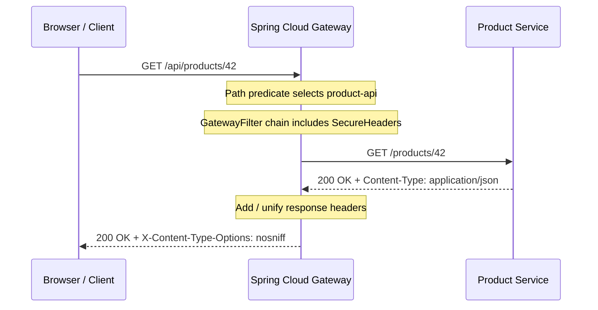
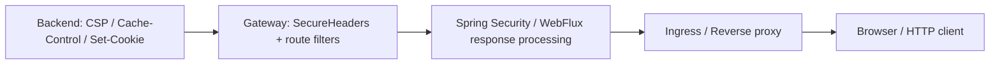

# SecureHeaders and Customizing Security Header Policies in Spring Cloud Gateway

An API Gateway does more than decide which backend a request goes to. It is also an appropriate place to apply a consistent **security response header policy** for APIs and web applications behind the entry point. For example, the gateway can instruct browsers not to sniff content types, prevent unintended embedding in iframes, restrict script loading sources, and encourage HTTPS connections.

In **Spring Cloud Gateway Server WebFlux**, `SecureHeaders` is a **GatewayFilter Factory** that provides a default set of security headers. You can apply it to a single route or via `default-filters` to share it across multiple routes, then tailor the policy to each application type. However, turning on a filter does not solve everything on its own: you must understand **who each header affects**, **which responses actually carry the headers**, **which values are appropriate**, and **how to avoid conflicts** with Spring Security, proxies, or backends.

This lesson belongs to the **Headers and Status** chapter of the `SPRING_CLOUD_GATEWAY` module. This knowledge complements route predicates, filter chains, header/path transformations, service discovery, and authentication, rate limiting, circuit breaker, retry, TLS, and observability policies when operating a secure microservices gateway.

> **Version scope:** Examples target **Spring Cloud Gateway Server WebFlux**. Configuration namespaces have changed across Spring Cloud Gateway generations; verify the exact starter and version you are running. The header values below are illustrative/policy values to evaluate, not a guarantee of identical default values in every version.

## 1. Where do security headers sit in the request/response flow?

Suppose a client calls `GET /api/products/42`. The Gateway selects the `product-api` route and forwards to Product Service. The backend returns JSON; the gateway may add several response headers before returning the result to the client.



**Two layers to separate:**

| Layer | Main decisions | Examples |
| --- | --- | --- |
| **Request** | Should the caller be allowed to access the API, where should it be routed, how should calls be rate-limited and forwarded? | Spring Security, `Path` predicate, `RequestRateLimiter`, `StripPrefix`, `lb://product-service`. |
| **Response** | What HTTP status, data, and response handling policy does the client receive? | `SecureHeaders`, `SetResponseHeader`, `RemoveResponseHeader`, `Cache-Control`. |

Headers such as Content Security Policy (CSP), `X-Frame-Options`, and `Referrer-Policy` primarily instruct **browsers**. A custom HTTP client or a backend **does not automatically follow** these policies the way a browser does. Therefore, response headers **do not replace** token authentication, resource authorization, input validation, TLS, or server-side attack protections.

## 2. What is `SecureHeaders` and what scope does it apply to?

`SecureHeaders` is the configurable filter created by `SecureHeadersGatewayFilterFactory`. When a route includes this filter, the Gateway adds the security response headers supported by the filter according to the active configuration.

Three important facts:

1. `SecureHeaders` is a **GatewayFilter**, bound to matched routes; it is **not automatically enabled for every endpoint** simply because an application includes Spring Cloud Gateway.
2. You can use `default-filters` to apply this factory across routes. This is common when multiple microservices need the same baseline header set.
3. `SecureHeaders` handles **headers**; it does not create HTTPS certificates, authenticate users, or decide HTTP `401/403/429/503` status codes.

The header groups supported by common WebFlux SecureHeaders releases include:

| Header | Main purpose | Notes |
| --- | --- | --- |
| `Strict-Transport-Security` | Tells browsers to prefer HTTPS for the host for `max-age` duration. | Only reliably meaningful when received over HTTPS; can have long-term effects on the host/subdomains. |
| `Content-Security-Policy` | Restricts which resource origins the browser may load/execute. | Must fit each HTML application; too broad is weak, too strict breaks pages. |
| `X-Frame-Options` | Restricts embedding pages via iframe/frame in supporting browsers. | Usually `DENY` or `SAMEORIGIN`; CSP `frame-ancestors` is the more modern mechanism. |
| `X-Content-Type-Options` | Prevents browsers from MIME-type sniffing in applicable contexts. | Common value: `nosniff`. |
| `Referrer-Policy` | Controls referrer information sent during navigation or resource loading. | For example `no-referrer` or `strict-origin-when-cross-origin`. |
| `X-XSS-Protection` | XSS filtering mechanism of some older browsers. | **Legacy**, does not replace CSP and escaping; many modern browsers dropped support. |
| `X-Download-Options` | Download policy for older clients. | `noopen` mainly relates to certain older browsers. |
| `X-Permitted-Cross-Domain-Policies` | Restricts cross-domain policy files for legacy runtimes. | Usually `none`; not a CORS solution. |

**Do not equate "supported by SecureHeaders" with "every system should enable the exact same values".** For instance, a CSP policy suitable for a static docs page can break a React UI that loads scripts/assets from an external domain; HSTS has an impact window longer than a single request.

Other useful policies such as `Permissions-Policy`, `Cache-Control`, and `Cross-Origin-Resource-Policy` **should not be assumed by default to be part of SecureHeaders in every version**. They can be configured using separate filters/headers once specific requirements are defined.

## 3. Enabling SecureHeaders for a route

Example where the Gateway exposes the product API at `/api/products/**` and forwards to Product Service:

```yaml
spring:
  cloud:
    gateway:
      server:
        webflux:
          routes:
            - id: product-api
              uri: http://localhost:8081
              predicates:
                - Path=/api/products/**
              filters:
                - StripPrefix=1
                - SecureHeaders
```

When `GET /api/products/42` matches the route:

- `StripPrefix=1` turns the path sent to the backend into `/products/42`.
- `SecureHeaders` applies the configured response headers.
- The backend runs business logic and returns status/body; the Gateway can add headers before the response completes.

**Note:** `SecureHeaders` does not mean every response must be `200 OK`. If the backend returns `404`, the Gateway can forward status `404` and still append headers. If the request does not match this route, the route's filters do not participate.

In older Spring Cloud Gateway Server WebFlux branches, route configuration usually lives under `spring.cloud.gateway.routes` instead of `spring.cloud.gateway.server.webflux.routes`. You must use the namespace recognized by your specific version along with the matching starter.

### 3.1. Applying to multiple routes with `default-filters`

If both Product Service and Order Service need the same baseline header set:

```yaml
spring:
  cloud:
    gateway:
      server:
        webflux:
          default-filters:
            - SecureHeaders
          routes:
            - id: product-api
              uri: http://localhost:8081
              predicates:
                - Path=/api/products/**
              filters:
                - StripPrefix=1

            - id: order-api
              uri: http://localhost:8082
              predicates:
                - Path=/api/orders/**
              filters:
                - StripPrefix=1
```

`default-filters` turns the `SecureHeaders` configuration into a `GatewayFilter` applied to the corresponding routes. Both routes can still have their own path-transformation filters.

Do not re-declare `SecureHeaders` on individual routes if it is already applied via `default-filters` without a specific reason: duplicating the filter can make header merging and debugging harder to predict.

### 3.2. Why are `GlobalFilter` and `WebFilter` not equivalent?

`SecureHeaders` is added to the **Gateway filter chain** after route selection, just like any other `GatewayFilter`. A Gateway `GlobalFilter` also typically operates in this chain, though its scope spans beyond a single route. A Spring WebFlux or Spring Security `WebFilter` sits at the **web layer outside route matching**.

Consequence: if `GET /unknown` **does not match any route**, you cannot assume it will receive all headers from `default-filters: SecureHeaders`. If you want certain headers to appear even on Gateway-generated `404`s before route selection, application error pages, or Actuator endpoints, consider applying the policy at **WebFlux/Spring Security, reverse proxy, or edge** and test separately.

## 4. Key headers and how to choose values

### 4.1. `X-Content-Type-Options: nosniff`

Example JSON response:

```http
HTTP/1.1 200 OK
Content-Type: application/json
X-Content-Type-Options: nosniff
```

`nosniff` prevents browsers from ignoring the declared MIME type in certain situations. However, this header **cannot fix** cases where the backend declares the wrong `Content-Type`; make sure the backend and Gateway advertise accurate media types.

For static assets, verify that CSS/JavaScript files are served with the right MIME types. Once `nosniff` is added, frontend setups that previously relied on browser content-type sniffing may start failing; fix the server/caching configuration rather than arbitrarily disabling the policy.

### 4.2. `X-Frame-Options` and CSP `frame-ancestors`

To prevent sensitive pages from being embedded in unintended iframes:

```http
X-Frame-Options: DENY
Content-Security-Policy: frame-ancestors 'none'
```

- `DENY` refuses embedding the page in browsers supporting the legacy header.
- `SAMEORIGIN` allows embedding only from the same origin as interpreted by the browser.
- `frame-ancestors 'none'` in CSP provides a modern, more flexible mechanism to specify which sources may embed the page.

Do not choose `DENY` for a page that genuinely needs to be embedded inside a portal or internal tool without aligning the integration contract. And do not confuse `frame-ancestors` (who may embed **this page**) with `frame-src` (where this page is allowed to load iframes from).

### 4.3. `Content-Security-Policy` (CSP)

A cautious policy for a **self-hosted static HTML page** could be:

```http
Content-Security-Policy: default-src 'self'; object-src 'none'; base-uri 'self'; frame-ancestors 'none'
```

Meaning:

| Directive | Function |
| --- | --- |
| `default-src 'self'` | Default policy for many resource types restricting them to the same origin. |
| `script-src` | Restricts script sources; if omitted, fallback rules apply per CSP. |
| `style-src` | Controls permitted stylesheets/styles. |
| `img-src` | Controls image sources. |
| `connect-src` | Restricts targets for browser fetch/XHR/WebSocket. |
| `object-src 'none'` | Disallows loading embedded plugin/object types governed by this directive. |
| `base-uri 'self'` | Restricts `<base>` elements used to alter relative URL resolution. |
| `frame-ancestors 'none'` | Disallows embedding the page from other origins or itself. |

CSP is only effective when **tailored to the application**. For example, a SPA calling an API at `https://api.example.com` may need `connect-src 'self' https://api.example.com`; a page using a legitimate font CDN needs a matching font policy. Do not use `script-src * 'unsafe-inline'` to "quick-fix" all CSP errors, as that severely weakens the defense goal.

An application requiring inline scripts can consider server-generated per-response **nonces/hashes**. Random nonces cannot be properly generated simply by hard-coding a static string in Gateway YAML. CSP can block certain browser XSS techniques, but it **does not replace** encoding, validation, and secure application design.

**Pure JSON APIs** benefit less from script-control directives than HTML pages, though they can still carry basic headers. When APIs and web UIs share the same Gateway, avoid forcing a highly specific UI CSP onto every route if it breaks frontends.

### 4.4. `Referrer-Policy`

Example:

```http
Referrer-Policy: strict-origin-when-cross-origin
```

This is a common choice to limit full path information when navigating to another origin in applicable scenarios. `no-referrer` is stricter: the browser sends no referrer under this policy.

If the system uses OAuth/OIDC, payments, or third-party integrations, test navigation flows that depend on referrer before changing it. **Never use referrer as a source of authentication or authorization**, as it can be absent or forged.

### 4.5. `Strict-Transport-Security` (HSTS)

Illustrative example for a **public host stably serving HTTPS**:

```http
Strict-Transport-Security: max-age=31536000
```

Browsers receive the HSTS header over a valid HTTPS connection and remember the policy for the `max-age` duration. HSTS does not turn an internal HTTP connection between the Gateway and backend into HTTPS; that requires separate TLS client and upstream URI configuration.

**Be cautious with `includeSubDomains` and `preload`:** they extend the impact to subdomains or browser preload lists, requiring an assessment of all related infrastructure. Do not enable them merely because an example shows them. An overly long HSTS policy can be hard to roll back for clients that have cached it.

For development environments using HTTP, localhost, or test proxies without stable public TLS, design an appropriate HSTS policy and verify actual behavior. Browsers do not accept HSTS over plain HTTP responses the way they do over trusted HTTPS.

## 5. Customizing SecureHeaders defaults

There are two distinct configuration layers that should be kept clear:

- **`SecureHeaders` properties**: adjust the values the factory uses when generating headers.
- **Additional response header filters**: set/remove/replace specific headers per route or per application policy.

In some Spring Cloud Gateway Server WebFlux branches using the older namespace, SecureHeaders customization properties look like:

```yaml
spring:
  cloud:
    gateway:
      filter:
        secure-headers:
          content-security-policy: "default-src 'self'; object-src 'none'; base-uri 'self'; frame-ancestors 'none'"
          frame-options: DENY
          content-type-options: nosniff
          referrer-policy: no-referrer
          strict-transport-security: "max-age=31536000"
```

This is a **property pattern from older WebFlux versions** (`spring.cloud.gateway.filter.secure-headers`). Newer branches organize namespaces under `server.webflux`; look up the exact `SecureHeadersProperties` configuration keys in **your exact version** instead of copying this sample directly into a newer app and assuming it takes effect.

Specifically:

1. Property configuration only changes the **values** of headers managed by SecureHeaders; the filter still must be applied to routes via `SecureHeaders` or `default-filters`.
2. A CSP value **must match the frontend's characteristics**; for instance, the policy above is for a simple HTML app, not sufficient for every SPA.
3. An HSTS value **must match public TLS deployment conditions**, never copied from an article without verifying the domain.
4. If you want to omit a default header completely, use the header-disabling mechanism supported by your SecureHeaders version or design a response-handling filter with defined ordering; do not set an empty string and assume browsers will interpret it correctly.

In versions supporting a disable list, header names are configured in a `disable` property of `SecureHeadersProperties` (for example `x-frame-options` or `strict-transport-security`). **Key names and value formats must be verified against the actual version**, then tested with `curl` or integration tests to confirm the header disappeared; successful YAML parsing does not prove the property was bound.

## 6. Global policy and per-route exceptions

Not every response needs the exact same set of headers. A practical Gateway design might include:

- **JSON APIs**: `X-Content-Type-Options`, cache policy, and CORS tailored as needed; CSP has more limited effect.
- **HTML web pages**: CSP, `frame-ancestors`/`X-Frame-Options`, `Referrer-Policy`, plus cookie policies.
- **Admin endpoints**: disallow caching sensitive information and disallow iframe embedding unless required.
- **Public cacheable assets**: allow caching under clear conditions; do not impose `no-store` on all static assets.

### 6.1. Combining SecureHeaders with per-route response filters

Example where only the account route forbids storing sensitive responses:

```yaml
spring:
  cloud:
    gateway:
      server:
        webflux:
          default-filters:
            - SecureHeaders
          routes:
            - id: account-private
              uri: lb://account-service
              predicates:
                - Path=/api/account/**
              filters:
                - StripPrefix=1
                - SetResponseHeader=Cache-Control, no-store

            - id: catalog-public
              uri: lb://catalog-service
              predicates:
                - Path=/api/catalog/**
              filters:
                - StripPrefix=1
```

For `account-private`, `SecureHeaders` and `SetResponseHeader` are combined into the filter chain after the route matches. `Cache-Control: no-store` tells clients and intermediate caches that the response should not be stored under the corresponding HTTP semantics. The `catalog-public` route does not receive `SetResponseHeader=Cache-Control, no-store` because that is specific to the account route.

Notes:

- `no-store` may be appropriate for personal data, but it is only one layer of protection. It does not solve backend authentication or authorization.
- Do not set `Cache-Control: public` on responses containing private information.
- With `lb://account-service`, the Gateway needs Spring Cloud LoadBalancer and an instance list from discovery or an appropriate configuration source.
- If Spring Security, the backend, or a proxy also writes `Cache-Control`, test the **final value** the client actually receives.

### 6.2. `AddResponseHeader`, `SetResponseHeader`, and `RemoveResponseHeader`

| Filter | Meaning | Risk if misused |
| --- | --- | --- |
| `AddResponseHeader` | Adds a response header value. | Can produce multiple values for the same header name. |
| `SetResponseHeader` | Sets/replaces the value of a header in the response. | Can overwrite a policy the backend tailored to actual content. |
| `RemoveResponseHeader` | Removes a header before the response is sent if executed in time. | Can delete a security header added by another layer. |
| `DedupeResponseHeader` | Deduplicates specified headers using a supported strategy. | Deduplication cannot pick the right security policy automatically when two values differ. |

For example, `RemoveResponseHeader=X-Powered-By` can reduce framework information leakage if that header appears through the Gateway; however, the better approach is still configuring the backend/proxy **not to emit** unnecessary information. Do not promise that removing a single header completely hides the server technology.

**Filter order matters.** If one filter attaches a header and another overwrites/removes it, the result depends on pre/post phases, when response headers are known, and whether the response is already committed. Do not rely solely on YAML line order when `GlobalFilter`s, default filters, and framework filters are also present.

## 7. Adjusting CSP per response with a GlobalFilter

Some systems serve both JSON and HTML and need a dedicated CSP for HTML content. In that case, a `GlobalFilter` can register a callback that runs **right before response commit**, reads the actual `Content-Type`, and sets CSP accordingly.

Java example (Server WebFlux) illustrating the **technique**:

```java
import org.springframework.cloud.gateway.filter.GatewayFilterChain;
import org.springframework.cloud.gateway.filter.GlobalFilter;
import org.springframework.core.Ordered;
import org.springframework.http.HttpHeaders;
import org.springframework.http.MediaType;
import org.springframework.stereotype.Component;
import org.springframework.web.server.ServerWebExchange;
import reactor.core.publisher.Mono;

@Component
public class HtmlCspHeaderFilter implements GlobalFilter, Ordered {

    private static final String CSP = "Content-Security-Policy";

    @Override
    public int getOrder() {
        return -100;
    }

    @Override
    public Mono<Void> filter(ServerWebExchange exchange,
                             GatewayFilterChain chain) {

        exchange.getResponse().beforeCommit(() -> {
            HttpHeaders headers = exchange.getResponse().getHeaders();
            MediaType contentType = headers.getContentType();

            if (contentType != null &&
                    MediaType.TEXT_HTML.isCompatibleWith(contentType)) {
                headers.set(
                    CSP,
                    "default-src 'self'; object-src 'none'; " +
                    "base-uri 'self'; frame-ancestors 'none'"
                );
            }

            return Mono.empty();
        });

        return chain.filter(exchange);
    }
}
```

Explanation:

1. `beforeCommit` is registered **before** the rest of the Gateway chain produces the response. It runs when WebFlux prepares to commit the response, while headers are not yet locked.
2. `Content-Type` at that moment is used to set CSP only for `text/html`. For ordinary JSON responses, the callback leaves CSP untouched in this example.
3. `headers.set(...)` replaces any existing CSP value at callback time, avoiding accidentally appending a second CSP via `add(...)`.
4. `chain.filter(exchange)` is **returned** so the framework manages subscription; do not call `block()` or `subscribe()` on the event loop.
5. `getOrder()=-100` is an illustrative order to register the callback early; you must still consider real filters with higher precedence or ones that terminate the request earlier.

If `SecureHeaders` already set a default CSP or the backend also set CSP, the callback can **replace that policy** for HTML. This ownership behavior must be decided explicitly; do not accidentally overwrite a strict policy created by the application (especially when the backend uses per-response nonces/hashes).

In production, prefer keeping CSP in the **application serving HTML** if it needs dynamic nonces, per-build hashes, or complex multi-source rules. The Gateway can provide a **baseline** and simpler headers; having clear single-point policy ownership is easier to test.

> `GlobalFilter` still sits inside the Gateway chain after route matching. If you need to cover responses before route matching, place logic at another layer such as a `WebFilter`/Spring Security or a reverse proxy.

## 8. Relationship between SecureHeaders, Spring Security, and the backend

Multiple places may add headers to the same response:



The diagram shows **the layers that can affect a response**, not a guarantee that every filter executes in the exact chronological order of the boxes in every application. Depending on the pipeline, responses pass through callbacks, commit hooks, middleware, and reverse proxies in specific orders.

### 8.1. The problem of multiple CSP or HSTS values

If the backend already returns:

```http
Content-Security-Policy: default-src 'self'; script-src 'nonce-abc123'
```

and the Gateway **adds** another CSP, the browser may enforce multiple policies simultaneously, causing unexpected blocking. You should not expect two policies to "merge" into a single business-valid policy.

With `Strict-Transport-Security`, duplicate or conflicting values can make client behavior unpredictable. With `X-Frame-Options`, some browsers/clients handle repeated headers inconsistently.

**Recommendation:** designate **one primary owner** for each header group:

- HSTS usually belongs at the **HTTPS edge** that has full knowledge of public hostnames and deployment conditions.
- Dynamic CSP with nonces usually belongs in the **backend or HTML frontend layer**.
- Universal, simple headers can be attached at the **Gateway** if all routes are compatible.
- Spring Security can generate several security response headers; audit it to avoid enabling conflicting policies across two layers.

Do not blindly deduplicate to "fix" two different policies. Deduplication is only truly safe once you decide which value is the trusted source.

### 8.2. Response headers do not protect APIs from unauthorized access

Enabling `X-Frame-Options: DENY` does not stop a server-side script from sending HTTP requests to an API. Nor does CSP make bearer tokens impossible to steal in every scenario.

The following controls remain essential:

| Risk | Appropriate mechanism |
| --- | --- |
| Unauthenticated caller invokes protected endpoint | Authentication/tokens, Spring Security, and backend protection. |
| User reads another user's order | Resource-level authorization checks in the backend. |
| Client calls API excessively | `RequestRateLimiter` with a properly defined key, anti-abuse policies. |
| Backend repeatedly fails or times out | Circuit breaker, timeouts, conditional retries, and idempotency. |
| Eavesdropping or transport spoofing | TLS/mTLS, certificate verification, trust configuration. |
| Browser renders unsafe web content | CSP, frame policy, MIME policy, escaping, and proper XSS defense. |

Response header filters are just one layer of **defense in depth** at the microservices entry point.

## 9. How SecureHeaders differs from CORS, cookies, and caching

### 9.1. CORS requires separate configuration

`Access-Control-Allow-Origin`, `Access-Control-Allow-Methods`, and `Access-Control-Allow-Credentials` belong to the **CORS** mechanism. They are not default policies to be inferred from `SecureHeaders`.

CORS describes when a browser permits JavaScript at one origin to read a response from another origin. It **does not replace** authentication or allow the server to skip permission checks.

Do not configure `Access-Control-Allow-Origin: *` alongside `Access-Control-Allow-Credentials: true` and expect browsers to allow sending and reading credentialed responses. If supporting multiple allowed origins, validate origins properly and handle `Vary: Origin` consistently with caching.

Some duplicate response header bugs occur when both the Gateway and backend configure CORS. Choose one clear owning layer and test both **`OPTIONS` preflight** and actual requests.

### 9.2. Secure cookies are a separate responsibility

`Secure`, `HttpOnly`, and `SameSite` are attributes of **`Set-Cookie`**:

```http
Set-Cookie: session=opaque-value; Path=/; Secure; HttpOnly; SameSite=Lax
```

- `Secure` restricts sending the cookie over insecure connections within browser rules.
- `HttpOnly` prevents JavaScript from accessing the cookie through APIs like `document.cookie`.
- `SameSite` helps mitigate certain cross-site cookie transmissions; its value depends on login and integration flows.

`SecureHeaders` does not automatically modify every `Set-Cookie` returned by the backend. To apply a centralized cookie policy, configure where the session/cookie is issued or use a verified cookie-rewriting mechanism without breaking OAuth/OIDC logins.

### 9.3. Cache-Control is a data policy

`Cache-Control: no-store` is usually needed for responses containing account data, payments, login sessions, or private information. Conversely, static public assets may need caching to reduce load.

Do not pick an overly broad default just because you are applying a global filter: forcing `no-store` on all images, CSS, and JS can degrade performance; setting `public` on sensitive responses can leak data through shared caches.

## 10. How status codes and response lifecycle affect SecureHeaders

An HTTP response's headers can only be modified safely **before commit**. In WebFlux, a response can be completed via `setComplete()` or begin streaming its body asynchronously. Once headers have been sent to the client, calling `set`/`add` afterward is not guaranteed to take effect.

This matters across status scenarios:

| Scenario | Who usually produces the status? | Is SecureHeaders guaranteed to run? |
| --- | --- | --- |
| `200` from backend | Backend, forwarded by Gateway | Can run if the route matches and the filter is in the right chain. |
| `404` from backend | Backend | Can run if the route still matched and the response passes through the chain. |
| `404` due to **no matching route** | Gateway/WebFlux handler mapping layer | **Not guaranteed** that route/default-filter `SecureHeaders` is invoked. |
| `401`/`403` before route matching | Spring Security/WebFlux | Not guaranteed to run Gateway filters; apply header policy at this layer if needed. |
| `429` from `RequestRateLimiter` | Rate-limiting filter | Depends on order and whether the filter short-circuits before SecureHeaders. |
| `503` when load balancer has no instances | Load balancer/Gateway handling | If the route already matched, the filter may have run; test actual responses. |
| `302` from `RedirectTo` | Redirect GatewayFilter | If redirect terminates the chain before SecureHeaders, filters after it do not run. |

**You cannot conclude "because `default-filters: SecureHeaders` is set, every response has the headers".** To consistently protect pre-routing errors, error pages, and Actuator endpoints, design policy placement to fit the deployment architecture.

An anti-pattern to avoid:

```java
return chain.filter(exchange)
    .doFinally(signal -> {
        // May be too late because the response is already committed.
        exchange.getResponse().getHeaders()
            .set("X-Content-Type-Options", "nosniff");
    });
```

`doFinally` is meant for observing completion/error/cancellation signals, not as a reliable hook for editing headers. If writing a custom filter, register `beforeCommit` early as shown in section 7.

## 11. Operational example: Gateway API and Admin UI

Consider this architecture:

- Public Gateway: `https://api.example.com`.
- Product Service: route `/api/products/**`, returns JSON.
- Account Service: route `/api/account/**`, returns JSON containing private data.
- Admin UI: route `/admin/**`, returns HTML.

A possible policy:

| Route | Baseline headers | Route-specific headers/policies |
| --- | --- | --- |
| `/api/products/**` | `X-Content-Type-Options` and verified baseline headers. | Cache based on data nature; avoid overly specific frontend CSP if returning only JSON. |
| `/api/account/**` | Same baseline headers. | `Cache-Control: no-store`; auth and resource authorization at appropriate layers. |
| `/admin/**` | Baseline headers, HTML-appropriate CSP. | `frame-ancestors 'none'`; test Admin UI scripts/fonts/styles. |

At the HTTPS edge, enable HSTS **after** confirming all related endpoints/subdomains sustainably support HTTPS. Do not expect `SecureHeaders` to automatically redirect HTTP to HTTPS; HTTPS redirection belongs to proxy/edge mechanisms or a separately configured redirect filter.

### 11.1. Multi-route configuration example

```yaml
spring:
  cloud:
    gateway:
      server:
        webflux:
          default-filters:
            - SecureHeaders
          routes:
            - id: product-api
              uri: lb://product-service
              predicates:
                - Path=/api/products/**
              filters:
                - StripPrefix=1

            - id: account-api
              uri: lb://account-service
              predicates:
                - Path=/api/account/**
              filters:
                - StripPrefix=1
                - SetResponseHeader=Cache-Control, no-store

            - id: admin-ui
              uri: http://localhost:8090
              predicates:
                - Path=/admin/**
```

This configuration **illustrates filter application scope**, and is not sufficient by itself to define a dedicated CSP policy for the Admin UI. When Admin UI requires dynamic CSP or specific resource rules, place the policy in the application or a dedicated filter, then verify actual output.

With `lb://`, service names must resolve through Spring Cloud LoadBalancer and a valid `ServiceInstance` source. Failure to find an instance is not a `SecureHeaders` configuration error.

### 11.2. Cases to test

| Request | Possible status | What to verify |
| --- | --- | --- |
| `GET /api/products/42` | 200/404 from backend | `nosniff`, no conflicting headers, valid JSON `Content-Type`. |
| `GET /api/account/me` authenticated | 200 | `Cache-Control: no-store`, baseline headers, no data leakage via cache. |
| `GET /api/account/me` unauthenticated | 401/403 | Does the header policy appear on responses blocked by Spring Security before routing? |
| `GET /admin/index.html` | 200 | CSP allows valid scripts/styles, frame policy, and HSTS over HTTPS. |
| `GET /unknown` | 404 at Gateway | Do baseline headers appear on unmatched-route responses? |
| Rate-limited request | 429 | Baseline headers and retry/quota headers if any; short-circuit filter order. |
| Backend down | 5xx | Does the response leak internal info or omit required headers? |

## 12. Testing with curl and a browser

### 12.1. Inspecting status and all response headers

```bash
curl -sS -D - -o /dev/null "https://api.example.com/api/products/42"
```

Use **a test environment URL you control** instead of `api.example.com`. Verify the status and which headers are actually enabled. Typical checks:

```http
HTTP/2 200
content-type: application/json
x-content-type-options: nosniff
referrer-policy: no-referrer
strict-transport-security: max-age=31536000
```

This is an **illustrative sample response**, not a guarantee that all these headers and values will appear from just any `SecureHeaders` configuration. In particular, HSTS must be tested at the **actual public HTTPS address** through the final proxy/ingress.

Do not use `-k`/`--insecure` to verify TLS safety: that option skips part of certificate verification and can mask trust errors.

### 12.2. Testing error responses as well

```bash
curl -sS -D - -o /dev/null "https://api.example.com/unknown"
curl -sS -D - -o /dev/null "https://api.example.com/api/account/me"
```

These requests may produce 404 and 401/403 respectively. Compare headers to spot gaps caused by unmatched routes or Spring Security short-circuits.

If checking results after redirects, note that `curl -L` follows `Location` and may only emphasize the final response unless you inspect the entire chain. Check both the **initial 3xx response** and the target response.

### 12.3. Checking for duplicate headers and CSP content

Check whether responses contain **multiple `Content-Security-Policy`, `Strict-Transport-Security`, `X-Frame-Options`, or `Cache-Control` headers** with different values. Do not just search for header names and declare it safe.

In a browser, open DevTools:

1. Check the **Network** tab for actual request/response headers.
2. Check **Console** for CSP violations, blocked scripts/CSS assets, and denied frames.
3. Test direct API calls and page navigations, iframes, fetch requests, and CORS preflights where used.

Especially with CSP, seeing the header present does not prove the UI works properly. An overly strict policy can break functionality even though requests return `200`.

### 12.4. Using Report-Only during CSP rollout

To observe violations before blocking, you can deploy `Content-Security-Policy-Report-Only` on a test route:

```yaml
filters:
  - name: SetResponseHeader
    args:
      name: Content-Security-Policy-Report-Only
      value: "default-src 'self'; object-src 'none'; base-uri 'self'"
```

Report-Only does not enforce blocking like an enforcing policy; it lets you observe violations via browser-supported reporting mechanisms. To receive automated reports, you also need to configure an appropriate reporting endpoint/header and protect report data.

**Important:** if the response simultaneously includes an enforcing `Content-Security-Policy` added by SecureHeaders/backend, that enforcing header **still blocks** according to its policy. Report-Only does not disable an active CSP. For a safe rollout, identify all policies currently present.

## 13. Common mistakes when configuring SecureHeaders

| Symptom | Cause to investigate | Approach |
| --- | --- | --- |
| No headers appear after only declaring `secure-headers` properties. | `SecureHeaders` not attached to route/default filters or wrong namespace used. | Verify the filter is attached to the route and properties are actually bound. |
| Gateway route 200 has headers but 404 at `/unknown` does not. | `default-filters` only affects matched routes. | Consider WebFilter/Spring Security/proxy for pre-routing responses. |
| Blank frontend screen after enabling CSP. | `script-src`, `style-src`, `connect-src`, or fonts/images are blocked. | Inspect CSP violations and tailor policy to the frontend; avoid blind loosening. |
| Admin UI cannot be embedded in portal. | `X-Frame-Options: DENY` or `frame-ancestors 'none'`. | Decide allowed embedding origins and align both policies. |
| Response has two `Content-Security-Policy` headers. | Both Gateway and backend/Spring Security emit CSP. | Assign a single owner and verify the effective policy. |
| HSTS header disappears on 401/404. | Response generated outside route filter chain or altered by proxy. | Check the layer responsible for HSTS at the HTTPS edge. |
| Public HTTPS works but enabling HSTS breaks subdomains. | Added `includeSubDomains` when subdomains are not HTTPS-ready. | Audit all domains before extending duration/scope. |
| Browser ignores security header. | Header unsupported by browser, syntax error, received over HTTP, or duplicated. | Check header spec, scheme, and DevTools. |
| CORS still fails even with SecureHeaders enabled. | CORS is a separate policy. | Configure CORS at the right layer; check OPTIONS and credential policy. |
| Cookies still lack `Secure` or `SameSite`. | SecureHeaders does not automatically modify all `Set-Cookie` headers. | Configure cookies/sessions where they are issued. |
| Response loses `Cache-Control` after passing through Gateway. | `SetResponseHeader` or another filter overwrites backend policy. | Check ordering and assign ownership of cache policy. |
| Headers present yet client reads another user's resource. | Response headers do not replace authentication/authorization. | Check identity, resource permissions, and backend protection. |
| Error only happens on circuit breaker fallback/429. | Short-circuit or fallback returns a response via another branch. | Test each status branch along with final headers. |

## 14. Applied exercises with answers

### Exercise 1 — Choosing SecureHeaders scope

A Gateway has 20 API routes and all of them need the same baseline headers. Should you repeat `SecureHeaders` 20 times or apply it via `default-filters`?

**Answer:** `default-filters` is appropriate to apply a shared configuration and reduce repetition. However, you must check exception routes, potential duplicate headers, and unmatched-route responses.

### Exercise 2 — Handling unmatched 404s

`GET /api/products/42` returns `X-Content-Type-Options: nosniff`, whereas `GET /not-found` returns 404 without that header. Is the SecureHeaders filter broken?

**Answer:** Insufficient evidence to say it is broken. `SecureHeaders` is a GatewayFilter participating in matched routes. If `/not-found` matches no route, check policies at the WebFlux/Spring Security or proxy layer to cover that 404 response.

### Exercise 3 — CSP for an admin page

An HTML admin application must disallow iframe embedding and only load internal scripts and stylesheets. Propose starting CSP directives.

**Hint:** `default-src 'self'; object-src 'none'; base-uri 'self'; frame-ancestors 'none'; script-src 'self'; style-src 'self'`. You must test builds, images/fonts, AJAX/WebSockets, and any inline scripts; the final policy must match actual resources.

### Exercise 4 — HSTS on a test environment

A teammate suggests enabling `Strict-Transport-Security: max-age=63072000; includeSubDomains; preload` immediately across all environments, including subdomains still on HTTP. Should you do this?

**Answer:** No. Long-lived HSTS with subdomain scope can cause browsers to force HTTPS on hosts that are not ready. Consider such a policy only after auditing domains, certificates, ingress, rollback capability, and preload requirements.

### Exercise 5 — Headers added by multiple layers

The backend sets CSP with a dynamic nonce for HTML, and the Gateway applies `SecureHeaders` with a different default CSP. What should you do?

**Answer:** Pick a single primary owner for the page's CSP. Usually keep dynamic-nonce CSP in the HTML application; configure the Gateway not to emit a conflicting CSP. Then inspect actual responses to verify no unintended extra policy remains.

### Exercise 6 — Do not confuse headers with authorization

Route `/api/orders/{id}` returns `X-Frame-Options: DENY`. An authenticated user calls `GET /api/orders/999`, which belongs to someone else. Does this header block the access?

**Answer:** No. `X-Frame-Options` only governs page framing inside a browser. The backend must still verify whether the user is authorized to read order `999`.

### Exercise 7 — Choosing a response filter

Only `/api/account/**` requires `Cache-Control: no-store`; `/api/catalog/**` still allows valid caching. Where should the policy be placed?

**Answer:** Put `SetResponseHeader=Cache-Control, no-store` on the account route or in its backend. Do not impose `no-store` across all routes without reason, and inspect actual responses if Spring Security or a proxy also sets cache policies.

### Exercise 8 — Does Report-Only block dangerous scripts?

A response contains `Content-Security-Policy-Report-Only: script-src 'self'` without any enforcing CSP. Is the browser guaranteed to block cross-origin scripts?

**Answer:** No. Report-Only is mainly for observing/reporting violations, not enforcing blocks. To block scripts, you must design and enforce an appropriate `Content-Security-Policy`.

## 15. Pre-production checklist

- [ ] Identified which routes need `SecureHeaders` and which routes have valid exceptions.
- [ ] `SecureHeaders` is genuinely registered via route/default filters using the version-appropriate namespace.
- [ ] Assigned **one primary owner** each for HSTS, CSP, frame policy, and cache policy.
- [ ] `X-Content-Type-Options: nosniff` is paired with accurate backend MIME types.
- [ ] CSP has been tested against HTML/SPA, scripts, styles, fonts, images, API fetch, and WebSockets.
- [ ] Long-lived HSTS, `includeSubDomains`, or `preload` are not enabled before ensuring end-to-end HTTPS in scope.
- [ ] `X-Frame-Options` and CSP `frame-ancestors` policies align with iframe requirements.
- [ ] Legacy headers such as `X-XSS-Protection` are not treated as modern XSS defenses.
- [ ] Responses have no unintended conflicting or duplicate CSP/HSTS/Cache-Control headers.
- [ ] Cache policies on sensitive APIs are tested on both 200 responses and data-bearing error responses.
- [ ] Cookies, CORS, and auth have dedicated mechanisms; do not rely on `SecureHeaders` as a substitute.
- [ ] Tested 200, 401, 403, 404 (backend and unmatched route), 429, 5xx, and redirects.
- [ ] Headers remain valid when gateway traffic traverses ingress, reverse proxies, CDNs, and TLS termination.
- [ ] Custom filters modify responses **before commit**, never setting headers in `doFinally`.
- [ ] Logs/metrics/traces track route ID, status, and errors without leaking tokens, cookies, or sensitive queries.
- [ ] Update/rollback plans exist for client-impacting CSP/HSTS policies.

## 16. Summary

**`SecureHeaders` is a GatewayFilter Factory that enables Spring Cloud Gateway Server WebFlux to attach a set of security response headers to configured routes.** `default-filters` is a convenient way to share baseline headers, while `SetResponseHeader`, `RemoveResponseHeader`, or custom filters can serve specialized rules when properly designed.

The value of this mechanism lies in **the right policy, accurate placement, and verified output on the final response**. HSTS should be decided based on public HTTPS; CSP must fit HTML/frontends; frame policy must match embedding needs; and CORS, cookies, caching, and authentication carry their own responsibilities. Test both success and error responses, identify conflicts from backends, Spring Security, and reverse proxies, and never edit headers after response commit.

When those responsibilities are well managed, the Gateway adds a useful defensive layer for browsers and API clients while working seamlessly alongside route predicates, filter chains, service discovery, rate limiting, retries, circuit breakers, TLS, and observability at the microservices entry point.
