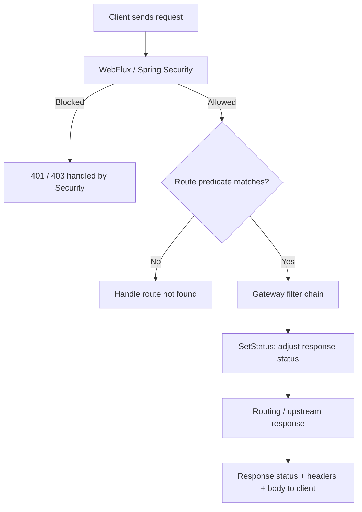
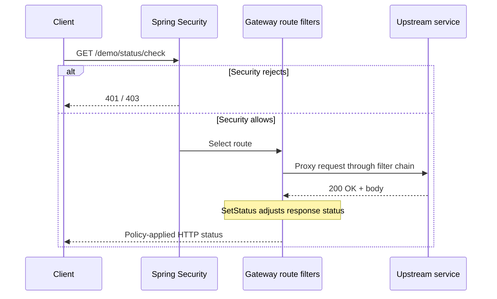

# SetStatus and the HTTP Status Code Contract Returned to Clients

When a client calls an API through **Spring Cloud Gateway**, it needs to receive HTTP codes with consistent meaning regardless of which microservice the Gateway routes to. Code `200` indicates the request succeeded per the contract; `401` requires authentication; `429` signals quota exceeded; `503` usually indicates the service is temporarily unavailable. An inappropriate HTTP code can cause applications to misbehave, trigger dangerous retry behavior, or make monitoring systems miscount error rates.

In the **Headers and Status** chapter, the **`SetStatus` GatewayFilter Factory** is the tool for changing the HTTP **response status** returned by Spring Cloud Gateway. This lesson explains how to configure `SetStatus`, its limitations, and how to preserve the **HTTP contract** when coordinating route predicates, filter chains, Spring Security, rate limiting, circuit breakers, retries, TLS, and request observability.

> **Scope:** Examples use **Spring Cloud Gateway Server WebFlux**. Spring Cloud Gateway Server MVC has a different pipeline and configuration API. `SetStatus` only adjusts the response status code; it does not automatically transform the response body into a contract-compliant error message, authenticate users, or prevent requests from reaching upstream by default.

## 1. Distinguishing three types of "status" in a request

Before using `SetStatus`, distinguish:

| Status type | Examples | What does it represent? |
| --- | --- | --- |
| **HTTP response status** | `200`, `404`, `429`, `503` | The outcome the client receives at the HTTP protocol layer |
| **Reactive terminal signal** | `onComplete`, `onError`, `cancel` | Execution lifecycle of `Mono`/`Flux` in WebFlux/Reactor |
| **Upstream status** | Backend returns `201`, connection timeout, instance unavailable | The outcome or failure occurring when the Gateway communicates with the target service |

These three are related but **not identical**. For instance, a backend can return a valid HTTP `503` response, the Gateway proxies it back to the client, and the Reactor stream still terminates with `onComplete`. Conversely, a socket error can produce `onError` and be translated by an error handler into HTTP `502` or `503`.

`SetStatus` affects **the returned HTTP code**; it does not turn `onError` into a response with a body, does not alter business outcomes that already happened on the backend, and does not dictate whether the client should retry.



The diagram shows layer **responsibilities**, not a fixed execution position for every pre/post callback in the filter chain. Filter order, how routing handles responses, and when the response is committed must all be verified in actual deployments.

## 2. SetStatus GatewayFilter Factory syntax

`SetStatus` accepts **one parameter**: the desired HTTP status code.

Common shortcut declaration:

```yaml
filters:
  - SetStatus=UNAUTHORIZED
```

Or using a **numeric code**:

```yaml
filters:
  - SetStatus=401
```

In Spring Cloud Gateway versions supporting this form, `UNAUTHORIZED` corresponds to HTTP `401` per Spring's `HttpStatus`. You can use standard names such as `NOT_FOUND`, `TOO_MANY_REQUESTS`, `SERVICE_UNAVAILABLE`, `GATEWAY_TIMEOUT`, or the corresponding HTTP numbers.

An illustrative route:

```yaml
spring:
  cloud:
    gateway:
      routes:
        - id: status-demo
          uri: http://localhost:8081
          predicates:
            - Path=/demo/status/**
          filters:
            - SetStatus=SERVICE_UNAVAILABLE
```

If the request matches the route and the filter applies before response commit, the Gateway sets the HTTP status received by the client to **`503 Service Unavailable`**.

**Very important warning:** The configuration above still includes `uri` and the Gateway routing chain. `SetStatus` **does not mean "do not call the backend"**. It is a status-setting operation inside the filter chain, not an automatic short-circuit command. Using `SetStatus=SERVICE_UNAVAILABLE` as a "maintenance mode" without verifying upstream calls can leave the backend continuing to receive requests, including write requests.

### Two configuration styles

| Syntax | Meaning |
| --- | --- |
| `SetStatus=404` | Sets HTTP code `404` |
| `SetStatus=NOT_FOUND` | Sets HTTP code `404` by constant name |
| `SetStatus=429` | Sets HTTP code `429` |
| `SetStatus=TOO_MANY_REQUESTS` | Sets HTTP code `429` by constant name |
| `SetStatus=503` | Sets HTTP code `503` |
| `SetStatus=SERVICE_UNAVAILABLE` | Sets HTTP code `503` by constant name |

Using constant names helps readers recognize intent, while numeric codes are closer to what clients see. Using a value unsupported by your Spring version or misspelled can prevent the application from starting/loading routes properly; verify configuration logs and registered routes.

**Version note:** `spring.cloud.gateway.routes` is the familiar prefix in traditional Spring Cloud Gateway WebFlux releases. Newer releases use `spring.cloud.gateway.server.webflux.routes`. Pick the prefix matching your starter/version; the `SetStatus=...` syntax itself does not change because of this prefix difference.

## 3. Where is SetStatus applied in the pipeline?

From a request's perspective:

1. WebFlux receives the request; if Spring Security is present, the security layer may reject it before the Gateway selects a route.
2. `RoutePredicateHandlerMapping` evaluates `Path`, `Method`, `Host`, `Header`, `Query`... conditions and selects a matching route.
3. `FilteringWebHandler` combines `GlobalFilter`s and the selected route's `GatewayFilter`s into an ordered chain.
4. `SetStatus` runs in the **Gateway filter chain** to alter the response status as configured.
5. Other routing/response filters continue processing; the response is committed and sent to the client.

Therefore:

- A route's `SetStatus` **does not run** if the request does not match that route.
- If Spring Security returns `401`/`403` before a Gateway route is selected, a route's `SetStatus` **cannot reach backward** to modify Security's response.
- If another filter has already committed response headers or started streaming the body, changing the status late may no longer take effect.
- If multiple filters modify status, the final result depends on their execution order and timing. Do not combine conflicting status-setting policies without testing.

### Response commit is an uncrossable boundary

In HTTP, the status code is sent at the start of the response. Once headers have been committed to the network, the Gateway **cannot reliably replace `200` with `503`** afterward.

```text
Before commit:
    status = 200          -> can set status = 503
    headers still editable -> can add Retry-After

After commit:
    status/headers sent   -> cannot "swap the response" already sent to client
    body may be streaming -> subsequent errors may abort stream/connection
```

In a custom Java filter, `ServerHttpResponse.setStatusCode(...)` returns a boolean indicating whether the status could be set; you can check `isCommitted()` to see if the response is already committed. When using `SetStatus`, align expectations with the pipeline stage and **test with real requests**, especially for streaming, large responses, early-writing filters, or error handling.

`SetStatus` is not a "safety net" guaranteeing every exception becomes a new HTTP status. Exceptions thrown before a response is formed must be handled by appropriate WebFlux/Gateway error mechanisms.

## 4. HTTP status is part of the API contract

Each HTTP status code group carries semantics that clients, proxies, caches, and monitoring tools rely on.

| HTTP Code | Typical meaning | Contract implications to consider |
| --- | --- | --- |
| `200 OK` | Success, with representation depending on method | Body must match the success schema |
| `201 Created` | Resource created | Should include representation or new resource URI via `Location` where appropriate |
| `202 Accepted` | Accepted for incomplete processing | Needs a task/result tracking mechanism if processed asynchronously |
| `204 No Content` | Success, no response content | **Do not send a response body** |
| `301`/`308` | Permanent redirect | Must consider `Location`, caching, and client behavior |
| `302`/`307` | Temporary redirect | `Location` and method-preservation differences matter greatly |
| `400 Bad Request` | Invalid request | Error payload should indicate the validation failure |
| `401 Unauthorized` | Missing/invalid authentication credentials | For HTTP authentication, include appropriate `WWW-Authenticate` |
| `403 Forbidden` | Request understood but permission denied | Do not use instead of `401` when simply unauthenticated |
| `404 Not Found` | Resource/handler not found | Distinguish non-existent route from backend returning 404 |
| `405 Method Not Allowed` | Method unsupported for resource | Requires `Allow` header per HTTP rules |
| `409 Conflict` | Resource state conflict | Return info helping the client resolve the conflict if safe |
| `422 Unprocessable Content` | Syntactically valid payload but semantically unprocessable | Distinguish from syntax error `400` per contract |
| `429 Too Many Requests` | Request rate limit exceeded | Often paired with `Retry-After` or quota information |
| `500 Internal Server Error` | Server-side processing failure | Avoid leaking stack traces and internal details |
| `502 Bad Gateway` | Gateway received invalid response from upstream | Classify integration/proxy errors |
| `503 Service Unavailable` | Service temporarily unavailable | May include `Retry-After`; avoid triggering retry storms |
| `504 Gateway Timeout` | Gateway did not receive timely result from upstream | Requires timeout budget and bounded retry policy |

**Changing status does not mean fulfilling the contract.** A body saying `"success": true` with status `503` produces a contradictory message. Similarly, setting status `201` does not create a resource, `Location`, or representation of that resource on its own.

### Example of an inconsistent contract

Suppose the backend returns:

```http
HTTP/1.1 200 OK
Content-Type: application/json

{"orderId":42,"status":"CONFIRMED"}
```

The Gateway applies `SetStatus=503` while keeping the success response body. The client receives an error status alongside a body asserting the order is confirmed. Some clients automatically retry on `503`, potentially causing duplicate operations.

Consequences:

1. **Client logic** struggles to decide whether to retry, report an error, or display data.
2. **Monitoring** counts 5xx errors even though the backend succeeded.
3. **Caching** and retry infrastructure may alter behavior based on status.
4. **Write transactions** may already be committed even though the client received an error code.

Use `SetStatus` only when changing the code is an **intentional policy and the response contract is fully designed**, not to mask arbitrary system errors.

## 5. Distinguishing SetStatus from returning an immediate response

There are two very different needs:

**Need A — Adjusting the status code of a response being processed:** use `SetStatus` when the whole chain and response content are consistent.

**Need B — Rejecting a request without sending it upstream:** requires **short-circuiting** in a dedicated filter or mechanism. `SetStatus` by itself does not have a "stop the processing chain" contract.

Illustrative Java `GatewayFilter` example that immediately returns `503` **without calling `chain.filter(exchange)`**:

```java
GatewayFilter maintenanceFilter = (exchange, chain) -> {
    ServerHttpResponse response = exchange.getResponse();

    response.setStatusCode(HttpStatus.SERVICE_UNAVAILABLE);
    response.getHeaders().set(HttpHeaders.RETRY_AFTER, "120");

    return response.setComplete();
};
```

This example uses `GatewayFilter`, `ServerHttpResponse`, `HttpStatus`, and `HttpHeaders`. This code can be integrated into a custom factory or corresponding Java route builder. This filter **always rejects** when applied and does not yet include an enable/disable toggle for maintenance; a real system needs an appropriate operational policy.

Core differences:

| Characteristic | `SetStatus=503` | Filter returning `response.setComplete()` early |
| --- | --- | --- |
| Sets HTTP status | Yes | Yes |
| Calls rest of route chain by default | Yes, does not represent an immediate block | No, if `chain.filter` is not called |
| Produces standard error response body by default | No | No; must construct it if required by contract |
| Can avoid calling upstream | Cannot be inferred from `SetStatus` alone | Yes, if the filter blocks **before routing** |
| Suitable as a strict maintenance gate | Not sufficient on its own | Yes, if position/order and policy are controlled |

For JSON error responses, a custom filter must set status, `Content-Type`, and an appropriate body, properly handling `DataBuffer` and commit. If an empty body suffices, `setComplete()` is straightforward. For general errors, consider WebFlux centralized error handlers and built-in Gateway filters before writing custom solutions.

## 6. Comparing SetStatus with other status-producing mechanisms

| Scenario | Better-suited mechanism | Why |
| --- | --- | --- |
| Route requires changing to a fixed response code with known contract | `SetStatus` | Alters status on the route's response |
| Unauthenticated client | Spring Security authentication entry point | Produces `401` with `WWW-Authenticate` and handles tokens |
| Authenticated client lacking permission | Spring Security access denied handler | Produces `403` per policy |
| Request exceeds quota | `RequestRateLimiter` or equivalent | Rejects requests with `429` based on configured key/quota |
| Upstream timeout | HTTP client timeouts or protection filter + error mapping | Enforces deadlines and maps failures to `504` when appropriate |
| Upstream failing with fallback | Valid `CircuitBreaker`/fallback | Reduces upstream dependency and returns consistent fallback content |
| Upstream returns meaningful error codes | Proxied response and selective error-handling policy | Preserves service contract or transforms in a controlled way |
| No matching Gateway route found | WebFlux handler mapping/error handling | Route filters do not run because no route was chosen |
| Need immediate blocking response without proxying | Custom filter or handler returning response and stopping chain | Controls body, headers, status, and upstream invocation |

**401 example:** `SetStatus=UNAUTHORIZED` does not verify JWTs, generate authentication challenges, or protect other routes. To secure APIs, configure `SecurityWebFilterChain` with an OAuth2 resource server/authorization policy.

**429 example:** `SetStatus=TOO_MANY_REQUESTS` on all requests neither tracks quota nor inspects identity/rate keys. Use `RequestRateLimiter` with a suitable algorithm and key resolver to reject only requests **exceeding the limit**.

**504 example:** A route with `SetStatus=GATEWAY_TIMEOUT` does not wait for the backend to expire; it only sets a status without a timeout timer. Configure connection/response timeouts in the right place, define a timeout budget, and map exceptions semantically.

## 7. Coordinating SetStatus with response headers

An HTTP response consists of a status line, headers, and an optional body. When intentionally changing status, inspect related headers.

### `503 Service Unavailable` and `Retry-After`

`Retry-After` can express seconds to wait or an HTTP-date timestamp that clients may use before retrying:

```http
HTTP/1.1 503 Service Unavailable
Retry-After: 120
Cache-Control: no-store
```

Response headers can be added via corresponding Gateway filters:

```yaml
filters:
  - SetStatus=SERVICE_UNAVAILABLE
  - AddResponseHeader=Retry-After,120
  - AddResponseHeader=Cache-Control,no-store
```

**This only illustrates setting status/headers.** It does not prevent calling upstream and does not guarantee an appropriate body. If the goal is blocking traffic during maintenance, use a short-circuit filter or dedicated handler as in section 5.

### `401 Unauthorized` and `WWW-Authenticate`

In HTTP authentication flows, `401` typically needs `WWW-Authenticate` to describe the authentication scheme. For Bearer JWT APIs, Spring Security resource server handles challenges based on authentication error context. `SetStatus=401` alone neither creates challenges nor distinguishes expired tokens, invalid signatures, or missing scopes.

Do not hard-code a static `WWW-Authenticate` on all requests without understanding the scheme and security policy. Missing authentication and insufficient token permissions are two distinct cases requiring different codes/responses.

### `201 Created` and `Location`

If the backend created a resource, `201` may accompany the new resource URI, for example:

```http
HTTP/1.1 201 Created
Location: https://api.example.test/api/orders/42
Content-Type: application/json

{"id":42}
```

Only use `SetStatus=CREATED` when an actual resource-creation action occurred with an appropriate representation/`Location`. If upstream returned `200` for a read-only operation, changing it to `201` does not make a resource exist.

### `204 No Content`

`204` means the response **has no content**. If upstream already emitted a JSON body, changing status to `204` without coordinating body/headers violates the contract and can cause clients to parse data abnormally. Decide where compliant `204` responses are generated, strip the body, and avoid invalid content headers.

### `405 Method Not Allowed` and `Allow`

`405` requires an `Allow` header listing supported methods. A non-matching `Method` route predicate normally makes the Gateway evaluate other routes or find no route; it **does not automatically guarantee** emitting `405` with `Allow`. If the API requires a strict `405` contract, design handling at the proper layer.

### `3xx Redirect` and `Location`

`SetStatus=FOUND` (302) or `SetStatus=TEMPORARY_REDIRECT` (307) does not pick a target URL automatically. Clients need `Location`. Moreover, `301`/`302` and `307`/`308` differ in method preservation during redirects; choose codes based on actual API requirements to avoid unexpectedly turning `POST` redirects into unwanted behavior.

## 8. Multi-route configuration and separating status policies

Suppose a Gateway has these routes:

- `/api/products/**` forwards normally to `product-service`.
- `/demo/status/**` tests the `SetStatus` filter in development.
- `/api/orders/**` is protected by JWT and an appropriate rate limiter.

A test configuration with clearly separated routes:

```yaml
spring:
  cloud:
    gateway:
      routes:
        - id: products
          order: 0
          uri: http://localhost:8081
          predicates:
            - Path=/api/products/**
          filters:
            - StripPrefix=1

        - id: status-lab
          order: 0
          uri: http://localhost:8082
          predicates:
            - Path=/demo/status/**
          filters:
            - SetStatus=SERVICE_UNAVAILABLE
            - AddResponseHeader=X-Status-Demo,enabled
```

Request `GET /api/products/42` is not affected by the `status-lab` route's `SetStatus`, because that filter belongs only to `status-lab`. Conversely, `GET /demo/status/check` can receive status `503` per the filter configuration. Do not assume a single route's status setting applies globally across the Gateway.

If a filter is declared in `default-filters`, it can apply to multiple routes via the Gateway's mechanism. Placing `SetStatus` there has a much broader impact than declaring it on one route. Because status is part of the API contract, review every route before letting a default configuration alter their HTTP codes.

### When to use Java DSL?

Routes can be defined using `RouteLocatorBuilder` in Gateway WebFlux. Conceptually equivalent example:

```java
@Configuration
public class StatusDemoRoutes {

    @Bean
    RouteLocator statusRoutes(RouteLocatorBuilder builder) {
        return builder.routes()
            .route("status-lab", route -> route
                .path("/demo/status/**")
                .filters(filters -> filters
                    .setStatus(HttpStatus.SERVICE_UNAVAILABLE))
                .uri("http://localhost:8082"))
            .build();
    }
}
```

Types to import include `Configuration`, `Bean`, `RouteLocator`, `RouteLocatorBuilder`, and `HttpStatus`. Java DSL overload signatures may vary by version, so check the API of your installed Spring Cloud Gateway release; the filter's meaning remains setting HTTP status inside the route filter chain.

## 9. Filter order and factors that can override status

When multiple components process a response, identify who is the **final owner** of the status:



Scenarios to keep in mind:

1. **Route filter does not run:** Request is rejected by Security, matches no route, or is handled by another handler.
2. **Multiple filters alter status:** A custom filter, fallback, or error handler may intervene; order and commit timing decide the outcome.
3. **Upstream fails at connection level:** There is no upstream HTTP response whose status can simply be "swapped"; connection/timeout errors must be handled at the right layer.
4. **Response already committed:** Modifying status too late cannot guarantee effect.
5. **Streaming body:** When a response is streamed incrementally, status cannot be changed mid-stream simply because an error occurs later.

**How to verify:** Observe route ID, upstream status, status returned by Gateway to client, error signals, timeouts/retries, and when the response begins. Do not rely solely on a single `onError` log entry to confirm the final HTTP code.

### Original status and modified status

In some Gateway versions, `SetStatus` provides an option to record the original HTTP code from the proxied response into a separate configurable response header for observability. If your project uses this feature, verify **property names and behavior for your version**, and keep it internal-only or assess security implications before exposing original statuses to clients.

Beyond diagnostic headers, maintain clear metrics/tracing for:

- Route ID.
- HTTP method, path template, or route pattern.
- Final HTTP status returned to the client.
- Upstream status if a backend response was received.
- Exception type if no HTTP response was received.
- Retry/circuit breaker fallback counts, latency, and trace ID.

Avoid logging Bearer tokens, cookies, and sensitive payloads.

## 10. Testing SetStatus with real requests

Suppose the Gateway runs at `http://localhost:8080`, a mock upstream runs at `http://localhost:8082`, and the `status-lab` route is configured as in section 8. Upstream returns `200 OK` with body:

```http
HTTP/1.1 200 OK
Content-Type: application/json

{"message":"upstream-ok"}
```

### Send the request

```bash
curl -i 'http://localhost:8080/demo/status/check'
```

Provided the route matches, the filter operates, and the response is not committed early, verify that the status received by the client is `503` per `SetStatus=SERVICE_UNAVAILABLE`. Also observe **whether upstream was called**. Do not infer from `503` that the request never reached the backend.

### Testing with a mock upstream

Illustrative test snippet using WireMock and `WebTestClient`:

```java
@Test
void setStatusOverridesProxiedHttpStatus() {
    wireMockServer.stubFor(
        get(urlEqualTo("/demo/status/check"))
            .willReturn(aResponse()
                .withStatus(200)
                .withHeader("Content-Type", "application/json")
                .withBody("{\"message\":\"upstream-ok\"}")));

    webTestClient.get()
        .uri("/demo/status/check")
        .exchange()
        .expectStatus().isEqualTo(HttpStatus.SERVICE_UNAVAILABLE)
        .expectHeader().valueEquals("X-Status-Demo", "enabled");

    wireMockServer.verify(1,
        getRequestedFor(urlEqualTo("/demo/status/check")));
}
```

This is an **illustrative test excerpt**, not a standalone runnable test class. Your project must declare `wireMockServer`, `webTestClient`, route configuration, and WireMock static imports; if Spring Security is enabled, requests must pass appropriate test security policies.

The test serves two goals simultaneously:

- Confirms **the final HTTP status** returned to the client can be overridden by `SetStatus`.
- Confirms **upstream is still called** when the filter configuration does not short-circuit.

If policy requires "never call upstream during maintenance", the test above **must be replaced with an assertion that the backend was not called**, paired with an actual request-blocking filter.

### Adding tests for edge cases

| Scenario | What to verify |
| --- | --- |
| Upstream returns `200`, route has `SetStatus=503` | Are client status, body, and headers consistent; was upstream called |
| Upstream returns `404`, route has `SetStatus=503` | Should the resource error meaning be preserved instead |
| Request does not match `/demo/status/**` | That route's `SetStatus` does not run |
| Missing JWT on an authenticated API | Security returns `401` before Gateway filters run |
| Response stream starts then fails | Do not attempt to write a new status after commit |
| Backend timeout/connection refused | Error handler decides HTTP error; do not treat SetStatus as a timeout mechanism |
| `SetStatus=204` on a response with a body | Must verify empty-body contract |
| `SetStatus=302` without `Location` | Client lacks sufficient redirect information |
| `SetStatus=429` and `Retry-After` | Apply only with a real rate-limit policy and proper retry guidance |

### Testing client compatibility

An API serving Java, JavaScript, and mobile clients should not be tested with `curl` alone. Test client-side response handling as well: body parsing, `4xx`/`5xx` handling, error display, retries, and caching. `WebClient.retrieve()` in Spring WebFlux typically turns error statuses into exceptions by default, whereas `exchangeToMono()` lets you handle `ClientResponse` directly. Other clients may not throw automatically on HTTP `503`. That is why statuses must be semantically accurate.

## 11. Common design mistakes and how to fix them

| Symptom | Possible cause | How to resolve |
| --- | --- | --- |
| Configured `SetStatus=503` yet backend still executes business logic | SetStatus does not stop the chain by default | Use a short-circuit filter/handler if you want to block upstream |
| Client receives `401` despite route having `SetStatus=503` | Security rejects before route selection | Check security entry point and access permissions |
| Client receives `404` due to wrong path | Route with `SetStatus` was not selected | Check `Path`/`Method`/`Host` and route order |
| Client receives `503` with a success body | Changed status only, did not change body | Design a unified body/status contract |
| Client retries a write operation that already succeeded | Error status triggers client/proxy retry | Never fake `5xx`; use idempotency keys and reconciliation |
| `SetStatus=201` but no resource was created | Changing status does not create resources | Let the backend decide resource-creation status |
| `SetStatus=204` yet content is still present | Body/headers not handled per 204 semantics | Return a bodyless response per contract |
| `SetStatus=302` yet browser fails to redirect properly | Missing/wrong `Location` | Check public URI and redirect status type |
| `SetStatus=429` yet quota is not tracked | SetStatus is not a rate limiter | Use `RequestRateLimiter` with proper key/quota |
| Timeout does not become `504` as expected | Missing timeout policy or exception mapping | Configure HTTP client timeouts/error handler |
| Status unchanged even though filter ran | Response already committed or another filter overwrote status | Check filter order and write/commit timing |
| Route fails to load | Invalid YAML, config prefix, or status name | Check startup logs and actual registered route list |

When investigating, distinguish **"Gateway selected a route and upstream returned an error"** from **"Gateway found no matching route"**. The former has a route ID and upstream status; the latter never runs `SetStatus` of an unselected route.

## 12. Practice: safe payment API maintenance

A Gateway serves:

- `GET /api/payments/{id}`: view payment status.
- `POST /api/payments`: submit a payment creation request.
- Upstream `payment-service` is configured via `lb://payment-service`.
- During maintenance, the system must return `503` with `Retry-After` and **must not execute POST** on the backend.
- Clients must have a way to know the payment outcome is unconfirmed and avoid duplicate submissions if an earlier attempt already started.

### Unsafe approach

```yaml
spring:
  cloud:
    gateway:
      routes:
        - id: payments
          uri: lb://payment-service
          predicates:
            - Path=/api/payments/**
          filters:
            - SetStatus=SERVICE_UNAVAILABLE
```

This configuration **does not guarantee stopping routing**. It can cause clients to see `503` while `payment-service` already processed the `POST`, creating a risk of duplicate payment retries.

### Proper implementation principles

Design a maintenance gate at an appropriate layer before routing:

1. Check maintenance state via a reliable configuration source.
2. When in maintenance, set status `503`, `Retry-After` header if valid, and a clear contract-compliant error body; **do not call `chain.filter(exchange)`**.
3. When not in maintenance, return `chain.filter(exchange)` for normal Gateway processing.
4. Keep authorization in Spring Security; never let the maintenance filter replace access control checks.
5. Use idempotency keys, transaction states, and reconciliation workflows for payment operations.
6. Test that the backend **receives no requests** during maintenance mode and that clients receive the right headers/body.

### Knowledge check exercises

1. Do `SetStatus=NOT_FOUND` and `SetStatus=404` differ in HTTP meaning?
2. Why does `SetStatus=503` not guarantee the backend was not called?
3. Does `SetStatus=UNAUTHORIZED` replace Spring Security JWT configuration?
4. If the response body says `{"success":true}` while status is `503`, which clients/proxies may behave unexpectedly?
5. Why should `204` not be applied to a response with a JSON body without changing the contract?
6. When a request does not match a route, does that route's `SetStatus` run?
7. Besides a status code, what other elements does a proper `429` require?
8. Once a response is committed, can a filter change `200` to `504` to reflect a mid-stream timeout?
9. To ensure the backend is never called during maintenance, what behavior in a `GatewayFilter` must differ from ordinary `SetStatus`?
10. Why should you measure both upstream status and the final status seen by the client?

**Remember:** **`SetStatus` only changes the HTTP response status within the scope of a selected Gateway route**. It does not authenticate, calculate quotas, generate contract bodies, perform redirects, enforce timeouts, or prevent upstream calls by default. Using each HTTP code according to its true semantics, coordinating headers/body, respecting response commit boundaries, and verifying behavior with real requests keep an API Gateway safe and observable.
