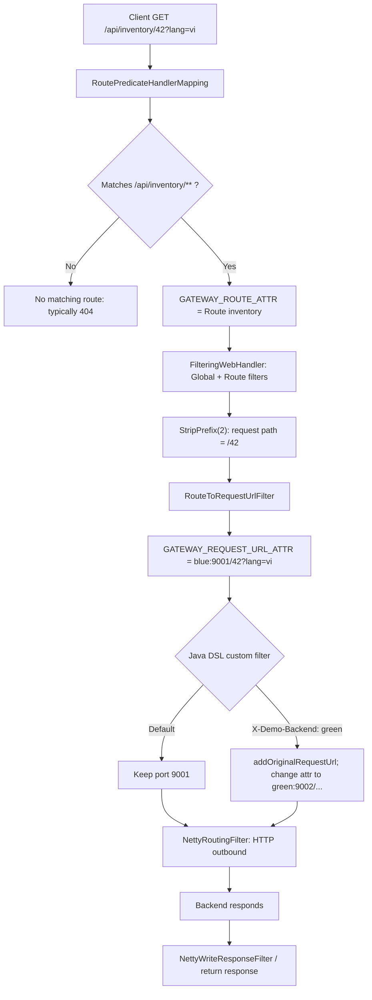

# Changing the Target URI via Java DSL and Controlling Exchange Attributes

## 1. Objectives and real-world scenario

In **Spring Cloud Gateway**, clients send requests to a Gateway address, while the Gateway can choose a different server to forward to. Normally the target is statically configured on the route via `uri`; for specialized needs, an application can also **change the forwarding URI per request** using Java DSL and a custom `GatewayFilter`.

For example, an inventory system has two test backends:

- **Blue:** `http://127.0.0.1:9001`
- **Green:** `http://127.0.0.1:9002`

Both serve `GET /42?lang=vi`. A single route receives `GET /api/inventory/42?lang=vi`; by default the Gateway forwards to Blue, but in a test environment it can select Green when the request carries `X-Demo-Backend: green`. Outbound host/port names must come from a **fixed allowlist of destinations permitted by the application**, never constructed directly from arbitrary client-supplied URLs or headers.

This topic belongs to the **Headers and Status** chapter, because changing the HTTP target affects `Host`, request/response headers, status, and upstream availability. However, the core mechanism is **`ServerWebExchange` internal attributes**, not writing a header that controls routing.

After this lesson, you will be able to:

1. Declare routes using `RouteLocatorBuilder` in Java DSL.
2. Distinguish the **route URI** (`Route.getUri()`), the **client request URI**, and the **resolved target URI** (`GATEWAY_REQUEST_URL_ATTR`).
3. Change the destination at the right time: **after** `RouteToRequestUrlFilter`, **before** the HTTP routing filter.
4. Preserve path/query when changing host/port, while recording the pre-change URI via `addOriginalRequestUrl`.
5. Explain the role and limitations of `GATEWAY_ROUTE_ATTR`, `GATEWAY_ORIGINAL_REQUEST_URL_ATTR`, `GATEWAY_SCHEME_PREFIX_ATTR`, and `GATEWAY_ALREADY_ROUTED_ATTR`.
6. Test which backend actually receives the request and distinguish route errors, network errors, HTTP statuses, and response headers.
7. Apply proper safety boundaries for service discovery, auth, rate limiting, retries, circuit breakers, TLS, and observability.

> **Version scope:** examples use **Spring Cloud Gateway Server WebFlux** from Spring Cloud 2025.0.x / Gateway 4.3.x, with Spring Boot 3.5.x. The illustrative starter is `spring-cloud-starter-gateway-server-webflux`. Examples for Gateway Server MVC or older release trains may differ in starter names, API packages, or configuration prefixes; check documentation for your exact version.

## 2. Three types of URIs that are easily confused

Suppose a client sends:

```http
GET /api/inventory/42?lang=vi HTTP/1.1
Host: localhost:8080
```

Java DSL route declares:

```java
.uri("http://127.0.0.1:9001")
```

And a `StripPrefix=2` filter removes `/api/inventory`. During processing, three URIs are involved:

| Type | Illustrative value | Meaning |
| --- | --- | --- |
| **Client-side Request URI** | `http://localhost:8080/api/inventory/42?lang=vi` | URI of the request entering the Gateway, obtained from `exchange.getRequest().getURI()`. |
| **Route URI** | `http://127.0.0.1:9001` | Static target declared in the `Route` object. |
| **Resolved routing URI** | `http://127.0.0.1:9001/42?lang=vi` | URI used when sending the request to the backend; stored in exchange attribute `GATEWAY_REQUEST_URL_ATTR`. |

This leads to two rules:

- `Route.getUri()` describes the target from route configuration. It is not where the full final upstream URL for every request lives.
- `exchange.getRequest().getURI()` represents the current request in WebFlux; mutating the request path and changing **`GATEWAY_REQUEST_URL_ATTR`** are related operations with different purposes.

When Java DSL changes `GATEWAY_REQUEST_URL_ATTR` from port `9001` to `9002`, that is an **internal proxy target swap**. The Gateway still returns the response directly to the client via `localhost:8080`; it **does not** send HTTP 301/302/307/308 or force the browser to redirect itself to Green.

### Impact of paths in a route URI

Gateway Server WebFlux builds the routing URL from the request URI and route information; **putting a path directly inside the route URI is not a reliable way to prepend a prefix for upstream**. For example:

```java
.uri("http://127.0.0.1:9001/hidden-prefix")
```

Do not expect `/hidden-prefix` to be automatically prepended to every request. If you want to alter the path, explicitly declare `StripPrefix`, `SetPath`, `PrefixPath`, `RewritePath`, or an appropriate path-mutating filter and test the output URI.

## 3. Flow of exchange attributes in the Gateway

A request matching a route passes through `RoutePredicateHandlerMapping` and then `FilteringWebHandler`. This chain merges `GlobalFilter`s with the route's `GatewayFilter`s and sorts them by `Ordered`.



Key attributes in `ServerWebExchangeUtils`:

| Attribute / API | Typical data type | Role and notes |
| --- | --- | --- |
| `GATEWAY_ROUTE_ATTR` | `Route` | Route selected by predicates. You can read `id`, `uri`, `metadata`. |
| `GATEWAY_REQUEST_URL_ATTR` | `URI` | URI used by the routing filter. This is the attribute to modify when changing the HTTP target for the current request. |
| `GATEWAY_ORIGINAL_REQUEST_URL_ATTR` | Historical URI set (typically `LinkedHashSet<URI>`) | Records URIs prior to transformations when the framework/filter explicitly adds them. Do not assume there is always exactly one URI or that it always holds the exact initial client URL. |
| `GATEWAY_SCHEME_PREFIX_ATTR` | Scheme-prefix string, if any | Serves cases such as `lb:ws://...`; do not edit arbitrarily without fully understanding the routing path. |
| `GATEWAY_ALREADY_ROUTED_ATTR` | Internal status marker | Used by routing filters to avoid routing multiple times. Never mark as routed **before** outbound HTTP actually happens. |
| `CLIENT_RESPONSE_ATTR` | Netty HTTP client response | Routing/response-writing data; usually unnecessary to touch when only changing the target URI. |

These attributes live in `exchange.getAttributes()`, **not HTTP headers** automatically sent to clients or upstreams. They only live for the duration of the current request/exchange. Never store them in static fields, mutable singleton maps, or caches shared across requests.

### Why does execution order determine success or failure?

`RouteToRequestUrlFilter` reads `GATEWAY_ROUTE_ATTR`, builds a URI from the route and transformed request, and **overwrites `GATEWAY_REQUEST_URL_ATTR`**. Therefore:

- If a custom filter writes a URI to `GATEWAY_REQUEST_URL_ATTR` **before** this step, its value may be overwritten by the framework filter.
- If a custom filter runs **after** the HTTP routing filter, changing the URI is too late and does not affect the already-sent request.
- In the WebFlux 4.3.x example, place the target-selection filter right **after** `RouteToRequestUrlFilter` via `RouteToRequestUrlFilter.ROUTE_TO_URL_FILTER_ORDER + 1`, then let Netty routing proceed.

`RouteToRequestUrlFilter.ROUTE_TO_URL_FILTER_ORDER` has value `10000` in the illustrated release line. Using the constant clarifies the ordering relationship; still check the actual filter chain of your version when upgrading or adding other filters.

## 4. Changing static route URIs with Java DSL

The simplest case is routing different paths to predefined services. Use `RouteLocatorBuilder`:

```java
@Bean
RouteLocator staticRoutes(RouteLocatorBuilder builder) {
    return builder.routes()
            .route("inventory-route", r -> r
                    .path("/api/inventory/**")
                    .filters(f -> f.stripPrefix(2))
                    .uri("http://127.0.0.1:9001"))
            .route("orders-route", r -> r
                    .path("/api/orders/**")
                    .filters(f -> f.stripPrefix(2))
                    .uri("http://127.0.0.1:9010"))
            .build();
}
```

The snippet belongs inside a `@Configuration` class with `@Bean`, `RouteLocator`, and `RouteLocatorBuilder` imported. There is no need to access exchange attributes because each route already has a fixed target URI.

| Request | Selected route | Outbound URI |
| --- | --- | --- |
| `/api/inventory/42` | `inventory-route` | `http://127.0.0.1:9001/42` |
| `/api/orders/71` | `orders-route` | `http://127.0.0.1:9010/71` |
| `/unknown` | No matching route | Not proxied through these two routes |

**Modifying the DSL while the application is running** does not automatically update already-created routes. `RouteLocator` is provided via a Spring bean; dynamic configuration in production requires an explicit route management/refresh mechanism or appropriate configuration/service-discovery setup. Do not treat `.uri(...)` as a per-request target-switching API.

When you want **a single route** to pick among backends from an approved set, the next example shows using a custom filter at the right point in the chain.

## 5. Java DSL example changing the target URI per request

We pick between two fixed local backends; the `X-Demo-Backend` header is meaningful only in this hands-on exercise. Values other than `green` use the default **blue** backend. The code does not take hostnames from headers, avoiding creating an open proxy to arbitrary addresses.

### 5.1. Initializing the project

Use JDK 17+, Maven, and compatible Spring Boot 3.5.x and Spring Cloud 2025.0.x. Complete example `pom.xml`:

```xml
<?xml version="1.0" encoding="UTF-8"?>
<project xmlns="http://maven.apache.org/POM/4.0.0"
         xmlns:xsi="http://www.w3.org/2001/XMLSchema-instance"
         xsi:schemaLocation="http://maven.apache.org/POM/4.0.0
                             https://maven.apache.org/xsd/maven-4.0.0.xsd">
    <modelVersion>4.0.0</modelVersion>

    <parent>
        <groupId>org.springframework.boot</groupId>
        <artifactId>spring-boot-starter-parent</artifactId>
        <version>3.5.0</version>
        <relativePath/>
    </parent>

    <groupId>com.example</groupId>
    <artifactId>gateway-uri-demo</artifactId>
    <version>0.0.1-SNAPSHOT</version>

    <properties>
        <java.version>17</java.version>
    </properties>

    <dependencyManagement>
        <dependencies>
            <dependency>
                <groupId>org.springframework.cloud</groupId>
                <artifactId>spring-cloud-dependencies</artifactId>
                <version>2025.0.0</version>
                <type>pom</type>
                <scope>import</scope>
            </dependency>
        </dependencies>
    </dependencyManagement>

    <dependencies>
        <dependency>
            <groupId>org.springframework.cloud</groupId>
            <artifactId>spring-cloud-starter-gateway-server-webflux</artifactId>
        </dependency>
    </dependencies>

    <build>
        <plugins>
            <plugin>
                <groupId>org.springframework.boot</groupId>
                <artifactId>spring-boot-maven-plugin</artifactId>
            </plugin>
        </plugins>
    </build>
</project>
```

The `3.5.0`/`2025.0.0` pair is an **illustrative release train pairing**, not a recommendation to use the `.0` initial patch in production. When starting a new project, choose supported patch versions from the official compatibility matrix. The starter omits its own version because the Spring Cloud BOM manages it.

Create entry point `src/main/java/com/example/gateway/GatewayApplication.java`:

```java
package com.example.gateway;

import org.springframework.boot.SpringApplication;
import org.springframework.boot.autoconfigure.SpringBootApplication;

@SpringBootApplication
public class GatewayApplication {
    public static void main(String[] args) {
        SpringApplication.run(GatewayApplication.class, args);
    }
}
```

Create `src/main/resources/application.yml`:

```yaml
server:
  port: 8080

spring:
  application:
    name: gateway-uri-demo
```

The route in this lesson is created with **Java DSL**, so do not add an overlapping `/api/inventory/**` YAML route to avoid route-selection ambiguity.

### 5.2. Writing `GatewayRoutes.java`

Create `src/main/java/com/example/gateway/GatewayRoutes.java`:

```java
package com.example.gateway;

import java.net.URI;

import org.springframework.cloud.gateway.filter.GatewayFilter;
import org.springframework.cloud.gateway.filter.RouteToRequestUrlFilter;
import org.springframework.cloud.gateway.route.RouteLocator;
import org.springframework.cloud.gateway.route.builder.RouteLocatorBuilder;
import org.springframework.context.annotation.Bean;
import org.springframework.context.annotation.Configuration;
import org.springframework.web.util.UriComponentsBuilder;

import reactor.core.publisher.Mono;

import static org.springframework.cloud.gateway.support.ServerWebExchangeUtils
        .GATEWAY_REQUEST_URL_ATTR;
import static org.springframework.cloud.gateway.support.ServerWebExchangeUtils
        .addOriginalRequestUrl;

@Configuration
public class GatewayRoutes {

    private static final String SELECTED_TARGET_ATTR =
            "demo.gateway.selectedTarget";

    @Bean
    RouteLocator gatewayRoutes(RouteLocatorBuilder builder) {

        return builder.routes()
                .route("inventory-route", r -> r
                        .path("/api/inventory/**")
                        .filters(f -> f
                                // Change path before the framework builds the target URI.
                                .stripPrefix(2)
                                // Run after RouteToRequestUrlFilter.
                                .filter(
                                        selectBackend(),
                                        RouteToRequestUrlFilter
                                                .ROUTE_TO_URL_FILTER_ORDER + 1)
                                // Response header purely for demo observation.
                                .addResponseHeader(
                                        "X-Gateway-Route", "inventory-route"))
                        // Default backend declared via Java DSL.
                        .uri("http://127.0.0.1:9001"))
                .build();
    }

    private GatewayFilter selectBackend() {
        return (exchange, chain) -> {

            URI current = exchange.getAttribute(
                    GATEWAY_REQUEST_URL_ATTR);

            if (current == null) {
                return Mono.error(new IllegalStateException(
                        "Gateway request URL missing; check filter order"));
            }

            // Demo scenario only supports HTTP routes targeting 127.0.0.1:9001.
            if (!"http".equalsIgnoreCase(current.getScheme())
                    || !"127.0.0.1".equals(current.getHost())
                    || current.getPort() != 9001) {
                return Mono.error(new IllegalStateException(
                        "Unexpected route destination"));
            }

            String requestChoice = exchange.getRequest()
                    .getHeaders()
                    .getFirst("X-Demo-Backend");

            boolean useGreen = "green".equalsIgnoreCase(requestChoice);
            String selected = useGreen ? "green" : "blue";

            if (useGreen) {
                // Change port on the resolved URI, preserving path/query.
                URI greenUri = UriComponentsBuilder.fromUri(current)
                        .port(9002)
                        .build(true)
                        .toUri();

                // Save pre-change URI into the exchange history.
                addOriginalRequestUrl(exchange, current);

                // The HTTP routing filter reads the new value here.
                exchange.getAttributes().put(
                        GATEWAY_REQUEST_URL_ATTR, greenUri);
            }

            // Internal metadata scoped to the current request.
            exchange.getAttributes().put(
                    SELECTED_TARGET_ATTR, selected);

            // Demo header reflects target selection decision,
            // does not confirm downstream returned 2xx.
            exchange.getResponse().getHeaders()
                    .set("X-Demo-Backend", selected);

            return chain.filter(exchange);
        };
    }
}
```

This is a route with a **default destination** `9001` and a custom `GatewayFilter` **attached only to this route**. Do not register a Gateway-wide `GlobalFilter` bean since the requirement only swaps targets for inventory requests.

Key parts explained:

1. `.path("/api/inventory/**")` selects the route before running filters.
2. `.stripPrefix(2)` turns `/api/inventory/42` into `/42`.
3. `.uri("http://127.0.0.1:9001")` sets the **default** upstream for the route.
4. `.filter(selectBackend(), ROUTE_TO_URL_FILTER_ORDER + 1)` attaches the filter at a controlled order. By this time, `RouteToRequestUrlFilter` has already populated `GATEWAY_REQUEST_URL_ATTR`.
5. `current` is the **resolved outbound URI**, so it contains the active path and query. Changing only the port with `UriComponentsBuilder.fromUri(current).port(9002)` preserves the rest.
6. `addOriginalRequestUrl(exchange, current)` records the pre-change URI in the history set. Do not use `exchange.getRequest().getURI()` instead of `current` here because the client-side request URI may differ from the outbound URI.
7. `exchange.getAttributes().put(GATEWAY_REQUEST_URL_ATTR, greenUri)` passes the new URI to subsequent routing filters.
8. `demo.gateway.selectedTarget` is a **custom-defined attribute**; it does not affect routing unless another filter actively reads it. `X-Demo-Backend` is just an observable response header in this lab.
9. `return chain.filter(exchange)` lets the rest of the chain continue. Omitting it stops the request before proxying.
10. The filter makes no blocking I/O calls and uses no shared mutable state across requests.

**Why use `build(true)`?** `UriComponentsBuilder.fromUri(current)` receives the current URI with its components already encoded. `build(true)` indicates those components are already encoded, keeping the existing path/query intact when changing only the port. Manually concatenating URL strings or uncontrolled decoding/re-encoding can unintentionally alter `%`, `+`, `&`, or Unicode characters.

### 5.3. Why not mutate `Route.getUri()`?

A `Route` created from configuration/DSL is shared routing metadata, whereas the decision to use Green in the example is **per-request**. Never mutate a route bean or static field that could simultaneously affect other requests.

To swap targets per request, update `GATEWAY_REQUEST_URL_ATTR` on the **current exchange**. Other requests receive their own attributes and default to Blue unless they also select Green.

## 6. Creating two local backends and verifying with curl

To verify where requests actually land, run a small JDK Echo server rather than relying solely on Gateway logs.

Create `EchoBackend.java` in a separate demo folder outside the Gateway source tree:

```java
import com.sun.net.httpserver.HttpServer;
import java.net.InetSocketAddress;
import java.nio.charset.StandardCharsets;

public class EchoBackend {
    public static void main(String[] args) throws Exception {
        int port = Integer.parseInt(args[0]);
        String name = args[1];

        HttpServer server = HttpServer.create(
                new InetSocketAddress("127.0.0.1", port), 0);

        server.createContext("/", exchange -> {
            String path = exchange.getRequestURI().getRawPath();
            String query = exchange.getRequestURI().getRawQuery();

            System.out.println(name + " RECEIVED " + path
                    + (query == null ? "" : "?" + query));

            String body = "backend=" + name + "\n"
                    + "path=" + path + "\n"
                    + "query=" + query + "\n";

            byte[] bytes = body.getBytes(StandardCharsets.UTF_8);

            exchange.getResponseHeaders().set(
                    "Content-Type", "text/plain; charset=UTF-8");
            exchange.sendResponseHeaders(200, bytes.length);

            try (var output = exchange.getResponseBody()) {
                output.write(bytes);
            }
        });

        server.start();
        System.out.println(name + " ready on 127.0.0.1:" + port);
    }
}
```

This is a learning server listening only on loopback. It implements no authentication, TLS, rate limiting, or circuit breaker; do not use it in production.

Open three terminals and run in order:

**Terminal A – Blue backend:**

```bash
java EchoBackend.java 9001 blue
```

**Terminal B – Green backend:**

```bash
java EchoBackend.java 9002 green
```

**Terminal C – Gateway** (in the project directory containing `pom.xml`):

```bash
mvn spring-boot:run
```

If using the Maven Wrapper, run `./mvnw spring-boot:run` on Linux/macOS or `mvnw.cmd spring-boot:run` on Windows.

### 6.1. Default request goes to Blue

```bash
curl -i "http://127.0.0.1:8080/api/inventory/42?lang=vi"
```

Expected response:

```http
HTTP/1.1 200 OK
X-Gateway-Route: inventory-route
X-Demo-Backend: blue
Content-Type: text/plain; charset=UTF-8

backend=blue
path=/42
query=lang=vi
```

The Blue terminal prints `blue RECEIVED /42?lang=vi`; the Green terminal receives no request.

### 6.2. Request selecting Green

```bash
curl -i -H "X-Demo-Backend: green" \
    "http://127.0.0.1:8080/api/inventory/42?lang=vi"
```

On Windows PowerShell, run on a single line:

```powershell
curl.exe -i -H "X-Demo-Backend: green" "http://127.0.0.1:8080/api/inventory/42?lang=vi"
```

Expected response:

```http
HTTP/1.1 200 OK
X-Gateway-Route: inventory-route
X-Demo-Backend: green
Content-Type: text/plain; charset=UTF-8

backend=green
path=/42
query=lang=vi
```

The Green terminal prints `green RECEIVED /42?lang=vi`, while the Blue terminal does not receive this request. That confirms the filter changed the target URI before proxying **without altering the path or query**.

### 6.3. Arbitrary header does not turn Gateway into an open proxy

```bash
curl -i -H "X-Demo-Backend: attacker.example.invalid:9999" \
    "http://127.0.0.1:8080/api/inventory/43"
```

Per the code above, any value other than `green` goes to Blue, so the backend receiving the request is still `127.0.0.1:9001`. The application **does not** concatenate hostnames from headers into outbound destinations. In production, backend selection should rely on controlled configuration or explicit authorization policies; the demo header is not an authentication mechanism.

### 6.4. Testing upstream failure

Stop the Green process while keeping Blue and the Gateway running, then call again with `X-Demo-Backend: green`. The route still matches and the filter still chooses Green, but connecting to `9002` fails and the Gateway typically returns a **5xx** error.

The response may still contain `X-Demo-Backend: green`, because the header only describes **the selected target**; it does not guarantee a backend call succeeded or returned 200.

Try `/not-configured`: if no other route/handler exists, the request usually returns **404**. It never enters `selectBackend` because it does not match the predicate.

## 7. Reading and controlling exchange attributes

### 7.1. Reading the route and target URI

Inside a `GatewayFilter` or `GlobalFilter` with `exchange`:

```java
Route selectedRoute = exchange.getAttribute(
        ServerWebExchangeUtils.GATEWAY_ROUTE_ATTR);

URI outbound = exchange.getAttribute(
        ServerWebExchangeUtils.GATEWAY_REQUEST_URL_ATTR);

String routeId = selectedRoute == null
        ? "unknown"
        : selectedRoute.getId();
```

Corresponding imports:

```java
import java.net.URI;
import org.springframework.cloud.gateway.route.Route;
import org.springframework.cloud.gateway.support.ServerWebExchangeUtils;
```

Do not assume `GATEWAY_REQUEST_URL_ATTR` is always present at every point. A filter running before `RouteToRequestUrlFilter` may observe `null`, and requests matching no route do not go through the same pipeline as matched requests.

### 7.2. Recording URI history when switching targets

When transforming the resolved URI yourself, use:

```java
URI before = exchange.getAttribute(
        ServerWebExchangeUtils.GATEWAY_REQUEST_URL_ATTR);

ServerWebExchangeUtils.addOriginalRequestUrl(exchange, before);
exchange.getAttributes().put(
        ServerWebExchangeUtils.GATEWAY_REQUEST_URL_ATTR, changedUri);
```

In this snippet, `before` must be checked for non-`null` and `changedUri` must be built/validated first. `addOriginalRequestUrl` helps maintain URI history across transformation steps. **History may contain multiple entries**, as LoadBalancer, forward, or other filters can also append to it. Do not inspect an arbitrary index in the URI set to infer "this is always the original browser URL".

### 7.3. Custom-defined metadata

You can store information for other filters or tracing in the exchange:

```java
private static final String SELECTED_TARGET_ATTR =
        "demo.gateway.selectedTarget";

exchange.getAttributes().put(SELECTED_TARGET_ATTR, "green");

String selected = exchange.getAttribute(SELECTED_TARGET_ATTR);
```

Use a namespaced key to avoid colliding with framework keys. Custom attributes do not automatically become HTTP headers; if you genuinely need to inform downstream or the client, add a header at the appropriate layer and watch out for sensitive data.

### 7.4. When should you NOT edit attributes?

| What you plan to do | Recommendation |
| --- | --- |
| Change upstream host/port of a matched request | Edit `GATEWAY_REQUEST_URL_ATTR` at the right order and with an approved destination. |
| Change upstream path | Prefer `SetPath`, `RewritePath`, `StripPrefix`, or `PrefixPath`. |
| Change HTTP `Host` sent upstream | Use the proper filter/header API; do not assume changing `GATEWAY_ROUTE_ATTR` or client URI automatically sets outbound `Host` as desired. |
| Change response status | Use response APIs or `SetStatus` filter. Changing URI does not change status to a specific code on its own. |
| Redirect browser to another URL | Use `RedirectTo`/3xx HTTP response with `Location`; do not edit routing attrs to fake a redirect. |
| Mark request as routed | Let routing filters manage `GATEWAY_ALREADY_ROUTED_ATTR`; never set it manually to "speed things up". |
| Manually edit `GATEWAY_SCHEME_PREFIX_ATTR` | Avoid unless explicitly designing `lb:`, `ws:`, or `wss:` flows. |

## 8. How does changing target URI relate to LoadBalancer and service discovery?

The example above uses two **concrete** HTTP URIs. In real microservices, routes are commonly declared as:

```java
.uri("lb://inventory-service")
```

In that case:

1. `RouteToRequestUrlFilter` builds a routing URI with the `lb` scheme.
2. `ReactiveLoadBalancerClientFilter` requires Spring Cloud LoadBalancer and a `ServiceInstance` list from discovery or valid configuration.
3. The LoadBalancer filter resolves `lb://...` into the HTTP(S) host/port of the chosen instance.
4. Only then does the HTTP routing filter proxy to that instance.

**Do not blindly apply the lesson's `9001/9002` port-swapping filter to an `lb://` route**: the guard in the example intentionally accepts only static HTTP routes to loopback. If overriding destinations on load-balanced routes, explicitly decide whether the change happens **before** or **after** LoadBalancer, respect order and URI scheme semantics, and account for retries/circuit breakers, instance health, and TLS. Replacing the URI with a static address can accidentally **bypass service discovery and load balancing**.

Normally, let LoadBalancer pick instances using metadata and proper instance-selection policies. Customize exchange attributes only when standard mechanisms cannot meet the requirement and integration tests cover it.

## 9. Headers, status, and TLS when switching backends

### HTTP headers

`GATEWAY_REQUEST_URL_ATTR` is the outbound URI. Changing host/port here is **different** from:

- The client request's `Host` header.
- `X-Forwarded-Host`, `Forwarded`, and proxy headers.
- Custom headers like `X-Demo-Backend` in the example.

Which public or internal host the backend needs to know is **independent** of which server the Gateway selected. With `PreserveHostHeader` or `SetRequestHostHeader`, understand upstream requirements and trusted-proxy boundaries. Never unconditionally forward a client-spoofed `Host` to a backend whose logic depends on domain names.

### HTTP status and response

If the route matches but Green is down, the Gateway may return a 5xx error. If Green returns `404`, the Gateway can forward Green's 404 response. If the client matches no route, a 404 can be generated directly at the Gateway before routing. Distinguish these cases using route IDs, logs/tracing, and connection details.

`X-Demo-Backend` in the example is a **diagnostic** header reflecting the target selection decision. Do not expose internal IP addresses or secret infrastructure details in production responses. If you want to proactively return an error from the Gateway, that is **short-circuiting**: set status/body and do not call `chain.filter(exchange)`.

### TLS

With outbound `https://`, the Netty HTTP client must establish TLS with upstream. Changing a URI from one HTTPS host to another can affect certificates, SNI, hostname verification, and trust configuration. Switching `https` to `http` just to avoid TLS errors weakens connection security. The local example uses `http://127.0.0.1` to simplify the lab; do not treat that as production policy.

## 10. Security when dynamically changing targets

A Gateway that lets clients specify backend URLs via query/headers without controls risks becoming an **open proxy** or an **SSRF (Server-Side Request Forgery)** vector. A malicious request could try to force the Gateway to access cloud metadata services, loopback, internal addresses, or unauthorized systems.

Apply these principles:

1. **Destination allowlist:** select from a fixed set of approved hosts/ports or service IDs. Never do `new URI(clientHeader)` and write it straight into `GATEWAY_REQUEST_URL_ATTR`.
2. **Identity control:** if tenant/backend selection depends on permissions, authenticate first with Spring Security WebFlux/OAuth2 and verify authorization against the chosen tenant or service.
3. **Prevent unintended DNS/IP redirection:** do not trust unchecked dynamic hostnames. Even with a domain allowlist, account for DNS resolution and runtime network egress policies.
4. **Preserve HTTP integrity:** path, query, method, body, and timeouts must be tested. Never build URLs from client data via string concatenation.
5. **Bound latency and failures:** configure connect/response timeouts, circuit breakers, and controlled retries; do not blindly retry side-effecting `POST` requests.
6. **Proper TLS:** verify upstream certificates; never disable verification to reach another address.
7. **Bounded observability:** log route ID, backend alias, status, and latency; never log JWTs, cookies, sensitive headers, or full URLs containing personal query strings.

The two Blue/Green destinations are purely a **learning model**. If you need canary releases or traffic splitting in production, consider route weighting/load balancing and release-management infrastructure rather than relying on arbitrary client headers.

## 11. Common errors

| Symptom | Cause to investigate | How to resolve |
| --- | --- | --- |
| Wrote `GATEWAY_REQUEST_URL_ATTR` yet requests still go to Blue | Custom filter runs before `RouteToRequestUrlFilter`, so the URI gets overwritten. | Set order after `ROUTE_TO_URL_FILTER_ORDER`, before the routing filter. |
| Custom filter sees URI as `null` | Filter runs too early or not on a route-selected branch. | Check order and `GATEWAY_ROUTE_ATTR`. |
| Request reaches Green but path still has `/api/inventory/42` | Missing or wrong `StripPrefix(2)`. | Check path-transforming filters before URL construction. |
| Target URI loses query or has broken encoding | Concatenated strings manually or built URI from decoded path. | Use `UriComponentsBuilder.fromUri(current)`; test special characters. |
| Header `X-Demo-Backend: green` present yet client sees 5xx | Header reflects selection decision, not proof upstream returned 200. | Check connection logs, backend, and metrics. |
| Route does not match `/api/inventory/**` | Wrong predicate or Java DSL route not registered. | Check `@Configuration` class, route ID, startup logs. |
| Selecting backend from arbitrary URL/header | Open proxy/SSRF risk. | Use only allowlists/controlled policies and egress restrictions. |
| Unintentionally turned `lb://` into a static HTTP target | Customizing routing attr bypassed LoadBalancer. | Separate `lb://` and static HTTP flows; use service discovery as designed. |
| Wrote `GATEWAY_ALREADY_ROUTED_ATTR` before calling chain | Routing filter may assume the request was already proxied. | Do not modify this attribute manually. |
| Status/response headers differ from expectation | Another response filter ran or upstream set its own status/header. | Inspect ordering, response commit, actual status, and filter chain. |
| Targets leak across requests | Stored backend selection in a mutable singleton field. | Use per-request `exchange.getAttributes()`. |

### Tip for observing the filter chain

In dev environments, if Spring Boot Actuator and the Gateway management endpoint are supported, inspect **actual routes and filter orders**. Enable and secure the endpoint according to your version's docs; never expose management APIs to the public Internet. To conclude which backend received a request, always combine demo response markers with logs on the backend itself or an HTTP test server with counters—do not infer solely from a "filter END" trace.

## 12. Minimal regression test suite

When changing route URIs via Java DSL, a test suite should cover:

| Test | Input | Result to verify |
| --- | --- | --- |
| Default target | `GET /api/inventory/42` | Blue backend receives `/42`. |
| Select Green | Same path, `X-Demo-Backend: green` | Green backend receives `/42`, Blue receives nothing. |
| Query preservation | `?lang=vi&tag=a&tag=b` | Upstream preserves name–value pairs per defined contract. |
| Invalid header | `X-Demo-Backend: random-host:1234` | Does not access addresses outside allowlist; defaults to Blue per demo. |
| Unmatched route | `GET /unknown` | Not proxied through inventory route; typically 404. |
| Green stopped | Request selecting Green | Connection error is surfaced, does not silently call Blue unless a fallback policy exists. |
| Concurrent requests | Concurrent Blue/Green traffic | No target leakage between exchanges; each request hits the right backend. |
| HTTP status | Green returns 404 or 503 | Observe exact status; do not mistake diagnostic header for status. |
| Characters/encoding | Path/query containing `%2F`, `+`, `%`, Unicode | No double encoding or unintended request semantics change. |
| Security | Header with arbitrary URI, unauthorized tenant | No SSRF/unauthorized target switch, no sensitive data logged. |

In automated tests, run two HTTP mock servers with counters and assert both **which address received the request** and **the received path/query/body**. That is much stronger than only asserting the `X-Demo-Backend` response header.

## 13. Self-check questions

**1. Does replacing `.uri("http://...")` with another value in Java DSL mean switching backends per request?**

No. `.uri(...)` defines the route's target when the route is constructed. Per-request target selection requires logic executing during request handling, such as a custom filter writing `GATEWAY_REQUEST_URL_ATTR`.

**2. Why might a custom filter that edits the URI too early have no effect?**

Because `RouteToRequestUrlFilter` builds the URI from the route and can overwrite `GATEWAY_REQUEST_URL_ATTR` afterward.

**3. Does changing the port in `GATEWAY_REQUEST_URL_ATTR` automatically generate an HTTP redirect for the client?**

No. That is internal Gateway forwarding. 3xx redirects use status codes and a `Location` header.

**4. Why should you call `addOriginalRequestUrl(exchange, before)` before writing the new URI?**

To maintain URI history in the exchange for related processing/observability steps. History may contain multiple URIs and does not automatically equal the client's original URL.

**5. What is the function of `GATEWAY_ROUTE_ATTR`?**

It holds the matched `Route` object. You can read route ID, configured URI, and metadata; do not use it in place of the final outbound URI.

**6. Why shouldn't you take a host directly from a header and concatenate it into the target URI?**

Because clients could control the header and force the Gateway to access arbitrary targets, creating SSRF/open proxy risks. Allowlists, access permissions, and egress policies are required.

**7. What does a response with `X-Demo-Backend: green` and status 503 prove?**

It only proves the filter picked the Green label per the demo code. It does not prove the connection to Green succeeded or which status upstream returned.

**8. If a route uses `lb://inventory-service`, should you immediately apply the local port-swapping filter?**

No. You must understand LoadBalancer ordering, service discovery, and URI schemes; instance selection should be left to standard mechanisms when appropriate.

## Conclusion

Changing target URIs in Spring Cloud Gateway Server WebFlux has two levels: **changing a route's `uri` via Java DSL** for static configuration, or **modifying `GATEWAY_REQUEST_URL_ATTR` in `ServerWebExchange`** for controlled per-request decisions. The second case requires exact ordering—after `RouteToRequestUrlFilter` and before HTTP routing—while preserving path/query, updating URI history, and not corrupting the "already routed" state. Disciplined use of exchange attributes keeps service selection, headers, status, retries, circuit breakers, TLS, and tracing consistent. Targets can change dynamically, but the allowlist of targets, selection permissions, and network egress must remain protected.

### References

- [Spring Cloud Gateway Server WebFlux 4.3 — Fluent Java Routes API](https://docs.spring.io/spring-cloud-gateway/reference/4.3/spring-cloud-gateway-server-webflux/fluent-java-routes-api.html)
- [Spring Cloud Gateway Server WebFlux 4.3 — Global Filters](https://docs.spring.io/spring-cloud-gateway/reference/4.3/spring-cloud-gateway-server-webflux/global-filters.html)
- [Spring Cloud Gateway Server WebFlux 4.3 — How It Works](https://docs.spring.io/spring-cloud-gateway/reference/4.3/spring-cloud-gateway-server-webflux/how-it-works.html)
- [Spring Cloud Gateway Server WebFlux 4.3 — Route Metadata Configuration](https://docs.spring.io/spring-cloud-gateway/reference/4.3/spring-cloud-gateway-server-webflux/route-metadata-configuration.html)
- [Spring Cloud 2025.0 Release Notes — starter names and property prefixes](https://github.com/spring-cloud/spring-cloud-release/wiki/Spring-Cloud-2025.0-Release-Notes)
- [Spring Cloud — cross-referencing Spring Boot / Spring Cloud release trains](https://spring.io/projects/spring-cloud/)
