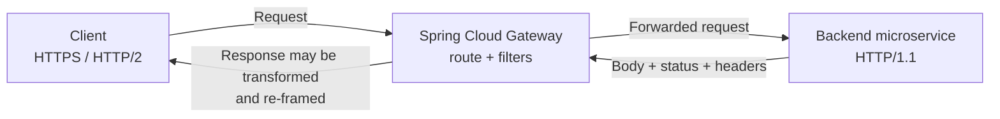

# Handling Content-Length, Transfer-Encoding, and Modified Content

## Lesson objectives

In the **Headers and Status** chapter, this lesson explains how a **Spring Cloud Gateway** handles content length and HTTP framing when forwarding or **modifying a response body**. The topic connects directly to the filter chain, routes, response status, and safely operating an API Gateway between clients and microservices.

After this lesson, you will be able to:

- Accurately distinguish **`Content-Length`**, **`Transfer-Encoding`**, and **`Content-Encoding`**; understand the characteristics of HTTP/1.1 and HTTP/2.
- Explain why modifying JSON/text/compressed bodies can invalidate old length headers.
- Identify where response bodies are transformed in Spring Cloud Gateway Server WebFlux and how to use `ModifyResponseBody` properly.
- Analyze **bodyless** statuses such as `204`, `304`, `HEAD` requests, and `206 Partial Content`.
- Recognize risks of **truncated responses, hanging connections, framing errors, incorrect caching, and request/response desynchronization**.
- Design tests covering actual bytes, protocols, statuses, and load to verify the final response received by the client is valid.

> Technical scope: **Spring Cloud Gateway Server WebFlux**, routing via Reactor Netty and common Gateway filters. Gateway Server MVC has a different execution mechanism. HTTP headers/protocols follow foundational rules, while specific codec and body-rewrite behaviors must be verified against your actual application version.

## 1. The Gateway sits between two HTTP hops

Clients may connect to the API Gateway over HTTPS/HTTP/2, while the Gateway connects to the backend over HTTP/1.1 or HTTPS/HTTP/2 depending on infrastructure. Spring Cloud Gateway handles **one HTTP request/response per hop**; transport-related headers are not automatically copied verbatim across connections.



A route may simply forward the response or include a filter that alters the body:

```text
Backend sends:   Content-Type: text/plain; charset=UTF-8
                 Content-Length: 2
                 Body: OK

Gateway changes: Body: OK ✅

Client needs:    Valid framing for the 6 UTF-8 bytes of "OK ✅"
```

If the gateway still sends `Content-Length: 2` after the body becomes 6 bytes, the client may read only the first two bytes while trailing bytes are misinterpreted or make the connection non-reusable. If it declares a length larger than the actual data sent, the client may wait for more bytes and time out.

Therefore, when transforming content, **headers describing size and transmission must match the final bytes**, not the old body.

## 2. Three easily confused headers: Length, Transfer, and Content Encoding

| Header | Description | Scope | Example |
| --- | --- | --- | --- |
| **`Content-Length`** | Number of **octets/bytes** of the HTTP content sent per protocol rules | Used to determine content length in valid cases | `Content-Length: 152` |
| **`Transfer-Encoding`** | Encoding used to **transfer a message over an HTTP/1.1 hop**; e.g. chunked | **Hop-by-hop**, not an immutable API metadata header | `Transfer-Encoding: chunked` |
| **`Content-Encoding`** | Encoding of the **representation/body**, such as gzip | Belongs to the sent content; receiver must decode to obtain original data | `Content-Encoding: gzip` |
| **`Content-Type`** | Media type and optional charset of the content | Enables consumer to interpret body | `Content-Type: application/json` |

Example:

```http
HTTP/1.1 200 OK
Content-Type: application/json
Content-Encoding: gzip
Content-Length: 87

<87 bytes of gzip-compressed JSON data>
```

In this example, **87 is the number of bytes sent after gzip content coding**, not the byte count of the decompressed JSON. If the Gateway decompresses, modifies the JSON, and resends it uncompressed, it must not keep `Content-Encoding: gzip` or `Content-Length: 87`.

Another HTTP/1.1 example:

```http
HTTP/1.1 200 OK
Content-Type: text/plain; charset=UTF-8
Transfer-Encoding: chunked

4
Wiki
5
pedia
0

```

The numbers `4`, `5`, and `0` are part of **chunked transfer coding** on the HTTP/1.1 hop. The reassembled body content is `Wikipedia`; those chunk-size lines are not part of the application-readable content string once the HTTP stack decodes it.

### 2.1. `Content-Length` counts bytes, not characters

With UTF-8, Vietnamese strings and emojis can occupy more bytes than their visible character count:

```java
import java.nio.charset.StandardCharsets;

String body = "OK ✅";

System.out.println(body.length()); // 5 UTF-16 code units
System.out.println(
    body.getBytes(StandardCharsets.UTF_8).length
); // 6 UTF-8 bytes
```

Never use `String.length()` to set `Content-Length`. If a response genuinely requires a fixed length, the value must be calculated in **bytes of the final representation** after applying charset, content encoding, and related transformations.

If the body can be streamed and the total byte count is not yet known, the HTTP server can use appropriate framing **without manually setting `Content-Length`**.

### 2.2. `Transfer-Encoding` is not the same as `Content-Encoding`

`Transfer-Encoding: chunked` describes how a message is framed over an HTTP/1.1 hop. It does not turn JSON into another JSON format and does not mean the data is compressed.

`Content-Encoding: gzip` states that the representation itself is gzip-compressed. This compressed payload can still be:

- Sent with `Content-Length` if the byte count is known and the protocol permits it.
- Sent using chunked transfer coding over HTTP/1.1 if length is unknown before sending.
- Sent via HTTP/2 DATA frames without using `Transfer-Encoding: chunked`.

When a Gateway modifies a response body, it must account for **both content encoding and framing**.

## 3. HTTP/1.1 and HTTP/2 do not frame identically

### 3.1. HTTP/1.1

HTTP/1.1 has several ways to delimit the end of response content, depending on status and message type:

- `Content-Length` is valid when the exact number of bytes to send is known.
- `Transfer-Encoding: chunked` lets content be sent in chunks with a terminating zero-length chunk.
- Some responses are delimited by closing the connection if no explicit framing is present; this is poor for connection reuse.
- Special statuses/methods follow dedicated rules and forbid a body; see section 8.

**Never send both `Content-Length` and `Transfer-Encoding` in the same HTTP/1.1 message.** Having both present is abnormal and can cause intermediaries to disagree on message boundaries.

For a proxy, handling a message with both conflicting headers must follow HTTP standards and strict security policies; do not arbitrarily pick one value or forward both as-is.

### 3.2. HTTP/2

HTTP/2 uses **DATA frames** and end-of-stream flags to frame payloads. It **does not use `Transfer-Encoding: chunked`**. `Content-Length` may still appear when valid, but if sent, its value must match the actual content byte count per HTTP/2 rules.

Be sure to distinguish the **`TE`** header from **`Transfer-Encoding`**: HTTP/2 only allows a narrow exception for `TE: trailers`, not `Transfer-Encoding: chunked`.

Consequently, for the exact same API, it is completely normal for the Gateway to receive an upstream HTTP/1.1 chunked response yet send to the client over HTTP/2 **without** a `Transfer-Encoding` header. This is normal gateway/proxy behavior, not a lost-header bug.

### 3.3. Hop-by-hop headers are not end-to-end contracts

Connection-management headers such as `Connection`, `Keep-Alive`, `Transfer-Encoding`, and `Upgrade` have **hop-by-hop** semantics. The Gateway may strip or regenerate connection headers appropriate to each inbound/outbound connection.

Do not build backend business logic assuming the client in front of the Gateway used chunked transfer, and do not demand the Gateway "preserve `Transfer-Encoding` verbatim from upstream" across different protocols. What matters is **valid payload and headers on each hop**.

## 4. What happens if the Gateway forwards without changing the body?

Suppose Catalog Service returns:

```http
HTTP/1.1 200 OK
Content-Type: application/json
Content-Length: 19

{"item":"notebook"}
```

In this example, the JSON string is pure ASCII and **19 bytes**. If the Gateway does not alter the representation, it can forward the same content bytes while the HTTP writer/Netty layer chooses valid framing on the client connection.

Two things should NOT be inferred:

1. **Unchanged body does not mean every header is forwarded verbatim.** Hop-by-hop headers may differ across HTTP connections or protocols.
2. **Receiving `Content-Length` from the backend does not mean keeping that exact value in every situation.** If a component decompresses, recompresses, a filter alters the payload, or the framework selects another transfer mode, framing must adjust accordingly.

In **Spring Cloud Gateway Server WebFlux**, typical components include:

| Component | Related responsibility |
| --- | --- |
| `RoutePredicateHandlerMapping` | Selects a route based on predicates like `Path`, `Method`, `Host` |
| `FilteringWebHandler` | Combines `GlobalFilter`s and route filters in order |
| `NettyRoutingFilter` | Uses the prepared target URI to execute the HTTP request to upstream |
| `NettyWriteResponseFilter` | Participates in writing the downstream response back to the client |
| `ModifyResponseBody` | Allows reading/transforming the response body within a filter and writing back a new body |
| `HttpHeadersFilter` and response-header filters | Processes headers, including those that must not be passed straight across hops |

Exact class/factory names and details may vary by version. However, the core rule never changes: **never let headers describing the old payload accompany a transformed payload**.

## 5. Which headers become sensitive when content is modified?

Consider the flow:


A filter can:

- Append text to a string.
- Transform JSON or strip sensitive fields.
- Change data types, e.g., receive JSON and return another object.
- Change charset or compress/decompress.
- Switch from a buffered body to a streaming flow, or vice versa.
- Return a circuit-breaker fallback response instead of the backend response.

When doing so, review:

| Header / metadata | Why check after rewriting? |
| --- | --- |
| `Content-Length` | Byte size may change; old length breaks framing |
| `Transfer-Encoding` | Framing is decided per hop by the HTTP writer; never copy/set manually from the old body |
| `Content-Type` / `charset` | New body may no longer have the same media type or charset |
| `Content-Encoding` | When decompressing to plain or recompressing, encoding must match final bytes |
| `ETag` | Old representation's entity tag may no longer be valid |
| `Content-Digest` / checksum | Old digest no longer describes the new representation |
| `Content-Range` | Old byte ranges are invalidated when length or content changes |
| `Cache-Control`, `Vary` | Caching policy/representation variants may need adjustment |

**Not every rewrite forces changing all headers.** For example, adding an unrelated response header does not require changing `Content-Length`. However, any operation that changes **payload bytes** requires reviewing framing and representation-bound metadata.

### 5.1. Why is a stale `Content-Length` especially dangerous?

Suppose:

```text
Upstream response:
  Body bytes: 100
  Content-Length: 100

Gateway rewrite:
  Final body bytes: 125
```

If the client receives `Content-Length: 100` while the Gateway sends 125 bytes, the client may treat **the first 100 bytes as one message** and the remaining 25 bytes as trailing garbage. If the same HTTP/1.1 connection is reused, this can corrupt response parsing and risk desynchronization.

Conversely, if the rewrite shrinks the body to 70 bytes while still declaring 100, the client may wait for 30 bytes that never arrive, causing timeouts or truncated responses.

The right solution is to let **the response-writing layer know the exact final body**, reset length when known, or omit length and use valid HTTP-stack-managed framing when total bytes are unknown. **Never fix length by counting Java characters or estimating JSON length.**

### 5.2. Keeping stale `Content-Encoding` after modifying the body

If the backend returns gzip and the Gateway transforms the body as text, determine:

1. Which component decodes gzip before the rewrite runs?
2. Does the rewrite receive **decoded bytes** or compressed bytes?
3. Does the Gateway re-encode with gzip or send an uncompressed response?
4. Do the final `Content-Encoding`, `Content-Length`, and `Vary: Accept-Encoding` match?

Do not assume `ModifyResponseBody` handles every compression/codec combination automatically across all versions. When transforming compressed content, explicitly design **decode → transform → re-encode (or strip content coding)**, configure accordingly, and test with `Accept-Encoding: gzip`.

### 5.3. Caching and validators

A backend may return:

```http
ETag: "original-v7"
Cache-Control: public, max-age=60
```

If the Gateway removes a JSON field, the client-facing representation has changed. Keeping a **strong ETag** meant for the old body can cause caches or conditional requests to misbehave. Strip or regenerate validators for the new representation and review cache policy if the transformation depends on user, tenant, or headers.

Be especially careful with `Vary`, `Content-Range`, `Accept-Ranges`, and `206 Partial Content`: modifying the body can invalidate byte ranges and cache validators.

## 6. `ModifyResponseBody`: transforming responses in Gateway WebFlux

Spring Cloud Gateway provides the **`ModifyResponseBody` GatewayFilter Factory** to transform response content. In Server WebFlux, this filter is configured via **Java DSL** in common releases.

Illustrative example: upstream returns text `OK`, and the Gateway appends ` ✅` before sending to the client.

```java
import org.springframework.cloud.gateway.route.RouteLocator;
import org.springframework.cloud.gateway.route.builder.RouteLocatorBuilder;
import org.springframework.context.annotation.Bean;
import reactor.core.publisher.Mono;

@Bean
RouteLocator messageRoute(RouteLocatorBuilder builder) {
    return builder.routes()
        .route("message", r -> r.path("/api/message")
            .filters(f -> f.modifyResponseBody(
                String.class,
                String.class,
                (exchange, originalBody) -> {
                    if (originalBody == null) {
                        return Mono.empty();
                    }
                    return Mono.just(originalBody + " ✅");
                }
            ))
            .uri("http://localhost:9001"))
        .build();
}
```

Assume the test backend on `localhost:9001` receives `GET /api/message` and returns:

```http
HTTP/1.1 200 OK
Content-Type: text/plain; charset=UTF-8
Content-Length: 2

OK
```

The Gateway produces the new logical body `OK ✅`. When UTF-8 encoded, **the new body is 6 bytes long**, even though Java's `String.length()` is 5. The final response must have valid framing: either the new length or streaming/chunked framing depending on the writer and protocol.

**Parameter meanings:**

- First `String.class`: body type used to read content from the upstream response.
- Second `String.class`: body type after rewriting.
- `(exchange, originalBody) -> ...`: function returning a **reactive publisher** with the new content.
- `Mono.empty()` handles an empty/absent body without synthesizing fake content.

This is a **simple `text/plain` response example**, not a template for editing sensitive JSON, binary data, images, or infinite streams. When handling JSON, use proper codecs and data structures, verify `Content-Type`, and avoid editing JSON via blind string replacement.

### 6.1. Why shouldn't you set `Content-Length` inside the rewrite function?

`rewriteFunction` returns the new logical content. Before encoding the body, the filter author may not yet know with certainty:

- The final charset.
- Whether content coding (gzip/br) will be applied.
- Whether the body will stream across multiple buffers.
- Which length or transfer coding the HTTP writer will pick.

Therefore, let the **framework/body writer and rewrite filter** handle byte serialization and framing. If your application has a custom filter altering the body at the `DataBuffer` level, that filter itself must ensure headers reflect the final bytes or let the HTTP stack choose valid framing.

Never use `SetResponseHeader=Content-Length,...` with a hand-computed number to patch a body mismatch. Likewise, applying `RemoveResponseHeader=Content-Length` arbitrarily **does not guarantee** fixing compression, status, caching, or committed-response issues.

### 6.2. Writing proper JSON rewrites

Given a JSON response:

```json
{
  "id": 42,
  "name": "book",
  "internalCost": 120
}
```

If the Gateway is tasked with removing the `internalCost` field, transform it using a parser/object mapper or an appropriate DTO. Do not replace via:

```java
body.replace("\"internalCost\":120", "");
```

because that easily leaves trailing commas, misses whitespace formatting variations, or deletes text appearing inside string values. After producing new JSON, ensure `Content-Type` stays accurate, byte length matches, validators/caching are reviewed, and empty/error JSON cases are tested.

For sensitive data authorization, **never rely solely on Gateway body rewriting to hide secret fields**. The backend is responsible for returning authorized data; the Gateway should only assist with well-defined contract transformations.

## 7. Filter order and when responses are written to the network

Spring Cloud Gateway Server WebFlux's filter chain is **wrapping**: `Ordered` filters with smaller order values generally run earlier in the request (pre) phase, while response (post) actions execute along the publisher structure on the return path.

```text
Client request
  ↓
Route predicate match
  ↓
GlobalFilter / GatewayFilter (pre phase)
  ↓
RouteToRequestUrl / Load balancing (if any)
  ↓
NettyRoutingFilter: send request to backend
  ↓
Receive upstream status + headers + body
  ↓
Gateway filters process response
  ↓
NettyWriteResponseFilter / response writer
  ↓
Client receives valid response
```

The diagram is a conceptual model; response-rewriting filters typically use decorators or publishers to intervene **before the body is actually sent**. Exact method names and ordering may vary by version.

### 7.1. Do not edit headers after the response has committed

In WebFlux, a response has a **commit** point when status/headers begin being sent. A filter attempting to alter `Content-Length`, `Content-Type`, or status after this point may have no effect or fail because headers were already emitted.

Anti-pattern:

```java
return chain.filter(exchange)
    .then(Mono.fromRunnable(() -> {
        // Runs too late if the response is already committed.
        exchange.getResponse()
            .getHeaders()
            .setContentLength(100);
    }));
```

This snippet can trigger after the response is already sent; it also does not know how many bytes the final payload is. Never use this to "patch" framing.

When intercepting the body, prefer built-in rewrite factories or a lifecycle-safe `ServerHttpResponseDecorator`. When modifying headers, act **before commit** and keep content consistent with headers. Never spawn an independent `subscribe()` inside a filter, as it detaches from the request/response lifecycle and breaks error/cancellation propagation.

### 7.2. Response header filters and body filters have distinct jobs

Example:

```yaml
filters:
  - AddResponseHeader=X-Gateway-Policy,checked
  - RemoveResponseHeader=X-Debug-Internal
```

These filters only manipulate the specified headers; **they do not alter the response body**. Hence adding a response header does not inherently require modifying `Content-Length`.

Conversely, `ModifyResponseBody` alters body bytes; what matters is not whether a filter name contains the word "header", but **whether the final payload remains unchanged**.

Some filters can alter status—for instance `SetStatus`, circuit-breaker fallbacks, or error handlers. When status changes from a body-bearing response to a bodyless status (such as 204), **ensure body and headers conform to the new status**. Never just change the status code and let the writer send the old body.

### 7.3. Route matching, request rewrite, and response rewrite

Do not confuse the two directions:

| Direction | Filter examples | Affects |
| --- | --- | --- |
| **Request → backend** | `RewritePath`, `SetRequestHeader`, `ModifyRequestBody` | URI/headers/body of the request sent upstream |
| **Backend → client** | `ModifyResponseBody`, `SetResponseHeader`, `AddResponseHeader`, `RemoveResponseHeader` | Status/headers/body of the response returned to client |

If a filter alters the **request body**, outbound request `Content-Length`/`Transfer-Encoding` must also be handled properly. This lesson focuses on responses, but **byte-accurate framing** applies to both directions.

## 8. Special status codes and methods: not every response has a body

HTTP rules clearly define when response content **must not** be sent:

| Case | Body sent to client? | Notes on `Content-Length` / framing |
| --- | --- | --- |
| **`HEAD`** | No, even if the corresponding GET would have a body | May include metadata like `Content-Length` of the corresponding representation per spec; do not assume length must be forced to 0 |
| **`204 No Content`** | No | Do not generate response content; do not send `Content-Length` with 204 |
| **`304 Not Modified`** | No | May contain `Content-Length` indicating the size of the representation GET would return; does not mean this response carries a body |
| **`1xx` responses** | No | Informational messages, carry no body |
| **`205 Reset Content`** | Generates no content | Follow reset semantics; avoid attaching a JSON body |
| **`206 Partial Content`** | May carry partial body | `Content-Range` and length must describe the actual partial slice, not the full body |
| **Normal `200 OK`** | Depends on API | May have empty or non-empty body; framing must be consistent |

Common pitfall: seeing `Content-Length: 4096` on `HEAD` or `304` **does not mean** 4096 body bytes are being transmitted. Those cases follow special rules for representation metadata. Never write a blanket filter saying "if no body, force `Content-Length: 0`" across all statuses/methods.

### 8.1. Changing status to 204 when a body already exists

Suppose the backend returns:

```http
HTTP/1.1 200 OK
Content-Type: application/json
Content-Length: 12

{"ok":true}
```

If a custom filter changes status to `204 No Content`, the final response must **send no content**, and metadata must not contradict 204 rules. Simply calling `setStatusCode(NO_CONTENT)` without controlling body writing can yield invalid output.

If business logic wants to return a JSON message, choose a status permitting a body per the API contract. If 204 is desired, ensure the pipeline does not write JSON afterward.

### 8.2. Partial Content and range requests

A client may request:

```http
Range: bytes=0-99
```

Backend returns:

```http
HTTP/1.1 206 Partial Content
Content-Range: bytes 0-99/1000
Content-Length: 100
```

If the Gateway arbitrarily injects characters into a byte range, `Content-Range`/length will no longer describe the data accurately. Do not automatically run text/JSON rewrites on `206` responses or ranged file downloads unless you design proper range, validator, and cache handling.

### 8.3. Streaming, SSE, and WebSocket

- **Server-Sent Events (`text/event-stream`)** can stream continuously with no known end. Never try to buffer the whole stream just to precompute `Content-Length`.
- **Large file downloads** should leverage streaming/backpressure and HTTP-stack framing; avoid buffering entire files into memory.
- **WebSocket Upgrade (`101 Switching Protocols`)** switches protocols after the handshake; never treat WebSocket frames as a JSON response body for `ModifyResponseBody`.

For HTTP/1.1 streaming, chunked transfer can be valid framing; over HTTP/2, DATA frames carry the stream. **Never force `Transfer-Encoding: chunked` on HTTP/2.**

## 9. Response compression in a Gateway

Compression saves bandwidth but makes body modification more complex.

### 9.1. Two possible flows

```text
Flow A: representation unchanged
Backend (gzip JSON) → Gateway proxy → Client (gzip JSON)

Flow B: representation modified
Backend (gzip JSON)
  → valid decompression
  → modify JSON
  → choose uncompressed JSON or recompress
  → produce consistent headers/framing
  → Client
```

In Flow B, keeping `Content-Encoding: gzip` while sending plain JSON bytes breaks client decompression. Sending newly gzipped bytes while keeping the old gzip length causes truncated or trailing reads.

### 9.2. Questions to answer before enabling rewrites

1. Does the backend return gzip/br when the client sends `Accept-Encoding`?
2. Does the Gateway HTTP client decompress automatically or not? What byte format does the rewrite receive?
3. Which content types and charsets do codecs use to decode/encode?
4. Is the final response recompressed, and who owns the `Content-Encoding` header?
5. Do `Vary: Accept-Encoding`, ETag, digests, and caches need recomputation?
6. How much memory can large bodies or high-compression-ratio payloads consume when decompressed?

Do not evaluate by testing only `curl` without `Accept-Encoding`. Test with requests accepting gzip, compressed upstream responses, Unicode payloads, and bodies large enough to distinguish streaming from buffering.

## 10. Errors and risks from inconsistent framing

| Symptom | Possible cause | What to check |
| --- | --- | --- |
| Client receives only start of response | `Content-Length` is smaller than actual bytes | Compare declared length vs payload per hop; inspect rewrite filter |
| Client waits until timeout | Declared length exceeds sent bytes, or missing terminating chunk | Inspect writer, cancellation, upstream errors |
| Client reports "invalid chunk" | Broken chunk framing or mis-forwarded headers/chunks | Inspect raw HTTP/1.1 response, hop-by-hop proxy headers |
| HTTP/2 reports protocol error | Attempted `Transfer-Encoding: chunked` or length mismatch | Inspect final framing/headers on HTTP/2 connection |
| JSON fails to parse | Text replacement broke JSON, encoding, or truncated it | Compare bytes/charset and parse output JSON |
| Client cannot decompress | Plain body vs `Content-Encoding` mismatch | Check gzip/br and `Accept-Encoding` |
| Cache serves stale data | Old representation's ETag/digest remained after rewrite | Check cache validators and `Vary` |
| Fails only on `HEAD`/`304` | Applied 200 length/body rules to bodyless responses | Check status/method semantics |
| Downloaded file is corrupted in segments | Rewrote `206` response while keeping `Content-Range` | Disable rewrites on partial responses or support ranges properly |

### 10.1. Risk when both `Content-Length` and `Transfer-Encoding` exist

An HTTP/1.1 message containing both headers can cause systems on either side of a proxy to interpret message boundaries differently. For requests, this is the classic root of **HTTP request smuggling**; for responses, conflicting framing can similarly corrupt how clients parse data.

Never implement logic like "if both are present, just trust `Content-Length`" to drive body parsing yourself. Gateways/proxies must follow HTTP standards and **detect or reject ambiguous messages** per security policy, while normalizing framing when validly forwarding. In particular, never forward both conflicting headers to the next hop.

### 10.2. Resource limits when rewriting

Body rewriting may require decoding or aggregating multiple `DataBuffer`s before producing new content. For very large payloads or highly compressible payloads, this can spike memory and GC pressure.

Configure:

- Request/response size limits or restrict which endpoints allow rewriting.
- Timeout policies and concurrency limits aligned with the backend.
- Codec/buffer limits appropriate to your WebFlux version.
- Stress tests with large payloads, heavy compression, high concurrency, and mid-stream client cancellations.

Never run a full-body rewrite filter across videos, large files, or SSE when the need can be handled at the backend or via a dedicated streaming mechanism.

## 11. Retries, circuit breakers, and body rewrite failures

Spring Cloud Gateway can use **Retry** or **CircuitBreaker** per route. These mechanisms do not eliminate framing requirements:

### 11.1. Retry

If a GET request to the backend fails before sending a response to the client, the Gateway may retry per policy. The client should ultimately receive only **one valid response** from the winning attempt.

When retrying:

- Never attach `Content-Length` from a failed attempt to the successful attempt's body.
- Do not let a custom filter write partial body data and then attempt to retry; once headers/body are committed, new status/headers cannot be arbitrarily sent.
- If a body rewrite holds mutable state, ensure it does not accumulate data across multiple attempts or subscriptions.
- Do not retry non-idempotent write operations without an idempotency contract and proper safeguards.

### 11.2. Circuit breaker fallback

Suppose the backend fails and the Gateway generates a fallback:

```json
{"message":"service temporarily unavailable"}
```

A fallback response is **different content** from the original response. It needs the right status (e.g., `503` per contract), accurate `Content-Type`, and valid framing. Never carry over `Content-Length` or `Content-Encoding` from another upstream response to describe the fallback.

The ordering among response rewrite filters, retries, and circuit breakers also determines **which response gets transformed**. Any order change must be accompanied by integration tests covering success, failure, and fallback paths.

## 12. Testing: verifying the actual bytes the client receives

A test checking only `status == 200` is insufficient. For body rewrites, verify **body bytes, `Content-Type`, `Content-Encoding`, and actual protocol framing**.

### 12.1. Mock backend scenario

Create a test backend returning:

```http
HTTP/1.1 200 OK
Content-Type: text/plain; charset=UTF-8
Content-Length: 2

OK
```

The Gateway applies `ModifyResponseBody` as in section 6. Expected output is `OK ✅` with 6 UTF-8 bytes. The response may:

- Carry `Content-Length: 6` when the writer sends an exact 6-byte body and HTTP conditions allow it.
- Or omit `Content-Length` and use valid framing, such as HTTP/1.1 chunked.

**Do not force every HTTP response to always have `Content-Length`.** What must be guaranteed is that final bytes match the metadata/framing received by the client, conflicting `Content-Length` and `Transfer-Encoding` never coexist, and the connection closes/terminates cleanly.

### 12.2. Testing with `curl`

Assume the Gateway runs at `http://localhost:8080` and route `/api/message` is configured:

```bash
# Observe status and headers on the client → Gateway hop:
curl -i --http1.1 "http://localhost:8080/api/message"

# Inspect connection details, headers, and HTTP client messages:
curl -v --http1.1 "http://localhost:8080/api/message"

# Test when client requests compressed response (if backend supports it):
curl -v --http1.1 --compressed \
  "http://localhost:8080/api/message"

# Check an endpoint supporting HEAD:
curl -I --http1.1 "http://localhost:8080/api/message"
```

`curl -i` displays headers and body already decoded by the HTTP client; **it does not prove the exact wire framing of individual chunks**. When investigating subtle framing bugs, use packet capture/HTTP debugging tools in a test environment and compare both hops: upstream–Gateway and Gateway–client.

If infrastructure supports HTTP/2, also test with an HTTP/2 client and verify `Transfer-Encoding: chunked` is absent from HTTP/2 responses.

### 12.3. Assertions with `WebTestClient`

In an integration test running the Gateway and a mock backend:

```java
webTestClient.get()
    .uri("/api/message")
    .exchange()
    .expectStatus().isOk()
    .expectBody(String.class)
    .isEqualTo("OK ✅");
```

This is an **illustrative assertion snippet**; `WebTestClient` must be configured to target the actual Gateway in the test. Checking `String` verifies the logical body; verifying framing requires observing responses over a **real HTTP connection**, because a test client running inside the same application context may skip full network encoding.

If the response has `Content-Length`, check it in **bytes**:

```java
byte[] encoded = "OK ✅".getBytes(StandardCharsets.UTF_8);
// encoded.length == 6
```

When a response omits `Content-Length`, it can still be completely valid. Do not write brittle tests that fail solely because the HTTP writer chose another framing mechanism instead of that header.

### 12.4. Minimal test matrix

| Case | Backend response / condition | Client-side expectation |
| --- | --- | --- |
| No rewrite | `200`, 20-byte body, accurate length | Body unchanged, valid framing |
| Rewrite longer body | `200`, 2-byte body → 6 bytes | Client reads all 6 bytes; length if present is 6 |
| Rewrite shorter body | `200`, long body → short body | No timeout from stale length |
| Unicode/emoji | UTF-8 text | Counted in bytes, not `String.length()` |
| Upstream chunked | HTTP/1.1, unknown length | Client receives full content; Gateway uses valid framing |
| HTTP/2 client | H2 connection | No `Transfer-Encoding: chunked` |
| Gzip | Upstream `Content-Encoding: gzip` | Body/encoding/length align after rewrite |
| `204` | No body | No body added and no invalid `Content-Length` |
| `HEAD` | Corresponding endpoint returns metadata | No body transmitted; length if present has valid semantics |
| `304` | Conditional cache request | No body transmitted; validators consistent |
| `206` | Returns a byte range | Do not alter content and break `Content-Range` |
| Backend timeout | Incomplete response | Gateway returns error per policy; no half-written response |
| Circuit breaker fallback | Gateway builds custom error body | Status, media type, and framing belong to fallback |
| Concurrent requests | Multiple rewritten responses | No data leakage or buffer sharing across requests |

## 13. Layer-by-layer troubleshooting guide

When errors report "Content-Length mismatch", "truncated chunked encoding", or "HTTP/2 protocol error", inspect step-by-step:

1. **Which route was selected?** Check route ID and predicates; the request may have hit a different backend than expected.
2. **What did the backend actually send?** Capture status, `Content-Type`, `Content-Encoding`, `Content-Length`/`Transfer-Encoding`, and byte count from an HTTP client on the same network as the Gateway.
3. **Which filter modified the body?** Check `ModifyResponseBody`, custom filters, compression, and fallbacks—not only filters mentioning `Content-Length`.
4. **Did body encoding/charset change?** Especially with Unicode characters or compressed responses.
5. **Does the response status permit a body?** Check `HEAD`, `204`, `304`, and `206`.
6. **When did the writer send headers and body?** Look for post-commit header edits or standalone `subscribe()` calls inside custom filters.
7. **Which protocols do the two hops use?** H1 upstream and H2 downstream frame differently; hop-by-hop headers do not have to match.
8. **Are retry/circuit breaker active?** Inspect attempts, fallbacks, and the final response seen by the client.
9. **Which payloads trigger the failure?** Test empty bodies, Unicode, gzip, long/streaming content, and canceled connections.
10. **Are there security or caching issues?** Check for conflicting framing, stale ETags/digests, and sensitive info in logs.

For production observability, prefer metrics/traces keyed by **route ID, status, latency, retries, aggregate response size, and encode/decode errors**. Never log sensitive bodies, bearer tokens, or full user headers just to debug `Content-Length`.

## 14. Hands-on exercise with answers

A route returns text through the Gateway. The backend responds:

```http
HTTP/1.1 200 OK
Content-Type: text/plain; charset=UTF-8
Content-Length: 2

OK
```

The Gateway uses `ModifyResponseBody` to produce `OK ✅`.

**Questions:**

1. Using UTF-8, how many bytes is the final body? Should `Content-Length` be set to the Java `String` length?
2. If the Gateway sends HTTP/1.1 and does not know the total size before streaming, which framing method can be used?
3. If the client receives HTTP/2, should `Transfer-Encoding: chunked` be added?
4. If the backend gzipped the body, may `Content-Encoding: gzip` be kept after converting to plain text without recompressing?
5. If the backend returns `204 No Content`, should appending ` ✅` run to create a new body?
6. If the initial response is `206 Partial Content`, why can rewriting corrupt data?
7. After a rewrite, is the backend's ETag necessarily still valid?
8. To verify correctness, is checking HTTP status 200 alone enough?

**Suggested answers:**

1. **6 UTF-8 bytes**; no. `String.length()` returns 5 UTF-16 code units, not the transmitted byte count.
2. **Chunked transfer coding** can be used for HTTP/1.1 if appropriate for the response and writer, or another valid framing mechanism managed by the HTTP stack.
3. **No.** HTTP/2 uses DATA frames and does not support `Transfer-Encoding: chunked`.
4. **No.** The body is no longer gzip; you must remove/update content coding or recompress properly and update length/framing.
5. **No.** A 204 response carries no content; preserve the status semantics.
6. Because byte ranges and `Content-Range` describe bytes of the original representation; rewriting can shift offsets, length, and content.
7. **Not necessarily.** Validators and digests tied to the old representation must be reviewed; a stale strong ETag typically no longer matches the new bytes.
8. **Not enough.** You must read all body bytes, verify headers/encoding, check special statuses, and test over real protocols.

## Summary

**`Content-Length` is byte length, `Transfer-Encoding` is single-hop HTTP/1.1 framing, and `Content-Encoding` describes representation encoding.** They serve different purposes. When Spring Cloud Gateway modifies a response body, the old length and representation metadata may no longer hold; the HTTP writer must transmit the new bytes in a protocol-compliant manner.

Safe Gateway design must account for **filter order, response commit, compression, bodyless statuses, byte ranges, retries, and fallbacks**. Prefer supported rewrite APIs, avoid setting `Content-Length` manually from estimates, never forward conflicting framing headers, and test with real clients both upstream and downstream. This protects microservices systems from truncated responses, hanging connections, broken caching, and security risks from inconsistent HTTP messages.
