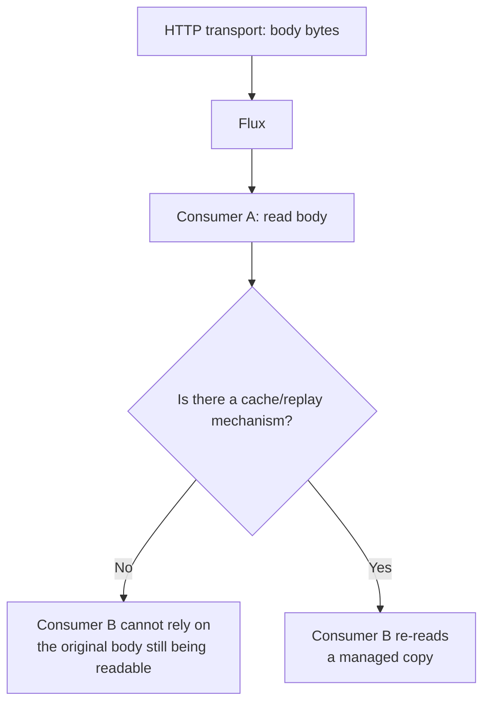
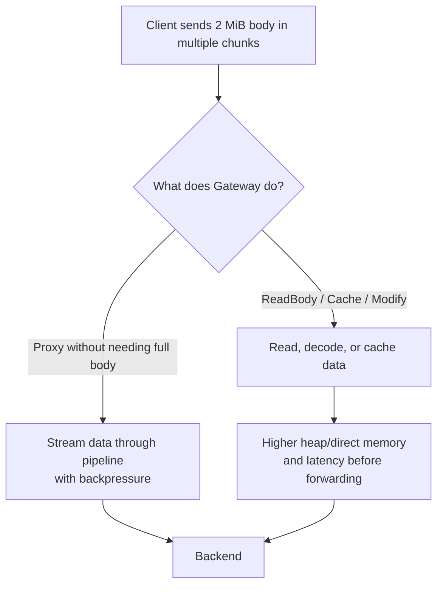

# Why Can a Request Body Typically Only Be Read Once in WebFlux?

**Chapter:** HTTP Body Handling  
**Module:** `SPRING_CLOUD_GATEWAY` — Spring Cloud Gateway

When building an API Gateway for microservices, we often want to read the request body to log it, verify a signature, inspect JSON content, select a route, or transform the payload. However, a very common bug in **Spring WebFlux** is that the first filter reads the body successfully, while the controller or downstream service receives an empty body, encounters a stream consumption error, or has no data left to process. The root cause lies in the nature of an **HTTP request body as a stream of bytes flowing over a network connection**, not a string or object that can be arbitrarily re-read.

In Spring Cloud Gateway Server WebFlux, components such as route predicates, the filter chain, and HTTP routing all operate on this request. If a component reads the body to inspect or transform it, it must manage **how the body is passed to the next component**. This lesson explains the `Flux<DataBuffer>` mechanism, single-pass consumption, caching/replay, backpressure, and memory risks, followed by a lab to verify the behavior against a small HTTP backend. This knowledge is especially important before implementing content validation, retries, rate limiting, circuit breakers, TLS, and request observability at the Gateway.

> **Scope:** The primary examples target **Spring Cloud Gateway Server WebFlux**. Gateway Server Web MVC uses a different Servlet model, and Proxy Exchange is a way to forward HTTP requests from annotated handlers; do not apply WebFlux APIs or filters directly to those other flavors. Nor is a request body automatically repeatable just by running on MVC: a Servlet input stream is also single-pass unless wrapped or cached.

## 1. Learning Objectives

After completing this lesson, you will be able to:

1. Explain the difference between a **streaming** body and an object that has been fully read into memory.
2. Describe `ServerHttpRequest.getBody()`, `Flux<DataBuffer>`, subscription, and how data is received from the HTTP transport.
3. Analyze why an earlier filter that reads the body can prevent a downstream handler or service from reading it again.
4. Distinguish between **single-pass reading** and **caching for replay**, and choose the right mechanism among `CacheRequestBody`, `ModifyRequestBody`, `ReadBody`, or retry.
5. Test body handling through Spring Cloud Gateway, including JSON payloads, empty request bodies, and size errors.
6. Design appropriate body limits, logging, and authentication as request concurrency scales up.

## 2. Where Does the Request Body Actually Come From?

An HTTP request typically consists of these parts:

```http
POST /api/echo HTTP/1.1
Host: gateway.example.test
Content-Type: application/json
Content-Length: 29

{"event":"created","count":3}
```

At the network level, the payload does not necessarily arrive at the application all at once as a complete `String`. Data may arrive incrementally due to TCP, TLS, HTTP/1.1 chunked transfer encoding, or HTTP/2 frames. WebFlux provides a reactive abstraction so the application processes chunks as they become available, rather than forcing the server to pre-allocate a byte array for every request.

In Spring WebFlux, a key API is:

```java
Flux<DataBuffer> body = exchange.getRequest().getBody();
```

`DataBuffer` represents a region of byte data; `Flux<DataBuffer>` is a `Publisher` that can emit **zero, one, or many** buffers, and then complete or signal an error. Data processing is triggered when an appropriate subscriber subscribes, while respecting Reactive Streams **demand** and **backpressure**.

### 2.1. One Request Does Not Equal One Buffer

For example, a request containing 20 KiB may be delivered up the pipeline as multiple smaller buffers; the number of buffers, the size of each buffer, and their boundaries have **no business meaning**. Never write logic that assumes the first buffer contains the entire JSON payload:

```text
HTTP request body:  {"orderId":"A-42","priority":true}
                          |
          +---------------+----------------+
          |               |                |
          v               v                v
     DataBuffer #1   DataBuffer #2    DataBuffer #3
     {"orderId":     "A-42","pri       ority":true}
                          |
          +---------------+----------------+
                          |
                  HTTP message decoder
                          |
                Java DTO / Map / String
```

This diagram is **illustrative**, not a fixed buffer count. A JSON parser may read across multiple buffers; when you want the entire body as a `String` or DTO, an HTTP message reader/decoder may need to aggregate the data subject to buffer limits.

### 2.2. Why Is a Streaming System Beneficial?

For a proxy handling thousands of connections, streaming allows forwarding data as it arrives and applying backpressure when the receiver is slow. The Gateway does not always have to hold the entire request body in the heap before forwarding it. This is particularly useful for file uploads, streaming, and requests with large payloads.

When a filter arbitrarily converts every body into a `byte[]`, `String`, or `Map`, that streaming benefit can be lost because memory must hold the full payload plus the decoded copy. Therefore, **reading the full body to make a decision must be a deliberate requirement**, not the default operation for every route.

## 3. What Does “Typically Only Read Once” Mean Exactly?

Not every `Flux` or `Mono` only allows a single subscription. Many reactive publishers are **cold publishers** that regenerate values for each subscription; sources with caching or replay can also re-emit stored values. The constraint here is the **body source of an actual HTTP request being consumed from the transport**: bytes arriving over a network connection do not automatically reappear whenever a new consumer subscribes.

In a typical WebFlux request:

1. The HTTP server receives bytes from the socket and emits them into the reactive body stream.
2. The first consumer subscribes and reads the data (possibly through a decoder).
3. The data is consumed from the underlying source; a subsequent read on the same request is **not guaranteed** to replay the content.
4. Depending on the HTTP runtime and circumstances, another subscription may receive an empty stream, an error indicating a subscriber is already attached, or other behavior. Do not rely on a fixed error code across all versions.
5. If the application needs multiple components to use the body, it must **cache/replay or transform the stream in a controlled way** before the next consumer needs to read it.



The **single-pass** concept applies to **consuming the original body**; it does not mean the entire HTTP processing pipeline can only inspect the payload once. Once a component has cached the data, subsequent components can inspect a **managed copy with a controlled lifecycle**, provided the cache is bounded and handles cancellation and resource release.

### 3.1. Comparison with Spring MVC

In Spring MVC, the request body typically flows through `HttpServletRequest.getInputStream()` or `getReader()`, which is also a data source that gets consumed. A servlet filter that reads the entire input stream and then lets the controller read it again can cause the same empty-body error. WebFlux makes this model explicit via `Publisher` and requires managing `DataBuffer` and backpressure.

Therefore, the explanation “WebFlux can only be read once because it uses Reactor” is **inaccurate**. The streaming nature of the HTTP source and the fact that the framework does not automatically buffer the entire payload are the root causes.

## 4. Common Mistake: A Filter Reads the Body Before the Controller

Suppose an API Gateway receives `POST /api/orders` and needs to forward the body to `order-service`. A developer adds a filter to log the body:

```java
// INCORRECT ILLUSTRATION - do not use in real applications.
// Register a subscriber to inspect the request body ...
exchange.getRequest().getBody().subscribe(dataBuffer -> {
    // Read / log content from dataBuffer here.
});

// ... then continue the chain as if the body had never been consumed.
return chain.filter(exchange);
```

This snippet has several flaws:

- `subscribe()` triggers an independent consumer while the filter chain is still returned. Two processing paths may contend for the body, execution order becomes non-deterministic, and downstream no longer receives the complete data.
- If you merely log bytes and ignore `DataBuffer`, your code can mishandle Netty's reference-counted memory: easily leaking memory or accessing a buffer that has already been released.
- There is no size limit, sensitivity control, or backpressure. The entire body content could leak into logs while memory and CPU pressure spike.
- Manual `subscribe()` breaks coordination of errors, cancellation, and request lifecycle within the framework-managed reactive chain.

**Rule:** inside a reactive filter, never call `subscribe()` just to “peek at the body” and then return `chain.filter(exchange)`. If you need to transform the payload, use a single reactive chain with a request decorator or a supported Gateway utility.

### 4.1. The Controller Is Also a Consumer

In WebFlux, a controller method such as:

```java
@PostMapping("/orders")
public Mono<ResponseEntity<String>> orders(@RequestBody Mono<String> body) {
    return body.map(text -> ResponseEntity.ok("received: " + text));
}
```

relies on the framework reading the body via a codec and supplying the value to the method. If an earlier `WebFilter` or `GatewayFilter` has consumed the body without replaying it, `@RequestBody Mono<String>` may have no data left to read. How an empty body behaves also depends on `@RequestBody`'s `required` attribute and the runtime decoder; do not assume it will always return the exact same HTTP status.

### 4.2. Does the Error Happen Before or After Route Selection?

```text
Client POST + body
  -> WebFilter / Spring Security / ingress layer
  -> HandlerMapping selects route via predicates
  -> Selected route's GatewayFilter chain
  -> HTTP routing to backend
```

A `WebFilter` can execute before the Gateway selects a route; a Gateway `GlobalFilter` is added to the chain of the **selected route**; a route-bound `GatewayFilter` runs in that route's chain. Where you read the body determines which layers can still see the data and which limits or filters have already had a chance to run.

For example, `ReadBody` is a **route predicate**: it can read and cache the body during route selection, before `RequestSize` or other route filters. `CacheRequestBody` is a **GatewayFilter**: it only executes after the route has been selected. Both components handle the same kind of data, but they do not run at the same stage.

## 5. Choosing the Right Body-Handling Approach for Your Need

| Requirement | Mechanism to Evaluate | Need to Buffer Entire Body? |
|---|---|---|
| Forward payload as-is without reading content | Let Gateway HTTP routing stream it | Usually no need to cache full body |
| Select route based on a JSON field | `ReadBody` predicate via Java DSL | May require decoding/caching before route selection |
| Another filter needs access to the decoded body | `CacheRequestBody` GatewayFilter | Usually caches according to `bodyClass` |
| Modify content before forwarding | `ModifyRequestBody` GatewayFilter | Usually decodes and produces a replacement body |
| Resend request during retry | `Retry` filter with appropriate replay mechanism | May need to cache body for retries |
| Log requests | Prefer method/path/status/route ID/correlation ID | Avoid storing raw body unless truly required |
| Handle large file uploads | Keep streaming, use appropriate upload/streaming APIs | Do not proactively aggregate entire file |

**Important distinction:** “read once” does not automatically force every application to add `CacheRequestBody`. If the Gateway simply proxies HTTP traffic without inspecting or modifying the body, normal routing handles the stream without keeping a copy.

### 5.1. What Is `CacheRequestBody`?

Gateway Server WebFlux provides the `CacheRequestBody` GatewayFilter to read the request body according to `bodyClass` and place the cached content into exchange attributes for subsequent filters; the framework also manages the decorated/adapted request so the pipeline can continue. This is the supported mechanism instead of having multiple filters call `subscribe()` on the inbound stream themselves.

### 5.2. What Is `ModifyRequestBody`?

`ModifyRequestBody` is used when the goal is not just observing but **replacing the content** of the request, such as normalizing a JSON field or redacting data before forwarding downstream. It offers a Java DSL API to specify input/output types and a rewrite function returning a `Mono`. Do not try to solve this by consuming the raw body and mutating a local `String` variable: the original request will not automatically get the new body.

### 5.3. What Is `ReadBody`?

`ReadBody` is a predicate for deciding whether a route matches based on the body, typically configured via `RouteLocatorBuilder` in the Java DSL. Because it evaluates the body **before a route is chosen**, it needs an appropriate caching mechanism so the request can continue through the pipeline. Do not write an arbitrary Java lambda under `predicates:` in YAML and assume the Gateway can execute it.

### 5.4. Why Does Retry Require Special Care?

If the Gateway needs to resend a POST with a body after a timeout or error, it cannot ask the HTTP transport to “re-send the exact bytes from the client” by default. The retry mechanism must have a way to replay a stored body or reconstruct it. This increases memory overhead and can cause **duplicate business operations**. For payments or orders, only enable retry when idempotency and proper retry conditions are in place.

## 6. Hands-On Lab: Observing the Body on a Spring Boot Backend

The goal is to build **two separate applications**:

| Application | Port | Purpose |
|---|---:|---|
| Echo Backend (Spring MVC) | `8081` | Receives `POST /echo` and returns JSON with the received body |
| Spring Cloud Gateway Server WebFlux | `8080` | Receives `POST /lab/echo` and forwards it to the backend |

The Gateway application can run on WebFlux while the backend runs on MVC. They communicate over HTTP and do not need the same web stack.

### 6.1. Setting Up the Echo Backend

Create an `echo-backend` project using Spring Initializr with Java and the **Spring Web** dependency. With Spring Boot 3.x, Java 17 or higher is supported; with Spring Boot 4.x, select the matching starter name on Initializr instead of copying starter names from another version.

Create `src/main/resources/application.yml`:

```yaml
server:
  port: 8081
spring:
  application:
    name: echo-body-backend
```

Create `EchoBackendApplication.java` in package `com.example.echo`:

```java
package com.example.echo;

import org.springframework.boot.SpringApplication;
import org.springframework.boot.autoconfigure.SpringBootApplication;

@SpringBootApplication
public class EchoBackendApplication {
    public static void main(String[] args) {
        SpringApplication.run(EchoBackendApplication.class, args);
    }
}
```

Create `EchoController.java` in the same package:

```java
package com.example.echo;

import jakarta.servlet.http.HttpServletRequest;
import java.nio.charset.StandardCharsets;
import java.util.LinkedHashMap;
import java.util.Map;
import org.springframework.http.MediaType;
import org.springframework.web.bind.annotation.PostMapping;
import org.springframework.web.bind.annotation.RequestBody;
import org.springframework.web.bind.annotation.RestController;

@RestController
public class EchoController {

    @PostMapping(
        value = "/echo",
        consumes = MediaType.TEXT_PLAIN_VALUE,
        produces = MediaType.APPLICATION_JSON_VALUE)
    public Map<String, Object> echo(
            @RequestBody(required = false) String body,
            HttpServletRequest request) {

        Map<String, Object> result = new LinkedHashMap<>();
        result.put("service", "echo-backend");
        result.put("method", request.getMethod());
        result.put("path", request.getRequestURI());
        result.put("body", body);
        result.put("bodyUtf8Bytes", body == null
                ? 0
                : body.getBytes(StandardCharsets.UTF_8).length);
        return result;
    }
}
```

This controller echoes the body content **strictly for this lab**. Never send tokens, passwords, customer data, or sensitive payloads to such an endpoint. In production, you should not expose an endpoint that mirrors raw payloads merely for debugging.

In the backend directory, run:

```bash
./mvnw spring-boot:run
```

On Windows PowerShell/Command Prompt:

```powershell
.\mvnw.cmd spring-boot:run
```

Before introducing the Gateway, test directly:

```bash
curl -i "http://localhost:8081/echo" \
  -H "Content-Type: text/plain; charset=utf-8" \
  --data-binary "hello from backend"
```

The response will typically return HTTP `200` with a body like:

```json
{
  "service": "echo-backend",
  "method": "POST",
  "path": "/echo",
  "body": "hello from backend",
  "bodyUtf8Bytes": 18
}
```

If calling the backend directly does not succeed, check the port, path mapping, and `Content-Type` before adding the Gateway.

### 6.2. Setting Up the WebFlux Gateway

Create a separate Spring Cloud Gateway Server WebFlux application running on `8080`. For compatible Spring Cloud 2025.0+ releases, the Maven dependency is:

```xml
<dependency>
    <groupId>org.springframework.cloud</groupId>
    <artifactId>spring-cloud-starter-gateway-server-webflux</artifactId>
</dependency>
```

Use a Spring Cloud BOM compatible with your Spring Boot version; do not mix incompatible Spring Boot and Spring Cloud Gateway versions. Add the configuration to **the Gateway's** `application.yml`:

```yaml
server:
  port: 8080

spring:
  cloud:
    gateway:
      server:
        webflux:
          routes:
            - id: echo-body-route
              uri: http://localhost:8081
              predicates:
                - Path=/lab/**
                - Method=POST
              filters:
                - StripPrefix=1
                - name: CacheRequestBody
                  args:
                    bodyClass: java.lang.String
```

Explanation:

- `Path=/lab/**` and `Method=POST` match only eligible requests.
- `StripPrefix=1` rewrites `/lab/echo` to `/echo`.
- `CacheRequestBody` instructs the Gateway to read the body as a `String` and manage the cached copy for subsequent components; this is a **route filter**, so it runs only after the route is selected.
- `uri: http://localhost:8081` forwards the request to the backend exposing `POST /echo`.

**Version note:** the example configuration uses the `spring.cloud.gateway.server.webflux.routes` prefix from newer release trains (such as Spring Cloud 2025.0+). Older Server WebFlux versions typically used `spring.cloud.gateway.routes` and a different starter artifact name. Before starting, verify the documentation matching the exact version in your project.

### 6.3. Sending Requests Through the Gateway

Keep both the backend and the Gateway running. Open a third terminal:

```bash
curl -i "http://localhost:8080/lab/echo" \
  -H "Content-Type: text/plain; charset=utf-8" \
  -H "X-Lab-Request-Id: body-001" \
  --data-binary "hello from gateway"
```

Expected JSON response:

```json
{
  "service": "echo-backend",
  "method": "POST",
  "path": "/echo",
  "body": "hello from gateway",
  "bodyUtf8Bytes": 18
}
```

From this result, you can verify:

1. The client called `/lab/echo` while the backend actually received `/echo` — `StripPrefix` worked.
2. The backend read the complete string `hello from gateway` — Gateway body handling/caching did not drop the payload during forwarding.
3. Both the `POST` method and the text content type match the controller.

The backend might not receive the `X-Lab-Request-Id` header if another security filter strips it; the demo request does not depend on this header for its result. If you want to observe headers, add a boolean flag or **non-sensitive** value to the backend's JSON response.

### 6.4. Is Caching Actually Needed on This Route?

In this example where the body is forwarded as-is and **no other filter needs access to its content**, try removing only this block:

```yaml
- name: CacheRequestBody
  args:
    bodyClass: java.lang.String
```

Restart the Gateway with the route containing `Path`, `Method`, and `StripPrefix`, then re-run the cURL command. The backend **should still receive the complete body**. That is the expected behavior: Gateway WebFlux can forward the request stream normally when no filter consumes it prematurely. Caching is added when multiple components actually need to read or transform the body, not as a mandatory requirement for every POST request.

This experiment only demonstrates that the lab's HTTP proxy path works; it does not mean you can read the body directly multiple times without caching.

### 6.5. Testing an Empty Body and Wrong Method

```bash
# POST without a body (you will see body=null or empty handling depending on runtime).
curl -i -X POST \
  -H "Content-Type: text/plain" \
  "http://localhost:8080/lab/echo"

# GET does not match Method=POST predicate, typically 404 if no other route matches.
curl -i "http://localhost:8080/lab/echo"
```

Do not treat a rejected `GET` as a body error. The predicate filtered out the request before `CacheRequestBody` ever ran. For an empty POST, whether `null` or an empty string is produced can vary by client and HTTP message reader; inspect the actual request and the controller's `required` setting.

## 7. Advanced Lab: Transforming the Body with Java DSL

Instead of reading data and discarding it, let us test a scenario where the Gateway needs to **normalize a text string** before forwarding. `ModifyRequestBody` creates a new body within the Gateway-managed pipeline.

Add a route configuration bean to the Gateway WebFlux application:

```java
package com.example.gateway;

import org.springframework.cloud.gateway.route.RouteLocator;
import org.springframework.cloud.gateway.route.builder.RouteLocatorBuilder;
import org.springframework.context.annotation.Bean;
import org.springframework.context.annotation.Configuration;
import org.springframework.http.HttpMethod;
import org.springframework.http.MediaType;
import reactor.core.publisher.Mono;

@Configuration
public class TextTransformRoutes {

    @Bean
    public RouteLocator textTransformRoute(RouteLocatorBuilder builder) {
        return builder.routes()
            .route("normalize-text", route -> route
                .path("/normalize/**")
                .and()
                .method(HttpMethod.POST)
                .filters(filters -> filters
                    .stripPrefix(1)
                    .modifyRequestBody(
                        String.class,
                        String.class,
                        MediaType.TEXT_PLAIN_VALUE,
                        (exchange, body) ->
                            Mono.justOrEmpty(body).map(String::trim)))
                .uri("http://localhost:8081"))
            .build();
    }
}
```

With the new route, call:

```bash
curl -i "http://localhost:8080/normalize/echo" \
  -H "Content-Type: text/plain; charset=utf-8" \
  --data-binary "   text has spaces   "
```

The backend will receive `text has spaces` instead of the string with leading and trailing whitespace if the filter works properly; the request was transformed **within a single reactive processing chain**. There is no need to call `subscribe()` manually or mutate an immutable request object.

The two routes have different paths (`/lab/**` and `/normalize/**`), so they can coexist. Never define a Java route and a YAML route with overlapping IDs or paths and guess which one will win.

### 7.1. What Must Stay Consistent When Replacing the Body?

All related metadata must remain consistent:

- **`Content-Type`:** the new body's data type must match; this example uses `text/plain`.
- **`Content-Length` / transfer framing:** when the byte length of the new body changes, do not manually preserve the old length header. Let the Gateway's HTTP components recompute or adjust framing via supported mechanisms.
- **Character encoding:** `String.length()` counts Java UTF-16 code units, which is not always equal to the UTF-8 byte count on the wire.
- **Content-Encoding:** if the actual request is compressed, understand which bytes are being read/decoded and do not transform compressed payloads as plain text.
- **Request signatures:** modifying the body can invalidate a client-sent HMAC/signature. Verify the signature at the stage and over the byte representation defined by the contract, then re-sign or pass trusted claims if required.

When the backend requires byte-for-byte fidelity, **do not apply arbitrary trimming or parse/re-serialize operations**. A JSON object can be semantically equivalent while differing in key order, whitespace, or escaping, which changes hashes and signatures.

### 7.2. Why Not Add CacheRequestBody Before Every ModifyRequestBody?

`ModifyRequestBody` already has its own mechanism for reading/decoding and producing a replacement body. Blindly adding `CacheRequestBody` can complicate filter logic and data lifecycles, increase memory usage, or cause confusion. Only combine multiple body-handling filters when there is a clear reason and you have **verified filter ordering, downstream body content, and memory usage** on your exact Gateway version.

## 8. `DataBuffer` Lifecycle and Memory Details

A body stream in WebFlux can flow through `DataBuffer` instances allocated by different mechanisms. With Reactor Netty, buffers may wrap Netty `ByteBuf` instances with **reference counting**. This explains why a custom filter attempting to retain buffers for re-reading is not as simple as keeping a Java object reference:

| Action | Risk If Done Wrong |
|---|---|
| Reading a buffer after it has been released | Reading invalid data or buffer usage errors |
| Failing to release a buffer when owning release responsibility | Direct memory leak |
| Releasing a buffer too early while another consumer needs it | Runtime error, lost or corrupted payload |
| Calling `subscribe()` outside the reactive chain | Loss of cancellation/error/backpressure coordination |
| Collecting all buffers into an unbounded `byte[]` | Heap exhaustion or GC pressure |
| Retaining both decoded JSON and raw body simultaneously | Increased copy count and total memory footprint |

Spring provides `DataBufferUtils` with utilities such as `join` and `release`; Gateway has its own request decoration and caching utilities. When writing custom code at the `DataBuffer` level, you must understand who **owns** each buffer, who is allowed to retain a reference, when to release it, and how to handle request cancellation. Only use these low-level utilities when supported filters cannot solve the problem.

**`DataBufferUtils.join(...)` does not turn the original transport stream into an infinitely replayable source.** It aggregates buffers and returns a single resulting buffer whose lifecycle must still be managed properly. Calling `join` and then continuing the chain with the original request does not enable replay. Applications that need to reuse the body require a new request decorator/representation and safe buffer management.

### 8.1. Buffering Can Sacrifice Streaming



The goal of a reactive system is not to “forbid caching at all costs,” but to **buffer only on routes that need it, with appropriate limits**. For instance, a small JSON API route requiring content inspection can accept buffering, whereas a multi-GB file upload route should never read the entire body into a `String`.

## 9. Request Body Size Limits

### 9.1. No Single Limit Applies to Every Layer

When a body is cached or decoded, distinguish between three layers:

| Layer | When It Applies | Primary Protection | Limitation |
|---|---|---|---|
| **Ingress / actual-bytes limit before routing** | As the request enters the system | Reduces risk of huge payloads reaching caching/decoding | Must inspect actual bytes received, not merely trust `Content-Length` |
| **HTTP codecs / `maxInMemorySize`** | When readers/decoders buffer or aggregate | Caps the size supported codecs hold in memory | Not guaranteed to cover every filter or custom buffering |
| **`RequestSize` GatewayFilter** | After the route has been selected | Can reject oversized requests with HTTP `413` | Does not stop a predicate like `ReadBody` from reading the body during route selection |

For typical routes using `Path`/`Method`, placing `RequestSize` before `CacheRequestBody` in the filter chain can help reject some oversized requests before caching runs. However, how the filter determines size may depend on the version, body transfer mode, and `Content-Length` header. With HTTP/1.1 chunked encoding or HTTP/2, total size might not be known upfront. **Do not treat the ordering of these two filters as proof of a strict byte limit.**

### 9.2. Codec Limits in WebFlux

Example code configuring default codecs in a WebFlux application:

```java
package com.example.gateway;

import org.springframework.context.annotation.Configuration;
import org.springframework.http.codec.ServerCodecConfigurer;
import org.springframework.web.reactive.config.WebFluxConfigurer;

@Configuration
public class CodecLimitConfig implements WebFluxConfigurer {

    @Override
    public void configureHttpMessageCodecs(ServerCodecConfigurer configurer) {
        configurer.defaultCodecs().maxInMemorySize(256 * 1024);
    }
}
```

This configuration expresses a buffer threshold of `256 KiB` for **default codecs**. Check Boot property configuration options and which codecs the Gateway actually uses for your specific Spring Boot/Spring Cloud version. If the limit is exceeded during decoding, a `DataBufferLimitException` may be thrown; **the final HTTP status is not guaranteed to be 413**, as it depends on exception mapping.

Do not raise this threshold to tens of megabytes without concurrency limits, a memory budget, and load testing. Even a modest number of 10 MiB body requests can consume hundreds of MiB if cached concurrently within a short burst.

### 9.3. The RequestSize Route Filter

In a typical YAML route:

```yaml
spring:
  cloud:
    gateway:
      server:
        webflux:
          routes:
            - id: limited-echo
              uri: http://localhost:8081
              predicates:
                - Path=/limited/**
              filters:
                - StripPrefix=1
                - name: RequestSize
                  args:
                    maxSize: 64KB
                - name: CacheRequestBody
                  args:
                    bodyClass: java.lang.String
```

Notice that `RequestSize` is placed before `CacheRequestBody`. When the body declares its size explicitly and the filter detects a request exceeding the threshold, the Gateway can typically return `413 Payload Too Large` instead of forwarding the request to the backend. In some versions, `RequestSize` has limitations depending on how it checks `Content-Length`; test chunked requests, requests without a declared length, and HTTP/2 requests separately before relying on this filter as a hard enforcement boundary.

In particular, if you select routes using the **`ReadBody` predicate**, the predicate may cache the body **before any route GatewayFilter runs**. In that case, even putting `RequestSize` first in the filter list does not prevent the body from being read/cached past the limit. An actual-bytes protection layer **before route selection** is necessary for strict safety requirements.

### 9.4. Estimating Memory by Concurrency

Suppose each request caches a 64 KiB body:

| Concurrently Cached Requests | Estimated Raw Body Data |
|---:|---:|
| 20 | ~1.25 MiB |
| 100 | ~6.25 MiB |
| 1,000 | ~62.5 MiB |
| 4,000 | ~250 MiB |

This is merely `request count × body size`. Memory also includes decoded Java objects, HTTP buffers, intermediate copies, request/response metadata, retry state, and GC overhead. Measure memory in the real runtime; never calculate a memory budget solely from wire payload bytes.

## 10. Why Checking Content-Length Alone Is Not Enough

In HTTP, `Content-Length` can indicate the payload size declared by the client, however:

- HTTP/1.1 can use `Transfer-Encoding: chunked` instead of sending `Content-Length` upfront.
- HTTP/2 transmits the body in DATA frames and does not require `Content-Length`.
- A client or proxy may supply unexpected metadata; the protection layer must handle malformed requests, premature disconnects, or unexpectedly few/many bytes.
- Compressed payloads such as gzip can be small on the wire yet expand significantly after decompression. You must define whether thresholds apply to **encoded** or **decoded** bytes depending on the processing layer.

For instance, this code:

```java
long declaredLength = exchange.getRequest()
        .getHeaders()
        .getContentLength();

if (declaredLength > 64 * 1024) {
    // Can reject requests that declare an oversized body early.
}
```

is only a **header-based fast-fail check**. `getContentLength()` can return `-1` when the size is unknown. To guarantee you do not accept bytes past the limit, you must **count actual bytes received while consuming the stream** and abort/cancel the request properly, or use an ingress/reverse proxy with verified body-size enforcement.

Do not implement a custom mechanism that joins all `DataBuffer` instances just to measure length; doing so causes the exact memory problem you are trying to avoid.

## 11. Authentication, Sensitive Data, and Processing Order

A realistic requirement is verifying a webhook's HMAC signature:

```text
Provider -> POST /webhook
         -> Gateway / Security must verify signature
         -> Only valid requests reach backend
```

If the signature is computed over **raw bytes**, avoid decoding JSON and re-serializing it before verification, because changes in whitespace, field ordering, or encoding can invalidate the signature even when semantics are unchanged. If a filter reads all raw bytes to verify the signature, it must replay the exact bytes to subsequent consumers—or shift the design so the backend verifies the signature directly upon receipt.

Key precautions:

1. **Never treat the raw body as sole authentication.** Client-supplied JSON fields like `"role":"admin"` or `"tenant":"gold"` do not prove authorization.
2. **Never log sensitive credentials or bodies** such as passwords, tokens, payment details, or personal data. Stripping `Authorization` after logging does not erase data already written in an earlier step.
3. **Reject or bound body size early.** Do not allow unauthenticated requests to upload arbitrary megabytes before checking headers or tokens.
4. **Distinguish body from headers:** `RemoveRequestHeader` only removes a header from the downstream request; it does not scrub JSON or multipart content being forwarded.
5. **Apply TLS hop-by-hop properly:** HTTPS on client → Gateway does not automatically mean Gateway → backend uses HTTPS; configure `uri: https://...` and verify trust/certificates when policy requires it.
6. **Understand service discovery scope:** `lb://service-id` changes how the backend is resolved, not the single-pass nature of the HTTP body.

### 11.1. Place Authentication Before Reading the Body When Possible

If you need to validate a JWT bearer token in a header, many policies can be enforced **before reading the payload**. When content-signature verification is required, reading the body is intentional and must use bounded buffers. Spring Security, `WebFilter`, and `GatewayFilter` do not always run at the same point; when designing, map out precisely where route selection, authentication, and body decoding happen.

### 11.2. Rate Limiting and Circuit Breakers Do Not Solve Body Caching

`RequestRateLimiter` throttles requests by a key; `CircuitBreaker` protects failing backends; neither turns the body into a replayable source nor replaces size limits. If a route was selected using `ReadBody`, route-scoped filters may only run **after** the body has already been read to evaluate the predicate.

For routes with retries, a single client request can result in multiple backend invocations. Track **how many times downstream receives a POST** and implement `Idempotency-Key`/deduplication at the business layer for state-creating operations.

## 12. Observing and Debugging Request Bodies Safely

To understand the pipeline, start by recording metadata:

| Signal | What It Helps With | What to Avoid |
|---|---|---|
| Method, normalized path, route ID | Knowing which route handled the request | Storing paths containing tokens or sensitive identifiers |
| HTTP status class and backend status | Distinguishing route mismatches from backend errors | Blaming every 5xx error on the body |
| Content-Type and body size bucket | Spotting unusual payloads or decoder mismatches | Dumping full bodies into metrics |
| Controlled request/trace ID | Correlating logs across services | Blindly trusting arbitrary client-supplied IDs |
| Decode failure/`DataBufferLimitException` | Identifying payload read/aggregation failures | Assuming every failure maps to HTTP 413 |
| Heap, direct memory, GC, concurrent requests | Measuring real caching cost | Judging solely from a single request's size |
| Latency before/after routing | Separating slow decoding from slow downstream | Drawing conclusions from single-client total time |

**Never use body content as a metric label.** Cardinality will explode and sensitive data can leak. A proper tracing setup can use W3C Trace Context/Micrometer Observation to correlate events across the Gateway and backend without storing raw payloads.

### 12.1. Three Different Perspectives

```text
Client:
  Sends POST + body to Gateway, sees final HTTP response.

Gateway:
  Selects route, reads/caches/transforms (if configured),
  then sends prepared request downstream.

Backend:
  Sees actual received method, path, Content-Type, and body.
```

Looking only at client logs cannot confirm that the backend received the intact body. Looking only at YAML does not prove the cache/modify filter is active in the running runtime. That is why the lab includes an Echo backend to compare **actual received values**; in production, replace payload echoing with synthetic test data or safe hash/metadata verification.

## 13. Common Pitfalls

| Symptom | Possible Cause | Resolution |
|---|---|---|
| Controller/backend receives empty body after a filter | An earlier filter subscribed/consumed the stream without replay | Remove manual `subscribe()`; use supported cache/modify filters |
| `Only one receive subscriber` or similar error | Multiple consumers reading one inbound HTTP stream | Find where `getBody()` is subscribed to twice |
| `DataBufferLimitException` | Reader/decoder exceeded aggregation buffer limit | Check payload size, codec limits, and whether route needs caching |
| Large requests spike memory/GC | Caching/transforming many concurrent bodies | Enforce size/concurrency limits; separate streaming routes |
| Body read succeeds, but backend sees different body | `ModifyRequestBody`/re-serialization altered bytes, encoding, or content type | Compare payload, charset, and headers across both layers |
| Backend returns HTTP `415 Unsupported Media Type` | `Content-Type` incompatible with controller/decoder | Verify media type and codec configuration |
| Backend returns HTTP `400` with JSON error | Invalid payload that decoder cannot parse | Distinguish malformed data from single-pass read errors |
| HTTP `404` when client calls through Gateway | Path predicate mismatch or wrong `StripPrefix` | Check route ID and the path received by the backend |
| HTTP `413` for oversized payload | Ingress/`RequestSize` rejected request | Identify which layer returned 413; test chunked requests |
| `CacheRequestBody` config does not run | Route did not match or wrong YAML prefix for version | Check release train, path/method, and route configuration |
| Body replayed on retry | Retry uses cache/replay mechanism | Verify idempotency and downstream invocation count |
| Trace context lost when logging body | Reading/logging in an independent subscriber loses context | Use the reactive chain and compatible tracing framework |
| Calling `localhost:8081` fails inside Docker | `localhost` inside Gateway container points to itself | Use appropriate container network service DNS/host |

### 13.1. Effective Troubleshooting Sequence

1. Call `POST http://localhost:8081/echo` directly with a small body to verify the backend.
2. Check `Path=/lab/**`, `Method=POST`, and `StripPrefix=1` on the Gateway.
3. Send the same body through `POST http://localhost:8080/lab/echo`; compare JSON output.
4. Temporarily remove `CacheRequestBody` from the route and verify a plain proxy still forwards the body successfully.
5. If you have custom body-handling filters, search for any `subscribe()` or `bodyToMono()` reading before downstream.
6. Verify that modify/cache/retry filters have sensible ordering, `bodyClass`, and compatible `Content-Type`.
7. Test large requests, codec limits, and real memory usage; distinguish decoder errors from backend responses.
8. Test cancellation and timeouts, ensuring buffers are not retained after failed requests.

Do not blame every empty-body case on the “single-pass” constraint if the client never sent a body, the request missed the route, or the backend had a mapping/`Content-Type` mismatch.

## 14. Practice Exercises

Run these in your lab environment:

1. **Uncached proxy:** starting from the Section 6 configuration, remove `CacheRequestBody` and send `hello from gateway`. Why does the body still reach the backend?
2. **Intentional caching:** re-enable `CacheRequestBody` and compare the response. When does caching help, and where does it consume resources?
3. **Transform:** test `POST /normalize/echo` with a string containing leading/trailing spaces. Compare the body reaching the backend and its byte length.
4. **Empty and wrong method:** test a bodyless POST and a GET to `/lab/echo`. Distinguish a decode issue from a predicate mismatch.
5. **Size limits:** add `RequestSize` and send an oversized body. Why does an HTTP 413 response not prove that the body was never buffered in earlier stages?
6. **Concurrent load:** calculate raw memory for 500 concurrent requests caching 128 KiB each; name at least three kinds of overhead excluded from that multiplication.
7. **Security:** a webhook carries an HMAC signature over raw bytes. What can happen if the Gateway parses JSON and re-serializes it before the backend verifies the signature?
8. **Retry:** an order-creation POST is retried twice to the backend. Describe how to prevent creating two orders even though the client called the Gateway only once.

### Completion Criteria

| Item | Passing Standard |
|---|---|
| Understand data source | Explain that `Flux<DataBuffer>` originates from HTTP transport and does not replay automatically |
| Avoid subscribe bugs | Never call `getBody().subscribe()` separately and continue the chain |
| Basic proxy | Backend receives body through Gateway even without caching enabled |
| CacheRequestBody | Understand why to use it and its memory cost |
| ModifyRequestBody | Backend receives the DSL-transformed body when configured |
| Route selection | Distinguish the `ReadBody` predicate from post-route body filters |
| Memory limits | Distinguish ingress size, codec limit, and `RequestSize` |
| Safe operations | Never log sensitive bodies; enforce concurrency and size limits |
| Resilience | Explain why retrying a POST requires replay and idempotency |

## 15. Quick Review Questions

**1.** Is it true that `Mono` and `Flux` in Reactor can always only be subscribed to once?  
**No.** The constraint comes from an inbound HTTP source being consumed, not a universal rule for all reactive publishers.

**2.** If the Gateway only forwards a POST without inspecting the body, is `CacheRequestBody` required?  
**Usually no.** HTTP routing can stream the data through the pipeline without buffering the entire payload.

**3.** Is it safe for a filter to read the body and then call `chain.filter(exchange)`?  
**Not necessarily.** If the filter consumed the inbound source without producing a valid request decorator/replay wrapper, downstream may lose the body.

**4.** Why does `RequestSize` not fully protect a `ReadBody` predicate?  
Because `ReadBody` participates in **route selection**, whereas `RequestSize` is a **route filter** that runs after the route is selected.

**5.** When converting JSON to JSON, why can raw bytes differ even for identical objects?  
Parsers/serializers can alter field order, whitespace, escape sequences, or encoding. Signatures computed over raw bytes can become invalid.

**6.** What is the most important principle when handling `DataBuffer` directly?  
Properly manage ownership, reference counting, release, cancellation, and backpressure; prefer built-in utilities over manual subscribe/replay logic.

## 16. Summary

An HTTP request body in WebFlux **can typically only be consumed directly in one pass** because the data source comes from the network and does not automatically replay for other subscribers. `Flux<DataBuffer>` is how the framework represents this stream; when an earlier filter reads it without a replay mechanism, downstream handlers or backends may have no data left. This is a request-stream lifecycle property, not a general limitation that every `Mono`/`Flux` allows only one subscriber.

In Spring Cloud Gateway, **do not read the body unnecessarily**. When you genuinely need content-based routing, inspection, or payload transformation, use supported mechanisms such as `ReadBody`, `CacheRequestBody`, and `ModifyRequestBody`, while managing codec limits, total inbound bytes, concurrency, memory budgets, and retry replay. Place authentication, rate limiting, circuit breakers, TLS, service discovery, and observability at the right layers so your microservices entry point remains safe and reliable.

## Official References

1. [Spring Framework — WebFlux: Reactive Core](https://docs.spring.io/spring-framework/reference/web/webflux/reactive-spring.html).
2. [Spring Framework — WebFlux: HTTP Message Codecs](https://docs.spring.io/spring-framework/reference/web/webflux/config.html).
3. [Spring Framework — DataBuffer and Codecs](https://docs.spring.io/spring-framework/reference/core/databuffer-codec.html).
4. [Spring Cloud Gateway Server WebFlux — CacheRequestBody GatewayFilter](https://docs.spring.io/spring-cloud-gateway/reference/spring-cloud-gateway-server-webflux/gatewayfilter-factories/cacherequestbody-factory.html).
5. [Spring Cloud Gateway Server WebFlux — ModifyRequestBody GatewayFilter](https://docs.spring.io/spring-cloud-gateway/reference/spring-cloud-gateway-server-webflux/gatewayfilter-factories/modifyrequestbody-factory.html).
6. [Spring Cloud Gateway Server WebFlux — Route Predicate Factories](https://docs.spring.io/spring-cloud-gateway/reference/spring-cloud-gateway-server-webflux/request-predicates-factories.html).
7. [Spring Cloud Gateway Server WebFlux — Retry GatewayFilter](https://docs.spring.io/spring-cloud-gateway/reference/spring-cloud-gateway-server-webflux/gatewayfilter-factories/retry-factory.html).
8. [Spring Cloud Gateway Server WebFlux — RequestSize GatewayFilter](https://docs.spring.io/spring-cloud-gateway/reference/spring-cloud-gateway-server-webflux/gatewayfilter-factories/requestsize-factory.html).

> **Version note:** Starter names, Java DSL APIs, and configuration prefixes in Gateway Server WebFlux can change across Spring Cloud release trains. Verify the documentation matching the exact Spring Boot, Spring Cloud, and Gateway versions in use. This lesson covers mechanisms and hands-on practice; performance testing, memory-leak checks, security validation, and operational policies must be verified on your real deployment.
