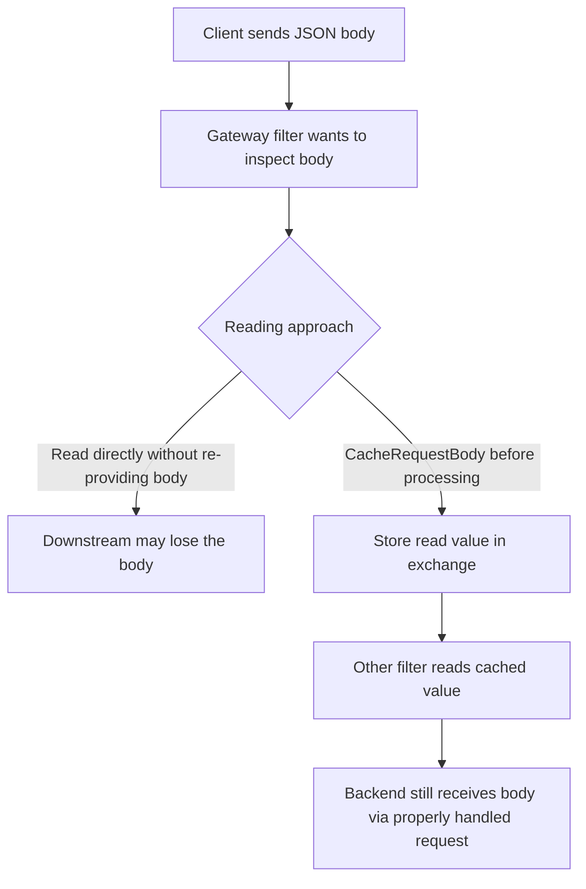
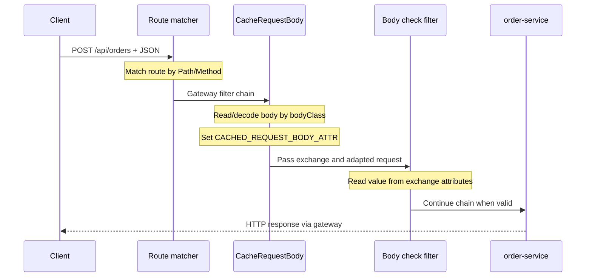
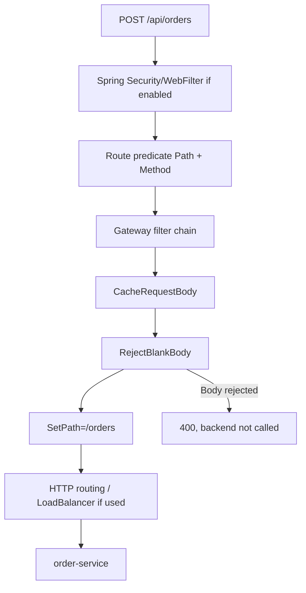
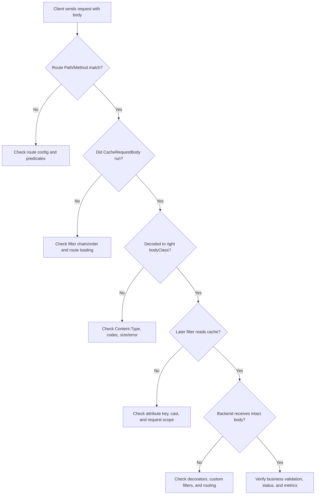

# CacheRequestBody and Reusing Read Content

An API Gateway typically only needs to inspect the path, method, headers, or token to choose a route and forward a request to a microservice. However, there are cases where the entry point must **inspect part of the request body before forwarding**: for instance, an API accepting JSON to create an order where the gateway needs to verify that the body is non-blank and attach observability metadata. The backend still needs to read **that exact same body** to execute business logic.

The challenge in **Spring Cloud Gateway Server WebFlux** is that the request body is exposed as a reactive data stream. If a filter subscribes to read the full body and then passes along the original request as if nothing happened, downstream filters or the backend may no longer be able to read its content. **`CacheRequestBody`** reads and stores the request content within the request's processing scope so subsequent filters can use the cached value without consuming the body stream again.

This lesson belongs to the **HTTP Body Handling** chapter of the **SPRING_CLOUD_GATEWAY** module. We will cover `CacheRequestBodyGatewayFilterFactory`, the `CACHED_REQUEST_BODY_ATTR` attribute, usage in the filter chain, decoding data types, memory limits, and how it interacts with route predicates, path/header transformations, service discovery, authentication, rate limiting, circuit breakers, retries, TLS, and observability.

> **Scope:** Technical details and Java/YAML examples focus on **Spring Cloud Gateway Server WebFlux**. Gateway Server Web MVC has its own servlet model, request/response abstractions, and filter API; do not copy WebFlux `ServerWebExchange`/`GatewayFilter` examples directly into MVC. Verify starter artifacts, property paths, and APIs against the exact Spring Boot/Spring Cloud/Gateway version in use.

## 1. Why Is Reading the Request Body Error-Prone in a Gateway?

Suppose a client sends:

```http
POST /api/orders HTTP/1.1
Host: api.shop.example
Content-Type: application/json

{"productId":42,"quantity":2}
```

A route matches `POST /api/orders`, applies `StripPrefix=2` so `order-service` receives `POST /`, or rewrites the path according to the defined contract. In this scenario, a custom filter wants to inspect the JSON before forwarding.

In WebFlux, `ServerHttpRequest.getBody()` returns a `Flux<DataBuffer>`. This is the **body data stream**; it is not a `String` or byte array that filters can freely read as many times as they like. Reading or subscribing to the body publisher consumes data from the HTTP request according to the server's transport mechanics. If a filter drains the stream without rebuilding an appropriate request, downstream receives an empty body or encounters a re-read error.



### Three Facts to Distinguish

1. **A request body's lifecycle is scoped to a single request**, not shared globally across the application.
2. **`CacheRequestBody` stores a read/decoded value in the exchange**, typically for downstream filters to retrieve; the mechanism allowing downstream to read the body must also be handled properly by the filter/framework.
3. **Caching a request body is different from HTTP response caching.** The goal is not to speed up subsequent API calls or share GET results across multiple clients.

## 2. What Does CacheRequestBody Actually Do?

In Spring Cloud Gateway Server WebFlux, `CacheRequestBodyGatewayFilterFactory` is a **GatewayFilterFactory** that builds a filter to read the request body as a configured Java type. The Gateway documentation states that this filter reads the body and stores the result in an exchange attribute named:

```java
ServerWebExchangeUtils.CACHED_REQUEST_BODY_ATTR
```

Subsequent filters can retrieve the value from `ServerWebExchange`:

```java
Object cached = exchange.getAttribute(
    ServerWebExchangeUtils.CACHED_REQUEST_BODY_ATTR);
```

If `bodyClass` is configured as `java.lang.String` and decoding succeeds, `cached` is typically a `String`. If you choose another type, check the **actual runtime type** before using it.

### Components and Responsibilities

| Component | Role | Common Misconception to Avoid |
| --- | --- | --- |
| **`CacheRequestBodyGatewayFilterFactory`** | Creates a filter configured with `bodyClass`. | The factory is not a shared cache across requests. |
| **`CacheRequestBody` (GatewayFilter)** | Reads/decodes the body and places the value into the exchange; coordinates what is needed for downstream processing. | Does not automatically validate whether JSON is business-valid. |
| **`ServerWebExchange`** | Context for the request/response passing through the WebFlux gateway. | Not persistent storage or a distributed cache. |
| **`CACHED_REQUEST_BODY_ATTR`** | Key used to retrieve the cached body value. | Not an HTTP header, cookie, or response body. |
| **`bodyClass`** | Target Java type when reading the body. | Not a size limit or a security policy definition. |
| **Downstream processing filter** | Reads the cached value for validation or observation as needed. | Should not re-subscribe to the original body stream just to obtain already-cached data. |

### High-Level Processing Flow



This diagram only illustrates an **accepted request**. If the validation filter decides to reject the request, it can write a response at the gateway and **not invoke the rest of the chain**, so the backend never receives the request. Buffer/decorator internals and buffer release timing are version-specific implementation details; do not manipulate internal buffers based on assumptions.

## 3. Configuring CacheRequestBody in YAML Routes

### 3.1. Server WebFlux Example

For Gateway versions using the `spring.cloud.gateway.server.webflux.routes` property namespace, an illustrative route looks like:

```yaml
spring:
  cloud:
    gateway:
      server:
        webflux:
          routes:
            - id: orders-create
              uri: http://localhost:8081
              predicates:
                - Path=/api/orders
                - Method=POST
              filters:
                - name: CacheRequestBody
                  args:
                    bodyClass: java.lang.String
                - name: RejectBlankBody
                - SetPath=/orders
```

**Explanation:**

- `Path=/api/orders` and `Method=POST` match the order-creation endpoint.
- `CacheRequestBody` reads the body as `java.lang.String` and stores the value in the exchange.
- `RejectBlankBody` is **a custom factory that we will build in Section 4**, not a built-in Spring Cloud Gateway filter.
- `SetPath=/orders` sets the backend path to `/orders`. It is independent of body reading.
- `http://localhost:8081` is a local mock/backend; in a real deployment you can switch to `lb://order-service` when LoadBalancer and an instance registry are configured.

When you only want to demonstrate the built-in Spring Cloud Gateway filter, you can **remove the `RejectBlankBody` line** and keep `CacheRequestBody`:

```yaml
filters:
  - name: CacheRequestBody
    args:
      bodyClass: java.lang.String
```

Enabling `CacheRequestBody` alone **makes no decisions** about product quantities, authorization to place orders, or which JSON fields are acceptable.

### 3.2. Why Use the `name/args` Form?

`CacheRequestBody` requires the `bodyClass` parameter, which is the Java class name to convert the body into. Writing the full form makes it clear that this is a factory configuration parameter, avoiding confusion with an arbitrary header or property.

| Configuration | Meaning |
| --- | --- |
| `name: CacheRequestBody` | Selects the gateway filter factory that reads and caches the request body. |
| `bodyClass: java.lang.String` | Requests decoding the body into a string. |
| `bodyClass: java.util.Map` | Can decode JSON into a map if the codec and content type match; verify the actual runtime type. |
| Omitting `bodyClass` | Not a complete configuration example; may fail binding or initialization depending on version. |

**`bodyClass` is not a “read any data as any type” magic switch.** It depends on the WebFlux stack's HTTP message readers/codecs and the actual `Content-Type`. You cannot expect a binary or multipart body to turn into a JSON DTO just by naming a class.

### 3.3. Choosing the Version-Appropriate Property Prefix

Some older Spring Cloud Gateway WebFlux documentation declares:

```yaml
spring:
  cloud:
    gateway:
      routes:
        - id: orders-create
          uri: http://localhost:8081
          predicates:
            - Path=/api/orders
            - Method=POST
          filters:
            - name: CacheRequestBody
              args:
                bodyClass: java.lang.String
```

Newer Gateway documentation clearly distinguishes `server.webflux` from `server.webmvc`. Never mix prefixes from two different examples or assume both take effect simultaneously. Verify your Gateway starter, Spring Cloud release train, Configuration Properties, and runtime route list before debugging body handling.

## 4. Reading the Cached Body from a Custom GatewayFilterFactory

Let us build a filter that **only rejects blank bodies** to demonstrate reading the cache. This rule is intentionally simple: checking for a blank body is **not** JSON schema validation, not user authentication, and does not replace validation inside `order-service`.

### 4.1. Illustrative Java Code

```java
import org.springframework.cloud.gateway.filter.GatewayFilter;
import org.springframework.cloud.gateway.filter.factory.AbstractGatewayFilterFactory;
import org.springframework.http.HttpStatus;
import org.springframework.stereotype.Component;

import static org.springframework.cloud.gateway.support.ServerWebExchangeUtils
    .CACHED_REQUEST_BODY_ATTR;

@Component
public class RejectBlankBodyGatewayFilterFactory
        extends AbstractGatewayFilterFactory<
            RejectBlankBodyGatewayFilterFactory.Config> {

    public RejectBlankBodyGatewayFilterFactory() {
        super(Config.class);
    }

    @Override
    public GatewayFilter apply(Config config) {
        return (exchange, chain) -> {
            Object value = exchange.getAttribute(CACHED_REQUEST_BODY_ATTR);

            if (!(value instanceof String body) || body.isBlank()) {
                exchange.getResponse().setStatusCode(
                    HttpStatus.BAD_REQUEST);
                return exchange.getResponse().setComplete();
            }

            // No need to re-subscribe to exchange.getRequest().getBody().
            return chain.filter(exchange);
        };
    }

    public static class Config {
        // No parameters needed for this example factory.
    }
}
```

Prerequisites for this example:

- The project uses a Spring Boot/Java version supporting pattern matching `instanceof` and `String.isBlank()`, such as Java 17.
- The `RejectBlankBodyGatewayFilterFactory` bean must be component-scanned and registered by Spring.
- The route must include `CacheRequestBody` with `bodyClass: java.lang.String` **before** `RejectBlankBody` in the effective filter chain execution order.
- `RejectBlankBody` is the shorthand name matching a class ending in `GatewayFilterFactory` under WebFlux's factory naming convention.

### 4.2. What Happens at Runtime?

| Request | Cached Value (When Decoding Succeeds) | Illustrative Action |
| --- | --- | --- |
| Body is `{"productId":42}` | Non-blank JSON string | Filter lets the request proceed. |
| Body is `   ` | Whitespace-only string | Filter returns `400 Bad Request`. |
| No body | Cached value may be absent | Filter returns `400 Bad Request`. |
| Body is `not-json` with `bodyClass=String` | String `not-json` | Filter still lets it pass because it only checks blankness; **backend must validate JSON**. |
| Body cannot be decoded by chosen codec/type | Read/decode error may occur before reaching the check filter | Verify exact status code and error handler on your runtime version. |

This example only reads `exchange.getAttribute(CACHED_REQUEST_BODY_ATTR)`. It does not create a new subscription on the original body stream, does not copy the body into a singleton field, and does not alter the forwarded request.

**Never cast blindly** like this:

```java
String body = (String) exchange.getAttribute(CACHED_REQUEST_BODY_ATTR);
```

If another route sets `bodyClass` to `Map` or a filter runs before caching, that cast can throw a `ClassCastException`. Checking `instanceof` and scoping the filter to the right route is much safer.

### 4.3. Why Use a Route-Scoped GatewayFilter?

`CacheRequestBody` is configured on a specific route. When the cache consumer is also a filter on that same route, both steps are clearly visible in configuration and easier to reason about in order:

```text
orders-create:
  1. CacheRequestBody(bodyClass = String)
  2. RejectBlankBody()
  3. SetPath(/orders)
```

This is the **intended order in the example**; when `Ordered`, custom global filters, or other route filters are present, observe the actual execution order. A `GlobalFilter` that runs too early will not see the cached body because `CacheRequestBody` has not executed yet.

## 5. Working with JSON: Reading a String vs. Reading an Object

### Choosing `java.lang.String`

Suitable when you need to view the raw body as a string to check presence, evaluate simple conditions, or feed a controlled parser.

Pros: easy to inspect with minimal coupling to DTO structure. Cons: if you want to verify valid JSON, you still need to parse it explicitly; the string `"{broken}"` is non-blank too.

### Choosing a Structured Object

With `Content-Type: application/json`, an appropriate message reader can decode the body into a Java type such as `java.util.Map` or a codec-supported DTO:

```yaml
filters:
  - name: CacheRequestBody
    args:
      bodyClass: java.util.Map
```

In the consuming filter, the expected type must match:

```java
Object cached = exchange.getAttribute(CACHED_REQUEST_BODY_ATTR);
if (cached instanceof java.util.Map<?, ?> payload) {
    Object productId = payload.get("productId");
    // Validate data against actual schema/business semantics if needed.
}
```

**Verify on your exact version and codec:** map/DTO support, class binding behavior, and `Content-Type` handling can vary with Spring WebFlux and Jackson configuration. When the body contains invalid JSON, the handler may fail before any cached value exists. Do not assume every decode failure maps to HTTP 400 without checking the application's error handling.

### Guidelines for Clear Requirements

| Need | Approach | What to Avoid |
| --- | --- | --- |
| Check only that body is non-empty | Cache as `String`, check null/blank | Confusing a blank check with JSON schema validation. |
| Inspect a JSON field | Decode into DTO/map or parse in a controlled way | Assuming the field is always present and correctly typed. |
| Modify a JSON field before calling backend | Consider `ModifyRequestBody` with appropriate schema/codec | Mutating the cached attribute and expecting the outbound body to change automatically. |
| Handle binary/upload bodies | Prefer streaming/size limits and backend processing | Buffering large files in RAM just to read a few bytes. |
| Enforce sensitive policies using body | Perform authorization/validation in the service owning the domain | Trusting a client-supplied field as proof of identity. |

### Content-Type Must Match the Payload

Suppose a client sends `Content-Type: application/json` with non-JSON body text. If `bodyClass=String`, reading as a string may still succeed; if `bodyClass` is a DTO, the codec may reject it. Do not rely on `CacheRequestBody` as a default JSON validator, and do not skip content-type verification on the backend.

## 6. Reusing the Body Does Not Mean Arbitrary Mutation

When a downstream filter reads `CACHED_REQUEST_BODY_ATTR`, it obtains a **decoded representation**. This is different from changing the content of the forwarded request.

For example:

```java
Object cached = exchange.getAttribute(CACHED_REQUEST_BODY_ATTR);
// An object referencing the content read for the current request.
```

Mutating a `Map` retrieved from the cache or overwriting the attribute with a new object **is not the standard contract for rewriting the raw HTTP body**. Downstream receives a modified body only if your filter/request-decorator mechanism actually emits a new body stream, adjusts necessary headers, and integrates properly with the routing layer.

### When to Use ModifyRequestBody?

`ModifyRequestBody` is a GatewayFilter built for **reading, transforming, and rewriting the request body** using a transformation function and appropriate codecs. In supported WebFlux releases, it is typically configured via the Java DSL rather than a simple YAML entry.

Comparison:

| Mechanism | Purpose | Expected Outcome |
| --- | --- | --- |
| **CacheRequestBody** | Read/store the body value for reuse by later filters. | Subsequent filters retrieve the value via exchange attribute. |
| **ModifyRequestBody** | Actively transform the body sent downstream. | Backend receives the new representation if the rewrite succeeds. |
| **ReadBody route predicate** (if supported by flavor/version) | Use body content as a route-matching condition. | Affects route selection; not equivalent to a post-match route filter. |
| **RequestSize filter** / ingress-server limits | Control request size. | Rejects oversized requests according to the configured mechanism. |
| **LocalResponseCache** or HTTP response cache | Cache **responses** according to policy. | Can reuse responses across eligible requests. |
| **Retry** | Retry downstream calls under configured conditions. | May require retaining/replaying the body and bounding attempts. |

Never use `CacheRequestBody` with the goal of speeding up a GET endpoint. It does not cache JSON responses for future clients.

## 7. CacheRequestBody and Filter Ordering in the Gateway Chain

After `RoutePredicateHandlerMapping` selects a route, `FilteringWebHandler` combines `GlobalFilter`s and route `GatewayFilter`s and sorts them by `Ordered`/gateway ordering rules.



In a typical setup, Spring Security authentication runs in the HTTP `WebFilter` chain before route filters, while GatewayFilter-level auth logic (if any) sits in a different layer. Do not assume a `GlobalFilter` observes requests rejected by Security or requests that match no route.

### What Happens If a Cache Consumer Runs Before the Cache Filter?

`exchange.getAttribute(CACHED_REQUEST_BODY_ATTR)` may return `null` or an unexpected object. The bug is not that the backend “ate” the body, but that **no cache step had run yet** for the current request.

Solution:

- Place `CacheRequestBody` before route filters that consume the cached data in the route configuration.
- When a custom filter implements `Ordered` or is a `GlobalFilter`, verify actual runtime execution order instead of relying solely on YAML position.
- Test requests with a body, empty requests, wrong `Content-Type`, and cases where a filter short-circuits.

### When a Filter Short-Circuits Early

A filter such as `RejectBlankBody` can return a 400 response without calling `chain.filter(exchange)`. When that happens:

1. Subsequent filters do not execute.
2. The backend does not receive the request.
3. Post-processing hooks already registered by earlier filters may still execute on reactive signals.
4. Buffer release must follow lifecycle rules in both the framework and custom code; never retain a `DataBuffer` beyond request scope.

If your application needs metrics for requests rejected by Spring Security prior to route matching, attach security metrics at the appropriate `WebFilter`/observability layer instead of expecting a post-route `GatewayFilter` to see them.

## 8. Memory Limits, Backpressure, and Traffic You Should Not Cache

**Reading and caching a body has a cost.** The gateway may need to hold data in memory while reading, decoding, inspecting, and forwarding. Under high concurrency, transiently retained memory scales with body size and in-flight request count.

### Estimating the Risk

Suppose 500 concurrent requests arrive, each with a 512 KiB body. Raw body bytes alone already total approximately:

```text
500 × 512 KiB = 256000 KiB ≈ 250 MiB
```

This figure **excludes** overhead from `DataBuffer`s, decoded objects, Java strings, JSON structures, connection pools, request metadata, and auxiliary buffers. Under heavy load, caching bodies affects heap/direct memory, garbage collection, latency, and concurrency capacity.

### Traffic Profiles to Evaluate

| Body Type | Should You Use CacheRequestBody? | Reason |
| --- | --- | --- |
| Small, bounded JSON | Often appropriate. | Read once for lightweight downstream filter inspection. |
| Very large JSON or high concurrency | Requires load and limit evaluation. | Decoding/buffering increases memory pressure. |
| Large multipart/file uploads | Usually avoid caching entire body at gateway. | Limit/stream and process in the backend. |
| Unbounded streaming/chunked bodies | Do not aggregate entirely by default. | Breaks streaming benefits and risks memory exhaustion. |
| Binary or media payloads | Only with clear justification and matching codec. | Decoding into `String`/DTO may be inappropriate. |
| Bodyless requests | No need to cache just to route by path/header. | Adds overhead and null-handling edge cases. |

### Guarding Against Oversized Requests

- Enforce **body size limits** at the ingress/server and use Gateway's `RequestSize` where appropriate; verify with both `Content-Length` requests and streaming/chunked requests.
- Set appropriate codec/buffering limits (such as `maxInMemorySize` on WebFlux codecs when used); this **does not replace** full request limits at the network layer.
- Never raise codec limits indefinitely just to silence an error on one large request.
- Bound concurrency, timeouts, and connections according to system capacity; load-test with realistic body sizes.
- Use streaming or backend processing whenever the gateway does not genuinely need to read the entire body.

Exceeding codec limits can raise an error like `DataBufferLimitException`; the resulting HTTP status depends on Gateway/WebFlux error handling and active filters. Do not assume every oversized case returns the exact same status code without testing.

### Do Not Manually Manage DataBuffer Without Understanding Its Lifecycle

In a Netty environment, buffers may be reference-counted. When manually calling `DataBufferUtils.join()` or writing a body-reading decorator, you must know when to retain/release buffers, copy bytes, and handle subscription cancellation; mistakes cause **memory leaks, double releases, or empty bodies**.

If your goal is simply reusing a decoded string or DTO, prefer `CacheRequestBody` and exchange attributes over writing custom buffer/replay mechanics. Only build a custom body-reading layer when no built-in filter fits and you thoroughly test error/cancellation paths, memory behavior, and concurrency.

## 9. Security: Do Not Turn CacheRequestBody into a Sensitive-Data Logger

Request bodies can contain shipping addresses, personal identifiers, payment details, passwords, or private payloads. Caching a body for filter inspection **does not grant permission to log or persist it**.

### Responsibility Boundaries

| Requirement | Appropriate Layer |
| --- | --- |
| Verify JWT, issuer, signature, expiration | Spring Security at the gateway when properly configured. |
| Check whether user is authorized to create orders | Gateway can enforce API-level permissions; `order-service` enforces domain/resource authorization. |
| Rate-limit by identity/API key | Rate limiter with an appropriate `KeyResolver` and store. |
| Check required JSON fields | Acceptable at gateway for generic technical rules; business validation stays in backend. |
| Keep tokens/sensitive bodies out of logs | Logging, tracing, and data policies across every layer. |
| Protect transport connections | TLS/mTLS, trust boundaries, and upstream authentication. |

### Principles When Reading Bodies

1. **Never log raw bodies** merely for debugging; if you genuinely must observe an attribute, log only sanitized, non-sensitive, bounded values.
2. **Never treat a `userId` field inside JSON as an authenticated identity.** Use verified principals/claims and enforce authorization on the backend.
3. **Never copy cached bodies into headers:** HTTP headers are not meant for large JSON payloads or private data.
4. **Never store a body in a field on a singleton filter bean.** Many requests run concurrently; use `ServerWebExchange` for per-request state.
5. **Never rely on an anti-abuse check in a filter that another route can bypass.** Ensure policies cover the full public API and protect the backend directly.
6. **Never trust client-supplied `Content-Length` as the sole defense.** Cap actual bytes received, including requests without declared lengths or using transfer encoding.

### Notes on Signatures/HMAC or Webhooks

For webhooks signed over the **raw body bytes**, converting the body into a `String` or DTO can lose byte-level fidelity needed for signature verification if you re-encode, normalize JSON, or alter characters. An HMAC verification flow must check the **exact signed bytes** specified by the partner protocol, with bounded size limits and safe storage/replay.

Do not assume `CACHED_REQUEST_BODY_ATTR` contains raw original bytes, as its value depends on `bodyClass` and the codec. If raw-byte verification is required, design an explicit byte path, pick a suitable mechanism, and test with Unicode, whitespace, and varying JSON key orderings.

## 10. CacheRequestBody, Retry, and Circuit Breakers

A microservices gateway commonly pairs body reading with timeouts, `Retry`, and `CircuitBreaker`. Each solves a different problem:

| Mechanism | Purpose | Risk When Combined with Bodies |
| --- | --- | --- |
| `CacheRequestBody` | Lets later filters access the read body. | Consumes memory; does not automatically make all request types retryable. |
| `Retry` | Retries downstream calls under configured conditions. | Requires replayable body, timeout budget, and protection against duplicate side effects. |
| `CircuitBreaker` | Short-circuits calls to failing/slow upstreams by policy. | Fallbacks or retries can create alternate paths requiring controlled responses. |
| `RequestRateLimiter` | Blocks requests exceeding quota before reaching upstream. | Avoid caching large bodies for requests that will be rejected when possible. |

### Why Caching the Body Does Not Make Retrying a POST Safe

Suppose a client sends `POST /api/payments`. The gateway sends the body to the payment service, but the network drops before the response arrives. The backend **may already have completed the payment**. Retrying simply because the gateway still has the body risks creating duplicate transactions.

To retry write operations safely, design an **idempotency key**, persist reliable processing state in the backend, and bound retry count and total duration. Body replay is a technical prerequisite, **not a guarantee of business correctness**.

### Memory Considerations During Retry

In certain `Retry` configurations, Gateway WebFlux retains the request body when replay is required. Combining `Retry` and `CacheRequestBody` can compound memory pressure if you do not understand the active buffers and filters.

Verify:

- Whether the body is sent accurately to upstream on **every retry attempt**.
- Whether the number of times the backend actually receives the request stays within limits.
- How total timeout and per-attempt timeout are calculated.
- When an earlier filter rejects a request, whether body buffers are released afterward.
- Whether `POST`/`PUT`/`PATCH` safety aligns with actual service contracts.

Never conclude that simply adding `CacheRequestBody` gives every downstream filter unlimited body replay.

## 11. Relation to Routes, Headers, Discovery, and Observability

| Concern | Relation to Body Caching | Design Guidance |
| --- | --- | --- |
| **Route predicate** | `CacheRequestBody` is a route filter executed after route matching. | Match routes by path/method/header first; cache only where needed. |
| **`StripPrefix`, `RewritePath`** | Modifies the request path; does not automatically alter JSON content. | Verify backend receives the right path and intact body semantics. |
| **Request headers** | `Content-Type` affects decoding; auth/cookie headers are sensitive. | Normalize headers at the edge; do not conflate body cache with headers. |
| **Service discovery** | `lb://order-service` selects an upstream instance. | Configure LoadBalancer and instance discovery independently; body caching does not resolve instances. |
| **Authentication** | Spring Security may reject before route filters run. | Body caching does not replace JWT validation or resource authorization. |
| **Rate limiting** | Over-quota requests can be rejected early. | Check filter order to avoid decoding large bodies unnecessarily. |
| **Circuit breaker / Retry** | May short-circuit or retry downstream calls. | Test memory, body send counts, timeouts, and idempotency. |
| **TLS** | Encrypts data in transit; does not dictate how the body is cached. | Secure client→gateway and gateway→backend TLS per topology. |
| **Metrics/tracing** | Can record request type, route ID, size, and duration. | Never log body/tokens; avoid tags with high-cardinality values or PII. |

### Observing an Order-Creation Request

Operations teams often want a log/tracing record like:

```text
traceId: [trace context]
routeId: orders-create
method: POST
publicPath: /api/orders
upstream: order-service
bodyValidation: passed
status: 201
elapsedMs: [actual measurement]
```

This is an **example of desired telemetry**, not the default output of `CacheRequestBody`. In implementation, use Micrometer/Actuator and your project's tracing standard, logging the route ID and bounded validation outcome; never place JSON bodies, access tokens, card numbers, or customer addresses into tags or logs.

## 12. Hands-On Lab: Read the Body Once, Use It in a Filter and Backend

### 12.1. Environment

Prepare:

- Spring Cloud Gateway Server WebFlux on `http://localhost:8080`.
- A mock `order-service` on `http://localhost:8081`, exposing `POST /orders` and recording **method, Content-Type, and body** for inspection in the test environment.
- The route from Section 3, including `CacheRequestBody`, `RejectBlankBody`, and `SetPath=/orders`.

The backend only needs to return a sample JSON response, such as:

```json
{"accepted":true,"orderId":"demo-001"}
```

The actual status code is decided by the backend/mock. This example does not implement real order persistence, JWT authentication, or service discovery.

### 12.2. Testing Valid Non-Blank JSON

```bash
curl -i \
  -H "Content-Type: application/json" \
  --data '{"productId":42,"quantity":2}' \
  "http://localhost:8080/api/orders"
```

Expected flow:

1. `Method=POST` and `Path=/api/orders` match the route.
2. `CacheRequestBody` caches the JSON string in the exchange attribute.
3. `RejectBlankBody` lets the request continue because the string is non-blank.
4. `SetPath` rewrites the path to `/orders`.
5. The mock backend receives the corresponding **JSON body** and returns the response.

If the backend receives an empty body, check filter ordering, codecs, and request-decorator/body behavior on your exact version. Do not try to fix it by arbitrarily calling `getBody()` again in a custom filter.

### 12.3. Testing an Empty Body

```bash
curl -i -X POST \
  -H "Content-Type: application/json" \
  "http://localhost:8080/api/orders"
```

In this custom filter example, when no matching cached `String` is present, it returns `400 Bad Request` and the backend **is not called**. If an earlier codec/filter returns a different error, note the actual outcome and where it originated.

### 12.4. Testing a Whitespace-Only Body

```bash
curl -i \
  -H "Content-Type: text/plain" \
  --data '   ' \
  "http://localhost:8080/api/orders"
```

If the body is decoded as a `String`, `isBlank()` returns true and the filter blocks it. With another `bodyClass`, behavior may differ and you should check `Content-Type`.

### 12.5. Testing a Non-JSON Body

```bash
curl -i \
  -H "Content-Type: application/json" \
  --data 'not-json' \
  "http://localhost:8080/api/orders"
```

With `bodyClass=String`, the example filter lets the request pass because the body is non-blank; the backend must validate and can reject invalid JSON. This test proves that **caching does not automatically validate schemas**. If you change `bodyClass` to a DTO/`Map`, re-test to observe the decode error.

### 12.6. Testing Path, Header, and Body Together

Add a non-sensitive header and query parameter:

```bash
curl -i \
  -H "Content-Type: application/json" \
  -H "X-Client-Version: 2" \
  --data '{"productId":42,"quantity":2}' \
  "http://localhost:8080/api/orders?source=mobile"
```

The mock backend confirms `POST`, path `/orders`, query `source=mobile`, `Content-Type`, and the intact JSON body. `CacheRequestBody` is not responsible for altering method, query parameters, or headers.

### 12.7. Testing Size Limits and Concurrent Requests

In your test environment, send bodies of 1 KiB, 64 KiB, and sizes approaching your project's configured threshold; observe processing time, memory, error codes, and responses when exceeding the limit. Then run multiple moderately sized concurrent requests to verify the gateway does not exhibit abnormal memory growth.

Never use unbounded payloads or disable all limits merely to prove the filter can cache large amounts of data. For large/streaming requests, consider a design that avoids caching the entire body.

### Result Matrix to Record

| Case | Input | Expected Observation |
| --- | --- | --- |
| B01 | Valid, non-blank JSON | Cache holds `String`, backend still receives body. |
| B02 | No body | Custom filter rejects or clear decode error occurs, no sensitive body logged. |
| B03 | Whitespace-only body | `RejectBlankBody` returns `400` when decoded as `String`. |
| B04 | Non-JSON string | Caching `String` does not replace backend JSON validation. |
| B05 | Different `Content-Type` | Record codec behavior and content-type policy. |
| B06 | JSON body cached as `Map`/DTO | Verify type handling and malformed payload behavior. |
| B07 | Oversized body | Rejected per policy; no unbounded memory growth. |
| B08 | Multiple concurrent requests | Per-request caches stay isolated, no cross-request mixing. |
| B09 | Route path/method mismatch | Route filters do not run; another handler determines response. |
| B10 | Adding `Retry` in POC | Backend receives body according to retry policy, no unintended duplicate writes. |

## 13. Troubleshooting Common Issues

| Symptom | Possible Cause | Where to Check |
| --- | --- | --- |
| `CACHED_REQUEST_BODY_ATTR` is `null` | Request has no body, cache filter has not run yet, another route matched, or decoding produced no value. | Check route ID, filter order, content type, and request type. |
| `ClassCastException` when reading cache | `bodyClass` does not match the type cast by a later filter. | Inspect runtime type safely with `instanceof` and check config. |
| Backend receives empty body | Custom filter consumed original body, improper request decorator/replay, or chain error. | Disable custom filters to isolate and verify WebFlux body reading. |
| Response reports decode error | `Content-Type`, body, and `bodyClass` mismatch; codec unsupported. | Test valid/invalid JSON, message readers, and error handling. |
| `DataBufferLimitException` | Buffer/codec exceeded configured limit. | Review body size, ingress/server limits, codec settings, and business need. |
| Gateway consumes high RAM | Too many large request bodies retained concurrently or multiple copies created. | Measure concurrency, body size, direct/heap memory, GC, and reactive flow. |
| Gateway leaks personal data in logs | Custom filter logs body or attribute values. | Scrub sensitive fields from logs/traces; audit retention and access controls. |
| 401/403 before reaching filter | Rejected by Spring Security or backend. | Inspect security chain; body caching does not handle authentication. |
| Backend errors despite route match | Issues in `SetPath`/`StripPrefix`, discovery, TLS, or upstream itself. | Compare path, target URI, networking, HTTP status, and traces. |
| Retry resends multiple times | Retry policy, idempotency, and body replay misaligned. | Count upstream invocations and verify write-operation contract. |
| YAML changed with no caching effect | Wrong property prefix, routes not refreshed, or incompatible dependency. | Verify version/starter, active routes, and startup logs. |

### 13.1. Step-by-Step Debugging Order



## 14. Pre-Deployment Checklist

- [ ] Confirmed why the gateway **genuinely needs to read the body**; if routing solely by path/headers, do not add caching.
- [ ] Selected **Server WebFlux** with compatible JDK/Spring Boot/Spring Cloud/Gateway versions and starter; if using Server Web MVC, consult its separate API.
- [ ] Verified property prefixes, `CacheRequestBody`, and `bodyClass` parameter against documentation for the exact version.
- [ ] Placed `CacheRequestBody` ahead of filters that read `CACHED_REQUEST_BODY_ATTR` in effective execution order.
- [ ] Custom filters only read the cached attribute and never arbitrarily subscribe to the original body stream.
- [ ] Tested missing bodies, blank bodies, invalid JSON, wrong `Content-Type`, and different decode types.
- [ ] Verified the backend still receives the expected method, path, query parameters, required headers, and valid body.
- [ ] Configured size and codec/buffering limits at ingress, server, and gateway layers.
- [ ] Load-tested concurrent requests while monitoring heap, direct memory, GC, latency, and errors.
- [ ] Ensured bodies/tokens/PII are never logged or stored in singletons or shared stores.
- [ ] Ensured authentication, resource authorization, and business validation remain enforced at the proper layers.
- [ ] Bounded retries and evaluated idempotency; verified circuit breakers and timeouts do not introduce unexpected failures.
- [ ] Tested `lb://` URIs, TLS, and service discovery independently of body caching.
- [ ] Added observability by route ID and trace without recording raw bodies or dynamic-value labels.
- [ ] Prepared a rollback procedure in case enabling caching spikes resource usage or affects forwarded bodies.

## 15. Self-Check Questions

1. Why cannot `ServerHttpRequest.getBody()` in WebFlux be treated like a `String` that can be freely read repeatedly?
2. What does `CacheRequestBodyGatewayFilterFactory` use `bodyClass` for? Does it automatically validate schemas or business rules?
3. Which `ServerWebExchange` attribute does a custom filter read the cached body from?
4. Why can changing `bodyClass` from `String` to `Map` break a filter that casts the cached value to `String`?
5. Does mutating a `Map` stored in the cache automatically modify the raw HTTP body that the backend receives?
6. Distinguish between `CacheRequestBody`, `ModifyRequestBody`, and an HTTP response cache.
7. Why is caching the body insufficient to make retrying `POST /payments` safe?
8. If the backend receives an empty body while an inspection filter saw the data, what steps would you investigate?
9. Why are size and concurrency limits still required even when the gateway uses reactive programming?
10. For a webhook signed with HMAC over raw bytes, why might a decoded `String` or DTO not work directly for recomputing the signature?

## 16. Version-Specific Reference Documentation

When implementing, open documentation for your **exact version and flavor** to verify factory names, configuration properties, codecs, body limits, and integration details:

- [Spring Cloud Gateway Server WebFlux — CacheRequestBody GatewayFilter Factory](https://docs.spring.io/spring-cloud-gateway/reference/spring-cloud-gateway-server-webflux/gatewayfilter-factories/cacherequestbody-factory.html)
- [Spring Cloud Gateway Server WebFlux — ModifyRequestBody GatewayFilter Factory](https://docs.spring.io/spring-cloud-gateway/reference/spring-cloud-gateway-server-webflux/gatewayfilter-factories/modifyrequestbody-factory.html)
- [Spring Cloud Gateway Server WebFlux — GatewayFilter Factories](https://docs.spring.io/spring-cloud-gateway/reference/spring-cloud-gateway-server-webflux/gatewayfilter-factories.html)
- [Spring Cloud Gateway Server WebFlux — Global Filters](https://docs.spring.io/spring-cloud-gateway/reference/spring-cloud-gateway-server-webflux/global-filters.html)
- [Spring Cloud Gateway — Configuration Properties](https://docs.spring.io/spring-cloud-gateway/reference/configprops.html)
- [Spring Framework WebFlux — Annotated Controllers and HTTP Message Codecs](https://docs.spring.io/spring-framework/reference/web/webflux.html)

**Key Takeaway:** `CacheRequestBody` enables the gateway to **read/decode the request body in a controlled manner and share the read value with downstream filters via `CACHED_REQUEST_BODY_ATTR`**. It does not modify the body itself, cache responses, validate business rules, or make retries safe. When using it in Spring Cloud Gateway, choose the right body type, filter order, memory limits, and security controls, and verify that **the backend still receives the request content required by the API contract**.
