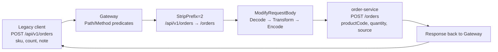
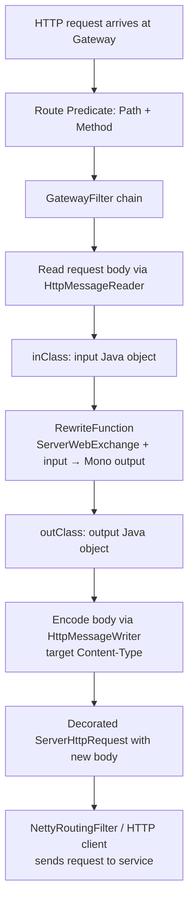
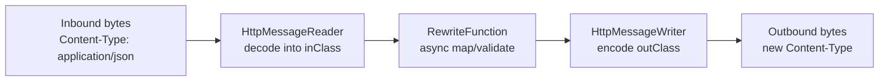

# ModifyRequestBody via Java DSL and Input Payload Transformation

In a microservices architecture, a public API sometimes must preserve a legacy request contract while an internal service has already moved to a new data structure. For example, a mobile app sends JSON with a `count` field, whereas the new `order-service` expects `quantity`. Changing the public contract immediately could break older clients. The **`ModifyRequestBody` GatewayFilter Factory** in **Spring Cloud Gateway Server WebFlux** allows reading the HTTP request content, decoding it into a Java type, transforming it via a reactive function, and writing out the new body to forward upstream.

This lesson belongs to the **HTTP Body Handling** chapter of the **SPRING_CLOUD_GATEWAY** module. When building an API Gateway, we routinely use route predicates and filter chains for routing, path/header manipulation, service discovery, security, rate limiting, circuit breakers, retries, TLS, and observability. **Transforming the request body**, however, is heavier and more sensitive than altering headers: it requires reading, decoding, potentially buffering in memory, re-encoding, and preserving HTTP message correctness.

Lesson objectives:

1. Know **when to use `ModifyRequestBody`** and when to forward the request body untouched to the backend.
2. Write a `RouteLocator` in **Java DSL** to convert inbound JSON into a different DTO and forward it upstream.
3. Understand `inClass`, `outClass`, `newContentType`, and `RewriteFunction`, including **bodyless** requests.
4. Handle invalid data, media types/codecs, body length, memory, reactive execution, and errors before the request reaches the backend.
5. Test payloads before/after transformation and assess impacts on authentication, rate limiting, retries, streaming, and observability.

> **Scope:** This content applies to **Spring Cloud Gateway Server WebFlux** using Spring WebFlux/Project Reactor. Gateway Server MVC has its own filter API and execution model; do not use WebFlux Java DSL examples directly in MVC. Both Spring Cloud Gateway WebFlux 4.x and 5.x documentation cover `ModifyRequestBody`; verify starters, dependencies, and configuration against the exact version you run.

## 1. Why Does a Gateway Need to Transform Request Bodies?

Suppose a legacy mobile client creates an order with this request:

```http
POST /api/v1/orders HTTP/1.1
Host: api.example.com
Content-Type: application/json
Authorization: Bearer <token>

{
  "sku": "BOOK-01",
  "count": 2,
  "note": "Deliver during business hours"
}
```

Meanwhile, the new backend expects:

```http
POST /orders HTTP/1.1
Content-Type: application/json

{
  "productCode": "BOOK-01",
  "quantity": 2,
  "source": "legacy-v1"
}
```

There are two distinct transformations here:

- **Path:** from `/api/v1/orders` to `/orders`, which can be handled by `StripPrefix=2`.
- **Body:** from `sku/count/note` to `productCode/quantity/source`, which requires reading and re-encoding JSON; `StripPrefix` or `RewritePath` **cannot** do this.



**Separation of responsibilities rule:** Data transformations in the gateway should serve **protocol or contract compatibility**, such as renaming fields, normalizing technical formats, or wrapping a JSON message. Decisions involving pricing, inventory, order ownership, totals, and payment status belong in domain services. If a transformation requires database lookups, aggregating multiple domains, or coordinating transactions, place that logic in an appropriate service/BFF rather than stuffing it into a gateway filter.

## 2. Where Does ModifyRequestBody Run in the Filter Chain?

In Spring Cloud Gateway Server WebFlux, `ModifyRequestBody` is a **route-scoped GatewayFilter Factory**. It reads the body from `ServerHttpRequest`, uses a Spring WebFlux codec to produce a Java value of the input type, invokes a rewrite function, and writes the new body for the forwarded request.

Conceptual flow:



Key points to understand:

- **Predicates evaluate before route filters:** for example, `Path=/api/v1/orders` matches the route on the public path. `ModifyRequestBody` is not a route predicate.
- **The initial body is a data stream** (`Flux<DataBuffer>`); do not arbitrarily read it twice. The built-in filter constructs an adapted request so subsequent stages can read the new body.
- **Object conversion requires matching codecs:** for instance, JSON to a Java record requires a JSON decoder; the output object requires a JSON encoder.
- **Reactive does not mean zero memory:** converting an entire JSON payload into a DTO typically requires decoding and potentially buffering the body.
- **The backend receives the new body.** Headers, HTTP method, path, and authorization are still governed by their respective filters/policies and do not change automatically just because `ModifyRequestBody` is used.

`ModifyRequestBody` transforms the **request body**. If you need to transform the body **returned to the client**, that is the job of `ModifyResponseBody`. If you only want to change headers, use `AddRequestHeader`, `SetRequestHeader`, or `RemoveRequestHeader` instead of reading the body.

## 3. Why Must It Be Configured via Java DSL?

Spring Cloud Gateway Server WebFlux documentation specifies that **`ModifyRequestBody` is only configurable via the Java DSL**. The practical reason is that the filter requires a Java function accepting `ServerWebExchange` and the decoded content, returning a publisher for the new body.

Typical syntax:

```java
.modifyRequestBody(
    InputType.class,
    OutputType.class,
    MediaType.APPLICATION_JSON_VALUE,
    (exchange, body) -> /* Return Mono<OutputType> */)
```

| Parameter | Role | Example |
| --- | --- | --- |
| `inClass` | Java type used to **read and decode the inbound body** | `LegacyOrderRequest.class` |
| `outClass` | Java type used to **encode the new body** | `CreateOrderRequest.class` |
| `newContentType` | Content type of the transformed body | `MediaType.APPLICATION_JSON_VALUE` |
| `rewriteFunction` | Function taking `ServerWebExchange` and input, returning a reactive `Publisher` for output | `(exchange, input) -> Mono.just(mapped)` |

`InputType` and `OutputType` must be compatible with the HTTP message codecs in your application. Setting `String.class` or `Object.class` does not magically handle every JSON, XML, or multipart payload.

The following example is **not** valid configuration according to WebFlux documentation:

```yaml
# Wrong idea: this filter cannot configure a rewrite function in plain YAML
spring:
  cloud:
    gateway:
      routes:
        - id: orders
          uri: http://localhost:8081
          predicates:
            - Path=/api/v1/orders
          filters:
            - ModifyRequestBody=LegacyOrderRequest,CreateOrderRequest
```

Standard routes can be declared in YAML, but when you need a Java function to transform the body, define a `RouteLocator` bean with `RouteLocatorBuilder`. Do not infer from YAML examples that any factory name can be written with class names and turned into an automatic converter.

## 4. Complete Example: Converting v1 JSON to Internal JSON via Java DSL

Suppose the Gateway runs on `localhost:8080` and a test `order-service` runs on `localhost:8081`. Clients call `POST /api/v1/orders`; the backend only exposes `POST /orders`.

### 4.1. Defining Input and Output DTOs

Use Java records to clearly express the contracts of both API generations:

```java
public record LegacyOrderRequest(
    String sku,
    Integer count,
    String note
) {}

public record CreateOrderRequest(
    String productCode,
    Integer quantity,
    String source
) {}
```

`LegacyOrderRequest` captures the structure from legacy clients. `CreateOrderRequest` is the payload expected by the new backend. In this example, `note` is not forwarded because the backend no longer supports it; any decision to drop fields must be confirmed against the contract rather than silently discarding important data.

### 4.2. Configuring RouteLocator

A minimal configuration class including imports and the bean:

```java
import org.springframework.cloud.gateway.route.RouteLocator;
import org.springframework.cloud.gateway.route.builder.RouteLocatorBuilder;
import org.springframework.context.annotation.Bean;
import org.springframework.context.annotation.Configuration;
import org.springframework.http.HttpMethod;
import org.springframework.http.HttpStatus;
import org.springframework.http.MediaType;
import org.springframework.web.server.ResponseStatusException;
import reactor.core.publisher.Mono;

@Configuration(proxyBeanMethods = false)
public class OrderGatewayRoutes {

    @Bean
    RouteLocator orderRoutes(RouteLocatorBuilder builder) {
        return builder.routes()
            .route("orders-legacy-create", r -> r
                .path("/api/v1/orders")
                .and()
                .method(HttpMethod.POST)
                .filters(f -> f
                    .stripPrefix(2)
                    .modifyRequestBody(
                        LegacyOrderRequest.class,
                        CreateOrderRequest.class,
                        MediaType.APPLICATION_JSON_VALUE,
                        (exchange, input) -> {
                            if (input == null) {
                                return Mono.error(new ResponseStatusException(
                                    HttpStatus.BAD_REQUEST,
                                    "Request body is required"));
                            }

                            if (input.sku() == null
                                    || input.sku().isBlank()
                                    || input.count() == null
                                    || input.count() <= 0) {
                                return Mono.error(new ResponseStatusException(
                                    HttpStatus.BAD_REQUEST,
                                    "sku and positive count are required"));
                            }

                            CreateOrderRequest mapped =
                                new CreateOrderRequest(
                                    input.sku().trim(),
                                    input.count(),
                                    "legacy-v1");

                            return Mono.just(mapped);
                        }))
                .uri("http://localhost:8081"))
            .build();
    }

    public record LegacyOrderRequest(
        String sku, Integer count, String note
    ) {}

    public record CreateOrderRequest(
        String productCode, Integer quantity, String source
    ) {}
}
```

**Prerequisites:** a Spring Cloud Gateway **Server WebFlux** starter compatible with Spring Boot, JSON codecs (Jackson per supported stack), Reactor, and the imports shown above. The `RouteLocator` bean is Java route configuration, not a Spring MVC controller.

**How it flows through the pipeline:**

1. `path("/api/v1/orders")` and `method(POST)` restrict the route to the order-creation endpoint. `GET` requests or other paths do not enter this converter.
2. `stripPrefix(2)` removes the `api` and `v1` segments, so upstream receives `/orders`.
3. `modifyRequestBody(...)` decodes the JSON into `LegacyOrderRequest`, performs minimal validation, and builds `CreateOrderRequest`.
4. `MediaType.APPLICATION_JSON_VALUE` instructs the writer to encode the new body as JSON.
5. `uri("http://localhost:8081")` targets the test backend; this can be replaced with `lb://order-service` when Spring Cloud LoadBalancer and an instance source are configured.

Checking `count > 0` in the example is only **minimal boundary validation** to avoid forwarding malformed payloads. `order-service` must still validate products, pricing, inventory, access permissions, and transaction validity. The gateway is not the source of truth for these rules.

### 4.3. Before and After Transformation

Client sends:

```bash
curl -i http://localhost:8080/api/v1/orders \
  -H "Content-Type: application/json" \
  -d '{"sku":"BOOK-01","count":2,"note":"Deliver during business hours"}'
```

Backend expects to receive:

```http
POST /orders HTTP/1.1
Content-Type: application/json

{"productCode":"BOOK-01","quantity":2,"source":"legacy-v1"}
```

The actual JSON text may vary in **field order, whitespace, or Unicode escaping**; what you should test is **JSON structure and values**. Outbound `Content-Length` may also differ from the inbound request because the body changed. Do not expect all framing-related headers to remain identical.

## 5. Handling Bodyless Requests and `null`

In `ModifyRequestBody`, if a request has **no body**, Spring Cloud Gateway documentation states that the `RewriteFunction` receives **`null`** as its input argument. This is distinct from valid JSON containing empty fields.

Two valid policies serve different goals:

### 5.1. Optional Body: Continue Forwarding Without a Body

```java
.modifyRequestBody(
    String.class,
    String.class,
    MediaType.TEXT_PLAIN_VALUE,
    (exchange, body) -> {
        if (body == null) {
            return Mono.empty();
        }
        return Mono.just(body.trim());
    })
```

`Mono.empty()` signals **no output body**. **Never** use `Mono.just(null)` because Reactor's `Mono.just` rejects `null` values.

### 5.2. Required Body: Return an Explicit Error

```java
.modifyRequestBody(
    LegacyOrderRequest.class,
    CreateOrderRequest.class,
    MediaType.APPLICATION_JSON_VALUE,
    (exchange, input) -> {
        if (input == null) {
            return Mono.error(new ResponseStatusException(
                HttpStatus.BAD_REQUEST,
                "Order request body is missing"));
        }
        return Mono.just(new CreateOrderRequest(
            input.sku(),
            input.count(),
            "legacy-v1"));
    })
```

This is an **illustrative configuration snippet**. In production you must still validate `sku` and `count` before using them; see the complete example in Section 4. `ResponseStatusException` allows WebFlux to map the error appropriately, while malformed JSON or unsupported media types may fail **during decoding before the rewrite function ever runs**.

| Scenario | Input Passed to Rewrite Function | Desired Behavior |
| --- | --- | --- |
| Valid JSON with all fields | Non-`null` Java DTO | Validate and return `Mono<OutputDTO>` |
| Request without a body | `null` | `Mono.empty()` if optional, or `400` error if required |
| Valid JSON missing `sku` | Java DTO with `null` field | Explicitly validate and return `400` |
| Syntactically invalid JSON | May fail in codec before rewrite function | Handle via proper error handler; do not assume lambda runs |
| `Content-Type` has no matching codec | Cannot decode or rejected | Explicitly define supported media types |
| Backend business validation fails | Gateway transformed successfully | Backend returns error per domain contract |

**Note on Bean Validation:** Do not assume `@Valid` on a DTO will automatically be enforced just because it passes through `ModifyRequestBody`. If complex validation is needed, invoke a validator explicitly or enforce it in the appropriate service.

## 6. Understanding the Three Steps: Decode → Transform → Encode

Technically, `ModifyRequestBody` does more than string-replace field names. It has three stages:



### 6.1. Decode: `inClass` Must Match Data and Media Type

If the request is JSON:

```json
{"sku":"BOOK-01","count":2}
```

and `inClass=LegacyOrderRequest.class`, the JSON codec constructs the record containing `sku` and `count`. If the request arrives as `text/plain` while configured for a JSON DTO, do not expect Spring to guess the contract. When a media type lacks a matching decoder, the request may be rejected or fail conversion.

If you want to accept plain text and wrap it into JSON, you can write:

```java
record MessageEnvelope(String message) {}

.modifyRequestBody(
    String.class,
    MessageEnvelope.class,
    MediaType.APPLICATION_JSON_VALUE,
    (exchange, text) ->
        text == null
            ? Mono.empty()
            : Mono.just(new MessageEnvelope(text.trim())))
```

This snippet is a **DSL fragment**: the `record` and `modifyRequestBody` call must be placed inside a route configuration class; this is not a standalone Java file. In this example, the inbound request can be `Content-Type: text/plain`, while the backend receives JSON like `{"message":"hello"}`.

### 6.2. Transform: Use Reactive Functions, Avoid Blocking

`RewriteFunction` returns `Mono<Out>`. You can map purely in memory as in Section 4; if you must call an asynchronous HTTP service for technical metadata, you can compose with `flatMap`/`map`, while weighing added latency and coupling.

**Do not do this:**

```java
(exchange, body) -> {
    Thread.sleep(200);              // Blocking on the request path
    LegacyResult r = jdbcDao.load(); // Synchronous JDBC
    return Mono.just(transform(r, body));
}
```

The snippet above only illustrates an **anti-pattern**; it omits declarations for the referenced classes. On WebFlux/Reactor Netty, blocking stalls event-loop threads and degrades `p95/p99` across multiple routes. If using a synchronous library is unavoidable, isolate the blocking source properly on `Schedulers.boundedElastic()`, bounding concurrency and driver timeouts. Even then, gateway body transformations should be kept as simple and deterministic as possible.

**Never** call `.block()` to unwrap a `Mono` and never call `subscribe()` manually inside a rewrite function; return the publisher so the Gateway manages the request lifecycle.

### 6.3. Encode: `outClass` and `newContentType` Must Align

If the output is `CreateOrderRequest` while `newContentType` is `MediaType.TEXT_PLAIN_VALUE`, the codec may not know how to write the object as plain text. Conversely, choosing JSON output while returning a `String` containing “hand-built” JSON can easily produce double-quoted/escaped JSON depending on the codec.

Rules of thumb:

- To serialize a Java object as JSON, pick an appropriate `outClass` and `application/json`.
- To send plain text, pick `String.class` and the matching text content type.
- To convert XML, binary, or custom formats, configure matching decoders/encoders and test the codec. Never assume the factory handles every payload automatically.
- Let the framework manage outbound framing and length. **Do not preserve the old `Content-Length` via a custom filter** once the body changes, as that can truncate/corrupt bodies or violate protocol framing.

## 7. Memory, Backpressure, and Request Body Size Limits

`ModifyRequestBody` is built to turn the **entire body into an object**. Consequently, it may need to **buffer** data in memory during decoding and re-encoding, unlike a streaming pass-through proxy that leaves the body untouched.

| Concern | Risk When Reading/Transforming Bodies | Mitigation |
| --- | --- | --- |
| Large JSON bodies | Larger buffered data, heap/direct memory pressure, and GC | Cap request size and codec buffering; do not accept oversized payloads |
| High concurrency | Each in-flight rewrite holds its own copy | Monitor concurrency, memory, `p95/p99`, and event loops |
| Multipart/file uploads | Unsuitable for decoding whole files into typical DTOs | Keep streaming or route to a dedicated upload pipeline |
| Streaming/SSE | Long-lived or unbounded bodies cannot be aggregated | Avoid `ModifyRequestBody` for large/continuous streams |
| Deeply nested/huge JSON | High CPU cost for decoding/encoding, codec pressure | Bound payload size and complexity; load-test |
| Retrying requests with bodies | May require caching/replaying body, raising memory and backend calls | Retry only when semantically safe with proper idempotency |

### 7.1. Route-Level Protection with RequestSize

Spring Cloud Gateway includes the **`RequestSize` GatewayFilter Factory** to restrict request size, for example:

```yaml
filters:
  - name: RequestSize
    args:
      maxSize: 256KB
```

This is a configuration snippet for a YAML-declared route, not something to paste directly into a Java `RouteLocator`. In real deployments, configure corresponding limits on routes, default filters, or the ingress layer, and verify enforcement runs **before** reading large bodies. When exceeded, `RequestSize` can return `413 Payload Too Large` per Gateway documentation.

For Java DSL routes, configure the size-limiting filter using the corresponding Java API or verified ingress/global policy. Do not assume the YAML snippet above applies automatically to Java routes.

### 7.2. Codec Limits and DataBufferLimitException

Spring WebFlux codecs enforce memory limits when **buffering data during decoding**. Exceeding the threshold can throw `DataBufferLimitException`. Defaults and configuration properties depend on your Spring Boot/Spring Framework version. Never resolve this by setting an unlimited threshold: the gateway can run out of memory when many clients send large bodies concurrently.

Verify **two layers of limits**:

1. Request limits at the ingress, server, or route level so oversized payloads never travel deep into the pipeline.
2. Codec buffering limits when decoding raw bytes into objects, kept no larger than genuinely needed.

**Backpressure** regulates flow rate through the reactive pipeline, but it **does not turn whole-JSON decoding into zero-memory streaming**. For video/file uploads or multi-million-line streams, let a dedicated backend/service process them via streaming rather than decoding the entire payload at the gateway.

## 8. Headers, Paths, and Filter Order When Rewriting Bodies

Input transformation problems typically combine multiple filters. For example:

```text
Client POST /api/v1/orders
    ├─ Route Path + Method
    ├─ StripPrefix(2)          -> /orders
    ├─ ModifyRequestBody       -> backend JSON
    ├─ RemoveRequestHeader     -> strip spoofed identity
    ├─ LoadBalancer / Routing  -> order-service
    └─ order-service enforces business rules
```

**Route filter ordering matters** if a later filter reads the modified body or an earlier filter depends on the original body. For every route, document:

- Inbound client path and target backend path.
- Inbound and outbound `Content-Type`.
- Body shape before and after rewriting.
- Which headers must be preserved or stripped (especially `Authorization` and `Content-Length`).
- Which filters must see the original body and which should only see the new body.

For instance, a custom filter that reads the original body and forwards the request without proper decoration/caching can cause `ModifyRequestBody` to see empty data; in Reactor Netty/WebFlux, the request body is not by default a repeatable byte sequence.

### 8.1. Authentication, Identity Headers, and Request Data

Spring Security should validate tokens at the edge. If `input` contains a client-sent `userId` or `tenantId`, **never** treat that field as proof of authorization or a trusted identity. The backend must verify the authenticated principal and domain ownership. If the gateway injects an internal identity header, strip any client-supplied version of that header and protect the trust boundary.

### 8.2. Caching and Retries

When a route combines `Retry` and `ModifyRequestBody`, understand **when the body is read, transformed, cached, or replayed**. A single client request can trigger multiple upstream calls under retry; each order-creation attempt can cause side effects. Therefore:

- Do not enable retries on `POST /orders` by default just for transient network errors.
- If retries are truly required, implement idempotency keys, reliable backend state tracking, and bounded retry counts.
- Never turn a body-transformation error into an “order succeeded” response.
- Measure memory overhead if request-body caching/replay is active.

### 8.3. Observability

Record **route ID, decode/transform/encode timing (if instrumented), bucketed body size, HTTP status, and trace ID**; never log tokens, passwords, card numbers, or entire order JSON payloads. Body rewriting can increase latency even when upstream is healthy because the gateway must parse and serialize payloads.

## 9. Comparing Other HTTP Body-Handling Techniques

| Technique | Purpose | When Appropriate |
| --- | --- | --- |
| **`ModifyRequestBody`** | Decode body, transform object, encode new body before forwarding | JSON/text contract adapter for small, well-defined schemas |
| **`ModifyResponseBody`** | Transform backend response body before returning to client | Response contract adapter; requires corresponding Java DSL setup |
| **`CacheRequestBody`** | Read/cache body for reuse by subsequent filters via supported mechanism | Policies needing body inspection; requires memory bounds |
| **`RequestSize`** | Cap allowed request size | Protecting gateway/backend from oversized payloads |
| **`RewritePath` / `StripPrefix`** | Change the request path | Changing URLs, not JSON bodies |
| **`SetRequestHeader`** | Add/replace outbound headers | Altering HTTP metadata without parsing body |
| **Pass-through streaming proxy** | Stream bytes through reactive HTTP proxy | Large uploads/downloads, binary/streaming data |
| **BFF / adapter service** | Heavy transformations needing domain logic, external data, or state | Complex mapping or separate transactions, I/O, or logic |

Do not push every transformation into one global filter across the whole gateway. An order-creation route and a file-upload route have vastly different body characteristics. Prefer **route-specific** transformations for payloads requiring decoding, and keep pass-through streaming routes as lightweight as possible.

## 10. Error Cases to Handle Explicitly

| Symptom | Possible Cause | How to Check and Fix |
| --- | --- | --- |
| Gateway fails to start with `ModifyRequestBody` in YAML | Factory requires Java DSL | Move route to `RouteLocatorBuilder` with a rewrite function |
| Rewrite function receives `null` | Request has no body | Return `Mono.empty()` or `Mono.error(400)` per contract |
| Input record has `null` fields | Client omitted fields; codec does not enforce presence | Validate explicitly and respond with `400` |
| Malformed JSON sent, lambda never invoked | Codec failed parsing before rewrite function ran | Check `Content-Type`, JSON syntax, and WebFlux error handling |
| Backend sees double-quoted JSON | Output `String` containing JSON was encoded again | Use a DTO/record as `outClass` instead of hand-building JSON strings |
| Backend returns `415` | Outbound `Content-Type` mismatches backend contract | Set `newContentType` properly and check codecs |
| Backend receives empty body | Earlier filter consumed body; rewrite returned `Mono.empty()` | Check filter order, caching/decoration, and `null` branch |
| New body length changed, upstream reports framing error | Custom code preserved old `Content-Length` or wrong encoding | Let framework handle framing; inspect actual outbound headers |
| Gateway returns `413` / buffer error | Payload exceeded `RequestSize` or codec limit | Identify rejecting layer; tune limits sensibly |
| `p95/p99` rises after enabling rewrite | Heavy parse/serialize, large payloads, blocking in lambda | Shrink payload/logic, profile event loop, load-test |
| Timeout/retry creates duplicate orders | Retried non-idempotent write request | Add idempotency key and domain-appropriate retry policy |
| Customer data appears in logs | Debug logging dumped unmasked body | Log only safe metadata; mask or omit sensitive fields |

**Remember:** not every error inside `ModifyRequestBody` automatically becomes HTTP `400`. An arbitrary exception in the rewrite function passes through error handling and may map differently. Return `ResponseStatusException` or configure an appropriate `ErrorWebExceptionHandler` to keep error contracts consistent.

## 11. Hands-On Lab: Observing the Body Before and After the Gateway

### 11.1. Setup

- WebFlux Gateway on `localhost:8080`, using the Java DSL from Section 4.
- Test `order-service` backend on `localhost:8081`, exposing `POST /orders`.
- Backend should inspect **parsed JSON, path, and `Content-Type`**, without logging sensitive data.

A minimal echo backend for a test environment could look like:

```java
import java.util.Map;
import org.springframework.http.MediaType;
import org.springframework.web.bind.annotation.PostMapping;
import org.springframework.web.bind.annotation.RequestBody;
import org.springframework.web.bind.annotation.RestController;
import reactor.core.publisher.Mono;

@RestController
class OrderEchoController {

    @PostMapping(
        path = "/orders",
        consumes = MediaType.APPLICATION_JSON_VALUE)
    Mono<Map<String, Object>> echo(
            @RequestBody Map<String, Object> body) {

        return Mono.just(body);
    }
}
```

Use this controller solely to verify that the backend receives the transformed body. Real APIs must enforce authentication/authorization and domain logic; never echo full user payloads back to clients if they contain sensitive data.

### 11.2. Testing a Successful Request

```bash
curl -i http://localhost:8080/api/v1/orders \
  -H "Content-Type: application/json" \
  -d '{"sku":"BOOK-01","count":2,"note":"hello"}'
```

If the backend echoes the received payload, the response body should match:

```json
{
  "productCode": "BOOK-01",
  "quantity": 2,
  "source": "legacy-v1"
}
```

### 11.3. Testing Missing or Invalid Bodies

```bash
# No body
curl -i -X POST http://localhost:8080/api/v1/orders

# JSON missing sku
curl -i http://localhost:8080/api/v1/orders \
  -H "Content-Type: application/json" \
  -d '{"count":2}'

# Invalid count
curl -i http://localhost:8080/api/v1/orders \
  -H "Content-Type: application/json" \
  -d '{"sku":"BOOK-01","count":0}'

# Malformed JSON
curl -i http://localhost:8080/api/v1/orders \
  -H "Content-Type: application/json" \
  -d '{"sku":"BOOK-01","count":'
```

The first three cases are handled in the Java example via `ResponseStatusException(HttpStatus.BAD_REQUEST, ...)`; malformed JSON is rejected by the codec before reaching the rewrite function's validation branch. Verify the actual status code, error body, and that the backend **did not** receive any invalid request.

### 11.4. Route and Body Acceptance Matrix

| Input | Expected Behavior at Backend / Gateway |
| --- | --- |
| `POST /api/v1/orders` + valid JSON | Backend `POST /orders` receives `productCode/quantity/source` |
| `GET /api/v1/orders` | POST-only route does not match; converter must not run |
| `POST /api/v1/catalog` | Orders route does not match |
| Empty body | With required contract, returns `400` before reaching upstream |
| Missing `sku`, `count <= 0` | Returns `400`, no order created |
| `Content-Type: text/plain` with JSON DTO | Rejected/not parsed as valid JSON without matching codec/contract |
| Very large JSON | Bounded by ingress/route/codec limits; no unbounded memory growth |
| Cancelled request | No orphaned tasks or leaked buffers |
| Slow or failing backend | Intentional timeout/resilience; no blind retry on order creation |

### 11.5. Asserting Payloads Structurally, Not as Raw Strings

In integration tests, prefer asserting JSON trees or DTOs instead of raw string comparisons, because property order and whitespace can vary. Use `WebTestClient` to call the gateway and a backend stub that captures received requests; verify route ID, path, headers, body, and error branches.

An indicative test snippet:

```java
webTestClient.post()
    .uri("/api/v1/orders")
    .contentType(MediaType.APPLICATION_JSON)
    .bodyValue("""
        {"sku":"BOOK-01","count":2,"note":"hello"}
        """)
    .exchange()
    .expectStatus().is2xxSuccessful();
```

This snippet **only illustrates the client side**: it requires a `WebTestClient` wired to the gateway and a test backend returning `2xx`. A complete test must verify that the backend **actually received the transformed JSON**, since `2xx` alone does not prove the converter ran.

## 12. Extension Exercise: Converting `text/plain` to JSON

A legacy webhook sends plain text:

```http
POST /api/legacy/events HTTP/1.1
Content-Type: text/plain

shipment:42
```

The new backend expects JSON:

```json
{"event":"shipment:42","origin":"legacy"}
```

Design a route with `Path=/api/legacy/events`, `Method=POST`, and `ModifyRequestBody` taking `String.class` as input, `EventEnvelope` record as output, and `newContentType=application/json`. Decide: **if the body is blank, should it be rejected or allowed**?

A reference rewrite function:

```java
record EventEnvelope(String event, String origin) {}

// Place inside the modifyRequestBody(...) call in Java DSL:
(exchange, text) -> {
    if (text == null || text.isBlank()) {
        return Mono.error(new ResponseStatusException(
            HttpStatus.BAD_REQUEST, "Event is required"));
    }
    return Mono.just(new EventEnvelope(text.trim(), "legacy"));
}
```

This exercise only covers the technical transformation, not what actions the webhook is authorized to trigger. Add webhook signature verification at the appropriate layer; **altering the body after verifying a signature over raw payload bytes may require preserving the original bytes for verification**. If the authentication protocol signs raw request bytes, design the ordering of signature verification and body rewriting strictly according to the provider's specification.

### Self-Check Questions

**Question 1.** Why cannot `RewritePath` handle renaming `count` to `quantity`?

> `RewritePath` only changes the URL path. Modifying the JSON body structure requires decoding, transforming, and re-encoding via `ModifyRequestBody` or an adapter service.

**Question 2.** Can you use `- ModifyRequestBody=Input,Output` in YAML to supply a Java lambda?

> No. Gateway Server WebFlux documentation only supports configuring `ModifyRequestBody` via the Java DSL with a rewrite function.

**Question 3.** Why is `Mono.just(null)` not the way to send a bodyless request?

> Reactor forbids `Mono.just(null)`. If an empty body is desired, return `Mono.empty()`; if a body is required, return an explicit error.

**Question 4.** If JSON decodes successfully but `sku` is missing, is the body automatically rejected?

> Do not assume so. The rewrite function needs explicit validation or an explicit validator call; the backend service must also enforce business validation.

**Question 5.** Why should this filter not be used for large file uploads?

> Converting a body into an object may require buffering and parsing the entire payload. Large uploads should use streaming or a service built for large payloads.

**Question 6.** If the request body changes, should the inbound `Content-Length` be kept unchanged?

> No. Framing must match the newly encoded byte length. Let the HTTP framework/transport manage the header and verify actual wire behavior.

**Question 7.** Once the Gateway has converted the JSON correctly, should it decide whether the order is valid?

> No. The Gateway only acts as a contract adapter and technical validator. Pricing, inventory, authorization, and transaction state belong to the domain service.

## 13. Checklist When Applying ModifyRequestBody

- [ ] Use only with **Spring Cloud Gateway Server WebFlux** and configure routes via **Java DSL**.
- [ ] Define the exact **input schema**, **output schema**, inbound/outbound `Content-Type`, and backend contract.
- [ ] Align `inClass`/`outClass` with codecs; test valid JSON, missing fields, malformed syntax, and unsupported media types.
- [ ] Handle **`null`** bodies: return `Mono.empty()` or a `400` error per contract, never `Mono.just(null)`.
- [ ] Perform minimal validation; do not assume `@Valid` runs automatically inside the rewrite function.
- [ ] Return the publisher to the Gateway; avoid `block()`, `subscribe()`, or blocking I/O on event-loop threads.
- [ ] Enforce request size and codec buffering limits; never use whole-object body rewriting for large uploads or streams.
- [ ] Do not preserve stale `Content-Length`; test actual path, headers, and body received by the backend after rewriting.
- [ ] Ensure filter order, caching, and retries do not misconsume the body or cause duplicate side effects.
- [ ] Keep authorization and business rules out of the body adapter; the backend verifies principal, tenant, and resources.
- [ ] Protect tokens, cookies, and personal data in logs; emit metrics by route ID, status, and latency rather than body content.
- [ ] Run load and failure tests: large payloads, codec failures, client cancellations, upstream timeouts, and retries.
- [ ] Verify service discovery/LoadBalancer when changing `uri` to `lb://...`; TLS and rate limiting still require dedicated policies.

## Conclusion

**`ModifyRequestBody`** allows **Spring Cloud Gateway Server WebFlux** to transform an HTTP request body before proxying it to a microservice, configured via the **Java DSL** with **`inClass`, `outClass`, `newContentType`, and `RewriteFunction`**. It is a practical tool for adapting API contracts during migrations, such as converting legacy v1 client JSON into `order-service`'s internal JSON.

When using it, properly handle **bodyless requests**, decode/validation errors, `Content-Type`, `Content-Length`, codec limits, and memory pressure. Do not treat this filter as a place for complex domain logic or automatic retries of write operations. Combining it thoughtfully with route predicates, path/header filters, authentication, rate limiting, discovery, circuit breakers, TLS, and observability enables the gateway to maintain a stable external contract while operating microservices safely.

## References

- [Spring Cloud Gateway Server WebFlux — ModifyRequestBody GatewayFilter Factory](https://docs.spring.io/spring-cloud-gateway/reference/spring-cloud-gateway-server-webflux/gatewayfilter-factories/modifyrequestbody-factory.html)
- [Spring Cloud Gateway Server WebFlux 4.3.x — GatewayFilter Factories](https://docs.spring.io/spring-cloud-gateway/reference/4.3/spring-cloud-gateway-server-webflux/gatewayfilter-factories.html)
- [Spring Cloud Gateway Server WebFlux — RequestSize GatewayFilter Factory](https://docs.spring.io/spring-cloud-gateway/reference/spring-cloud-gateway-server-webflux/gatewayfilter-factories/requestsize-factory.html)
- [Spring Framework — WebFlux: HTTP Message Codecs](https://docs.spring.io/spring-framework/reference/web/webflux/reactive-spring.html)
