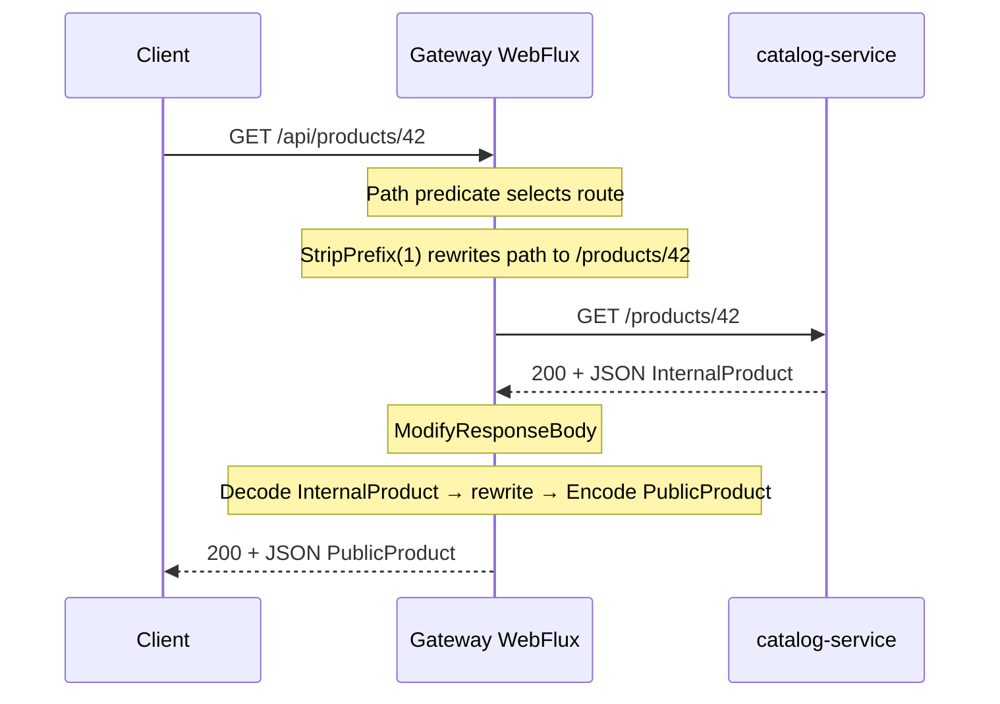

# ModifyResponseBody via Java DSL and Response Payload Transformation

## 1. Why Transform an HTTP Response Body at the API Gateway?

In a microservices architecture, **Spring Cloud Gateway** serves as the common entry point: selecting routes with predicates, applying filter chains to modify paths/headers, resolving service instances via discovery, and enforcing authentication, rate limiting, circuit breakers, retries, TLS, and metrics/tracing. Beyond forwarding requests, the Gateway sometimes needs to **transform response data** before returning it to the client.

For example, `catalog-service` returns JSON:

```json
{
  "id": "42",
  "name": "Wireless Headphones",
  "priceCents": 2499000,
  "internalCostCode": "COST-TIER-B"
}
```

A mobile client only needs:

```json
{
  "id": "42",
  "displayName": "Wireless Headphones",
  "priceCents": 2499000
}
```

**`ModifyResponseBody`** enables the Gateway to decode the upstream HTTP response body, invoke a transformation function you write, and re-encode the body before sending it to the client. In this example, the Gateway **renames `name` to `displayName`** and **excludes `internalCostCode` from the public DTO**.

This lesson belongs to the **HTTP Body Handling** chapter of the **SPRING_CLOUD_GATEWAY** module. After completing it, you will be able to:

1. Distinguish the paths of the **request body** and **response body**.
2. Declare `ModifyResponseBody` using the **Java `RouteLocatorBuilder`** on Gateway Server WebFlux.
3. Understand the roles of `inClass`, `outClass`, `RewriteFunction`, and `Mono`.
4. Convert an internal JSON DTO to a client DTO, transform plain text, and handle empty response bodies.
5. Verify status codes, `Content-Type`, `Content-Length`, decode errors, large responses, and streaming.
6. Place body transformations properly alongside authentication, caching, retries, circuit breakers, TLS, and observability.

> **Version scope:** Primary examples target **Spring Cloud Gateway Server WebFlux 5.0.x** running with a compatible Spring Boot/Spring Cloud BOM. Gateway Server Web MVC has a filter of the same name with a **different Java API**, compared in Section 9. In the 4.x line, starter names, config namespaces, and related APIs may differ; always consult documentation for the exact version pinned in your project.

## 2. Where Does ModifyResponseBody Sit in the Processing Flow?

`ModifyResponseBody` is a **route-specific GatewayFilter**. It intercepts the body **after the upstream generates a response** and **before the response is sent to the client**.



| Task | Primary Filter/API | Direction |
|---|---|---|
| Change request path | `StripPrefix` / `RewritePath` | Client → upstream |
| Add request header | `AddRequestHeader` | Client → upstream |
| **Change response body** | **`ModifyResponseBody`** | Upstream → client |
| Change response header | `AddResponseHeader` / `SetResponseHeader` | Upstream → client |
| Change request body | `ModifyRequestBody` | Client → upstream |

Filter ordering includes both a **pre-phase** and a **post-phase** around calling upstream. `ModifyResponseBody` uses a response decorator mechanism to transform content as it is written to the client; declaring it on a route **does not send a new request body to the backend**. If predicates do not match or a prior filter short-circuits (for example, a rate limiter returning 429), the downstream response-transformation pipeline may not execute.

### 2.1. Why Is Java DSL Required?

`ModifyResponseBody` accepts a **body transformation function** provided by the developer. Spring Cloud Gateway WebFlux documentation states that this filter is **only configurable via the Java DSL**:

```java
.modifyResponseBody(
    String.class,           // Body type when reading upstream response
    String.class,           // Body type encoded and sent to client
    (exchange, original) -> // Reactive rewrite function
        original == null
            ? Mono.empty()
            : Mono.just(original.toUpperCase(java.util.Locale.ROOT)))
```

This Java lambda cannot be expressed with a plain YAML line like `- ModifyResponseBody=...`. YAML can still hold **other configuration** such as application port, simple routes, and timeouts; however, routes using `ModifyResponseBody` in this lesson must be defined with a `@Bean RouteLocator` and `RouteLocatorBuilder`.

### 2.2. Parameters to Understand

| Component | Meaning | Common Mistake |
|---|---|---|
| `inClass` | Java type used by the codec to **read** the upstream response: e.g., `String.class` or `InternalProduct.class` | Picking a DTO that does not match the actual JSON |
| `outClass` | Java type of the transformed value to **write** to the client response | Changing the data structure while leaving `outClass` incompatible |
| `exchange` | `ServerWebExchange` context: request, response, attributes/route | Logging tokens or trusting unauthenticated client input |
| `original` | Decoded body, which may be **`null`** when upstream returns no body | Calling methods on `null` and throwing an error |
| Return value | `Mono<outClass>`, completing asynchronously | Returning `null` instead of `Mono.empty()`; calling `block()` on the event loop |

**`Mono.empty()`** signals a publisher that completes **without emitting a body**. It differs from `Mono.just("")` (an empty `String` body) and from JSON `null` serialized as four text bytes. For HTTP `204 No Content` and `304 Not Modified`, respect the rule of **sending no body**.

## 3. Hands-On Lab: Transforming a JSON DTO at the Gateway

### 3.1. Preparing Two Applications

| Application | Port | Key Dependency | Role |
|---|---:|---|---|
| `catalog-demo` | 8081 | Spring Web MVC from Spring Initializr | Backend returning internal DTO |
| `gateway-demo` | 8080 | `spring-cloud-starter-gateway-server-webflux` | Routing, path rewrite, and response rewrite |

Create each application via [Spring Initializr](https://start.spring.io/) with **Java 17+**, choosing a Spring Boot version compatible with your Spring Cloud BOM. Use the WebFlux starter on the Gateway; do not add the Servlet MVC starter to the Gateway unless an explicit architectural requirement calls for it.

The key dependency in **`gateway-demo`**'s `pom.xml`, with versions managed by the Spring Cloud BOM:

```xml
<dependency>
    <groupId>org.springframework.cloud</groupId>
    <artifactId>spring-cloud-starter-gateway-server-webflux</artifactId>
</dependency>
```

Spring Boot reactive codecs must be able to serialize/deserialize JSON; Spring Initializr with the standard JSON stack usually includes Jackson automatically. If you use custom dependency setups or a different mapper, verify the codec is registered.

### 3.2. Writing the Sample Backend

In the **catalog-demo** project, create `src/main/java/com/example/catalog/CatalogApplication.java`:

```java
package com.example.catalog;

import org.springframework.boot.SpringApplication;
import org.springframework.boot.autoconfigure.SpringBootApplication;
import org.springframework.http.ResponseEntity;
import org.springframework.web.bind.annotation.GetMapping;
import org.springframework.web.bind.annotation.PathVariable;
import org.springframework.web.bind.annotation.RestController;

@SpringBootApplication
@RestController
public class CatalogApplication {

    public static void main(String[] args) {
        SpringApplication.run(CatalogApplication.class, args);
    }

    @GetMapping("/products/{id}")
    public ResponseEntity<InternalProduct> product(@PathVariable String id) {
        if (!"42".equals(id)) {
            return ResponseEntity.notFound().build();
        }

        return ResponseEntity.ok(
            new InternalProduct("42", "Wireless Headphones",
                                2_499_000L, "COST-TIER-B"));
    }

    public record InternalProduct(
        String id,
        String name,
        long priceCents,
        String internalCostCode
    ) {}
}
```

`application.yml` for **catalog-demo**:

```yaml
spring:
  application:
    name: catalog-demo
server:
  port: 8081
```

Start the backend application and test it directly:

```bash
# Inside the catalog-demo project directory:
./mvnw spring-boot:run

# In another terminal:
curl -i 'http://localhost:8081/products/42'
```

The expected JSON contains **all four fields**, including `internalCostCode`. The `/products/99` endpoint returns **404 with no response body**; this test case verifies that the rewrite function handles a `null` body safely.

### 3.3. Writing the Gateway with RouteLocatorBuilder and ModifyResponseBody

In the **gateway-demo** project, create `src/main/java/com/example/gateway/GatewayApplication.java`:

```java
package com.example.gateway;

import org.springframework.boot.SpringApplication;
import org.springframework.boot.autoconfigure.SpringBootApplication;
import org.springframework.cloud.gateway.route.RouteLocator;
import org.springframework.cloud.gateway.route.builder.RouteLocatorBuilder;
import org.springframework.context.annotation.Bean;
import org.springframework.http.HttpMethod;
import reactor.core.publisher.Mono;

@SpringBootApplication
public class GatewayApplication {

    public static void main(String[] args) {
        SpringApplication.run(GatewayApplication.class, args);
    }

    @Bean
    public RouteLocator productRoutes(RouteLocatorBuilder builder) {
        return builder.routes()
            .route("public-product", r -> r
                .path("/api/products/**")
                .and()
                .method(HttpMethod.GET)
                .filters(f -> f
                    .stripPrefix(1)
                    .modifyResponseBody(
                        InternalProduct.class,
                        PublicProduct.class,
                        (exchange, original) -> {
                            if (original == null) {
                                return Mono.empty();
                            }

                            // Include only fields permitted for public exposure.
                            PublicProduct result = new PublicProduct(
                                original.id(),
                                original.name(),
                                original.priceCents());
                            return Mono.just(result);
                        }))
                .uri("http://localhost:8081"))
            .build();
    }

    // DTO for reading JSON returned by catalog-service.
    public record InternalProduct(
        String id,
        String name,
        long priceCents,
        String internalCostCode
    ) {}

    // Public DTO exposed to clients.
    public record PublicProduct(
        String id,
        String displayName,
        long priceCents
    ) {}
}
```

`application.yml` for **gateway-demo**:

```yaml
spring:
  application:
    name: gateway-demo
server:
  port: 8080
```

**Observe how the components relate:**

1. `Path=/api/products/**` and `Method=GET` restrict the route to matching path/method requests.
2. `StripPrefix=1` turns `/api/products/42` into `/products/42` before calling `catalog-service`.
3. `uri("http://localhost:8081")` is the target backend; the Gateway connects and receives JSON.
4. `InternalProduct.class` tells the codec to decode upstream JSON into that DTO.
5. `(exchange, original) -> ...` copies only the three allowed fields into `PublicProduct` instead of manually manipulating raw JSON strings.
6. `PublicProduct.class` gives the codec the output type to serialize the new JSON response.
7. `original == null` is handled with `Mono.empty()` so no fake body is generated when upstream sends no body.

The backend and Gateway DTOs are **two independent classes** sharing the upstream JSON wire contract; there is no need for a compile-time dependency from the Gateway to the backend's source code. In real systems, manage API contracts and schema compatibility as backends evolve.

## 4. Verifying Results at the Client

### 4.1. Two Requests for the Same Product

Start the backend on `:8081` first, then the Gateway on `:8080`; run `curl`:

```bash
# Direct backend call (lab internal data).
curl -i 'http://localhost:8081/products/42'

# Call through the Gateway and ModifyResponseBody filter.
curl -i 'http://localhost:8080/api/products/42'
```

**Expected** response through the Gateway:

```http
HTTP/1.1 200 OK
Content-Type: application/json

{"id":"42","displayName":"Wireless Headphones","priceCents":2499000}
```

Compared to the upstream response, `internalCostCode` is absent from the body sent to the client. This is a **DTO schema** transformation, not a regex string search-and-remove.

> The code and responses shown here are **samples for learners to run locally**, not outputs captured from a live deployment. JSON field ordering, charset, and headers depend on your runtime version.

### 4.2. Testing a Bodyless Response

```bash
# Backend returns 404 without a body.
curl -i 'http://localhost:8081/products/99'

# Gateway matches route and receives 404 without a body from backend.
curl -i 'http://localhost:8080/api/products/99'
```

In the demo, the rewrite function receives `null` and returns `Mono.empty()`. Status **404** from the backend is preserved because the filter does not alter status codes; the client does not receive a bogus JSON like `{"id":null}`. If a real upstream returns a **custom JSON error body** with 404, decoding as `InternalProduct.class` may fail: you need a separate error-response policy (Section 6.3).

### 4.3. Testing Non-Matching Routes

```bash
# Does not match Path predicate; typically 404 if no other route matches.
curl -i 'http://localhost:8080/api/orders/42'

# Does not match Method=GET; typically 404 if no other route matches.
curl -i -X POST 'http://localhost:8080/api/products/42'
```

Declaring a filter on a route does not mean it runs on every request. Verify the route **matched** before investigating why a body did not change.

## 5. Plain Text Transformation: The Simplest Example

Before working with JSON DTOs, you can experiment with `text/plain` strings. Add the following endpoint to the **backend's `CatalogApplication`**:

```java
@GetMapping(value = "/text/greeting", produces = "text/plain")
public String greeting() {
    return "hello gateway";
}
```

Inside the **existing `productRoutes` bean**, add **another route** right after `public-product` and before `.build()`:

```java
.route("upper-text", r -> r
    .path("/api/text/**")
    .filters(f -> f
        .stripPrefix(1)
        .modifyResponseBody(
            String.class,
            String.class,
            (exchange, text) -> text == null
                ? Mono.empty()
                : Mono.just(text.toUpperCase(java.util.Locale.ROOT))))
    .uri("http://localhost:8081"))
```

This is a **continuation appended to the same `builder.routes()`**, not a standalone Java file or bean to paste on its own. After `StripPrefix(1)`, `/api/text/greeting` calls `/text/greeting` on the backend.

```bash
curl -i 'http://localhost:8081/text/greeting'
# Body: hello gateway

curl -i 'http://localhost:8080/api/text/greeting'
# Body: HELLO GATEWAY
```

Because both **input and output are `String`** and the backend declares `text/plain`, this example changes **content** without changing the media type representation. `Locale.ROOT` prevents host-locale dependency in case folding; it is still **not** a complete internationalization or localization strategy.

**Never apply this uppercasing trick to JSON**: running `toUpperCase` across an entire JSON string alters field names as well as values, breaking the schema clients expect. For structured JSON, prefer DTOs and JSON codecs as in Section 3.

## 6. Choosing the Right Data Types, Codecs, and Content-Type

`ModifyResponseBody` must **decode** the upstream body before running the rewrite function. Payload format and HTTP headers directly govern whether the codec succeeds.

| Upstream Response | Appropriate `inClass` | Illustrative `outClass` | What to Watch |
|---|---|---|---|
| `text/plain` with text body | `String.class` | `String.class` | Charset and locale; do not parse as JSON |
| `application/json` object | DTO or `JsonNode` if configured | Public DTO | Missing/wrongly typed fields, schema conventions, mapper config |
| `application/json` array | Appropriate collection type; may need advanced type reference | Collection/DTO | Avoid forcing a JSON array into a single object |
| `application/problem+json` | Error schema/`ProblemDetail` | Matching error schema | Do not try decoding errors as success DTOs |
| `204` / `304` with no body | Any, though body may be `null` | `Mono.empty()` | Never emit body bytes on no-content status codes |
| SSE/NDJSON streaming | Do not aggregate into a single DTO | Streaming mechanism | Preserving event boundaries, latency, backpressure |
| PDF, ZIP, images, gRPC/binary | Dedicated filter if any, or pass-through byte proxy | Never use JSON DTOs | Preserving `Content-Type`, `Content-Encoding`, HTTP/2 trailers |

### 6.1. Content-Type and Content-Length

In the **JSON → JSON demo**, upstream already returns `Content-Type: application/json` and the output is also JSON. The Java structure changes, while the **representation media type** stays the same.

If you convert **JSON → text/plain**, **XML → JSON**, or change the representation encoding, specify the **new `Content-Type`** via your Gateway version's API (some Java DSL overloads/configs provide `newContentType`), and test both input and output codecs. Never change the header to `application/json` if the actual body remains unformatted text.

Upstream **`Content-Length`** may no longer be accurate after transformation. The Gateway/response decorator updates the length or switches to chunked transfer encoding when writing the body; developers **must never copy the stale `Content-Length`** onto the new response. Verify with `curl -i` and a client that reads the full body, not just eyeballing printed JSON.

In addition, headers tied to the **exact previous content** such as `ETag`, `Content-MD5`, `Digest`, `Content-Range`, or specialized cache metadata can become invalid after rewriting. Depending on the mechanism, **strip or recompute** them and check consistency with `Cache-Control`, `Vary`, and conditional requests. For example, an `ETag` computed by the backend over internal JSON is not necessarily valid for the filtered JSON emitted by the Gateway.

### 6.2. Content-Encoding, Accept-Encoding, and Compression

Responses carrying `Content-Encoding: gzip` or Brotli contain **compressed bytes**, which cannot be treated directly as plain JSON/UTF-8 text. Depending on the HTTP client, codecs, and filters, the body may need decompression before rewriting and recompression afterward. If compression is misconfigured at the gateway, clients can encounter JSON errors, garbled output, or mismatched `Content-Length`.

In the lab, start with local HTTP and **uncompressed** responses. In production, test both requests with `Accept-Encoding: gzip` and without it, comparing final `Content-Encoding`/`Content-Type`/`Content-Length`. Never blindly strip `Content-Encoding` to “fix” an error while the body bytes are still compressed.

### 6.3. When Upstream Returns an Error or Non-Conforming Body

The lab's rewrite function reads into `InternalProduct.class`. That **works for successful product JSON**, but many backends return 400/500 error responses with a different shape:

```json
{
  "error": "PRODUCT_NOT_AVAILABLE",
  "message": "Cannot load product"
}
```

Never assume this error response can safely decode into `InternalProduct`. If required fields are absent or schemas clash, decoding can fail, causing the Gateway to return a different error than upstream's original response. There are three strategies depending on your requirements:

1. **Pass error responses through untouched** if your route/handler design can skip rewriting on errors and only transform success responses.
2. **Standardize a single response contract** across backends (e.g., an explicit status/data/error envelope) and model matching DTOs.
3. **Read the body as a general type like `String` or a JSON tree** and branch conditionally on status code, `Content-Type`, and schema, with thorough tests for every response kind.

In all cases, **check the actual HTTP status before constructing a success DTO**. Never silently emit valid-looking success JSON with status 500, nor overwrite status to 200 just to give the client a prettier body.

## 7. Performance, Streaming, and Memory Limits

### 7.1. The Response Body Is No Longer Proxied as a Pure Stream

A filter that must read the body into an object or string before modifying it typically needs to **aggregate/buffer the data**. Compared to a pure pass-through proxy forwarding sequential `DataBuffer`s, rewriting increases:

- **Memory** required to hold inbound bytes during decoding and the resulting Java objects.
- **CPU** spent parsing, mapping DTOs, and re-serializing.
- **Latency** before the client receives the complete body, especially for large responses.
- **Risk of hitting codec limits** under high request concurrency.

Therefore, never apply `ModifyResponseBody` by default to **video, images, large ZIP/PDF files, bulk downloads, Server-Sent Events (SSE), multi-item NDJSON, gRPC streaming, or WebSocket frames**. Those protocols and transfer modes have specific requirements for streaming, chunking, framing, trailers, and backpressure. Use streaming-aware mechanisms or perform transformations in the service owning the data.

### 7.2. `DataBufferLimitException`

When an aggregated body exceeds the codec's memory limit, you may see:

```text
org.springframework.core.io.buffer.DataBufferLimitException:
Exceeded limit on max bytes to buffer
```

In Spring Boot 4.0.x, the relevant codec memory property is **`spring.http.codecs.max-in-memory-size`**. Example for an application **handling only small JSON payloads**:

```yaml
spring:
  http:
    codecs:
      max-in-memory-size: 1MB
```

This is **not a “just raise it until the error goes away” knob**. The property applies to auto-configured WebFlux/WebClient codecs; in practice, separate configuration may be needed if the Gateway, HTTP client, or custom codecs do not read from that same source. Codec limits are **not a total application memory limit**: if 500 concurrent requests each buffer a 1MB body, total memory consumption is far higher due to objects and intermediate buffers.

Focus on **reasonable response size limits**, test responses near the boundary, configure timeouts, bound concurrent connections, and monitor heap/direct memory. The `RequestSize` filter governs **inbound requests**, not **upstream responses** being rewritten.

### 7.3. Never Block the Event Loop Inside `rewriteFunction`

`RewriteFunction` executes within the reactive pipeline. The following example is **unsuitable** for WebFlux when run directly on an event loop:

```java
// ANTI-PATTERN: this callback can block the event loop.
(exchange, product) -> {
    try {
        Thread.sleep(1000); // Blocking!
    } catch (InterruptedException ex) {
        Thread.currentThread().interrupt();
        return Mono.error(ex);
    }
    return Mono.just(product);
}
```

For pure DTO conversions, use **fast, deterministic, non-blocking** operations as in Section 3. If I/O is genuinely required, prefer **reactive** APIs or redesign to handle it in the backend. If calling a blocking library is unavoidable, isolate it on an appropriate scheduler with timeouts and concurrency bounds; never call `Mono.block()` or `Thread.sleep()` on the event loop.

### 7.4. Retries and Caching Can Alter Semantics

- **Retry:** when upstream fails or times out, the Gateway may re-invoke the backend per retry policy. Body transformation must be **side-effect-free** and ideally idempotent. Never automatically retry state-mutating POST requests without guaranteed idempotency.
- **Circuit breaker:** may return a fallback body with a different schema than `InternalProduct`; test both normal and fallback responses so a parse error does not mask the original fallback.
- **Response cache:** depending on whether a response cache sits before or after the rewrite filter, cached content may be the original or transformed payload. Align cache keys, `Vary`, ETags, and authorization; never cache one user's data and serve it to another.
- **Rate limiting:** typically rejects requests before upstream; do not treat `429` responses as matching the product JSON schema.

## 8. Security and Observability for Response Rewriting

### 8.1. Is DTO Transformation a Security Mechanism?

In our example, `PublicProduct` exposes only three fields, helping prevent **accidental** leakage of `internalCostCode` on this public route. However, if the backend exposes other routes, error messages, caches, debug endpoints, or file downloads containing that field, filtering one response does not secure the whole system.

**Security principles:**

- Treat the Gateway as **one defense-in-depth layer**, not a substitute for backends honoring API contracts and minimizing exposed data.
- Enforce access control with Spring Security/JWT/OAuth2/mTLS/ACLs; `ModifyResponseBody` performs neither authentication nor authorization.
- Never log tokens, cookies, passwords, or personal data inside `RewriteFunction`.
- Never construct responses based on client-supplied `X-User-Id`, `X-Tenant-Id`, or `Host` headers if those values have not been verified.
- If filtering data by tenant, test across multiple accounts, roles, response caches, 404/403 paths, and direct backend calls.

### 8.2. What Should You Observe?

| Signal Group | How to Collect | Why It Matters |
|---|---|---|
| Route ID and request ID | Structured logs, tracing | Identifies which route handled the request |
| Downstream HTTP status and response status | Metrics/traces, backend access logs | Separates upstream failures from rewrite failures |
| Input/output byte counts | Metrics or appropriate instrumentation | Detects unexpected response size growth |
| Decode/transform/encode duration | Per-route timers or custom instrumentation | Measures latency added by the filter |
| Codec/`DataBufferLimitException` counts | Error monitoring/alerts | Spots schema mismatches or oversized bodies |
| Timeout/cancellation rates | Reactor/Netty telemetry, load tests | Guards resources under high concurrency |

In a demo, you can temporarily enable selective debug logging:

```yaml
logging:
  level:
    org.springframework.cloud.gateway: DEBUG
```

In production, favor **route ID**, status code, latency, and size metrics; avoid logging **raw response bodies** because they may contain sensitive data. Enable TRACE/wiretap only in controlled environments with strict time and traffic limits.

## 9. Comparing WebFlux and Web MVC Java DSLs

Both **Gateway Server WebFlux** and **Gateway Server Web MVC** include `ModifyResponseBody` in the Spring Cloud Gateway documentation, but their **function signatures and declaration APIs differ**.

| Criterion | Server WebFlux | Server Web MVC |
|---|---|---|
| Runtime | Reactor Netty / reactive WebFlux | Servlet/WebMvc.fn |
| Java route declaration | `RouteLocatorBuilder` returning `RouteLocator` | `GatewayRouterFunctions.route` returning `RouterFunction<ServerResponse>` |
| Response rewrite usage | `GatewayFilterSpec.modifyResponseBody(...)` | `AfterFilterFunctions.modifyResponseBody(...)` |
| Callback | `(ServerWebExchange, body) -> Mono<out>` | MVC response handler function returning transformed body directly |
| YAML config for body-rewrite lambda | No YAML factory equivalent to Java callback | Also requires Java DSL |
| Packages/filter classes | `org.springframework.cloud.gateway.*` WebFlux | `org.springframework.cloud.gateway.server.mvc.*` |

### 9.1. A Java DSL Snippet on Server Web MVC

To illustrate the difference, here is a **separate example for a Gateway Server Web MVC application** proxying the `GET /text/greeting` text endpoint on backend `:8081`:

```java
import java.util.Locale;
import org.springframework.context.annotation.Bean;
import org.springframework.web.servlet.function.RouterFunction;
import org.springframework.web.servlet.function.ServerResponse;

import static org.springframework.cloud.gateway.server.mvc.filter.AfterFilterFunctions.modifyResponseBody;
import static org.springframework.cloud.gateway.server.mvc.filter.BeforeFilterFunctions.uri;
import static org.springframework.cloud.gateway.server.mvc.handler.GatewayRouterFunctions.route;
import static org.springframework.cloud.gateway.server.mvc.handler.HandlerFunctions.http;

@Bean
public RouterFunction<ServerResponse> upperTextMvc() {
    return route("upper-text-mvc")
        .GET("/text/greeting", http())
        .before(uri("http://localhost:8081"))
        .after(modifyResponseBody(
            String.class, String.class, null,
            (request, response, text) ->
                text == null ? "" : text.toUpperCase(Locale.ROOT)))
        .build();
}
```

This is an **illustrative `@Bean` method** to place inside an appropriate `@Configuration` or Spring Boot application class using the **Gateway Server Web MVC** dependency. `null` in the third argument of `modifyResponseBody` is the **new content type** parameter (unchanged here). This example assumes the backend **always returns a string**, so do not interpret returning `""` as handling HTTP `204/304`; add explicit handling if an endpoint may omit a body.

**Never copy** a WebFlux `Mono` callback into MVC or pass MVC's `RouterFunction<ServerResponse>` into WebFlux's `RouteLocatorBuilder`. These snippets are for comparison and represent **two separate implementations**.

## 10. Troubleshooting When Bodies Do Not Change or Responses Error

### 10.1. Ordered Diagnostic Checklist

1. **Confirm the request matched the route.** Check path, method, host, and route ID. A request that misses the route cannot trigger its filters.
2. **Confirm the backend works directly.** Call the upstream URL from the same network environment as the Gateway and check actual status and `Content-Type`.
3. **Inspect DTO/codec alignment.** Compare upstream JSON with `inClass` to spot missing/mistyped fields or error responses with a different schema.
4. **Inspect the callback.** Check `original == null`, avoid `Mono.just(null)` or `return null`, and verify there is no blocking code.
5. **Inspect final headers and body.** Compare `Content-Type`, `Content-Length`, `Content-Encoding`, body, and `ETag` between upstream and Gateway.
6. **Check other filters.** Retries, circuit breakers, response caches, security chains, default filters, and route precedence can alter execution flow.
7. **Run performance checks.** Large bodies, high concurrency, compression, timeouts, connection cancellations, and streaming all require dedicated testing.

### 10.2. Common Failure Matrix

| Symptom | Possible Cause | Resolution Step |
|---|---|---|
| Route not found when calling Gateway | `Path` or `Method` mismatch, or Java `@Bean` route not registered | Check beans, Actuator route list, and incoming request |
| Body still contains internal JSON | A different route matched or filter not attached | Compare route ID and direct vs. Gateway responses |
| Gateway returns JSON decode error | `inClass` mismatches upstream schema or wrong `Content-Type` | Inspect raw upstream response, DTO, JSON codec, and status |
| `NullPointerException` in rewrite | Upstream sent no body; callback assumed non-null | Handle `original == null` and return `Mono.empty()` when appropriate |
| Gateway returns 5xx after backend error response | Error body has different schema than success DTO; rewrite failed parsing | Standardize error format or separate error-response handling |
| `DataBufferLimitException` | Buffered body exceeded codec limit | Reduce size, scope endpoints, measure concurrency, tune codec limit deliberately |
| Client receives truncated body or hangs | Stale `Content-Length` mismatch or transfer-encoding error | Do not copy old length; inspect response headers, compression, and chunking |
| Client reports response is not JSON | Output/`Content-Type` inconsistency | Align output type, codec, and `Content-Type` |
| Cache serves stale wrong-schema body | Incorrect ETag/cache key or response cache ordering | Regenerate/drop stale cache metadata; verify `Vary`, TTL, and auth |
| SSE delivers events very late | Rewrite aggregates body and breaks streaming | Disable body rewrite for SSE; use streaming-friendly filters |
| High CPU/heap under load | Decoding and encoding every response at Gateway | Measure response sizes, streamline DTOs, cap concurrency, or move transform to backend |
| Compression errors occur | Mismatch between `Content-Encoding` and body bytes | Test `Accept-Encoding`/compression end-to-end |

### 10.3. Inspecting Routes and Filters via Actuator

If you add `spring-boot-starter-actuator` to Gateway Server WebFlux, you can enable read-only access to the Gateway endpoint:

```yaml
management:
  endpoint:
    gateway:
      access: read-only
  endpoints:
    web:
      exposure:
        include: health,gateway
```

After startup:

```bash
curl -sS 'http://localhost:8080/actuator/gateway/routes'
curl -sS 'http://localhost:8080/actuator/gateway/routes/public-product'
```

Actuator proves that the route was **created and registered**; it **does not prove on its own** that a specific response was rewritten successfully. Combine it with **actual `curl` responses, backend logs, and request IDs**. Secure Actuator behind Spring Security and internal networks; never expose Gateway management APIs publicly.

## 11. Decision Criteria: Should Transformation Live at the Gateway?

| Problem | Is ModifyResponseBody Appropriate? | Reason |
|---|---|---|
| Rename a few small JSON fields for a public API | **Often appropriate** | Clear DTO mapping, low cost |
| Strip an internal field from a small API response | **Often appropriate** | Output DTO allowlist; still secure the backend |
| Adapt schemas for legacy clients during migration | **Often appropriate** | Time-bounded, versioned, backed by contract tests |
| Field mapping requiring multiple database queries | **Prefer handling in a service** | Avoid blocking I/O and heavy domain logic at the Gateway |
| Aggregating multiple upstreams into one view | **Consider a BFF/aggregation service** | Needs partial-failure handling, latency control, and caching |
| SSE streaming or large files | **Unsuitable for aggregating body rewrite** | Increases buffering, breaks streaming, hits memory limits |
| Blocking sensitive data accessible via other endpoints | **Insufficient** | Requires authorization and data minimization at the source |

**Design rule:** Keep the Gateway focused on its **entry-point role**: routing, edge policies, and lightweight compatibility adapters. Complex domain transformations belong in the **service owning the data** or a **Backend for Frontend (BFF)** when needed.

## 12. Practice Exercises

**Exercise 1 — DTO allowlist.** The backend adds `supplierEmail` to `InternalProduct`. Explain whether JSON returned to clients via `public-product` will contain the new field and under what conditions the overall design could still leak that data.

**Exercise 2 — Null body.** Why is the callback `original -> Mono.just(original.id())` risky when the backend returns `404` with no body? Write a safe version of the callback.

**Exercise 3 — Paths.** Given a route with `Path=/api/products/**` and `StripPrefix(1)`, determine the downstream path for `GET /api/products/42?lang=vi`. Does `ModifyResponseBody` strip the query parameter?

**Exercise 4 — Plain text.** Write `modifyResponseBody(String.class, String.class, ...)` to convert `"hello gateway"` to `"HELLO GATEWAY"`, emitting no body when upstream returns empty.

**Exercise 5 — Error status.** The backend returns `500` with JSON `{"error":"DB_DOWN"}`. Why can attempting to decode it into `InternalProduct` break the response? Propose a contract-clear error-handling approach.

**Exercise 6 — Content-Type.** The Gateway converts JSON to `text/plain`, yet the response header remains `application/json`. What client errors can occur? Which components must be configured and tested?

**Exercise 7 — Performance.** A route proxies a 40MB file through `ModifyResponseBody` with a 1MB codec limit. List three risks and an alternative design.

**Exercise 8 — Streaming.** A `text/event-stream` endpoint emits events every 2 seconds. If an aggregating body rewrite is attached, what can happen to event delivery timing at the client?

### Answer Hints

1. Because `PublicProduct` only declares three fields, `supplierEmail` will not appear in **this route's response body**; however, it could still leak through error responses, other routes, logs, or caches if those paths are unprotected.
2. When no body exists, the callback receives `null`; check `if (original == null) return Mono.empty();` before accessing fields.
3. The backend receives `GET /products/42?lang=vi`. `ModifyResponseBody` only modifies the **response** body and does not alter request query parameters.
4. `text == null ? Mono.empty() : Mono.just(text.toUpperCase(Locale.ROOT))`.
5. The 500 response uses an error schema different from the product DTO; separate error handling, standardize a response envelope, or branch conditionally by status and content type.
6. The client may feed plain text into a JSON parser and fail. Align `outClass`, codec, and the new `Content-Type`, and verify consistent `Content-Length`/encoding.
7. Risks include `DataBufferLimitException`, elevated heap/direct memory usage, and increased latency. Proxy streams/downloads with streaming-safe mechanisms or transform at the backend.
8. Clients may not receive events in real time because the response is buffered or connections stall; avoid aggregating body rewrites for SSE.

## Official References

- [Spring Cloud Gateway Server WebFlux 5.0 — ModifyResponseBody GatewayFilter Factory](https://docs.spring.io/spring-cloud-gateway/reference/5.0/spring-cloud-gateway-server-webflux/gatewayfilter-factories/modifyresponsebody-factory.html) — Java DSL syntax, `inClass`, `outClass`, and handling `null` bodies.
- [Spring Cloud Gateway Server WebFlux 5.0 — ModifyRequestBody GatewayFilter Factory](https://docs.spring.io/spring-cloud-gateway/reference/5.0/spring-cloud-gateway-server-webflux/gatewayfilter-factories/modifyrequestbody-factory.html) — distinguishing request vs. response directions.
- [Spring Cloud Gateway Server WebFlux 5.0 — How It Works](https://docs.spring.io/spring-cloud-gateway/reference/5.0/spring-cloud-gateway-server-webflux/how-it-works.html) — route matching, pre/post filter chains, and client responses.
- [Spring Cloud Gateway Server WebFlux 5.0 — Fluent Java Routes API](https://docs.spring.io/spring-cloud-gateway/reference/5.0/spring-cloud-gateway-server-webflux/fluent-java-routes-api.html) — `RouteLocatorBuilder` and Java route declarations.
- [Spring Cloud Gateway Server Web MVC 5.0 — ModifyResponseBody Filter](https://docs.spring.io/spring-cloud-gateway/reference/5.0/spring-cloud-gateway-server-webmvc/filters/modifyresponsebody.html) — MVC-specific Java DSL callback.
- [Spring Boot 4.0 — Common Application Properties](https://docs.spring.io/spring-boot/4.0/appendix/application-properties/index.html) — `spring.http.codecs.max-in-memory-size` and codec properties.
- [Spring Cloud Gateway Server WebFlux 5.0 — Actuator API](https://docs.spring.io/spring-cloud-gateway/reference/5.0/spring-cloud-gateway-server-webflux/actuator-api.html) — inspecting registered routes and filters.
