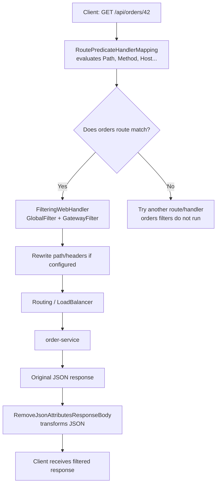

# RemoveJsonAttributesResponseBody and Removing JSON Fields

A microservice may reuse the same data object for multiple purposes: internal business processing, operational diagnostics, and returning results to client applications. If the backend inadvertently includes internal-only fields in a JSON response, clients can receive details outside the public API contract such as `internalNote`, `debugInfo`, or internal technical identifiers.

In **Spring Cloud Gateway Server WebFlux**, **`RemoveJsonAttributesResponseBody`** is a **GatewayFilter Factory** that **removes specified fields from JSON content in an HTTP response**. You can choose to remove fields only at the **root level** of the JSON, or enable the **recursive** option to match those field names across nested levels. This is a **gateway response-body transformation**: the backend still produces its original payload, while the client receives the filtered JSON when the request passes through a route configured with this filter.

This lesson belongs to the **HTTP Body Handling** chapter of the **SPRING_CLOUD_GATEWAY** module. It builds upon route-predicate routing, filter chains, path/header modifications, and service discovery, and connects to authentication, rate limiting, circuit breakers, retries, TLS, and observability when exposing APIs to web, mobile, or partner clients.

> **Version scope:** This lesson uses **Spring Cloud Gateway Server WebFlux**. Spring Cloud Gateway 5.x documentation places routes under `spring.cloud.gateway.server.webflux.routes`; many older 4.x releases use `spring.cloud.gateway.routes`. Verify the exact starter, version, and Server WebFlux vs. Server MVC flavor before applying. A shared feature name in documentation does not guarantee the exact factory or syntax exists in every environment.

## 1. The Problem: Backend Returns JSON with Undesired Fields

Suppose a client sends:

```http
GET /api/orders/42 HTTP/1.1
Host: api.example.test
Accept: application/json
```

The backend returns a JSON representation shared by processing and diagnostics:

```json
{
  "orderId": "ORD-42",
  "status": "PAID",
  "total": 125000,
  "internalNote": "reconciled on node-7",
  "debugInfo": {
    "node": "orders-7",
    "traceHint": "internal"
  },
  "customer": {
    "customerId": "C-19",
    "name": "An",
    "internalNote": "legacy-migration"
  },
  "items": [
    {
      "sku": "BOOK-1",
      "quantity": 2,
      "debugInfo": "stock-candidate-A"
    }
  ]
}
```

The public API only needs order details, customer info, and line items. The `internalNote` and `debugInfo` fields should not be exposed to the client. You can attach a filter to this API's route to strip those field names from the response body.

Two requirements must be **clearly distinguished**:

1. **Remove at root level only:** remove `internalNote` and `debugInfo` directly under the outermost JSON object; preserve fields with the same names inside `customer` or `items`.
2. **Recursive removal:** remove those field names inside nested JSON objects as well, as supported by the factory.

Picking the wrong mode can either leave internal data inside child objects or strip fields that legitimate clients depend on.

## 2. Where Does RemoveJsonAttributesResponseBody Operate?

In Spring Cloud Gateway's WebFlux architecture, a request is mapped to a route before running that route's gateway filters:



Logical flow:

1. **Route predicates** decide which requests are assigned to a route, such as `Path=/api/orders/**`.
2. The **Gateway filter chain** handles request operations on the way in and response operations on the way out.
3. **Routing/load balancing** forwards the request to the target service or instance per the route URI.
4. The **backend** produces the JSON response.
5. **`RemoveJsonAttributesResponseBody`** processes the response body and strips the configured attributes before the body reaches the client.

This filter **does not modify the request body**, **does not select routes**, **does not change the backend address**, and **does not authenticate users**. It focuses strictly on matching field names inside the **JSON response** of the active route.

Because gateway filters form an ordered reactive chain, a response returned early by a Spring Security `WebFilter` or an external proxy **may bypass the route's filters**. If any filter in the chain terminates the response early, verify execution order to know whether the body was transformed.

## 3. Configuration Syntax: Field List and the `recursive` Option

Per official documentation, the shortcut syntax is:

```text
RemoveJsonAttributesResponseBody=<field1>,<field2>,...,<recursive?>
```

Where:

| Component | Purpose | Example |
| --- | --- | --- |
| JSON field name | Attribute names to find and remove from JSON objects. | `internalNote`, `debugInfo` |
| Name list | Multiple field names separated by commas. | `internalNote,debugInfo` |
| Trailing `false` | Remove at root level only; this is also the default when omitted. | `internalNote,debugInfo,false` |
| Trailing `true` | Enable searching and removing those field names in nested levels. | `internalNote,debugInfo,true` |

Example from Spring documentation:

```yaml
filters:
  - RemoveJsonAttributesResponseBody=id,color
```

Removes only `id` and `color` at the **root level**.

Variant with the recursive parameter:

```yaml
filters:
  - RemoveJsonAttributesResponseBody=id,color,true
```

Intends to remove `id` and `color` **at every level** traversed by the factory within the JSON structure.

**Very important note:** The trailing `true` or `false` is a **mode flag**, not another JSON field name. Do not name fields to collide with flags or misplace arguments without checking how the framework parses the configuration.

### 3.1. Field Names Are Not JSONPath

The filter takes **attribute names**, not arbitrary JSON path selectors:

- `internalNote` is one field name.
- `debugInfo` is another field name.
- `customer.internalNote` **must not be assumed** to be an official way to remove only `internalNote` under `customer`.
- `items[*].debugInfo` is **not** JSONPath syntax supported by this factory's documentation either.

If you need to remove a field in **one specific branch** while keeping a same-named field in another branch, or transform based on values, use a backend DTO or a tested custom body transformation like `ModifyResponseBody`.

### 3.2. Do Not Confuse Attribute Names with Attribute Values

Example:

```json
{
  "internalNote": "hidden",
  "status": "internalNote",
  "message": "debugInfo"
}
```

With `RemoveJsonAttributesResponseBody=internalNote,debugInfo`, the goal is to **remove fields whose keys match**. The `status` and `message` fields **are not automatically removed merely because their string values happen to match a target field name**.

That is the difference between **structural JSON attribute filtering** and regex text replacement. Never simulate this filter with raw string search-and-replace over JSON, as doing so can corrupt valid data or escaped strings.

## 4. Default Mode: Removing Fields at Root Level Only

Given the JSON response from Section 1, applying:

```yaml
filters:
  - RemoveJsonAttributesResponseBody=internalNote,debugInfo
```

produces this illustrative result:

```json
{
  "orderId": "ORD-42",
  "status": "PAID",
  "total": 125000,
  "customer": {
    "customerId": "C-19",
    "name": "An",
    "internalNote": "legacy-migration"
  },
  "items": [
    {
      "sku": "BOOK-1",
      "quantity": 2,
      "debugInfo": "stock-candidate-A"
    }
  ]
}
```

Both direct root-level fields are gone:

- `internalNote` on the outermost object.
- `debugInfo` on the outermost object.

However, the same-named fields **inside** `customer` and the `items` element remain. Therefore, default mode is only appropriate when you are certain the unwanted fields **only appear at the root** or when business requirements intentionally keep child object values.

Spring Cloud Gateway documentation explicitly states the default flag is `false`; do not assume that simply listing field names makes the framework traverse nested objects automatically.

### 4.1. Should You Always Use Root-Only?

**Advantages:**

- Narrow blast radius, easy to predict.
- Lower risk of accidentally deleting attributes that share a name but have legitimate meaning inside nested objects.
- Fits simple JSON wrappers with internal metadata at the root.

**Risks:**

- Unwanted fields may sit inside nested objects, maps, or array elements.
- If the backend refactors its JSON structure and moves a sensitive field down one level, root-only policy will miss it.

Choose root-only only after auditing actual response structures and data contracts.

## 5. Recursive Mode: Removing Fields Across Multiple Levels

To look for those field names at nested levels, append `true` at the **end of the list**:

```yaml
filters:
  - RemoveJsonAttributesResponseBody=internalNote,debugInfo,true
```

With the JSON from Section 1, the expected result is:

```json
{
  "orderId": "ORD-42",
  "status": "PAID",
  "total": 125000,
  "customer": {
    "customerId": "C-19",
    "name": "An"
  },
  "items": [
    {
      "sku": "BOOK-1",
      "quantity": 2
    }
  ]
}
```

The `true` flag is documented as removing attributes at **any level** in the JSON structure. When implementing, still test nested objects and array elements on your **specific framework version** to confirm exact behavior.

### 5.1. Risk of Over-Broad Removal

Suppose an order API response contains:

```json
{
  "orderId": "ORD-42",
  "customer": {
    "id": "C-19"
  },
  "items": [
    {
      "id": "LINE-11"
    }
  ]
}
```

If you configure:

```yaml
filters:
  - RemoveJsonAttributesResponseBody=id,true
```

every field named `id` in traversed objects can be stripped, including the **customer ID** or **line-item ID** that the client actually needs. This can prevent the client from correlating data or making follow-up API calls.

**Lesson:** Recursive mode does not distinguish an “internal field” from a “legitimate field” by position or type. It strictly matches the **configured field name**. Before enabling recursion, audit the entire JSON schema and all supported response variants.

## 6. Complete Route Example with Spring Cloud Gateway

Suppose the gateway exposes `GET /api/orders/42` while `order-service` serves `GET /orders/42`. You want to remove two internal fields before returning JSON:

### 6.1. Server WebFlux Configuration with the New Namespace

```yaml
spring:
  cloud:
    gateway:
      server:
        webflux:
          routes:
            - id: orders-public
              uri: lb://order-service
              predicates:
                - Path=/api/orders/**
                - Method=GET
              filters:
                - StripPrefix=1
                - RemoveJsonAttributesResponseBody=internalNote,debugInfo,true
```

Explanation:

1. `Path` and `Method` are **route predicates** determining which requests match.
2. `StripPrefix=1` removes the `api` segment so the backend receives `/orders/42`.
3. `lb://order-service` is a **logical target**, requiring Spring Cloud LoadBalancer and a configured instance registry to pick a real backend instance.
4. `RemoveJsonAttributesResponseBody=internalNote,debugInfo,true` processes the route's **JSON response**, not the inbound request body.
5. The client receives a JSON body with matching attribute names removed.

With `Method=GET`, a `POST /api/orders` request **does not match this route**. Do not expect the filter to remove fields from another route's response or from a handler responding before route selection.

**This is a learning example, not a complete data-leak prevention pattern.** When sensitive fields must be masked per authorization level, the backend must still control what data is emitted based on verified identity.

### 6.2. Common Namespace in Spring Cloud Gateway 4.x

In 4.x releases using the older namespace, the equivalent configuration looks like:

```yaml
spring:
  cloud:
    gateway:
      routes:
        - id: orders-public
          uri: lb://order-service
          predicates:
            - Path=/api/orders/**
            - Method=GET
          filters:
            - StripPrefix=1
            - RemoveJsonAttributesResponseBody=internalNote,debugInfo,true
```

Use **only one namespace** matching your application's version and starter. If the route fails to load or the framework reports an unknown factory, check your Spring Cloud Gateway dependency, Server WebFlux vs. MVC variant, and version-specific docs; never assume merely adding a filter name in YAML activates a feature.

### 6.3. Root-Only Configuration for Simpler Cases

If internal details only exist on the outermost object:

```yaml
filters:
  - RemoveJsonAttributesResponseBody=internalNote,debugInfo
```

This is generally the safer choice for **schema compatibility** when nested attributes with the same name are valid data. Conversely, if your goal is eliminating a sensitive field everywhere, carefully weigh the risks of recursive mode.

## 7. Distinguishing from Other HTTP Content-Modifying Filters

| Mechanism | Processing Direction | Purpose | Example |
| --- | --- | --- | --- |
| **`RemoveJsonAttributesResponseBody`** | Response body | Removes JSON attribute names at root or recursively. | Drop `internalNote` and `debugInfo` from client JSON. |
| **`ModifyResponseBody`** | Response body | Customizes decoding, mapping, and encoding with your own logic. | Restructure JSON, drop a field in one branch only, map DTOs. |
| **`ModifyRequestBody`** | Request body | Transforms client-sent content before downstream receives it. | Normalize inbound JSON. |
| **`RemoveResponseHeader`** | Response header | Deletes an HTTP header. | Remove `X-Internal-Node` from response. |
| **`RewriteResponseHeader`** | Response header | Rewrites a header value using an expression. | Normalize a response header. |
| **`DedupeResponseHeader`** | Response header | Deduplicates repeated response header values. | Clean up duplicate CORS headers. |
| **Backend DTO/serialization** | Backend | Controls which fields are emitted in the response at the source. | Return a public DTO free of internal metadata. |

**Key point:** A JSON field `internalNote` is not an HTTP header. Using `RemoveResponseHeader=internalNote` **does not remove** the `internalNote` property inside a JSON body. Conversely, `RemoveJsonAttributesResponseBody` **does not** strip `Set-Cookie`, `Server`, or `Location` headers, nor query-string values.

### 7.1. When Should You Use This Built-In Filter?

Suitable when:

- A few JSON attributes must be stripped consistently from a route's responses.
- The API contract is straightforward, uses standard JSON, and needs **name-based filtering**.
- Root-only or whole-structure recursive scope is acceptable.
- Every response variant traversing the route can be tested.

Prefer backend DTOs or `ModifyResponseBody`/custom transformation when:

- Fields must be selected by **JSON path**, data type, value, or authorization.
- The API uses varying representations, requires streaming, or handles large payloads.
- Complex structural mapping, field renaming, or multi-field combination is needed.
- Response shaping depends on user identity and scope.

**Never push core authorization logic into a filter simply because YAML config is quick.** Filtering JSON keys by name is a data transformation, not an access-control mechanism for permitting or denying resource access.

## 8. The Response Body in WebFlux Is a Data Stream

In Spring WebFlux, a response body is represented as a publisher of `DataBuffer`s, not a mutable Java `String` sitting in memory at all times. To strip JSON attributes, the gateway must process the body representation and re-emit the transformed response.

Consequently, modifying bodies carries different costs and constraints than modifying headers:

- **Memory:** for large responses or high concurrency, decoding/transforming JSON increases memory consumption. Never treat body transformations as zero-cost per-field streaming.
- **CPU:** parsing JSON, traversing structures, and re-serializing take CPU time.
- **Backpressure and lifecycle:** publishers must remain within the reactive chain; never call `subscribe()` or `block()` on the event loop to intercept responses.
- **Buffer limits:** some body-processing paths must aggregate data, making them subject to codec/buffer limits and errors on large payloads.
- **Content metadata:** when the body changes, length, encoding, caching headers, and body signatures may need adjustment or verification.

These are reasons to **benchmark performance and test response types**, rather than adding the filter blindly to all routes.

### 8.1. Content-Type and Body Formats

The filter is designed for **JSON content**. A real system may return:

- `application/json` with a standard JSON object.
- `application/problem+json` or a compatible JSON media type.
- `text/plain`, XML, HTML, or binary data.
- Bodyless responses such as `204 No Content`.
- A root-level JSON array, JSON scalar, or unexpected JSON structure.
- Compressed data, chunked transfers, or streaming such as `text/event-stream`.

**Never claim that all of these formats are handled identically by the filter.** Decoding, pass-through, or error behavior depends on the framework, content type, and exact version; test directly. For endpoints returning HTML, files, SSE, or binary payloads, avoid attaching JSON filters broadly.

If JSON arrays must be supported, test payloads with a root array, objects nested inside arrays, empty arrays, and target fields inside array elements. Documentation describes recursive removal across levels, but testing on your live runtime remains the standard for verifying API contracts.

### 8.2. Content-Length, Content-Encoding, ETag, and Response Signatures

Suppose the original response is:

```http
HTTP/1.1 200 OK
Content-Type: application/json
Content-Length: 410
ETag: "original-payload"
```

After stripping fields, the JSON is usually **shorter** and may be re-serialized. Consequences to verify:

1. **`Content-Length`** must match the final response bytes or be omitted so the HTTP stack uses an appropriate transfer mechanism. Never keep a stale length and expect clients to read the payload cleanly.
2. **`Content-Encoding`** such as `gzip`: determine which layer decompresses/recompresses the body; do not assume the filter handles every compression format.
3. **`ETag`** and body checksums/signatures: if computed from the original payload, they may no longer match the modified body.
4. **Cache headers and conditional requests:** `304 Not Modified` responses, gateway/CDN caches, and client caches must stay consistent with the emitted body version.
5. **Application signatures:** if clients verify a byte-for-byte signature over JSON, altering the body will invalidate the signature.

The framework may manage certain headers automatically during body modification depending on the filter/version, but **never assume all business metadata is updated automatically**. Inspect actual wire responses and caching/signing policies.

### 8.3. Filter Placement and Multiple Body-Modifying Filters

If a route combines `ModifyResponseBody`, `RemoveJsonAttributesResponseBody`, and response compression, the result depends on **ordering and how the response is written**. Response filters execute in a reactive chain; another filter may already have transformed or committed the response.

Recommendations:

- Start with **one clear owner** for JSON transformation whenever possible.
- Avoid stacking multiple filters that rewrite the same response body without understanding their execution order.
- Test the final end-to-end response rather than only testing each filter in isolation.
- Never let body rewriting stall response streaming or leak resources via unreleased `DataBuffer`s.

## 9. Security: Stripping JSON Fields Does Not Replace Authorization

Suppose a backend returns:

```json
{
  "orderId": "ORD-42",
  "customerId": "C-19",
  "internalNote": "do not disclose",
  "shippingAddress": "Private address"
}
```

If the gateway strips `internalNote` yet returns `shippingAddress` to a user not authorized to view that order, the system **still leaks data**. Dropping a few field names provides zero resource-level access control.

**Properly scoped protection layers:**

| Requirement | Appropriate Layer | Filter's Role |
| --- | --- | --- |
| JWT/session authentication | Spring Security at gateway/backend per architecture | Does not verify identity. |
| Authorization to view another user's order | Backend or layer with trusted authorization context | Does not decide who may read resources. |
| Defining public response structure | Backend DTO/serialization or API layer | Can assist by filtering fixed field names. |
| Request rate limiting | `RequestRateLimiter` or equivalent policy | Does not enforce RPS limits. |
| Reducing internal metadata exposure | Backend and field/header removal filters | Can strip some metadata from JSON responses. |
| Error/latency monitoring | Metrics, tracing, logs free of sensitive data | Does not provide full observability on its own. |

### 9.1. Why a DTO Allowlist Is Safer Than a Field Blocklist

`RemoveJsonAttributesResponseBody` works as a **field-name blocklist**: you list fields to drop. When the backend adds a new sensitive field named `secretKey`, a filter configured only for `internalNote` and `debugInfo` **will not automatically know** to remove `secretKey`.

For APIs handling personal data, financial details, or authorization state, the stronger pattern is:

1. The backend builds a **public DTO** with an explicit **allowlist** of fields permitted for output.
2. The backend enforces **access control** per user and resource.
3. The gateway enforces edge policies like authentication, rate limiting, and supplementary metadata filtering where genuinely needed.
4. Integration tests verify **no sensitive fields appear** in any response across all protected routes.

Name-based removal is a convenient helper layer, **not your sole line of defense**. Another route, an exposed internal endpoint, or a misrouted request could bypass that filter.

### 9.2. Recursion Can Corrupt Valid Data

A field name like `id`, `code`, or `token` can carry different meanings in different branches. For instance, `token` in a login response might be the access token meant for the client, whereas `token` inside a nested internal object must stay hidden. Recursive removal by **exact name** cannot tell them apart.

For selective removal, it is better to reshape the response at the source or use a tested conditional transformation instead of deleting every matching attribute everywhere.

### 9.3. Never Log Original Payloads

When debugging this filter, avoid logging full before/after JSON, especially responses carrying tokens, personal data, or payment details. Log instead:

- Route ID and correlation/trace ID.
- HTTP status and latency.
- Response sizes before/after via safe byte counts without content.
- Decode/body-transformation error counts.

Never add “full body” logging merely to prove a sensitive field was removed; logs themselves become a data-leak vector.

## 10. Hands-On Testing with a Mock Backend

To prove the filter works, use a backend returning JSON **that actually contains the fields to be removed**. Calling an API without those fields and seeing `200` proves nothing.

### 10.1. Preparing a Deterministic Response

Suppose a mock backend listens on `http://localhost:9090` and returns:

```json
{
  "orderId": "ORD-42",
  "internalNote": "root",
  "customer": {
    "name": "An",
    "internalNote": "nested"
  }
}
```

Test route configuration:

```yaml
spring:
  cloud:
    gateway:
      server:
        webflux:
          routes:
            - id: orders-test
              uri: http://localhost:9090
              predicates:
                - Path=/api/orders/**
              filters:
                - StripPrefix=1
                - RemoveJsonAttributesResponseBody=internalNote,true
```

The mock backend should serve `/orders/42` since `StripPrefix=1` strips `api`. Assume the Gateway listens on `http://localhost:8080`.

### 10.2. Calling Through the Gateway

```bash
curl -i http://localhost:8080/api/orders/42 \
  -H 'Accept: application/json'
```

When the route and filter work properly, the structurally received body is:

```json
{
  "orderId": "ORD-42",
  "customer": {
    "name": "An"
  }
}
```

**Do not depend on whitespace or object key ordering** in JSON assertions; parsing and re-serialization can change formatting without altering data. Assert **presence/absence of JSON properties**, not raw string equality unless byte-for-byte layout is required.

### 10.3. Switching to Default Mode to Compare

Change the filter:

```yaml
filters:
  - RemoveJsonAttributesResponseBody=internalNote
```

Expected result in root-only mode:

```json
{
  "orderId": "ORD-42",
  "customer": {
    "name": "An",
    "internalNote": "nested"
  }
}
```

This is a critical check to catch misunderstandings about the `recursive` flag.

### 10.4. Testing with WebTestClient

In an integration test running the Gateway and a backend stub returning the JSON above, you can assert JSON paths:

```java
webTestClient.get()
    .uri("/api/orders/42")
    .exchange()
    .expectStatus().isOk()
    .expectHeader().contentTypeCompatibleWith(
        MediaType.APPLICATION_JSON
    )
    .expectBody()
    .jsonPath("$.orderId").isEqualTo("ORD-42")
    .jsonPath("$.internalNote").doesNotExist()
    .jsonPath("$.customer.internalNote").doesNotExist()
    .jsonPath("$.customer.name").isEqualTo("An");
```

*Prerequisite:* the test must run with **`recursive=true` configured**, a mock backend response containing the nested field, and an integration context that loads the Gateway filters. `WebTestClient` must be wired to the test environment; the snippet above shows assertions, not a full test class.

When testing default mode, replace the nested-attribute assertion with:

```java
// Applies when configured as root-only (no trailing true).
.jsonPath("$.customer.internalNote").isEqualTo("nested");
```

Also verify that **the backend was called exactly once** and received the expected request path. Mocking the response directly in a gateway controller without traversing the route/filter chain does not prove the factory works.

### 10.5. Test Matrix

| Scenario | What to Verify |
| --- | --- |
| JSON object with target field at root | Default mode removes root field and keeps others. |
| JSON object with same-named nested field | Root-only preserves nested; recursive strips nested per factory behavior. |
| JSON containing an array of objects | Test recursive traversal across array elements on your runtime version. |
| JSON without target field names | Response remains valid JSON; no unintended fields removed. |
| Similar field names, e.g. `internalNote` vs `internalNotes` | Only exact specified fields are removed; verify actual matching. |
| Root array, JSON scalar, or empty body | Test actual runtime behavior; do not extrapolate from root-object examples. |
| Backend returns `text/plain` or XML | Do not expect the JSON filter to act as with `application/json`. |
| Compressed or streaming responses | Verify compatibility; do not enable broadly without testing. |
| Responses with `Content-Length`, `ETag`, `Content-Encoding` | Final metadata matches the transformed body. |
| Route lacks filter or caught earlier by broad route | Never assume requests traversed the intended route's filters. |
| 4xx/5xx error responses containing JSON | Check whether filter ran or response originated outside/before gateway route. |

## 11. Troubleshooting Common Issues

### Issue 1 — Filter Does Not Remove Fields Inside Nested Objects

**Symptom:** root-level `internalNote` is removed, while `customer.internalNote` remains.

**Possible cause:** configuration only specifies `RemoveJsonAttributesResponseBody=internalNote`, which defaults to **root-only**. If nested removal is desired, configure `RemoveJsonAttributesResponseBody=internalNote,true` and test.

### Issue 2 — Enabling Recursive Deletes Needed Fields

**Symptom:** client misses `id` inside array elements after enabling recursion.

**Possible cause:** `id` is a common field name across levels; the filter does not understand object-level semantics. Avoid removing `id` globally when clients need nested IDs. Use backend DTOs or structure-aware body transformations.

### Issue 3 — Request Matches Path, Yet Filter Does Not Run

**Symptom:** response still contains `debugInfo` despite the route declaring the filter.

**Check:** `Path`, `Method`, `Host`, `order` value, actual matched route ID, and runtime filter list. A broader route may intercept the request before the specific route, skipping the specific route's filters.

### Issue 4 — Wrong Namespace or Factory Not Found

**Symptom:** application reports `RemoveJsonAttributesResponseBody` cannot be found or the route fails to load.

**Check:** Spring Cloud Gateway version, Server WebFlux vs. Server MVC, starter dependency, config namespace, and version-matched factory docs. Never take documentation from one flavor and assume the same syntax works on another.

### Issue 5 — Malformed JSON Response or Wrong `Content-Length`

**Symptom:** client fails decoding, response truncates, checksum/ETag mismatches, or a proxy reports a body-framing error.

**Check:** `Content-Type`, `Content-Encoding`, empty/streaming bodies, other body-modifying filters, response metadata, and commit timing. Inspect actual wire response bytes. Never tweak headers manually without knowing what the framework already handled.

### Issue 6 — Backend Exposes Sensitive Data via Another Endpoint

**Symptom:** the order GET API is filtered, while an export API or admin endpoint still leaks full fields.

**Solution:** audit all routes and API contracts, protect endpoints at the backend, return public-safe DTOs, and enforce authorization. Never treat one route's filter as a system-wide data barrier.

### Issue 7 — Oversized Responses Cause Memory Pressure

**Symptom:** rising latency, buffer-limit exceptions, or memory pressure when exporting large reports through the gateway.

**Solution:** avoid applying body transformations to large files, downloads, or streams; filter at the backend, bound payloads, and measure latency and memory. For large datasets, an API emitting clean DTOs from the source is far more efficient than rewriting huge JSON at the edge.

### Issue 8 — Clients Depend on a Removed Field

**Symptom:** after rollout, older clients report missing fields even though HTTP status is `200`.

**Cause:** removing JSON attributes is a **response schema change**, potentially a breaking change. Align API contracts, client versions, API documentation, and regression tests before enabling the filter.

## 12. Operations: Observability, Performance, and Rollback

When promoting this filter to production, define clearly:

| Area | Metrics / Controls to Monitor |
| --- | --- |
| **Route matching** | Route ID, predicates, loaded configuration version. |
| **Performance** | RPS, p95/p99 latency, CPU, and memory during JSON transformation. |
| **Body-transformation errors** | Counts of decode/encode/buffer failures by status and route. |
| **Data correctness** | Contract tests for required present and absent fields. |
| **Security** | Audits ensuring sensitive fields do not leak on other routes. |
| **Caching and metadata** | `Content-Length`, `ETag`, encoding, and cache coherence post-transform. |
| **Recoverability** | Rolling back/disabling the filter via config, synced across all gateway replicas. |

Other concerns from the rest of the module still apply:

- **Authentication/authorization:** the gateway can authenticate requests via Spring Security, while the backend still enforces resource-level authorization; JSON filtering does not replace it.
- **Rate limiting:** prevent high-volume traffic or abusive clients from exhausting resources inside body transformations.
- **Retry/circuit breaker:** downstream calls may be retried or return errors/fallbacks; test whether final responses in those branches pass through the expected filters.
- **TLS:** protect data in transit across both client–gateway and gateway–backend hops; body filtering does not encrypt transport.
- **Observability:** track route ID, latency, and error rates without logging bodies containing sensitive data.

If the gateway runs multiple replicas, keep route/filter configuration synchronized across all replicas. If one replica has recursion enabled while another stays root-only, clients will randomly receive two different schemas depending on which gateway instance handles their request.

### 12.1. Recommended Rollout Workflow

1. **Define the public schema:** which fields clients may receive and which must be absent at every level.
2. **Test against a representative JSON suite:** root, nested objects, arrays, nulls, error responses, large bodies, and varied media types.
3. **Measure baseline:** latency, response sizes, and resource utilization before enabling the filter.
4. **Enable per route with narrow scope:** do not roll out globally without testing other APIs.
5. **Verify live contracts:** clients parse the transformed response cleanly and required URLs/IDs remain present.
6. **Monitor and prepare rollback:** if valid fields disappear or serialization errors appear, revert to the tested config and investigate before re-deploying.

## 13. Self-Check Knowledge Quiz

### Scenario A — Remove Root Field Only

Backend returns:

```json
{
  "debugInfo": "root-only",
  "item": {
    "debugInfo": "nested-still-needed"
  }
}
```

**Question:** Which configuration should you use?

**Answer:** `RemoveJsonAttributesResponseBody=debugInfo` (or explicitly specify the default `false` if supported by your version). Root `debugInfo` is stripped while `item.debugInfo` is preserved under root-only mode.

### Scenario B — Remove a Field Name at All Levels

Backend returns `internalNote` at the root, inside `customer`, and inside `items`. **What should you configure?**

**Answer:** `RemoveJsonAttributesResponseBody=internalNote,true`. Test nested objects and array elements on your active framework version.

### Scenario C — Remove Only `customer.id`

Response has `order.id` and `customer.id`; clients need `order.id` but must not see `customer.id`.

**Question:** Is `RemoveJsonAttributesResponseBody=id,true` suitable?

**Answer:** No. Recursing on `id` can delete both. Use backend DTO/serialization or a structure-aware body transformation that understands attribute paths.

### Scenario D — Returning XML Instead of JSON

An API returns `application/xml` while the route uses the JSON attribute filter. **Can you assume it still removes attributes?**

**Answer:** No. The filter is documented for JSON. Verify behavior on the actual media type or use an XML-appropriate solution.

### Scenario E — Clients Fail Due to Missing Fields

After enabling recursion, clients fail to read `id`. **What should you investigate first?**

**Answer:** Locate where `id` appears, check whether the filter matched too broadly by name, confirm which fields the API contract requires and which clients depend on them. Narrow the field list/mode or move filtering to the backend.

### Scenario F — Config Looks Right, Yet Sensitive Fields Still Appear

**Question:** Can you immediately conclude the filter is broken?

**Answer:** Not yet. Verify whether that route was actually selected, whether the filter is in the active chain, whether the response is JSON within scope, and whether a different handler or route served the request.

## 14. Key Takeaways

1. **`RemoveJsonAttributesResponseBody` processes JSON response bodies** by removing declared attribute names, not altering request headers or route predicates.
2. **Default is root-only:** `RemoveJsonAttributesResponseBody=internalNote,debugInfo` strips fields only at the root level.
3. **Recursive mode:** append `true`, e.g. `RemoveJsonAttributesResponseBody=internalNote,debugInfo,true`, to match those field names across nested levels.
4. **Not JSONPath and not authorization-aware:** filtering by name alone can miss newly added sensitive fields or strip legitimate fields sharing the same name.
5. **Response bodies are reactive streams:** check `Content-Type`, size, encoding, `Content-Length`, `ETag`, caching, and framework JSON handling.
6. **Secure at the source:** use public DTO allowlists and backend authorization for sensitive data; the gateway filter is a supplementary layer.
7. **Test end-to-end:** verify actual JSON properties, confirm route/backend execution, test both root-only and recursive modes, and monitor body-transformation errors before broad rollout.

**Practical Conclusion:** Use `RemoveJsonAttributesResponseBody` when you need **fast, consistent removal of a list of JSON field names** on a Spring Cloud Gateway route's responses. Choose root-only vs. recursive mode deliberately, understand API contract implications, and test actual JSON payloads. A secure gateway does more than hide a few body attributes—it also enforces authentication and authorization, manages traffic, protects TLS, and observes request flows without leaking data.

### References

- [Spring Cloud Gateway Server WebFlux — RemoveJsonAttributesResponseBody GatewayFilter Factory](https://docs.spring.io/spring-cloud-gateway/reference/spring-cloud-gateway-server-webflux/gatewayfilter-factories/removejsonattributesresponsebody-factory.html): attribute name list, root-only default, and recursive option.
- [Spring Cloud Gateway 4.2 — RemoveJsonAttributesResponseBody GatewayFilter Factory](https://docs.spring.io/spring-cloud-gateway/reference/4.2/spring-cloud-gateway/gatewayfilter-factories/removejsonattributesresponsebody-factory.html): example using the `spring.cloud.gateway.routes` namespace.
- [Spring Blog — Interesting new filters on Spring Cloud Gateway 4.0](https://spring.io/blog/2023/01/18/interesting-new-filters-on-spring-cloud-gateway-4-0/): background introducing the JSON attribute removal filter.
