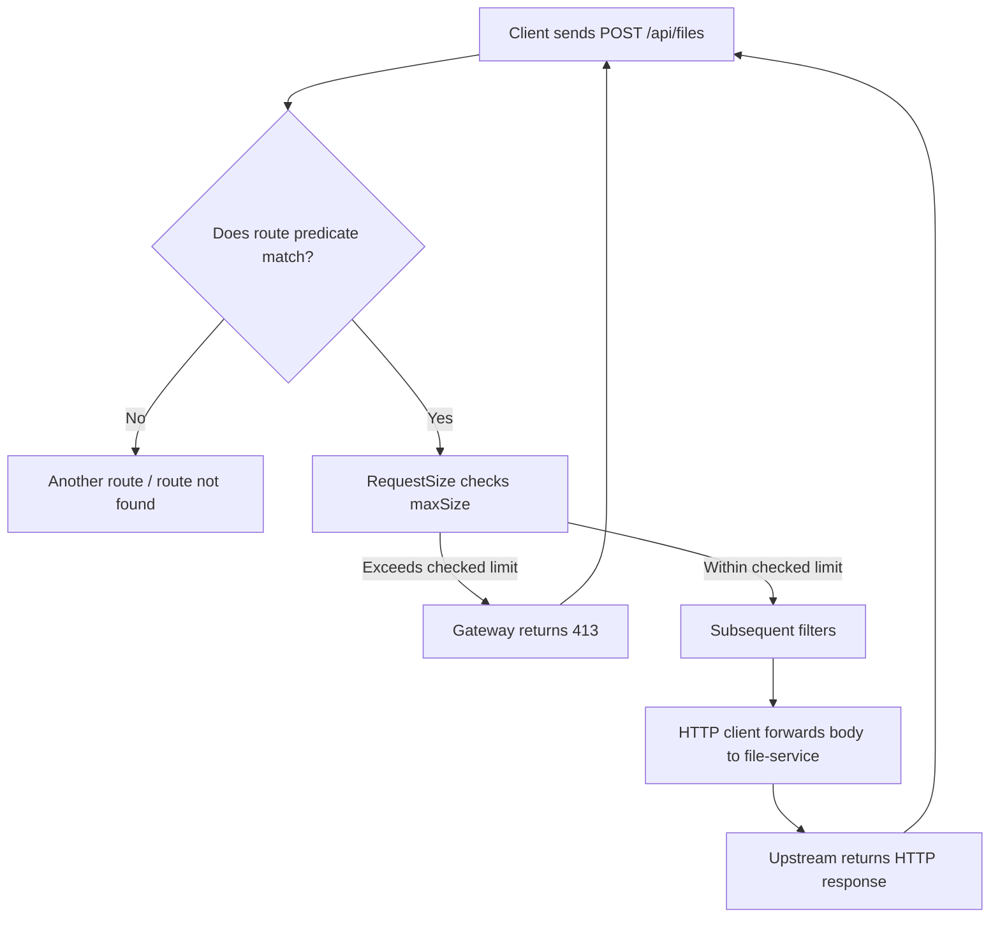
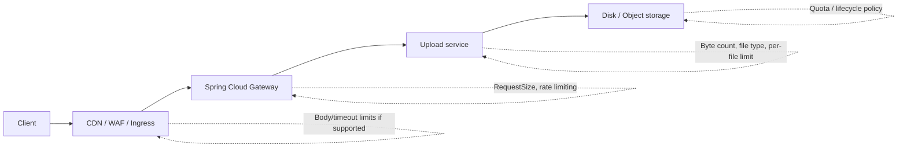

# RequestSize and Upload Size Limits

## 1. Why Does an API Gateway Need Request Size Limits?

In a microservices system, **Spring Cloud Gateway** serves as the common entry point receiving requests from web, mobile, or partner clients, matching **route predicates**, running the **filter chain**, and routing to the appropriate upstream service. Some requests carry small bodies, such as order-creation JSON; others carry images, PDFs, or import files spanning tens of megabytes.

Without size limits, a client can send an oversized body that forces the Gateway or target microservice to burn bandwidth, memory, connections, multipart-parsing CPU, and disk storage. When multiple requests arrive concurrently, resources can be exhausted quickly even at a modest requests-per-second rate.

**`RequestSize`** is a **GatewayFilter factory** in **Spring Cloud Gateway Server WebFlux** that lets you declare a `maxSize` limit per route. When a request exceeds the threshold under that Gateway version's checking mechanism, the filter rejects it instead of forwarding it to the target service, typically returning HTTP **413 Payload Too Large** (also called *Content Too Large* in newer specs).

This lesson belongs to the **HTTP Body Handling** chapter of the **SPRING_CLOUD_GATEWAY** module and focuses on:

1. Understanding `RequestSize`, `maxSize`, `DataSize`, and HTTP status 413.
2. Configuring per-route limits, especially for upload endpoints.
3. Distinguishing **request body size**, **uploaded file size**, **multipart overhead**, and other system limits.
4. Recognizing the limitation of `Content-Length` checks with HTTP streaming/chunked transfers.
5. Testing with `curl`, monitoring, and building defense-in-depth protections for a safe Gateway.

> **Version scope:** Primary examples follow **Spring Cloud Gateway Server WebFlux 5.x** using the `spring.cloud.gateway.server.webflux` prefix; a later section also illustrates the `spring.cloud.gateway` prefix common in WebFlux 4.x. Do not mix both styles in the same application. Spring Cloud Gateway **Server MVC** is a different flavor with its own configuration model.

## 2. Distinguishing Request Size from File Size

An HTTP request can include a method, URL, headers, and a body. When limiting uploads, ask **at which layer the limit applies and which bytes are measured**.

| Concept | Meaning | Example |
| --- | --- | --- |
| File size | Exact byte count of the file itself | 9 MiB for `photo.jpg` |
| HTTP body size | Total bytes in the body over the connection, including multipart metadata | Roughly 9 MiB plus per-part boundaries and headers |
| `Content-Length` | Header stating the HTTP message content's octet count when known upfront | `Content-Length: 1048576` |
| Request header size | Size of header fields; governed by a separate limit | Oversized headers or cookies |
| In-memory read/buffer limit | Bytes a codec or filter may aggregate in RAM | `spring.codec.max-in-memory-size` |
| Storage limit | File size a service writes to disk/object storage | Bucket quota, disk capacity, tenant quota |

**A 10 MiB file does not equal an exact 10 MiB multipart HTTP request.** With `multipart/form-data`, the body also contains boundaries and per-part metadata; thus, if the request limit is set to exactly 10 MiB, uploading a file right near 10 MiB can be rejected.

Similarly, a request may **lack** a known-upfront `Content-Length`, such as HTTP/1.1 `Transfer-Encoding: chunked` or certain HTTP/2 streams. In those cases, a filter checking only that header cannot know the total byte count before reading the entire body. This is an important constraint to verify on your version.

### Example Upload Request Payload

```http
POST /api/files HTTP/1.1
Host: api.example.test
Content-Type: multipart/form-data; boundary=----exampleBoundary
Content-Length: 7340032

[body containing boundaries, part headers, and file bytes]
```

The `Content-Length` header in this example represents the **body**, not solely the embedded file bytes. The bracketed placeholder is illustrative notation, not valid raw multipart syntax to send directly.

## 3. How Does RequestSize Work in the Filter Chain?

A route in Spring Cloud Gateway consists of:

- **Predicates:** select requests, such as `Path=/api/files/**`, `Method=POST`.
- **Filters:** enforce policies, such as `RequestSize`, `StripPrefix`, rate limiters, or header/path transformations.
- **URI:** upstream address, such as `http://localhost:8081` or `lb://FILE-SERVICE` when discovery/load balancing is enabled.

When the route matches and `RequestSize` is active, the Gateway compares the request size (as measured by that version's implementation) against `maxSize`. If it exceeds the threshold, the Gateway can **terminate the response right at the entry point**, without passing the request through downstream filters or upstream. If within the limit, the filter invokes the rest of the `GatewayFilterChain`.



**Note on wording:** “Within checked limit” does not prove *actual transmitted bytes* are always under `maxSize`. The guarantee depends on how `RequestSize` measures size, especially when a body is streamed without providing `Content-Length`.

### HTTP 413 and Response Details

When the filter rejects an oversized request, Spring Cloud Gateway documentation shows:

```http
HTTP/1.1 413 Payload Too Large
errorMessage: Request size is larger than permissible limit.
```

The `errorMessage` header may contain details on the actual size and the limit. Verify the **header name, content, format, and presence** on your actual runtime version; do not build clients that depend strictly on the English message string. HTTP status 413 is the primary signal for API callers.

`RequestSize` **does not automatically emit a structured JSON error body** like `application/problem+json`. If your product requires consistent error bodies, design error handling that fits the Gateway pipeline without accidentally buffering huge request bodies before rejecting them.

## 4. Configuring RequestSize in Spring Cloud Gateway Server WebFlux

### 4.1. Example Using the WebFlux 5.x Namespace

Suppose the Gateway accepts `POST /api/files/raw`, while the file service handles `POST /files/raw` at `http://localhost:8081`. We set a **10 MiB** limit on the upload route:

```yaml
spring:
  cloud:
    gateway:
      server:
        webflux:
          routes:
            - id: file-upload
              uri: http://localhost:8081
              predicates:
                - Path=/api/files/**
                - Method=POST,PUT
              filters:
                - name: RequestSize
                  args:
                    maxSize: 10MB
                - StripPrefix=1
```

Explanation:

1. `Path=/api/files/**` matches only requests under the file-upload API prefix.
2. `Method=POST,PUT` restricts the route to the two upload methods in this example.
3. `RequestSize` is the GatewayFilter factory name.
4. `args.maxSize: 10MB` sets the size threshold using Spring's `DataSize` type.
5. `StripPrefix=1` strips the `/api` segment, rewriting `/api/files/raw` to `/files/raw` when proxying.
6. `uri` points to the target service; in production, use environment-configured addresses or `lb://FILE-SERVICE` with `DiscoveryClient`/LoadBalancer configured.

This is a **standalone configuration example**. If the upload service needs JWT auth, rate limiting, TLS, timeouts, or circuit breakers, configure those components explicitly—they are not enabled automatically by `RequestSize`.

### 4.2. Example for Server WebFlux 4.x Projects

Projects using the older property layout place the same route definition under `spring.cloud.gateway.routes`:

```yaml
spring:
  cloud:
    gateway:
      routes:
        - id: file-upload
          uri: http://localhost:8081
          predicates:
            - Path=/api/files/**
            - Method=POST,PUT
          filters:
            - name: RequestSize
              args:
                maxSize: 10MB
            - StripPrefix=1
```

These two snippets differ only in **configuration namespace**; never declare both simultaneously as separate routes. During upgrades, check your Spring Boot version, Spring Cloud release train, and WebFlux Gateway starter to confirm which property prefix is supported; do not add both prefixes hoping one takes effect.

### 4.3. Environment-Driven Configuration

The limit can come from environment variables so the same JAR/container uses different values per environment:

```yaml
# Place inside the args of the RequestSize filter:
maxSize: '${GATEWAY_MAX_UPLOAD_SIZE:10MB}'
```

Linux/macOS example:

```bash
export GATEWAY_MAX_UPLOAD_SIZE=16MB
export SPRING_PROFILES_ACTIVE=staging
java -jar target/api-gateway.jar
```

PowerShell example:

```powershell
$env:GATEWAY_MAX_UPLOAD_SIZE = "16MB"
$env:SPRING_PROFILES_ACTIVE = "staging"
java -jar target/api-gateway.jar
```

`10MB` here is a learning fallback. In production, you can omit defaults to require the variable explicitly, enforce config-management policies, and verify the effective route limit. Never let clients dictate `maxSize` via an untrusted header.

### 4.4. Shorthand Syntax

A route can also use the factory's shortcut syntax:

```yaml
filters:
  - RequestSize=10MB
```

The explicit `name`/`args` form is usually easier to review, especially when a route chains many filters. **Use only one declaration style** per check; avoid accidentally stacking multiple `RequestSize` filters with different thresholds on the same route without an intentional design.

## 5. `DataSize`: Choosing the Right Unit and Threshold

`maxSize` uses Spring Boot's `DataSize` type, accepting raw byte counts or values with units such as `KB`, `MB`, and `GB`.

| Configuration Value | Meaning | Equivalent Bytes |
| --- | --- | --- |
| `1000000` | No suffix; defaults to bytes | 1,000,000 |
| `1MB` | 1 mebibyte under `DataSize` convention | 1,048,576 |
| `5MB` | 5 × 1,048,576 bytes | 5,242,880 |
| `10MB` | 10 × 1,048,576 bytes | 10,485,760 |
| `5000000` | Exactly 5 million bytes | 5,000,000 |
| `512KB` | 512 × 1,024 bytes | 524,288 |

When aligning with frontend/backend teams, state both units and exact bytes. Do not treat `5MB` and `5000000` as identical.

**Default value:** Spring Cloud Gateway documentation notes that if you **attach the `RequestSize` filter to a route** without specifying `maxSize`, the factory defaults to **5 MB**. This **does not mean every route in the Gateway is automatically capped at 5 MB** if the filter is not attached or no limit exists at another layer.

### Choosing Limits per API

No single threshold fits every endpoint:

| Endpoint Group | Example Selection Rule | What Must Be Confirmed |
| --- | --- | --- |
| Business JSON APIs | Smaller limit than upload endpoints | Actual JSON sizes, array counts, and decoders |
| Avatars/images | Few MB depending on product rules | Image file size plus multipart overhead |
| PDF documents | Limit driven by business requirements | Maximum size, frequency, and storage capacity |
| CSV imports | May require higher limit than typical JSON | Streaming/parsing strategy, row counts, CPU bounds |
| Large video uploads | Often requires a dedicated architecture | Capacity, chunk retries, resumable uploads, object storage |

For example, if the product permits files up to 10 MiB, you may need a **total HTTP request body limit slightly above 10 MiB** to accommodate multipart overhead. However, that headroom must never replace **per-file size validation** inside the backend service.

## 6. Critical Limitation: `Content-Length` and Streaming Uploads

### 6.1. What Happens When `Content-Length` Is Known Upfront?

An HTTP/1.1 request can send the header:

```http
POST /api/files/raw HTTP/1.1
Content-Type: application/octet-stream
Content-Length: 12582912
```

If the route configures `maxSize: 10MB`, this header declares a **12 MiB** body, exceeding 10 MiB. In `RequestSize` implementations relying on `Content-Length`, the Gateway can reject the request immediately before forwarding the body upstream, sparing downstream resources.

**However, a header is client-supplied metadata.** Never treat reading `Content-Length` as proof that every actual wire byte has been counted.

### 6.2. Chunked Transfers or HTTP/2 Without `Content-Length`

HTTP/1.1 can stream bodies with `Transfer-Encoding: chunked`; HTTP/2 can transmit DATA frames without declaring a total length upfront. In these situations, `Content-Length` may be absent.

There has been official discussion in the Spring Cloud Gateway project regarding versions of `RequestSizeGatewayFilterFactory` that **only inspect the `Content-Length` header** without counting total bytes on the body stream. When a client omits that header, the filter may **fail to block oversized requests** as operators expected.

Therefore, never guarantee that **`RequestSize=10MB` alone blocks every request above 10 MiB at the Gateway**. Before relying on it for resource protection:

1. Identify your exact **Gateway version** and verify the filter's runtime behavior.
2. Test requests with `Content-Length`, requests without `Content-Length`, HTTP/1.1 chunked requests, and HTTP/2 if your infrastructure supports it.
3. Verify **how many bytes upstream actually received**, rather than checking only for a 413 status on the client.
4. Enforce **stream byte-counting limits** at your ingress/reverse proxy or backend service when strict enforcement is required.
5. Configure bandwidth caps, upload timeouts, connection limits, and concurrency limits.

> **Practical warning:** this is not merely an edge case. Clients omitting `Content-Length` is completely normal HTTP streaming behavior. See [Spring Cloud Gateway issue #3843](https://github.com/spring-cloud/spring-cloud-gateway/issues/3843) regarding `Content-Length` checking limits; verify whether your version has changed this behavior.

### 6.3. Why Not Buffer the Entire Body Yourself Just to Measure It?

A custom `GatewayFilter` could try reading the body to count bytes, but **aggregating the entire body in memory before counting** backfires: the Gateway itself consumes RAM proportional to the upload size.

In WebFlux and Reactor Netty, the body is modeled as `Flux<DataBuffer>`. If a custom byte-counting filter is genuinely required, it must be **streaming**, handle cancellation/errors, preserve the downstream request body, respect backpressure, and manage `DataBuffer` reference counting properly. Building such a filter is its own engineering and testing effort; never slap in `DataBufferUtils.join(...)` and assume you have complete DoS protection.

Another way to offload the Gateway is **direct-to-object-storage uploads** using short-lived pre-signed URLs with file/chunk size policies. The Gateway only issues or validates upload authorization and processes metadata, avoiding proxying huge files through the Gateway entirely.

## 7. Do Not Confuse `RequestSize` with Other Limits

The following mechanisms solve **different** problems:

| Mechanism | What Does It Limit? | Does It Replace `RequestSize`? |
| --- | --- | --- |
| `RequestSize` GatewayFilter | Request size per filter/version mechanics | Primary topic, though may rely on `Content-Length` |
| `spring.codec.max-in-memory-size` | Bytes a codec may buffer in memory while decoding | **No**; not a general upload body limit |
| Service multipart limits | Per-file/part size, part count, file validity | **No**; separate service/business checks |
| Header size limit / `RequestHeaderSize` | Size of request headers | **No**; distinct from body size and usually different status |
| Ingress/reverse proxy body limit | Request size accepted at the edge proxy | **Complements** protection depending on proxy and config |
| HTTP client / upload timeout | Wait time and slow-upload duration | **No**; prevents holding connections open too long |
| Rate limiting / concurrency limit | Request rate or concurrent request count | **No**; a single huge request can still consume heavy resources |
| Service storage quota | File capacity saved on disk/object storage | **No**; prevents quota overrun or disk exhaustion |

### 7.1. `spring.codec.max-in-memory-size`

`spring.codec.max-in-memory-size` limits how much data certain WebFlux codecs can accumulate in memory during decoding. Exceeding it typically raises `DataBufferLimitException`.

Example:

```yaml
spring:
  codec:
    max-in-memory-size: 256KB
```

This is **not a “maximum 256 KB upload” setting** for every request passing through the Gateway. When the Gateway purely proxies a stream without decoding the body, this setting may not measure the upload at all. Conversely, when a filter caches/transforms the body or a handler uses codecs, memory limits apply at that decoding stage.

### 7.2. `spring.servlet.multipart.*` Does Not Configure a WebFlux Gateway

In Servlet-based Spring MVC apps, you may see:

```yaml
spring:
  servlet:
    multipart:
      max-file-size: 10MB
      max-request-size: 12MB
```

These properties belong to **Servlet multipart** support; do not copy them into **Spring Cloud Gateway Server WebFlux** expecting them to govern reactive uploads. If the target backend is Spring MVC, that backend can still use its own multipart settings; Gateway and backend are independent applications with separate responsibilities.

For WebFlux multipart handling, review the relevant reader/decoder settings, part limits, and file streaming behavior in your Spring Framework/Spring Boot version. No single property solves every large-file scenario.

### 7.3. A Small File Can Still Travel in a Large Request

A `multipart/form-data` request can carry multiple files/parts. A 20 MiB total body cap **does not guarantee** each file obeys a 5 MiB/file policy, and a 5 MiB/file cap **does not guarantee** the total request stays under 20 MiB when multiple files are attached. System design should validate **total request size**, **each part/file**, **part count**, content type, actual file format, and upload permissions.

## 8. Designing Multi-Layer Limits for Production

Think of an upload path as passing through multiple “gates”:



**Illustrative** thresholds for a business rule allowing files up to 10 MiB:

| Layer | Example Policy | Purpose |
| --- | --- | --- |
| Ingress | Body limit around 12 MiB and upload timeout | Block huge uploads as close to the edge as possible |
| Gateway route | `RequestSize=12MB` | Reject requests whose declared size exceeds threshold |
| Upload service | Count actual bytes read; max 10 MiB per file | Protect against streaming bodies lacking `Content-Length` |
| Multipart parser | Limit part count and metadata size | Prevent abuse via huge numbers of tiny parts |
| Storage | Per-user/tenant quota, real MIME inspection | Protect storage capacity and stored data integrity |

The 12 MiB numbers merely illustrate multipart headroom; measure actual overhead rather than copying values straight to production. If the ingress has a tighter limit than the Gateway, ingress rejects first and the 413 response may **lack the Gateway's `errorMessage`**. That is expected, but document it clearly in logs and API docs.

### 8.1. Safe Configuration of Supporting Controls

- **Authentication/authorization:** require JWT or equivalent auth so only authorized users can upload; the service still checks ownership of storage objects.
- **Rate limiting:** cap uploads per minute by trusted identity; never use a client-chosen header as the quota key.
- **TLS:** protect data across client → gateway and gateway → upstream per your trust model.
- **Timeouts and concurrency:** prevent slowloris uploads or excessive concurrent uploads from exhausting resources.
- **Retry/circuit breaker:** never assume retrying uploads is safe, especially if the service already wrote part or all of a file; use upload IDs/idempotency or resumable upload protocols where needed.
- **Observability:** track 413 counts, bucketed sizes, latency, active connections, and upstream errors; never log file contents or tokens.

A non-blocking **Reactor Netty** Gateway can hold many I/O connections concurrently, but it **does not automatically bound byte counts** and is not immune to slow senders, huge files, or filters that cache full bodies.

## 9. Testing `RequestSize` with `curl`

Assume the Gateway runs at `http://localhost:8080` with `maxSize: 10MB`, and upstream at `localhost:8081` exposes `POST /files/raw` or `PUT /files/raw` accepting binary bodies.

### 9.1. Generating Small and Large Payloads

On Linux/macOS, you can create dummy binary payloads strictly for testing:

```bash
# 1 MiB and 12 MiB; run in a dedicated test directory.
head -c 1048576 /dev/zero > upload-small.bin
head -c 12582912 /dev/zero > upload-large.bin
```

Never commit test binaries to Git and never test against real user data. Use a test host with sufficient memory/disk and delete temporary files afterward.

### 9.2. Testing When the HTTP Request Sends `Content-Length`

```bash
# 1 MiB body: within the 10MB limit.
curl -i --http1.1 \
  -H "Content-Type: application/octet-stream" \
  --data-binary @upload-small.bin \
  http://localhost:8080/api/files/raw

# 12 MiB body: exceeds limit when Gateway checks Content-Length.
curl -i --http1.1 \
  -H "Content-Type: application/octet-stream" \
  --data-binary @upload-large.bin \
  http://localhost:8080/api/files/raw
```

Expected behavior:

- For 1 MiB, `RequestSize` **does not reject for size**. Upstream may return `200`, `201`, `400`, `404`, `415`, etc., depending on the actual handler.
- For 12 MiB with `Content-Length` sent upfront, the Gateway is expected to return **413**.
- When blocked at the Gateway, upstream should **receive zero new requests** for the rejected attempt; verify upstream access logs or counters.

Note: some clients, proxies, or servers reset the connection early upon detecting an oversized body, causing `curl` to print connection warnings even though an HTTP status was returned. Focus on observed status codes, response headers, and logs at each hop.

### 9.3. Testing `multipart/form-data`

If upstream accepts multipart requests:

```bash
curl -i \
  -F "description=sample" \
  -F "file=@upload-small.bin;type=application/octet-stream" \
  http://localhost:8080/api/files/raw
```

This is a **different request** from a raw binary body: total multipart body size includes boundaries and part headers. An upstream accepting only `application/octet-stream` may return `415 Unsupported Media Type` or a parse error; that does not mean the filter failed.

To test right near the boundary, create a file slightly under `maxSize` leaving room for multipart overhead. Then increase size gradually and record the **actual** `Content-Length` sent by the client.

### 9.4. Testing Chunked Requests Without `Content-Length`

In a controlled test environment, test an HTTP/1.1 request using chunked transfer encoding:

```bash
curl -v --http1.1 \
  -H "Content-Type: application/octet-stream" \
  -H "Transfer-Encoding: chunked" \
  --data-binary @upload-large.bin \
  http://localhost:8080/api/files/raw
```

Before drawing conclusions, **inspect `curl`'s request header output** to verify `Content-Length` was genuinely omitted. If traffic passes through an ingress/proxy, that intermediary may buffer and re-add metadata before the Gateway sees the request.

**Do not assume 413 will automatically occur here.** If the Gateway lets the large request through because your filter version does not count stream bytes, you have uncovered a gap in your size-enforcement assumptions that must be closed by another layer. Verify whether upstream received data and stop the test once confirmed.

### 9.5. Recommended Test Matrix

| Case | Body | Header/Transport | What to Verify |
| --- | --- | --- | --- |
| B1 | 1 MiB | Exact `Content-Length` | Does an in-limit request reach upstream? |
| B2 | 12 MiB | Exact `Content-Length` | Does Gateway return 413 before proxying? |
| B3 | Near 10 MiB | Multipart with overhead | Is threshold evaluated on total body or file alone? |
| B4 | 12 MiB | HTTP/1.1 chunked, no Length | Does the filter actually count streaming bytes? |
| B5 | 12 MiB | HTTP/2, no Length if supported | Behavior under your deployed protocol |
| B6 | Small body | Different route without `RequestSize` | Is the policy properly scoped to the target route? |
| B7 | Oversized body | Through ingress instead of direct Gateway | Which layer generated 413? |
| B8 | JSON/stream via `ModifyRequestBody` | Filter transforms body | Does limit apply before or after transformation? |
| B9 | Two concurrent uploads | Each within per-request limit | Do concurrency/rate limits protect aggregate resources? |

Include **assertions on upstream request count and received byte count** in integration tests. Checking only for HTTP 413 does not tell you which layer blocked it or how many bytes reached the microservice.

## 10. Metrics, Handling 413, and API Contracts

### 10.1. How Should Clients Handle 413?

Upon receiving **413**, web/mobile frontends should explain the limit and ask users to choose a smaller file, compress/split files via a **system-supported protocol**, or switch to a dedicated upload flow. Never automatically retry the same oversized request, as that wastes load and will fail again.

An API team might standardize an error contract like:

```json
{
  "type": "https://api.example.test/problems/request-too-large",
  "title": "Upload payload exceeds limit",
  "status": 413,
  "detail": "The limit for this API is 10 MiB."
}
```

This is **not a default body guaranteed by `RequestSize`**; it is an example of how an application can standardize error responses. If consistent JSON error bodies are required, implement and test error handling carefully without inadvertently buffering entire oversized requests.

### 10.2. Observability at Gateway and Service

Track:

- HTTP **413 counts by route** and by rejecting component (ingress/Gateway/service), when distinguishable.
- Declared `Content-Length` by **bucket/range**, avoiding high-cardinality per-user metric labels.
- Active upload count, upload duration, inbound/outbound bytes, and connection counts.
- `400`/`413`/`429`/`500`/`503` error rates and p95/p99 latency.
- `DataBufferLimitException`, heap/direct memory pressure, queues, disk-full events, and timeouts.
- End-to-end request/trace IDs across hops to pinpoint which component rejected a call.

Avoid logging body contents, passwords, tokens, sensitive filenames, or query strings holding personal data. The filter's `errorMessage` header helps during debugging, though clients should not parse English message text to infer future limits.

### 10.3. Relation to Other HTTP Status Codes

| Status | Situation | Do Not Confuse With |
| --- | --- | --- |
| `413 Content Too Large` | Request body exceeded a layer's limit | HTTP 414 / 431 |
| `414 URI Too Long` | Path/URI exceeded limit | Oversized file upload |
| `415 Unsupported Media Type` | Service rejects the `Content-Type` | Oversized request |
| `431 Request Header Fields Too Large` | Request headers exceeded limit | Large multipart body |
| `400 Bad Request` | Malformed request or missing required data | Not necessarily a size limit |
| `401`/`403` | Authentication/authorization failure | `RequestSize` |
| `429 Too Many Requests` | Rate limit exceeded | Single oversized request |
| `503 Service Unavailable` | Upstream unavailable or proxy failure | Do not assume upload was too large |

HTTP statuses can originate from ingress, the Gateway, or the service. If a WAF blocks a request upstream of the Gateway, `RequestSize` never runs; inspect signals per layer instead of assuming every 413 came from Spring Cloud Gateway.

## 11. Common Configuration Mistakes

| Symptom | Possible Cause | What to Check |
| --- | --- | --- |
| 8 MiB file rejected under `8MB` limit | Multipart overhead pushes total body past 8 MiB | Check `Content-Length` and multipart framing |
| 12 MiB upload still hits upstream despite `maxSize: 10MB` | Request lacks `Content-Length` or filter did not run on route | Check protocol, route match, version, and chunked tests |
| 413 returned without `errorMessage` | Ingress/service returned error or version format differs | Compare responses and logs across each hop |
| Route returns 404/405 instead of 413 | Path/method predicate did not match | Check route definition, `StripPrefix`, and HTTP method |
| Even small requests hit memory errors | Custom filter/codec caching or aggregating bodies | Check `spring.codec.max-in-memory-size`, body filters, direct memory |
| Changing `spring.servlet.multipart.max-file-size` has no Gateway effect | Gateway uses WebFlux, not Servlet multipart | Configure limits in Gateway/WebFlux and backend separately |
| Raised `maxSize`, yet browser upload still fails | Ingress/backend/storage still enforces a lower limit | Check every layer and its response status |
| Client retries repeatedly on 413 | Retry policy or frontend retry does not classify errors | Stop retrying 413s; guide user to reduce size |
| Many small import requests overload system | `RequestSize` caps per-request size, not aggregate load | Add rate limiting, concurrency bounds, quotas, backpressure |
| 413 occurs after Gateway already sent body to service | Rejected by upstream or stream exceeded another layer's limit | Use traces, counters, and byte counts to pinpoint |
| After upgrade, `RequestSize` seems ignored | Namespace difference between WebFlux 4.x/5.x or Server MVC mix-up | Verify starter, namespace, and effective routes |

## 12. Practice Exercise: Upload Policies by API Type

**Scenario:** a system exposes two API groups:

- `POST /api/profiles/avatar`: avatar upload, max 3 MiB by **actual file size**.
- `POST /api/documents/upload`: PDF upload, max 10 MiB by **actual file size**.

Set **total HTTP request** limits at the Gateway slightly above the file sizes to allow reasonable overhead, while requiring each backend service to enforce **per-file size** and actual file-type validation.

**Illustrative** Gateway Server WebFlux 5.x configuration:

```yaml
spring:
  cloud:
    gateway:
      server:
        webflux:
          routes:
            - id: avatar-upload
              uri: http://localhost:8081
              predicates:
                - Path=/api/profiles/avatar
                - Method=POST
              filters:
                - name: RequestSize
                  args:
                    maxSize: 4MB
                - StripPrefix=1

            - id: document-upload
              uri: http://localhost:8082
              predicates:
                - Path=/api/documents/upload
                - Method=POST
              filters:
                - name: RequestSize
                  args:
                    maxSize: 12MB
                - StripPrefix=1
```

**Things you must verify yourself:**

1. Send payloads with `Content-Length` just below and just above each threshold.
2. Send `multipart/form-data` with files right near 3 MiB/10 MiB; measure actual overhead.
3. Send large payloads without `Content-Length`; verify whether upstream is actually protected.
4. Confirm the avatar service rejects files >3 MiB even when total body <4 MiB.
5. Confirm the document service rejects spoofed PDFs or files >10 MiB per policy.
6. Run concurrent uploads to observe bandwidth, memory, CPU, and timeouts.
7. Test JWT/authorization, user quotas, and idempotency if clients may re-upload.
8. Add ingress limits and ensure no upload route is left unprotected.

The 4MB and 12MB values are **not universal recommendations for every product**. In real systems, base thresholds on payload types, measured multipart overhead, network speeds, SLOs, user quotas, and security requirements.

### Pre-Production Checklist

- [ ] Clearly separated **file size** from **total request size** as two distinct limits.
- [ ] Used the correct `RequestSize` configuration namespace for your WebFlux version.
- [ ] Explicitly configured `RequestSize` on critical upload endpoints.
- [ ] Tested requests with `Content-Length`, chunked transfer, and HTTP/2 where supported.
- [ ] Enforced actual byte-counting limits in the service/ingress where strict body enforcement is required.
- [ ] Did not rely solely on `spring.codec.max-in-memory-size` or `spring.servlet.multipart.*`.
- [ ] Measured memory when combining with `ModifyRequestBody`, `CacheRequestBody`, or retry body replay.
- [ ] Verified 413 responses are not needlessly retried and frontends display clear guidance.
- [ ] Bounded concurrent uploads, connection durations, and upload rates.
- [ ] Prevented bodies/tokens/sensitive filenames from leaking into logs; kept metric labels low-cardinality.
- [ ] Enforced per-file limits, file-type validation, quotas, and malware scanning where required.
- [ ] Verified ingress/CDN and upstream layers so the source of any 413 is unambiguous.

## 13. Summary

**`RequestSize`** is the GatewayFilter used to establish per-route request size limits in **Spring Cloud Gateway Server WebFlux**, configured with a `DataSize` `maxSize`. When it detects a request exceeding the threshold, the Gateway can respond with **413** and an error header without forwarding the request upstream. If the filter is enabled without specifying `maxSize`, Spring documentation notes a **5 MB** default.

However, some versions of `RequestSize` primarily inspect **`Content-Length`** and do not automatically count streamed bytes for chunked or HTTP/2 requests lacking a known upfront length. That is why you must **test with real requests** and enforce complementary limits at ingress and backend services whenever strict protection is required.

When building a secure API Gateway for microservices, combine `RequestSize` with **route predicates**, header/path filters, **Spring Security**, **rate limiting**, **timeouts**, **controlled circuit breakers/retries**, **TLS**, backend upload validation, and **observability**. A multi-layered approach protects both the Gateway and upstream services instead of relying on a single size check.

### References

- [Spring Cloud Gateway Server WebFlux — RequestSize GatewayFilter Factory](https://docs.spring.io/spring-cloud-gateway/reference/spring-cloud-gateway-server-webflux/gatewayfilter-factories/requestsize-factory.html).
- [Spring Cloud Gateway — Issue #3843: RequestSize and Content-Length](https://github.com/spring-cloud/spring-cloud-gateway/issues/3843).
- [Spring Boot — Externalized Configuration and DataSize](https://docs.spring.io/spring-boot/reference/features/external-config.html).
- [MDN — HTTP 413 Content Too Large](https://developer.mozilla.org/en-US/docs/Web/HTTP/Reference/Status/413).
