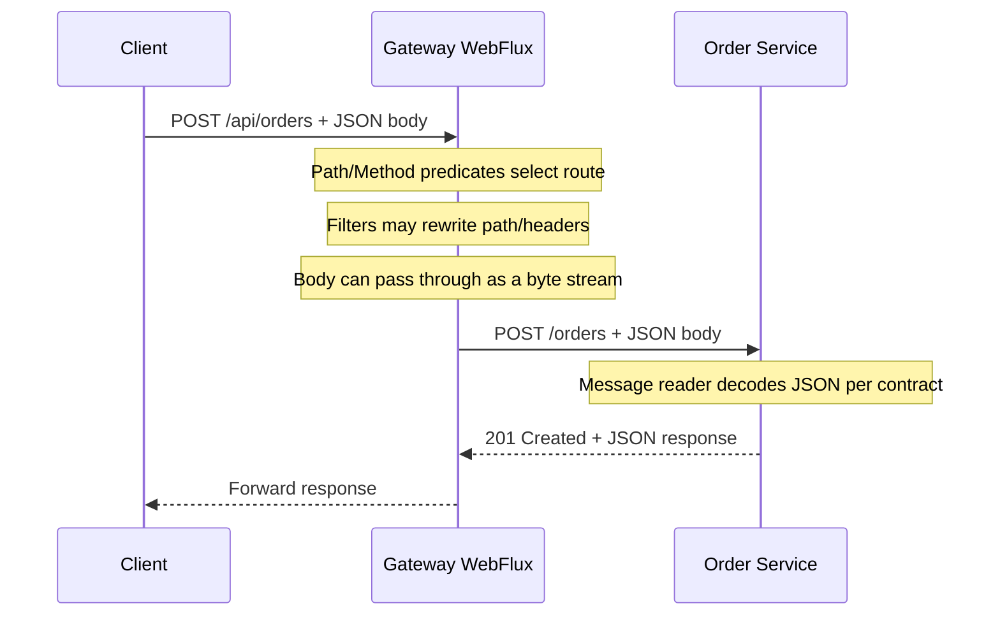
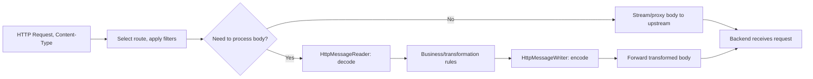
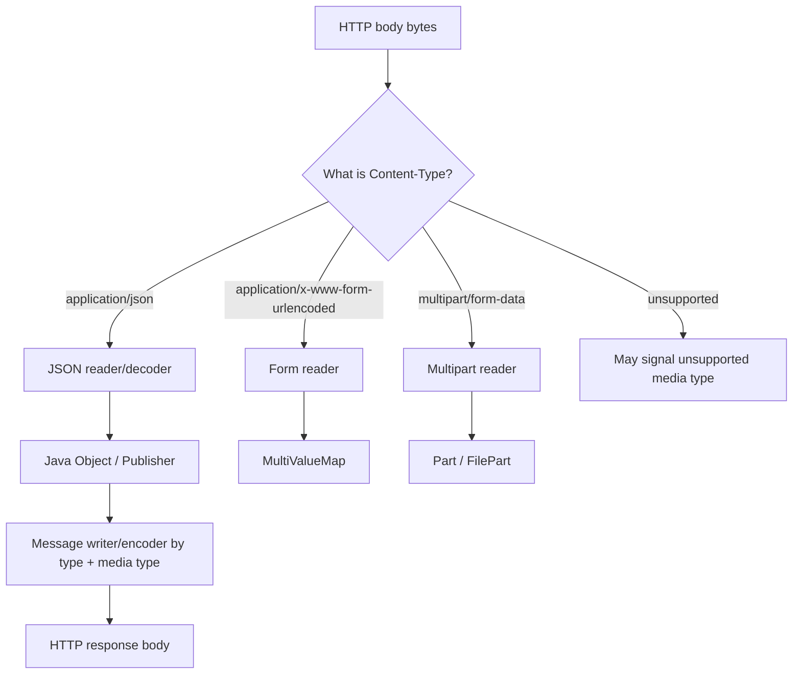
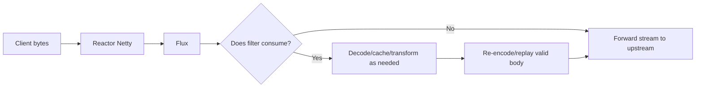

# JSON, Forms, Multipart, and Content Converter Selection in Spring Cloud Gateway

In a microservices architecture, a Gateway does more than route by `Path` and `Method`. It must also accurately forward **HTTP request bodies** and **response bodies**: JSON for creating orders, URL-encoded forms for submitting form fields, multipart payloads for file uploads, and sometimes large data streams. Mishandling `Content-Type`, consuming the body prematurely, or breaking multipart boundaries can cause a request to match the right route while the backend receives corrupted content.

**Spring Cloud Gateway Server WebFlux** runs on the reactive model of Spring WebFlux and Reactor Netty. During normal pass-through forwarding, the Gateway streams body bytes **without decoding JSON or multipart payloads into Java objects**. When filters inspect, validate structure, or rewrite bodies, the Gateway uses the appropriate **HTTP message codec** to decode and re-encode the content.

This lesson belongs to the **HTTP Body Handling** chapter of the `SPRING_CLOUD_GATEWAY` module. It connects directly with route predicates, filter chains, path/header transformations, service discovery, and policies for authentication, rate limiting, circuit breakers, retries, TLS, and observability to operate your microservices entry point safely.

> **Scope:** This lesson focuses on **Spring Cloud Gateway Server WebFlux**. Java examples use Spring WebFlux/Project Reactor. Configuration namespaces and certain APIs can differ across Spring Boot/Spring Cloud versions; use the matching starter and documentation for your deployed version. Code examples assume the corresponding dependencies are present.

## 1. From Client to Backend: Which Layers Does the Body Cross?

Suppose a client sends an order-creation request:

```http
POST /api/orders HTTP/1.1
Host: gateway.example.com
Content-Type: application/json
Accept: application/json

{"sku":"BOOK-42","quantity":2}
```

The Gateway can match route `order-api`, rewrite `/api/orders` to `/orders`, and forward to Order Service. If no filter needs to read or modify the body, the Gateway does not need to turn that JSON string into an `OrderRequest`.



When content transformation is needed, a different branch appears:



**Distinguish two responsibilities:** *routing* answers “which service owns this request?”, whereas *content conversion* answers “what should the body bytes be decoded into and re-encoded as?”. Do not decode every payload at the Gateway when the goal is simply forwarding.

## 2. Headers That Govern Body Handling

An HTTP body is a sequence of bytes. Headers tell the receiver how to interpret those bytes and how both sides negotiate formats.

| Header | Role | Example |
| --- | --- | --- |
| `Content-Type` | Declares **the media type of the body being sent**. | `application/json`, `application/x-www-form-urlencoded`, `multipart/form-data; boundary=...` |
| `Accept` | Declares **the response media types the client wants**. | `application/json`, `text/event-stream` |
| `Content-Length` | Byte length of the body under length-delimited framing. | `Content-Length: 32` |
| `Transfer-Encoding` | HTTP/1.1 transport framing for chunked transfer; not a business format. | `chunked` |
| `Content-Encoding` | Compression/encoding representation applied at the HTTP level. | `gzip` |
| `Content-Disposition` | Metadata for a part/attachment, such as field name or filename. | `form-data; name="file"; filename="photo.jpg"` |

**`Content-Type` is not `Accept`.** A client can send `Content-Type: application/json` alongside `Accept: text/plain`: the request body is JSON, while the client wants a plain-text response. The backend may accept or reject based on formats it supports. In HTTP, `415 Unsupported Media Type` typically reflects an unsupported **request body** format; `406 Not Acceptable` typically reflects inability to produce a **response** matching `Accept`.

**Important for the Gateway:** when purely proxying, it preserves relevant headers and forwards the received body. It does not automatically turn JSON into form data or JPEG into PNG just because the client sends a different `Accept` header. Format conversion only occurs when an explicit conversion mechanism is configured.

### 2.1. MIME Types and Charsets

`Content-Type` specifies a **media type**, sometimes with parameters:

```http
Content-Type: application/json
Content-Type: application/x-www-form-urlencoded
Content-Type: text/plain; charset=UTF-8
Content-Type: multipart/form-data; boundary=----FormBoundary8f1
```

For instance, `application/json` normally uses UTF-8; do not blindly decode it as raw bytes using the OS default charset. For text, using the wrong charset corrupts accented/non-ASCII characters. For binary files, **never** convert bytes into a `String` for processing and re-encode them without a well-defined contract.

### 2.2. `Content-Length` After Rewriting a Body

Suppose the original JSON body is 20 bytes long, and a filter adds a new field so the new body is 55 bytes long. If the filter forwards the stale `Content-Length: 20` header, upstream may read a truncated body or report a protocol framing error.

When using built-in body-rewriting filters, let the encoder and HTTP transport manage length and framing; avoid preserving the old `Content-Length` after rewriting. In custom filters, account for `Content-Type`, `Content-Encoding`, and `Transfer-Encoding` so headers never contradict the actual bytes.

## 3. JSON: The Ubiquitous API Format

### 3.1. How Is JSON Received?

Example:

```http
POST /api/orders HTTP/1.1
Content-Type: application/json
Accept: application/json

{"sku":"BOOK-42","quantity":2}
```

A backend can map this body to a DTO:

```java
public record CreateOrderRequest(String sku, int quantity) {}
```

In a Spring WebFlux backend, a handler can accept the body:

```java
@PostMapping(
    path = "/orders",
    consumes = MediaType.APPLICATION_JSON_VALUE,
    produces = MediaType.APPLICATION_JSON_VALUE
)
public Mono<ResponseEntity<OrderReceipt>> create(
        @RequestBody Mono<CreateOrderRequest> requestBody) {
    return requestBody
        .flatMap(orderService::create)
        .map(created -> ResponseEntity
            .status(HttpStatus.CREATED)
            .body(created));
}
```

This example assumes `orderService.create` returns `Mono<OrderReceipt>` and enforces appropriate validation and authorization. Note that this is **WebFlux backend** code—there is no requirement to write controllers inside the Gateway.

In Spring WebFlux, the JSON codec (typically Jackson when available) reads bytes and binds them to the target Java type. If syntax is invalid, types mismatch, or decode limits are exceeded, the request fails before business logic runs.

### 3.2. What Happens When the Gateway Only Forwards JSON?

A simple WebFlux route might be:

```yaml
spring:
  cloud:
    gateway:
      server:
        webflux:
          routes:
            - id: order-api
              uri: http://localhost:8082
              predicates:
                - Path=/api/orders/**
              filters:
                - StripPrefix=1
```

When a client sends `POST /api/orders` with a JSON body, the Gateway rewrites the path to `/orders` and forwards the body to the backend. Because the route does not read the content, **the Gateway needs no knowledge of Order Service's DTOs**.

Consequences:

- The backend owns the JSON schema, validation, and business rules.
- The Gateway can still protect the edge with Spring Security and rate limiting without decoding the full JSON payload.
- Backend JSON schema changes may not require any Gateway route changes when the Gateway does not transform bodies.
- When request signing, raw-byte signature verification, or checksums are involved, be extra careful because parsing and re-serializing JSON can alter wire bytes even when logical values are identical.

### 3.3. JSON Objects, Arrays, and JSON Streaming

Do not treat these three shapes as interchangeable:

| Example | Typical Use | Key Consideration |
| --- | --- | --- |
| `{"id":42}` | Single JSON object | Maps cleanly to a single DTO. |
| `[{"id":1},{"id":2}]` | JSON array | Often requires reading the full structure before processing. |
| Consecutive JSON lines, e.g. `application/x-ndjson` | Streaming multiple objects | Requires streaming-capable codecs and media types; not identical to a JSON array. |

A backend response of `Flux<Product>` may be encoded as a JSON array or a streaming format depending on media type and writer. Seeing `Flux` in Java does not guarantee clients receive each item immediately as it is emitted.

## 4. Form URL-Encoded: Key–Value Pair Payloads

Traditional HTML forms typically send:

```http
POST /login HTTP/1.1
Content-Type: application/x-www-form-urlencoded

username=mai&remember=true
```

Characteristics:

- Body data consists of `key=value` pairs joined by `&`.
- Special characters are URL-encoded according to form rules; never split raw strings manually and decode ad hoc.
- A key can appear multiple times, e.g., `tag=java&tag=spring`. Therefore **`MultiValueMap<String, String>`** fits better than a single-value map.

In a WebFlux backend, form data can be read via:

```java
@PostMapping(
    path = "/search",
    consumes = MediaType.APPLICATION_FORM_URLENCODED_VALUE
)
public Mono<ResponseEntity<String>> search(ServerWebExchange exchange) {
    return exchange.getFormData()
        .map(form -> {
            String query = form.getFirst("q");
            return ResponseEntity.ok(
                query == null ? "No keyword provided" : "Keyword received"
            );
        });
}
```

This only illustrates **reading a form body**; real handlers must validate inputs, bound sizes, and never log sensitive values. `getFormData()` uses the matching codec to parse data and returns a reactive publisher.

### 4.1. Form Bodies vs. Query Strings

These two parts of a request are distinct:

```http
POST /search?q=java HTTP/1.1
Content-Type: application/x-www-form-urlencoded

page=2
```

`q=java` is in the URI **query string**; `page=2` is in the **body**. The Gateway's `Query` route predicate inspects request query parameters; it **does not inspect** fields inside a form body.

Moving data between URL queries and bodies also changes caching and logging behavior. Never place passwords, tokens, or secrets into query URLs where they risk leaking into access logs, browser history, analytics, or referrers.

### 4.2. Testing Forms with `curl`

```bash
curl -i "http://localhost:8080/api/form/submit" \
  -H "Content-Type: application/x-www-form-urlencoded" \
  --data-urlencode "name=Nguyễn An" \
  --data-urlencode "tag=java" \
  --data-urlencode "tag=spring"
```

This assumes a matching route is configured and the backend accepts forms. `--data-urlencode` makes `curl` properly URL-encode each field, which is especially helpful for spaces and Vietnamese/non-ASCII characters.

### 4.3. Why You Must Not Arbitrarily Read Forms in a `GatewayFilter`

When a filter calls:

```java
return exchange.getFormData()
    .flatMap(form -> {
        // Form was read, but the body was consumed at this layer.
        return chain.filter(exchange);
    });
```

this code **does not guarantee** the backend can still read the original body. In WebFlux, the body is a publisher with a single-consumption lifecycle; reading it early can leave the rest of the Gateway chain with zero bytes to forward. If inspecting the body at the Gateway is truly required, use proper request caching/replay/decoration with resource bounds. Do not treat `getFormData()` as a free read with zero pipeline side effects.

## 5. `multipart/form-data`: Multiple Parts and Binary Files

Multipart is commonly used when forms mix text fields and files:

```http
POST /api/files HTTP/1.1
Content-Type: multipart/form-data; boundary=----WebKitFormBoundaryExample

------WebKitFormBoundaryExample
Content-Disposition: form-data; name="description"

Product photo
------WebKitFormBoundaryExample
Content-Disposition: form-data; name="file"; filename="photo.jpg"
Content-Type: image/jpeg

... file bytes ...
------WebKitFormBoundaryExample--
```

This snippet simplifies byte representation; on the wire, parts are delimited by boundaries and strict CRLFs. **The `boundary` parameter must match the body.** If a client or filter overwrites `Content-Type: multipart/form-data` and strips the `boundary` parameter, the backend may fail to parse the upload.

### 5.1. Multipart vs. Form URL-Encoded

| Property | `application/x-www-form-urlencoded` | `multipart/form-data` |
| --- | --- | --- |
| Typical contents | Text field key-value pairs | Multiple parts, mixing text fields and binary files |
| Delimiter | `&` between fields | Boundary markers between parts |
| Binary file support | Unsuitable for large files | Designed for transferring binary parts |
| Received type in WebFlux | `MultiValueMap<String,String>` | `Part`, `FormFieldPart`, `FilePart`, or part event stream per API |
| Cost if Gateway parses it | May buffer form in memory | May use memory, temp disk, and many buffers; higher resource risk |

For large file uploads, **stream/forward the multipart payload** untouched when the Gateway only needs to route, rather than loading whole files into memory.

### 5.2. Reading Multipart in a WebFlux Backend

An illustrative backend handler receiving a file:

```java
@PostMapping(
    path = "/files",
    consumes = MediaType.MULTIPART_FORM_DATA_VALUE
)
public Mono<ResponseEntity<Void>> upload(
        @RequestPart("file") FilePart file) {

    Path destination = Path.of("/var/app/uploads", "generated-id.bin");

    return file.transferTo(destination)
        .thenReturn(ResponseEntity.accepted().build());
}
```

The example uses a **server-controlled** destination filename rather than concatenating `file.filename()` onto a path. Real applications must also ensure directory existence, proper permissions, unique IDs, size limits, magic-byte/content verification, and appropriate storage backends.

`FilePart.transferTo(...)` lets the backend handle uploads through a reactive API. The Gateway does not need to write files to disk when upload processing belongs to the downstream service.

### 5.3. Can the Gateway Parse Multipart?

Yes, Spring WebFlux provides `exchange.getMultipartData()` and `Part`-based APIs. However:

- Parsing multipart can consume memory and/or temporary disk space.
- If a filter consumes the body, replaying it requires reconstructing the full multipart stream, including **boundaries, fields, filenames, part headers, and data bytes**.
- Converting `Flux<DataBuffer>` into a `String` corrupts binary files.
- Client-supplied filenames, part media types, and metadata fields **are untrusted input**.
- When multiple large parts arrive, aggregating everything into a byte array can trigger memory spikes.

When the goal is merely blocking oversized or invalid uploads, enforce size limits early and delegate content validation to the backend or dedicated upload pipeline rather than writing a custom `GatewayFilter` that parses every multipart request.

### 5.4. `curl` Generates the Boundary Automatically

```bash
curl -i -X POST "http://localhost:8080/api/files" \
  -F "description=Product photo" \
  -F "file=@./photo.jpg;type=image/jpeg"
```

The `-F` flag tells `curl` to build the multipart body and set `Content-Type` with the matching boundary. **Never manually add `Content-Type: multipart/form-data`** with an empty or mismatched boundary when using `-F`.

## 6. How Does Spring WebFlux Select Content Converters?

In Spring WebFlux, **`HttpMessageReader<?>`** and **`HttpMessageWriter<?>`** components read and write bodies based on Java type and media type. They rely on registered codecs, configurable via `ServerCodecConfigurer`, `ClientCodecConfigurer`, or framework auto-configuration.

For a WebFlux endpoint expecting `Mono<CreateOrderRequest>`:

1. The framework inspects the request's `Content-Type` and the target Java type requested by the handler or filter.
2. It selects a message reader/decoder supporting that combination.
3. It decodes the bytes into the Java object or publisher.
4. When writing a response object, it selects a writer/encoder matching the object type and HTTP content negotiation.



This diagram illustrates **active decoding/encoding**. It does not mean the Gateway's Netty routing filter automatically decodes every proxied request.

### 6.1. Common Codecs

| Content Type | Typical WebFlux Reader/Writer | Conditions / Limitations |
| --- | --- | --- |
| JSON (`application/json`) | Jackson-based decoder/encoder when configured | Must match DTO, media type, memory limits, and null/schema rules. |
| Plain text (`text/plain`) | String decoder/encoder | Charset, size limits, and choosing `String` type. |
| Form URL-encoded | Form reader/writer supporting `MultiValueMap` | Proper encoding and multi-value key handling. |
| Multipart | Reader/writer for `Part` or multipart resources | Boundaries, file streaming, memory/disk limits, part lifecycles. |
| Raw bytes (`byte[]`, `DataBuffer`) | Byte array/buffer codecs | No business-level awareness; requires resource management. |
| Streaming (`text/event-stream`, `application/x-ndjson`) | Streaming-capable writer/encoder | Never aggregate an unbounded stream into one object/string. |

A media type header is only a **codec-selection hint**, not proof that the payload is valid. A client can send binary garbage labeled `application/json`; the decoder will still raise an error when attempting to parse JSON.

### 6.2. Codec Selection Depends on the Target Java Type

Asking a decoder for `String.class` behaves differently from asking for `CreateOrderRequest.class`. Likewise, reading `Flux<DataBuffer>` operates at the raw buffer level, unlike decoding `Mono<List<Product>>`.

Therefore, when using body-rewriting filters in the Gateway, pick matching **input class**, **output class**, and **output media type**. If they do not align with the real payload, decode/encode errors can occur inside the Gateway even when the backend is completely healthy.

### 6.3. `Accept` Does Not Automatically Convert Proxied Responses

In a WebFlux backend, `Accept: application/json` helps select a representation when a handler produces multiple formats. However, when the Gateway merely proxies an upstream response, it **does not automatically convert `text/plain` from the backend into `application/json`**. Only explicit body-transformation filters or converters perform such conversions.

When rewriting responses, verify the outbound `Content-Type` after encoding. Never rewrite the body into JSON while leaving an old `text/plain` header intact.

## 7. When Should the Gateway Forward the Body Untouched?

In many systems, the cleanest design keeps the Gateway focused on **routing, edge security, and reliability**, leaving schemas to backend services. Use this guide:

| Requirement | Gateway Choice | Reason |
| --- | --- | --- |
| Forward JSON from client to Order Service unchanged | Pass body through | Avoids JSON decode/re-serialize overhead and DTO coupling. |
| Forward login form to Authentication Service | Pass body through with proper security controls | Sensitive credentials should be handled directly by the owning auth service. |
| Large multipart file upload | Streaming pass-through with size limits | Avoids buffering file bytes in Gateway heap. |
| Add `X-Gateway-Source` header | `SetRequestHeader` | No need to touch the body. |
| Strip `/api` before calling backend | `StripPrefix` or `SetPath` | Changes path only; no body decoding needed. |
| Inject a JSON field per integration contract | `ModifyRequestBody` or dedicated adapter layer | Requires controlled decode/transform/encode. |
| Strip internal fields from JSON response | `ModifyResponseBody` or update backend DTO | Rewriting responses requires handling error schemas and status codes. |
| Check user permissions | Spring Security + backend authorization | Never trust body fields as proof of identity. |

Transforming bodies at the Gateway helps adapt legacy API contracts, normalize fields, or filter responses. Still, every decode/encode step adds CPU, RAM, and schema-drift risk.

## 8. `ModifyRequestBody`: Strongly Typed JSON Transformation

`ModifyRequestBody` is a GatewayFilter Factory that reads the request body into an input type, invokes a reactive rewrite function, and encodes the result as the new body. In standard WebFlux versions, it is configured primarily via the **Java DSL** using `RouteLocatorBuilder`—do not assume YAML shorthand syntax works across versions.

Suppose a client sends:

```json
{"sku":"BOOK-42","quantity":2}
```

The internal backend expects a `source` field set by the Gateway:

```json
{"sku":"BOOK-42","quantity":2,"source":"edge-gateway"}
```

Illustrative Java configuration class:

```java
import org.springframework.cloud.gateway.route.RouteLocator;
import org.springframework.cloud.gateway.route.builder.RouteLocatorBuilder;
import org.springframework.context.annotation.Bean;
import org.springframework.context.annotation.Configuration;
import org.springframework.http.MediaType;
import reactor.core.publisher.Mono;

@Configuration
public class OrderBodyRoutes {

    public record ClientOrder(String sku, int quantity) {}
    public record BackendOrder(String sku, int quantity, String source) {}

    @Bean
    RouteLocator orderRoutes(RouteLocatorBuilder builder) {
        return builder.routes()
            .route("order-json", r -> r
                .path("/api/orders")
                .and()
                .method("POST")
                .filters(f -> f
                    .modifyRequestBody(
                        ClientOrder.class,
                        BackendOrder.class,
                        MediaType.APPLICATION_JSON_VALUE,
                        (exchange, input) -> {
                            if (input == null) {
                                return Mono.empty();
                            }
                            return Mono.just(new BackendOrder(
                                input.sku(),
                                input.quantity(),
                                "edge-gateway"
                            ));
                        }
                    )
                    .stripPrefix(1)
                )
                .uri("http://localhost:8082"))
            .build();
    }
}
```

**Component breakdown:**

1. `ClientOrder.class`: type the message reader decodes from client JSON.
2. `BackendOrder.class`: type the message writer serializes into the new JSON.
3. `MediaType.APPLICATION_JSON_VALUE`: expected media type of the outbound body.
4. `(exchange, input) -> Mono<BackendOrder>`: non-blocking transformation function.
5. `input == null`: handles bodyless requests; depending on your API contract, you may want to reject empty bodies instead of passing them through.
6. `stripPrefix(1)`: rewrites `/api/orders` to `/orders` prior to routing, independent of JSON rewriting.

When a client sends:

```bash
curl -i "http://localhost:8080/api/orders" \
  -H "Content-Type: application/json" \
  -d '{"sku":"BOOK-42","quantity":2}'
```

Order Service at `http://localhost:8082/orders` receives the body with the added `source` field.

**Limitations of this example:** it assumes a JSON object matching the DTO, not files or unbounded streams; the backend must still validate `sku`, `quantity`, and permissions. A `source` header or field is only trustworthy when the backend is isolated from direct external access or verifies trust cryptographically. This snippet also omits explicit error policies for malformed JSON or empty bodies; production needs explicit error rules.

### 8.1. Never Transform JSON via Ad Hoc String Replacement

Doing something like:

```java
String changed = body.replace("\"role\":\"user\"", "\"role\":\"admin\"");
```

is not safe JSON transformation. It breaks on whitespace variations, field ordering, and escaping, and can corrupt substrings inside data values. Never use string replacement to assign roles, alter user identifiers, or manipulate security fields.

Use DTOs, a JSON tree/codec with explicit validation, or handle domain fields inside the backend. Above all, **never trust `role` or `userId` from a request body as an authenticated identity**.

### 8.2. Empty Bodies and Reactive Semantics

The rewrite function returns `Mono<Output>`. To emit an output object, use `Mono.just(output)`; to emit no body, use `Mono.empty()` per the filter/endpoint contract. Never call `block()` to extract a request body, and never call `subscribe()` manually inside a filter: WebFlux/Gateway must manage subscriptions, error signals, and cancellation across the HTTP exchange.

## 9. `ModifyResponseBody`: Rewriting JSON Responses

Suppose a backend returns:

```json
{"sku":"BOOK-42","name":"Java Handbook","internalNote":"warehouse-only"}
```

The Gateway only wants to expose:

```json
{"sku":"BOOK-42","name":"Java Handbook"}
```

Illustrative Java DSL route:

```java
@Configuration
public class ProductResponseRoutes {

    public record InternalProduct(
        String sku, String name, String internalNote) {}
    public record PublicProduct(String sku, String name) {}

    @Bean
    RouteLocator productRoutes(RouteLocatorBuilder builder) {
        return builder.routes()
            .route("product-json", r -> r
                .path("/api/products/**")
                .filters(f -> f
                    .stripPrefix(1)
                    .modifyResponseBody(
                        InternalProduct.class,
                        PublicProduct.class,
                        MediaType.APPLICATION_JSON_VALUE,
                        (exchange, body) -> {
                            if (body == null) {
                                return Mono.empty();
                            }
                            return Mono.just(
                                new PublicProduct(body.sku(), body.name())
                            );
                        }
                    )
                )
                .uri("http://localhost:8081"))
            .build();
    }
}
```

Imports for `@Configuration`, `@Bean`, `RouteLocator`, `RouteLocatorBuilder`, `MediaType`, and `Mono` mirror the Section 8 example. When adapting to a real project, add the package/imports and verify the API signature for your version.

**Special considerations:**

- `ModifyResponseBody` decodes the backend body into `InternalProduct`; if the backend returns an **error schema different from** the success object, decoding can fail. Branch on status and media type before transforming, or standardize a unified response envelope.
- When responses have no body (`204 No Content`, `HEAD`, or empty body), never assume a non-null object.
- Sharing one filter across both JSON endpoints and file downloads can corrupt binary data; scope routes and media types tightly.
- If `internalNote` is truly sensitive, have the backend return a public DTO directly from the source. Never rely on the Gateway as the sole barrier against leaking sensitive fields.
- Check headers such as `Content-Length`, `Content-Type`, and `Content-Encoding` after re-encoding.

Transforming bodies in the Gateway helps during API transitions, but it couples the Gateway to backend schemas. An uncoordinated DTO change can trigger 5xx errors across the route even though the backend itself is healthy.

## 10. Bodies Are `Flux<DataBuffer>`, Not Pre-Built `String`s

At the lower WebFlux layer, a request body has the shape:

```java
Flux<DataBuffer> body = exchange.getRequest().getBody();
```

`DataBuffer` represents a slice of byte data; a single HTTP body can arrive across many buffers. The reactive chain supports non-blocking I/O and backpressure across layers.

Simplified lifecycle diagram:



### 10.1. Single-Pass Reads and Body Replay

Never assume any code can subscribe multiple times to `exchange.getRequest().getBody()`. Depending on the source, the body can only be consumed once; reading it prematurely in a filter without proper replay leaves the backend with an empty body.

If multiple steps must inspect the same content, evaluate `CacheRequestBody` or the Gateway's built-in mechanisms. When caching, ensure you:

- Enforce explicit body size limits.
- Know what type is cached and which components may read it.
- Respect `DataBuffer` lifecycles without retaining buffers too long.
- Test with real JSON, form, and multipart payloads, since replay requirements differ.
- Never cache sensitive payloads longer than necessary.

An example `CacheRequestBody` configuration in Gateway versions supporting that factory uses the filter name and body class:

```yaml
filters:
  - name: CacheRequestBody
    args:
      bodyClass: java.lang.String
```

This example only illustrates **text-based body caching**; never apply `String` caching to binary files or large requests. Check the factory behavior and limits for your exact Gateway version.

### 10.2. `DataBuffer`s Must Be Managed Properly

With pooled buffers, retain/release ownership matters. Dangerous mistakes include:

- Storing a `DataBuffer` in a field or static collection beyond the request.
- Reading bytes and forgetting to release buffers in manual buffer-management code.
- Calling `DataBufferUtils.join(...)` to aggregate **all bytes** of an unbounded large upload.
- Calling `body.blockFirst()` or blocking event-loop threads.
- Converting binary files to `String` under an incompatible charset.

When writing custom `DataBuffer`-level filters, master buffer ownership contracts, cancellation/error handling, and `ServerHttpRequest`/`ServerHttpResponse` decoration. For straightforward JSON conversions, prefer built-in body filters over manipulating pooled memory directly.

### 10.3. Backpressure Is Not Rate Limiting

- **Backpressure** regulates demand for elements inside a stream, managing flow pace between publisher and subscriber.
- **Rate limiting** caps request frequency or volume per client, API key, user, or route.

Having `Flux<DataBuffer>` does not stop a client from firing thousands of upload requests. Likewise, `RequestRateLimiter` does not replace per-request payload size limits.

## 11. Choosing Memory, File, and Request Size Limits

Rewriting bodies forces decoding/encoding, making **resource limits** mandatory in your design.

| Limit Type | Purpose | What to Check |
| --- | --- | --- |
| Request body size limit | Reject oversized payloads on individual requests. | `RequestSize` route filter, reverse proxy, and backend. |
| In-memory decode limit | Prevent codecs from buffering excessive payloads in heap. | `spring.codec.max-in-memory-size` on supported stacks; `DataBufferLimitException` when exceeded. |
| Multipart per-part/aggregate limits | Bound part sizes, part counts, memory, and temp files. | WebFlux multipart reader settings, disk quotas, upload policies. |
| Timeouts and connections | Protect gateway resources from slow clients or backends. | Netty/Gateway timeouts, backpressure, client disconnects. |
| Format validation | Stop malformed or malicious payloads early. | `Content-Type`, file magic bytes, backend validation, decompression bounds. |

### 11.1. The `RequestSize` Filter

Example capping payload size on an upload route:

```yaml
- id: file-upload
  uri: lb://file-service
  predicates:
    - Path=/api/files/**
    - Method=POST
  filters:
    - StripPrefix=1
    - name: RequestSize
      args:
        maxSize: 5MB
```

The `maxSize: 5MB` value is illustrative; pick limits per API and verify how the factory checks request size in your version. Oversized requests can be rejected (e.g. `413 Payload Too Large`), though do not assume every branch, streaming mode, or proxy emits identical statuses/bodies without testing.

### 11.2. `max-in-memory-size` Is Not a Global Upload Cap

A common WebFlux configuration:

```yaml
spring:
  codec:
    max-in-memory-size: 1MB
```

This is a **codec limit for buffering during decoding**, not a guarantee that every request passing through the Netty proxy is capped at 1MB. Large streaming uploads still need dedicated limits at the edge, route, and backend. Conversely, raising the decode limit too high just for large JSON payloads increases heap usage per concurrent connection.

### 11.3. Multipart and Temporary Files

Multipart handling may buffer parts and spill to temporary disk files depending on the decoder and configuration. In operations, consider:

- disk quotas and temporary directory capacity;
- file count, part count, and oversized part metadata;
- max size per file, total request size, and timeouts;
- resource cleanup on failed or cancelled requests;
- filename/path-traversal protection and malware scanning policies;
- concurrent uploads from many clients.

Merely raising `max-in-memory-size` does not solve multipart risks. If large uploads are a primary workload, consider direct uploads to object storage via short-lived signed URLs under an appropriate trust model to offload the Gateway.

## 12. Security Perspectives on JSON, Forms, and Multipart

### 12.1. Never Trust Client-Declared `Content-Type`

A part claiming `Content-Type: image/jpeg` does not prove its bytes are a real JPEG image. Similarly, `Content-Type: application/json` does not prove the body matches your schema.

When the backend performs security checks:

- Verify actual file format/magic bytes, size, structure, and domain constraints.
- Never construct file storage paths by concatenating raw client filenames.
- Never interpolate raw form or JSON values into SQL statements, templates, or shell commands.
- Keep authentication and resource authorization on the server, never trusting `userId` or `role` inside the body.
- Keep sensitive data out of logs, traces, error responses, and caches.

### 12.2. Never Log Payloads Containing Secrets

Login JSON may contain `password`, OAuth forms contain `client_secret`, and multipart uploads contain personal documents. A `GlobalFilter` that reads the body “for easy debugging” both leaks sensitive data and risks breaking stream consumption/replay. Prefer logging:

- route ID, HTTP method, status, latency, and valid correlation/trace IDs;
- body size if measured safely;
- normalized MIME group for `Content-Type`;
- high-level decode/validation error codes without raw tokens or files.

When payload inspection is genuinely needed in special troubleshooting, use isolated test environments, synthetic data, and proper redaction.

### 12.3. Headers and Cookies Are Not Equivalent to Body Fields

Authentication typically relies on Bearer tokens or session cookies at the WebFlux/Spring Security layer, not on a JSON field like `"isAdmin":true`. Nor does a client-supplied `X-User-Id` header become proof of identity simply because the Gateway forwards it.

TLS/mTLS protects transport hops, `SecureHeaders` manages browser-facing response headers, `RequestRateLimiter` enforces request quotas, and body validation protects **payload integrity**. They complement one another rather than replacing each other.

## 13. Impact of Retries, Circuit Breakers, and Response Bodies

Modifying or caching bodies interacts with reliability filters:

### 13.1. Retries and Body Replayability

Suppose the Gateway forwards `POST /orders` to the backend. The backend creates the order, the response drops, and the Gateway retries. Without backend idempotency, two orders are created.

For streaming bodies (large JSON or multipart), a publisher may **not be readable again** after the first send. Certain Gateway retry mechanisms cache the body for replay, raising memory consumption significantly.

Before enabling retries on routes with bodies:

1. Define which HTTP methods are safe to retry and which status codes/errors qualify.
2. Require idempotency keys on state-changing writes where appropriate.
3. Verify body replayability and cache memory bounds.
4. Test client disconnects, backend timeouts, and partial error responses.
5. Measure heap/buffer usage when many requests retry concurrently.

### 13.2. Circuit Breakers Do Not Fix Body Contracts

`CircuitBreaker` protects upstream calls when backends fail or slow down. It **does not automatically** convert JSON to form data or match each API's fallback schema. When configuring fallbacks, align status codes, `Content-Type`, and payload structure—especially when clients expect a specific JSON shape.

### 13.3. Compressed and Streaming Responses

If upstream returns `Content-Encoding: gzip`, body bytes are HTTP-compressed. A custom filter attempting to decode compressed bytes straight as JSON will fail unless decompression is handled properly.

For SSE (`text/event-stream`), NDJSON streaming, or file downloads, a filter converting the entire response into a `String` breaks streaming, spikes latency, consumes memory, or corrupts files. Keep streaming pass-through intact whenever transformation is unnecessary.

## 14. Layered Troubleshooting

When the Gateway matches a route yet the backend fails to handle the body, diagnose in order:

1. **Route/predicates:** did the request enter the expected route?
2. **Headers:** are `Content-Type`, `Content-Encoding`, and `Accept` right?
3. **Filter chain:** did any filter read, cache, or rewrite the body, and did it run before routing?
4. **Codecs:** are input class, output class, media type, and memory limits compatible?
5. **Routing:** are target URI, load balancer, timeouts, and upstream connectivity healthy?
6. **Backend:** did all bytes arrive, are schema/form/parts valid, and does authorization pass?
7. **Response:** do status, headers, and body match actual outcomes and retry/circuit-breaker policies?

| Symptom | Likely Cause | Resolution |
| --- | --- | --- |
| Backend receives empty body after custom filter | Filter consumed publisher without replaying it. | Use proper body filters/caching; inspect actual request at backend. |
| JSON returns `400` | Malformed JSON or schema/validation failure. | Inspect payload, DTO, and controlled error messages. |
| Gateway returns `415` during rewrite | Media type or codec unsupported for inbound body. | Check `Content-Type`, Java class, and configured codecs. |
| Multipart missing file | Missing `boundary`, wrong part name, or body already consumed. | Let client generate multipart headers; verify part name and bytes at backend. |
| Form field with Vietnamese/UTF-8 text garbled | Mismatched charset encoding/decoding. | Use standard form codecs/URL encoding; avoid manual string splitting. |
| Large upload fails with `413` | Request limit at Gateway, proxy, or backend. | Check each layer's limit against allowed upload size. |
| `DataBufferLimitException` during decode | Body exceeded codec's in-memory buffer limit. | Shrink payload, switch to streaming, or tune limit deliberately. |
| Editing JSON hangs upstream | Mismatched `Content-Length`/framing or blocking filter. | Use built-in filters; check transport headers and event-loop threads. |
| Response fails parsing in `ModifyResponseBody` | Error body differs from success DTO or media type differs. | Branch by status/media type or revise rewrite strategy. |
| Downloaded file corrupted | Bytes decoded as `String` or re-encoded via charset. | Stream raw bytes directly; skip unnecessary text decoding. |
| Retry creates duplicate records | Side-effecting `POST` retried. | Add idempotency, narrow retry rules, verify body replay. |
| Gateway RAM spikes on uploads | Filter aggregates/caches large multipart or JSON bodies. | Bound cache/part buffers; prefer streaming pass-through. |

## 15. Testing HTTP with JSON, Forms, and Multipart

The examples below assume the Gateway runs at `http://localhost:8080` with matching routes configured. When testing, use a **mock backend** that records method, path, headers, and received body byte length (without persisting secrets).

### 15.1. Sending JSON

```bash
curl -i "http://localhost:8080/api/orders" \
  -H "Content-Type: application/json" \
  -H "Accept: application/json" \
  --data '{"sku":"BOOK-42","quantity":2}'
```

Verify the backend receives:

- JSON `Content-Type`.
- Valid JSON body, including `source` if the route uses Section 8's `ModifyRequestBody`.
- Backend path `/orders` if `StripPrefix=1` is used.
- Contract-compliant error codes when the DTO is invalid.

### 15.2. Sending Form URL-Encoded Data

```bash
curl -i "http://localhost:8080/api/forms/search" \
  --data-urlencode "q=Spring Cloud Gateway" \
  --data-urlencode "tag=webflux" \
  --data-urlencode "tag=reactor"
```

When using `--data-urlencode`, `curl` automatically sets the form media type. Ensure the backend handles both values of `tag` rather than keeping only one when business logic needs all of them.

### 15.3. Sending Multipart Data

```bash
curl -i "http://localhost:8080/api/files" \
  -F "title=Profile avatar" \
  -F "file=@./avatar.png;type=image/png"
```

Create an appropriate `avatar.png` file beforehand and ensure the upload backend enforces allowed types and sizes. Never hand-craft boundaries or read uploads as a `String`.

### 15.4. Testing an Unsupported Media Type

```bash
curl -i "http://localhost:8080/api/orders" \
  -H "Content-Type: text/plain" \
  --data "not-json"
```

If the route applies `ModifyRequestBody` with a JSON input DTO and has no matching reader for `text/plain`, the Gateway can reject or raise a decode error. If the Gateway merely proxies, the backend decides whether to accept `text/plain`. Do not expect identical status codes across both architectures.

### 15.5. Testing Limits and Request Cancellation

In your test environment, generate valid payloads covering:

- Just below and just above configured body limits.
- Large JSON objects and large JSON arrays.
- Forms with many repeated keys.
- Multipart requests with many parts or large files.
- Slow streaming responses where the client disconnects mid-stream.

Monitor memory, buffer utilization, latency, timeouts, and cleanup on cancellation. Avoid using real sensitive data in these tests.

## 16. Practice Exercises with Answers

### Exercise 1 — Identifying `Content-Type` Handling

A client sends `POST /api/orders` with body `{"sku":"A","quantity":1}` and `Content-Type: application/json`. The Gateway only configures `StripPrefix=1`. Must the Gateway use Jackson to parse the JSON?

**Answer:** No. When purely forwarding, the Gateway streams the body as bytes; Jackson/codecs are only needed when a filter or backend decodes JSON into Java types.

### Exercise 2 — Distinguishing Forms from Queries

A client calls `POST /search?q=reactor` with body `page=2&tag=java` and `Content-Type: application/x-www-form-urlencoded`. Does `Query=q, reactor` at the Gateway evaluate `page` or `tag`?

**Answer:** No. The `Query` predicate evaluates URI query parameters; `page` and `tag` live in the form body. Only the backend or a form-reading mechanism processes those fields.

### Exercise 3 — Why Did Multipart Lose the File?

A custom filter reads `exchange.getRequest().getBody()`, converts it to a `String`, and sends that string downstream. The backend reports a corrupted image or missing file. What should you inspect?

**Answer:** The filter likely corrupted binary bytes, boundaries, and part headers, or failed to replay the body properly. Prefer pass-through streaming for multipart or use proper streaming/part codecs with resource bounds while keeping part structure intact.

### Exercise 4 — Choosing a Body Filter

You need to inject a `source` field into a JSON request with a stable schema before forwarding to the backend. Which approach fits best?

**Answer:** `ModifyRequestBody` with input/output DTOs and the JSON codec. Never use `String.replace` on raw JSON. For security-sensitive fields, verify the trusted origin of `source`.

### Exercise 5 — Predicting Decode Errors

A route uses `ModifyResponseBody` expecting `InternalProduct`, while the backend returns `404` with JSON `{"error":"Not found"}`. What is the risk?

**Answer:** The codec may fail to map the error body to the success DTO or produce an invalid object with missing fields. Branch explicitly by status/media type/schema or have the backend return a consistent public DTO.

### Exercise 6 — Confusing Backpressure and Quotas

“Because the Gateway streams uploads with `Flux<DataBuffer>`, we do not need request size limits or rate limiting.” Is this true?

**Answer:** No. Backpressure regulates stream consumption speed, whereas per-request byte limits and per-client request quotas are separate policies. Enforce size limits, timeouts, and rate limiting appropriately.

### Exercise 7 — Retries and Idempotency

`POST /payments` may already have charged the customer on the backend when the Gateway times out. Is it safe to enable three retries simply because the JSON body was cached?

**Answer:** Never enable automatic retries merely because the body is replayable. Re-sending bytes is a technical capability; preventing duplicate charges is a business requirement. Enforce idempotency, strict retry conditions, and uncertain-outcome handling.

### Exercise 8 — Why Changing `Accept` Is Not Enough

A client sends `Accept: application/xml` while the backend only returns JSON; the Gateway merely proxies with no response-body filter. Will the Gateway return XML?

**Answer:** No. `Accept` states client preference. The backend may return 406 or behave per its contract; the Gateway does not convert JSON to XML automatically without an explicit conversion mechanism.

## 17. Safe Implementation Checklist

- [ ] Distinguished **byte-stream proxying** from **decoding/transforming/encoding** bodies.
- [ ] Routes handle `Content-Type` and `Accept` accurately; JSON decoders are not forced onto incompatible forms or files.
- [ ] JSON is parsed via proper codecs/DTOs with schema validation, never trusting client-supplied identity fields.
- [ ] Forms handle URL encoding, repeated keys, charsets, and separate queries from bodies.
- [ ] Multipart preserves boundaries, part headers, and file bytes; files are never converted to `String`.
- [ ] File uploads enforce size limits, part counts, temp storage quotas, safe filenames/paths, and content inspection.
- [ ] Custom filters never consume the body and skip replaying it to the backend.
- [ ] Body transformations never call `block()` or detach `subscribe()` from the Gateway lifecycle.
- [ ] `Content-Length`, `Content-Type`, and `Content-Encoding` are properly handled after body rewrites.
- [ ] `max-in-memory-size`, request size limits, and multipart limits are configured deliberately.
- [ ] Large streaming requests are never aggregated into heap just for logging or minor transforms.
- [ ] Response rewrites handle 2xx responses, error schemas, 204/HEAD responses, and varying media types.
- [ ] Retries with bodies verify replayability, idempotency, and cache memory cost.
- [ ] Rate limiting, timeouts, circuit breakers, TLS, and authorization are enforced at the right layers.
- [ ] Passwords, tokens, secret forms, uploaded files, and raw bodies are kept out of logs and traces.
- [ ] Tested JSON, forms, multipart, empty bodies, oversized bodies, wrong media types, client cancellations, and upstream errors.

## 18. Summary

The three HTTP body formats serve distinct purposes: **JSON** fits structured data exchange; **`application/x-www-form-urlencoded`** carries encoded text field pairs; **`multipart/form-data`** carries multiple parts, particularly binary file uploads with exact boundaries. In **Spring Cloud Gateway Server WebFlux**, standard routing does not force the Gateway to decode payloads, while body-rewriting filters require **message readers/writers and codecs** aligned with both the media type and Java type.

The golden rule is to **read or transform the body only when genuinely necessary**, and whenever you do, manage replay, resources, response headers, decode errors, and the full reactive lifecycle. Keeping clear boundaries between route predicates, filter chains, business validation, and access control allows the Gateway to forward API traffic cleanly without becoming a bottleneck or a data-leak point.

By properly pairing JSON, forms, and multipart with `ModifyRequestBody`, `ModifyResponseBody`, `Flux<DataBuffer>` streams, memory bounds, idempotent retries, TLS, and observability, your `SPRING_CLOUD_GATEWAY` edge can support microservices safely and reliably as traffic and payload sizes scale.
