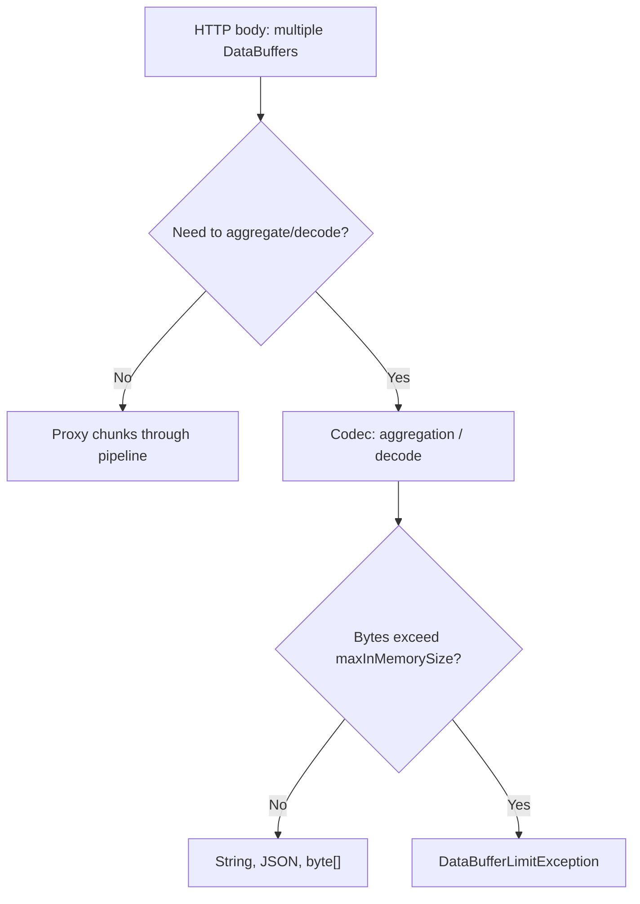

# Codec Buffer Limits and `DataBufferLimitException` in Spring Cloud Gateway

**Spring Cloud Gateway** handles route predicates, filter chains, and HTTP forwarding to microservices. When the Gateway merely routes and forwards chunks, a large request does not necessarily have to be assembled whole in RAM. However, when an application or filter needs to **read or transform an HTTP body** — such as `ModifyRequestBody`, `ModifyResponseBody`, `CacheRequestBody`, or a JSON decoder — data may have to be accumulated up to a configured limit.

When accumulation exceeds that threshold, you may encounter:

```text
org.springframework.core.io.buffer.DataBufferLimitException:
Exceeded limit on max bytes to buffer : 262144
```

This lesson belongs to the **HTTP Body Handling** chapter and explains codec limits, the nature of `DataBufferLimitException`, how to pinpoint the exact component throwing it, and how to design a Gateway without wasting memory.

> **Version scope:** Examples target **Spring Cloud Gateway Server WebFlux 5.0.x** with Spring Cloud 2025.1 / Spring Boot 4. YAML routes use `spring.cloud.gateway.server.webflux.routes`; Spring Boot 4's codec property is `spring.http.codecs.max-in-memory-size`. Do not copy `spring.codec.max-in-memory-size` from older Boot guides. Server Web MVC runs on a Servlet runtime with a different body-handling API.

## 1. Learning Outcomes

After this lesson, you will be able to:

1. Distinguish `DataBuffer`, codecs, and `maxInMemorySize`.
2. Understand why streaming proxying behaves differently from decoding a body into `String`/JSON.
3. Read a `DataBufferLimitException` and isolate whether it came from a request, response, or custom `WebClient`.
4. Configure codec limits for the right Spring Boot version while recognizing their effective scope.
5. Distinguish `RequestSize`, multipart limits, timeouts, and codec buffering.
6. Reproduce the error in a lab, measure behavior, and pick safe solutions under concurrent load.

## 2. `DataBuffer` and Data Accumulation

WebFlux represents a body as a sequence of `DataBuffer`s; each buffer holds a slice of bytes received from the network. A `Decoder` converts those bytes into Java objects: `String`, `byte[]`, a JSON object, or part of a form payload.

**Not every decoder needs the entire body.** However, when a decoder must produce a single value, it usually has to buffer bytes until enough data arrives to complete decoding. That is why **codec buffer limits** exist.



### 2.1. Why Is It Often 256 KiB?

Many default Spring WebFlux codecs default to around **256 KiB = 262,144 bytes** unless configured otherwise. This is a limit on **a codec's aggregation step**, **not** a rule that every request larger than 256 KiB is blocked by the Gateway.

Examples:

| Processing Path | Must Aggregate Full Body? | Meaning for Codec Limit |
|---|---|---|
| Route using only `Path` and `StripPrefix` | Usually no | Should not hit 256 KiB limit merely by proxying |
| Controller accepting `@RequestBody Mono<String>` | Yes | One large `String` can exceed the threshold |
| `ModifyRequestBody(String.class, ...)` | Usually decodes request | Can hit the limit |
| `ModifyResponseBody(String.class, ...)` | Usually decodes response | Can hit the limit |
| `CacheRequestBody` with `String.class` | Reads and caches body | Can hit the limit |
| NDJSON/SSE parsed into individual events | Aggregates per element depending on decoder | Limit may apply **per element** |
| Multipart file part | Has dedicated parser mechanics | In-memory threshold also triggers disk spilling |
| Untransformed file download | Can stream | Governed by other limits outside codecs |

**Backpressure does not eliminate the need for buffer limits.** Aggregating operators like `collectList`/`join` or decoders producing a single object can still consume substantial memory even though data moves over reactive streams.

### 2.2. What Is `DataBufferLimitException` Really?

`org.springframework.core.io.buffer.DataBufferLimitException` belongs to Spring Framework and extends `IllegalStateException`. It indicates that bytes consumed for accumulation exceeded the configured threshold. The exception can arise in:

- `DataBufferUtils.join(...)` when joining multiple buffers;
- a decoder building a `String`/`byte[]`/object from a request or response;
- a streaming decoder buffering bytes for a single JSON record or SSE event;
- a form reader or internal filter body-caching mechanism.

This exception is **not synonymous** with `OutOfMemoryError`. On the contrary, the cap prevents a single operation from retaining too many bytes. Yet if you raise the cap carelessly, the system can still face RAM, GC, direct memory, and concurrency pressure.

## 3. Reading Stacktraces Instead of Guessing from HTTP Status

Typical line:

```text
DataBufferLimitException: Exceeded limit on max bytes to buffer : 262144
    at org.springframework.core.io.buffer.LimitedDataBufferList...
    ...
```

`262144` is in **bytes**, equivalent to 256 KiB. It is not 262,144 Unicode characters; a UTF-8 character can span multiple bytes.

| Stacktrace Clue | What to Investigate |
|---|---|
| `StringDecoder`, `Jackson...Decoder`, or `bodyToMono` | A single value is being decoded from a body |
| `LimitedDataBufferList`, `DataBufferUtils.join` | An explicit byte-accumulation step exists |
| `ModifyRequestBody`, `CacheRequestBody` | Request body is likely being read/cached |
| `ModifyResponseBody`, `ClientResponse` | Response body is likely being buffered/transformed |
| Custom `WebClient` | Where were that HTTP client's codecs built? |
| `MultipartHttpMessageReader` | Multipart part/disk limits need inspection |

Your first diagnostic questions are: **did the error occur on the request or the response?** Is a filter reading the body? Did the decoder come from Spring Boot's auto-configured codecs? Did anyone call `join` or `collect` before forwarding?

### 3.1. Does `DataBufferLimitException` Always Return HTTP 413?

**No.** Actual HTTP status depends on where the exception occurs and how the application handles errors:

- If a decoder reads the request body and the application maps the exception appropriately, it can return a status matching the API contract.
- If the error happens while a filter reads an upstream **response**, the Gateway may already have started writing to the client; changing the status code may no longer be possible.
- Without custom handling, the response may be `5xx` or an aborted connection depending on the runtime.

`413 Payload Too Large` is an appropriate code for policies rejecting an oversized **request**, but it is **not** the automatic default outcome of every `DataBufferLimitException`.

### 3.2. Distinguishing Different Kinds of Limits

| Mechanism | What Does It Bound? |
|---|---|
| Codec `maxInMemorySize` | Bytes buffered/decoded for a single object/element |
| Gateway `RequestSize` | Allowed request size per route |
| Ingress/proxy body limit | Requests accepted/rejected at the outer edge |
| Multipart configuration | Memory, disk usage, and part counts |
| Backend payload policy | Payload accepted by each microservice |
| Timeout | Wait time for requests/responses |
| `RateLimiter` | Request rate per user, tenant, or trusted key |

A well-secured Gateway needs **multiple layers of defense**, rather than using `max-in-memory-size` as a substitute for all other limits.

## 4. Configuring Codecs on Spring Boot 4

Spring Boot 4 uses this property:

```yaml
spring:
  http:
    codecs:
      max-in-memory-size: 512KB
```

This sets the byte limit allowed when codecs need aggregation, scoped to the Spring Boot auto-configured **WebFlux server** and `WebClient`. When unset, individual codecs use their own defaults; many default to around 256 KiB.

### 4.1. Integrating with Gateway Routes

```yaml
server:
  port: 8080

spring:
  application:
    name: body-limit-demo
  http:
    codecs:
      max-in-memory-size: 256KB # Intentionally set low for lab
  cloud:
    gateway:
      server:
        webflux:
          routes:
            - id: raw-proxy
              uri: http://localhost:9001
              predicates:
                - Path=/raw/**
              filters:
                - StripPrefix=1
```

Here, `spring.http.codecs.max-in-memory-size` configures **codecs**, while `spring.cloud.gateway.server.webflux.routes` configures **routing**. `StripPrefix=1` simply drops the `raw` segment from the request path; it neither reads the body nor sets a total payload quota.

### 4.2. Where Does the Property Take Effect?

Never assume one property adjusts **every** buffer in the application. Components such as `ModifyRequestBody`, `ModifyResponseBody`, custom `HttpMessageReader`s, and a `WebClient` constructed via `WebClient.builder()` may use independently created codecs or `HandlerStrategies`.

If you set the limit and the error persists:

1. Check the exact property name for your Spring Boot version.
2. Read the stacktrace to see which decoder and filter threw the error.
3. Verify which `ServerCodecConfigurer`/`ClientCodecConfigurer` the component uses and whether custom readers/writers were created separately.
4. Try removing body-transformation filters if unnecessary.
5. Raise the limit only at the exact place where business payloads genuinely require buffering.

A manually built `WebClient` can be configured individually:

```java
import org.springframework.web.reactive.function.client.WebClient;

WebClient client = WebClient.builder()
        .codecs(configurer ->
            configurer.defaultCodecs().maxInMemorySize(512 * 1024))
        .build();
```

This configuration applies only to **that `WebClient`**. It does not alter other `WebClient`s or codecs used inside a `GatewayFilter`. Never use `-1` (unlimited) as a default fix for errors.

## 5. Lab: Reproducing `DataBufferLimitException` with `Mono<String>`

To separate codec behavior from filter implementation details, create a **WebFlux controller inside the same Gateway application**. The controller reads the request body into a single `String`; when the body exceeds the codec limit, you can observe the exception directly.

### 5.1. Application Setup

Use Spring Boot 4 and Spring Cloud 2025.1 with the **Spring Cloud Gateway Server WebFlux** starter. Primary Maven dependency:

```xml
<dependency>
    <groupId>org.springframework.cloud</groupId>
    <artifactId>spring-cloud-starter-gateway-server-webflux</artifactId>
</dependency>
```

A real project needs the Spring Cloud BOM and compatible Spring Boot parent/plugins; the snippet above is not a complete `pom.xml`.

Startup class:

```java
import org.springframework.boot.SpringApplication;
import org.springframework.boot.autoconfigure.SpringBootApplication;

@SpringBootApplication
public class BodyLimitApplication {
    public static void main(String[] args) {
        SpringApplication.run(BodyLimitApplication.class, args);
    }
}
```

Controller placed in a package scanned by Spring Boot:

```java
import org.springframework.http.MediaType;
import org.springframework.web.bind.annotation.PostMapping;
import org.springframework.web.bind.annotation.RequestBody;
import org.springframework.web.bind.annotation.RestController;
import reactor.core.publisher.Mono;

@RestController
public class CodecLabController {
    @PostMapping(
        path = "/lab/decode",
        consumes = MediaType.TEXT_PLAIN_VALUE,
        produces = MediaType.TEXT_PLAIN_VALUE)
    public Mono<String> decode(@RequestBody Mono<String> body) {
        return body.map(value -> "chars=" + value.length());
    }
}
```

`Mono<String>` requires a complete `String`. The controller returns the character count and **never** logs the raw body. Because no Gateway route matches `/lab/decode`, requests to this path are handled by the WebFlux controller.

### 5.2. Generating ASCII Payloads and Testing

On Windows PowerShell 5.1, inside your lab directory, create two files filled with `a` characters (each ASCII character is one byte):

```powershell
[System.IO.File]::WriteAllText("$PWD\payload-100k.txt", ('a' * (100 * 1024)), [System.Text.Encoding]::ASCII)
[System.IO.File]::WriteAllText("$PWD\payload-300k.txt", ('a' * (300 * 1024)), [System.Text.Encoding]::ASCII)

(Get-Item .\payload-100k.txt).Length
(Get-Item .\payload-300k.txt).Length
```

Expected lengths: `102400` and `307200` bytes. When using UTF-8 with Vietnamese or other non-ASCII characters, Java character count can differ from byte count; codec limits count **bytes**.

Start the Gateway:

```powershell
.\mvnw.cmd spring-boot:run
```

Send the 100 KiB body:

```powershell
curl.exe -i -X POST -H "Content-Type: text/plain" --data-binary "@payload-100k.txt" http://localhost:8080/lab/decode
```

Normal response with `max-in-memory-size: 256KB`:

```text
HTTP/1.1 200 OK

chars=102400
```

Next, test the 300 KiB body:

```powershell
curl.exe -i -X POST -H "Content-Type: text/plain" --data-binary "@payload-300k.txt" http://localhost:8080/lab/decode
```

Because `Mono<String>` must buffer 300 KiB, the 256 KiB codec limit normally throws `DataBufferLimitException`. Inspect the stacktrace and **note the actual HTTP status**, without assuming it is always 413.

Change `max-in-memory-size` from `256KB` to `512KB`, restart, and resend the 300 KiB body. With the controller using Boot's auto-configured WebFlux codecs, the request should succeed, returning:

```text
chars=307200
```

If it still fails, verify property binding and any custom codecs. This lab **demonstrates controller decoder limits**; it does not prove every internal filter uses the same codec instance.

## 6. Testing Streaming Proxying for Comparison

Now build a backend that reads the request in `8 KiB` chunks without turning the entire body into a `String`.

Create `StreamEchoBackend.java`:

```java
import com.sun.net.httpserver.HttpServer;
import java.net.InetSocketAddress;
import java.nio.charset.StandardCharsets;

public class StreamEchoBackend {
    private static final long MAX_BYTES = 1024L * 1024L;

    public static void main(String[] args) throws Exception {
        HttpServer server = HttpServer.create(
                new InetSocketAddress("127.0.0.1", 9001), 0);

        server.createContext("/echo", exchange -> {
            long total = 0;
            byte[] buffer = new byte[8192];

            try (var input = exchange.getRequestBody()) {
                int n;
                while ((n = input.read(buffer)) != -1) {
                    total += n;
                    if (total > MAX_BYTES) {
                        exchange.sendResponseHeaders(413, -1);
                        exchange.close();
                        return;
                    }
                }
            }

            byte[] output = ("receivedBytes=" + total + "\n")
                    .getBytes(StandardCharsets.UTF_8);
            exchange.getResponseHeaders().set(
                    "Content-Type", "text/plain; charset=utf-8");
            exchange.sendResponseHeaders(200, output.length);
            try (var response = exchange.getResponseBody()) {
                response.write(output);
            }
        });

        server.start();
        System.out.println("Backend on localhost:9001");
    }
}
```

Run the backend in another terminal:

```powershell
java --add-modules jdk.httpserver StreamEchoBackend.java
```

Keep the `/raw/**` route, `StripPrefix=1`, and the `256KB` codec limit on the Gateway. Send the same 300 KiB payload:

```powershell
curl.exe -i -X POST -H "Content-Type: text/plain" --data-binary "@payload-300k.txt" http://localhost:8080/raw/echo
```

Because the route purely proxies bytes with no body-reading filter, you can get:

```text
HTTP/1.1 200 OK
receivedBytes=307200
```

`/lab/decode` fails while `/raw/echo` succeeds because **decoding a single value** and **streaming bytes forward** are two distinct mechanisms. Still, proxying uses network buffers, connection pools, backend limits, and system quotas; streaming does not mean payloads can grow infinitely.

## 7. Body Filters: When the Gateway Must Aggregate Requests or Responses

Two key filters in **Server WebFlux**:

- **`ModifyRequestBody`** reads and transforms the request body before forwarding to the backend.
- **`ModifyResponseBody`** reads and transforms the response body from the backend before sending it to the client.

Per official documentation, both are configured via the **Java DSL**. When asked to convert the entire body into a `String` or JSON object, a codec typically has to buffer data; for large payloads, that is where `DataBufferLimitException` can surface.

Illustrative route with response-body transformation:

```java
import java.util.Locale;
import org.springframework.cloud.gateway.route.RouteLocator;
import org.springframework.cloud.gateway.route.builder.RouteLocatorBuilder;
import org.springframework.context.annotation.Bean;
import org.springframework.context.annotation.Configuration;
import reactor.core.publisher.Mono;

@Configuration
public class BodyRewriteRoutes {
    @Bean
    RouteLocator rewriteRoutes(RouteLocatorBuilder builder) {
        return builder.routes()
            .route("rewrite-text", r -> r
                .path("/rewrite/**")
                .filters(f -> f
                    .stripPrefix(1)
                    .modifyResponseBody(
                        String.class,
                        String.class,
                        (exchange, body) ->
                            body == null
                                ? Mono.empty()
                                : Mono.just(body.toUpperCase(Locale.ROOT))))
                .uri("http://localhost:9001"))
            .build();
    }
}
```

This snippet illustrates the API, **not a recommendation to enable body rewriting on all responses**. In particular, when you only want to edit headers or paths, use specialized filters: `AddRequestHeader`, `RemoveResponseHeader`, `RewritePath`, `StripPrefix`, etc. They do not convert entire payloads into `String`s.

### 7.1. Bodies Cannot Arbitrarily Be Read Twice

Reactive request data is consumed as a stream. If a custom `GlobalFilter` manually subscribes to `exchange.getRequest().getBody()` without properly decorating/caching the request, the backend may receive an empty body or fail.

Gateway's `CacheRequestBody` helps when caching is genuinely needed, but caching:

- increases memory consumption;
- can trigger decoder limits;
- requires managing data lifecycles across errors, retries, and client cancellations;
- should never be enabled automatically on every route.

Only cache request bodies when business requirements demand it; for large payloads, consider redesigning so the full body never needs re-reading.

### 7.2. `DataBuffer` and Memory Release

In WebFlux running on Reactor Netty, some `DataBuffer`s are allocated from pooled/direct memory. If you write custom code handling `DataBuffer`, understand ownership, `retain`/`release` timing, and cancellation handling:

- Never retain buffer references beyond their request lifecycle.
- Never manually call `subscribe()` to log a body and forget forwarding/cleanup.
- Consider `DataBufferUtils.join(publisher, maxByteCount)` if **bounded** aggregation is necessary, while properly handling and releasing the returned buffer.
- Avoid turning a byte stream into a `String` just to count bytes or check a header.

Mistakes in buffer lifecycles can leak memory over time or cause errors on cancelled requests, **even if you raised the codec limit**.

## 8. `RequestSize`: Rejecting Oversized Requests by Policy

If business rules cap requests at `1MB`, apply the `RequestSize` filter to the route instead of tweaking only codec limits:

```yaml
spring:
  cloud:
    gateway:
      server:
        webflux:
          routes:
            - id: bounded-upload
              uri: http://localhost:9001
              predicates:
                - Path=/api/upload/**
              filters:
                - name: RequestSize
                  args:
                    maxSize: 1MB
                - StripPrefix=1
```

Per Gateway documentation, `RequestSize` rejects requests exceeding the limit and can return **HTTP 413 Payload Too Large** with error details. That is a **request size policy**, distinct from setting `maxInMemorySize` on codecs.

| Question | `RequestSize` | Codec `maxInMemorySize` |
|---|---|---|
| Caps total HTTP request per route? | Primary purpose | Not its primary purpose |
| Controls `Mono<String>` decoder? | No | Yes, if decoder falls within config scope |
| Affects large response bodies? | Not a response filter | Can trigger when response is decoded |
| HTTP 413 status clearly documented? | Yes, per filter docs | Not guaranteed for all exceptions |
| Can both be used together? | Yes | Yes |

Streaming/chunked requests lacking `Content-Length` must be tested separately on your exact version. If running behind an ingress or reverse proxy, also set request body quotas outside the Gateway to reject excessive traffic earlier.

### 8.1. `RequestSize` Is Not Rate Limiting

- `RequestSize` governs the **size** of a single request.
- `RequestRateLimiter` governs request **rate** by a key such as user/tenant when configured properly.
- `Timeout`, `CircuitBreaker`, and `Retry` handle latency, upstream failures, and retransmission.

They can coexist on a route, yet none replaces the others. For non-idempotent requests like `POST /payments`, enabling uncontrolled retries risks repeating business side effects.

## 9. Multipart: RAM Thresholds Differ from File Size Limits

Multipart uploads have dedicated properties in WebFlux. On Spring Boot 4 you can configure:

```yaml
spring:
  webflux:
    multipart:
      max-in-memory-size: 256KB
      max-disk-usage-per-part: 20MB
      max-parts: 10
```

Meaning:

- `max-in-memory-size`: threshold for holding a part's data in RAM; for **file parts**, this typically controls when data spills to disk, not the total upload quota.
- `max-disk-usage-per-part`: disk usage cap per part.
- `max-parts`: maximum number of parts in a request.

These properties govern the **multipart parser**, distinct from `spring.http.codecs.max-in-memory-size`. Defaults can vary across releases; do not guess Boot 4 defaults from Boot 3 examples.

If the Gateway merely proxies raw multipart without parsing the body, parser properties may not apply. If a filter reads/caches multipart, check memory, disk, temp-file cleanup, part count limits, and temp-directory permissions. For very large uploads, streaming or direct-to-object-storage architectures usually fit better than buffering entire files in the Gateway.

## 10. Why Not Set Huge Limits Everywhere?

Suppose you raise the buffer limit to `4 MiB`. With `200` concurrent requests, each may hold nearly `4 MiB` of accumulated bytes:

```text
200 requests × 4 MiB ≈ 800 MiB of raw payload
```

That illustrative math **excludes** decoded objects, copies for body transformation, JSON trees, Netty direct memory, connection pools, heap overhead, and GC. An upper bound for **one buffering operation** is not the memory budget of the entire JVM.

How to reduce risk:

1. **Do not read bodies unnecessarily.** Route predicates, TLS, JWT checks, and header/path rewrites do not require buffering payloads.
2. **Bound requests at the outer edge.** Ingress, Gateway `RequestSize`, and backend services should enforce consistent business quotas.
3. **Raise limits only as much as needed.** Base thresholds on payload distributions, concurrency, and real memory headroom.
4. **Stream whenever possible.** Especially for files, videos, large reports, SSE, and NDJSON.
5. **Distinguish requests from responses.** Large responses buffered by `ModifyResponseBody` pose memory risks even when clients send tiny GETs.
6. **Monitor request cancellations and errors.** When a client disconnects, buffers must be cleaned up cleanly.
7. **Test retries and circuit breakers.** Retries can cause one logical request to hit the backend repeatedly, extending resource retention time.

## 11. Diagnostic Workflow for `DataBufferLimitException`

A practical workflow when the error occurs in production:

| Step | What to Find | Why |
|---|---|---|
| 1 | Request ID, route ID, method, path template | Identify the exact route and logical request |
| 2 | Request body or response body? | Separate client input from upstream output |
| 3 | Filter/decoder in stacktrace | Pinpoint where byte accumulation occurred |
| 4 | Active limit value | Match against the byte count in the exception |
| 5 | Boot-managed codec or manually built? | Avoid tuning a property that has no effect |
| 6 | Actual payload size and `Content-Type` | Design accurate tests and quotas |
| 7 | Heap, direct memory, GC, concurrency, p95/p99 | Evaluate impact before raising limits |
| 8 | Error/cancellation/timeout cases | Verify memory cleanup and response commits |

**Never** log raw bodies, `Authorization` headers, cookies, access tokens, or personal data while debugging. Use structured logs, correlation IDs, route IDs, and safe sampling.

### 11.1. What Does Actuator Show?

If `spring-boot-starter-actuator` is included, you can expose the Gateway endpoint read-only on 5.0.x:

```yaml
management:
  endpoint:
    gateway:
      access: read-only
  endpoints:
    web:
      exposure:
        include: health,info,gateway
```

After restarting:

```bash
curl -i http://localhost:8080/actuator/gateway/routes
curl -i http://localhost:8080/actuator/gateway/globalfilters
```

Actuator shows registered routes and filters, but **does not tell you** which byte limit the failing codec uses. Combine stacktraces, effective config, and size-based testing. In production, lock down management endpoints with network controls and authentication.

### 11.2. When the Error Happens in the Response

If the Gateway has already begun writing the response and a downstream filter hits a decode failure, headers and status may already be committed. Therefore, **never assume** a trailing `onErrorResume` can always turn the failure into a clean JSON `413`. Design exception handling around response commit timing, and test with slow backends, large responses, and mid-stream client disconnects.

## 12. Common Misconceptions

| Misconception | Reality |
|---|---|
| “The Gateway blocks every body larger than 256 KiB.” | That is typically a codec **aggregation** limit; streaming proxies may not hit it. |
| “Changing one property fixes it everywhere.” | Custom decoders, `WebClient`s, and body filters can use separate codecs. |
| “`DataBufferLimitException` always returns 413.” | Status depends on exception handling; `RequestSize` documents explicit 413 behavior. |
| “A small `Content-Length` is always safe.” | The header may be missing/wrong; compressed payloads or single huge JSON records can still overflow. |
| “`Flux` never buffers.” | Streaming decoders can still accumulate bytes **per element**. |
| “Backpressure replaces memory quotas.” | No; `join`/`collect` or codecs can still buffer entire payloads. |
| “Multipart files over 256 KiB are always rejected.” | File-part memory thresholds often spill to disk; set separate disk/file/part limits. |
| “A 10 MiB buffer limit means the JVM uses at most 10 MiB.” | Concurrency, object copies, and direct memory multiply actual memory usage. |
| “Logging full bodies helps debug safely.” | Payloads can be huge and hold secrets or PII; log only safe metadata. |

## 13. Applying These Principles Across Microservice Routes

| Route | Characteristics | Recommended Approach |
|---|---|---|
| `/api/orders/**` | Small/medium business JSON | Clear body quotas; decode only when validating/transforming |
| `/api/media/upload/**` | Large multipart files | Streaming, disk quotas, file-type checks; avoid full-body `String` |
| `/api/reports/**` | Large responses | Streaming pass-through; avoid `ModifyResponseBody` on entire reports unless needed |
| `/api/events/**` | SSE or NDJSON | Process per event/record, bound each record, keep heartbeats |
| `/api/payments/**` | Non-idempotent requests | Enforce request limits and idempotency-aware retry policies |
| `/api/auth/**` | Cookies, JWTs, sensitive data | Authentication/authorization; never log sensitive bodies or tokens |

Every route also needs policies for **rate limiting**, timeouts, circuit breakers, retries, inbound/outbound TLS, and metrics/tracing. No single `maxInMemorySize` setting replaces these controls.

## 14. Self-Check Questions

**Question 1.** When does `DataBufferLimitException` typically occur?

**Answer:** When a decoder or join/cache operation accumulates more bytes than the configured limit.

**Question 2.** Why can a 300 KiB payload proxy successfully while a `Mono<String>` decoder fails?

**Answer:** Proxying can forward byte chunks directly; `Mono<String>` must build a single value from the entire body and hits the codec buffer limit.

**Question 3.** What is the codec property name in Spring Boot 4?

**Answer:** `spring.http.codecs.max-in-memory-size`, e.g. `512KB`. Mind the auto-configuration scope.

**Question 4.** Is `262144` in the error message measured in characters or bytes?

**Answer:** Bytes; equal to 256 KiB. Character counts can differ from byte counts under UTF-8.

**Question 5.** Is `DataBufferLimitException` guaranteed to return `413`?

**Answer:** No. It depends on where the exception occurs, exception handlers, and whether the response was already committed.

**Question 6.** Do `RequestSize` and codec `max-in-memory-size` replace each other?

**Answer:** No. One enforces per-route request size; the other bounds codec buffering operations.

**Question 7.** Is a multipart file larger than 256 KiB always rejected by `max-in-memory-size: 256KB`?

**Answer:** No. For file parts, that threshold usually triggers spilling to disk; separate disk/size/part limits are needed.

**Question 8.** Why is setting a 10 MiB buffer risky under high concurrency?

**Answer:** Each concurrent request can buffer up to the limit, plus decoded objects, copies, Netty buffers, and JVM overhead—multiplying total memory consumption dramatically.

**Exercise:** Run the Section 5 lab with the `256KB` codec limit. Send `payload-300k.txt` to `/lab/decode` and `/raw/echo` and record the results. Then raise the limit to `512KB`, restart, and test again. Explain where aggregation happens, where streaming happens, and propose a `RequestSize` setting for an API accepting requests up to 1 MiB.

## 15. Official References

- [Spring Boot 4.0 — Common Application Properties, codec limit](https://docs.spring.io/spring-boot/4.0/appendix/application-properties/index.html).
- [Spring Framework 7.0 — WebFlux Reactive Core, Limits](https://docs.spring.io/spring-framework/reference/7.0/web/webflux/reactive-spring.html).
- [Spring Framework — DataBufferLimitException Javadoc](https://docs.spring.io/spring-framework/docs/current/javadoc-api/org/springframework/core/io/buffer/DataBufferLimitException.html).
- [Spring Cloud Gateway 5.0 — ModifyRequestBody](https://docs.spring.io/spring-cloud-gateway/reference/5.0/spring-cloud-gateway-server-webflux/gatewayfilter-factories/modifyrequestbody-factory.html).
- [Spring Cloud Gateway 5.0 — ModifyResponseBody](https://docs.spring.io/spring-cloud-gateway/reference/5.0/spring-cloud-gateway-server-webflux/gatewayfilter-factories/modifyresponsebody-factory.html).
- [Spring Cloud Gateway 5.0 — CacheRequestBody](https://docs.spring.io/spring-cloud-gateway/reference/5.0/spring-cloud-gateway-server-webflux/gatewayfilter-factories/cacherequestbody-factory.html).
- [Spring Cloud Gateway 5.0 — RequestSize](https://docs.spring.io/spring-cloud-gateway/reference/5.0/spring-cloud-gateway-server-webflux/gatewayfilter-factories/requestsize-factory.html).
- [Spring Cloud Gateway 5.0 — How It Works](https://docs.spring.io/spring-cloud-gateway/reference/5.0/spring-cloud-gateway-server-webflux/how-it-works.html).
- [Spring Framework — DataBufferUtils](https://docs.spring.io/spring-framework/docs/current/javadoc-api/org/springframework/core/io/buffer/DataBufferUtils.html).

**Key Takeaway:** `DataBufferLimitException` signals that **an operation buffering or decoding a body** exceeded its limit; it does not prove that every HTTP payload larger than that limit is blocked. To operate Spring Cloud Gateway reliably, pinpoint the exact decoder, set appropriate limits, keep request-size policies separate from codec limits, and **prefer streaming whenever reading the whole body is unnecessary**.
