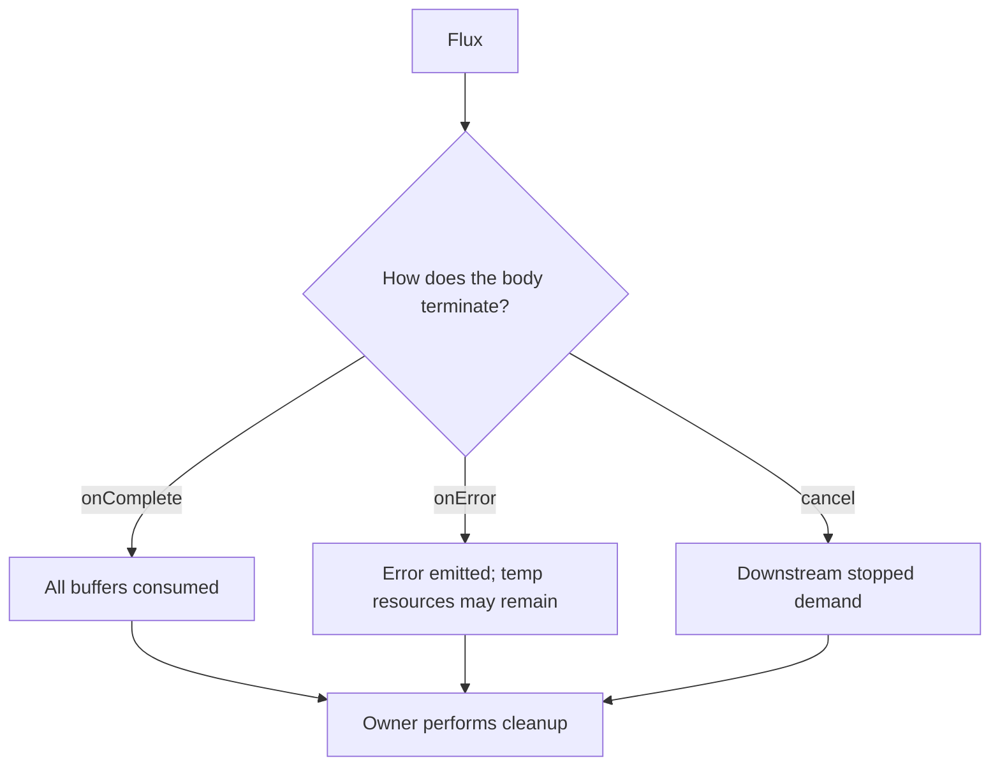
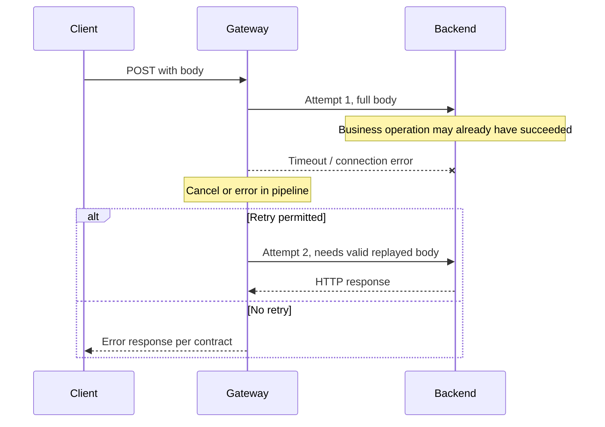

# `DataBuffer`, Retaining/Releasing Buffers, and Preventing Memory Leaks

In **Spring Cloud Gateway Server WebFlux**, HTTP payloads (both request bodies and response bodies) typically flow through a `Flux<DataBuffer>` stream. Each `DataBuffer` holds a chunk of binary data; chunks are emitted incrementally according to downstream demand. This lets the API Gateway proxy large requests and responses without holding the entire payload in memory.

However, when the Gateway needs to verify a signature, measure size, modify a JSON body, cache a body for retries, or run a custom filter, critical questions arise: **who owns each buffer, when is `retain` required, when must `release` be called, and what happens on errors or client cancellations?** Mistakes here can cause off-heap (direct memory) leaks, use-after-free buffer errors, latency spikes, or resource exhaustion while Java heap still looks healthy.

This lesson belongs to the **HTTP Body Handling** chapter and focuses on the `DataBuffer` lifecycle across Project Reactor, Spring WebFlux, and Spring Cloud Gateway—complete with Java examples, ownership rules, body size limits, testing strategies, and real operational pitfalls.

> **Scope:** Examples apply to Spring Cloud Gateway **Server WebFlux** running on Reactor/Netty. Gateway Server MVC uses a different request/response model. Only drop down to low-level `DataBuffer` code when truly necessary; prefer built-in Gateway body filters whenever possible.

## 1. Why Must the Gateway Manage Buffers?

HTTP messages can carry large payloads or continuous streams: JSON requests, file uploads, file downloads, Server-Sent Events (SSE), video, or incrementally generated responses. In WebFlux, the body is rarely a pre-loaded `String` sitting in RAM.


A `DataBuffer` is Spring's abstraction over a region of byte data, providing read/write operations, readable byte counts, and data views. Two underlying implementations are common:

| Buffer Kind | Characteristics | Key Takeaway |
| --- | --- | --- |
| Non-pooled buffer, e.g. from `DefaultDataBufferFactory` | Typically heap-backed; does not necessarily use reference counting | `release` is usually a no-op |
| Netty-backed buffer, e.g. `NettyDataBuffer` wrapping `ByteBuf` | May use direct/off-heap memory and reference counting | Holding too long leaks memory; releasing too early causes access errors |

Not every `DataBuffer` uses off-heap memory or a pooled `ByteBuf`. Write code against the `DataBuffer` / `DataBufferUtils` abstraction without assuming every implementation shares the same allocator.

### Why Are Off-Heap Leaks Hard to Spot?

When a pooled `ByteBuf`'s reference count never reaches `0`, the pool cannot reclaim that memory slice in time. Java GC may continue running normally and heap dumps won't reveal the culprit, yet the Gateway's **direct memory** climbs until it fails under load. Conversely, calling `release` too many times returns the buffer to the pool while another publisher still needs to read it, causing runtime errors or corrupted data.

**Both extremes are dangerous:** under-releasing leaks memory; releasing too early or twice triggers use-after-free failures.

## 2. Ownership Model and Reference Counting

For reference-counted buffers, think of the backing memory as needing to live until **every active owner** finishes with it. `DataBufferUtils.retain(buffer)` and `DataBufferUtils.release(buffer)` are Spring's APIs for managing this lifecycle when the buffer supports pooling.

```text
An owned pooled buffer (refCnt = 1)
  |
  +-- retain() --> refCnt = 2
  |                  |
  |                  +-- extra holder finishes -> release() -> refCnt = 1
  |
  +-- remaining owner finishes --------------- -> release() -> refCnt = 0
                                                 memory can be reclaimed
```

The counter above illustrates the principle of a reference-counted `ByteBuf`. Initial counts and internals can vary across buffer types and when slices/views/composites share underlying memory.

Key operations:

| API | Role | When to Use |
| --- | --- | --- |
| `DataBufferUtils.retain(buffer)` | Increments reference count if pooled | Another consumer needs the buffer after the current owner may finish |
| `DataBufferUtils.release(buffer)` | Decrements reference count if pooled | The component **currently owning** the buffer is done reading it |
| `DataBufferUtils.touch(buffer, hint)` | Attaches a leak-tracking hint on supported buffers | Debugging lifecycle issues in tests or diagnostics |
| `DataBufferUtils.releaseConsumer()` | `Consumer<DataBuffer>` helper that releases buffers | Pipelines where a consumer is responsible for releasing |

### Minimal Ownership Rules

1. **Receive and pass downstream unchanged:** if you only inspect metadata and forward the same buffer downstream, **do not release it manually**; the downstream consumer owns releasing it by contract.
2. **Receive and consume without forwarding:** once your code finishes reading, the owning code must **release** the buffer—even when an exception is thrown.
3. **Need to retain a buffer beyond the sender's lifecycle:** call `retain` before transferring ownership and ensure cleanup on every termination path.
4. **Buffer dropped inside a Reactive chain:** configure proper `discard` cleanup on operators that support it so dropped buffers do not lose their only release path.
5. **Unsure who owns a buffer:** never guess with random `retain`/`release` calls. Read the API contract at each handoff boundary and establish clear ownership.

### Anti-Pattern: Forwarding and Releasing at the Same Time

```java
// WRONG: downstream still needs the buffer to write the HTTP body.
Flux<DataBuffer> unsafe = inboundBody
    .doOnNext(buffer -> {
        log.debug("bytes={}", buffer.readableByteCount());
        DataBufferUtils.release(buffer); // Released too early.
    });

return response.writeWith(unsafe);
```

`response.writeWith(unsafe)` will receive buffers that may already be released. With pooled buffers, the HTTP writer fails when attempting to read the data.

**Correct when only logging chunk sizes:**

```java
Flux<DataBuffer> observed = inboundBody
    .doOnNext(buffer ->
        log.debug("bytes={}", buffer.readableByteCount()));

return response.writeWith(observed);
```

This snippet only reads `readableByteCount()`, leaves the reader index untouched, and does not retain the buffer; the HTTP writer remains responsible for consuming and releasing it.

## 3. Reactor Signals Directly Tied to Cleanup

A body publisher can:

- Emit `onNext(DataBuffer)` signals and finish normally with `onComplete`.
- Emit one or more buffers and fail with `onError`.
- Receive `cancel` due to client disconnect, timeout, or downstream stopping demand.
- Be cut short by operators like `take`, `filter`, or a fallback branch.



Cancellation is **not** an `onError` signal. For example, a `timeout` operator cancels upstream and emits `TimeoutException` downstream. Thus an upstream counter sees `CANCEL` while a counter after `timeout` sees `ON_ERROR` on the very same request.

To observe all three termination paths:

```java
return bodyProcessing
    .doOnError(error -> log.warn("body processing failed", error))
    .doFinally(signal -> log.debug("body pipeline finished: {}", signal));
```

`doFinally` is appropriate for observability or cleaning up resources **explicitly owned by your code**. Never use `doFinally` to blindly `release` every buffer that passed through a `Flux`: buffers may already have been released by the writer or may still be owned by another component.

### `doOnDiscard` and Operators That Drop Elements

Some Reactor operators can **drop** an incoming `DataBuffer` without forwarding it downstream. For operators that **support the discard hook**, you can register:

```java
Flux<DataBuffer> selected = source
    .filter(this::shouldKeep)
    .doOnDiscard(DataBuffer.class, DataBufferUtils::release);
```

This illustrates the discard hook on a generic `Flux<DataBuffer>`; **do not arbitrarily drop individual chunks on real HTTP bodies like this**, as dropping chunks corrupts HTTP content. When `filter` rejects a buffer, the hook releases the discarded buffer. Retained buffers continue downstream and are **not** passed to the discard hook.

Keep in mind:

- `doOnDiscard` only works for operators that support discard hooks; not every custom operator, publisher, or side effect invokes it.
- Hook placement determines which operators are covered. Place it on the pipeline segment that can drop buffers and verify with tests.
- Never both directly `release` a dropped buffer and also attach a discard hook that releases the same buffer.
- For buffers queued or cached manually, the queue/cache author must still write explicit cleanup for errors and cancellations.

## 4. Reading the Full Body with `DataBufferUtils.join`

When you must verify a signature or parse a payload, a common pattern is **joining chunks into one buffer**. Spring provides `DataBufferUtils.join(...)` to aggregate a `Publisher<DataBuffer>` into a `Mono<DataBuffer>`.

`join` may produce a composite buffer or merge via the `DataBufferFactory`; **never assume it always allocates an independent byte copy**. Once you receive the joined buffer, the consumer owns releasing it per contract.

### Safe Example: Copying to `byte[]` and Releasing the Joined Buffer

```java
static Mono<byte[]> copyBody(Flux<DataBuffer> body) {
    int maxBytes = 1024 * 1024; // 1 MiB for this example.

    return DataBufferUtils.join(body, maxBytes)
        .map(joined -> {
            try {
                byte[] copy = new byte[joined.readableByteCount()];
                joined.read(copy);
                return copy;
            } finally {
                DataBufferUtils.release(joined);
            }
        })
        .defaultIfEmpty(new byte[0]);
}
```

Explanation:

1. `join(body, maxBytes)` collects buffers up to a **maximum total byte limit**. Exceeding it raises `DataBufferLimitException`.
2. `joined.readableByteCount()` determines how many bytes to copy.
3. `joined.read(copy)` copies bytes into the application byte array.
4. `finally` guarantees the joined buffer is `release`d even if code inside `map` throws.
5. If the publisher emits zero buffers, `join` completes empty; `defaultIfEmpty` turns it into an empty byte array for this helper.

**Lifecycle inside `join`:** if upstream errors or cancels mid-aggregation, `DataBufferUtils.join` releases buffers accumulated so far. Once it emits a complete `DataBuffer`, the recipient must release it when finished. Never separately release individual input buffers already handed into `join`, as doing so causes a double release.

### Why Do Body Size Limits Still Matter?

If 1,000 concurrent clients send 10 MiB bodies and the Gateway aggregates them all, raw payloads alone occupy roughly **10 GiB** of memory before overhead. In a forwarding Gateway, copying full bodies eliminates streaming and backpressure advantages.

Where appropriate, configure memory bounds for WebFlux codecs, for example:

```yaml
spring:
  codec:
    max-in-memory-size: 1MB
```

This limit applies to codec/buffering operations in the Spring stack; it **does not replace** bounds in custom code. With `DataBufferUtils.join(body, maxBytes)`, `maxBytes` is passed directly to your helper. Verify the exact configuration property for your Spring Boot/Spring Framework version and enforce complementary limits at the reverse proxy/Gateway.

If a body exceeds the limit, map the error according to your **defined API contract** (e.g., an appropriate oversized-payload response such as HTTP `413 Content Too Large` when applicable) before the response is committed. Do not assume every `DataBufferLimitException` automatically turns into one fixed HTTP status.

## 5. Reading the Body Does Not Mean the Backend Still Receives It

A common mistake when writing a `GatewayFilter`:

```java
// WRONG in terms of business/request flow:
// the request body may already be consumed before Gateway proxies it.
return copyBody(exchange.getRequest().getBody())
    .flatMap(bytes -> {
        log.info("received {} bytes", bytes.length);
        return chain.filter(exchange);
    });
```

A body publisher is typically **designed for single-pass consumption** upon subscription and is not guaranteed to be repeatable. Once `copyBody` drains the stream, `chain.filter(exchange)` still passes the original request, yet upstream may observe an empty body, partial body, or a second-read error.

To **both inspect and forward**, you must actively preserve data on the request passed down the chain. Options:

- Use **`ModifyRequestBody`** when decoding/transforming a typed payload and re-writing a new body via the framework.
- Use **`CacheRequestBody`** when later filters need to reuse the body; watch memory costs and framework-managed cleanup.
- If writing a custom filter, wrap with a `ServerHttpRequestDecorator` providing the replacement body and manage new buffers cleanly across cancellation and retries.
- If you only need size metrics or counters, prefer **streaming pass-through** over reading the entire body.

Never call `subscribe()` inside a `GatewayFilter` to “peek quickly”: an unlinked subscription detaches from the request lifecycle, causing race conditions, lost bodies, and leaks on client disconnect.

### DSL Example: Using Built-In Body Modification

A route can use the Gateway WebFlux Java DSL:

```java
@Bean
RouteLocator bodyRoutes(RouteLocatorBuilder builder) {
    return builder.routes()
        .route("orders", r -> r
            .path("/api/orders/**")
            .filters(f -> f
                .modifyRequestBody(
                    String.class,
                    String.class,
                    (exchange, originalBody) -> {
                        // Example keeping the content intact after framework decoding.
                        return Mono.justOrEmpty(originalBody);
                    }))
            .uri("http://localhost:8081"))
        .build();
}
```

This example uses the `modifyRequestBody` builder to illustrate **buffer ownership managed by the Gateway filter factory**. Overloads and media-type support can vary by version; configure matching codecs, content types, and schemas when actually rewriting payloads. Leaving the body unchanged while running decode/encode adds needless overhead; never attach this filter just for logging.

If you actually transform JSON, confirm the rewritten body is valid JSON, `Content-Type` matches, the framework updates framing/length, and security checks or signatures no longer rely on original raw bytes.

## 6. Observing a Response Body Without Retaining or Releasing Buffers

A `GlobalFilter` can decorate the response to record chunk sizes without consuming the body:

```java
@Component
public class ResponseSizeFilter implements GlobalFilter, Ordered {

    private static final Logger log =
        LoggerFactory.getLogger(ResponseSizeFilter.class);

    @Override
    public int getOrder() {
        return -1;
    }

    @Override
    public Mono<Void> filter(
            ServerWebExchange exchange,
            GatewayFilterChain chain) {

        ServerHttpResponseDecorator decorated =
            new ServerHttpResponseDecorator(exchange.getResponse()) {
                @Override
                public Mono<Void> writeWith(
                        Publisher<? extends DataBuffer> body) {
                    return super.writeWith(
                        Flux.from(body).doOnNext(buffer ->
                            log.debug("response chunk: {} bytes",
                                buffer.readableByteCount())));
                }
            };

        return chain.filter(
            exchange.mutate().response(decorated).build());
    }
}
```

Types used here include `GlobalFilter`, `Ordered`, `GatewayFilterChain`, `ServerWebExchange`, `ServerHttpResponseDecorator`, `Publisher`, `DataBuffer`, `Flux`, `Mono`, and standard logging types.

**Why does this measurement not leak?** The callback only reads `readableByteCount()` and passes the **exact same buffer** onward to the writer without calling `retain` or `release`. The writer retains full ownership for consuming and releasing it.

**Example limitation:** `writeWith(...)` does not cover every write path—specifically `writeAndFlushWith(...)`, which is commonly used for chunk-flushed streams like SSE. If complete streaming metrics are needed, handle that method appropriately or use built-in observability. Never convert the body into a `String` “just to log easily,” as that breaks streaming and risks data leaks.

## 7. When Is `retain` Needed, and How to Avoid Holding Too Long?

`retain` should only be used when there are **two independent ownership lifecycles**. For instance, one component hands a buffer to the HTTP writer while an asynchronous background task still needs those bytes after the writer may have finished.

With pooled buffers, if two consumers hold the same reference without `retain`, one can release it while the other is still reading. If you call `retain` and miss cleanup on an error or cancellation branch, the pool leaks. Therefore, a safer choice in many observability tasks is to **copy a small, bounded slice of data** into an independent structure and let the writer keep the original buffer.

| Need | Approach | Risks to Control |
| --- | --- | --- |
| Count bytes, measure latency | Inspect metadata and pass through | Do not accidentally release the buffer |
| Streaming hash/checksum | Process each chunk non-blockingly and forward intact if allowed | Do not advance reader index permanently; do not keep references past lifecycle |
| Log bounded preview (a few hundred bytes) | Copy only allowed byte count; sanitize sensitive fields | Avoid logging tokens/PII; bound overhead |
| Buffer body to verify signature before proxying | Use bounded body/caching filters | Single-pass body, cleanup on error/cancel |
| Retain buffer for async task | Pair `retain` and `release` with explicit ownership | Double release or missing release |
| Large response bodies | Streaming pass-through | Never buffer whole body in RAM |

### Specific `retain` Traps

**Trap 1 — Calling `retain` on every `onNext` with no matching `release`:** reference counts climb indefinitely. After millions of requests, direct memory is exhausted.

**Trap 2 — Handing a buffer to a detached background task:** if the task is not tied to the main `Mono`/`Flux`, client cancellation will not stop it and cleanup may be skipped.

**Trap 3 — Sharing a single buffer across multiple subscriptions:** a body publisher may be re-subscribed during retries or fallbacks; re-emitting a pooled buffer that was already released triggers use-after-free errors. Caching/replay requires intentionally designed retention and replay mechanics.

**Trap 4 — Releasing both input buffers and the composite from `join`:** the composite may already own its inner components; releasing twice breaks ownership.

**Trap 5 — Storing a buffer in a field of a singleton filter:** mixes data across concurrent requests, creates race conditions, retains memory indefinitely, and leaks user data.

Unless you have proven a need to share buffers across independent lifecycles, **prefer passing buffers through without `retain`**.

## 8. Request Bodies, Retries, and Circuit Breakers at the Gateway

Spring Cloud Gateway can attach `Retry` or `CircuitBreaker` filters to a route. For bodyless requests, retrying is straightforward with respect to input data. For requests with a body, **each retry attempt needs a valid, replayable body source**.

Example:

```http
POST /api/payments HTTP/1.1
Content-Type: application/json

{"orderId":"o-42","amount":250000}
```

If the first attempt reaches the backend, the backend records the payment, and the Gateway times out waiting for the response, retrying can create a duplicate payment. If the Gateway cannot replay the body properly, the retry may send an empty or corrupted body. These are **two independent concerns**:

1. **Technical data correctness:** the body must be cached/replayed with safe `DataBuffer` handling across all attempts.
2. **Business correctness:** retry only when the operation carries an idempotency key/deduplication guard or is verified safe to repeat.



Built-in Gateway caching/retry filters may retain referenced buffers across attempts; do not manually release buffers owned by built-in filters. If you implement custom retry or caching, design explicit cleanup for completion, error, cancellation, and retry exhaustion.

**Rate limiting** works best when rejecting early before spending memory reading large bodies. **Circuit breakers** require contract-compliant fallbacks; never return a default `200` when upstream fails and the response body is meaningless. **TLS** protects bytes in transit, not memory leaks inside the Gateway process.

## 9. Errors and Cancellation During Body Processing

Distinguish these scenarios carefully:

| Event | Impact on Stream | Required Action |
| --- | --- | --- |
| Client disconnects mid-upload | Downstream may cancel upstream request body | Release owned resources; do not keep reading indefinitely |
| Backend closes connection early | Response/request pipeline may error or cancel | Do not leave buffers stranded in uncleaned queues |
| Aggregation limit exceeded | `join`/codec may emit `DataBufferLimitException` | Release accumulated buffers; emit contract-appropriate HTTP error |
| JSON decode failure | Publisher may `onError` after partial data | Avoid retaining unbounded temporary buffers or `byte[]` |
| Timeout mid-response streaming | Response may already be committed | Never try altering HTTP status post-commit; close stream and record error |
| Operator drops a chunk | Buffer never reaches downstream | Use discard hooks/cleanup appropriate to operator and ownership |
| Retrying request with body | May re-subscribe or reuse cache | Ensure replayability and release resources after final attempt |

An easy mistake to make:

```java
// WRONG: block() on the Gateway's reactive processing path.
byte[] bytes = copyBody(exchange.getRequest().getBody()).block();
return chain.filter(exchange);
```

Errors here include blocking an event-loop thread and consuming the request body before forwarding the original request. In a WebFlux Gateway, the pipeline must be **composed asynchronously**:

```java
// This only illustrates asynchronous composition.
// To proxy the original request after reading the body, you must also supply a new body.
return copyBody(exchange.getRequest().getBody())
    .flatMap(bytes -> validateBody(bytes));
```

In this illustration, `validateBody` must return an appropriate `Mono`; the snippet only shows reactive composition and is **not** a complete forwarding filter. To continue `chain.filter(exchange)` with a valid body, use a proper rewrite/decorator mechanism as in Section 5.

### Do Not Turn `DataBuffer` Errors into Contract-Violating HTTP Responses

- Oversized bodies can return `413` if designed as part of your policy.
- Malformed JSON typically maps to `400`; syntactically valid payloads failing business rules may use another contract status.
- Upstream connectivity failures typically fall under `502`/`503`/`504` depending on root cause and timeout policy.
- Client upload cancellations may leave no socket open to send a final HTTP response.

Never use `onErrorResume` to return fake success or swallow exceptions; doing so hides memory bugs and hampers incident diagnosis.

## 10. Debugging Memory Leaks on Reactor Netty

### Warning Signs

- Direct memory or process/container RSS climbs with traffic and fails to recover as expected.
- Gateway throughput drops, latency spikes, or `ByteBuf`/reference-count errors appear.
- Logs contain Netty warnings like `LEAK: ByteBuf.release() was not called before it's garbage-collected`.
- Issues surface only on routes with large request/response bodies, custom filters, or retries.

**Do not conclude there is a leak solely because a pool retains memory.** Pools hold memory for reuse, and resident memory does not always drop immediately after each request. Evaluate growth across load cycles, pool bounds, leak logs, and memory reuse.

### Enabling Controlled Leak Detection

Netty includes leak detection for unreleased buffers. In test or diagnostic environments, raise detection detail with the JVM system property:

```bash
-Dio.netty.leakDetection.level=advanced
```

`advanced` reports richer allocation/access trails than simple mode; `paranoid` can help in isolated tests at heavy overhead. Never leave high-detail levels enabled indefinitely in production without measuring impact. Leak detector logs are **diagnostic clues**, not a substitute for tracing ownership; a leak missed by sampling can still exist.

You can attach hints via `DataBufferUtils.touch(buffer, "route=orders,stage=body-check")` at key points to aid tracking when buffers support leak detection. Never embed tokens, personal data, or payloads in touch hints.

### Root-Cause Investigation Workflow

1. Identify routes and filters that read or write bodies—especially custom filters, body caches, retries, and fallbacks.
2. Separate **pass-through** routes from **consume-and-drop** or **cache/replay** routes.
3. For every retained `DataBuffer`, trace ownership across each operator and identify what ends ownership.
4. Check all three termination paths: **complete, error, cancel**. A passing happy path never proves timeout cleanup works.
5. If using `join`, verify where the joined buffer is released; if filtering/dropping, verify whether the operator invokes `doOnDiscard`.
6. Generate sustained load with sizable bodies, mid-upload client aborts, and backend failures while watching memory/allocator metrics and Netty logs.
7. After fixing, re-run the same scenario to confirm flat resource usage and intact upstream bodies.

## 11. Testing Buffer Management

### Testing a Body-Reading Helper

Use `StepVerifier` from `reactor-test` to verify a helper like `copyBody`:

```java
@Test
void joinsAndCopiesSmallBody() {
    DataBufferFactory factory = new DefaultDataBufferFactory();

    Flux<DataBuffer> body = Flux.just(
        factory.wrap("hello ".getBytes(StandardCharsets.UTF_8)),
        factory.wrap("gateway".getBytes(StandardCharsets.UTF_8))
    );

    StepVerifier.create(copyBody(body))
        .assertNext(bytes -> assertEquals(
            "hello gateway",
            new String(bytes, StandardCharsets.UTF_8)))
        .verifyComplete();
}
```

This test validates byte output, though `DefaultDataBufferFactory` generally **does not** exercise Netty pooled reference-counting risks. To catch leaks or double-releases, add tests with pooled buffer implementations, leak detection enabled, cancel/error scenarios, and reference-count assertions where test APIs allow.

### Testing Limit Enforcement

```java
@Test
void rejectsBodyLargerThanLimit() {
    DataBufferFactory factory = new DefaultDataBufferFactory();
    Flux<DataBuffer> body = Flux.just(
        factory.wrap(new byte[2 * 1024 * 1024])
    );

    StepVerifier.create(copyBody(body))
        .expectError(DataBufferLimitException.class)
        .verify();
}
```

This expectation assumes the 1 MiB limit in Section 4's helper. It does not test HTTP `413` mapping because `copyBody` is a low-level helper; verify HTTP status codes in Gateway integration tests alongside your error handler.

### End-to-End Gateway Testing

Use `WebTestClient`, WireMock/MockWebServer, or a stub upstream to verify:

| Scenario | Key Assertion |
| --- | --- |
| Small JSON POST through filter | Upstream receives **all** bytes, matching `Content-Type` and body |
| Contract-transformed body | Upstream receives valid JSON matching schema, no `Content-Length` mismatch |
| Oversized upload | Rejected per policy without unbounded body buffering |
| Client aborts mid-upload | Cancellation propagates; no detached reader continues indefinitely |
| Backend closes connection early | Resources, connections, and buffers cleaned up on error branch |
| Retry on request with body | Every attempt receives exact payload; no premature buffer release |
| Streaming response | Chunks stream forward without collapsing into one huge buffer |
| Response cancelled mid-stream | Retained buffers cleaned up; no lingering subscriptions |
| Sustained concurrent load | Direct memory and open connections stay bounded |

Never validate leak safety solely with HTTP `200` or a single-buffer test. Many bugs surface only across **multiple chunks**, on **cancellation after partial delivery**, or when **two retry attempts share an improperly managed resource**.

## 12. Common Implementation Mistakes

| Mistake | Why It Is Dangerous | Fix |
| --- | --- | --- |
| Calling `release` in `doOnNext` and passing same buffer to writer | Writer may read already-freed memory | Observe metadata only and pass through; let writer own consumption |
| Calling `join`, reading bytes, and forgetting `release` on joined buffer | Leaks pooled memory | Use `try/finally` as shown in `copyBody` |
| Releasing input buffers already owned by `join` | Double release | Release only the joined result buffer per contract |
| Calling `retain` without releasing on cancel/error | Reference count never reaches 0 | Map every owner and clean up on all termination branches |
| Reading body then calling `chain.filter(exchange)` on original request | Body replay is no longer guaranteed | Use `ModifyRequestBody`, caching, or a proper decorator |
| Calling `subscribe()` inside a filter | Creates work detached from request lifecycle | Return a `Mono`/`Flux` composed into the chain |
| Calling `block()` on an event-loop thread | Stalls processing of all other requests on that thread | Use async reactive operators; isolate blocking I/O if unavoidable |
| Aggregating bodies without byte bounds | Triggers OOM/DoS under concurrency | Bound bytes, concurrency, timeouts, and prefer streaming |
| Trying to log full bodies | Wastes memory and risks leaking tokens/PII | Log metadata or strictly bounded safe previews |
| Rewriting body while keeping stale `Content-Length` | Client/backend reads truncated body or hangs waiting for bytes | Use framework body-rewrite filters; check post-transform headers |
| Retrying non-idempotent `POST` | Can execute business action multiple times | Require idempotency keys and strict retry policies |
| Skipping cancellation tests | Leaks appear only when clients disconnect | Add abort/timeout tests using pooled buffers |
| Changing response status after streaming commit | Cannot alter an already-sent status line | Handle errors before commit or terminate stream cleanly |

### When Do You Not Need to Touch `DataBuffer` at All?

If you only need to rewrite paths/headers, evaluate route predicates, authenticate, rate-limit, trip circuit breakers, or configure TLS, you generally **do not need to touch request or response bodies**. Stick to built-in Gateway filters and Spring Security. Every time you inspect or alter a body, you take on responsibility for:

- Payload size bounds and backpressure.
- Buffer ownership and reference counting.
- Body semantics during retries.
- Correct `Content-Type`, encoding, and framing length.
- Cleanup on errors and cancellations.
- Content security and performance overhead.

## 13. Practice Exercise: Enforcing a JSON Size Limit Before Proxying

A Gateway serves `POST /api/orders` to `order-service`. The team wants to enforce a **1 MiB** JSON body limit, record byte counts as metrics, and forward the body intact. Client cancellations mid-upload must stop cleanly; oversized requests must be rejected per HTTP contract without unbounded buffering at the Gateway.

### A Sound Design Approach

1. Use `Path` and `Method` route predicates to match `POST /api/orders`; let Spring Security validate JWT/scopes in the `WebFilter` layer.
2. Prefer bounded codec/`ModifyRequestBody` or bounded validation mechanisms, avoiding multiple subscriptions to the raw request body.
3. If using `DataBufferUtils.join`, set `maxBytes=1_048_576` and release the joined buffer immediately after extracting needed bytes.
4. When the body is valid, provide a **new body** via framework-managed request decoration/rewriting so `order-service` receives the full payload.
5. For oversized bodies, map errors cleanly before response commit and verify cleanup on error and cancellation branches.
6. Count bytes via streaming metadata where possible; never log raw payloads or tokens.
7. Test valid requests, empty requests, oversized requests, client aborts, upstream timeouts, and retries if enabled.

### Self-Check Questions

1. Why can `DataBufferUtils.release(buffer)` be a no-op on one buffer implementation yet critical on another?
2. What does `retain` do to a reference count, and when must a matching `release` run?
3. If a buffer is handed to the HTTP writer, why must you never `release` it inside `doOnNext`?
4. Does `DataBufferUtils.join(body, maxBytes)` prevent unbounded body aggregation? Who releases the buffer emitted by `join`?
5. Why does calling `copyBody(exchange.getRequest().getBody())` followed by `chain.filter(exchange)` fail to guarantee the backend still sees the body?
6. When a Reactor `filter` drops a `DataBuffer`, what is `doOnDiscard`'s role? Does it cover every operator?
7. When `timeout` cancels upstream, which branch needs cleanup, and why does `CANCEL` not automatically mean HTTP `500`?
8. Why are tests using `DefaultDataBufferFactory` insufficient to catch pooled Netty buffer leaks?
9. Which **two conditions**—one for body data and one for business semantics—must hold before retrying a `POST`?
10. Why should Netty leak detection be run selectively in test environments rather than at maximum level continuously in production?

**Key Takeaway:** `DataBuffer` is the unit of payload flow in the reactive HTTP pipeline. Every buffer requires **a clear ownership lifecycle**: if passing through, let downstream manage it; if consuming and dropping, release it; if retaining an extra reference, pair it with guaranteed cleanup; and never overlook discarded or cancelled streams. Enforcing size limits, preferring built-in Gateway body filters, and testing success, error, and cancellation paths prevent memory leaks while preserving Spring Cloud Gateway's streaming efficiency.
