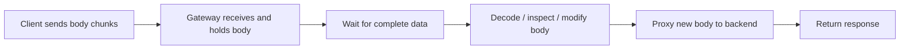
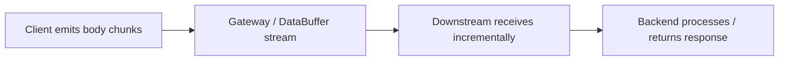

# Full Content Buffering vs. Streaming in Spring Cloud Gateway

## 1. The Question: Does an API Gateway Need to Hold the Entire HTTP Body?

**Spring Cloud Gateway** is the entry point for microservices: receiving requests, selecting routes via **route predicates**, executing the **filter chain**, modifying paths/headers, resolving services, and forwarding to backends. Mechanisms such as JWT authentication, rate limiting, circuit breakers, retries, TLS, and observability keep the system operating safely. When handling **HTTP bodies**, a critical architectural choice is **holding the full content in memory** (*full buffering*) versus **forwarding chunks as data arrives** (*streaming*).

Examples:

- `POST /api/orders` sending a small JSON payload: may need to read, inspect, or alter a field before proxying.
- `PUT /api/files/video.mp4` uploading a multi-hundred-MB video: holding the whole file in RAM per request puts heavy pressure on memory.
- `GET /api/reports/export` returning a large file: should forward chunks incrementally instead of waiting for the entire file to materialize.
- `GET /api/events` returning **Server-Sent Events (SSE)**: responses can stay open indefinitely, with no “whole body” to wait for completion.

**Lesson goal:** understand how `Flux<DataBuffer>` works in Gateway Server WebFlux; know when buffering is required and when streaming is the right choice; set limits, avoid buffer leaks, and test the difference.

> **Scope:** this lesson focuses on **Spring Cloud Gateway Server WebFlux** using Reactor/Netty. Gateway Server Web MVC uses the Servlet stack and different I/O mechanics; the reasoning behind choosing buffering vs. streaming still applies, though do not copy WebFlux `Flux<DataBuffer>` or `GlobalFilter` code directly into MVC.

## 2. Two Body-Handling Models

### 2.1. Full Buffering: Read Everything First, Then Process



With **full buffering**, the Gateway or a filter consumes the body into an in-memory structure such as a `String`, DTO, `byte[]`, or aggregated `DataBuffer`. Only after collecting enough data does the filter decide how to proceed—for example, rewriting JSON or validating content.

Advantages: sees the entire payload, convenient for JSON schema checks, body rewrites, full-payload checksums, or replaying requests on retry. Trade-offs: memory, latency, and decoding CPU scale with body size.

### 2.2. Streaming: Process Chunk by Chunk



With **streaming**, the Gateway does not wait for the entire request or response to finish before forwarding data; chunks flow through the reactive pipeline as they arrive. This is especially valuable for large uploads/downloads, SSE, and continuously generated payloads.

**Streaming does not mean “zero memory usage.”** Sockets, Netty, codecs, network buffers, TLS, Reactor operators, and filters can all retain transient data. Backpressure regulates pace when components honor demand, but it does not guarantee constant memory across the entire system.

### 2.3. Direct Comparison

| Criterion | Full Buffering | Streaming |
|---|---|---|
When can downstream begin receiving data? | Usually after the Gateway finishes reading the aggregated body | As soon as individual body chunks are ready |
Memory vs. body size | Scales with total payload and concurrent requests | Primarily bounded by in-flight chunks, though pipeline-dependent |
Time to first byte | Higher due to waiting for full body | Typically lower |
Re-reading the body | Easier when paired with proper cache/replay | Not repeatable by default |
Whole-JSON transformation | Convenient | Requires incremental parsers or other strategies to preserve streaming |
Large uploads/downloads | Risk of holding huge data in RAM | Usually far more suitable |
Unbounded SSE/NDJSON | Unsuitable to wait for full content | Suitable when events flush properly |
Risks | `DataBufferLimitException`, OOM, higher latency | Buffer leaks, downstream stalls, queue buildup if backpressure breaks |

## 3. What Is a Body in Gateway Server WebFlux?

In WebFlux, the request body is typically accessed as:

```java
Flux<DataBuffer> body = exchange.getRequest().getBody();
```

Where:

- `Flux<DataBuffer>` is an **asynchronous** stream of byte chunks.
- `DataBuffer` is Spring's byte-buffer abstraction; on Reactor Netty, it can wrap a **pooled**, **reference-counted** `ByteBuf`.
- Using codecs, Spring can decode the body into a `String`, JSON DTO, `byte[]`, or *multipart* data.
- An HTTP body is designed to be **consumed as a stream**. Once a filter consumes it, downstream **cannot automatically read it again** without explicit caching or request decoration.

Therefore, never write a filter like this:

```java
// Design flaw when still trying to proxy the original request:
exchange.getRequest().getBody().subscribe(buffer -> {
    // read/log body here and ignore
});
return chain.filter(exchange);
```

This creates a subscription outside the Gateway's control, races to consume the body before the backend reads it, breaks backpressure, and leaks buffers. **Never manually call `subscribe()`, `block()`, or unbounded `collectList()` in a filter** just to inspect a payload.

### 3.1. Distinguishing Raw Bytes from Decoded Objects

```text
Network bytes
    |
    v
Flux<DataBuffer>    <-- can stream
    |
    +--> Codec/Decoder --> Mono<DTO> or Mono<String>
    |                     (sometimes requires aggregating the body)
    |
    +--> Proxy HTTP client --> downstream receives byte stream
```

The difference is not whether Reactor is used, but whether **a step requires the entire payload**. For example, `Mono<String>` represents an asynchronous result, **not** incremental forwarding: building one `String` representing the whole body means the filter aggregated the content.

## 4. When Does Spring Cloud Gateway Need Buffering?

### 4.1. Filters Directly Touching the Body

| WebFlux Component | Why Might It Buffer the Body? | Operational Note |
|---|---|---|
`CacheRequestBody` | Reads/caches request for later components to reuse | Original body read once; cached data raises memory usage |
`ModifyRequestBody` | Decodes request, runs rewrite function, encodes new body | Configurable only via **Java DSL**; unsuitable by default for large files |
`ModifyResponseBody` | Decodes and modifies response before sending to client | Configurable only via **Java DSL**; can sacrifice streaming benefits |
`Retry` with body methods | Stores request body to resend on retries | Gateway docs warn about memory when retrying requests with bodies |
`ReadBody` route predicate | Reads and caches body for programmatic predicates | Reads body during route selection; weigh size and cost |
`LocalResponseCache` | Caches responses per policy for reuse | Not streaming; requires cache policy, TTL, and capacity bounds |

**Not every filter reads the body.** `Path`, `Host`, `Method`, `StripPrefix`, `AddRequestHeader`, and `SetResponseHeader` operate primarily on metadata, paths, or headers; using them **does not force** the Gateway to buffer the full body.

### 4.2. `CacheRequestBody`: Read Once, Reuse Later

WebFlux **4.3+/5.x** route example:

```yaml
spring:
  cloud:
    gateway:
      server:
        webflux:
          routes:
            - id: cached-json-route
              uri: http://localhost:8081
              predicates:
                - Path=/api/inspect/**
              filters:
                - name: CacheRequestBody
                  args:
                    bodyClass: java.lang.String
```

This filter reads the request body, converts it to `String` (per `bodyClass`), and stores it in the `ServerWebExchange` attribute keyed by `ServerWebExchangeUtils.CACHED_REQUEST_BODY_ATTR`. Filters that genuinely need the body can read the cached value; the Gateway uses an appropriate mechanism so later stages can still read the request.

**Cost:** converting a request to `String` can consume more memory than raw wire bytes due to character representation, decoding, and intermediate objects. Do not enable body caching on every route by default just in case of logging.

### 4.3. `ModifyRequestBody` and `ModifyResponseBody` via Java DSL

These two factories are for cases where you truly must transform **content**, not merely paths or headers. Official docs require configuring them via the **Java DSL** (not arbitrary YAML filter parameters).

The following example illustrates a **small text request**, not binary uploads:

```java
package com.example.gateway;

import org.springframework.cloud.gateway.route.RouteLocator;
import org.springframework.cloud.gateway.route.builder.RouteLocatorBuilder;
import org.springframework.context.annotation.Bean;
import org.springframework.context.annotation.Configuration;
import org.springframework.http.MediaType;
import reactor.core.publisher.Mono;

@Configuration
public class TextBodyRoutes {

    @Bean
    RouteLocator textRoutes(RouteLocatorBuilder builder) {
        return builder.routes()
            .route("normalize-text", r -> r.path("/api/text")
                .filters(f -> f
                    .modifyRequestBody(
                        String.class,
                        String.class,
                        MediaType.TEXT_PLAIN_VALUE,
                        (exchange, text) ->
                            text == null
                                ? Mono.empty()
                                : Mono.just(text.strip()))
                    .modifyResponseBody(
                        String.class,
                        String.class,
                        (exchange, text) ->
                            text == null
                                ? Mono.empty()
                                : Mono.just(text.toUpperCase())))
                .uri("http://localhost:8081"))
            .build();
    }
}
```

A `POST /api/text` sending `"  hello  "` is trimmed before calling the backend; the backend's text response is uppercased. Running this end-to-end requires a backend exposing `/api/text` and returning `text/plain`.

**Key points:**

- Converting to `String` to edit bodies incurs decode/encode cost. Never apply these two filters blindly to video, zip files, large uploads, or SSE.
- When the request or response **has no body**, the rewrite function can receive `null`; documentation requires returning `Mono.empty()` for bodyless cases.
- Changing the body can affect `Content-Length`, `Content-Type`, `Content-Encoding`, body signatures, and `ETag`. Let the filter/framework update metadata appropriately and test; never preserve a stale `Content-Length` after rewriting.
- Altering payloads after verifying a body signature can **invalidate the signature** downstream. Decide where verification occurs and re-sign if the protocol genuinely requires it.

### 4.4. `Retry` with Request Bodies: Memory Can Spike

Gateway Server WebFlux documentation warns: when `Retry` is used with **HTTP methods carrying a body**, the request body may be **cached in memory** for retry attempts, managed via the `CACHED_REQUEST_BODY_ATTR` exchange attribute. One client request can trigger multiple downstream attempts.

Therefore:

1. Retry only **safe or idempotency-designed operations**; for order/payment POSTs, require an idempotency key and clear business policies.
2. Cap retry attempts, backoff, timeouts, and concurrent requests.
3. Enforce request size limits before allowing caching or retries.
4. Avoid letting a large file-upload route accidentally inherit `Retry` via a global `default-filter`.

## 5. Streaming: Pass-Through Routes Without Decoding Bodies into Objects

### 5.1. Configuring Routes for Uploads and SSE

Suppose `file-service` runs on `localhost:8081` and `event-service` runs on `localhost:8082`. On **Gateway Server WebFlux 4.3+**:

```yaml
server:
  port: 8080

spring:
  application:
    name: edge-gateway
  cloud:
    gateway:
      server:
        webflux:
          routes:
            - id: file-upload-route
              uri: http://localhost:8081
              predicates:
                - Path=/api/files/**
                - Method=PUT,POST
              filters:
                - StripPrefix=1
                - name: RequestSize
                  args:
                    maxSize: 20MB

            - id: live-events-route
              uri: http://localhost:8082
              predicates:
                - Path=/api/events/**
                - Method=GET
              filters:
                - StripPrefix=1
```

For `PUT /api/files/video.mp4`, `StripPrefix=1` rewrites the backend path to `/files/video.mp4`. For `GET /api/events/ticks`, the backend receives `/events/ticks`. In both routes, we **declare no** filter that reads or transforms the full body; the Gateway forwards via streaming over the reactive HTTP pipeline.

`RequestSize` enforces a Gateway **HTTP request size limit** via `maxSize`; requests exceeding the filter's check are rejected with **413 Payload Too Large**. It does not turn the request into a buffered body, nor is it a codec decode limit. For chunked uploads lacking `Content-Length`, reverse proxies and backends need complementary size enforcement; never trust a single layer alone.

**Older versions:** in Gateway Server WebFlux 4.2 and earlier, route lists typically lived under `spring.cloud.gateway.routes`. Do not paste the newer namespace into an older release train without upgrading the starter.

### 5.2. SSE Is the Clear Showcase of Streaming

A **WebFlux** backend can emit continuous events:

```java
package com.example.events;

import java.time.Duration;
import org.springframework.http.MediaType;
import org.springframework.http.codec.ServerSentEvent;
import org.springframework.web.bind.annotation.GetMapping;
import org.springframework.web.bind.annotation.RestController;
import reactor.core.publisher.Flux;

@RestController
class EventController {
    @GetMapping(value = "/events/ticks", produces = MediaType.TEXT_EVENT_STREAM_VALUE)
    Flux<ServerSentEvent<String>> ticks() {
        return Flux.interval(Duration.ofSeconds(1))
            .map(number -> ServerSentEvent.<String>builder()
                .event("tick")
                .id(number.toString())
                .data("tick-" + number)
                .build());
    }
}
```

This is a backend controller, not a Gateway filter. Clients observe events arriving incrementally:

```bash
curl -N -i http://localhost:8080/api/events/ticks
```

`-N`/`--no-buffer` stops **curl** from buffering output excessively so you can observe events in real time. Proxies, HTTP clients, compression, and intermediate buffers can still affect flush timing. For SSE, send periodic **heartbeats** and handle disconnects cleanly.

**Never put `ModifyResponseBody(String.class, ...)` on an SSE route** just to log. A long-lived or infinite stream has no “complete string” for the filter to collect and emit; doing so inflates memory, stalls delivery, or fails outright.

## 6. Codec Limits Differ from HTTP Request Size Limits

A frequent error when decoding bodies is:

```text
org.springframework.core.io.buffer.DataBufferLimitException:
Exceeded limit on max bytes to buffer
```

Spring WebFlux codecs enforce a cap on how many bytes **may be buffered in memory** when a decoder needs to aggregate data. Per Spring Framework docs, many codecs default to around **256 KiB**. Check exact defaults and property names against your Spring Boot/Framework release.

In Spring Boot **3.5 and 4.x**, Boot's codec property is:

```yaml
spring:
  http:
    codecs:
      max-in-memory-size: 1MB
```

This example **allows built-in codecs to aggregate up to 1 MB when needed**, not advice to raise the default arbitrarily. `spring.http.codecs.max-in-memory-size` applies to **auto-configured Spring Boot WebFlux servers and `WebClient`s**; it does not automatically govern custom `DataBufferUtils.join(...)` calls, manually constructed HTTP clients/codecs, or every Gateway path.

| Limit | What It Bounds | Does It Protect the Whole Gateway Automatically? |
|---|---|---|
Route `RequestSize` | Request size per filter mechanics | No; coordinate with ingress, backend, and request modes |
`spring.http.codecs.max-in-memory-size` | Bytes a codec may aggregate during decoding | No; applies only to codecs/instances within config scope |
Reverse proxy/ingress body limit | Requests entering the system | Does not replace Gateway/backend checks |
Multipart limits | Part counts, memory/disk usage of parts | Applies when using the corresponding multipart decoder |
`DataBufferUtils.join(source, maxByteCount)` | Total bytes joined in custom code | Applies only at that specific call site |

**Never “fix” `DataBufferLimitException` by setting a massive limit or disabling limits.** Ask instead: which request is being aggregated, why is full-body reading needed, can it stream, what are valid business payload sizes, and what is concurrency?

### 6.1. A Memory Estimate for Capacity Planning

Suppose **100 concurrent requests** each retain an **8 MiB** payload in RAM. Raw body bytes alone already total roughly:

```text
100 requests × 8 MiB = 800 MiB
```

This is a **minimum estimate just to visualize risk**, excluding temporary byte buffers, Java/JSON objects, copies, TLS, metadata, thread stacks, send buffers, and Netty off-heap memory. A container with modest RAM limits can hit OOM or get OOM-killed by the OS.

In reality, memory usage varies with copy count, decoding strategy, and retention duration. Measure **peak concurrent buffered bytes**, not merely requests per minute.

## 7. `DataBuffer`, Pooling, and Release Responsibility

Netty may use pooled, reference-counted buffers. If a custom filter consumes a `DataBuffer` without handing off ownership or calling **`release`** properly, memory leaks occur even while Java heap looks free.

Key rules:

1. **Prefer built-in filters and codecs** over manual buffer manipulation unless strictly required.
2. If you consume a `DataBuffer` yourself without forwarding it, ensure it is released—typically via `DataBufferUtils.release(buffer)`.
3. When Reactor operators can drop elements (`filter`, `skip`, prefetch, cancel/error), attach appropriate cleanup such as `doOnDiscard(DataBuffer.class, DataBufferUtils::release)` per documentation.
4. When joining buffers, prefer **bounded** APIs with cleanup handling, such as `DataBufferUtils.join(source, maxByteCount)`.
5. Never hold references to pooled buffers inside singletons, unbounded caches, or callbacks outliving the request without managing reference counts.

### 7.1. Illustrative Java Example of **Bounded** Reading

The helper below merely illustrates aggregating a `Flux<DataBuffer>` into a `String` **with an explicit limit**. It is **not** a complete `GlobalFilter` and **does not** recreate the body for downstream:

```java
import java.nio.charset.StandardCharsets;
import org.springframework.core.io.buffer.DataBuffer;
import org.springframework.core.io.buffer.DataBufferUtils;
import reactor.core.publisher.Flux;
import reactor.core.publisher.Mono;

static Mono<String> readSmallBody(Flux<DataBuffer> source) {
    int maxBytes = 1024 * 1024; // 1 MiB
    return DataBufferUtils.join(source, maxBytes)
        .map(joined -> {
            try {
                byte[] bytes = new byte[joined.readableByteCount()];
                joined.read(bytes);
                return new String(bytes, StandardCharsets.UTF_8);
            } finally {
                DataBufferUtils.release(joined);
            }
        });
}
```

**Limitations of this example:** it consumes `source` once. To proxy the request after reading, you must cache/decorate the request appropriately; otherwise downstream has no body left. When exceeding `maxBytes`, `join` signals a limit exception; callers must map that error to an appropriate response instead of exposing stack traces. Never use this code for large payloads.

## 8. Streaming and Backpressure: Benefits and Limits

**Backpressure** lets a receiver signal demand to a producer in a reactive pipeline. When downstream slows down, backpressure-aware stages slow emission, preventing unbounded queue growth.

However, not every boundary speaks the same signal:

- TCP has its own flow control; real network throughput and socket buffers still matter.
- HTTP/1.1 and HTTP/2 handle framing and flow control differently; using Netty does not guarantee each `DataBuffer` maps 1:1 to a wire HTTP chunk.
- A filter calling `collectList()`, `cache()`, or unbounded queues destroys streaming benefits even though the surface API still returns `Flux`.
- Compression, body transforms, or multi-service fan-outs can temporarily buffer bytes at each layer.
- When a client cancels a request, the pipeline must propagate `CANCEL`, abort downstream, and release any retained buffers.

For **SSE** or `application/x-ndjson`, track time to **first event/line** rather than only total response completion time; an infinite stream has no normal end time.

## 9. When Should You Choose Which Model?

| Scenario | Recommendation | Reason |
|---|---|---|
Proxying small JSON without editing body | **Streaming/pass-through** | Avoids needless decoding and copying |
Validating JWT, rewriting paths or headers | **No full buffering needed** | Handled via metadata and the Security layer |
Inspecting/transforming whole small JSON | **Bounded buffering** | Needs full payload; keep bounds aligned with SLA |
Verifying full-payload hash | Domain-dependent: consider **incremental hashing** | Does not always require keeping all bytes in RAM |
Large file uploads | **Streaming** or direct-to-object-storage via signed URLs | Cuts memory and Gateway load |
Returning large PDF/CSV/binary | **Streaming** | Delivers chunks to clients as produced |
Long-lived SSE/NDJSON | **Streaming**, flushes/heartbeats | Avoids waiting for an endless body |
Retrying POST/PUT with large bodies | **Avoid blind retries** | May require caching; memory and idempotency risks |
Reading body to choose routes | **Re-evaluate architecture; bound payloads** | Makes route matching memory-heavy and hard to scale |

**Rule of thumb:** if you only need to decide based on `Path`, `Host`, `Method`, headers, or access rights, never read the body. When deep content validation is needed, keep domain logic in the backend and keep the Gateway focused on routing and edge policies.

## 10. Hands-On Verification: Buffering vs. Streaming

### 10.1. Test Upload Through the Gateway

Using Section 5's `file-upload-route`, prepare a test file `sample.bin` on the client and a backend accepting `PUT /files/sample.bin`. Send:

```bash
curl -i -X PUT \
  -H 'Content-Type: application/octet-stream' \
  --data-binary @sample.bin \
  http://localhost:8080/api/files/sample.bin
```

If the payload exceeds `RequestSize` and the filter detects it, the Gateway can return `413` instead of forwarding to the backend. Test with small and large payloads, comparing requests through the Gateway against direct backend calls. Never assume the body was held in RAM just because the transfer is large.

### 10.2. SSE: Observing the First Event

Start `event-service` with Section 5's controller, then run:

```bash
curl -N -i http://localhost:8080/api/events/ticks
```

Events should appear one by one as the backend emits them. If the client receives nothing until long after, check compression, proxy buffering, response body filters, flush behavior, and timeouts. Compare with calling `http://localhost:8082/events/ticks` directly to isolate the culprit.

### 10.3. Testing Small Payloads with `ModifyRequestBody`

With Section 4's `normalize-text` route and a text-echo backend on `8081`:

```bash
curl -i -X POST \
  -H 'Content-Type: text/plain' \
  --data-binary '  hello gateway  ' \
  http://localhost:8080/api/text
```

If the backend echoes the text it received, calling through the Gateway yields `HELLO GATEWAY` after both filters run. This requires the backend to return `text/plain` with no interfering filters. It only verifies small-body transformation, **not** throughput for large files.

### 10.4. Metrics Matrix to Collect

| Metric / Observation | What It Helps Detect |
|---|---|
Request/response sizes and content types | Which routes carry large payloads or long streams |
Concurrent request count and body retention time | Memory pressure from buffering |
JVM heap, GC pauses, Netty direct/off-heap memory | Distinguishing GC load from pooled-buffer leaks |
`DataBufferLimitException`, `413`, `5xx` | Aggregation/limit/body errors or backend failures |
Time to first byte/event and total latency | Unintended buffering or slow flushing |
Client disconnect/cancellation rate | Cleanup behavior and backpressure |
Retry attempts per route | Repeated body reads/sends and amplified cost |
Ingress/egress throughput and backend latency | Network, downstream, or filter bottlenecks |

Use Spring Boot Actuator, Micrometer, tracing, and structured logging to record route ID, status, and latency. **Never log entire request/response bodies**, especially tokens, personal data, payment info, or customer files.

## 11. Common Pitfalls and Fixes

| Symptom | Possible Cause | Resolution |
|---|---|---|
`DataBufferLimitException` | Codec or join step needed to aggregate past its limit | Find which filter/decoder buffers body; narrow read scope, stream, or set sensible bounds |
Gateway hits OOM during concurrent POSTs | Body cache/`Retry`/`ModifyRequestBody` active under high concurrency | Cap payload size, concurrency, and retries; drop needless buffering |
Backend receives **empty** request after custom logging | Filter consumed body prematurely without decorating/caching for replay | Use proper body caching/forwarding; remove manual `subscribe()` |
SSE delivers data only after connection closes | Filter aggregated `String` or proxy buffered response | Remove body-transform filter; check flushing, heartbeats, and proxies |
Large uploads fail while small JSON succeeds | `RequestSize`, ingress limit, codec/multipart limit, or timeout | Identify which layer returns `413`/`400`/`5xx` and inspect each threshold |
Latency climbs with body rewriting enabled | Added decode + aggregation + encode + allocation | Measure size and duration; consider moving transformation to backend |
Netty logs memory leak warnings | Custom code retained `DataBuffer` without releasing | Audit reference counting, `DataBufferUtils.release`, and error/cancel paths |
Retries cause duplicate transactions | POST replayed after timeout without idempotency | Implement idempotency keys, tighten retry limits and policies |
Wrong `Content-Length` after editing body | Stale header no longer matches new body | Ensure codecs/filters update headers; never hardcode wrong framing |
Chunked request bypasses size limit | One layer checks only the `Content-Length` header | Add stream-counting limits at ingress/backend and test chunked requests |

## 12. Exercises and Answers

**Exercise 1.** A Gateway only needs `Path=/api/files/**`, `StripPrefix=1`, and JWT validation. Does it need to decode the entire upload body?

**Answer:** no. Paths and headers/tokens can be evaluated upfront without reading the body; keep large files streaming and protect with size limits, timeouts, and proper authentication policies.

**Exercise 2.** A route attaches `ModifyResponseBody(String.class, ...)` on a long-lived SSE endpoint. What is the core problem?

**Answer:** the filter tries to operate on a complete `String`, whereas SSE is a long or infinite stream; this causes buffering, stalls events, or fails to complete. Let the response stream and process events incrementally if genuinely needed.

**Exercise 3.** Does raising `spring.http.codecs.max-in-memory-size` guarantee the Gateway blocks every request larger than that value?

**Answer:** no. That is a **codec aggregation limit** within config scope, not a size cap on every HTTP request. Configure `RequestSize` and ingress/backend limits appropriately.

**Exercise 4.** Enabling `Retry` on POSTs with large bodies spikes Gateway RAM. Why?

**Answer:** to resend a request with a body, the Gateway may have to cache its contents. Memory scales with concurrent requests, payload size, storage mechanism, and attempt count—plus business duplication risk if the POST is not idempotent.

**Exercise 5.** A `GlobalFilter` calls `exchange.getRequest().getBody().subscribe(...)` to log and then returns `chain.filter(exchange)`. Why does the backend sometimes see an empty body?

**Answer:** the filter consumed the body publisher outside the chain without re-providing data downstream; it also breaks backpressure and can leak buffers. Avoid manual `subscribe()`; when content is truly needed, use supported cache/modify mechanisms with clear limits.

**Exercise 6.** An upload is streaming through the Gateway. Can you claim the Gateway holds exactly one `DataBuffer` in RAM?

**Answer:** no. There are socket buffers, Netty pools, queues, TLS, prefetching, and filter stages. Streaming reduces the need to hold the **entire** body, but does not guarantee a single fixed buffer or zero accumulation.

## 13. Official References

- [Spring Cloud Gateway – CacheRequestBody GatewayFilter](https://docs.spring.io/spring-cloud-gateway/reference/spring-cloud-gateway-server-webflux/gatewayfilter-factories/cacherequestbody-factory.html): single-read body semantics, cached body in `ServerWebExchange`.
- [Spring Cloud Gateway – ModifyRequestBody GatewayFilter](https://docs.spring.io/spring-cloud-gateway/reference/spring-cloud-gateway-server-webflux/gatewayfilter-factories/modifyrequestbody-factory.html): modifying request bodies via Java DSL.
- [Spring Cloud Gateway – ModifyResponseBody GatewayFilter](https://docs.spring.io/spring-cloud-gateway/reference/spring-cloud-gateway-server-webflux/gatewayfilter-factories/modifyresponsebody-factory.html): modifying response bodies via Java DSL.
- [Spring Cloud Gateway – Retry GatewayFilter](https://docs.spring.io/spring-cloud-gateway/reference/spring-cloud-gateway-server-webflux/gatewayfilter-factories/retry-factory.html): warnings about caching request bodies and memory during retries.
- [Spring Cloud Gateway – RequestSize GatewayFilter](https://docs.spring.io/spring-cloud-gateway/reference/spring-cloud-gateway-server-webflux/gatewayfilter-factories/requestsize-factory.html): request size limits and `413`.
- [Spring Framework – Data Buffers and Codecs](https://docs.spring.io/spring-framework/reference/core/databuffer-codec.html): pooling, reference counting, `DataBufferUtils.join`, and release.
- [Spring Framework – Reactive Core](https://docs.spring.io/spring-framework/reference/web/webflux/reactive-spring.html): reactive streaming, SSE, and `DataBuffer` handling requirements.
- [Spring Boot 3.5 – Common Application Properties](https://docs.spring.io/spring-boot/3.5/appendix/application-properties/): `spring.http.codecs.max-in-memory-size` and WebFlux/multipart limits.

**Key Takeaway:** **only buffer an entire HTTP body when a feature genuinely requires it and within clear bounds**. For regular proxy routes, large files, and SSE, prefer **streaming** to cut latency and intermediate memory. `Flux<DataBuffer>` does not guarantee safety on its own: enforce pooling/release discipline, backpressure, codec limits, request sizes, retry rules, connection timeouts, and traffic observability to keep Spring Cloud Gateway stable.
