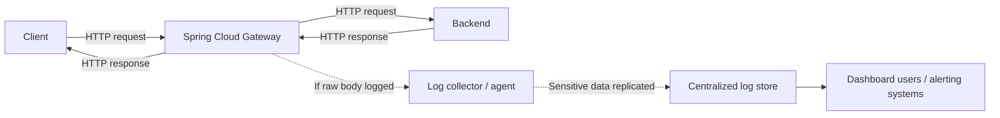

# Masking Sensitive Data When Logging Request or Response Bodies

## Learning Objectives

In the **HTTP Body Handling** chapter, this lesson tackles a very common real-world scenario when operating **Spring Cloud Gateway**: a development team wants to log request and response payloads for troubleshooting, yet bodies can contain passwords, tokens, customer details, or payment data. Logging raw bodies turns the API Gateway into an unplanned store of sensitive data—typically accessible to far more people and systems than the core business database.

After completing this lesson, you will be able to:

- Explain **why HTTP bodies should not be logged by default** at the gateway and identify when approved exceptions apply.
- Distinguish **no body logging**, **allowlisting permitted values**, **redaction/masking**, and **pseudonymization**.
- Log request metadata safely in a `GlobalFilter` **without consuming** the reactive body.
- Understand the risks of using `ModifyRequestBody`, `ModifyResponseBody`, or `DataBuffer` to inspect payloads.
- Implement structured JSON handling while avoiding blind regex masking, and recognize the limits of key-based redaction.
- Control headers, URLs, error responses, framework/wiretap logging, payload lengths, and log retention.
- Write unit and integration tests proving both that sensitive data never enters logs and that real requests/responses arrive intact.

> This lesson uses **Spring Cloud Gateway Server WebFlux** on Project Reactor. Gateway Server MVC has its own filter and body mechanics. APIs and configuration names can vary across versions; verify dependencies and confirm with HTTP integration tests before deploying.

## 1. Why Is Logging Full Bodies So Dangerous?

A client sends a request:

```http
POST /api/accounts/login HTTP/1.1
Host: api.example.com
Content-Type: application/json
Authorization: Bearer <access-token>

{
  "username": "user-42",
  "password": "<secret>",
  "deviceId": "<device-identifier>"
}
```

The backend may return:

```http
HTTP/1.1 200 OK
Content-Type: application/json

{
  "accessToken": "<new-access-token>",
  "refreshToken": "<new-refresh-token>",
  "expiresIn": 3600
}
```

If the Gateway logs both raw bodies and the `Authorization` header, the logs will contain **both the inbound login credentials and the newly issued tokens**. The problem does not disappear once logs leave the node: log data flows through collectors, queues, search indexes, backups, and dashboards.



Typical risks:

| Risk | Example | Consequence |
| --- | --- | --- |
| Credential exposure | `password`, `accessToken`, session cookies | Anyone with log access can replay credentials |
| Personal data exposure | Email, phone number, address, date of birth | Violates data protection requirements and privacy policies |
| Financial data exposure | Card numbers, bank accounts, transactions | Elevates sensitivity and compliance scope of the logging system |
| Internal data exposure | Medical diagnoses, records, customer notes | Creates shadow copies outside the system of record |
| Log injection | Strings containing newlines/fake log lines | Misleads investigations or forges entries |
| Log bloat | File uploads, huge JSON bodies, video | Drives up CPU, I/O, storage cost, and latency |
| Expanded blast radius | Logs copied into backups, alerts, reports | Hard to track who received and retained copies |

**Priority rule:** if a diagnostic need can be satisfied with route ID, status code, latency, trace ID, error type, and aggregated payload size, **never log the body**. Log bodies only with an explicit justification, clear data classification, tight scoping, tests, and enforced log lifecycle policies.

## 2. Distinguishing Data Protection Strategies

Many guides lump everything under “masking,” but these techniques behave differently:

| Approach | Meaning | Log Example | Priority |
| --- | --- | --- | --- |
| **No body logging** | Omit payload entirely | `bodyLogged=false` | **Default, safest** |
| **Allowlist** | Extract only approved fields and normalize values | `eventType=created` | Preferred when a few fields are genuinely needed |
| **Redaction** | Replace full sensitive values with a marker | `"password":"[REDACTED]"` | Supplementary defense for structured JSON |
| **Partial masking** | Keep only a non-sensitive slice per policy | `account=****4321` | Only when permitted and clearly justified |
| **Pseudonymization/tokenization** | Substitute a surrogate identifier for the original value | `customerRef=tok_...` | Requires managing linkability and keys |
| **Hashing** | Represent via cryptographic hash | `customerHash=...` | Does not automatically protect low-entropy inputs; needs proper design |

Example raw JSON:

```json
{
  "eventType": "created",
  "customer": {
    "email": "private@example.invalid",
    "phone": "+000000000",
    "password": "not-for-logs"
  },
  "items": [
    {"sku": "BOOK-001", "cardNumber": "0000000000000000"}
  ]
}
```

If you only need to know the event type, an appropriate log line is:

```text
route=orders eventType=created bodyLogged=false status=201 durationMs=34
```

No email, phone, password, or card number enters the record. Yet this log still lets operators classify incidents by route, event, and status.

If an approved audit workflow requires the JSON **structure**, redacted output might look like:

```json
{
  "eventType": "created",
  "customer": {
    "email": "[REDACTED]",
    "phone": "[REDACTED]",
    "password": "[REDACTED]"
  },
  "items": [
    {"sku": "BOOK-001", "cardNumber": "[REDACTED]"}
  ]
}
```

Yet this is **no absolute guarantee**: a secret could live in `notes`, `description`, or a newly added field missing from the blocklist. That is why allowlisting is generally stronger than maintaining a list of field names to redact.

## 3. First Step: Define What Is Permitted in Logs

Never start with “how do I read the body from a reactive stream?”. Start with **“what is the minimum information needed for this observability goal?”**.

A practical logging policy can divide endpoints into tiers:

1. **Metadata only:** almost all endpoints—especially login, payments, password changes, health data, and user-data APIs.
2. **Allowlisted fields only:** selected business APIs with bounded-enum fields like `eventType` or `schemaVersion` approved for audit logs.
3. **Policy-redacted bodies:** only explicitly reviewed endpoints with documented investigation needs, restricted environments, size caps, access controls, and retention limits.
4. **No body logging supported:** `multipart` uploads, binary data, large files, schemaless gRPC/Protobuf, SSE, infinite streams, and WebSocket frames.

Do not classify only **requests**. Responses can be even more sensitive than requests—for example, backends returning access tokens, search results with PII, or errors exposing internal details. Policies must cover **both directions**.

### 3.1. Do Not Log Raw Paths and Queries Blindly

Sensitive data does not hide exclusively in bodies:

```text
GET /api/users/private@example.invalid
GET /api/orders?customerId=123456&token=<secret>
GET /api/documents/<sensitive-document-id>
```

Logging `exchange.getRequest().getURI()` or `getQueryParams()` verbatim still leaks sensitive data. Prefer **route IDs** or **controlled route patterns**; never use full URIs as default metric labels or log fields. Even route patterns should be reviewed so client-controlled segments do not sneak into labels.

### 3.2. Headers That Require Dedicated Filtering

Headers whose values should normally stay out of logs:

- `Authorization`, `Proxy-Authorization`, `Cookie`, `Set-Cookie`.
- Organization-specific API keys or secret headers.
- Relayed tokens, CSRF tokens, session IDs, and sensitive values in `Forwarded`/`X-Forwarded-*` where applicable.
- Headers carrying personal identifiers or domain secrets depending on the API.

Never call `headers.toString()` for production debugging. Excluding only well-known header names is **insufficient** when services invent custom secret headers. If header telemetry is genuinely required, log only **allowlisted header names**, presence flags, and safely classified values.

## 4. Safe Metadata Logging in a `GlobalFilter`

In Spring Cloud Gateway Server WebFlux, the safest and lowest-cost approach never touches the body's `DataBuffer`s. Record only route ID, method, status, and duration.

Example:

```java
import org.slf4j.Logger;
import org.slf4j.LoggerFactory;
import org.springframework.cloud.gateway.filter.GatewayFilterChain;
import org.springframework.cloud.gateway.filter.GlobalFilter;
import org.springframework.cloud.gateway.route.Route;
import org.springframework.core.Ordered;
import org.springframework.http.HttpStatusCode;
import org.springframework.stereotype.Component;
import org.springframework.web.server.ServerWebExchange;
import reactor.core.publisher.Mono;

import static org.springframework.cloud.gateway.support.ServerWebExchangeUtils
    .GATEWAY_ROUTE_ATTR;

@Component
public class SafeAccessLogFilter implements GlobalFilter, Ordered {

    private static final Logger log =
        LoggerFactory.getLogger(SafeAccessLogFilter.class);

    @Override
    public int getOrder() {
        return -100;
    }

    @Override
    public Mono<Void> filter(
            ServerWebExchange exchange,
            GatewayFilterChain chain) {

        Route route = exchange.getAttribute(GATEWAY_ROUTE_ATTR);
        String routeId = route == null ? "unknown" : route.getId();
        String method = exchange.getRequest().getMethod().name();
        long startNanos = System.nanoTime();

        return chain.filter(exchange)
            .doFinally(signal -> {
                HttpStatusCode code =
                    exchange.getResponse().getStatusCode();
                long latencyMs =
                    (System.nanoTime() - startNanos) / 1_000_000;

                log.info(
                    "gateway.request route={} method={} "
                        + "status={} durationMs={} terminal={}",
                    routeId,
                    method,
                    code == null ? "unknown" : code.value(),
                    latencyMs,
                    signal
                );
            });
    }
}
```

This filter **never reads the body** and **never logs full URLs or headers**. It runs after route matching, when `GATEWAY_ROUTE_ATTR` typically holds the selected route. `doFinally`'s `signal` is a Reactor terminal signal (`ON_COMPLETE`, `ON_ERROR`, `CANCEL`), **not an HTTP status**. For requests blocked before the Gateway filter chain (e.g., by `SecurityWebFilterChain`) or unmatched requests, this filter may **not execute**; add telemetry at the WebFlux/security/ingress layer to observe every request hitting the edge.

Instead of reading a trace ID from an arbitrary client-supplied header, use context propagation from a configured, trusted tracing framework. If using custom correlation IDs, bound format and length to prevent injection; **`ThreadLocal`-based MDC does not automatically propagate across all Reactor operators** without a proper bridge.

### 4.1. Why Log Inside `doFinally`?

`chain.filter(exchange)` returns a `Mono<Void>` representing request processing through the gateway chain. `doFinally` records the outcome when the chain completes normally, errors, or cancels. Measured duration covers **the portion of the chain wrapped by this filter**, not automatically upstream layers before it or total time from the client's TLS handshake.

Never call `.subscribe()` inside a filter to log out-of-band: that opens a separate subscription and breaks HTTP request error/cancellation handling. When asynchronous work is required, compose it into the chain using proper Reactor operators.

## 5. WebFlux Body Mechanics: You Cannot Arbitrarily Read and Forward

In WebFlux, HTTP payloads flow through **`Flux<DataBuffer>`**. A body may arrive across many buffers governed by backpressure. Therefore, the request body **is not a Java string that can be re-read arbitrarily**.

### 5.1. What Happens If You Read the Body in a Separate Stream?

A common mistake looks like:

```java
// DO NOT DO THIS: reading the body just to log before continuing the chain.
exchange.getRequest().getBody()
    .subscribe(buffer -> log.info("requestBody={}", buffer));

return chain.filter(exchange);
```

Problems:

- `subscribe()` detaches a subscription from the request pipeline.
- The request body may be single-use; downstream routing may no longer receive full content.
- `DataBuffer.toString()` does not produce safe formatted HTTP content.
- Improper `DataBuffer` handling/release causes memory leaks or use-after-release errors.
- There is zero secret masking; the buffer may hold passwords, tokens, binary data, or compressed bytes.

Do not “fix” this by calling `.block()`: blocking a non-blocking event-loop thread causes errors, raises latency, and degrades throughput.

### 5.2. Why Writing Custom `ServerHttpRequestDecorator` / `ServerHttpResponseDecorator` Is Hard

Decorators allow low-level interception of request/response bodies, but they must guarantee:

- Not consuming the body before downstream reads it.
- If bytes must be inspected, **copying at the right moment**, preserving reference counts, and releasing `DataBuffer`s cleanly.
- Preserving backpressure, cancellation, timeouts, and errors.
- Respecting `Content-Type`, charset, `Content-Encoding`, `Content-Length`, `Transfer-Encoding`, HTTP/2, and response body semantics.
- Never buffering unboundedly on large payloads, SSE, or multipart.
- Never mutating headers or status after the response commits.

A logging-only filter that inadvertently alters body bytes, length, or timing is a severe gateway defect. Therefore, **do not install a global custom body decorator across all routes just for debugging**.

## 6. When Content Inspection Is Approved: Prefer Allowlisting

Suppose an endpoint only needs to log `eventType` from JSON requests to count operation types, while the body carries several secret fields. Rather than attempting to mask every sensitive field, **extract only the known field and normalize it against a closed set**.

### 6.1. Extracting Non-Sensitive Summary Information

Illustrative Java helper using Jackson, intended only for approved audit flows:

```java
import com.fasterxml.jackson.databind.JsonNode;
import com.fasterxml.jackson.databind.ObjectMapper;

public final class SafeEventSummary {
    private static final ObjectMapper MAPPER = new ObjectMapper();

    private SafeEventSummary() {
    }

    public static String fromJson(String body) {
        if (body == null || body.length() > 4096) {
            return "omitted";
        }

        try {
            JsonNode root = MAPPER.readTree(body);
            if (root == null || !root.isObject()) {
                return "other";
            }

            String eventType =
                root.path("eventType").asText("");

            // Only emit permitted fixed values.
            return switch (eventType) {
                case "created", "updated", "cancelled" -> eventType;
                default -> "other";
            };
        } catch (Exception ignored) {
            // Never log raw body or exception messages containing input.
            return "invalid-json";
        }
    }
}
```

Given this JSON:

```json
{
  "eventType": "created",
  "customer": {
    "email": "private@example.invalid",
    "password": "<secret>"
  },
  "payment": {"cardNumber": "<sensitive>"}
}
```

the helper returns **`created`** and never builds log text from email, password, or card number. Even if a client sends an `eventType` containing newlines and forged log lines, the helper returns `other` because it is outside the allowlist.

**Limitations:** invoke only on approved endpoints, content types, and bounded sizes. This helper alone does not stop lower layers from reading/decoding huge bodies earlier; server/codec/filter limits are still mandatory. Values extracted from a body—even normalized ones—**are never proof of identity or authorization**.

### 6.2. Structured JSON Redaction When Truly Required

If a specific audit requirement needs the JSON structure preserved, mask values at **every nesting depth**, including inside arrays. The example below illustrates one defensive layer, **not a substitute for allowlisting, data classification, or testing**:

```java
import java.util.Iterator;
import java.util.Locale;
import java.util.Map;
import java.util.Set;

import com.fasterxml.jackson.databind.JsonNode;
import com.fasterxml.jackson.databind.ObjectMapper;
import com.fasterxml.jackson.databind.node.ArrayNode;
import com.fasterxml.jackson.databind.node.ObjectNode;

public final class JsonLogRedactor {

    private static final ObjectMapper MAPPER = new ObjectMapper();
    private static final int MAX_INPUT_CHARS = 4096;
    private static final int MAX_NESTING = 16;

    private static final Set<String> PRIVATE_KEYS = Set.of(
        "password", "passwd", "secret",
        "token", "accesstoken", "refreshtoken",
        "authorization", "apikey",
        "email", "phone", "cardnumber", "cvv"
    );

    private JsonLogRedactor() {
    }

    public static String safeForLog(String body) {
        if (body == null) {
            return "[ABSENT]";
        }
        if (body.length() > MAX_INPUT_CHARS) {
            return "[OMITTED_TOO_LARGE]";
        }

        try {
            JsonNode tree = MAPPER.readTree(body);
            if (tree == null) {
                return "[OMITTED_EMPTY]";
            }
            maskTree(tree, 0);
            String sanitized = MAPPER.writeValueAsString(tree);
            return sanitized.length() <= MAX_INPUT_CHARS
                ? sanitized
                : "[OMITTED_TOO_LARGE]";
        } catch (Exception ignored) {
            return "[OMITTED_UNPARSEABLE]";
        }
    }

    private static void maskTree(JsonNode node, int depth) {
        if (depth > MAX_NESTING) {
            throw new IllegalArgumentException("nesting too deep");
        }

        if (node instanceof ObjectNode object) {
            Iterator<Map.Entry<String, JsonNode>> fields =
                object.fields();

            while (fields.hasNext()) {
                Map.Entry<String, JsonNode> field = fields.next();
                String normalized =
                    field.getKey().toLowerCase(Locale.ROOT);

                if (PRIVATE_KEYS.contains(normalized)) {
                    object.put(field.getKey(), "[REDACTED]");
                } else {
                    maskTree(field.getValue(), depth + 1);
                }
            }
        } else if (node instanceof ArrayNode array) {
            for (JsonNode item : array) {
                maskTree(item, depth + 1);
            }
        }
    }
}
```

With:

```json
{
  "eventType": "created",
  "user": {
    "password": "hidden-value",
    "email": "private@example.invalid"
  },
  "cards": [
    {"cardNumber": "0000000000000000", "cvv": "000"}
  ]
}
```

the redacted log becomes:

```json
{
  "eventType": "created",
  "user": {
    "password": "[REDACTED]",
    "email": "[REDACTED]"
  },
  "cards": [
    {"cardNumber": "[REDACTED]", "cvv": "[REDACTED]"}
  ]
}
```

**Mandatory limitations to remember:**

- `PRIVATE_KEYS` is **incomplete**; `pin`, `sessionKey`, `access_token`, custom fields, or secrets inside `notes` will slip past.
- Error strings may expose raw bodies elsewhere. The example intentionally **omits exception messages** on parse failures.
- Valid JSON does not prove data is safe to log. Even after redacting listed keys, remaining fields may contain PII or trade secrets.
- Character length is a simple safeguard against log bloat, **not a substitute for HTTP body/codec byte limits**; JSON parsers can consume significant memory on deeply nested payloads.
- Never forward the redacted output as the body sent to the backend unless a separate approved content transformation requires it. **Log payloads and service payloads must remain strictly separated.**

For genuinely sensitive data, **allowlisting** outperforms trying to maintain an ever-incomplete list of fields to redact.

## 7. Integration Points in Spring Cloud Gateway: `ModifyRequestBody` and `ModifyResponseBody`

Spring Cloud Gateway provides **`ModifyRequestBody`** and **`ModifyResponseBody`** GatewayFilter Factories to process content using codec-supported types. They are meant for **body transformation**, not as a default logging mechanism for all traffic. Still, when a route already has a legitimate reason to decode the body, you can emit a **safe audit summary** during that processing.

### 7.1. Scoped Example for a JSON Route

The Java DSL example below applies only when a route handles small JSON text payloads with a **well-defined contract** and permitted body reading:

```java
import org.slf4j.Logger;
import org.slf4j.LoggerFactory;
import org.springframework.cloud.gateway.route.RouteLocator;
import org.springframework.cloud.gateway.route.builder.RouteLocatorBuilder;
import org.springframework.context.annotation.Bean;
import org.springframework.http.MediaType;
import reactor.core.publisher.Mono;

class AuditedRoutes {
    private static final Logger log =
        LoggerFactory.getLogger(AuditedRoutes.class);

    @Bean
    RouteLocator auditedRoute(RouteLocatorBuilder builder) {
        return builder.routes()
            .route("order-events", r -> r.path("/api/events/**")
                .filters(f -> f
                    .modifyRequestBody(
                        String.class,
                        String.class,
                        MediaType.APPLICATION_JSON_VALUE,
                        (exchange, body) -> {
                            String eventType =
                                SafeEventSummary.fromJson(body);
                            log.info(
                                "audit phase=request route={} eventType={}",
                                "order-events", eventType
                            );
                            return body == null
                                ? Mono.empty()
                                : Mono.just(body);
                        }
                    )
                    .modifyResponseBody(
                        String.class,
                        String.class,
                        (exchange, body) -> {
                            // Do not log raw response; example only marks the
                            // phase, since the response may contain personal data.
                            log.info(
                                "audit phase=response route={}",
                                "order-events"
                            );
                            return body == null
                                ? Mono.empty()
                                : Mono.just(body);
                        }
                    )
                )
                .uri("http://localhost:9001"))
            .build();
    }
}
```

In this example:

- `SafeEventSummary` is the **allowlist** function from Section 6.1. It never prints raw bodies, personal data, or access tokens.
- The rewrite function returns the same **logical `String`** it received, not a redacted copy. Redaction or summaries for logging **must not alter the business payload**.
- `Mono.empty()` handles bodyless exchanges; never manufacture a JSON `"null"` or synthetic body.
- `localhost:9001` is only a mock backend for the exercise.

**Critical warning:** even when returning the exact same `String`, `ModifyRequestBody`/`ModifyResponseBody` still **decode and re-encode bytes**, potentially changing charset, `Content-Length`, transfer encoding, or compression handling. Therefore **do not use this pattern solely for logging** when byte-for-byte preservation, body signatures, compressed content, multipart, streaming, or large bodies are involved. For metadata logging, Section 4's pattern is far safer and cheaper.

Across versions, Gateway Java DSL signatures and configuration namespaces may vary. This example illustrates **where to extract a sanitized summary**, not a claim that the exact DSL applies across all versions or media types.

### 7.2. Why Not Log Response Bodies on Every Route?

Backend responses can contain:

- Access tokens, refresh tokens, session cookies, or indirect authentication secrets.
- Personal profiles, permissions, orders, or invoices.
- User-entered text such as notes, comments, or documents.
- Error messages leaking SQL, stack traces, or internal addresses if a backend is misconfigured.
- File downloads, images, binary payloads, or long-lived streams.

Applying `ModifyResponseBody` broadly forces buffering, hurts latency and memory, and breaks compression or streaming. **Do not turn the Gateway into a collector of entire response payloads** just because debugging an app error would be more convenient.

### 7.3. Retry and Circuit Breaker Boundaries

If a body-observing filter sits **inside the publisher region** re-subscribed by `Retry`, one external client request can emit **multiple audit logs** across attempts. Placed outside `Retry`, it logs once end-to-end but may miss per-attempt failures.

With circuit breakers and fallbacks, the final response may be a Gateway-generated fallback body rather than a backend body. Apply redaction policies to the **actual written response**. Never treat every `phase=response` log line as proof that the backend succeeded.

Under network failures, timeouts, or client cancellations, a body-logging callback might not fire or may see only partial signals depending on filter implementation. Never rely on body logs as **the sole source of transaction audit evidence**; critical business audits belong in the backend under durable guarantees.

## 8. Avoiding Accidental Data Leaks via Framework Logging

Even when your custom filter logs only metadata, other components can still dump payloads:

| Log Source | Risk to Check |
| --- | --- |
| **Reactor Netty wiretap** | Can log raw HTTP traffic including headers/bodies depending on format mode and log level |
| **WebFlux codec / request-details logging** | Verbose debug modes can log request data or sensitive parameters |
| **Reverse proxy / ingress / API management** | Access logs may capture full URLs + query strings and configured headers |
| **HTTP clients or retry libraries** | Request/response debug logging may print payloads on errors |
| **Exception handlers** | Exception messages/stack traces sometimes echo input values |
| **Tracing / observability instrumentation** | Custom span attributes/baggage can collect URLs, headers, or bodies |
| **Log collectors and exporters** | May harvest stdout, local files, or sidecars unaware they carry secrets |

**Never enable wiretap or body debug logging broadly in production** just to investigate a single bug. If temporarily required in a controlled environment, tightly scope routes, traffic, duration, log access, and cleanup/sanitization afterward. Properties like `httpclient.wiretap`/`httpserver.wiretap` depend on Gateway version; never copy config from another version without verifying.

In Spring WebFlux, request-details logging flags can expose sensitive details; review Spring Framework, Reactor Netty, and your tracing tooling together. Merely avoiding `log.info(body)` in application code is **not enough** to guarantee the system never logs bodies.

## 9. Body Types to Avoid Logging or That Require Special Handling

Not every HTTP body is plain JSON text:

| Content Type | Example | Appropriate Policy |
| --- | --- | --- |
| Small, vetted JSON | `application/json` | Prefer allowlisting; redact only with explicit approval |
| Form URL-encoded | `application/x-www-form-urlencoded` | Often carries passwords or tokens; avoid raw values |
| Multipart upload | `multipart/form-data` | Never log file parts, sensitive filenames, or raw form fields |
| Binary files | PDF, ZIP, images, video | Never convert to `String`; never buffer for logging |
| Protobuf/gRPC | Schema-driven binary payloads | Do not interpret bytes as UTF-8; needs dedicated tooling/contracts |
| Compressed bodies | `Content-Encoding: gzip` | Never log compressed bytes or decompress unboundedly |
| SSE/streaming | `text/event-stream` | Never aggregate unbounded streams for logging; emit connection/approved-event telemetry |
| WebSocket | Bidirectional frames post-upgrade | Do not treat as standard HTTP response bodies |

To monitor streaming endpoints, measure **handshake status, connection duration, throughput, aggregated byte counts, and errors/cancellations** instead of buffering entire payloads.

### 9.1. Resource and Size Bounds

Even a few-kilobyte JSON body requires decoding and parsing. At thousands of concurrent requests, a filter buffering full payloads drives up memory and GC pressure. Ensure you:

- Enforce **inbound size thresholds** and outbound log thresholds; skip logging above threshold.
- Enforce bounds at codec/server/ingress layers rather than relying solely on `String.length()`.
- Never stash raw bodies or `DataBuffer`s inside `ServerWebExchange.getAttributes()`, `Reactor Context`, or static caches “temporarily.”
- Respect streaming and backpressure; never block event-loop threads with heavy synchronous parsing or logging.
- Load-test at peak traffic and compare CPU, memory, and p95/p99 latency before and after enabling auditing.

### 9.2. Redaction Does Not Automatically Preserve Protocol Safety

If a filter **actually modifies the forwarded body** (rather than only building a log string), headers must match the new bytes:

- `Content-Length` counts **actual bytes**, not `String.length()`.
- `Content-Encoding` must match whether content is compressed or uncompressed.
- HTTP/1.1 `Transfer-Encoding` is hop-by-hop framing; HTTP/2 does not use chunked transfer coding.
- `Content-Type`, charset, `ETag`, checksums, cache validators, and byte ranges may need updating.
- Never attach a body to `204`/`304` or `HEAD` responses in violation of HTTP semantics.

This is another reason to **keep redacted log copies strictly separate from the real payload crossing the Gateway**. Masking for logs must never alter what clients or backends expect on the wire.

## 10. Log Injection and Trusted Identifiers

Even after stripping passwords and tokens, an unredacted string field can contain:

```text
created
ERROR user=admin authenticated=true
```

Concatenating that value directly into unstructured logs lets an attacker forge entries resembling legitimate log lines. Safeguards:

1. **Allowlist values** such as `created|updated|cancelled` instead of copying free-form text.
2. Emit **structured logs** through a properly configured logger/encoder; never build JSON logs via string concatenation.
3. Bound lengths and strip or escape newlines, control characters, tricky Unicode, and invalid input.
4. Sanitize route labels, trace IDs, and every client-influenced field.
5. Never treat a client-supplied header as proof of authentication or authorization.

A correlation ID helps link Gateway and backend logs, yet it is **not a secret** and should not carry arbitrary long strings. To propagate trace IDs across services, configure standard tracing context propagation; Reactor Context does not automatically cross HTTP hops to backends.

## 11. Testing the “No Data Leak” Requirement

Tests must answer **two independent questions**:

1. Do logs keep sensitive data out?
2. Do actual requests and responses reach clients and backends intact per contract?

### 11.1. Unit Testing the Allowlist Summary Helper

```java
import static org.junit.jupiter.api.Assertions.assertEquals;

import org.junit.jupiter.api.Test;

class SafeEventSummaryTest {

    @Test
    void doesNotReturnSecretFields() {
        String body = """
            {
              "eventType": "created",
              "password": "never-print-me",
              "accessToken": "another-secret",
              "customer": {"email": "private@example.invalid"}
            }
            """;

        assertEquals("created", SafeEventSummary.fromJson(body));
        assertEquals(
            "other",
            SafeEventSummary.fromJson(
                "{\"eventType\":\"created\\nERROR fake-entry\"}"
            )
        );
    }

    @Test
    void failsClosedForInvalidOrOversizedBody() {
        assertEquals(
            "invalid-json",
            SafeEventSummary.fromJson("{not-json}")
        );
        assertEquals(
            "omitted",
            SafeEventSummary.fromJson("x".repeat(5000))
        );
    }
}
```

These tests verify the summary helper does not return raw bodies or secrets. To prove **real logging** leaks nothing, capture logs emitted by the route filter and related loggers in test harnesses and assert the absence of `never-print-me`, `another-secret`, emails, raw tokens, and other sensitive strings.

### 11.2. Unit Testing JSON Redaction

```java
import static org.junit.jupiter.api.Assertions.assertFalse;
import static org.junit.jupiter.api.Assertions.assertTrue;

import org.junit.jupiter.api.Test;

class JsonLogRedactorTest {

    @Test
    void masksNestedFieldsAndArrays() {
        String input = """
            {
              "user": {"password": "secret-123"},
              "cards": [{"cardNumber": "1111222233334444"}],
              "eventType": "created"
            }
            """;

        String sanitized = JsonLogRedactor.safeForLog(input);

        assertFalse(sanitized.contains("secret-123"));
        assertFalse(sanitized.contains("1111222233334444"));
        assertTrue(sanitized.contains("[REDACTED]"));
        assertTrue(sanitized.contains("created"));
    }

    @Test
    void omitsUnparseableData() {
        String sanitized =
            JsonLogRedactor.safeForLog("{invalid-token-123");
        assertFalse(sanitized.contains("invalid-token-123"));
    }
}
```

**Do not stop at these tests:** also test unknown field names, uppercase/underscore variants, secrets embedded in free-form strings, Unicode, deeply nested JSON, and oversized JSON. A key-based redactor **cannot prove on its own that every remaining value is safe**.

### 11.3. Gateway Integration Test Matrix

| Scenario | How to Test | Expected Result |
| --- | --- | --- |
| Login body with password | POST JSON to login route | No raw request body or password logged |
| Login response with tokens | Backend returns token JSON | No raw response or access/refresh tokens logged |
| Query containing token | `GET /api/search?token=...` | Full URL/query not logged |
| Header containing secret | Send `Authorization`, cookie, API key | No secret values in logs |
| Nested JSON + arrays | Body with multi-level objects | When redaction is permitted, recognized keys masked at all depths |
| Unknown field name | Body has `privateNote` holding a secret | Not leaked under allowlist; redactor alone is insufficient |
| Invalid JSON | Send malformed JSON | Raw input never echoed into error logs |
| Oversized body | Payload past permitted threshold | Body logging skipped; HTTP limits/responses follow policy |
| Multipart/binary | File upload | File contents never decoded or logged |
| Gzip response | Backend returns gzip | Compressed bytes not logged; client receives valid response |
| Streaming/SSE | Long-lived stream | Stream never buffered whole for logging |
| Retry | Transient backend error then success | Clear whether logs track request vs. attempt; no duplicate secret leaks |
| Circuit breaker fallback | Backend unavailable | Fallback body not logged raw outside policy |
| Client cancels request | Disconnect mid-flight | No buffer leaks; cancellation handled cleanly |
| Concurrency | Multiple clients and tenants | No cross-request mixing or secrets entering another request's log |

In integration tests, run a **mock backend capturing the exact received payload** alongside a **test log collector** to compare both sides. For instance, on Section 7's scoped audit route:

- Send JSON containing `eventType=created` and a password.
- Backend must receive valid business JSON matching the contract (unless an explicit transformation is designed).
- Audit log contains only `eventType=created`, route ID, and safe metadata.
- Client receives the designed status, content type, and body.
- Test with compression and upstream errors enabled to catch unintended codec/filter side effects.

Never stop at asserting HTTP 200: a valid response does not prove logs are safe, and clean logs do not prove payloads arrived intact.

## 12. Log Lifecycle Governance and Incident Response for Leaked Secrets

Even with safe logging, operational governance still requires:

- **Least-privilege access:** restrict log viewing to authorized teams; separate technical logs from business audit logs.
- **Encryption in transit and at rest:** protect log collectors, storage, backups, and exporters.
- **Appropriate retention:** avoid keeping unnecessary records indefinitely; enforce automated deletion policies.
- **Destination/vendor controls:** track everywhere logs ship, including staging environments.
- **Configuration checks:** review logging levels, Netty wiretap, debug toggles, and filters before every release.
- **Bounded alerting:** avoid dumping raw payloads or headers into emails, chat ops, or incident tickets.
- **Clear ownership:** define who may authorize special body logging, who approves its window, and who verifies it is turned back off.

If **passwords or tokens are discovered in logs**:

1. Immediately disable the sensitive log source and lock down access to affected log stores.
2. Assess data scope, time window, every log/backup system that ingested it, and who may have accessed it.
3. Revoke/rotate all potentially exposed secrets or tokens per your organization's security incident process.
4. Purge or remediate collected logs under deletion, retention, legal, and incident-response procedures; never assume fixing code erases historical logs.
5. Add regression tests across the Gateway, proxies, and logging configuration.

Masking at the filter layer is only one layer. Safe operations require combining **authentication, authorization, TLS, rate limiting, circuit breakers, retries, tracing, and data governance** across clearly bounded responsibilities.

## 13. Practice Exercise with Answers

A `POST /api/payments` route receives:

```json
{
  "eventType": "created",
  "customer": {
    "email": "private@example.invalid",
    "phone": "+000000000"
  },
  "payment": {
    "cardNumber": "0000000000000000",
    "cvv": "000"
  },
  "notes": "customer requested dedicated support"
}
```

The backend returns:

```json
{
  "paymentId": "pay-42",
  "status": "accepted",
  "accessToken": "<unexpected-secret>"
}
```

Suppose the operations team only needs request counts per route, error rates, latency, and `eventType`. Answer these questions:

1. Should you log the raw request body to obtain `eventType`?
2. Is a redactor masking only `cardNumber` and `cvv` safe enough for logging?
3. Should you log the response body simply because it only has three fields?
4. Can you extract `eventType` via a fixed allowlist and ignore all other fields?
5. If payload inspection is required for an investigation, how must `notes` be handled?
6. Can `String.length()` predict the HTTP wire body size after rewriting?
7. If the Gateway enables `Retry` on payment POSTs, is a single per-request log enough to see attempt counts?

**Suggested Answers:**

1. **Unnecessary.** Logging route ID, status, latency, and normalized `eventType` meets the stated requirement.
2. **Not safe enough.** Email, phone number, notes, and future fields can still hold sensitive data.
3. **No.** The response contains `accessToken`; having only three fields does not make it safe.
4. **Yes.** Emit only a value from `created|updated|cancelled|other` and never send raw JSON to logs.
5. By default, **never log `notes`**. If an exception is formally approved, add dedicated controls; key-based redaction alone cannot mask secrets written in free-form text.
6. **No.** Wire framing depends on actual encoded/compressed byte length; `String.length()` counts UTF-16 code units.
7. **Not enough.** Retries can emit multiple outbound attempts; use per-attempt telemetry and idempotency policies to prevent duplicate charges.

## Summary

In **Spring Cloud Gateway Server WebFlux**, logging request or response bodies is not as simple as adding `log.info(...)`: it is a decision affecting **data governance, security, performance, and reactive HTTP body lifecycles**. By default, **do not log bodies**. When content visibility is genuinely needed, prefer **allowlisting safe values**, reserving structured redaction only for reviewed, size-bounded, and formally approved routes.

Remember that secrets can also hide in **URLs, queries, headers, exceptions, and responses**. Never use `subscribe()` or `block()` to grab bodies, avoid unbounded caches, and never treat a field-name redactor as sufficient by itself. Test both **emitted logs** and **actual HTTP payloads reaching downstream and clients**, while auditing Reactor Netty, proxies, tracing, and log storage. This discipline keeps your gateway observable without turning it into a data leak for your microservices.
