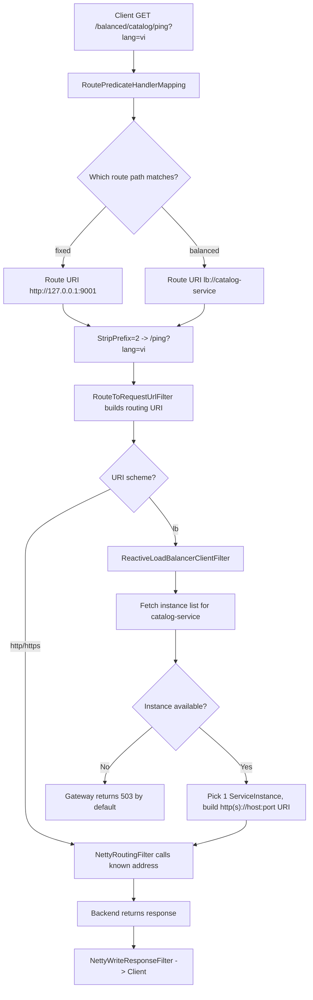

# Fixed Routes vs. Service-ID Routes `lb://`

## 1. Why Does an API Gateway Need Two Ways to Choose a Target?

In a microservices system, **SPRING_CLOUD_GATEWAY** receives requests from clients, selects a route using predicates, executes the filter chain (path/header transformation, authentication, rate limiting, retry, circuit breaker, etc.), and forwards HTTP traffic to the upstream service. At this forwarding step, the Gateway needs to know the **actual address of the target service**.

There are two common ways to declare a route:

- **Fixed route:** `uri: http://127.0.0.1:9001` or `uri: https://inventory.internal.example`. The route specifies the HTTP(S) address that the Gateway calls directly.
- **Service-ID route:** `uri: lb://catalog-service`. The route specifies a **service ID** so that **Spring Cloud LoadBalancer** resolves it to a concrete instance from an instance list source.

For example, suppose a Catalog service has two running instances:

```text
Catalog instance A: 127.0.0.1:9001
Catalog instance B: 127.0.0.1:9002
Service ID:         catalog-service
```

When using a fixed route to `9001`, the Gateway does not automatically choose `9002`. When using `lb://catalog-service` with LoadBalancer and an instance source configured, the Gateway can forward different requests to `9001` or `9002`.

Learning objectives in the **Service Discovery and Load Balancing** chapter:

1. Distinguish **direct address**, **service ID**, **service discovery**, and **load balancing**.
2. Explain the full `lb://` flow through `RouteToRequestUrlFilter`, `ReactiveLoadBalancerClientFilter`, and `NettyRoutingFilter`.
3. Write Gateway Server WebFlux configuration for both fixed routes and `lb://` routes.
4. Create two local backends and use `SimpleDiscoveryClient` to run the example without Eureka/Consul.
5. Distinguish between **no route matched (404)**, **no instance found (503 by default)**, and **connection failure to a selected instance (5xx)**.
6. Identify impacts on paths/headers, TLS, authentication, retry/circuit breaker, and request observability.

> **Example versions:** Spring Boot 3.5.x and Spring Cloud 2025.0.x, corresponding to Gateway Server WebFlux 4.3.x. Uses starters `spring-cloud-starter-gateway-server-webflux`, `spring-cloud-starter-loadbalancer`, and configuration prefix `spring.cloud.gateway.server.webflux`. Choose a supported patch version for real deployments; the specific versions in the code below are only used to illustrate a compatible pair.

## 2. Quick Comparison: Fixed Routes vs. `lb://` Routes

| Aspect | Fixed route `http(s)://` | Service-ID route `lb://` |
| --- | --- | --- |
| Route `uri` | `http://127.0.0.1:9001` | `lb://catalog-service` |
| Target name | Actual host + port, or a resolvable DNS/virtual IP. | Logical name (service ID), **not an HTTP hostname**. |
| How the instance is determined | Gateway uses the declared URI; if the host is DNS/LB, an external mechanism may distribute load. | Spring Cloud LoadBalancer retrieves a list of `ServiceInstance`s and picks one instance. |
| Is Spring Cloud LoadBalancer required? | No, if only proxying HTTP(S) to a static host. | **Yes**, when using `lb://` routes. |
| Is an instance source required? | No registry needed for a fixed HTTP(S) URI. | **Yes**: a registry/discovery client, `SimpleDiscoveryClient`, or an equivalent instance provider. |
| Adding/removing instances | Route does not change automatically; external DNS/ingress can hide the change. | Instance list from discovery/supplier can be updated and used for subsequent selections. |
| Failure when backend disconnects | Connection to the static host fails. | If no instances → typically 503; if a listed but dead instance is selected → connection error. |
| Suitable use cases | Demos, fixed endpoints, upstreams behind a stable reverse proxy/LB. | Multiple replicas, dynamic addresses, client-side load balancing at the Gateway. |

**Key point:** a static hostname like `https://catalog.internal.example` might point to DNS round-robin or an infrastructure load balancer, so a fixed route **does not mean the system performs no load balancing at any layer**. It only means Spring Cloud Gateway does not select a `ServiceInstance` itself via the `lb://` scheme for that route.

Similarly, **`lb://` does not automatically enable discovery**. It only tells the Gateway that service ID resolution is needed. Without an instance list, the Gateway cannot guess the upstream address.

## 3. Request Structure Through Both Route Types

Suppose a client sends:

```http
GET /balanced/catalog/ping?lang=vi HTTP/1.1
Host: localhost:8080
```

The processing flow can be illustrated with a diagram:



Terms in the diagram:

- **`RoutePredicateHandlerMapping`** selects a route based on predicates. It does not perform load balancing.
- **`FilteringWebHandler`** combines `GlobalFilter`s with the route's `GatewayFilter`s, orders them by `Ordered`, and executes the filter chain.
- **`StripPrefix=2`** changes the request path from `/balanced/catalog/ping` to `/ping` before proxying.
- **`RouteToRequestUrlFilter`** builds the routing URI and stores it in `ServerWebExchangeUtils.GATEWAY_REQUEST_URL_ATTR`.
- **`ReactiveLoadBalancerClientFilter`** inspects `GATEWAY_REQUEST_URL_ATTR`: if the scheme is `lb`, it selects an instance via `ReactorLoadBalancer`, replaces that attribute with the real HTTP(S) URI, and saves the previous URI in the history attribute.
- **`NettyRoutingFilter`** sends the request to the resolved HTTP(S) URI using Reactor Netty; **`NettyWriteResponseFilter`** forwards the response back to the client.

For an `lb://` route, `ReactiveLoadBalancerClientFilter` does not mean making an HTTP request to a "host named lb". **`lb` is an internal directive scheme** requesting instance selection.

### Exchange attributes during resolution

```text
Request from client:
  http://localhost:8080/balanced/catalog/ping?lang=vi

GATEWAY_ROUTE_ATTR:
  Route(id="catalog-balanced", uri=lb://catalog-service, ...)

After StripPrefix:
  request path = /ping

After RouteToRequestUrlFilter:
  GATEWAY_REQUEST_URL_ATTR = lb://catalog-service/ping?lang=vi

After ReactiveLoadBalancerClientFilter (e.g., picking B):
  GATEWAY_REQUEST_URL_ATTR = http://127.0.0.1:9002/ping?lang=vi

After NettyRoutingFilter:
  HTTP request has been sent to instance B
```

`GATEWAY_ORIGINAL_REQUEST_URL_ATTR` may record the URIs before transformation. This is **internal exchange metadata**; it does not automatically become a header sent to the backend. Do not modify routing attributes without understanding filter ordering and the load balancing mechanism.

## 4. Fixed Route: Simple Configuration and Behavior

Fixed WebFlux route:

```yaml
spring:
  cloud:
    gateway:
      server:
        webflux:
          routes:
            - id: catalog-fixed
              uri: http://127.0.0.1:9001
              predicates:
                - Path=/fixed/catalog/**
              filters:
                - StripPrefix=2
```

Client calls `GET /fixed/catalog/ping`:

1. `Path=/fixed/catalog/**` matches the request.
2. `StripPrefix=2` removes the two segments `fixed` and `catalog`; the upstream receives `GET /ping`.
3. The Gateway sends HTTP directly to `127.0.0.1:9001`.
4. If the instance on port `9001` stops, the Gateway does not automatically call `9002` just because that port is running.

Pros: simple, easy to verify, minimal infrastructure dependencies. Cons: if the instance address changes, the route must be updated (or a stable DNS/ingress must sit in front of the service).

### When is a "fixed" address still the right choice?

If the route is:

```yaml
uri: https://catalog.internal.example
```

then the hostname may represent **another load balancer** or a **Kubernetes Service** managed by the infrastructure. The Gateway does not necessarily need `lb://` in every architecture. What matters is identifying which layer performs load distribution, health checks, and failover, avoiding unintended duplication or overlapping policies.

## 5. `lb://` Routes: Service ID, Discovery, and Load Balancing

Route configuration:

```yaml
spring:
  cloud:
    gateway:
      server:
        webflux:
          routes:
            - id: catalog-balanced
              uri: lb://catalog-service
              predicates:
                - Path=/balanced/catalog/**
              filters:
                - StripPrefix=2
```

In `lb://catalog-service`:

- `lb` indicates that the LoadBalancer mechanism is required.
- `catalog-service` is the **service ID**.
- The route **does not directly contain** `9001` or `9002`: they come from the instance list source.

To work, **two independent parts** are required:

1. **`spring-cloud-starter-loadbalancer`** provides the Spring Cloud LoadBalancer infrastructure and `ReactorLoadBalancer` used in WebFlux.
2. **A `ServiceInstance` source** provides one or more `host:port` entries corresponding to the service ID. That source can come from a `DiscoveryClient`/registry, simple configuration, or a carefully customized `ServiceInstanceListSupplier`.

When multiple instances exist, Spring Cloud LoadBalancer supports algorithms such as **Round-Robin** (typically the default choice) or **Random**, as well as other instance selection strategies via configuration or customization. Actual results **are not guaranteed to strictly alternate A–B every time**: concurrency, caching, the instance list, the algorithm, and filters can affect the order.

### How does service discovery differ from load balancing?

| Component | Answers the question | Example |
| --- | --- | --- |
| **Registry / DiscoveryClient** | "Which instances of `catalog-service` currently exist?" | Eureka, Consul, Kubernetes discovery, `SimpleDiscoveryClient` in demos. |
| **ServiceInstanceListSupplier** | "Which instance list source will LoadBalancer use?" | Supplier from discovery, optionally combined with caching/health-check. |
| **ReactorLoadBalancer** | "From this list, which instance should be chosen for the request?" | Round-Robin or another algorithm. |
| **Gateway routing filter** | "How is the HTTP request sent to the chosen target URI?" | `NettyRoutingFilter` via Reactor Netty. |

A registry can contain an unhealthy instance for a period of time; **discovery only provides the list**, and does not guarantee every instance is returning successful HTTP responses.

## 6. Hands-On: One Gateway, Two Routes, and Two Local Instances

The following lab uses **`SimpleDiscoveryClient`** to declare the instance list in `application.yml`. That lets you learn the `lb://` mechanism **without installing Eureka, Consul, or Kubernetes**.

Architecture:

```text
Client: localhost:8080
    |
    +-- GET /fixed/catalog/ping
    |       --> fixed URI ----------------> Catalog Blue :9001
    |
    +-- GET /balanced/catalog/ping
            --> lb://catalog-service
                    |
                    +-- catalog-service / instance 0 --> Blue  :9001
                    +-- catalog-service / instance 1 --> Green :9002
```

### 6.1. Create `pom.xml` with required dependencies

Requirements: **JDK 17 or higher**, Maven, and `curl`. Uses the Spring Boot `3.5.0` / Spring Cloud `2025.0.0` pair **to illustrate a compatible release train**, not as a recommendation to pick `*.0` patch releases for production.

```xml
<?xml version="1.0" encoding="UTF-8"?>
<project xmlns="http://maven.apache.org/POM/4.0.0"
         xmlns:xsi="http://www.w3.org/2001/XMLSchema-instance"
         xsi:schemaLocation="http://maven.apache.org/POM/4.0.0
                             https://maven.apache.org/xsd/maven-4.0.0.xsd">
    <modelVersion>4.0.0</modelVersion>

    <parent>
        <groupId>org.springframework.boot</groupId>
        <artifactId>spring-boot-starter-parent</artifactId>
        <version>3.5.0</version>
        <relativePath/>
    </parent>

    <groupId>com.example</groupId>
    <artifactId>discovery-gateway</artifactId>
    <version>0.0.1-SNAPSHOT</version>

    <properties>
        <java.version>17</java.version>
    </properties>

    <dependencyManagement>
        <dependencies>
            <dependency>
                <groupId>org.springframework.cloud</groupId>
                <artifactId>spring-cloud-dependencies</artifactId>
                <version>2025.0.0</version>
                <type>pom</type>
                <scope>import</scope>
            </dependency>
        </dependencies>
    </dependencyManagement>

    <dependencies>
        <dependency>
            <groupId>org.springframework.cloud</groupId>
            <artifactId>spring-cloud-starter-gateway-server-webflux</artifactId>
        </dependency>
        <dependency>
            <groupId>org.springframework.cloud</groupId>
            <artifactId>spring-cloud-starter-loadbalancer</artifactId>
        </dependency>
    </dependencies>

    <build>
        <plugins>
            <plugin>
                <groupId>org.springframework.boot</groupId>
                <artifactId>spring-boot-maven-plugin</artifactId>
            </plugin>
        </plugins>
    </build>
</project>
```

Do not pin versions manually for the two starters: the Spring Cloud BOM manages them within the same release train. Gateway Server WebFlux runs on Reactor Netty; there is no need to add `spring-boot-starter-web` to this demo.

### 6.2. Create the Java entry point

Create `src/main/java/com/example/gateway/GatewayApplication.java`:

```java
package com.example.gateway;

import org.springframework.boot.SpringApplication;
import org.springframework.boot.autoconfigure.SpringBootApplication;

@SpringBootApplication
public class GatewayApplication {
    public static void main(String[] args) {
        SpringApplication.run(GatewayApplication.class, args);
    }
}
```

A minimal Gateway proxy application does not need a REST controller. With the appropriate Spring Cloud starters, discovery client/load balancing capabilities are auto-configured; for this example you do not need to write `@EnableDiscoveryClient` or register a Eureka server.

### 6.3. Create `application.yml`

Create `src/main/resources/application.yml`:

```yaml
server:
  port: 8080

spring:
  application:
    name: discovery-gateway
  cloud:
    discovery:
      client:
        simple:
          instances:
            catalog-service:
              - uri: http://127.0.0.1:9001
              - uri: http://127.0.0.1:9002

    gateway:
      server:
        webflux:
          routes:
            - id: catalog-fixed
              uri: http://127.0.0.1:9001
              predicates:
                - Path=/fixed/catalog/**
              filters:
                - StripPrefix=2
                - AddResponseHeader=X-Gateway-Route, catalog-fixed

            - id: catalog-balanced
              uri: lb://catalog-service
              predicates:
                - Path=/balanced/catalog/**
              filters:
                - StripPrefix=2
                - AddResponseHeader=X-Gateway-Route, catalog-balanced
```

Read the configuration as **three distinct parts**:

1. `spring.cloud.discovery.client.simple.instances.catalog-service` is the **source instance list**, read by Spring Cloud Commons `SimpleDiscoveryClient`. It contains two concrete HTTP URIs.
2. `spring.cloud.gateway.server.webflux.routes` is the list of Gateway routes. The two routes match on **two different paths** so you can compare them without overlapping predicates.
3. `AddResponseHeader=X-Gateway-Route, ...` only adds an observation marker for the route in this lab; it is not how an instance is selected and does not contain the backend name picked by LoadBalancer.

**You do not need to enable `discovery.locator.enabled`** in this example. We have declared routes explicitly. `SimpleDiscoveryClient` supplies instances for `lb://catalog-service`, whereas **DiscoveryClient Route Definition Locator** is a separate mechanism for auto-generating routes from discovered services.

### 6.4. Create an Echo backend running on two ports

Create `EchoBackend.java` in a separate practice directory, **not** inside the Gateway source tree:

```java
import com.sun.net.httpserver.HttpServer;
import java.net.InetSocketAddress;
import java.nio.charset.StandardCharsets;

public class EchoBackend {
    public static void main(String[] args) throws Exception {
        int port = Integer.parseInt(args[0]);
        String instance = args[1];

        HttpServer server = HttpServer.create(
                new InetSocketAddress("127.0.0.1", port), 0);

        server.createContext("/", exchange -> {
            String path = exchange.getRequestURI().getRawPath();
            String query = exchange.getRequestURI().getRawQuery();

            System.out.println(instance + " received " + path
                    + (query == null ? "" : "?" + query));

            String body = "instance=" + instance + "\n"
                    + "path=" + path + "\n"
                    + "query=" + query + "\n";
            byte[] payload = body.getBytes(StandardCharsets.UTF_8);

            exchange.getResponseHeaders().set(
                    "Content-Type", "text/plain; charset=UTF-8");
            exchange.sendResponseHeaders(200, payload.length);

            try (var output = exchange.getResponseBody()) {
                output.write(payload);
            }
        });

        server.start();
        System.out.println(instance + " ready on port " + port);
    }
}
```

`EchoBackend` is a small HTTP server using the JDK standard library, bound only to loopback. It returns the actual instance name that received the request, the path, and the raw query string; **it does not implement authentication, TLS, rate limiting, or production health checks**.

Open three terminals:

**Terminal A – Blue:**

```bash
java EchoBackend.java 9001 blue
```

**Terminal B – Green:**

```bash
java EchoBackend.java 9002 green
```

**Terminal C – Gateway** (in the directory containing `pom.xml`):

```bash
mvn spring-boot:run
```

If using the Maven Wrapper: `./mvnw spring-boot:run` on Linux/macOS or `mvnw.cmd spring-boot:run` on Windows.

### 6.5. Verify the fixed route

Open a fourth terminal and send multiple requests:

```bash
curl -i "http://127.0.0.1:8080/fixed/catalog/ping?lang=vi"
```

Typical output:

```http
HTTP/1.1 200 OK
X-Gateway-Route: catalog-fixed
Content-Type: text/plain; charset=UTF-8

instance=blue
path=/ping
query=lang=vi
```

For this route, the Blue backend on port `9001` is used for every normal request. Green on port `9002` does not receive requests through this fixed route.

### 6.6. Verify the `lb://` route

Send repeatedly:

```bash
curl -i "http://127.0.0.1:8080/balanced/catalog/ping?lang=vi"
curl -i "http://127.0.0.1:8080/balanced/catalog/ping?lang=vi"
curl -i "http://127.0.0.1:8080/balanced/catalog/ping?lang=vi"
curl -i "http://127.0.0.1:8080/balanced/catalog/ping?lang=vi"
```

The responses share `X-Gateway-Route: catalog-balanced`, `path=/ping`, and `query=lang=vi`. The `instance` field shows whether the request was sent to **blue** or **green**. In the default simple setup, you will usually observe both instances across multiple requests; do not write tests expecting an **exact** A–B–A–B sequence when running concurrent requests or changing the instance list.

You can also call the two backends directly to compare:

```bash
curl -i "http://127.0.0.1:9001/ping?lang=vi"
curl -i "http://127.0.0.1:9002/ping?lang=vi"
```

What needs to be demonstrated is not just a 200 response, but that **both backends can actually receive requests through the `lb://catalog-service` route**.

### 6.7. When no route matches

```bash
curl -i "http://127.0.0.1:8080/not-configured"
```

If no route or other handler matches the path, the Gateway typically returns `404 Not Found`. This error occurs **before** LoadBalancer selects a service instance.

## 7. Trying Failure Scenarios to Understand the Mechanism

### 7.1. No instances returned by discovery

Suppose the route still declares:

```yaml
uri: lb://catalog-service
```

but no instances are provided for that service ID (for example, an empty list, a misregistered name, or a non-working discovery client). `ReactiveLoadBalancerClientFilter` cannot resolve a target; under Gateway Server WebFlux default behavior, the result is typically:

```http
HTTP/1.1 503 Service Unavailable
```

Gateway has a configuration option to **return 404 instead of 503 when no instance is found**, though the exact property name should be checked against your running version. You should not enable that option just to mask discovery errors: 404 "resource not found" and 503 "service temporarily unavailable" carry different operational meanings.

**Note:** a 503 caused by no instance found is **different** from an HTTP 503 returned by an actual backend. Use route IDs, LoadBalancer/discovery logs, and tracing to distinguish the source of the error.

### 7.2. An instance stops but remains in the list

Stop the Green process on port `9002`, keep the Gateway and Blue running, and keep calling:

```bash
curl -i "http://127.0.0.1:8080/balanced/catalog/ping"
```

Because the example's `SimpleDiscoveryClient` contains **two statically configured addresses**, stopping Green does not automatically remove Green from the list. If LoadBalancer still picks `9002`, the Gateway attempts to connect and fails, usually returning a **5xx** response. Other requests that pick Blue can still succeed.

**Do not assume:** "Using `lb://` automatically removes every dead instance immediately." A real system needs one or more mechanisms—health checks, registry updates, instance list refresh, timeouts, and properly configured retries/circuit breakers.

### 7.3. Fixed route when the backend disconnects

If Blue on `9001` stops, the `/fixed/catalog/**` route will not automatically switch to `9002`: it still tries to call the configured URI and may return a connection error. With an `lb://` route, some requests can still succeed if LoadBalancer chooses Green (when Green is running).

### 7.4. Wrong service ID

```yaml
uri: lb://catalog-servce
```

The typo `catalog-servce` differs from `catalog-service`. Route predicates can still match, but the instance list for the misspelled service ID is empty; the result is usually 503. **The service ID must match exactly** with the discovery source; pay attention to case sensitivity conventions across different registries.

## 8. From `SimpleDiscoveryClient` to a Real Registry

In the demo, the instance list is written in configuration:

```yaml
spring:
  cloud:
    discovery:
      client:
        simple:
          instances:
            catalog-service:
              - uri: http://127.0.0.1:9001
              - uri: http://127.0.0.1:9002
```

`SimpleDiscoveryClient` uses that configuration when no registry-based discovery client replaces it. It is a way to learn the **service ID → instance list** syntax, but it does not automatically register/deregister based on process lifecycle like a real discovery system.

In production, the instance source can be:

- **Eureka:** backend applications register instances by service name and the registry provides the list.
- **Consul:** Consul's service registration and health checks provide instance information.
- **Kubernetes:** use Services/DNS or an infrastructure-appropriate discovery mechanism; not every Kubernetes cluster needs `lb://` on the Gateway side.
- **Custom Supplier:** provides `ServiceInstance`s based on an internal target management system, with appropriate caching/health policies.

Steps to move to a real registry:

1. Add the discovery client starter matching your registry to the Gateway (and configure backend registration if the architecture requires it).
2. Configure registry endpoints, credentials, namespace, and network policy.
3. Ensure the service name in the registry matches `catalog-service` exactly.
4. Keep the `uri: lb://catalog-service` route if you still want the Gateway to perform client-side balancing.
5. Remove the demo's static instance configuration once the registry becomes the source of truth, avoiding duplicate lists or unpredictable sources.
6. Test scaling, restarts, deregistration, timeouts, and TLS in a real environment.

### Is `discovery.locator.enabled` needed when already using `lb://`?

**No.** These are two different features:

- **Manual routes:** explicitly declare `id`, `Path`, `uri: lb://catalog-service`, and filters. LoadBalancer only needs a suitable instance source.
- **DiscoveryClient Route Definition Locator:** when enabled, the Gateway can **auto-generate routes** from services seen by `DiscoveryClient`. Auto-generated routes typically use `lb://serviceId`, `Path=/serviceId/**`, and rewrite the path by stripping the service ID prefix by default.

If you choose the locator, verify the configuration in **the exact Gateway Server WebFlux version**; in the 2025.0.x train, Gateway WebFlux properties moved under the `spring.cloud.gateway.server.webflux` prefix. Enabling automatic route generation can unintentionally expose internal services through the Gateway, so you need mechanisms to restrict which services are exposed, authentication, and predicate/filter reviews. This lab keeps the locator **disabled** and declares two controlled routes.

## 9. How Does Load Balancing Affect Security and the Filter Chain?

### Authentication and authorization

An `lb://` route only changes how the **target address** is selected; it does not turn the Gateway into an authentication system. Clients must still be verified via Spring Security WebFlux/OAuth2 or an equivalent mechanism before accessing protected resources. Service IDs are supplied by trusted configuration; do not take an arbitrary URI sent by a client and turn it into `lb://` to select unauthorized internal services.

### Rate limiting

Rate limits are usually placed at the Gateway to protect the entire group of services; increasing the number of instances does not mean quotas should automatically increase. When running multiple Gateway instances, you need distributed/synchronized counters and reliable rate-limit keys. Do not use client-spoofable IP addresses or query parameters as the sole identifier for critical policies.

### Circuit breaker and retry

LoadBalancer picks an instance; **retries and circuit breakers do not appear automatically just because a route uses `lb://`**. They must be configured separately when needed.

- Retries can resend requests after connection/status failures, but whether attempts switch instances depends on filter ordering, configuration, and LoadBalancer integration.
- Avoid blindly retrying `POST`/`PATCH` operations with side effects unless appropriate idempotency mechanisms exist.
- A circuit breaker helps protect against continuous downstream errors/timeouts; it does not fully replace health checks and discovery.
- Set connect/response timeouts at the appropriate layers; decide on response codes/fallbacks and metrics for both no-instance failures and actual HTTP errors.

### TLS and `isSecure`

Clients may connect to the Gateway over HTTPS while the **Gateway → backend** connection remains HTTP if the selected `ServiceInstance` is not marked secure. Conversely, a secure instance can lead to outbound HTTPS. Therefore, **do not infer the upstream connection scheme from the client request scheme**.

When using `lb://`, instance/registry configuration must accurately describe the protocol, port, certificates, and trust. For special scheme prefixes (such as `lb:ws://...`), the Gateway has additional scheme rules; check the routing documentation for your version. Do not disable TLS verification to work around instance selection errors.

### Headers and paths

`StripPrefix`, `SetPath`, `RewritePath`, `AddRequestHeader`, and other filters still apply per route regardless of whether the backend is fixed or `lb://`. However, forwarding Host/Forwarded headers must be controlled according to trusted proxy boundaries; do not rely on a spoofed `Host` header from a client for tenant authorization. In Spring Cloud 2025.0, pay attention to changes in trust behavior for `X-Forwarded-*`/`Forwarded` headers per the release notes.

### Request observability

At a minimum, observe:

- Route ID (e.g., `catalog-fixed` or `catalog-balanced`).
- Target service ID (`catalog-service`) when using `lb://`.
- HTTP status, latency, 5xx/timeout counts, and retry counts.
- Available instance count, frequency of no-instance-found errors, and health check results.
- The actual instance that received the request, from controlled backend logs/traces.

Avoid turning `host:port`, full URLs, or queries containing PII or tokens into high-cardinality metric labels. Spring Boot Actuator/Micrometer supports Gateway monitoring; management endpoints must be protected and not left publicly exposed.

## 10. Quick Troubleshooting

| Symptom | Common cause | How to check |
| --- | --- | --- |
| `404` for `/not-configured` | No route/handler matches the request. | Inspect `Path` predicates and the route list. |
| `503` with `lb://catalog-service` | LoadBalancer found no valid instance for the service ID. | Check the LoadBalancer starter, DiscoveryClient source, service name, and instance list. |
| `lb://` is not resolved properly | Missing LoadBalancer starter/auto-configuration or version-mismatched configuration. | Check Maven dependency tree and startup logs; confirm `spring-cloud-starter-loadbalancer`. |
| Some `lb://` requests intermittently return 5xx | A dead instance is still in the static/cached list or there is a connection error. | Call each instance directly, check discovery/health, and inspect routing logs. |
| Fixed route only calls Blue | Route URI explicitly specifies `9001`. | Expected behavior; to load balance, use underlying infrastructure or `lb://`. |
| Backend receives `/balanced/catalog/ping` instead of `/ping` | Missing or incorrect `StripPrefix=2`. | Check filters attached to the route and the actual request arriving at the backend. |
| Unexpected paths when both locator and manual routes are active | The locator may generate additional routes per service ID. | Check the route list, predicates/filters, and disable the locator if unneeded. |
| TLS/SSL error reaching an instance | Mismatched scheme, port, certificate, or trust store. | Check `ServiceInstance.isSecure`, HTTPS client config, and SNI/certificate. |
| Replica count changed but traffic did not shift | Registry/supplier cache, health check, or refresh has not updated yet. | Check discovery, cache TTL, and current instance count. |
| Valid path returns 403/429 | A security layer or rate limiter rejected the request before routing. | Check filter chain, security rules, route ID, and response markers. |

### Incident isolation workflow

1. **Did a route match?** If not, check Path/Host predicates, configuration prefix, and route ID.
2. **Is the URI fixed or `lb://`?** If fixed, call the declared URI directly. If `lb://`, check the service ID and whether an instance source exists.
3. **Are any instances available?** Verify via the registry, `SimpleDiscoveryClient`, or actual supplier.
4. **Is the selected instance reachable?** Call `host:port` directly, checking port, firewall, protocol, and TLS.
5. **Were path/headers transformed properly by filters?** Check `StripPrefix`, `RewritePath`, header filters, and backend logs.
6. **Are protection and operational controls interfering?** Check auth, rate limiter, retry, circuit breaker, timeouts, and traces/metrics.
7. **Have instance stop/restart cases been tested?** Verify the system updates the list and responds appropriately when no instances remain.

## 11. Suggested Test Suite

| Scenario | Request/condition | Expected result to verify |
| --- | --- | --- |
| Normal fixed | `/fixed/catalog/ping` | Blue backend receives `/ping`; fixed route ID. |
| Normal balanced | Send multiple `/balanced/catalog/ping` | Requests reach both Blue and Green in default configuration. |
| Query preservation | `/balanced/catalog/ping?lang=vi` | Backend receives `query=lang=vi`. |
| No matching route | `/not-configured` | Typically 404, no downstream request sent. |
| No instances | `lb://missing-service` or empty instance list | 503 by default, logs indicate missing instance. |
| One instance down | Stop Green, keep static list | Connection errors may occur when Green is picked; no automatic list removal guaranteed. |
| Fixed disconnected | Stop Blue | Fixed route does not fail over to Green. |
| Wrong service name | `lb://catalog-servce` | No instance found, no automatic typo detection. |
| Add/remove instance via registry | Real discovery environment | List updates according to registry/cache/health mechanisms. |
| Upstream TLS | ServiceInstance with corresponding HTTP and HTTPS | Protocol, certificates, SNI, and trust are controlled. |
| Concurrent load | Send many requests in parallel | Do not rely on strict round-robin order; measure distribution and errors. |

These tests do not mandate a specific algorithm; they verify **observable Gateway behavior** and clearly separate routing errors, service discovery errors, and connection errors.

## 12. Self-Check Questions

**1. Using `uri: http://127.0.0.1:9001` when there are two catalog replicas on ports 9001/9002, will the Gateway automatically switch to port 9002?**

No. A fixed URI only points to the declared address. To use multiple instances, you need another load-balancing layer or an `lb://` route with an instance source and LoadBalancer.

**2. Is `lb://catalog-service` an HTTP URL that Netty can call directly?**

No. `lb` is an internal scheme requiring `ReactiveLoadBalancerClientFilter` to resolve the service ID into a real HTTP(S) URI before Netty routing.

**3. To make an `lb://` route work, is adding `spring-cloud-starter-loadbalancer` alone enough?**

Not enough. You also need a source providing `ServiceInstance` entries matching the service ID, such as a registry or `SimpleDiscoveryClient` as in the example.

**4. If an `lb://` request returns 503, does that always mean the actual upstream returned 503?**

No. The Gateway by default can also return 503 when LoadBalancer fails to find an instance. You need to distinguish pre-routing errors from HTTP responses returned by the upstream.

**5. Is `discovery.locator.enabled` required when manually declaring `uri: lb://catalog-service`?**

No. The locator is used to **auto-generate routes** from discovered services; manual routes can use `lb://` independently of it.

**6. If you stop an instance in a `SimpleDiscoveryClient` configuration, why does the Gateway still sometimes try to connect to it?**

Because the instance configuration is a static list; stopping a process does not automatically delete the declared entry. You need a registry/health check or an appropriate instance update mechanism.

**7. If the Gateway receives HTTPS from a client, is the connection to a backend chosen by LoadBalancer HTTPS by default?**

No. The outbound scheme depends on `ServiceInstance` metadata, the route, and related configuration; client–Gateway TLS and Gateway–backend TLS are two separate connections.

**8. Can `StripPrefix=2` be used with both fixed URIs and `lb://`?**

Yes. It is a GatewayFilter that transforms the request path before sending upstream; instance selection happens in a subsequent routing step.

## Conclusion

In Spring Cloud Gateway Server WebFlux, a **fixed route** uses `http(s)://host:port` to proxy to a known address, whereas an **`lb://serviceId` route** uses a logical name and relies on Spring Cloud LoadBalancer to pick a `ServiceInstance` from a discovery source. Both approaches still share the same route predicates and filter chain to transform paths and headers. What makes `lb://` work is not the `lb://` string alone, but **having the LoadBalancer dependency, a valid instance list, and an exact service ID configuration**.

In production microservices, you must test health checks, disconnects, discovery caching, TLS, authentication, rate limiting, retries, circuit breakers, and observability. Choose routing according to how your infrastructure exposes services, and avoid assuming client-side load balancing automatically solves all instance failures or replaces other fault-tolerance mechanisms.

### Official References

- [Spring Cloud Gateway Server WebFlux 4.3 — Global Filters: ReactiveLoadBalancerClientFilter and RouteToRequestUrlFilter](https://docs.spring.io/spring-cloud-gateway/reference/4.3/spring-cloud-gateway-server-webflux/global-filters.html)
- [Spring Cloud Gateway Server WebFlux 4.3 — DiscoveryClient Route Definition Locator](https://docs.spring.io/spring-cloud-gateway/reference/4.3/spring-cloud-gateway-server-webflux/the-discoveryclient-route-definition-locator.html)
- [Spring Cloud Gateway Server WebFlux 4.3 — How It Works](https://docs.spring.io/spring-cloud-gateway/reference/4.3/spring-cloud-gateway-server-webflux/how-it-works.html)
- [Spring Cloud Commons — Spring Cloud LoadBalancer](https://docs.spring.io/spring-cloud-commons/reference/4.3/spring-cloud-commons/loadbalancer.html)
- [Spring Cloud Commons — Common Abstractions, SimpleDiscoveryClient](https://docs.spring.io/spring-cloud-commons/reference/spring-cloud-commons/common-abstractions.html)
- [Spring Cloud 2025.0 Release Notes — starters and configuration prefixes](https://github.com/spring-cloud/spring-cloud-release/wiki/Spring-Cloud-2025.0-Release-Notes)
- [Spring Cloud — choosing a release train compatible with Spring Boot](https://spring.io/projects/spring-cloud/)
