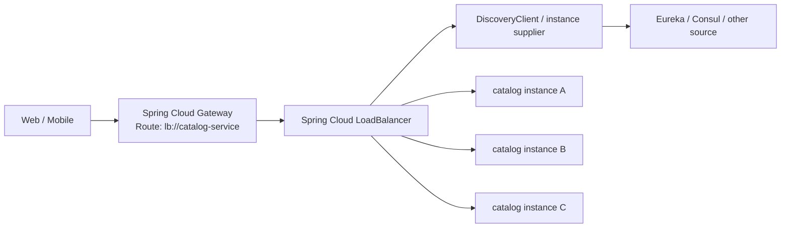
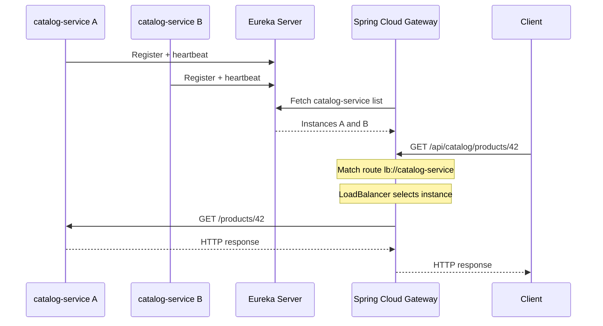
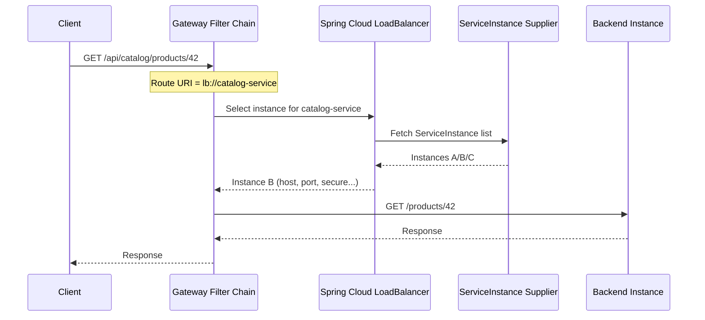
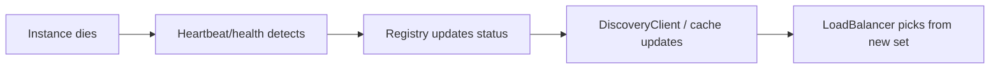

# Connecting DiscoveryClient with Eureka, Consul, or an Appropriate Service Source

In a microservices system, **Spring Cloud Gateway** typically sits in front of multiple replicas of the same service. Today `catalog-service` has two instances; tomorrow the system scales out to five instances; an instance may restart, move to another host, or be removed because it is no longer healthy. If you had to declare every instance's IP and port directly in Gateway routes, every backend deployment could force an entrypoint configuration update.

**Service discovery** solves the problem of locating instance addresses by **logical service name**. With an appropriate discovery mechanism, the Gateway only needs to know a name such as `catalog-service` and declare a route using the URI `lb://catalog-service`. At forwarding time, **Spring Cloud LoadBalancer** picks a specific instance from the list supplied by the service discovery source.

This lesson belongs to the **Service Discovery and Load Balancing** chapter of the **SPRING_CLOUD_GATEWAY** module. It focuses on connecting `DiscoveryClient` to **Eureka**, **Consul**, or another instance source; distinguishing service registration, service discovery, automatic route generation, and instance selection; and testing in a real gateway with route predicates, the filter chain, path/header transformations, authentication, rate limiting, circuit breakers, retries, TLS, and request observability.

> **Scope:** The route and filter examples below use **Spring Cloud Gateway Server WebFlux**, with dependency organization and properties to be checked against your version. Web MVC has corresponding route/filter APIs but does not reuse WebFlux code verbatim. Hostnames, addresses, and ports are examples only; no live Eureka, Consul, backend, or real load-test results are pre-created by this article.

## 1. The Problem with Hardcoding Addresses in Routes

Suppose a gateway route is declared as:

```yaml
id: catalog-route
uri: http://192.0.2.10:8081
predicates:
  - Path=/api/catalog/**
filters:
  - StripPrefix=2
```

This is an **abbreviated route snippet**; actual configuration must sit under the valid property prefix for your Gateway version. With this route, the gateway always forwards to one specific address unless another mechanism is configured.

Common limitations:

1. **Changing IPs:** new containers or VMs may receive different IPs/ports.
2. **No automatic scaling:** the route only knows one upstream even if the service has multiple instances.
3. **Manual failover:** when the target instance dies, the route does not automatically know a replacement address.
4. **Harder config management:** multiple gateway replicas must all update their backend lists together.
5. **Operational risk:** mistyping an IP can send traffic to the wrong environment or service.

Instead of storing instance addresses in the route, we route by **service name**:

```yaml
id: catalog-route
uri: lb://catalog-service
predicates:
  - Path=/api/catalog/**
filters:
  - StripPrefix=2
```

`lb://catalog-service` is neither an Internet hostname nor a self-contained instance-selection algorithm. It is a **logical URI** processed by Spring Cloud Gateway's load-balancing components. It requires the `spring-cloud-starter-loadbalancer` dependency and a compatible `ServiceInstance` source.



The Gateway decides **which route a request belongs to** first, and then the load balancer chooses **which instance of the service** to call. Those two decisions must not be conflated.

## 2. Distinguishing Service Registry, DiscoveryClient, LoadBalancer, and Gateway

| Component | Answers the question | Example |
| --- | --- | --- |
| **Service Registry** | "Which instances of this service currently exist?" | Eureka Server, Consul Catalog |
| **Service registration** | "How is an instance registered/deregistered?" | `catalog-service` registers its address, port, and status |
| **`DiscoveryClient` / `ReactiveDiscoveryClient`** | "Which API does a Spring app use to read the list of services/instances?" | `getInstances("catalog-service")` via the corresponding interface |
| **`ServiceInstance`** | "What host, port, ID, metadata, and security flag does an instance have?" | `catalog-service@10.0.0.21:8081` |
| **Spring Cloud LoadBalancer** | "Which instance should be chosen from the supplied set?" | Round-robin or configured strategy |
| **Gateway RouteLocator** | "Which logical route does this request follow?" | `/api/catalog/**` → `lb://catalog-service` |
| **`DiscoveryClientRouteDefinitionLocator`** | "Should routes be auto-generated from discovered service names?" | Auto-generated `/catalog-service/**` route when enabled and properly configured |

A Spring Cloud `DiscoveryClient` implementation can be **blocking/synchronous**, whereas `ReactiveDiscoveryClient` provides an interface suited for reactive flows. Gateway WebFlux and Spring Cloud LoadBalancer have integration points to consume instance lists depending on the source; do not assume every registry shares the same client type, cache, or update mechanism.

### 2.1. Two independent yet related flows

**Registration and discovery flow:**

```text
catalog instance starts
    -> registers with Eureka/Consul (or is discovered by infrastructure)
    -> registry supplies the instance list
    -> gateway/load balancer reads the list via its configured mechanism
```

**Request-processing flow:**

```text
GET /api/catalog/products/42
    -> Path predicate matches catalog-route
    -> StripPrefix=2 rewrites path to /products/42
    -> lb://catalog-service resolves the logical name
    -> LoadBalancer selects a ServiceInstance
    -> HTTP client connects to the instance's host:port
    -> backend returns response
```

Having a service record in the registry **does not automatically guarantee** a connection from the gateway to the instance will succeed. You still need the right network address, health, DNS, port, firewall, HTTP(S) protocol, and certificates if TLS is used.

## 3. Which Service Discovery Source Fits Best?

Not every system needs to deploy Eureka or Consul. Choose the instance source based on the **infrastructure you already operate**, rather than installing an extra registry solely because you use Spring Cloud Gateway.

| Source | Core model | Best suited when | What to check |
| --- | --- | --- | --- |
| **Netflix Eureka** | Eureka client apps self-register; Eureka Server provides registry and lease status. | Spring Cloud system already uses Eureka or needs this registry model. | Eureka Server, lease/heartbeat, instance config, registry protection. |
| **HashiCorp Consul** | Apps/agents register services and health checks; Consul Catalog/Health provides instances. | Organization already uses Consul for discovery/config or runs polyglot apps. | Consul agent/server, ACL tokens, health checks, datacenter, and network. |
| **Kubernetes-native discovery** | Cluster Services and EndpointSlices/DNS represent backends; optionally use Spring Cloud Kubernetes DiscoveryClient. | Microservices are already deployed in Kubernetes. | Whether Service DNS alone suffices or DiscoveryClient, RBAC, and topology are needed. |
| **`SimpleDiscoveryClient`** | Static `ServiceInstance` list declared via properties. | POC/local dev or a small fixed set of backends. | URI list, config-change process, and how LoadBalancer retrieves instances. |
| **Custom source** | Supplies instance lists via a custom client/supplier. | Standardized internal service catalog already exists. | API, cache/TTL, authentication, health, error handling, and compatibility. |

**Practical rule:** if existing Kubernetes Service DNS and ingress already satisfy routing and load balancing needs, you may not need a Spring Cloud discovery client in the gateway. Conversely, when the gateway must select instances by metadata, zone, or custom policy, a `ServiceInstance` source adds flexibility.

### What should you NOT expect from a registry?

- A registry does not authenticate end-user JWTs.
- A registry does not establish TLS between the gateway and backends.
- A registry does not rate-limit requests per user/API key.
- A registry does not enforce business endpoint paths, HTTP methods, or permissions.
- A registry does not create circuit breakers or make POST retries automatically safe.

Those are the responsibilities of the route predicate/filter chain, Spring Security, resilience libraries, and the backend itself.

## 4. Preparing Dependencies and Version Compatibility

Before configuring, lock down compatible **JDK, Spring Boot, Spring Cloud release train, Spring Cloud Gateway WebFlux**, and discovery client versions. Use the Spring Cloud BOM / Dependency Management to keep libraries aligned.

### 4.1. Required dependency groups

| Role | Common starter |
| --- | --- |
| API Gateway WebFlux in recent lines | `org.springframework.cloud:spring-cloud-starter-gateway-server-webflux` |
| Spring Cloud LoadBalancer | `org.springframework.cloud:spring-cloud-starter-loadbalancer` |
| Eureka DiscoveryClient | `org.springframework.cloud:spring-cloud-starter-netflix-eureka-client` |
| Consul DiscoveryClient | `org.springframework.cloud:spring-cloud-starter-consul-discovery` |
| Health/metrics in Spring Boot apps | `org.springframework.boot:spring-boot-starter-actuator` |
| JWT resource server auth if needed | `org.springframework.boot:spring-boot-starter-oauth2-resource-server` |

Gateway starter names, property prefixes, and version support can change across release trains. For example, older Gateway WebFlux lines used `spring-cloud-starter-gateway`, whereas newer lines separate `server-webflux` and `server-webmvc`. Check the official compatibility matrix before copying dependencies.

### 4.2. Gradle example (conceptual, not a complete build file)

Assume the project **already configures** the Spring Boot plugin, repositories, and a compatible Spring Cloud BOM:

```groovy
dependencies {
    implementation "org.springframework.cloud:spring-cloud-starter-gateway-server-webflux"
    implementation "org.springframework.cloud:spring-cloud-starter-loadbalancer"

    // Pick only the discovery starter matching your infrastructure.
    implementation "org.springframework.cloud:spring-cloud-starter-netflix-eureka-client"
    // Or: implementation "org.springframework.cloud:spring-cloud-starter-consul-discovery"

    implementation "org.springframework.boot:spring-boot-starter-actuator"
}
```

The snippet above **does not** specify version numbers because versions should be managed by the BOM. Do not enable both Eureka and Consul "just in case," because multiple `DiscoveryClient`s on the classpath can all contribute instance info and complicate configuration. If a project genuinely needs multiple registries, define clear precedence, service groups, and composition rules.

### 4.3. Is @EnableDiscoveryClient needed?

In many modern Spring Cloud apps, adding the discovery starter and configuring it properly is enough to enable the discovery client via auto-configuration; **`@EnableDiscoveryClient` is not strictly required**. Depending on the platform, you can disable self-registration if the gateway only consumes the registry instead of advertising itself as a service.

Do not treat the annotation as a fix for missing dependencies or a wrong registry URL. Check startup logs, discovery beans, and actual instance lookup results.

## 5. Connecting Eureka: Registering Backends and Discovering from the Gateway

### 5.1. Eureka diagram



Eureka relies on registration and lease/heartbeat maintenance; the instance list seen at the gateway can **lag behind reality** for a window of time. A record appearing in the registry does not prove that the instance just returned a successful HTTP response.

### 5.2. Configuring catalog-service as a Eureka client

Example in the `catalog-service` backend application:

```yaml
spring:
  application:
    name: catalog-service
server:
  port: 8081

eureka:
  client:
    serviceUrl:
      defaultZone: http://localhost:8761/eureka/
```

The backend needs a compatible Eureka client starter. `defaultZone` is the key used by the Eureka client inside `serviceUrl`; keep the exact name/case and format from your version's documentation.

If two backend instances run on the same machine for testing, they must use **different ports**, such as 8081 and 8082, with the same `spring.application.name`. Each instance must register an address **reachable by the gateway**, not only valid locally on the backend host.

### 5.3. Configuring the gateway to connect to Eureka

```yaml
spring:
  application:
    name: api-gateway

server:
  port: 8080

eureka:
  client:
    serviceUrl:
      defaultZone: http://localhost:8761/eureka/
```

This is the shared discovery connection configuration. Gateway routes will be added separately in Section 8. The gateway may register itself with Eureka depending on defaults; if the gateway **only needs to read the registry**, you can set `eureka.client.register-with-eureka=false` while keeping registry fetching enabled as needed. Test with your actual topology before changing defaults.

### 5.4. Common Eureka pitfalls

| Scenario | Symptom | Resolution |
| --- | --- | --- |
| Wrong `defaultZone` URL or port | Fails to fetch registry, connection errors in logs. | Verify Eureka Server is running and the URL is reachable from the gateway. |
| Service registers an address unreachable from gateway | Instance appears in UI, but requests fail with connection errors. | Check advertised hostname/IP, container networking, port, and firewall. |
| Registry stores service name differently from route | `lb://catalog-service` finds no instances. | Compare the exact service ID from client/registry; avoid guessing case. |
| Backend dies but registry has not updated | Requests can still hit the dead instance during the transition window. | Tune/monitor leases, caches, timeouts, safe retries, and app health. |
| Gateway errors when registry is temporarily unreachable | New instances may be missed or refreshes fail. | Verify cache/TTL behavior and designed degradation strategy. |

In some Eureka setups, application/service names are normalized to uppercase in the registry. **Compare the actual service ID** across client, `DiscoveryClient`, and route rather than assuming every source treats casing identically.

## 6. Connecting Consul: Discovery Tied to Health Checks

Consul provides a service catalog and a health-checking system. Applications can register via a Consul client/agent; Spring Cloud Consul's discovery support reads eligible services/instances to feed LoadBalancer.

### 6.1. Example catalog-service configuration with Consul

A valid YAML sample must place `spring.application` and `spring.cloud.consul` together under **one** `spring` key, without declaring duplicate top-level keys:

```yaml
spring:
  application:
    name: catalog-service
  cloud:
    consul:
      host: localhost
      port: 8500
      discovery:
        service-name: catalog-service
        health-check-path: /actuator/health

server:
  port: 8081

management:
  endpoints:
    web:
      exposure:
        include: health,info
```

Here:

- `spring.cloud.consul.host` and `port` point to the Consul agent/server reachable by the application.
- `discovery.service-name` is the service ID used for registration and lookup.
- `health-check-path` is the path Consul uses for health checks per your configuration/version.
- For Consul to probe the app's health endpoint, you need Spring Boot Actuator (or an equivalent HTTP endpoint), accurate registered host/port, and network policy allowing health checks.

**Do not** expose all Actuator endpoints publicly just so Consul can read health. Place the health endpoint on a management network or restrict it to trusted paths; avoid leaking configuration, secrets, and administrative data.

### 6.2. Connecting the gateway to Consul

```yaml
spring:
  application:
    name: api-gateway
  cloud:
    consul:
      host: localhost
      port: 8500
      discovery:
        register: false

server:
  port: 8080
```

`register: false` illustrates a gateway that **only consumes** services in Consul without registering itself. If an ingress or other apps need to discover the gateway itself, you may let it register, provided that is an intentional architectural choice with proper health/port settings.

Consul can use **ACL tokens**, HTTPS/mTLS, and datacenters/namespaces depending on deployment. Never commit real tokens in YAML files; use a secrets manager/environment variables and check your version's docs for security properties.

### 6.3. Key differences from Eureka

| Aspect | Eureka | Consul |
| --- | --- | --- |
| Health mechanism | Usually based on registration and heartbeats/leases, depending on health indicator config. | Dedicated health checks via Consul agent/health subsystem. |
| Protocol & infrastructure | Eureka Server + Eureka clients. | Consul servers/agents, catalog, health, and ACLs. |
| Service ID | May be normalized per Eureka client naming. | Usually matches the service name declared in Consul. |
| Status propagation | Latency due to heartbeats/caches/registry. | Latency due to health interval/caches/consistency mode. |
| Registry security | Secures Eureka Server via infrastructure, TLS/auth when configured. | Has its own ACL token model and TLS/Consul service identity. |

Do not assume Consul always detects failures "instantly" or that Eureka is always less accurate. Real behavior depends on health checks, intervals/TTLs, how LoadBalancer fetches instances, and network conditions.

## 7. Without an External Registry: SimpleDiscoveryClient

To learn the `lb://` mechanism before deploying Eureka or Consul, Spring Cloud can use `SimpleDiscoveryClient` with statically configured instance URIs. This is great for a POC; it does not replace automatic change detection in dynamically scaled environments.

```yaml
spring:
  cloud:
    discovery:
      client:
        simple:
          instances:
            catalog-service:
              - uri: http://localhost:8081
              - uri: http://localhost:8082
```

If the gateway includes `spring-cloud-starter-loadbalancer` and the Spring Cloud version supports this static instance source, an `lb://catalog-service` route can choose between the two addresses.

When running locally:

- Start two mock backends on 8081 and 8082.
- Have each backend return a distinct marker such as `instance: A` and `instance: B`.
- Send multiple requests through the gateway to observe distribution.
- Stop one mock backend and observe system behavior **while the static list still contains that instance**.

A static list does not automatically remove a dead URI simply because the process stopped. This is a very clear demonstration of the difference between **knowing which instances exist in config** and **knowing which instances are healthy**.

## 8. Configuring Gateway Routes with lb://

### 8.1. YAML for Server WebFlux with the new namespace

When your application uses a Gateway WebFlux line with property prefix `spring.cloud.gateway.server.webflux.routes`:

```yaml
spring:
  cloud:
    gateway:
      server:
        webflux:
          routes:
            - id: catalog-route
              uri: lb://catalog-service
              predicates:
                - Path=/api/catalog/**
              filters:
                - StripPrefix=2
                - SetRequestHeader=X-Edge-Source, gateway

            - id: orders-route
              uri: lb://order-service
              predicates:
                - Path=/api/orders/**
              filters:
                - StripPrefix=2
```

These routes are **independent of whether you choose Eureka, Consul, or SimpleDiscoveryClient**. They assume LoadBalancer can see `catalog-service` and `order-service` through a suitable instance source.

Example request:

```http
GET /api/catalog/products/42?lang=vi HTTP/1.1
Host: api.example
```

Expected flow:

1. Predicate `Path=/api/catalog/**` selects `catalog-route`.
2. `StripPrefix=2` strips the two segments `api` and `catalog`, so upstream receives `/products/42`.
3. The header filter sets `X-Edge-Source: gateway` before forwarding.
4. LoadBalancer fetches the instance list for `catalog-service` and picks a suitable instance.
5. The backend receives `GET /products/42?lang=vi` with the processed headers.

**Do not use `X-Edge-Source` as proof of authentication.** A client can send the same header name itself if the gateway/backend does not strip and overwrite it; identity must be verified via Spring Security or a trusted channel.

### 8.2. Older Gateway WebFlux lines with a different prefix

Many guides for older Gateway 4.x lines declare routes at:

```yaml
spring:
  cloud:
    gateway:
      routes:
        - id: catalog-route
          uri: lb://catalog-service
          predicates:
            - Path=/api/catalog/**
          filters:
            - StripPrefix=2
```

**Do not mix both namespace styles** without checking your running version. Spring Cloud Gateway changed how Server WebFlux/Web MVC are grouped and how properties are named across release lines. When routes do not show up even though the app starts, check Configuration Properties/starters before blaming Eureka or Consul.

### 8.3. Java DSL independent of a YAML prefix

```java
import org.springframework.cloud.gateway.route.RouteLocator;
import org.springframework.cloud.gateway.route.builder.RouteLocatorBuilder;
import org.springframework.context.annotation.Bean;
import org.springframework.context.annotation.Configuration;

@Configuration
public class CatalogGatewayRoutes {

    @Bean
    RouteLocator catalogRoutes(RouteLocatorBuilder builder) {
        return builder.routes()
            .route("catalog-route", route -> route
                .path("/api/catalog/**")
                .filters(filters -> filters.stripPrefix(2))
                .uri("lb://catalog-service"))
            .build();
    }
}
```

This creates a `RouteLocator` for Server WebFlux. It does not automatically supply LoadBalancer or DiscoveryClient; compatible dependencies are still mandatory. For Web MVC, use MVC's corresponding route DSL and handlers/filters rather than WebFlux's `RouteLocatorBuilder`.

## 9. DiscoveryClientRouteDefinitionLocator: Should You Auto-Generate Routes?

Spring Cloud Gateway also supports **generating routes from discovered service names** via `DiscoveryClientRouteDefinitionLocator`. This is a **different feature** from having explicit routes using `lb://catalog-service`.

### Comparing the two approaches

| Routing style | How it works | Pros | Risks / limits |
| --- | --- | --- | --- |
| **Explicit route + `lb://`** | Deliberately declare route ID, predicates, filters, and service ID. | Stable public API, easy to control auth/rate limits/rewrites. | Must maintain the list of published routes. |
| **Auto-generated Discovery locator** | Reads service IDs from DiscoveryClient and creates route definitions via configured rules. | Convenient for test environments or uniform service fleets. | Risk of unintentionally exposing internal services; paths depend on registry names. |

In some Gateway WebFlux lines, legacy configuration to enable the locator looks like:

```yaml
spring:
  cloud:
    gateway:
      discovery:
        locator:
          enabled: true
          lower-case-service-id: true
```

For lines with the newer Gateway namespace, **verify the discovery locator property branch in your exact version's documentation**. Do not assume legacy examples are valid in newer apps.

### Default path behavior

In the common discovery locator model, auto-generated routes may use a predicate like `/{serviceId}/**` and rewrite the path to strip `/{serviceId}` before reaching the backend. For example, if the service ID is `catalog-service`:

```text
Client:  GET /catalog-service/products/42
Backend: GET /products/42
```

This describes a **configurable default rule** in supported lines, not a guarantee that every registry/version builds identical URLs. Service names may differ in casing, and auto-generated predicates/filters can change when customizing the locator.

**Safe choice for public APIs:** usually declare controlled explicit routes and enable auto discovery locator only when genuinely needed. If auto-generating routes, filter the published service list, audit security per route, and avoid exposing internal endpoints.

### Why a registry update doesn't mean an auto-generated route appears instantly

The DiscoveryClient source and the **route cache** follow two separate lifecycles. When a **new service name** appears, the locator must observe the new name and the Gateway must refresh its route list via the corresponding mechanism. When a **new instance of an existing service ID** appears, LoadBalancer can update the instance list without creating a new route ID.

If you are debugging why `lb://catalog-service` fails to forward, do not blindly call route refresh and assume discovery is fixed; inspect the exact layer missing data.

## 10. What Happens When LoadBalancer Picks an Instance?

In Gateway Server WebFlux, once a request matches a route, a load-balancing filter resolves the `lb://service-id` URI into an actual address.



### 10.1. Load balancing algorithms

Spring Cloud LoadBalancer can provide distribution choices such as **round-robin**; depending on version and configuration, other strategies or custom extensions may be available. Do not assume:

- With 2 instances, each receives exactly 50% of requests.
- A slow instance automatically receives fewer requests.
- Having LoadBalancer guarantees health-based filtering.
- LoadBalancer will never pick an instance that just died before being evicted from the list.

Actual distribution depends on the instance set, caching/supplier mechanism, algorithm, concurrency, retries, and service discovery state. For production readiness, measure **request counts per instance**, errors, and failover convergence time when an instance disappears.

### 10.2. When no instance is available

If LoadBalancer cannot find a `ServiceInstance` for the service ID, the gateway usually cannot forward and may return **503 Service Unavailable** by default in supported WebFlux lines. Some versions offer an option to return **404** when no instance is found. Check the exact status code behavior in your running version's configuration.

Do not confuse **503 from no instance found** with **404 from no route predicate match**:

| Case | Layer where it happens | How to troubleshoot |
| --- | --- | --- |
| No route matches `/api/catalog/**` | Route predicate/handler mapping | Check path/method/host, route order, and route config. |
| Route matches, but service ID has no instances | LoadBalancer/discovery | Check registry, health, service name, and source cache. |
| Instance selected, but connection fails | HTTP client/network/TLS | Check IP, port, firewall, certificates, and timeouts. |
| Upstream returns 404 | Backend | Check `StripPrefix`/`RewritePath` and backend endpoints. |

## 11. Registry Health, Caching, and Eventual Consistency

In a distributed system, registration data does not update simultaneously everywhere. An instance may already be dead while:

1. The registry has not yet received or processed the loss signal.
2. The gateway's DiscoveryClient still holds an older snapshot.
3. LoadBalancer is still using a cached instance set.
4. A request selects that instance before the entire system converges to the new state.



**There is no fixed convergence time across all systems.** Eureka uses leases/heartbeats and specific caches; Consul uses health checks and configurable caching/consistency; Kubernetes has its own readiness probes, endpoint propagation, and DNS/network behavior.

### What should you configure and test?

- **Health/readiness endpoint:** report ready only when the backend can actually serve requests as required.
- **Registration identity:** instance ID, hostname, IP, and port must be valid on the network as seen from the gateway.
- **TTL/intervals:** understand refresh intervals for the registry and discovery caches, without lowering everything aggressively unless justified by load/operations.
- **LoadBalancer supplier:** know your configured instance source and health-cache/filtering behavior; do not assume all suppliers drop failing instances immediately.
- **Timeouts/retries:** set bounds so requests do not hang on dead instances; only retry safe operations within a budget.
- **Observability:** measure error bursts right after scale-down, convergence time, and the rate of calls sent to unhealthy instances.

Design health endpoints **meaningfully**: an endpoint returning 200 when the app cannot process requests keeps the registry treating it as healthy. Yet readiness should not depend so broadly on every auxiliary service that it triggers unnecessary cascading failures.

## 12. TLS, Security, and Trust Boundaries

Discovery provides **target addresses**, but those addresses may lie across different trust zones. Protect both the path to the registry and the path to backends.

| Hop | Risk | Control |
| --- | --- | --- |
| Gateway → Eureka/Consul | Service list leakage, registry spoofing, credential theft. | TLS, ACLs/authentication, and management-network restrictions on the registry. |
| Gateway → discovered backend | URI pointing to wrong host, plaintext connection, or mismatched certificate. | Outbound network restrictions, TLS/mTLS, hostname verification, and accurate instance metadata. |
| Client → Gateway | Forged tokens, unauthorized API access, overload. | HTTPS, Spring Security, rate limiter, and proper CORS. |
| Backend → backend | Unchecked internal calls. | Resource-level authorization, service identity/mTLS where needed, and network policies. |

### 12.1. Never construct URIs from untrusted client input

The `lb://catalog-service` route takes the service name from **managed gateway configuration**, not from a raw URL sent by a client. If an application lets clients pick a service ID or hostname and maps it directly into `lb://...` or `http://...`, it risks **SSRF/open proxy** vulnerabilities and route authorization bypasses.

Keep the list of allowed routes/service IDs explicit; govern registry writes and routes under separate privileges. A rogue instance appearing in the registry can receive traffic if the system trusts the registry blindly.

### 12.2. HTTP or HTTPS when using lb://?

`lb://catalog-service` is a logical URI; the outbound protocol/connection is determined by instance metadata and the HTTP filter mechanism in your Gateway/LoadBalancer version. **Do not treat `lb://` as a guarantee of HTTPS.**

If backends require HTTPS, verify `ServiceInstance` secure flags/metadata, gateway HTTP client config, certificates/trust stores, SNI, and intermediate proxies. Test against a backend with a valid certificate, not just by looking at the service ID.

### 12.3. Forwarded headers and identity

Gateways often add headers like `Forwarded`/`X-Forwarded-*` in topologies with upstream proxies. Trust only headers created by controlled proxies/ingresses; never treat client-supplied IPs or user IDs in headers as trustworthy proof.

Likewise, a route filter like `SetRequestHeader=X-Edge-Source,gateway` does not authenticate the client. JWT validation and authorization must still use proper mechanisms; `order-service` must verify the user is allowed to view the **specific order**.

## 13. Rate Limiting, Circuit Breakers, and Retries When Instances Change

Discovery does not replace entrypoint protection components:

| Mechanism | What does it solve? | Relationship to discovery |
| --- | --- | --- |
| **RequestRateLimiter** | Limits requests by a key such as user/API key. | Usually applied per public route/identity; quotas must stay consistent across gateway replicas. |
| **Timeout** | Caps connection/response wait time. | Helps handle unresponsive instances; must align with SLOs and retries. |
| **CircuitBreaker** | Temporarily stops calling an upstream with high error rates per policy. | Does not replace registry health; protects client/gateway when a backend set fails. |
| **Retry** | Retries requests meeting configured criteria. | Can increase call volume and must guard against retrying into the same failing instance. |
| **LoadBalancer** | Picks an instance from the current list. | Does not enforce rate limits or verify identity. |

### Example: failure occurs between instance selection and backend call

1. LoadBalancer picks instance A because the registry still reports A as healthy.
2. Instance A drops the connection when the gateway sends the request.
3. The gateway receives an HTTP client error or timeout.
4. If `Retry` is configured and conditions match, the request may be retried, though **there is no guarantee** retry will automatically switch to B as expected unless you verify the actual filter/LoadBalancer integration.

For idempotent GETs, bounded retries may be acceptable depending on contract. For `POST /api/orders` or payments, the backend may have completed the operation before the response was lost; retrying without an **idempotency key** risks duplicate data or transactions.

**Do not try to make registry refreshes ultra-fast to replace timeouts and resilience policies.** Resilience layers complement each other, but they need an overall time budget and load testing to avoid error amplification.

## 14. Lab A: SimpleDiscoveryClient Before Using a Real Registry

### 14.1. Prepare three processes

| Process | Assumed address | Role |
| --- | --- | --- |
| Gateway WebFlux | `localhost:8080` | Route `catalog-route` using `lb://catalog-service` |
| Mock catalog A | `localhost:8081` | Returns JSON `{"instance":"A"}` |
| Mock catalog B | `localhost:8082` | Returns JSON `{"instance":"B"}` |

Use the `SimpleDiscoveryClient` config from Section 7 and the Gateway route from Section 8. Both mock backends need a `GET /products/42` endpoint.

### 14.2. Call through the gateway

```bash
curl -i "http://localhost:8080/api/catalog/products/42"
curl -i "http://localhost:8080/api/catalog/products/42"
curl -i "http://localhost:8080/api/catalog/products/42"
```

Record the `instance` value per request. You can observe multiple instances being selected; **do not make strict A/B alternation a pass criterion**, because algorithms, suppliers, filters, and concurrent requests affect distribution.

### 14.3. Stop one instance

1. Stop mock B while **keeping** both A and B in the `SimpleDiscoveryClient` list.
2. Call the same URL repeatedly.
3. Record status codes, error types, timeouts, and requests reaching A.
4. Confirm that a static list does not automatically drop B simply because process B stopped, unless your project adds a health-check supplier.
5. Restart B and compare the results again.

This lab demonstrates that **load balancing does not imply active health checking**. An instance source with health signaling such as Consul or properly configured Eureka leases gives better status signals, though propagation latency still exists.

## 15. Lab B: Moving to Eureka or Consul

### Eureka option

1. Deploy Eureka Server in a test network at an address reachable by all processes.
2. Add the Eureka client starter to both `catalog-service` mocks, aligning `spring.application.name=catalog-service` with different ports per instance.
3. Configure the gateway with the Eureka client and suitable load balancer.
4. Remove the static `SimpleDiscoveryClient` config to avoid mixing instance sources in the POC.
5. Check that the registry shows both A and B; verify the **addresses from the gateway's point of view**.
6. Send requests via `lb://catalog-service` and observe which instances are selected.
7. Stop B; measure the time from stopping until the registry/LoadBalancer stops picking B.

### Consul option

1. Deploy a Consul agent/server in the test environment with appropriate networking/ACLs.
2. Add the Consul Discovery starter to the backends and gateway.
3. Configure `spring.cloud.consul.host/port`, `discovery.service-name`, and appropriate health checks.
4. Ensure each backend's health endpoint is genuinely reachable **from the Consul agent**.
5. Send requests through the same `lb://catalog-service` route; record selected instances.
6. Make B unavailable (stop it or fail its health check); measure how long Consul takes to mark it unhealthy and how long the Gateway takes to stop selecting B.
7. Restore B and observe re-registration, health recovery, and request handling.

Do not run both Eureka and Consul for **the same service name** in a basic POC without controlling how `DiscoveryClient`s are merged; otherwise it becomes hard to tell which registry supplied an instance.

### Sample acceptance test matrix

| Case | Setup | What to observe |
| --- | --- | --- |
| D01 | Two healthy instances | Gateway discovers both instances and forwards the expected path. |
| D02 | Add a third instance | How quickly the new instance appears in the active list. |
| D03 | One instance dies | Error count and convergence time until the dead instance is no longer picked. |
| D04 | Eureka/Consul briefly disconnected | Whether the Gateway serves from cache or errors; recovery when the registry returns. |
| D05 | Misspelled service ID | No instances for `lb://...`; distinguish from predicate failure. |
| D06 | Wrong IP/port registered | Registry has a record, but HTTP client connection fails. |
| D07 | HTTPS backend | Verify certs, host, SNI, trust store, and outbound URI. |
| D08 | Route with `StripPrefix=2` | Backend receives `/products/42` with query string intact. |
| D09 | Multiple gateway replicas | Replicas share the same registry/policy and show compatible behavior. |
| D10 | Bounded Retry enabled for GET | Measure upstream call counts, errors, and total latency. |
| D11 | JWT and rate limits enabled | Invalid tokens/exceeded quotas are blocked; do not blame discovery. |
| D12 | Request observability | Trace links gateway/backend; metrics grouped by route ID and service. |

## 16. Observability and Debugging from Route to Instance

### 16.1. What to observe

In operations, aim to capture:

- Matched route ID, e.g., `catalog-route`.
- Service ID in the `lb://catalog-service` URI.
- Number of instances supplied by the discovery source.
- Actually selected instance, host/port, or backend group at a **controlled** log level.
- Upstream call outcome, timeouts, TLS/network errors, and HTTP status.
- Trace/correlation ID across gateway and backend.
- Registry/instance-list refresh timestamps and error metrics when the discovery source is unavailable.

An illustrative record:

```text
traceId:       [trace ID]
routeId:       catalog-route
serviceId:     catalog-service
instanceGroup: catalog-region-a
requestPath:   /api/catalog/products/42
upstreamPath:  /products/42
status:        200
elapsedMs:     [measured value]
```

This is **not a default log** automatically emitted by Gateway from a single `lb://` line. You must integrate Micrometer, Spring Boot Actuator, tracing, and an appropriate metrics/logging pipeline. Never log Authorization tokens, cookies, sensitive request bodies, or URIs containing secrets. Avoid putting high-variance instance IDs/URLs into metric labels that cause high cardinality.

### 16.2. What can Actuator inspect?

In versions with Spring Boot Actuator/Gateway actuator endpoints enabled and secured, you can inspect runtime routes:

```http
GET /actuator/gateway/routes
```

This endpoint checks whether the Gateway has route `catalog-route` and URI `lb://catalog-service`. It **does not necessarily list every final instance** or prove an instance is healthy. Check instance details via the registry, LoadBalancer diagnostics/metrics, or appropriate internal admin endpoints.

**Never expose management actuator endpoints publicly to the Internet.** Enable only needed endpoints, restrict access, and verify the exposure/access model for your exact Spring Boot/Gateway version.

### 16.3. Diagnostic table

| Symptom | Possible cause | Check |
| --- | --- | --- |
| `GET /api/catalog/products/42` returns 404 right from gateway | Route not loaded or predicate mismatch. | Config prefix, path/method, route order, and runtime route list. |
| Route has `lb://catalog-service` but returns 503 | No instances found or none available. | DiscoveryClient, registry, service ID, cache, and LoadBalancer. |
| Registry shows instance, but gateway connection fails | Wrong IP/port/hostname/firewall/TLS. | Network path from gateway to instance, HTTP client logs, certificates. |
| Only a few requests fail right after scale-down | Discovery/LoadBalancer still sees the stopped instance. | Lease/health interval, cache/TTL, and convergence time. |
| Wrong backend path | `StripPrefix`/`RewritePath`/`PrefixPath` mismatch. | Backend echoed path, filter order, and query string. |
| Route stops working only after switching to Consul | Wrong service name, health check, or Consul ACL/address. | Catalog Health API, agent logs, registration config, and ACLs. |
| Eureka name differs from `lb://` name | Case/service ID mismatch. | Actual value returned by `DiscoveryClient`. |
| Browser reports CORS error | Gateway cross-origin policy mismatch. | OPTIONS preflight, origin, headers; do not tweak registry to fix. |
| Client receives 401/403 | Authentication/authorization. | JWT issuer/scopes, security chain, and backend resource permissions. |
| Requests blocked with 429 | Rate limiting. | `KeyResolver`/quota/Redis or active limiter. |
| TLS error between gateway and backend | Wrong scheme, SNI, or trust. | Certificates, HTTPS endpoint, httpclient SSL, and instance secure flag. |
| Service returns 5xx after reaching backend | Business or backend failure. | Traces, upstream logs, and circuit breaker; do not look only at registry. |

## 17. Production Deployment Checklist

- [ ] Choose a discovery source matching your infrastructure: Eureka, Consul, Kubernetes, SimpleDiscoveryClient, or an existing solution.
- [ ] Pin compatible JDK, Spring Boot, Spring Cloud release train, Gateway WebFlux/MVC, discovery starter, and Spring Cloud LoadBalancer versions.
- [ ] Define service IDs and casing conventions; every instance of a service registers under the right logical name.
- [ ] Ensure IP/hostname/port published by the registry are **reachable from the gateway**.
- [ ] Design health/readiness, leases/heartbeats, and acceptable convergence times to drop failed instances.
- [ ] Use `lb://service-id` with explicit routes when you want clear public APIs, predicates, and security filters.
- [ ] Enable `DiscoveryClientRouteDefinitionLocator` auto-routes only with service exposure policies, auth, and path limits.
- [ ] Secure the registry with management networks, TLS/ACLs/auth; never commit secrets in YAML.
- [ ] Verify HTTP/HTTPS to instances, SNI, hostname verification, and mTLS against the real topology.
- [ ] Configure timeouts, rate limiting, and circuit breakers; keep retries bounded/idempotent to avoid load amplification.
- [ ] Test scale up/down, instance crashes, health failures, registry outages/recovery, and instance caching across multiple gateway replicas.
- [ ] Observe route ID, service ID, latency, error rates, and traces across layers without logging tokens/PII.
- [ ] Maintain runbooks for no-instance outages, registry failures, backend rollouts, and route config changes.
- [ ] Establish rollback plans, alerts, and post-upgrade verification for every release-train upgrade.

## 18. Self-Check Questions

1. Why does `lb://catalog-service` **not** work automatically if you only add the route to the gateway without configuring LoadBalancer/an instance source?
2. Distinguish `DiscoveryClient`, `DiscoveryClientRouteDefinitionLocator`, and Spring Cloud LoadBalancer by timing and responsibility.
3. Why can an instance already registered in Eureka/Consul still cause gateway connection errors?
4. When Eureka supplies a service ID with different casing from `catalog-service`, where should you verify before editing the route?
5. When should you choose Consul, Eureka, or Kubernetes Service DNS instead of introducing a new registry?
6. With `SimpleDiscoveryClient`'s static instance list, what happens when one backend stops while the configuration still keeps its URI?
7. Why can auto-generating all routes from a registry create the risk of exposing internal endpoints?
8. When an instance dies, why can the registry, client cache, and LoadBalancer take time to synchronize state?
9. What is the difference between HTTP 404 from an unmatched route and HTTP 503 from no available instances?
10. Why are TLS and JWT not automatically guaranteed just because a route uses `lb://`?
11. Before retrying `POST /orders` on a backend connection error, what safety mechanism does the system need?
12. When measuring a scale-down event, what metrics should you collect to evaluate convergence time and client experience?

## 19. Version-Specific Reference Documentation

The links below are for **verifying starter names, properties, client mechanisms, and APIs for your exact release**; do not assume every example from newer lines runs unchanged on an older Gateway project or Gateway Server Web MVC:

- [Spring Cloud Gateway Server WebFlux — The DiscoveryClient Route Definition Locator](https://docs.spring.io/spring-cloud-gateway/reference/spring-cloud-gateway-server-webflux/the-discoveryclient-route-definition-locator.html)
- [Spring Cloud Gateway Server WebFlux — Global Filters and LoadBalancer](https://docs.spring.io/spring-cloud-gateway/reference/spring-cloud-gateway-server-webflux/global-filters.html)
- [Spring Cloud Gateway — Configuration Properties](https://docs.spring.io/spring-cloud-gateway/reference/configprops.html)
- [Spring Cloud Commons — Common Abstractions (DiscoveryClient, LoadBalancer)](https://docs.spring.io/spring-cloud-commons/reference/spring-cloud-commons/common-abstractions.html)
- [Spring Cloud Netflix — Eureka Clients](https://docs.spring.io/spring-cloud-netflix/reference/spring-cloud-netflix.html)
- [Spring Cloud Consul — Discovery](https://docs.spring.io/spring-cloud-consul/reference/discovery.html)
- [Spring Cloud — Project / Supported release trains](https://spring.io/projects/spring-cloud)
- [Spring Cloud Gateway Server Web MVC — Reference](https://docs.spring.io/spring-cloud-gateway/reference/spring-cloud-gateway-server-webmvc/index.html)

**Remember:** **`DiscoveryClient` tells Spring Cloud which instances are advertised by a registry/discovery source; Spring Cloud LoadBalancer picks an instance for an `lb://service-id` route; and the Gateway route predicate/filter chain decides how requests are processed and forwarded.** Successfully connecting Eureka, Consul, or another source is only the first step: the microservices entrypoint must be protected with authentication, TLS, quotas, timeouts, circuit breakers, safe retries, and observability to operate reliably as instance counts and system state continuously change.
