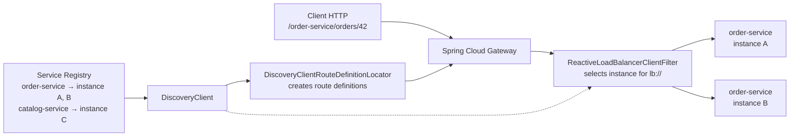
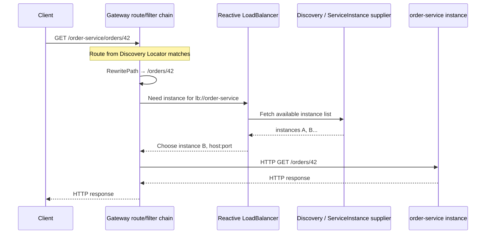

# DiscoveryClient Route Definition Locator

In a microservices architecture, the addresses and number of instances of a service change during deployments, scaling, and recovery from failures. If every time a new service is created you had to manually add a route to the API Gateway, the configuration would gradually become bloated, error-prone with service names, or point to nonexistent instances.

**`DiscoveryClient Route Definition Locator`** in **Spring Cloud Gateway Server WebFlux** solves part of this problem: it **generates route definitions based on services discovered by a `DiscoveryClient`**, instead of requiring operators to write every route individually. Under the default configuration, each service produces a route with a URI like `lb://service-name`, a path predicate `/serviceId/**`, and a filter that strips the service ID prefix before forwarding the request upstream.

This lesson belongs to the **Service Discovery and Load Balancing** chapter in the **SPRING_CLOUD_GATEWAY** module. In an API Gateway with route predicates, filter chains, path/header transformations, service discovery, authentication, rate limiting, circuit breakers, retries, TLS, and observability, it is essential to clearly distinguish **auto-generating routes from a registry** from **selecting an instance to send a request to**. The two steps are closely related, but they are not synonymous.

After this lesson, you will be able to:

1. Explain the roles of `DiscoveryClient`, `RouteDefinitionLocator`, `DiscoveryClientRouteDefinitionLocator`, and Spring Cloud LoadBalancer.
2. Predict the default route generated from a service ID, including its URI, path predicate, and `RewritePath`.
3. Enable the locator using the **correct namespace for your Gateway version**; prepare dependencies and a service registry.
4. Configure `include-expression`, `lower-case-service-id`, `route-id-prefix`, `predicates`, and `filters` without accidentally losing default routes or filters.
5. Compare auto-discovered routes with explicitly declared `lb://` routes; choose the right approach for internal versus public environments.
6. Troubleshoot `404`, `503`, service renames, stale registries, missing instances, exposed internal endpoints, and overlapping routes.

> **Scope:** This article covers **Spring Cloud Gateway Server WebFlux** with Reactor Netty; its APIs and namespaces do not apply verbatim to Server MVC. Discovery configuration has changed across versions. The Gateway WebFlux **5.x** **configuration properties** table lists `spring.cloud.gateway.server.webflux.discovery.locator.*`; Gateway WebFlux **4.3.x** uses `spring.cloud.gateway.discovery.locator.*`. Some prose in the 5.x locator guide still references the legacy names; whenever discrepancies occur, consult the configuration properties table, dependencies, and effective configuration of your **exact running version**, then test the actual routes.

## 1. Placing DiscoveryClient Route Definition Locator in the Overall Architecture

A system might register two instances of `order-service` and one instance of `catalog-service` in a service registry. The Gateway needs to know **which service IDs exist** to create routes, and **which instances a given service ID currently has** when a request arrives.



The diagram is conceptual; in practice, the instance list used by LoadBalancer may be provided by `ServiceInstanceListSupplier` with caching, health checks, and discovery client mechanisms. You should not assume the locator directly sends every HTTP request or maintains an immutable instance list itself.

| Component | Responsibility | Typical input / output |
| --- | --- | --- |
| **Service registry** | Stores service IDs and currently registered instances | `order-service → host:port, metadata, status` |
| **`DiscoveryClient`** | Provides a way to look up service names and instances via Spring Cloud Commons | `getServices()`, `getInstances(serviceId)`, or the reactive counterpart |
| **`RouteDefinitionLocator`** | Supplies `RouteDefinition`s to the Gateway | `Flux<RouteDefinition>` |
| **`DiscoveryClientRouteDefinitionLocator`** | Generates route definitions from services seen by discovery | Predicates, filters, `lb://...` URI, and route ID |
| **`RoutePredicateHandlerMapping`** | Selects the route matching the client request | `Path`, `Host`, `Method`, etc. |
| **`ReactiveLoadBalancerClientFilter`** | Resolves an `lb://serviceId` URI to a concrete instance | Chooses `host:port` and updates the outbound URI |
| **`NettyRoutingFilter`** | Sends the HTTP/HTTPS request to the chosen instance via Reactor Netty | Upstream response to return to the client |

**Two separate questions:**

- **"Which URL does the client call to match a route?"** — determined by the route definition and predicates.
- **"Which service instance receives this request?"** — determined by load balancing and the current instance list.

Enabling the discovery locator **does not automatically guarantee** instances are healthy, backends are reachable, or timeouts/retries are properly configured.

## 2. Default Route Generation Mechanism

Suppose `DiscoveryClient::getServices()` returns two service IDs:

```text
order-service
catalog-service
```

When the discovery locator is enabled, the Gateway typically generates routes conceptually equivalent to:

```yaml
# ILLUSTRATION of auto-generated routes; not configuration to copy verbatim
- id: <prefix>order-service
  uri: lb://order-service
  predicates:
    - Path=/order-service/**
  filters:
    - RewritePath=/order-service/?(?<remaining>.*), /$\{remaining}

- id: <prefix>catalog-service
  uri: lb://catalog-service
  predicates:
    - Path=/catalog-service/**
  filters:
    - RewritePath=/catalog-service/?(?<remaining>.*), /$\{remaining}
```

The `RewritePath` lines above represent the **default semantics**; the actual replacement expression is constructed by the locator using its own mechanism. When writing YAML for routes or for the locator yourself, escaping `$` and SpEL expressions must be handled appropriately (see Section 6).

### How is a concrete request processed?

Suppose backend `order-service` exposes `GET /orders/42`:

1. The client calls `GET /order-service/orders/42` on the Gateway.
2. `Path=/order-service/**` matches the route generated from the registry.
3. `RewritePath` strips the `/order-service` prefix, yielding request path `/orders/42`.
4. The route URI is `lb://order-service`, so LoadBalancer looks up an available instance for that service ID.
5. The Gateway proxies `GET /orders/42` to an `order-service` instance and relays the response back to the client.

| Public request | Route predicate | Path after rewrite | Route URI |
| --- | --- | --- | --- |
| `/order-service/orders/42` | `/order-service/**` | `/orders/42` | `lb://order-service` |
| `/catalog-service/products/7` | `/catalog-service/**` | `/products/7` | `lb://catalog-service` |
| `/other-service/test` | No matching route in this example | Not applicable | Not applicable |

**Common misconception:** `/order-service/orders/42` is only the **default public path of the discovery locator**, not a mandatory requirement in all API designs. If you want to expose `/api/orders/42` and call `order-service`, you can use an explicit route or customize the locator's predicates/filters.

### The default route ID does not necessarily equal the service ID

According to the configuration properties table, `route-id-prefix` defaults to a prefix based on the discovery client class name followed by an underscore, with the service ID appended at the end. Thus, the route ID may look like `ReactiveCompositeDiscoveryClient_order-service` or another name depending on the discovery implementation and version—**do not hardcode that illustrative name**. You can configure a prefix for easier tracking; always verify the actual route ID via Actuator/logs.

## 3. Dependencies and Prerequisites Before Enabling the Locator

There are three fundamental components:

1. **Spring Cloud Gateway Server WebFlux** — the WebFlux-based HTTP gateway.
2. **A `DiscoveryClient` implementation** — e.g., Netflix Eureka, Consul, Zookeeper, or Kubernetes integration appropriate for your environment; services must actually be registered and queryable.
3. **Spring Cloud LoadBalancer** — to resolve the `lb://service-name` URIs used by default in auto-generated routes.

Example Maven dependency declarations, **without pinning individual library versions manually** when the project already uses a compatible Spring Cloud BOM/release train:

```xml
<!-- Gateway Server WebFlux, managed by compatible release train -->
<dependency>
  <groupId>org.springframework.cloud</groupId>
  <artifactId>spring-cloud-starter-gateway-server-webflux</artifactId>
</dependency>

<!-- Required when using lb://service-id route URIs -->
<dependency>
  <groupId>org.springframework.cloud</groupId>
  <artifactId>spring-cloud-starter-loadbalancer</artifactId>
</dependency>

<!-- Example if using Eureka as the service registry -->
<dependency>
  <groupId>org.springframework.cloud</groupId>
  <artifactId>spring-cloud-starter-netflix-eureka-client</artifactId>
</dependency>
```

In Consul/Kubernetes environments, replace the Eureka starter with the implementation matching your infrastructure; do not add multiple discovery providers unnecessarily.

**Do not confuse the locator's dependencies with LoadBalancer's dependencies.** An app might read service names from a registry yet lack `lb://` resolution, or have LoadBalancer configured while the registry has no instances. Those two failures produce different symptoms and must be checked separately.

### Practical operating conditions

- The registry is running or an instance source compatible with your integration is available.
- The Gateway registers/connects to the registry per the discovery provider's configuration.
- The desired service ID appears in the list visible to discovery.
- Service instances advertise addresses and ports **reachable by the Gateway**; private addresses are valid only when containers/VMs share a compatible network.
- Service names are consistent across the registry, LoadBalancer, and routes.

Setting `enabled: true` does not make the Gateway spin up Eureka/Consul, register backends, or configure health checks on its own.

## 4. Enabling the Discovery Locator by Gateway Version

### 4.1. Spring Cloud Gateway Server WebFlux 5.x

Configuration matching the **Configuration Properties** table of the 5.x line:

```yaml
spring:
  cloud:
    gateway:
      server:
        webflux:
          discovery:
            locator:
              enabled: true
```

When configured correctly and the discovery client has service IDs, the Gateway gains auto-discovered routes. `enabled` defaults to `false`. In 5.x, related properties such as `include-expression`, `predicates`, `filters`, and `lower-case-service-id` also live under the `spring.cloud.gateway.server.webflux.discovery.locator` namespace.

### 4.2. Spring Cloud Gateway Server WebFlux 4.3.x

Configuration in the 4.3.x guide:

```yaml
spring:
  cloud:
    gateway:
      discovery:
        locator:
          enabled: true
```

The namespace here is `spring.cloud.gateway.discovery.locator`, **different** from the 5.x namespace.

### 4.3. Why does a 5.x guide page still show the old property name?

The `DiscoveryClient Route Definition Locator` reference page for 5.x still includes example snippets like `spring.cloud.gateway.discovery.locator.enabled=true` and older YAML layouts, while the **5.x Configuration Properties table** lists `spring.cloud.gateway.server.webflux.discovery.locator.enabled`.

Therefore, this lesson **prioritizes the namespace from the 5.x configuration properties table** and flags the documentation inconsistency. In real deployments, inspect the configuration metadata/Actuator of your exact running artifact and test the route list after startup. Do not try both namespaces at random to "fix" missing routes.

## 5. Scaling Routes: Discovery Locator vs. Static Routes Using lb://

Both options can load-balance requests to the same service:

**Option A — Explicit route:**

```yaml
spring:
  cloud:
    gateway:
      server:
        webflux:
          routes:
            - id: orders-public
              uri: lb://order-service
              predicates:
                - Path=/api/orders/**
              filters:
                - StripPrefix=1
```

Client calls `/api/orders/42`; backend receives `/orders/42`.

**Option B — Enable discovery locator with defaults:**

```yaml
spring:
  cloud:
    gateway:
      server:
        webflux:
          discovery:
            locator:
              enabled: true
```

Client calls `/order-service/orders/42`; backend receives `/orders/42`.

| Criterion | Explicit `lb://` route | Auto-generated Discovery Locator |
| --- | --- | --- |
| Need to write each route? | Yes | No, routes are generated from the service registry |
| Backend URI | Can use `lb://order-service` | Typically `lb://serviceId` by default |
| Public path | Chosen by API designer | `/serviceId/**` by default; customizable |
| New service registered in registry | No public route until config is added | Route can be generated if filter conditions match and route cache refreshes |
| Public API control | Clear, narrowed to exact needs | Must be controlled via `include-expression`, predicates, security, and network |
| Best suited for | Internet/public APIs requiring stable contracts | Internal service discovery, dev/test, or strictly governed environments |
| Registry dependency for instance selection | Yes when using `lb://` | Yes for both route generation and instance selection |

**Key point:** You do not need to enable the discovery locator for an explicit `uri: lb://order-service` route to use LoadBalancer. The locator creates **route definitions**; LoadBalancer selects **service instances**. These are two independent features with distinct responsibilities.

## 6. Customizing Predicates and Filters for Auto-Generated Routes

By default, the locator uses:

- `Path=/serviceId/**`.
- `RewritePath=/serviceId/?(?<remaining>.*)` with replacement `/${remaining}`.

If you define `predicates` or `filters` under the locator, you **replace the corresponding default list**, rather than merely "appending a new filter" to the default list. Spring documentation emphasizes that you must re-declare `RewritePath` if you still need to strip the service ID from the path.

### 6.1. Example: exposing the /internal/serviceId/** prefix

Suppose all service IDs are **lowercase**, such as `order-service` and `catalog-service`, and you only want to generate routes for those two services. WebFlux 5.x configuration:

```yaml
spring:
  cloud:
    gateway:
      server:
        webflux:
          discovery:
            locator:
              enabled: true
              include-expression: >-
                serviceId == 'order-service' or serviceId == 'catalog-service'
              predicates:
                - name: Path
                  args:
                    pattern: "'/internal/' + serviceId + '/**'"
              filters:
                - name: RewritePath
                  args:
                    regexp: "'/internal/' + serviceId + '/?(?<remaining>.*)'"
                    replacement: "'/${remaining}'"
```

**Syntax note:** Values like `"'/internal/' + serviceId + '/**'"` are **SpEL expressions inside strings**, not literal route paths. The locator evaluates the expression with `serviceId` in context to create the predicate/filter for each service. The replacement `'/${remaining}'` is a **string returned by SpEL**, later used by `RewritePath` as a replacement referencing the named capture group `remaining`. This example follows the YAML style in the locator docs; when using a different config loader, test how `${...}` and property placeholder escaping behave.

Result for service ID `order-service`:

| Property | Value |
| --- | --- |
| Route URI | `lb://order-service` |
| Path predicate | `/internal/order-service/**` |
| Rewrite regex | `/internal/order-service/?(?<remaining>.*)` |
| Request from client | `GET /internal/order-service/orders/42` |
| Upstream path | `GET /orders/42` |

**Why not add CircuitBreaker right in this example?** A `CircuitBreaker` filter requires its own dependency, name, and fallback policy; to keep the core example easy to test, only basic predicates and filters are included. When adding custom filters such as `CircuitBreaker`, `Retry`, or `RequestRateLimiter`, **keep `RewritePath`** if your backend still expects the path without the service ID prefix.

### 6.2. Adding a Host predicate without losing Path

Example allowing only requests with a matching internal Host:

```yaml
predicates:
  - name: Host
    args:
      pattern: "'gateway.internal.example.com'"
  - name: Path
    args:
      pattern: "'/internal/' + serviceId + '/**'"
```

This is the replacement `predicates` section inside the locator, not a full application YAML. Both predicates on the same route are evaluated with AND logic. If you configure only `Host` and forget `Path`, the route may match far more broadly than intended, depending on other routes.

**A Host predicate is not an authentication mechanism.** Clients can set the `Host` header in certain scenarios; place the Gateway behind a trusted ingress/proxy, require tokens, and protect networks/services accordingly.

### 6.3. Adding filters while keeping RewritePath

An extended sample can look like:

```yaml
filters:
  - name: RewritePath
    args:
      regexp: "'/internal/' + serviceId + '/?(?<remaining>.*)'"
      replacement: "'/${remaining}'"
  - name: RemoveRequestHeader
    args:
      name: "'X-User-Id'"
```

This is an example filter list using a **SpEL expression** for the `name` argument, so client-sent `X-User-Id` headers are not trusted. Check exact factory argument names for your version and test in a real application. If a policy does not depend on `serviceId`, you can also place shared policies in `default-filters` for Gateway WebFlux under your version's namespace.

In public environments, enforce security and rate limits at a trusted layer rather than relying solely on an `/internal` path prefix.

## 7. include-expression: Which Services Should Be Exposed on the Gateway?

The default `include-expression` is `true`: per locator policy, **every service seen by `DiscoveryClient` can be considered for route generation**, regardless of whether its name is internal or public.

This poses a major risk if the Gateway connects to a registry containing all of:

- `order-service` and `catalog-service` (intended to be public).
- `payment-admin`, `billing-worker`, or `internal-secrets` (must not be public).
- Services dedicated to monitoring, batch jobs, or operations.

**Do not enable an unrestricted locator on a public API Gateway** without defining which services are permitted to be published.

Example allowlist by service ID:

```yaml
spring:
  cloud:
    gateway:
      server:
        webflux:
          discovery:
            locator:
              enabled: true
              include-expression: >-
                serviceId == 'order-service' or serviceId == 'catalog-service'
```

This expression matches only when the ID from the registry is lowercase exactly as shown. If the registry returns `ORDER-SERVICE`, `==` against `'order-service'` will not match.

**Operational principles:**

1. Use an **explicit allowlist** rather than a negative exclusion list like "everything except a few dangerous services," because new internal services can be registered at any time.
2. Inspect the exact service IDs returned by `DiscoveryClient` before writing the expression.
3. Never construct SpEL expressions from client input or change them dynamically without control; this is trusted administrator configuration.
4. After changing the expression, inspect the active route list and reachable URLs.
5. Even when routes are generated only for approved services, backends must still verify authentication/authorization by resource, tenant, and role.

`include-expression` decides **whether a route is created for a service**. It is not a mechanism for filtering healthy vs. unhealthy instances, nor does it perform user authorization.

## 8. lower-case-service-id, route-id-prefix, and url-expression

Per the configuration properties table, the discovery locator offers several additional options:

| Property under `...discovery.locator` | Default | Meaning |
| --- | --- | --- |
| `enabled` | `false` | Enables auto-generating routes from the registry |
| `include-expression` | `true` | Decides which services are included in route generation via SpEL |
| `lower-case-service-id` | `false` | Supports lowercase service IDs in predicates/filters, especially when the registry returns uppercase IDs |
| `route-id-prefix` | Based on discovery client name and underscore | Prefix for route IDs; service ID is appended |
| `url-expression` | `'lb://' + serviceId` | Expression building the route's target URI |
| `predicates` | One default `Path` | Shared predicate list generated for each service |
| `filters` | One default `RewritePath` | Shared filter list generated for each service |

### 8.1. Eureka returning uppercase service IDs

Some Eureka setups return service IDs like `ORDER-SERVICE`. Without adjustment, the default public route can end up at `/ORDER-SERVICE/**` instead of `/order-service/**`, confusing clients.

With Gateway WebFlux 5.x:

```yaml
spring:
  cloud:
    gateway:
      server:
        webflux:
          discovery:
            locator:
              enabled: true
              lower-case-service-id: true
```

This option helps format the name in **predicates/filters**. It **does not rename the service inside the registry**, nor does it implicitly replace the identifier LoadBalancer uses to look up instances. Verify separately:

- Which exact ID `DiscoveryClient` returns.
- Whether the Gateway-generated path is uppercase or lowercase.
- The `lb://...` URI and `serviceId` used by LoadBalancer.
- Whether `include-expression` compares with the matching casing.

### 8.2. Setting an observable route ID

```yaml
spring:
  cloud:
    gateway:
      server:
        webflux:
          discovery:
            locator:
              enabled: true
              route-id-prefix: registry_
```

Each route receives an ID based on this prefix plus the service ID, e.g., `registry_order-service`. Using a predictable route ID helps filter logs, metrics, and traces; however, if a service is renamed, its route ID changes as well.

### 8.3. When should you customize url-expression?

By default, `url-expression` generates `lb://serviceId`, which is usually appropriate when the Gateway performs load balancing. You should not write expressions that build host/port from client-supplied values.

If you ever need to adjust the target URI from trusted registry metadata, evaluate the **service instance scheme, HTTP/HTTPS protocol, TLS trust, and network access permissions**. Never create an open proxy by taking an arbitrary hostname from a client header/query and concatenating it into the route URI. Overly complex expressions are also hard to debug and may run into SpEL security restrictions in newer versions.

**Compatibility note:** Do not assume arbitrary Java methods or helper calls in SpEL expressions are permitted. Newer Gateway releases can restrict the expression evaluation context for security reasons. Prefer simple expressions and test on your exact version.

## 9. From Service ID to Instance: What Does LoadBalancer Do?

The locator creates a route with URI `lb://order-service`, but when a request arrives, the Gateway must pick **one concrete instance**:



In **Gateway Server WebFlux**, `ReactiveLoadBalancerClientFilter` uses Spring Cloud LoadBalancer to turn the `lb://` URI into a concrete HTTP/HTTPS URI before `NettyRoutingFilter` proxies the request.

Distinguish carefully:

- **Service ID exists in registry, but zero instances are available**: the route may exist, yet requests have no target to forward to.
- **Instance exists, but cannot connect**: DNS/network/TLS/timeout failures can occur after instance selection.
- **Backend returns `404`**: the request may have reached the right service, while the rewritten path is wrong, the endpoint does not exist, or business logic returned "not found".
- **No route matched**: the Gateway could not select a route, so no load-balancing step occurs for that request.

When LoadBalancer finds no instances, Gateway WebFlux typically returns **`503 Service Unavailable` by default**; some versions offer a setting to return `404`. Do not treat status `503` as absolute proof of a registry failure, because circuit breakers, backends/networks, and other filters can also return 503.

### Client TLS and backend TLS are two separate connections

A client accessing `https://api.example.com` does not automatically guarantee the Gateway sends HTTPS to the backend. With `lb://`, the outbound scheme can rely on `ServiceInstance.isSecure` metadata and load-balancer/routing filter rules. Configure truststores, backend certificates, mTLS, or network policies per your architecture. Never disable certificate verification to work around instance-selection issues.

## 10. How Do Routes Update When the Registry Changes?

The discovery locator creates route definitions from the service list supplied by `DiscoveryClient`, but **this does not mean every registry change appears instantaneously** in the cached route list.

When a new route appears or disappears depends on:

- Update frequency/latency of the registry and discovery client.
- Service or instance list caching in Spring Cloud LoadBalancer.
- The route-cache/event refresh mechanism used by your Gateway version.
- Connectivity between the Gateway and registry, network failures, or incomplete service registration.

Distinctions to keep in mind when deploying:

| Change | What can happen | How to verify |
| --- | --- | --- |
| Add a new **instance** to an existing routed service | LoadBalancer can pick the instance after the list refreshes | Trace instance/backend responses and cache health |
| Remove one instance | Service ID and route may remain if other instances exist | Check available instance count and refresh frequency |
| Register a **new service ID** | Locator can create a new route once discovery data and route definitions refresh | Inspect `/actuator/gateway/routes` after refresh |
| Service disappears from registry | Auto-generated route may be evicted after refresh, but do not assume instant removal | Observe registry and route list over time |
| Registry outage | Old/cached routes may remain for a while depending on implementation | Distinguish existing routes from upstreams with reachable instances |

### Actuator for inspecting routes — protect it carefully

In Gateway WebFlux 5.x, the Gateway Actuator endpoint is usually **not exposed by default**; it can be configured as **read-only** for administrative environments:

```properties
management.endpoint.gateway.access=read-only
management.endpoints.web.exposure.include=gateway
```

Once protected with access control and a trusted network, you can inspect:

```bash
curl -s http://localhost:8080/actuator/gateway/routes
```

The output contains the route ID, URI, predicates, and filters of routes known to the Gateway. This endpoint is an **administrative tool**, not a public client API. Across Gateway/Boot versions, Actuator exposure properties can differ; check the documentation for your running release.

If you need to refresh the route cache, Actuator documents `POST /actuator/gateway/refresh` when enabled with proper permissions. That operation **modifies runtime state**, so never expose it publicly and never use it as a Band-Aid for broken registry/refresh events. In production, favor controlled automatic refresh and clear operational procedures.

## 11. Security: Auto-Discovering Routes Can Mean Auto-Exposing Services

This is the biggest risk of the discovery locator when attached directly to a public Gateway.

Suppose the registry contains:

```text
order-service
catalog-service
payment-admin
user-internal
billing-worker
```

If the default locator generates routes for **every service**, a client could probe:

```text
/payment-admin/**
/user-internal/**
/billing-worker/**
```

Even if the backend returns `403`, unnecessarily exposing internal service names and routes increases the attack surface. If any backend assumes "this service only has internal callers" and skips authentication, auto-publishing its route can cause a severe vulnerability.

**Secure design:**

1. Admit only **approved** services into the locator via `include-expression`, or isolate registries/network zones.
2. Consider **explicit routes** for Internet-facing APIs, especially when public URLs need stable contracts and dedicated authorization.
3. Enforce authentication, rate limiting, request size limits, and appropriate edge protections.
4. Backends must still verify actual resource permissions, tenant/ownership checks, and service-to-service auth where appropriate.
5. Never trust client-supplied `X-User-Id`, `X-Tenant-Id`, `Forwarded`, or `X-Forwarded-*` headers; trust only verified proxies and identities.
6. Never let clients supply arbitrary `serviceId`/host URIs via custom filters to avoid open proxy/SSRF issues.
7. Restrict Gateway Actuator endpoints to management networks, preferring read-only when only inspection is needed.

**Do not treat a Path predicate as an authorization layer.** A `/payment-admin/**` predicate only selects a route; it does not prove the caller is an administrator.

## 12. Combining Auto-Discovered Routes with Other Gateway Policies

In a real system, auto-generated routes still pass through the filter chain like regular routes. Related engineering responsibilities include:

| Policy | Impact on discovery-generated routes | Boundary to maintain |
| --- | --- | --- |
| **Authentication** | Require JWT/OAuth2 tokens for protected APIs | Services must still enforce resource-level permissions |
| **Rate limiting** | Throttle overload by principal/API key or trusted source | Never use spoofable header IPs as arbitrary keys |
| **Circuit breaker** | Shed traffic to failing backends, optionally per service/route | Never return fake success for payments or writes |
| **Retry** | Conditionally recover from transient connection errors | Do not retry non-idempotent `POST`s; avoid amplifying registry/backend load |
| **Timeout** | Cap connect/response latency | A timeout does not guarantee the backend aborted work |
| **TLS/mTLS** | Protect hops from client/ingress to Gateway and Gateway to instances | `lb://` does not imply automatic TLS |
| **Request path/headers** | Locator usually strips service ID via RewritePath; policy headers may be added | Never forward self-declared client identity as trusted |
| **Observability** | Track route ID, service ID, status, latency, retries, and chosen instance | Never log tokens, cookies, bodies, or sensitive raw URLs |

When configuring custom `filters` for the locator, remember it **replaces the default filter list**. If you add `RequestRateLimiter` or `CircuitBreaker` without re-declaring `RewritePath`, the backend may receive `/order-service/orders/42` instead of `/orders/42`, resulting in `404` even when the instance is healthy.

In addition, never invoke JDBC, blocking HTTP clients, or `Thread.sleep()` inside a shared custom `GlobalFilter`; Gateway WebFlux runs on an event loop, so blocking calls can stall many routes simultaneously.

## 13. Hands-On: Exposing order-service and catalog-service Through the Gateway

**Goal:** observe auto-generated routes, path rewriting, instance selection, and missing-service/missing-instance scenarios. Practice in a controlled local or staging environment—never enable an unrestricted discovery locator on a public API.

### Preparation

- Gateway Server WebFlux running on port `8080` with a discovery client + Spring Cloud LoadBalancer.
- A valid registry, such as Eureka or Consul, using the matching starters from the Spring Cloud BOM.
- `order-service` registered under service ID `order-service` with `GET /orders/42`.
- `catalog-service` registered under service ID `catalog-service` with `GET /products/7`.
- To observe load balancing, run **two distinct instances** of `order-service` with separate instance IDs/ports and an endpoint returning a non-sensitive marker.

### Step 1 — Enable the locator

WebFlux 5.x example:

```yaml
spring:
  cloud:
    gateway:
      server:
        webflux:
          discovery:
            locator:
              enabled: true
              include-expression: >-
                serviceId == 'order-service' or serviceId == 'catalog-service'
```

This example uses lowercase service IDs. If your registry returns uppercase IDs, adjust the expression and/or `lower-case-service-id` to match actual behavior; do not assume both services match automatically.

### Step 2 — Inspect generated routes

If read-only Gateway Actuator is enabled and properly secured, call `GET /actuator/gateway/routes`. Verify the presence of:

- A URI equivalent to `lb://order-service` with predicate `/order-service/**`.
- A URI equivalent to `lb://catalog-service` with predicate `/catalog-service/**`.
- Rewrite filters stripping the service ID.
- **No** routes for internal services outside the allowlist.

### Step 3 — Call the APIs and inspect the actual path

```bash
curl -i http://localhost:8080/order-service/orders/42
curl -i http://localhost:8080/catalog-service/products/7
```

Expected backend view:

| Client request | Selected backend | Path received by backend |
| --- | --- | --- |
| `GET /order-service/orders/42` | `order-service` | `/orders/42` |
| `GET /catalog-service/products/7` | `catalog-service` | `/products/7` |

If the backend receives the original path containing the service ID, check whether custom filters accidentally dropped the default `RewritePath`.

### Step 4 — Observe instance selection

Have the two `order-service` instances return headers `X-Instance-Marker: A` and `X-Instance-Marker: B` in your test environment, then send repeated requests:

```bash
curl -i http://localhost:8080/order-service/orders/42
```

Observe which backend handled each call. **Do not expect an exact 50/50 split after just a few requests**; the selection algorithm, caches, health, load, and whether sticky sessions/weights are enabled all influence results.

### Step 5 — Controlled failure tests

1. **Stop one instance**: verify the remaining instance continues serving after discovery/load balancer updates.
2. **Stop all instances**: inspect the error status and trace; typically `503` when no instance is found.
3. **Register a new service ID outside the allowlist**: verify the Gateway does not expose a route for it.
4. **Add a custom filter without RewritePath** in a test environment: observe the backend receiving the wrong path, then restore the filter.
5. **Rename a service in the registry**: verify how route ID, public URL, and `include-expression` change to prevent unintended breaking changes.

### Acceptance matrix

| Scenario | Expected outcome to verify |
| --- | --- |
| Discovery client active, services registered | Route definitions are generated |
| Route exists, but LoadBalancer finds no instances | Instance-selection error; not confused with a missing route |
| Client calls `/order-service/orders/42` | Correct route matched, backend receives `/orders/42` |
| Custom filters preserve `RewritePath` | Path continues to rewrite properly |
| Service outside allowlist | No auto-discovered route exists for that service |
| Registry returns uppercase service IDs | Casing/path/include expression are explicitly configured and tested |
| Registry updates occur | Observe route/instance refresh latency without assuming instant updates |
| Request lacks token or permission | Rejected per policy; backend leaks no data |
| Gateway/registry/backend network error | Timeouts, metrics, and logs suffice to isolate root cause |

## 14. Common Mistakes and Troubleshooting

| Symptom | Likely cause | How to fix |
| --- | --- | --- |
| Locator `enabled: true` but no routes generated | Wrong property namespace; missing DiscoveryClient or empty registry | Check Gateway version, effective config, discovery client, and service list |
| Route exists but calls return `503` | LoadBalancer has no instances, instances marked unavailable, or transport error | Check `spring-cloud-starter-loadbalancer`, instance count, network, and traces |
| Backend returns `404` for `/order-service/orders/42` | Default RewritePath replaced by custom filters, or backend lacks the endpoint | Inspect actual upstream path and filter list |
| Custom predicates match every path | Replaced default `Path` without re-declaring it | Restore the Path predicate and test matching scope |
| Lowercase paths fail to match | Registry returns uppercase IDs and `lower-case-service-id` is not enabled | Check service IDs, casing properties, and actual URI/Path |
| `include-expression` filters out valid services | Case mismatch in ID comparison or syntax error | Inspect exact service IDs from registry and simplify SpEL |
| Newly registered service has no route yet | Discovery delay, route cache not refreshed, or allowlist not updated | Check registry state, route list, and secure refresh process |
| Duplicate or unstable route IDs | Overlapping prefixes/IDs across multiple locators/routes | Set an explicit `route-id-prefix` and inspect the route list |
| Requests hit wrong route when manual routes overlap | Overlapping predicates/route orders | Design non-overlapping predicates and integration-test route IDs |
| `lb://` has instances, but TLS connection fails | Wrong secure metadata/certificates or outbound trust | Check `isSecure`, TLS truststore, mTLS, and HTTP client logs |
| v1/v2 requests violate contracts | Locator generates routes by service name without understanding API versions | Use explicit routes or add appropriate version predicates/logic |
| Internal APIs become public | Default locator includes all services | Enable allowlists, isolate gateways/registries, enforce auth and network policies |
| Actuator cannot view routes | Gateway endpoint not enabled or missing permissions | Configure read-only and access via management channel |
| High latency across multiple routes | Slow registry, cache/connection pool issues, slow backends, blocking custom filter | Check route ID, trace, per-stage latency, event loop, and instance pool |

When troubleshooting, isolate in order: **does the registry have the service name → does the Gateway have the route → does the predicate match → does LoadBalancer find an instance → does the backend receive the expected path**. A `404`/`503` status code alone is never enough to jump to conclusions.

## 15. Reinforcement Questions

**1. Does `DiscoveryClientRouteDefinitionLocator` pick an instance for each individual request?**

> No. It creates **route definitions** from service IDs provided by discovery. Selecting an instance for an `lb://serviceId` URI is handled by Spring Cloud LoadBalancer and the corresponding routing filters.

**2. If you already declare `uri: lb://order-service` in YAML, do you need to enable the discovery locator?**

> No. That is an explicit route; LoadBalancer still needs a service instance source. The locator is only needed if you want to auto-generate routes from the registry.

**3. For service ID `order-service`, which path does the default generated route match?**

> By default, `/order-service/**`. The `RewritePath` filter strips `/order-service` so the backend receives paths like `/orders/42`.

**4. Why can adding a single custom filter cause the backend to receive the wrong path?**

> Because a custom `discovery.locator.filters` list **replaces** the default list. If you forget to re-declare `RewritePath`, the service ID prefix is no longer stripped.

**5. Should you enable an unrestricted locator on an Internet-facing Gateway if the registry contains `payment-admin`?**

> No. A registry can contain internal services; the default locator considers every service. You need an allowlist, network segmentation, and access control; for public APIs, explicit routes are usually easier to govern.

**6. Does `lower-case-service-id: true` rename the service in the registry?**

> No. It supports lowercase representation in predicates/filters. You must separately verify the registry service ID and the URI resolved by LoadBalancer.

**7. Why can the Gateway have a route yet still return `503`?**

> A route only states **which service ID** a request should target. If no instances are available or an error occurs during selection/upstream calling, the request still fails.

**8. When a new service appears in the registry, is its route guaranteed to appear instantaneously?**

> Not necessarily. Discovery/cache/route-refresh lifecycles and `include-expression` policies also apply; verify in practice.

## 16. Pre-Operations Checklist

- [ ] Confirm **Gateway Server WebFlux** starter, a matching `DiscoveryClient`, and Spring Cloud LoadBalancer are present.
- [ ] Choose the locator property namespace matching your version: **4.3.x** uses `spring.cloud.gateway.discovery.locator`, while **5.x** uses `spring.cloud.gateway.server.webflux.discovery.locator` per configuration properties.
- [ ] Verify the actual service ID from the registry and confirm `lb://serviceId` has available instances.
- [ ] Test the default `/serviceId/**` route along with prefix-stripping `RewritePath`.
- [ ] When customizing predicates/filters, **re-declare `Path`/`RewritePath`** if you want to keep that behavior.
- [ ] Never leave `include-expression: true` unrestricted on a public gateway; enforce an explicit allowlist.
- [ ] Verify `lower-case-service-id`, route ID prefix, registry casing, and the impact of service renames.
- [ ] Prevent unintended overlaps between discovery routes and manual routes; test exact route IDs.
- [ ] Enforce authentication/authorization, rate limits, timeouts, TLS, and network controls at trust boundaries; backends still verify business permissions.
- [ ] Never build URIs from untrusted client input in `url-expression` or custom filters; prevent SSRF/open proxy flaws.
- [ ] Track service ID, route ID, instance count, connection errors, `p95/p99`, and trace IDs; never log sensitive tokens/cookies/bodies.
- [ ] Test new service registration, service removal, all instances down, stale registry, and route cache refresh.
- [ ] Secure Gateway Actuator endpoints, preferring `read-only` when only viewing routes; never expose route mutation/refresh on the Internet.
- [ ] Avoid non-idempotent retries for write operations, especially payment/order `POST` requests.

## Conclusion

**`DiscoveryClient Route Definition Locator`** enables Spring Cloud Gateway Server WebFlux to **generate routes from discovered services**, defaulting to an `lb://serviceId` URI, a `/serviceId/**` predicate, and a `RewritePath` filter that strips the prefix before proxying. It reduces repetitive route configuration in microservices environments, but it **does not replace LoadBalancer**, does not guarantee instances are always healthy, and does not authenticate callers.

Using the locator safely requires picking the right namespace for your version, preparing dependencies, restricting which services are exposed, preserving default predicates/filters when needed, and observing actual routes and instances. For public APIs with stable contracts, explicit `lb://` routes are often easier to govern; the discovery locator shines when automatic routes are needed in internal networks or environments with strict service-publishing rules. Combined properly with security, rate limiting, circuit breakers, retries, TLS, and observability, it helps your gateway serve microservices more reliably.

## References

- [Spring Cloud Gateway WebFlux 5.x — DiscoveryClient Route Definition Locator](https://docs.spring.io/spring-cloud-gateway/reference/spring-cloud-gateway-server-webflux/the-discoveryclient-route-definition-locator.html)
- [Spring Cloud Gateway WebFlux 4.3.x — DiscoveryClient Route Definition Locator](https://docs.spring.io/spring-cloud-gateway/reference/4.3/spring-cloud-gateway-server-webflux/the-discoveryclient-route-definition-locator.html)
- [Spring Cloud Gateway 5.x — Configuration Properties](https://docs.spring.io/spring-cloud-gateway/reference/configprops.html)
- [Spring Cloud Gateway WebFlux — Global Filters / ReactiveLoadBalancerClientFilter](https://docs.spring.io/spring-cloud-gateway/reference/spring-cloud-gateway-server-webflux/global-filters.html)
- [Spring Cloud Gateway WebFlux — Actuator API](https://docs.spring.io/spring-cloud-gateway/reference/spring-cloud-gateway-server-webflux/actuator-api.html)
- [Spring Cloud Gateway WebFlux — Starter](https://docs.spring.io/spring-cloud-gateway/reference/spring-cloud-gateway-server-webflux/starter.html)
