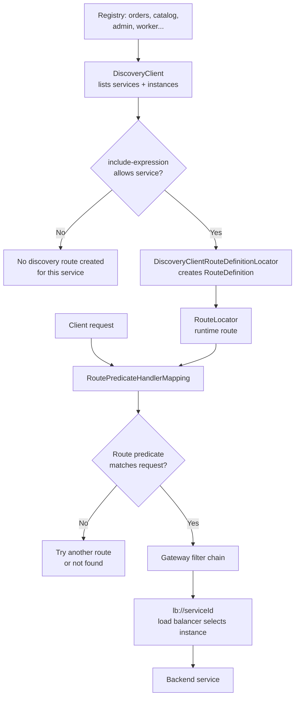

# Customizing Which Services Are Included in the Route List

When an organization has dozens of microservices registered with Eureka, Consul, or a compatible service discovery system, **not every service should be published as an API route**. Alongside client-facing services like `orders-service` or `catalog-service`, the registry may contain `admin-service`, `internal-report-service`, background workers, or services meant to be called only over the internal network.

**Spring Cloud Gateway** can auto-generate routes from discovered services through **`DiscoveryClient` Route Definition Locator**. This feature is useful because when a new service is added, you do not have to declare each `uri: lb://...` manually. However, turning it on automatically for **all** services can create a broader API surface than intended. To control this, the Gateway provides **`discovery.locator.include-expression`**: a **Spring Expression Language (SpEL)** expression that decides **which services are included in the auto-generated route list**.

This lesson belongs to the **Service Discovery and Load Balancing** chapter of the **SPRING_CLOUD_GATEWAY** module. It sits at the intersection of route predicates, filter chains, path/header rewriting, and service discovery. Choosing the right services for route generation also affects where authentication, rate limiting, circuit breakers, retries, TLS, and request observability are placed when operating a secure API Gateway.

> **Scope:** This content focuses on **Spring Cloud Gateway Server WebFlux**. In newer releases, the configuration namespace is `spring.cloud.gateway.server.webflux.discovery.locator.*`; in some older 4.x releases, the namespace is `spring.cloud.gateway.discovery.locator.*`. Always pick the exact namespace, starter, and documentation matching your running Spring Cloud Gateway version. Do not copy Server WebFlux configuration verbatim to the Server MVC variant and assume identical behavior.

## 1. Why Filter Services Before Creating Routes?

Suppose the registry contains:

| Service ID | Purpose | Should the gateway auto-create a public route? |
| --- | --- | --- |
| `orders-service` | Orders | Yes, after applying appropriate API policies |
| `catalog-service` | Product catalog | Yes |
| `payments-service` | Payments | Possibly, with strict access and API controls |
| `admin-service` | System administration | Do not publish automatically |
| `internal-report-service` | Internal reporting | No |
| `billing-worker` | Background jobs | No |

With Discovery Locator enabled and the default condition allowing every service, the Gateway **can generate routes even for internal-only services**. That does not mean requests to those services are always allowed—Spring Security, routing, and network policies may provide other protection layers—but the public route table becomes harder to control and easy to misread.

**Goal:** only services satisfying an **explicitly approved condition** get auto-generated routes. You can use:

- **An allowlist** by service ID.
- **A naming convention**, e.g., selecting only names starting with `public-`.
- **Registry metadata**, e.g., instances carrying `edge=true`.
- **A combination of conditions**, such as belonging to a service group and having a publish flag.

This is a **route definition** management step, not a per-request authentication or authorization mechanism.

## 2. Distinguishing Service Discovery, Route Generation, and Load Balancing

These three processes are related, yet they answer three distinct questions.

| Process | Question | Typical components involved |
| --- | --- | --- |
| **Service discovery** | Which services are present, and at which host/port are instances running? | `DiscoveryClient` / `ReactiveDiscoveryClient` and registry |
| **Auto-route generation** | Which services does the Gateway expose as routes? | `DiscoveryClientRouteDefinitionLocator`, `include-expression` |
| **Load balancing** | Once a route selects `lb://orders-service`, which instance handles the request? | Spring Cloud LoadBalancer, instance list source |
| **Route matching** | Which route does an HTTP request match? | `RoutePredicateHandlerMapping`, `Path`/`Host`/`Method` predicates |

Logical flow:



**Timing is the key distinction:**

1. **`include-expression`** inspects discovery service/instance info when **building the route list**.
2. **`Path`, `Host`, `Method`** are **route predicates** evaluated when an HTTP request arrives.
3. **`lb://`** is resolved once a request has matched a route and the gateway needs to select a backend instance.

Filtering services in step 1 **does not verify caller identity** in step 2. An allowed generated route still needs valid security policies, quotas, and access controls.

## 3. Enabling DiscoveryClient Route Definition Locator

Normally, routes can be declared manually:

```yaml
spring:
  cloud:
    gateway:
      server:
        webflux:
          routes:
            - id: orders-api
              uri: lb://orders-service
              predicates:
                - Path=/api/orders/**
              filters:
                - StripPrefix=1
```

But when you want routes **generated from registered services**, enable the Discovery Locator:

```yaml
spring:
  cloud:
    gateway:
      server:
        webflux:
          discovery:
            locator:
              enabled: true
```

The example above requires a matching **`DiscoveryClient` implementation** (Eureka, Consul, Kubernetes, or another platform) connected to a registry. Because default discovery route URIs take the form `lb://service-name`, the Gateway also needs **`spring-cloud-starter-loadbalancer`** and an instance source to resolve service IDs when calling downstream.

**Without `enabled: true`**, the Gateway does not auto-generate discovery locator routes merely because the app has a `DiscoveryClient`. Conversely, toggling the flag without a compatible registry/discovery implementation or load balancer will not ensure requests reach backends successfully.

### 3.1. Configuration style in earlier Spring Cloud Gateway releases

In many older Spring Cloud Gateway 4.x docs and apps, the same feature is configured as:

```yaml
spring:
  cloud:
    gateway:
      discovery:
        locator:
          enabled: true
```

Sub-properties such as `include-expression`, `lower-case-service-id`, `predicates`, `filters`, `url-expression`, and `route-id-prefix` sit under the same `locator` node. Pick **the single namespace matching your version**; do not define two parallel route sections just to experiment.

### 3.2. Default when include-expression is omitted

The default value of `discovery.locator.include-expression` is **`true`**, meaning the inclusion expression does not filter out services by any custom rule. Depending on the registry and version, the route list still depends on which services/instances `DiscoveryClient` actually sees and the refresh mechanism.

With the default value, a new service appearing in the registry **can be added to the auto-generated route list** if sufficient data is present for route generation. Therefore, think carefully before enabling the Discovery Locator on an Internet-facing edge gateway.

## 4. include-expression: Per-Service SpEL Condition

`include-expression` is a **SpEL expression** that must evaluate to a boolean deciding **whether or not to include** a service in routes created by the Discovery Locator.

Minimal configuration:

```yaml
spring:
  cloud:
    gateway:
      server:
        webflux:
          discovery:
            locator:
              enabled: true
              include-expression: "serviceId == 'orders-service'"
```

Here:

- `serviceId` is a property of the **`ServiceInstance`** object used to evaluate the expression.
- `==` compares values.
- `'orders-service'` is a **SpEL** string literal, so single quotes sit **inside** the YAML string.
- If the expression evaluates to true for a service, the Discovery Locator creates a route for it; if false, **no discovery route is created** for that service.

Conditions should be **clear, simple, and easy to test**. Never accept SpEL configuration from untrusted sources, as it is a powerful expression language affecting how the application builds routing config.

### 4.1. Commonly used fields

| `ServiceInstance` data | SpEL example | Purpose |
| --- | --- | --- |
| `serviceId` | `serviceId == 'orders-service'` | Select one exact service by name |
| `serviceId` | `serviceId.startsWith('public-')` | Select services sharing a naming prefix |
| `serviceId` | `serviceId matches '^(orders|catalog)-service$'` | Select by an allowlist regex |
| `metadata` | `metadata['edge'] == 'true'` | Select services carrying registry metadata permitting publication |
| Combined | `metadata['edge'] == 'true' and serviceId.startsWith('public-')` | Must satisfy both conditions |

**About metadata:** The availability and types of `metadata` depend on the `DiscoveryClient`/registry. In many integrations, metadata is a map with string keys and values. If the `edge` key is absent, `metadata['edge']` does not equal `'true'`, so the example condition denies inclusion. Verify the metadata actually returned **for the `ServiceInstance` observed by the Gateway**, rather than inferring solely from source annotations/labels or config.

### 4.2. Example 1 — Allowlist by serviceId

Suppose you only want auto-generated routes for two services:

- `orders-service`.
- `catalog-service`.

Configuration:

```yaml
spring:
  cloud:
    gateway:
      server:
        webflux:
          discovery:
            locator:
              enabled: true
              include-expression: "serviceId == 'orders-service' or serviceId == 'catalog-service'"
```

If the registry returns exact lowercase service IDs, expected results:

| Service in registry | SpEL result | Discovery route created? |
| --- | --- | --- |
| `orders-service` | `true` | Yes |
| `catalog-service` | `true` | Yes |
| `admin-service` | `false` | No |
| `internal-report-service` | `false` | No |

**Strength of an allowlist:** new services accidentally registered in the registry **are not automatically added to the route list** unless the list is intentionally updated. **Trade-off:** config updates/refreshes are needed when publishing new API services.

### 4.3. Example 2 — Naming prefix convention

Suppose the registry distinguishes public services from internal services:

```text
public-orders
public-catalog
public-payment
internal-report
admin-service
billing-worker
```

Configuration:

```yaml
spring:
  cloud:
    gateway:
      server:
        webflux:
          discovery:
            locator:
              enabled: true
              include-expression: "serviceId.startsWith('public-')"
```

This expression is flexible: any new service whose name begins with `public-` can get a route. However, **picking a naming prefix is not a security approval mechanism**; if a registry user or an uncontrolled deployment pipeline can name services arbitrarily, they can register an eligible service. When an edge gateway faces the Internet, combine this with registry registration permissions and deployment controls.

### 4.4. Example 3 — Regex for an approved service group

```yaml
spring:
  cloud:
    gateway:
      server:
        webflux:
          discovery:
            locator:
              enabled: true
              include-expression: "serviceId matches '^(orders|catalog|payments)-service$'"
```

The regex above accepts only names matching the **entire string** against the pattern. Anchors `^` and `$` make intent explicit and avoid accidentally matching names like `orders-service-test`.

When a registry such as **Eureka** returns uppercase IDs like `ORDERS-SERVICE`, the expression above may not match. When case-insensitive matching is needed, **normalize inside SpEL**:

```yaml
include-expression: "serviceId.toLowerCase() matches '^(orders|catalog|payments)-service$'"
```

This normalizes the **name used for expression matching**. Do not confuse it with the Discovery Locator's `lower-case-service-id` property, which affects how route **predicates/filters** are built (see Section 6).

### 4.5. Example 4 — Include only services tagged with edge metadata

Spring Cloud has previously showcased this official example:

```yaml
spring:
  cloud:
    gateway:
      server:
        webflux:
          discovery:
            locator:
              enabled: true
              include-expression: "metadata['edge'] == 'true'"
```

Suppose the registry provides metadata:

| Service ID | Metadata `edge` | Expectation |
| --- | --- | --- |
| `orders-service` | `"true"` | Route created |
| `catalog-service` | `"true"` | Route created |
| `admin-service` | `"false"` | No route created |
| `worker-service` | Key absent | No route created |

The benefit of this approach is that API exposure is driven by **metadata controlled in the service registration pipeline**, rather than hardcoding every service ID in the Gateway. Still, verify:

1. Does the registry/`DiscoveryClient` actually **propagate metadata** to the Gateway?
2. Is `edge` a string `"true"` or another type/value? Comparisons must match types.
3. Who is permitted to set/modify `edge` metadata? Is there a review and audit process?
4. Do all instances of the same `serviceId` carry consistent metadata?
5. When metadata changes, what ensures runtime routes are refreshed?

**Note on multiple instances:** In common Discovery Locator implementations, the include expression is evaluated against a **representative `ServiceInstance` of the service** during route generation. It is **not** a per-instance filter during load balancing. If the same service has one instance with `edge=true` and another with `edge=false`, behavior can become unpredictable across instance lists and refreshes. Keep publishing metadata **consistent across the entire service**, or manage exposure via a trusted centralized config source.

### 4.6. Example 5 — Combining metadata with an allowlist

If you want both name restriction and an explicit opt-in flag:

```yaml
include-expression: "(serviceId.toLowerCase() matches '^(orders|catalog)-service$') and metadata['edge'] == 'true'"
```

The expression returns `true` only when **both** conditions hold. Parentheses clearly state evaluation order, making it easier to maintain than a long ungrouped expression.

With strict conditions, a valid service missing the metadata will **not receive a route**. That may be the desired fail-closed behavior, but you need testing to catch missing metadata before production deploys drop an API.

## 5. Once a Service Passes include-expression, Which Route Is Created?

By default, Discovery Locator typically creates a route with these components:

| Default component | Illustrative form | Meaning |
| --- | --- | --- |
| **Route ID** | DiscoveryClient prefix + service ID | Identifies the auto-generated route; prefix varies by config/implementation. |
| **URI** | `lb://orders-service` | Logical target; concrete instance is chosen later by the load balancer. |
| **Path predicate** | `/orders-service/**` | Matches only requests whose path starts with the service ID prefix. |
| **RewritePath filter** | Strips leading `/orders-service` from the path | Backend receives the path without the gateway's service ID segment. |

Example after the route is created:

```text
Client -> Gateway:
  GET /orders-service/orders/42

Discovery route:
  serviceId = orders-service
  Path = /orders-service/**
  URI = lb://orders-service
  RewritePath strips /orders-service

Gateway -> Backend:
  GET /orders/42
```

**Do not assume the entry path is `/api/orders/**`.** That pattern is common in **manually declared** routes. Discovery Locator defaults to `/serviceId/**`; if you want cleaner public endpoints, configure custom predicates/filters or use static routes aligned with your API contract.

**And having a route does not mean the backend is reachable.** With `lb://...`, you still need available instances, DNS/port resolution, and working network connectivity.

### 5.1. Request examples across a service map

Suppose the registry holds:

```text
orders-service  -> 10.2.0.10:8080, 10.2.0.11:8080
catalog-service -> 10.2.0.20:8080
admin-service   -> 10.2.0.30:8080
```

With an `include-expression` allowing only `orders` and `catalog`:

| HTTP request to Gateway | Matching discovery route? | Backend path after rewrite |
| --- | --- | --- |
| `GET /orders-service/orders/42` | Yes | `/orders/42` |
| `GET /catalog-service/products/9` | Yes | `/products/9` |
| `GET /admin-service/admin/users` | **No discovery route created for admin** | Not forwarded via this discovery route |

The last request could still be handled by a **static route**, another WebFlux handler, or another proxy layer if configured in the application. Thus, the accurate statement is **"no discovery route was auto-generated for admin,"** rather than claiming every path to admin is locked down.

## 6. Roles of lower-case-service-id, url-expression, and route-id-prefix

When configuring which services get generated routes, you often also care about how those routes are represented.

### 6.1. lower-case-service-id

Some registries, particularly Eureka setups, may return uppercase service IDs like `ORDERS-SERVICE`. With `lower-case-service-id: true`, the Gateway can build path patterns and filters using lowercase service IDs, allowing clients to call `/orders-service/**` instead of `/ORDERS-SERVICE/**`.

```yaml
spring:
  cloud:
    gateway:
      server:
        webflux:
          discovery:
            locator:
              enabled: true
              lower-case-service-id: true
              include-expression: "serviceId.toLowerCase() == 'orders-service'"
```

The two settings solve **two different problems**:

- `lower-case-service-id`: formats the service ID in the generated route's predicates/filters.
- `serviceId.toLowerCase()` in `include-expression`: prevents the **service filter** from missing services whose registry names are uppercase.

Do not set only `lower-case-service-id: true` and assume `serviceId == 'orders-service'` will match a registry returning `ORDERS-SERVICE`.

### 6.2. url-expression

The default discovery route URI has the form:

```text
'lb://' + serviceId
```

In configuration, this appears as:

```yaml
url-expression: "'lb://'+serviceId"
```

This is a **SpEL expression building the route's target URI**, distinct from `include-expression` which decides whether to create the route.

**Do not change `url-expression` arbitrarily** to build addresses from registry data without understanding trust boundaries, schemes, TLS, and instance resolution. The normal Gateway pattern is `lb://serviceId` so Spring Cloud LoadBalancer picks a registered instance; switching to hardcoded `http://` can bypass load balancing or target the wrong infrastructure.

### 6.3. route-id-prefix

Discovery routes normally use route IDs constructed from a locator prefix and the service ID. `route-id-prefix` lets you customize the route prefix to distinguish auto-generated routes from manual routes in logs, metrics, and observability dashboards.

Example:

```yaml
route-id-prefix: discovery_
```

Pick a readable ID format that will not collide with static route IDs. Route IDs are very helpful when determining whether a request was handled by an **auto-generated discovery route** or an overlapping static route.

## 7. Filtering Services vs. Customizing Predicates and Filters

Suppose the requirement is:

> "Only services with `edge=true` metadata get generated routes, **and** each of those routes accepts requests only on host `api.example.test`."

There are **two kinds of conditions**:

1. `metadata['edge'] == 'true'`: **route-inclusion condition**, solved by `include-expression`.
2. `Host=api.example.test`: **per-HTTP-request condition**, solved by a **route predicate**.

A combined configuration (following the parameter structure in the Server WebFlux documentation) looks like:

```yaml
spring:
  cloud:
    gateway:
      server:
        webflux:
          discovery:
            locator:
              enabled: true
              include-expression: "metadata['edge'] == 'true'"
              predicates:
                - name: Host
                  args:
                    pattern: "'api.example.test'"
                - name: Path
                  args:
                    pattern: "'/'+serviceId+'/**'"
              filters:
                - name: RewritePath
                  args:
                    regexp: "'/' + serviceId + '/?(?<remaining>.*)'"
                    replacement: "'/${remaining}'"
```

**Explanation of the quoting layers:**

- `pattern: "'api.example.test'"` is a **YAML string** containing a **SpEL expression that evaluates to a string**.
- `pattern: "'/'+serviceId+'/**'"` builds the path pattern from the service ID at route-creation time.
- `regexp` builds the path-rewrite pattern per service ID.
- `replacement` references the `remaining` regex capture group to preserve the rest of the path.

**Customization warning:** In common releases, setting custom `discovery.locator.predicates`/**`filters`** lists **replaces the default lists**, rather than merely "appending one line to the defaults." If you add `Host` and forget to re-declare `Path`, or add another filter and forget `RewritePath`, the route may match unexpected requests or the backend may receive paths still containing the service ID and return `404`. Always re-declare the default components you want to keep.

**About `${remaining}`:** This is the named-group syntax in `RewritePath` replacements. Across different config sources (YAML, `.properties`, environment variables), `$` and braces can be intercepted by property placeholder expansion; use the exact escaping syntax documented for your version and test the actual path. The Spring Cloud Gateway documentation shows how to write replacements in YAML versus different escaping in `.properties`.

### 7.1. When to use static routes instead of the discovery locator?

Discovery Locator makes sense when:

- Your system has many services following a **uniform routing convention**.
- Service discovery is tightly governed.
- Exposure scope is controlled by a clear allowlist or metadata rule.
- Public paths matching `/serviceId/**` or a verifiable common convention are acceptable.

Static routes may fit better when:

- Public APIs follow a stable contract like `/api/orders/**` without exposing internal service IDs.
- Each route needs distinct predicates/filters, auth scopes, quotas, and timeouts.
- You need route versioning, canary rules, or special policies for payments/admin.
- Operators want to explicitly review every published endpoint.

Both approaches **can coexist**. However, if static routes and auto-generated routes overlap on paths, define explicit `order` and predicates to avoid matching the wrong route.

## 8. Metadata Must Be Controlled at the Source

Suppose a service registers in the registry with metadata equivalent to:

```yaml
# Logical metadata at the service registration source;
# actual syntax depends on Eureka, Consul, Kubernetes...
metadata:
  edge: "true"
  owner: "api-team"
```

The Gateway can only read `metadata['edge']` if the corresponding `DiscoveryClient` **populates that key/value into `ServiceInstance.getMetadata()`**. Not every Kubernetes label, annotation, or container setting automatically appears in this map; check your discovery integration's metadata mapping mechanism.

**Trust boundaries to enforce:**

- Who is permitted to **register a service** in the registry?
- Who can modify the `edge` metadata?
- Is there a review/audit trail for changing `edge=false` to `edge=true`?
- Is registration bound to genuine service identities, or can names be spoofed?
- Do all gateway replicas read the registry and metadata consistently?
- Do network policies between gateway and backends restrict which services can be called?

Filtering by metadata is a **route-generation rule**, not security authorization. If an attacker can register a service with `edge=true` and control public paths, the filter will not know the service wasn't approved.

For sensitive APIs, consider a **reviewed static allowlist** or a deployment governance pipeline ensuring metadata is set only by trusted pipelines.

## 9. Avoid Confusing the Different Filtering Layers

| Feature | What is filtered/selected | When | Example |
| --- | --- | --- | --- |
| `include-expression` | **Services** receiving discovery routes | When creating/refreshing route definitions | Only services with `edge=true` get routes |
| `Path`/`Host`/`Method` predicates | **HTTP requests** eligible for a route | When a request arrives at the Gateway | Only `GET /orders-service/**` |
| `route.order` | Evaluation order among competing **routes** | During route matching | Specific route before fallback |
| Spring Cloud LoadBalancer | **Instance** handling a matched route request | After selecting route and `lb://` target | Pick `10.2.0.10` or `10.2.0.11` |
| Health check/discovery | Available instances per registry/health state | During instance list updates | Exclude unhealthy instances from LB source |
| Spring Security | **Callers/requests** permitted access | Gateway/backend security layer | JWT, scopes, resource permissions |
| `RequestRateLimiter` | Requests against quota/rate limits | Gateway filter or equivalent layer | Reject with `429` when over limit |

### 9.1. include-expression does not filter individual instances by metadata

A common design mistake:

> "I have three instances of `orders-service`, and only one has `edge=true`. I'll set `include-expression` so requests only go to that one instance."

This **misunderstands responsibility**. `include-expression` decides whether to generate a **route for the service ID**. Once the `lb://orders-service` route is chosen, which instances can receive traffic depends on the instance list source, health checks, and load-balancing policy.

If you want to exclude unhealthy instances or apply zone, canary, or metadata-based instance filtering, design and verify that at the **discovery/load-balancing layer**—never use `include-expression` as an instance filter.

### 9.2. include-expression is not an HTTP request route predicate

The expression `serviceId == 'orders-service'` does not check whether a client is allowed to call `/orders-service/**`. Even an included service may still require checking `Host`, `Path`, HTTP method, authentication, and authorization.

If a request arrives for `/admin-service/**` and `admin-service` was excluded from discovery routes, the Gateway **does not auto-generate a route** for that path. However, another static route or proxy layer could still forward the request if configured. Test the entire path end to end.

## 10. When Registry or Config Changes, Do Routes Update Immediately?

Service discovery is typically a dynamic data source: instances can appear, disappear, change metadata, or move across infrastructure. However, the **runtime route list** is updated through Spring Cloud Gateway's and the discovery implementation's own refresh/caching/event mechanisms.

Never assume registry changes **reflect instantaneously** across all gateway replicas:

1. Registries have their own sync/heartbeat intervals.
2. `DiscoveryClient` may cache service/instance lists.
3. Discovery Locator and `RouteLocator` may cache or rebuild routes on refresh events.
4. Multiple gateway instances may temporarily observe different snapshots.
5. In-flight requests may continue along a route chosen before new configuration took effect.

**Safe change workflow:**

- Confirm the service/metadata actually appears in `DiscoveryClient`.
- Confirm the SpEL expression evaluates as expected.
- Inspect **runtime routes** on every Gateway instance.
- Trigger refresh via the **mechanism supported by your version/platform**, rather than just editing YAML files.
- Send test requests to both permitted and excluded paths.
- Monitor route counts, route IDs, error rates, and backend impact.

If your environment includes Spring Boot Actuator and the Spring Cloud Gateway routes endpoint, you can inspect the **loaded route list**. Management endpoints must be access-controlled and never exposed openly to the Internet, as they reveal internal topology and URIs.

### 10.1. When a service is excluded but its route still exists

Possible causes:

- The SpEL condition was not loaded under the active namespace/profile.
- The service's metadata or name differs from assumptions, so the expression still evaluates to true.
- Another static route with a similar ID/path exists outside Discovery Locator.
- The route cache has not refreshed yet.
- The Gateway replica serving the request is still running older config.

**Never conclude from a single `curl` command.** Check the route ID, effective configuration, route provenance, and which Gateway instance handled the request.

## 11. Hands-On with a Simulated Registry and Route Checks

Suppose a lab environment has three services in the registry:

```text
orders-service      metadata: edge=true
catalog-service     metadata: edge=true
admin-service       metadata: edge=false
```

To focus on filtering conditions, use:

```yaml
spring:
  cloud:
    gateway:
      server:
        webflux:
          discovery:
            locator:
              enabled: true
              include-expression: "metadata['edge'] == 'true'"
              lower-case-service-id: true
```

**Prerequisites before running:** a `DiscoveryClient` connected to the registry, metadata propagated to the Gateway, and Spring Cloud LoadBalancer if using `lb://` URIs. The Gateway is assumed to listen on `localhost:8080`, and backends must expose matching endpoints to receive requests.

### 11.1. Test included services

With default route generation, test:

```bash
curl -i http://localhost:8080/orders-service/orders/42
curl -i http://localhost:8080/catalog-service/products/9
```

Expectations:

- The Gateway creates discovery routes for `orders` and `catalog`.
- Requests to `/orders-service/orders/42` are rewritten to `/orders/42` before the backend.
- If backends are ready, valid responses return; if no instances exist or connections fail, errors can still occur **even though the route was included**.

### 11.2. Test an excluded service

```bash
curl -i http://localhost:8080/admin-service/admin/users
```

Expect **no auto-generated discovery route** for `admin-service`. Without another matching route/handler, this typically returns `404`. If the request still reaches the admin backend, investigate static routes, other proxies, the condition, or the route cache.

**Do not rely on `404` as sole proof.** A backend can return `404` after a route matched; checking runtime routes or metrics/traces containing route IDs gives clearer proof.

### 11.3. Test matrix

| Scenario | Expected result | Additional checks |
| --- | --- | --- |
| `orders-service` has `edge=true` | Discovery route exists | URI, ID, Path, RewritePath |
| `catalog-service` has `edge=true` | Discovery route exists | Backend instances ready |
| `admin-service` has `edge=false` | No discovery route | No unintended static fallback route |
| Service missing `edge` metadata | Does not match `== 'true'` | Did the registry propagate metadata? |
| Eureka returns `ORDERS-SERVICE` and expression checks lowercase directly | May fail to match | Normalize inside SpEL |
| One service has two instances with differing metadata | Do not use as instance filtering | Standardize metadata per service |
| Service metadata just changed | Route may not update instantaneously | Route cache/refresh on all Gateway replicas |
| Discovery route and static route overlap on path | Another route may win | `order`, route ID, predicates |
| Route exists, zero healthy instances | Downstream call fails | Health/discovery/load-balancer |

### 11.4. Unit-testing SpEL directly with ServiceInstance

You can test expression logic before integrating with the Gateway by evaluating it against a sample `ServiceInstance`. **Illustrative** Java snippet:

```java
import org.springframework.cloud.client.DefaultServiceInstance;
import org.springframework.expression.Expression;
import org.springframework.expression.spel.standard.SpelExpressionParser;

DefaultServiceInstance instance = new DefaultServiceInstance(
    "orders-1", "orders-service", "127.0.0.1", 9090, false
);
instance.getMetadata().put("edge", "true");

Expression include = new SpelExpressionParser().parseExpression(
    "serviceId == 'orders-service' and metadata['edge'] == 'true'"
);

Boolean allowed = include.getValue(instance, Boolean.class);
// allowed: true with the example data.
```

This snippet only checks the expression against a mock object; it **does not prove a real `DiscoveryClient` carries the right metadata**, does not verify YAML binding, and does not confirm a route is created. After unit-testing SpEL, you still need an integration test against your real environment's registry/`DiscoveryClient`.

### 11.5. Testing "fail closed" on missing data

With `metadata['edge'] == 'true'`, intentionally omit the `edge` key from a test service and confirm **no discovery route is created**. If your environment requires every valid service to carry this metadata, validate it in the registration pipeline to catch missing config before production.

When flipping `edge` from `true` to `false`, test **after refresh** to confirm the runtime route disappears. Do not assume removing a route terminates an in-flight request or closes previously opened connections.

## 12. Common Errors and How to Fix Them

### Error 1 — Using include-expression to filter by HTTP path

**Wrong expectation:** configuring `include-expression` to allow only `GET /api/orders/**`. The expression evaluates **`ServiceInstance`/`serviceId`**, not HTTP requests. To filter by HTTP method/path, use `Method` and `Path` predicates.

### Error 2 — Confusing lower-case-service-id with mutating data inside SpEL

**Symptom:** Eureka returns uppercase service IDs; `lower-case-service-id: true` is enabled, yet `serviceId == 'orders-service'` still fails to match.

**Fix:** normalize inside the expression like `serviceId.toLowerCase() == 'orders-service'`, or match the exact ID returned by the registry. Distinguish the name used for matching from the name used in generated predicates/filters.

### Error 3 — Metadata is not propagated by DiscoveryClient

**Symptom:** service has label/annotation `edge=true`, yet `metadata['edge'] == 'true'` returns false or creates no route.

**Fix:** inspect `ServiceInstance.getMetadata()` on the real `DiscoveryClient`. Kubernetes, Consul, and Eureka propagate metadata differently; never infer it automatically from manifests.

### Error 4 — Same service has inconsistent metadata

**Symptom:** routes appear and disappear intermittently across refreshes.

**Fix:** standardize exposure metadata **at the service level**. Do not try to use `include-expression` to filter individual instances; control instances at the load-balancing/discovery layer.

### Error 5 — Service excluded yet still reachable

**Possible cause:** another static route or ingress still points to the service, or the effective config differs from the file you are reading. `include-expression` only controls **routes created by the discovery locator**; it does not delete other routes or replace firewalls/network policies.

### Error 6 — Adding custom predicates or filters loses the default rewrite

**Symptom:** backend returns `404` because it receives `/orders-service/orders/42` instead of `/orders/42`.

**Fix:** when customizing `discovery.locator.filters`, re-declare the corresponding `RewritePath` if you still want the service ID stripped from the path. Likewise, when overriding `predicates`, preserve `Path` to keep the default routing convention.

### Error 7 — Route exists, but requests fail with backend not found

**Distinction:** `include-expression` allowed route generation, yet `lb://serviceId` may have no instances or hit network/TLS errors. Inspect Spring Cloud LoadBalancer, service registry, health, host/port, and certificates. Do not tweak the include expression when load balancing is the root cause.

### Error 8 — Accepting SpEL from untrusted sources

**Risk:** SpEL is a powerful expression language; letting untrusted users update Gateway expressions directly creates configuration and unintended execution risks. Deploy configuration only through authorized, reviewed pipelines. Never build a public endpoint accepting arbitrary expressions and applying them at runtime.

### Error 9 — Editing config files without checking runtime state

**Symptom:** after changing `include-expression`, routes remain in their previous state.

**Fix:** verify active profiles, namespaces, route caches/refreshes, and all replicas. Inspect runtime routes rather than just reading YAML; changes may not have synchronized yet.

## 13. Security and Operations When Publishing Services Automatically

**Allowing route generation does not grant access permission.** For a secure edge gateway, layer defenses:

| Layer | Responsibility | Example |
| --- | --- | --- |
| **Registry governance** | Governs who can register services and edit metadata | Only reviewed pipelines can set `edge=true` |
| **Discovery include-expression** | Governs which services get auto-generated routes | Allowlist or metadata + allowlist |
| **Route predicates** | Governs which HTTP requests match a route | `Path`, `Host`, `Method` |
| **Spring Security/auth** | Verifies identity, tokens, and permissions | JWT/OAuth2, API authorization |
| **Gateway filters** | Edge policies, HTTP transformations | Rate limiting, header sanitation, retry, circuit breaker |
| **Backend authorization** | Permissions on actual resources | Users can view only their own orders |
| **Network/TLS** | Secures connections and restricts access paths | Gateway–backend TLS, network policies |
| **Observability** | Detects wrong routes, latency, and errors | Route ID, status, metrics, traces |

### 13.1. Do not expose the entire registry to the Internet

A service may be registered for **other internal services** to call. That does not mean it has a public API contract or has been hardened for Internet traffic. Use allowlists, static routes for sensitive APIs, and proper registry/network segmentation.

Specifically:

- **Admin services:** never rely solely on `include-expression` for protection; restrict network access and require strong authentication/authorization.
- **Payments:** manage methods, idempotency, timeouts, and retries, preventing clients from freely calling internal endpoints.
- **Internal workers:** no route needed if they do not serve an HTTP API.
- **Actuator endpoints:** must be secured; never treat registry metadata as complete endpoint hiding.

### 13.2. Applying rate limits and resilience with dynamic routes

When Discovery Locator auto-generates routes, those routes may share the same predicate/filter template. If services require distinct quotas, circuit breakers, retries, timeouts, or JWT policies, evaluate:

1. Can shared policies be expressed with `default-filters` and security `WebFilter`s?
2. Should special services use static routes to pick dedicated policies?
3. Do custom filters still preserve the default `RewritePath`?
4. Are retries safe for POST/PUT, especially on payment APIs?
5. Are backend errors tagged by route ID and instance for investigation?

A "generated route" is not yet a "production-ready API." Discovery mainly handles dynamic routing and instance lists—it does not design business contracts or security policies for you.

### 13.3. Appropriate observability for dynamic routes

When monitoring the Gateway, capture:

- Runtime route list, service IDs, and route provenance.
- Route counts per group/registry to detect unexpected spikes.
- Route ID alongside HTTP status, p95/p99 latency, and error rates.
- `lb://` no-instance errors and downstream TLS/network issues.
- Route list/config drift across Gateway replicas.
- Audit events for `edge` metadata edits and `include-expression` changes.

**Never log tokens, cookies, personal data, or sensitive bodies** just to debug routing. Keep logs keyed safely by service ID, route ID, and correlation/trace ID.

## 14. Implementation Checklist

1. **Define exposure boundaries:** which services are truly public APIs, and which are internal?
2. **Pick a filtering strategy:** allowlist by `serviceId`, naming prefix, `edge=true` metadata, or a combination.
3. **Inspect the real registry:** exact service IDs, casing, actual propagated metadata, and consistency across instances.
4. **Pick the right namespace:** `server.webflux.discovery.locator.*` or the legacy namespace.
5. **Enable Discovery Locator properly:** `enabled=true`, discovery implementation, and LoadBalancer if using `lb://`.
6. **Verify path conventions:** whether default `/serviceId/**` and `RewritePath` fit public APIs.
7. **Inspect runtime routes:** included/excluded services, IDs, URIs, predicates, and filters.
8. **Run integration tests:** valid routed requests, excluded routes, services with zero instances, missing metadata, and config refresh.
9. **Enforce access security:** Spring Security, backend authorization, rate limits, TLS, and network policies.
10. **Monitor after changes:** route counts, `404`/`5xx` errors, route mismatches, and drift across Gateway replicas.

## 15. Self-Review Questions and Scenarios

### Scenario A — Registry contains internal services

Registry contains `orders-service`, `catalog-service`, `admin-service`. Gateway enables Discovery Locator with `include-expression=true`.

**Question:** Is it safe to treat every service as a public API?

**Answer:** No. By default there is no exclusion condition at route generation, so internal services can get auto-generated routes. Restrict which services are published and still enforce security at the request/backend layers.

### Scenario B — Matching names with Eureka

Registry returns `ORDERS-SERVICE`; configured expression is `serviceId == 'orders-service'`.

**Question:** Why might the route not appear?

**Answer:** String comparison is case-sensitive. Match the exact registry name or use `serviceId.toLowerCase() == 'orders-service'`.

### Scenario C — Metadata present on Kubernetes manifest

Deployment has label `edge=true`, yet Gateway creates no route when using `metadata['edge'] == 'true'`.

**Question:** What should you check?

**Answer:** Check whether `DiscoveryClient` maps that label into the `ServiceInstance` metadata map evaluated by the Gateway; not every label/annotation is automatically exposed there.

### Scenario D — Only one instance marked edge

`orders-service` has three instances: one with `edge=true`, two with `edge=false`.

**Question:** Does `include-expression` guarantee only the first instance receives requests?

**Answer:** No. It decides whether to generate a route for the **service ID**; instance selection belongs to load balancing/discovery. Standardize metadata across instances when using it for service-wide publication.

### Scenario E — Route exists, but requests return 404

Gateway generated a route for `orders-service`, client calls `GET /orders-service/orders/42`, and backend returns `404`.

**Question:** Must `include-expression` be wrong?

**Answer:** No. The route may have matched while path rewriting is wrong or the backend lacks `/orders/42`. Inspect the route ID, `RewritePath`, post-routing URL, and backend contract.

### Scenario F — Adding a Host predicate

You configure `discovery.locator.predicates` with only `Host=api.example.test`.

**Question:** Have you preserved the default rule matching only `/serviceId/**`?

**Answer:** Not necessarily. Custom predicates replace the default list; you must re-declare `Path` if you want to keep that convention.

### Scenario G — Removing edge metadata, yet route remains

A service was changed to `edge=false` in the registry, yet one Gateway replica still publishes its route.

**Question:** How do you investigate?

**Answer:** Verify the metadata seen by that replica's `DiscoveryClient`, the `include-expression` namespace/profile, route cache/refresh, other Gateway replicas, and whether a static route shares the same path.

## 16. Takeaways

1. **`DiscoveryClient Route Definition Locator`** generates routes from services provided by discovery; the default logical URI is `lb://serviceId` and paths typically use `/serviceId/**`.
2. **`include-expression`** is a SpEL expression deciding **whether a service is included in the auto-generated route list**. The default is `true`.
3. You can filter by **service ID**, naming conventions, or **`ServiceInstance` metadata** such as `metadata['edge'] == 'true'`. Understand case sensitivity and how your registry propagates metadata.
4. **Including a service in the route list ≠ matching an HTTP route ≠ selecting a backend instance**. `include-expression`, route predicates, and load balancing address separate stages.
5. When customizing Discovery Locator `predicates` or `filters`, remember to re-declare the **default Path/RewritePath** if you still need the `/serviceId/**` convention.
6. **Never use `include-expression` as a substitute for security.** You still need auth/authorization, registry governance, network policies, rate limits, TLS, and runtime route observability.
7. **Inspect running routes**, not just YAML or registry state; changes may require refreshes and synchronization across multiple Gateway replicas.

**Practical conclusion:** In Spring Cloud Gateway, `include-expression` is an essential control point for **generating routes only for services the gateway truly intends to publish**. Favor clear conditions, trusted metadata sources, allowlist/exclusion tests, and runtime verification after every change. Restricting auto-generated routes while combining proper security and load balancing keeps the API Gateway flexible without unintentionally widening its attack surface.

### References

- [Spring Cloud Gateway — DiscoveryClient Route Definition Locator (Server WebFlux)](https://docs.spring.io/spring-cloud-gateway/reference/spring-cloud-gateway-server-webflux/the-discoveryclient-route-definition-locator.html): generating routes from a registry, `lb://` URIs, default path/rewrite behavior, and notes on overriding predicates/filters.
- [Spring Cloud Gateway — Configuration Properties](https://docs.spring.io/spring-cloud-gateway/reference/configprops.html): `discovery.locator.enabled`, `include-expression`, `lower-case-service-id`, `url-expression`, and `route-id-prefix` properties.
- [Spring Blog — Spring Cloud Finchley.RC1 Has Been Released](https://spring.io/blog/2018/04/25/spring-cloud-finchley-rc1-has-been-released/): the `metadata['edge'] == 'true'` SpEL example published when introducing Discovery Locator service filtering.
