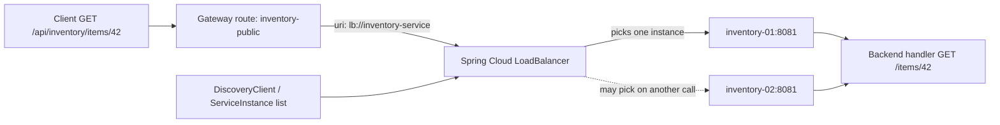
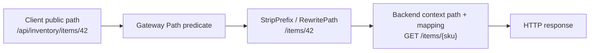
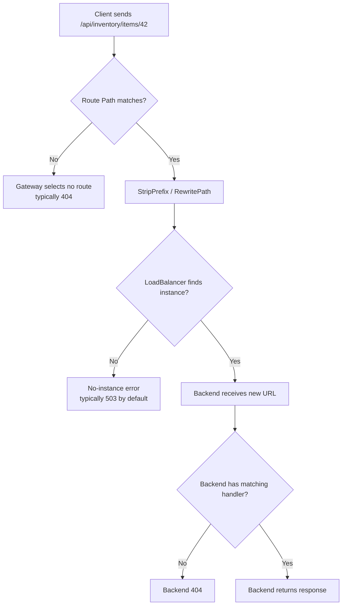

# Service Identification, Case Sensitivity, and Path Rules

**Chapter:** Service Discovery and Load Balancing  
**Module:** `SPRING_CLOUD_GATEWAY` — Spring Cloud Gateway

Spring Cloud Gateway can route to a fixed address such as `http://localhost:8081`, or to a **logical service name** via `lb://inventory-service`. The second approach fits microservices well because IPs, ports, and instance counts change across deployments. However, many "Gateway cannot find service" or "path returns 404" errors do not stem from the load-balancing algorithm: they come from confusing the **service name in the registry**, **the casing of that name**, **the path called by the client**, and **the path actually sent downstream to the backend**.

This lesson explains how these parts relate, especially the **DiscoveryClient Route Definition Locator** feature of **Spring Cloud Gateway Server WebFlux**. You will run two experiments: declaring an explicit `lb://...` route with a stable public path, and enabling the locator to auto-generate routes from discovered services. Then you will verify names, casing, `Path` predicates, and `RewritePath` with live requests.

> **Version scope:** Primary config examples use Spring Cloud Gateway Server WebFlux property names from recent release trains (e.g., Spring Cloud 2025.0+/Gateway 4.3+ and 5.x). Older lines use `spring.cloud.gateway.discovery.locator.*` and `spring.cloud.gateway.routes`; newer lines use `spring.cloud.gateway.server.webflux.discovery.locator.*` and `spring.cloud.gateway.server.webflux.routes`. If you use Gateway Server Web MVC or Proxy Exchange, check the API/mechanisms for that variant rather than copying WebFlux config mechanically.

## 1. Learning Objectives

After this lesson, you will be able to:

1. Distinguish **service ID**, **instance ID**, **route ID**, **hostname**, and **public API path**.
2. Explain how `lb://service-id` locates a backend via Spring Cloud LoadBalancer and a `ServiceInstance` source.
3. Describe the default routes generated by DiscoveryClient Locator: `Path=/serviceId/**` and `RewritePath` stripping the prefix.
4. Understand `lower-case-service-id` and why uppercase names returned by Eureka can affect public URLs.
5. Write stable manual routes like `/api/inventory/**`, independent of registry casing.
6. Detect failures caused by **wrong service name**, **wrong path**, **missing instance**, **missing dependency**, **wrong protocol**, or **overridden rewrite filter**.
7. Combine this knowledge with authentication, rate limiting, circuit breakers, retries, TLS, and per-route/per-service request observability.

## 2. Five Names That Must Not Be Conflated

Suppose a system has an Inventory service running two instances:

| Concept | Example | Meaning |
|---|---|---|
| **Service ID** | `inventory-service` | Identifier of the *service group* in discovery/LoadBalancer |
| **Instance ID** | `inventory-01`, `inventory-02` | Identifier of a specific process/pod/instance |
| **Instance address** | `10.10.2.11:8081`, `10.10.2.12:8081` | Actual address the Gateway connects to after picking an instance |
| **Route ID** | `inventory-public` | Route identifier managed by Gateway, used for config/metrics/diagnostics |
| **Public path** | `/api/inventory/items/42` | URL interface known and called by clients |

A hostname like `inventory.default.svc.cluster.local` is also **not automatically a service ID**. With `http://inventory.default.svc.cluster.local:8080`, the Gateway may rely on DNS; with `lb://inventory-service`, the Gateway uses Spring Cloud LoadBalancer instance selection. Specific infrastructure can bridge them, but resolution works differently.



**Crucial point:** LoadBalancer picks an **instance**; it does not decide the public path. The Gateway's `Path` predicate and `StripPrefix`/`RewritePath` decide which URL matches and which path reaches the backend. Renaming a service ID does not have to force public API path changes if a manual route decouples the two.

## 3. How Does `lb://service-id` Work?

A static route can be declared as:

```yaml
spring:
  cloud:
    gateway:
      server:
        webflux:
          routes:
            - id: inventory-public
              uri: lb://inventory-service
              predicates:
                - Path=/api/inventory/**
              filters:
                - StripPrefix=2
```

For `GET /api/inventory/items/42?expand=stock`:

1. `Path=/api/inventory/**` matches the external path.
2. `StripPrefix=2` strips the two segments `api` and `inventory`, leaving `/items/42`; the `expand=stock` query string is preserved unless another filter alters it.
3. The Gateway detects the `lb` URI scheme and asks LoadBalancer to pick a `ServiceInstance` for `inventory-service`.
4. LoadBalancer uses the instance list supplied by Spring Cloud `DiscoveryClient` or a compatible source.
5. The Gateway routes HTTP(S) to the selected instance's host/port; the actual security scheme depends on instance metadata and configuration.
6. The backend receives the request at `/items/42` and returns an HTTP response for the Gateway to relay back to the client.

**Both conditions are required:** having the `spring-cloud-starter-loadbalancer` starter and having a **real instance source**. Adding only the Gateway starter, setting only `spring.application.name`, or writing only `lb://...` will not discover the service.

For a service with zero instances, Gateway Server WebFlux normally returns HTTP `503 Service Unavailable` by default; an option exists to return `404` when no instance is found. Do not confuse this error with an HTTP `503` intentionally returned by a backend.

### 3.1. A service ID is not an arbitrary name you invent

The service ID in `lb://...` must match how the discovery source publishes the service. Do not guess from Maven artifact names, container names, Java packages, or dashboard labels. Verify the ID actually exposed by `DiscoveryClient`/registry and its corresponding instance list.

With Eureka, application names may be presented/normalized to uppercase by the registry. With Consul, Kubernetes, or `SimpleDiscoveryClient`, naming conventions may differ. **Do not assume every registry treats service IDs like case-insensitive DNS names.**

### 3.2. Manual routes vs. auto-generated routes

Both approaches can use LoadBalancer, but they **differ in how routes are defined**:

| Criterion | Manual `lb://...` route | DiscoveryClient Locator |
|---|---|---|
| Who defines the route? | Developer in YAML/Java DSL | Gateway generates it from service discovery |
| Public path | Chosen by you: `/api/inventory/**` | Defaults to `/serviceId/**` |
| Path filter | Declared by you, e.g., `StripPrefix=2` | Includes `RewritePath` by default to strip the service ID segment |
| Adding a new service | No manual route created automatically | A new route can appear once the locator detects the service |
| Public API surface control | Clearer because routes are reviewed | Must restrict which services are exposed |
| Depends on LoadBalancer | Yes when `uri` is `lb://...` | Default locator URI is `lb://serviceId` |

Enabling DiscoveryClient Locator **is not a prerequisite** for a manual `lb://...` route to work.

## 4. How Does DiscoveryClient Locator Generate Default Paths?

According to Gateway Server WebFlux docs, for a service ID returned by discovery as `inventory-service`, the default locator creates logic equivalent to:

```yaml
# Illustrative diagram of an auto-generated route, NOT a file to declare manually.
- id: <discovery-prefix>inventory-service
  uri: lb://inventory-service
  predicates:
    - Path=/inventory-service/**
  filters:
    - RewritePath=/inventory-service/?(?<remaining>.*), /${remaining}
```

The purpose of `RewritePath` is to **strip the service name prefix** from the request before forwarding to the backend. For example:

```text
Client calls Gateway:
  GET /inventory-service/items/42?expand=stock

Path predicate:
  /inventory-service/** -> match

Default RewritePath:
  /inventory-service/items/42 -> /items/42

Backend receives:
  GET /items/42?expand=stock
```

If the service in the registry is `INVENTORY-SERVICE` and path normalization is off, the locator route may use prefix `/INVENTORY-SERVICE/**`. Then `/inventory-service/items/42` may **fail to match** because paths are case-sensitive in typical configurations. That is a route-matching failure, not LoadBalancer failing to find an instance.

### 4.1. Default path and default filter work as a pair

For `/serviceId/items/42` to reach backend `/items/42`, **both the predicate** and the **matching rewrite** are needed. If you keep `Path=/inventory-service/**` while dropping `RewritePath`, the backend may receive `/inventory-service/items/42` verbatim and return `404` because its handler is registered only at `/items/42`.

Conversely, if the filter strips the wrong number of segments, the request may arrive at `/service/items/42` or `/42`. Do not blame "discovery failed" when the instance was actually selected and the request reached the backend at the wrong URL.

### 4.2. Why is `RewritePath` different from `StripPrefix`?

| Filter | Example | Characteristics |
|---|---|---|
| `StripPrefix=2` | `/api/inventory/items/42` → `/items/42` | Strips a fixed number of segments |
| `StripPrefix=1` | `/inventory-service/items/42` → `/items/42` | Easy to use on manual routes with a single prefix |
| `RewritePath` | Regex strips `/serviceId` → `/items/42` | Flexible by path pattern; used by the locator to generate per-service-ID rewrites |

The default locator uses `RewritePath` with a regex containing named group `remaining`. Using `StripPrefix=1` on a **manual route** can yield the same result for simple paths, but do not swap out the default locator filter without testing edge cases (trailing slashes, empty segments, encoded paths, Gateway versions).

### 4.3. When does HTTP 404 appear?

| Scenario | Where is the error? | What to check |
|---|---|---|
| `Path` fails to match due to casing mismatch | Gateway did not select a route | Inspect route predicates and client URL |
| Path matches, `RewritePath` is wrong | Backend receives wrong URL and may return 404 | Inspect `requestUri` at the backend |
| Path is right, backend has no handler | Backend | Inspect `@GetMapping`/`@RequestMapping` |
| `lb://...` finds no instance | LoadBalancer/discovery | Inspect registry; typically 503 by default |
| Another route matches earlier | Route order/priority | Inspect actual matched route ID and `order` config |

Do not lump every 404 into "service missing": Gateway returning 404 on no-route, backend returning 404 after rewrite, and LoadBalancer configured to return 404 are **three distinct cases**.

## 5. Casing: Service ID, Public Path, and DNS Name

Similar-looking names easily mislead beginners:

| Target | Casing behavior to remember |
|---|---|
| **HTTP header name** | Case-insensitive per HTTP standards — **unrelated** to service IDs |
| **DNS hostname** | DNS resolution is generally case-insensitive |
| **URL path** | Typically treated as case-sensitive; do not assume `/Orders` equals `/orders` |
| **Service ID in registry** | Logical string following each registry/`DiscoveryClient` convention; may be case-normalized |
| **Route ID** | Route identifier managed by Gateway, not DNS matching |
| **Instance ID** | Name of a specific instance; not an automatic path segment in the locator |

Example:

```text
Registry returns:  INVENTORY-SERVICE
Client calls:      /inventory-service/items/42
Desired URI:       lb://INVENTORY-SERVICE
Backend endpoint:  GET /items/42
```

If `lower-case-service-id=false`, the locator uses the registry's casing in default patterns/filters; lowercase requests can be rejected by `Path`. If the locator's lower-case option is enabled, the public path can use lowercase while instance selection still queries the logical name registered in discovery.

**Do not blindly change the URI to `lb://inventory-service`** when the registry genuinely exposes `INVENTORY-SERVICE`. Confirm the lookup name supported by LoadBalancer and change the right layer: public path, registry name, or the mapping between them.

## 6. What Problem Does `lower-case-service-id` Solve?

In modern **Gateway Server WebFlux**, configuration:

```yaml
spring:
  cloud:
    gateway:
      server:
        webflux:
          discovery:
            locator:
              enabled: true
              lower-case-service-id: true
```

Spring Cloud Gateway configuration documentation notes:

- By default, `lower-case-service-id` is `false`.
- When `true`, the locator uses the lowercase form of the service ID in **predicates/filters generated by the locator**.
- Especially helpful when Eureka advertises `MYSERVICE` while you want a public route `/myservice/**`.

Illustrative examples:

| `DiscoveryClient` returns | `lower-case-service-id` | Default client-facing Path |
|---|---|---|
| `inventory-service` | `false` | `/inventory-service/**` |
| `inventory-service` | `true` | `/inventory-service/**` |
| `INVENTORY-SERVICE` | `false` | `/INVENTORY-SERVICE/**` |
| `INVENTORY-SERVICE` | `true` | `/inventory-service/**` |

**Limits of this property:** it does not "rename" the service in Eureka, does not force other clients to use lowercase, does not fix container/DNS names, and does not make every LoadBalancer lookup suddenly case-insensitive. Under default config, the locator's `url-expression` still builds `'lb://' + serviceId` from the discovery name; that is why **normalizing the public path** must be kept separate from the **identity used to pick an instance**.

### 6.1. More sustainable naming practices

If you control the system from the start, prefer:

1. Defining a consistent convention for service IDs, such as lowercase + hyphens (`inventory-service`, `order-service`).
2. Knowing how each registry preserves or normalizes that convention.
3. Not changing service IDs arbitrarily between dev/staging/prod.
4. Separating public API paths into a dedicated contract (`/api/inventory/**`), avoiding coupling mobile/web clients to registry names.
5. Using manual routes when you need clean domain APIs, versioned paths, or exposure of only approved services.

`lower-case-service-id` is a **compatibility tool**, not a substitute for naming conventions and route governance.

## 7. Hands-On from Scratch: Building the Inventory Backend

We will create an HTTP backend exposing `GET /items/{sku}`. The response includes the **instance ID** and the **actual received path**, letting us verify both instance selection and URL rewriting.

### 7.1. Create the Spring Boot project

From [Spring Initializr](https://start.spring.io/), create a Maven Java project with package `com.example.inventory` and the **Spring Web** dependency. For Spring Boot 3.x, Java 17+ is suitable. For Spring Boot 4.x, pick the exact starter name generated by Initializr rather than copying from another version.

Backend `src/main/resources/application.yml`:

```yaml
spring:
  application:
    name: inventory-service

server:
  port: 8081

lab:
  instance-id: blue
```

Startup class `InventoryApplication.java`:

```java
package com.example.inventory;

import org.springframework.boot.SpringApplication;
import org.springframework.boot.autoconfigure.SpringBootApplication;

@SpringBootApplication
public class InventoryApplication {
    public static void main(String[] args) {
        SpringApplication.run(InventoryApplication.class, args);
    }
}
```

Controller `InventoryController.java` in the same package:

```java
package com.example.inventory;

import jakarta.servlet.http.HttpServletRequest;
import java.util.LinkedHashMap;
import java.util.Map;
import org.springframework.beans.factory.annotation.Value;
import org.springframework.web.bind.annotation.GetMapping;
import org.springframework.web.bind.annotation.PathVariable;
import org.springframework.web.bind.annotation.RestController;

@RestController
public class InventoryController {

    @Value("${lab.instance-id:blue}")
    private String instanceId;

    @GetMapping("/items/{sku}")
    public Map<String, Object> item(
            @PathVariable String sku,
            HttpServletRequest request) {
        Map<String, Object> result = new LinkedHashMap<>();
        result.put("service", "inventory-service");
        result.put("instance", instanceId);
        result.put("sku", sku);
        result.put("method", request.getMethod());
        result.put("path", request.getRequestURI());
        result.put("query", request.getQueryString());
        return result;
    }
}
```

**Note:** `spring.application.name` names the application, but **does not automatically register instances into a service registry**. In this lab, the Gateway learns about instances from a dedicated `SimpleDiscoveryClient` configuration.

### 7.2. Run the backend and test directly

In the backend project directory:

```bash
./mvnw spring-boot:run
```

Open another terminal:

```bash
curl -i "http://localhost:8081/items/SKU-42?include=stock"
```

Expected abbreviated JSON body:

```json
{
  "service": "inventory-service",
  "instance": "blue",
  "sku": "SKU-42",
  "method": "GET",
  "path": "/items/SKU-42",
  "query": "include=stock"
}
```

If the backend returns `404` on direct calls, fix the controller/mapping before testing the Gateway. If port `8081` is already in use, change the port **consistently** in both the backend and the Gateway's instance list.

### 7.3. Add a second instance to observe load balancing

Run the same app in another terminal with a different port and instance ID:

**Bash (Linux/macOS):**

```bash
SERVER_PORT=8082 LAB_INSTANCE_ID=green ./mvnw spring-boot:run
```

**PowerShell (apply only in the second terminal):**

```powershell
$env:SERVER_PORT = "8082"
$env:LAB_INSTANCE_ID = "green"
.\mvnw.cmd spring-boot:run
```

Verify `curl -i http://localhost:8082/items/SKU-42` returns `"instance":"green"`. Ensure both instances are genuinely running concurrently on `8081` and `8082`; if one is missing while still listed in static config, LoadBalancer can pick the stopped instance and hit a connection error.

## 8. Building the Gateway with a Manual Route and Discovery Locator

Create a separate Spring Boot **Gateway Server WebFlux** project, e.g., package `com.example.gateway`, using compatible Spring Boot and Spring Cloud BOMs. On a modern Spring Cloud release train, add:

```xml
<dependencies>
    <dependency>
        <groupId>org.springframework.cloud</groupId>
        <artifactId>spring-cloud-starter-gateway-server-webflux</artifactId>
    </dependency>
    <dependency>
        <groupId>org.springframework.cloud</groupId>
        <artifactId>spring-cloud-starter-loadbalancer</artifactId>
    </dependency>
</dependencies>
```

`SimpleDiscoveryClient` can supply static instances from properties when no external registry is used. This is suitable for learning, not as a dynamic discovery solution as pods/instances scale.

### 8.1. Gateway `application.yml`

```yaml
server:
  port: 8080

spring:
  application:
    name: inventory-gateway-lab
  cloud:
    discovery:
      client:
        simple:
          instances:
            inventory-service:
              - uri: http://localhost:8081
              - uri: http://localhost:8082
    gateway:
      server:
        webflux:
          discovery:
            locator:
              enabled: true
              lower-case-service-id: true
          routes:
            - id: inventory-public
              uri: lb://inventory-service
              predicates:
                - Path=/api/inventory/**
              filters:
                - StripPrefix=2
                - AddRequestHeader=X-Lab-Route, inventory-public
```

This file defines **two route sources**:

1. **Manual route `inventory-public`:** public path is `/api/inventory/**`. The Gateway uses `lb://inventory-service` to select an instance; `StripPrefix=2` removes `api/inventory`.
2. **Auto-generated Discovery Locator route:** `inventory-service` appears in discovery, so the locator can also create a route for `/inventory-service/**` and attach a filter stripping the `inventory-service` prefix.

The two public paths **are distinct**, so in this lab they do not compete on the same request. Setting `lower-case-service-id: true` produces no visible difference here because the static service ID is already lowercase. To see why this option matters when Eureka returns uppercase IDs, see Section 10.

### 8.2. Run the Gateway and test both URL styles

Start the Gateway on `8080` while both backend instances `8081`/`8082` remain running. From another terminal:

```bash
# 1) Manual route with a public path chosen by the API team.
curl -i "http://localhost:8080/api/inventory/items/SKU-42?include=stock"

# 2) Auto-generated route based on the service ID from DiscoveryClient.
curl -i "http://localhost:8080/inventory-service/items/SKU-42?include=stock"
```

Expected outcome for both commands: the HTTP response from the backend shows `"path":"/items/SKU-42"` and `"sku":"SKU-42"`. The `"instance"` field will be `blue` or `green` depending on which instance was chosen. Query `include=stock` is preserved if no other filter modifies the query.

| External URL | Route source | Path filter | URL received by backend |
|---|---|---|---|
| `/api/inventory/items/SKU-42` | Manual | `StripPrefix=2` | `/items/SKU-42` |
| `/inventory-service/items/SKU-42` | Auto-generated locator | Default `RewritePath` | `/items/SKU-42` |

Repeat each command to observe LoadBalancer selecting across multiple instances:

```bash
curl -s http://localhost:8080/api/inventory/items/SKU-42
curl -s http://localhost:8080/api/inventory/items/SKU-42
curl -s http://localhost:8080/api/inventory/items/SKU-42
curl -s http://localhost:8080/api/inventory/items/SKU-42
```

**Do not claim two consecutive requests must strictly alternate blue/green.** The LoadBalancer algorithm/policy, instance caching, active instance count, and network layers can all affect the outcome. The goal is to confirm the Gateway can route to one of the instances published by discovery, not to assert a fixed cycle across every version and infrastructure.

**If you do not run both backends:** you can declare only instance `8081` and run a single-instance lab first; in that case load distribution across instances isn't tested yet. Do not leave `8082` in the list if nothing is listening on that port.

### 8.3. Why are manual routes useful?

If the registry later changes `inventory-service` to `INVENTORY-SERVICE`, or the platform migrates from Eureka to Kubernetes, you can adjust target mapping in the Gateway while keeping the public `/api/inventory/**` API stable, as long as service lookup works and the backend still serves `/items/**`.

Conversely, when using the default locator, service names can appear directly in public URLs. That is convenient for internal environments, but never treat all auto-generated routes as safe public interfaces by default.

## 9. Direct Comparison: Uppercase ID Does Not Mean Uppercase Path

Consider an application registered in Eureka with a service ID seen by the Gateway as `INVENTORY-SERVICE`. Default paths vary by setting:

```text
DiscoveryClient returns:
    serviceId = INVENTORY-SERVICE

If lower-case-service-id = false:
    Default client path:  /INVENTORY-SERVICE/items/SKU-42
    Downstream path:      /items/SKU-42
    Default route URI:    lb://INVENTORY-SERVICE

If lower-case-service-id = true:
    Default client path:  /inventory-service/items/SKU-42
    Downstream path:      /items/SKU-42
    Default route URI:    lb://INVENTORY-SERVICE
```

Notice the distinction: **the public path is normalized**, whereas **the original ID for instance lookup must still match the registry**. The locator's lower-case property is not meant to alter the casing of manual `lb://...` URIs written by developers.

### 9.1. Experimenting with route matching on differently cased URLs

Suppose the locator generates `Path=/inventory-service/**`; test:

```bash
# Path matching the pattern (lowercase).
curl -i http://localhost:8080/inventory-service/items/SKU-42

# Path intentionally capitalized in part.
curl -i http://localhost:8080/Inventory-Service/items/SKU-42

# Path with an extra prefix not matching the locator route.
curl -i http://localhost:8080/api/inventory-service/items/SKU-42
```

With standard case-sensitive `Path` matching, the last two commands do not match the **default locator route** and typically return `404` if no other route matches. Do not use this experiment to conclude the registry returned no instances: route selection dropped the request before LoadBalancer was ever invoked.

If you want the public route to always be `/api/inventory/**`, do not force clients to guess registry names; define a manual route as in Section 8.

## 10. Customizing Discovery Locator Without Losing Default Path Rewriting

The locator lets you customize auto-generated routes using property groups such as:

- `discovery.locator.enabled` — enables/disables automatic discovery routes;
- `discovery.locator.lower-case-service-id` — normalizes the service ID appearing in default predicates/filters;
- `discovery.locator.include-expression` — decides which services are included in locator routes;
- `discovery.locator.route-id-prefix` — prefix for generated route IDs;
- `discovery.locator.url-expression` — expression building the target URI, defaulting to `'lb://' + serviceId`;
- `discovery.locator.predicates` / `discovery.locator.filters` — defines predicates/filters for auto-generated routes.

These properties sit under `spring.cloud.gateway.server.webflux` in the illustrated version. **Read the exact Configuration Properties table for your running version**, because subpages or older examples may use the `spring.cloud.gateway.discovery.locator` prefix.

### 10.1. Use an allowlist to avoid auto-exposing every service

By default, `include-expression` evaluates to `true`: eligible services in discovery can become auto-generated routes. If the Gateway is a public entrypoint, this can accidentally expose admin services or internal backends externally.

In a lab with only `inventory-service`, try a restricted config:

```yaml
spring:
  cloud:
    gateway:
      server:
        webflux:
          discovery:
            locator:
              enabled: true
              lower-case-service-id: true
              include-expression: "serviceId == 'inventory-service'"
```

`include-expression` checks the ID returned by `DiscoveryClient`; the example above works only when discovery actually provides lowercase `inventory-service`. If Eureka returns `INVENTORY-SERVICE`, an **exact comparison like that** may filter out the service even with `lower-case-service-id=true`. The lower-case option formats paths/filters; it does not transform the `serviceId` variable across all custom expressions.

In production, review `include-expression` alongside Spring Security, network policies, route ownership, and approved public APIs. A locator allowlist is **one risk-reduction layer**, not a replacement for authentication/authorization.

### 10.2. Why can adding a custom filter cause a 404?

Suppose you want every locator route to add header `X-Route-Source`. If you configure:

```yaml
# INCOMPLETE sample; intentionally illustrates losing the default rewrite.
spring:
  cloud:
    gateway:
      server:
        webflux:
          discovery:
            locator:
              enabled: true
              filters:
                - name: AddRequestHeader
                  args:
                    name: X-Route-Source
                    value: discovery-locator
```

When you **define `locator.filters` yourself**, the locator's default filter list is replaced; do not assume `RewritePath` remains present automatically. The result can be:

```text
Client:            GET /inventory-service/items/42
Matched route:     Path=/inventory-service/**
Remaining filter:  AddRequestHeader
Backend receives:  GET /inventory-service/items/42
Backend expects:   GET /items/42
Result:            404 at backend, even though LoadBalancer found an instance.
```

**Resolution:** if you want to keep default behavior, re-declare `RewritePath` inside your custom filter list, matching the service ID casing in use. Likewise, when customizing `locator.predicates`, re-declare `Path` if you still want `/serviceId/**` matching. The Gateway documentation explicitly warns about this.

Logical structure to maintain:

```text
discovery.locator.predicates
  - Path: "/<serviceId>/**"
  - (optional) Host / Method / Header per policy

discovery.locator.filters
  - RewritePath: "/<serviceId>/?(?<remaining>.*)" -> "/\${remaining}"
  - (optional) AddRequestHeader / CircuitBreaker / ...
```

The snippet above **is a conceptual diagram**, not copy-paste YAML: Spring uses SpEL expressions to construct regexes per service ID, and in `application.yml` the `${remaining}` replacement token often requires escaping per your version's guide. Never paste literal `<serviceId>` into config expecting the framework to treat it as a variable.

If only a few routes need special policies, a more controllable solution may be **manual routes** combining `Path` with `StripPrefix` or static `RewritePath`. That avoids altering the shared template for all services.

### 10.3. Avoiding path collisions when using auto-generated and manual routes together

Suppose you create both:

- Auto-generated route `Path=/inventory-service/**`;
- Manual route also with `Path=/inventory-service/**` but carrying custom auth filters.

When multiple routes match, which route wins depends on priority order and the active route set. Never assume "manual routes always win" or "discovery routes always win." It is especially dangerous if the winning route lacks required auth or rate-limiting filters.

In the lab, we deliberately used **two separate prefixes** to avoid conflicts. In real deployments, govern route IDs, route order, and security policies across all potentially matching paths.

## 11. Path Rules Must Stay Consistent Across Layers

There are at least four "path" layers:



### 11.1. Paths are case-sensitive

HTTP paths are generally not treated like DNS hostnames. In route `Path=/inventory-service/**`, `/Inventory-Service/items/42` should not be treated as equivalent without special matching config. This distinction is separate from:

- Whether the service name in the registry is uppercase;
- Whether the backend hostname has uppercase letters;
- Query parameters like `?sort=asc`;
- HTTP header names, which are case-insensitive per HTTP standards.

### 11.2. Prefixes, context paths, and backend paths

Suppose the backend is configured with context path `/inventory` and controller mapping `/items/{sku}`. Then the real backend URL is `/inventory/items/42`. If the Gateway strips prefixes down to `/items/42`, the backend may return 404 even though discovery succeeded. Align the path contract or add appropriate rewrite/prefix filters.

Do not automatically assume the service ID (`inventory-service`), context path (`/inventory`), and API base path (`/api/v1/inventory`) are identical. Those three strings are separate architectural choices.

### 11.3. Trailing slashes, path encoding, and multiple proxies

Paths like `/inventory-service`, `/inventory-service/`, `/inventory-service/items/42`, or paths with percent-encoded characters can trigger differing behaviors depending on `Path` predicates, rewrite regexes, HTTP servers, and framework versions.

When debugging:

1. Record the **actual path sent by the client** (not only a tool-normalized URL);
2. Check whether the route predicate matches;
3. Observe the **actual path received by the backend**;
4. Verify the controller mapping and backend context path;
5. Never let multiple layers decode or normalize paths inconsistently, creating auth-rule bypasses.

Never transform paths by concatenating strings with untrusted client input. When rewriting is needed, use official filters and test paths with slashes, encoded characters, or unusual segments in an isolated environment.

### 11.4. Public URLs should not depend on registry names

`inventory-service` may change due to org refactoring, discovery frameworks, or casing normalization; external clients should not have to change URLs whenever infrastructure renames a service. A more resilient design:

```text
Public API:  /api/v1/inventory/items/42
Gateway:     Path=/api/v1/inventory/**
Filter:      StripPrefix=3
Downstream:  lb://inventory-service
Backend:     GET /items/42
```

With `/api/v1/inventory/items/42`, the first three segments are `api`, `v1`, `inventory`; `StripPrefix=3` leaves `/items/42`. This is an example of a **manual route**, not the default locator path.

## 12. Layer-by-Layer Diagnosis of 404 and 503

When a request fails, identify which step stopped it:



| Symptom | Primary hypothesis | Check to run |
|---|---|---|
| `/inventory-service/**` matches but `/Inventory-Service/**` returns 404 | Case difference in `Path` predicate | Inspect route locator and `lower-case-service-id` |
| `/inventory-service/items/42` returns 404, no backend logs | Route did not match or Gateway did not load locator | Inspect route definitions, config prefix, `DiscoveryClient.getServices` |
| Backend logs `/inventory-service/items/42` and returns 404 | Default filter replaced or no rewrite occurred | Check if `locator.filters` includes `RewritePath` |
| Backend logs `/items/42` and returns 404 | Backend lacks mapping or has a different context path | Call backend directly with the same path |
| `lb://inventory-service` returns 503 while direct backend works | LoadBalancer has no valid instance for that exact service ID | Check dependencies, instance list, and lookup name |
| Intermittent success and connection errors | One listed instance is down or on the wrong port | Call each instance `uri` directly, check selected instance ID |
| `lb://...` unexpectedly uses HTTPS | Registry marks instance secure or scheme config differs | Inspect `ServiceInstance`, secure flag, TLS trust |
| Gateway errors when backend isn't serving | TCP connect refused, DNS, firewall, wrong port | Check network from Gateway environment to backend |
| Locator creates zero routes | `enabled` false/wrong prefix, DiscoveryClient empty, `include-expression` filters all | Check version, `DiscoveryClient`, and expression |
| Backend returns 503 with application body | Service itself returned 503 | Compare direct backend response with Gateway response |
| Manual route works but auto-generated route fails | Different public paths and default filters | Compare `Path` and `RewritePath` per route |
| Adding custom filter changes backend path | Custom `locator.filters` replaced defaults | Restore `RewritePath` or switch to manual route |

### 12.1. Distinguishing LoadBalancer 404 from no-route 404

Modern Server WebFlux supports a configuration like:

```yaml
spring:
  cloud:
    gateway:
      server:
        webflux:
          loadbalancer:
            use404: true
```

When this option is enabled, **LoadBalancer finding no instances** can return 404 instead of the default 503. Therefore, you cannot look at the HTTP code alone and conclude "route does not exist"; inspect logs/correlation IDs and check service instances.

In production debugging, prioritize route ID, service ID, instance ID, and measurable failure causes; avoid logging full URLs containing sensitive tokens or queries.

### 12.2. Why can `spring.application.name` be right while discovery is still empty?

`spring.application.name: inventory-service` only names the application. For Eureka/Consul/Kubernetes discovery, you need the client, registration/lookup config, or matching service discovery infrastructure. For the `SimpleDiscoveryClient` lab, instance URIs must be declared in the **Gateway**'s configuration; changing a backend port without updating the list leads to connection failures.

Key checkpoints:

1. Does the Gateway have a valid load-balancer dependency?
2. Does the discovery source actually return `inventory-service`?
3. Is there at least one `ServiceInstance` with valid host, port, and scheme?
4. Is that instance serving the expected endpoint/path?
5. Can the Gateway's network namespace reach that address?

In Docker Compose or Kubernetes, `localhost` refers to the calling container/pod's own loopback namespace. If the Gateway and backend run in separate containers, `http://localhost:8081` on the Gateway will not point to the backend. Use valid service addresses/DNS and check network policies.

## 13. Security When Exposing Services via the Locator

Auto-generating routes from a registry speeds up development, but it also expands the **API surface**. If the registry contains `admin-service` or `billing-internal`, enabling an unrestricted locator can expose `/admin-service/**` or `/billing-internal/**` on the Gateway, depending on route and security policies.

A secure design should include these layers:

1. **Explicit service allowlist or public routes:** `include-expression` or manual routes; review whenever new services register.
2. **Spring Security and authorization:** decide which clients can call each route. Path names or service IDs do not prove access rights.
3. **Trusted network:** backends should accept connections only from authorized callers; prevent bypassing the Gateway.
4. **Headers and identity:** never trust client-supplied `X-User`, `X-Role`, or `X-Forwarded-For`; if forwarding identity, verify and overwrite at trust boundaries.
5. **Rate limiting / request limits:** not enabled automatically by `lb://`; configure keys and resource limits explicitly.
6. **Per-hop TLS:** client → Gateway HTTPS and Gateway → backend HTTPS/mTLS are separate connections requiring separate hostnames/certificates/trust.
7. **Observability and data protection:** never log credentials, sensitive payloads, or secret URL queries in logs/metrics.

### 13.1. Renaming a service is not authorization

Hiding `admin-service` behind an obscure path does not secure it. An `lb://admin-service` route remains reachable if predicates and security allow it. Place authentication/authorization policies at the proper layer rather than relying on service-name casing or obscurity.

### 13.2. Retries and circuit breakers do not fix path errors

`Retry` can replay failed requests and `CircuitBreaker` can stop cascading backend failures, but they **cannot fix** a `StripPrefix`/`RewritePath` sending the wrong URL. Retrying a 404 caused by a bad path only adds load and obscures the bug. For POST or body-bearing requests, retries may also buffer payloads and repeat side effects; design idempotency, timeouts, and retry criteria before enabling them.

For multi-instance `lb://`, understand circuit breakers and health checks by **unit of protection**: one service ID can hold both healthy and failing instances. Never assume changing `uri` to `lb://` automatically enables health checks/circuit breakers or removes every unhealthy instance.

## 14. Observing Routes, Services, and Instances in Operations

A successful HTTP response from the Gateway only proves the request reached a handler; it does not confirm LoadBalancer is distributing traffic properly. Measure:

| Signal | Why is it useful? |
|---|---|
| **Route ID** | Distinguishes manual routes from auto-generated locator routes |
| **Service ID** | Shows which service group `lb://` looked up |
| **Chosen instance ID/host/port** | Shows which instance received the request |
| **Path before and after rewrite** | Separates predicate mismatches from backend mapping errors |
| Per-hop HTTP status/latency | Shows whether failure occurred in Gateway, LoadBalancer, or backend |
| Available instance count per service | Detects empty registries or config changes |
| SSL/TLS errors and connect timeouts | Separates protocol/transport failures from path failures |
| Retry, circuit breaker, rate-limit outcomes | Shows per-route cost and policy behavior |

Spring Boot Actuator and Gateway metrics/tracing mechanisms can aid observability, though enabling endpoints/metrics varies by version. When using route-management actuator endpoints, enable only what is needed, protect access, and avoid exposing sensitive URIs/route configs.

**Avoid high-cardinality metric labels** such as raw URLs containing SKUs/user IDs, token values, user-sent headers, or query strings. Favor route ID, service ID, HTTP method, status class, and normalized endpoint names. When tracing requests across Gateway and backends, use correlation IDs/W3C Trace Context per organizational policy rather than relying solely on lab headers.

### 14.1. Best evidence in the lab

In Section 8, the backend returns `instance` and `path`. Those two fields separate:

- `"instance":"blue"` or `"green"`: routing selected a concrete instance.
- `"path":"/items/SKU-42"`: filters reshaped the path into what the backend expects.
- `"service":"inventory-service"`: self-reported by the backend app for cross-checking, not a registry attestation.

In production, you do not need to return infrastructure details like hostnames/IPs/instance IDs to external clients. Emit them to controlled internal logs/traces and expose only necessary metadata.

## 15. Self-Guided Practice Exercises

Work step by step with the backend and Gateway from Sections 7–8; after each change, record the **client URL**, **matched route**, **instance**, and **path received by the backend**.

### Exercise 1 — Compare manual route and Locator route

Send two requests:

```bash
curl -i http://localhost:8080/api/inventory/items/BOOK-1
curl -i http://localhost:8080/inventory-service/items/BOOK-1
```

Explain why the backend sees `/items/BOOK-1` in both cases even though the two requests use **two different routes** with different prefix-stripping mechanisms.

### Exercise 2 — Change the filter on the manual route

Try changing `StripPrefix=2` to `StripPrefix=1` on route `inventory-public`, restart the Gateway or refresh routes via the appropriate mechanism, and call:

```bash
curl -i http://localhost:8080/api/inventory/items/BOOK-2
```

The backend will likely receive `/inventory/items/BOOK-2` and have no matching controller, returning `404`. Restore `StripPrefix=2` and re-run. Distinguish this failure from **failing to find an `inventory-service` instance**.

### Exercise 3 — Test URL casing

When the locator generates route `/inventory-service/**`, test:

```bash
curl -i http://localhost:8080/inventory-service/items/BOOK-3
curl -i http://localhost:8080/INVENTORY-SERVICE/items/BOOK-3
```

Compare the results and explain why `lower-case-service-id` applies to the locator's predicate/filter generation without making arbitrary URL paths case-insensitive.

### Exercise 4 — Simulate zero instances

In a safely modifiable lab environment, temporarily point a manual route to a nonexistent service ID, e.g., `lb://missing-lab-service`. Send a request to that route and inspect the status/logs. Immediately restore the original URI afterward.

Answer: does the outcome differ from merely misconfiguring `StripPrefix`? If so, at **which stage** does it differ? Never run this exercise on a production Gateway.

### Exercise 5 — Observe two instances

Run both `blue` and `green`. Send 10 requests to `/api/inventory/items/BOOK-4` and count the `instance` field in the JSON responses. Try stopping one instance and repeating in a **lab environment**. Without appropriate health checking/eviction for a static instance source, what can happen when LoadBalancer still sees the stopped instance's address?

### Exercise 6 — Customize the Locator

Set `include-expression` to allow only `inventory-service` and verify that another service in the registry does not get an auto-generated public route. Then discuss what happens if the registry exposes the service name as `INVENTORY-SERVICE` while the expression still compares against a lowercase string.

### Exercise 7 — Security and observability

Design policies for public API `/api/v1/inventory/**`: route predicates, path rewriting, authentication/authorization, rate limiting by trusted user/key, circuit breakers, retries, outbound TLS, logs/metrics, and keeping internal pod/service names out of public responses.

### Completion criteria

| Criterion | Pass condition |
|---|---|
| Understand service ID | Can explain how `inventory-service` differs from route ID and instance ID |
| Understand `lb://` | Knows LoadBalancer plus a `ServiceInstance` source are required |
| Understand locator | States default `Path=/serviceId/**` and prefix-stripping `RewritePath` accurately |
| Separate public path | Explains that `/api/inventory/**` is an independent contract |
| Casing | Knows the role and limits of `lower-case-service-id` |
| Verify paths | Backend receives `/items/SKU-42` from both manual route and locator |
| Distinguish errors | Separates route-mismatch 404, backend 404, and no-instance error |
| No blind exposure | Enforces an allowlist or approved public routes |
| Observe load | Identifies chosen instance and tests across multiple instances |
| Safe operations | Does not use paths/IDs for authorization; configures auth, TLS, and logging policy |

## 16. Review Questions and Guiding Answers

**1. Does `lb://inventory-service` mean the Gateway calls DNS host `inventory-service`?**  
No. `lb://` invokes LoadBalancer to choose a `ServiceInstance`. DNS may underlie discovery or be used separately, but `lb` is not merely `http://` with a swapped prefix.

**2. Do you have to enable DiscoveryClient Route Definition Locator to use `lb://`?**  
No. Manual `lb://...` routes work as long as LoadBalancer can query instances from a valid source.

**3. What public path does the default locator generate?**  
`/serviceId/**`, where `serviceId` comes from `DiscoveryClient` (optionally lowercased in predicates/filters via the locator setting).

**4. How does the locator strip the service name prefix?**  
Via default `RewritePath` using pattern `/serviceId/?(?<remaining>.*)` and replacement `/${remaining}`, so the backend sees the remaining path.

**5. Why might `lower-case-service-id: true` not fix a missing-instance error for `lb://INVENTORY-SERVICE`?**  
Because that property controls generating predicates/filters from the service ID; it does not replace the discovery source or make every service-name lookup across the system automatically case-insensitive.

**6. LoadBalancer forwarded a request to a backend, and the backend returned 404. What should you check first?**  
Compare the `requestUri` received by the backend against its controller mappings and context path, especially if you customized or accidentally dropped the default `RewritePath`.

**7. Why can adding just one `AddRequestHeader` to `locator.filters` break the path?**  
Because configuring a custom filter list **replaces the entire default list**, including the `RewritePath` that stripped the prefix.

**8. Should you automatically expose every service in a registry to the Internet?**  
No. You need an explicit allowlist/public routes, auth/authorization, network policies, observability, and review of internal endpoints.

**9. If the Gateway returns 404, does that always mean no route matched?**  
No. It could be a 404 from the backend, or LoadBalancer configured to return 404 when no instance is found. Analyze layer by layer.

**10. When should you prefer public route `/api/inventory/**` over `/inventory-service/**`?**  
When you want a stable API contract, want to avoid exposing registry names, or need custom product-specific path/version/security policies.

## 17. Summary

In Spring Cloud Gateway, **service ID, route ID, instance ID, and public URL path are four distinct concepts**. `lb://service-id` lets the Gateway find a backend instance through LoadBalancer, while predicates and filters determine which path clients call and which path the backend actually receives.

**DiscoveryClient Locator** can auto-generate routes from a service list. By default, it uses `/serviceId/**` as the predicate and `RewritePath` to strip the service ID prefix. `lower-case-service-id` helps produce lowercase paths when registries like Eureka return uppercase names, but it does not rename the underlying service or fix every lookup issue.

When building a long-lived microservices gateway, standardize service identifiers, keep public API paths decoupled from registry names, restrict which services are auto-exposed, verify paths at the backend, and layer authentication, rate limiting, circuit breakers, retries, TLS, and request observability. When failures occur, diagnose in order: **Path predicate → path rewrite → service lookup → instance → backend mapping**, rather than looking at HTTP 404/503 and guessing.

## References

1. [Spring Cloud Gateway Server WebFlux — DiscoveryClient Route Definition Locator](https://docs.spring.io/spring-cloud-gateway/reference/spring-cloud-gateway-server-webflux/the-discoveryclient-route-definition-locator.html).
2. [Spring Cloud Gateway — Configuration Properties](https://docs.spring.io/spring-cloud-gateway/reference/configprops.html) (check `spring.cloud.gateway.server.webflux.discovery.locator.*` and `loadbalancer.use404`).
3. [Spring Cloud Gateway Server WebFlux — Route Predicate Factories](https://docs.spring.io/spring-cloud-gateway/reference/spring-cloud-gateway-server-webflux/request-predicates-factories.html).
4. [Spring Cloud Gateway Server WebFlux — GatewayFilter Factories](https://docs.spring.io/spring-cloud-gateway/reference/spring-cloud-gateway-server-webflux/gatewayfilter-factories.html).
5. [Spring Cloud Gateway Server WebFlux — Global Filters](https://docs.spring.io/spring-cloud-gateway/reference/spring-cloud-gateway-server-webflux/global-filters.html).
6. [Spring Cloud Commons — Common Abstractions: SimpleDiscoveryClient](https://docs.spring.io/spring-cloud-commons/reference/spring-cloud-commons/common-abstractions.html).
7. [Spring Cloud Commons — Spring Cloud LoadBalancer](https://docs.spring.io/spring-cloud-commons/reference/spring-cloud-commons/loadbalancer.html).
8. [Spring Cloud Netflix — Eureka Client](https://docs.spring.io/spring-cloud-netflix/reference/spring-cloud-netflix.html).

> **Version note:** Older documentation pages may illustrate the same Discovery Locator behavior using the `spring.cloud.gateway.discovery.locator.*` prefix, whereas newer Gateway Server WebFlux configuration tables use `spring.cloud.gateway.server.webflux.discovery.locator.*`. Verify your exact version before copying configuration; this content is a conceptual guide and hands-on lab, not formal QA output or a production-ready configuration.
