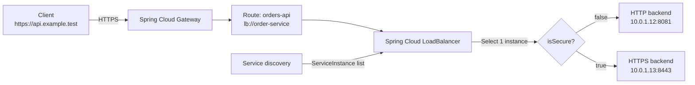
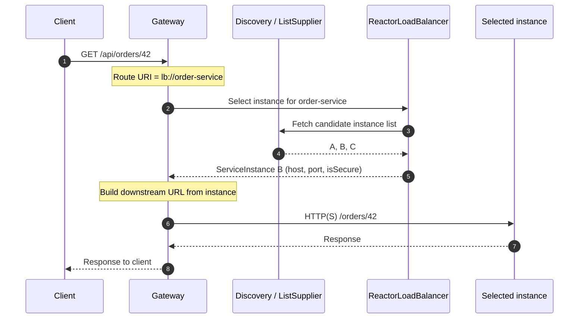
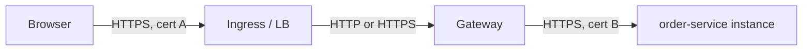

# Instance Selection, isSecure Status, and Downstream Protocols

## 1. The Problem: Client Uses HTTPS, Yet Gateway May Call Backend Over HTTP

A microservices system usually deploys multiple replicas of the same service—for example, `order-service` running three instances across different pods or hosts. **Spring Cloud Gateway** must select an appropriate instance for each matched request, then determine whether to connect to that instance over **HTTP or HTTPS**, and on which **host/port**.

Two decisions are easily confused:

1. **Instance selection:** where is `order-service`, which replicas can currently accept requests, and which replica will be chosen?
2. **Backend protocol selection (downstream/upstream scheme):** will the Gateway send `http://host:port` or `https://host:port` to the selected replica?

Suppose a client calls `https://api.example.test/api/orders/42`. The Gateway may accept **HTTPS from the client**, yet if the chosen instance is `10.0.1.12:8081` with `isSecure=false`, the **Gateway → order-service** connection may use **HTTP**. Conversely, if the instance advertises `isSecure=true` and the backend actually serves TLS, the Gateway can use **HTTPS** on the next hop.

Therefore, **never infer the protocol to a microservice solely from the protocol the client used to call the Gateway**.

This lesson belongs to the **Service Discovery and Load Balancing** chapter in the **SPRING_CLOUD_GATEWAY** module, explaining `ServiceInstance`, `ReactiveLoadBalancerClientFilter`, `lb://`, the `isSecure` flag, and scheme prefix exceptions, followed by hands-on configuration, testing, troubleshooting, and protecting TLS hops.

> **Scope:** Focused on **Spring Cloud Gateway Server WebFlux** with Spring Cloud LoadBalancer. YAML examples use the `spring.cloud.gateway.server.webflux` namespace from recent versions; compatibility notes also show the `spring.cloud.gateway` namespace common in WebFlux 4.x. Choose matching Spring Boot/Spring Cloud versions and do not mix configurations from the **Gateway Server MVC** variant.

## 2. Concepts That Must Be Distinguished

| Concept | Role | Example |
| --- | --- | --- |
| **Service ID** | Logical name of an instance group | `order-service` |
| **Service discovery** | Resolves an instance list from a service ID | Eureka, Consul, Kubernetes integration, `SimpleDiscoveryClient` |
| **`ServiceInstance`** | Metadata describing a specific destination | `host=10.0.1.12`, `port=8081`, `isSecure=false` |
| **Spring Cloud LoadBalancer** | Selects one instance from the candidate list | Round Robin or configured strategy |
| **Route predicate** | Selects a Gateway route for the incoming request | `Path=/api/orders/**` |
| **GatewayFilter / GlobalFilter** | Applies policies and routing in the filter chain | `StripPrefix`, `ReactiveLoadBalancerClientFilter` |
| **Scheme** | Connection protocol to the destination | `http`, `https`, `ws`, `wss` |
| **`isSecure`** | Transport security flag of the instance | `true` or `false` |
| **TLS trust** | Certificate trust, hostname verification, and mTLS config | CA, truststore, SSL bundle, or HTTP client config |

Remember: a **route** is not an **instance**. A route with ID `orders-api` may point to service ID `order-service`; that service ID corresponds to multiple instances, each with its own host, port, and protocol.



This diagram illustrates **selection**. Each normal request picks **one** instance; it is not broadcast to both just because two branches exist. Only a separately configured retry/circuit breaker mechanism can trigger additional attempts.

## 3. ServiceInstance: Small Metadata That Decides Target and Protocol

Spring Cloud Commons defines `org.springframework.cloud.client.ServiceInstance` as the abstraction for a service replica. Key fields/methods include:

| Property | Meaning | What to verify |
| --- | --- | --- |
| `getServiceId()` | Logical service group | Matches the service ID in the `lb://...` route |
| `getInstanceId()` | Replica identity (if provided) | Used for observability and isolating failing instances |
| `getHost()` | Host/IP reachable by Gateway | Valid DNS or network routing from Gateway |
| `getPort()` | Listening port of the instance | HTTP port differs from HTTPS port when configured separately |
| `isSecure()` | Flag stating whether the instance uses a secure transport | Must reflect the actual protocol at the endpoint |
| `getUri()` | URI describing the instance | Check actual scheme, host, and port |
| `getMetadata()` | Extra info depending on `DiscoveryClient` | Zone, version, weight, or custom config data |

Illustrative data for two instances:

```text
Service ID: order-service

Instance A
  instanceId: orders-a
  host:       10.0.1.12
  port:       8081
  isSecure:   false
  target:     http://10.0.1.12:8081

Instance B
  instanceId: orders-b
  host:       orders-b.internal.example
  port:       8443
  isSecure:   true
  target:     https://orders-b.internal.example:8443
```

If **A** is chosen, Gateway can use HTTP; if **B** is chosen, Gateway can use HTTPS. This is **hypothetical data**, not a live registry.

### 3.1. Illustrating ServiceInstance in Java

```java
import org.springframework.cloud.client.DefaultServiceInstance;
import org.springframework.cloud.client.ServiceInstance;

ServiceInstance a = new DefaultServiceInstance(
    "orders-a",
    "order-service",
    "10.0.1.12",
    8081,
    false
);

ServiceInstance b = new DefaultServiceInstance(
    "orders-b",
    "order-service",
    "orders-b.internal.example",
    8443,
    true
);
```

In this constructor, the final boolean argument sets `secure`. **Merely instantiating two objects in Java does not register them in Eureka, Kubernetes, or Gateway.** For Gateway to select them, a `DiscoveryClient`/`ServiceInstanceListSupplier` source must supply those instances.

Some `DiscoveryClient`s derive `isSecure` from the registration URL, others from registry metadata/properties. With Eureka, for example, secure port and registration status must be configured accurately. Never assume every registry derives `isSecure` the same way.

### 3.2. isSecure does not mean the instance is healthy

`isSecure=true` only describes the **endpoint's security protocol**. It does **not** prove the instance is alive, accepting traffic, serving a valid certificate, able to complete connections, or authenticating users.

An instance can report `isSecure=true` yet fail TLS handshakes; an instance with `isSecure=false` can still be healthy and return HTTP 200 over an internal network. **Health/availability** and **TLS scheme** are two separate pieces of information that must be verified independently.

## 4. Instance Selection Process When a Route Uses lb://

A route URI `lb://order-service` does **not** mean Netty will look up hostname `order-service` via DNS like an ordinary HTTP URL. The `lb://` prefix tells Gateway to ask **Spring Cloud LoadBalancer** to resolve the service ID into a real instance.

Overview of the process:

1. Request `GET /api/orders/42` matches predicate `Path=/api/orders/**`.
2. Gateway reads route URI `lb://order-service` and builds the routing URL in `ServerWebExchange`.
3. `ReactiveLoadBalancerClientFilter` detects the `lb` scheme and looks up the `ReactorLoadBalancer` selector for service ID `order-service`.
4. `ServiceInstanceListSupplier` supplies candidate instances from discovery/config, optionally via caching or zone/health filters.
5. LoadBalancer picks an instance; Gateway replaces the logical URI with the concrete host, port, and scheme.
6. The HTTP routing filter (typically Reactor Netty `HttpClient`) sends the request to the chosen backend; the response flows back to the client.



The exact ordering among `GlobalFilter`s is governed by `Ordered` and can vary by version. Do not build logic that depends on internal system filter ordering without verifying against docs and your running runtime.

### 4.1. Three URIs that are easy to confuse

| Route URI | Meaning | Uses Spring Cloud LoadBalancer? |
| --- | --- | --- |
| `http://localhost:8081` | Call exact host/port over HTTP | No; Gateway routes statically |
| `https://orders.internal.example:8443` | Call exact host/port over HTTPS | No; DNS may resolve host, not Spring Cloud LB |
| `lb://order-service` | Pick an instance by service ID, then determine downstream URL | Yes, with LoadBalancer and an instance source |
| `lb:https://order-service` | LB prefix with explicit HTTPS scheme | Yes; route scheme can override `isSecure` per scheme-prefix rules |

Using `lb://` does not create a service registry or instances by itself. You must provide `spring-cloud-starter-loadbalancer` and a compatible `DiscoveryClient`/`ServiceInstance` source. Library and Gateway starter names must match your project version.

### 4.2. Round Robin and selection strategies

Spring Cloud LoadBalancer provides implementations such as **Round Robin** and **Random**, along with instance-list filtering mechanisms. In typical default configurations, selection rotates across available instances.

However, never promise "100 requests will strictly split evenly":

- The instance list can change during autoscaling or deregistration.
- Gateway may run multiple replicas; each replica keeps its own selection counters/state.
- Caching, health checks, zone preference, weights, and retries can change distribution.
- Requests do not cost identical resources; splitting **request counts** evenly does not mean equal CPU/latency.
- Round Robin does not automatically provide session affinity, readiness guarantees, or immediate eviction of failing instances.

A LoadBalancer picks a **destination**; it does not replace service-level access control, per-user rate limits, or process health monitoring.

## 5. Configuring a Route with LoadBalancer

### 5.1. Gateway Server WebFlux with the new namespace

Example of a public `/api/orders/**` route pointing to logical service `order-service`:

```yaml
spring:
  cloud:
    gateway:
      server:
        webflux:
          routes:
            - id: orders-api
              uri: lb://order-service
              predicates:
                - Path=/api/orders/**
              filters:
                - StripPrefix=1
```

If a client calls `GET /api/orders/42`, `StripPrefix=1` removes the `api` segment so upstream receives `GET /orders/42`. LoadBalancer decides which instance gets the request and which backend protocol is used. This route does not yet include authentication, rate limiting, retries, or circuit breakers; configure those policies separately.

### 5.2. Same route in WebFlux 4.x projects

Some projects use the namespace:

```yaml
spring:
  cloud:
    gateway:
      routes:
        - id: orders-api
          uri: lb://order-service
          predicates:
            - Path=/api/orders/**
          filters:
            - StripPrefix=1
```

**Pick the single namespace matching your Gateway version**—do not write both in the same app as a fallback. If route config fails to load, Gateway may return 404 due to no matching route, which is easily confused with 503 due to no instances found.

### 5.3. Using SimpleDiscoveryClient for learning environments

You do not have to run Eureka/Consul just to demonstrate instance selection. Spring Cloud Commons includes `SimpleDiscoveryClient`, which reads instance lists from properties.

Example **sample app without a registry-backed DiscoveryClient**:

```yaml
spring:
  cloud:
    discovery:
      client:
        simple:
          instances:
            order-service:
              - uri: http://localhost:8081
              - uri: http://localhost:8082
```

Combine this snippet with the `lb://order-service` route above. Run two demo HTTP server apps on `8081` and `8082`, each returning a distinct identifier in responses, e.g., `X-Instance-Id: orders-a` or `X-Instance-Id: orders-b`.

Important:

- Both endpoints must **actually be running** and reachable by Gateway.
- `SimpleDiscoveryClient` uses static configuration; on its own, it lacks dynamic registration, discovery, and eviction of instances like a service registry.
- When adding a registry-backed `DiscoveryClient` to the project, the instance source may change. Do not expect static config to always apply across all profiles.
- To test HTTPS, use `https://...` URIs pointing to real servers with valid TLS; do not merely change the string `http` to `https`.

## 6. How Does isSecure Decide HTTP vs. HTTPS on the Next Hop?

**This is the central point of the lesson.** With `ReactiveLoadBalancerClientFilter` and `lb://service-id` routes, Gateway documentation notes that the `ServiceInstance.isSecure()` value of the selected instance can **override the client request's scheme** when determining the downstream connection.

Example:

```text
Client → Gateway:  HTTPS https://api.example.test/api/orders/42
Route URI:         lb://order-service
Chosen instance:   10.0.1.12:8081, isSecure=false
Gateway → Backend: HTTP http://10.0.1.12:8081/orders/42
```

Even though the browser used TLS on the first hop, the second hop **is not encrypted automatically**. If security policy requires end-to-end encryption or service-to-service encryption, this configuration does not satisfy it.

Conversely:

```text
Client → Gateway:  HTTP http://localhost:8080/api/orders/42
Route URI:         lb://order-service
Chosen instance:   orders-b.internal.example:8443, isSecure=true
Gateway → Backend: HTTPS https://orders-b.internal.example:8443/orders/42
```

The backend protocol can be HTTPS even when the request to Gateway arrived over HTTP. That **does not mean the Client → Gateway hop is secure**; to protect clients, configure TLS on Gateway or an appropriate ingress layer.

### 6.1. Two-hop protocol matrix

Assuming route `lb://order-service` with no scheme prefix forcing the protocol:

| Client → Gateway | Instance `isSecure` | Typical Gateway → Upstream | Notes |
| --- | --- | --- | --- |
| HTTP | `false` | HTTP | Both hops may be unencrypted |
| HTTPS | `false` | HTTP | TLS terminates at Gateway/ingress; next hop has no automatic TLS |
| HTTP | `true` | HTTPS | Next hop has TLS; client hop needs its own policy |
| HTTPS | `true` | HTTPS | Both hops may use TLS, as **two separate TLS sessions** |

This matrix shows the **intended scheme chosen by routing**, not a guarantee the connection succeeded. For HTTPS to work, the server must serve TLS on that port with valid certificates, and Gateway's HTTP client must trust the right CA/hostname.

### 6.2. Where does isSecure come from?

It depends on the `DiscoveryClient` and how the service is registered:

- With `SimpleDiscoveryClient`, configured instance URIs specify `http://` or `https://`.
- With Eureka/Consul and other integrations, metadata, secure ports, or registration URLs can determine `isSecure`.
- With a custom `ServiceInstanceListSupplier`, your code creating `ServiceInstance` sets the secure flag accurately or inaccurately.
- When a service sits behind an ingress/reverse proxy, the **published port** must be one Gateway can actually connect to, not an unopened or non-TLS internal port.

Do not try to "fix" `isSecure` using a filter that adds `X-Forwarded-Proto: https`. That header is HTTP/proxy metadata and does not turn a plain HTTP socket into TLS. Fix the **instance registration info** or use the appropriate route scheme.

## 7. Exception: Routes with an Explicit Scheme Prefix

Gateway supports route URIs with an **`lb:` prefix in front of a URI with its own scheme**, such as:

```yaml
# Example with an explicitly specified HTTP(S) scheme:
uri: lb:https://order-service
```

Or for WebSocket:

```yaml
uri: lb:ws://chat-service
```

During processing, `RouteToRequestUrlFilter` strips the `lb` prefix and stores it in internal attribute `GATEWAY_SCHEME_PREFIX_ATTR`. `ReactiveLoadBalancerClientFilter` still selects an instance by service ID, **but the scheme from a prefixed route URI can take precedence over the instance's `isSecure` flag** per the rules documented in Spring Cloud Gateway.

Consequently:

| Route URI | Key property | Consequence |
| --- | --- | --- |
| `lb://order-service` | Instance `isSecure` | Usually determines downstream `http`/`https` |
| `lb:https://order-service` | HTTPS scheme written in route | Can force HTTPS per the explicit scheme, even if instance metadata says `isSecure=false` |
| `lb:ws://chat-service` | WebSocket scheme | Uses `ws` WebSocket routing rather than standard HTTP |
| `lb:wss://chat-service` | Secure WebSocket scheme | Requires backend supporting WSS and valid TLS |

> **Do not abuse scheme forcing to mask bad metadata.** If some instances serve HTTPS while others only speak HTTP, forcing the entire route to `lb:https://...` causes HTTP-only instances to fail TLS handshakes. The sustainable fix is registering accurate endpoints/protocols per instance, or separating service pools under clear policies.

### 7.1. Distinguishing lb:ws and websocket routes

WebSocket begins with an HTTP Upgrade and then switches to a `ws` or `wss` connection. In Spring Cloud Gateway Server WebFlux, `lb:ws://chat-service` combines load balancing with WebSocket routing; for SockJS fallback over HTTP, you may also need a normal HTTP route.

Never assume an `lb://chat-service` route behaves identically to `lb:ws://chat-service`. The URL scheme signals Gateway to select WebSocket forwarding, not just encryption.

### 7.2. Does a scheme prefix change instance selection?

No. The `lb:` prefix still triggers **instance selection via LoadBalancer**. The primary exception affects the **downstream scheme**, not bypassing discovery or hardcoding a host. The chosen instance must still have a valid host/port and a server compatible with the resolved scheme.

## 8. Selecting Instances When the List Changes

In real deployments, `order-service` may scale from 2 to 5 replicas, or a replica may leave the pool during shutdown. `ServiceInstanceListSupplier` supplies candidates; optional steps such as caching, health checking, and zone filtering may be layered depending on configuration.

### 8.1. Layers of responsibility

| Component | Responsibility | What it does NOT guarantee automatically |
| --- | --- | --- |
| Registry / `DiscoveryClient` | Updates instance lists and metadata | Does not guarantee every request will succeed |
| `ServiceInstanceListSupplier` | Emits candidate lists to LoadBalancer | Does not pick a final endpoint without LoadBalancer |
| LoadBalancer algorithm | Picks one instance from the list | Does not automatically retry another instance on failure |
| Health-check supplier (if any) | Filters instances by health criteria | Does not fix bad TLS/certificate/port config |
| Gateway HTTP client | Connects to host/port using chosen scheme | Does not automatically correct a wrong `isSecure` flag |
| Circuit breaker / retry policy | Coordinates fault tolerance when configured | Does not make write operations automatically idempotent |

**Caching introduces lag.** Discovery removing an instance does not guarantee every Gateway replica stops selecting it instantaneously; TTLs, registry caches, and list refresh intervals affect behavior. Design graceful shutdown, readiness probes, and proper retry policies.

### 8.2. Zone preference, weights, and health checks

Spring Cloud LoadBalancer offers extensions such as:

- **Zone preference:** prefers nearby instances when zone metadata and config are supplied.
- **Weighted load balancing:** selects by weight when a matching supplier/weight mechanism is configured.
- **Health-check supplier:** excludes or deprioritizes instances failing health checks.
- **Caching:** reduces discovery query load, though it can delay list updates.

Do not assume these features are **all enabled by default**. They require specific dependencies and configuration. An instance with `isSecure=true` is not preferred over `isSecure=false` simply because it is secure; instance selection and protocol resolution are two distinct steps.

If your system requires **all upstreams to use HTTPS**, manage the instance pool so every advertised endpoint supports HTTPS and is monitored accordingly. Mixing HTTP and HTTPS under the same service ID should only be a tightly controlled transitional choice, such as a brief migration window.

## 9. When No Instance Is Found: 503 or 404?

A route may match the request, yet LoadBalancer finds zero candidate instances for the service ID. Gateway documentation states the default behavior is **HTTP 503 Service Unavailable**.

Example:

```text
Client: GET /api/orders/42
Route:  orders-api   (predicate matches)
URI:    lb://order-service
LB:     No ServiceInstance found
Result: 503 (default)
```

This can be changed to 404 via `loadbalancer.use404` under your version's namespace.

**New WebFlux namespace:**

```yaml
spring:
  cloud:
    gateway:
      server:
        webflux:
          loadbalancer:
            use404: true
```

**Old WebFlux namespace:**

```yaml
spring:
  cloud:
    gateway:
      loadbalancer:
        use404: true
```

These are **two mutually exclusive alternatives**. Never treat a no-instance 404 as identical to a no-route 404 or an upstream "resource not found" 404; they originate at different stages.

| Scenario | Typical HTTP status | What to check |
| --- | --- | --- |
| No route matches `Path`/`Method` | 404 | Predicates, route registration |
| `lb://` route matches, zero instances | 503 (or 404 if `use404` enabled) | Registry, supplier, service ID, cache |
| Instance selected, host/port unreachable | Often connection error, leading to 5xx | DNS, network, port, policies, timeouts |
| Instance only speaks HTTP, Gateway calls HTTPS | TLS/SSL handshake or protocol error | `isSecure`, scheme prefix, TLS listener |
| Instance only speaks HTTPS, Gateway calls HTTP | Protocol/connection error, code varies by proxy/server | `isSecure`, port, scheme |
| Upstream returns 404 for routed path | Typically proxies 404 to client | `StripPrefix`, path rewrite, service endpoint |

The final HTTP status also depends on error handlers, retries, circuit breakers, or ingress layers. Inspect logs/traces by route and root cause instead of guessing from status codes alone.

## 10. Client-Side TLS and Backend-Side TLS Are Two Independent Configurations

A Gateway can sit behind a TLS-terminating ingress, terminate TLS itself, or perform both functions depending on architecture.



In this diagram, **certificates A and B serve different hops**. Configuring public-facing TLS does not automatically configure Netty `HttpClient`'s trust when calling `order-service`.

### 10.1. Prerequisites for upstream HTTPS

For Gateway to call `https://orders-b.internal.example:8443` successfully, you need:

1. The instance actually **listening for TLS** on the advertised port.
2. A certificate matching the hostname/SNI Gateway uses to connect.
3. Gateway's HTTP client **trusting the required CA or truststore**.
4. Both sides supporting compatible TLS versions and ciphers per security policy.
5. If **mTLS** is used, Gateway presenting a valid client certificate/key accepted by the service.
6. Firewalls, service meshes, proxies, and DNS permitting the connection from Gateway.

`isSecure=true` **does not generate certificates**, does not disable certificate verification, and does not configure mTLS by itself. Conversely, `isSecure=false` does not mean access requires no authentication: apps can still pass JWTs over internal HTTP, though payloads on that hop are not TLS-encrypted unless protected by another tunnel layer.

### 10.2. Never use an insecure trust manager in production

Some Gateway versions expose properties like `httpclient.ssl.use-insecure-trust-manager` to skip certificate verification during testing. **Never use this as a fix for production TLS failures.** It undermines endpoint authentication, leaving HTTPS connections vulnerable to active interception/spoofing.

When an SSL handshake fails, inspect the certificate chain, SAN/hostname, CA, and SNI. If using a mesh sidecar/proxy, verify **which address Gateway actually connects to and which hop terminates TLS**.

### 10.3. X-Forwarded-Proto does not control the TLS socket

`X-Forwarded-Proto: https` or `Forwarded` headers inform applications about the public protocol the client used through a proxy. Those headers **do not force** Gateway to use HTTPS to the backend.

Never trust forwarded headers from arbitrary clients; configure trusted proxy boundaries at the ingress/Gateway so clients cannot spoof them. These headers serve URL reconstruction, app logic, and observability—they never replace `ServiceInstance.isSecure` or SSL client configuration.

## 11. Testing Instance Selection and Downstream Protocols

### 11.1. Prepare two backends to identify instances

Assume the `SimpleDiscoveryClient` config from Section 5 is active and two services are running:

- `localhost:8081`: returns response/header `X-Instance-Id: orders-a`.
- `localhost:8082`: returns response/header `X-Instance-Id: orders-b`.

Both must handle `GET /orders/42`. To test HTTPS, set up a separate instance with a real TLS endpoint and valid certificate; never point `https://localhost:8082` at a server speaking only HTTP.

Test the backends directly first:

```bash
curl -i http://localhost:8081/orders/42
curl -i http://localhost:8082/orders/42
```

If the backends are not running, subsequent steps cannot prove load balancing works.

### 11.2. Call Gateway multiple times

With Gateway running on `http://localhost:8080`:

```bash
curl -i http://localhost:8080/api/orders/42
curl -i http://localhost:8080/api/orders/42
curl -i http://localhost:8080/api/orders/42
curl -i http://localhost:8080/api/orders/42
```

Record the `X-Instance-Id` returned by the backend and the HTTP code. With default Round Robin, you may see the two instances alternate. **Do not rely on four requests strictly producing A-B-A-B**: Gateway replica counts, caching, list changes, and LB policies can change the order.

Do not intentionally expose `X-Instance-Id` headers containing sensitive internal infrastructure details in production if external clients can see them. In this lab, it is a synthetic marker for easy observation.

### 11.3. Test isSecure combinations

Create two separate test setups:

**HTTP backend case:** one instance at `http://localhost:8081` with `isSecure=false`. Call Gateway over HTTP or (if configured) HTTPS. Verify requests reach `8081` without a TLS handshake.

**HTTPS backend case:** one instance at `https://orders-b.internal.example:8443` with `isSecure=true`. Gateway must have proper trust and the backend must serve TLS; inspect network traces or safe logs to confirm the connection.

Test matrix:

| Test | Route | Supplied instance | Expected scheme |
| --- | --- | --- | --- |
| S1 | `lb://order-service` | `isSecure=false`, HTTP `8081` | Downstream HTTP |
| S2 | `lb://order-service` | `isSecure=true`, HTTPS `8443` | Downstream HTTPS |
| S3 | `lb:https://order-service` | `isSecure=false`, backend HTTP-only | Risk of TLS error because route forces HTTPS |
| S4 | `lb:https://order-service` | `isSecure=false`, backend **actually** serves TLS | HTTPS can succeed if trust/port match |
| S5 | `lb:ws://chat-service` | WebSocket `ws` server | WebSocket routing to instance |
| S6 | `lb://missing-service` | Empty list | 503 by default, or 404 if configured |

With S3/S4, the goal is to **verify scheme prefix override**, not to encourage running with inaccurate metadata. Verify behavior on your exact Gateway/LoadBalancer version.

### 11.4. When encountering SSLHandshakeException or protocol errors

Classify the issue by answering:

1. Which route did Gateway match, and **which instance did it select**?
2. What `host`, `port`, `isSecure`, and URI did the instance advertise?
3. Is the route `lb://` or `lb:https://`/`lb:wss://`?
4. Does the actual endpoint speak HTTP or TLS on that port?
5. Does Gateway trust the CA/certificate, hostname, and SNI properly?
6. Is a mesh/proxy/ingress altering the protocol or port between Gateway and the service?

**Never fix this by disabling certificate verification** before knowing the root cause. A handshake error may simply mean `isSecure` and the registered port disagree, or trust config is incomplete.

## 12. Observing Routes, Instances, and Connection Details

A slow or failed request can stem from route predicates, the instance list, LB selection, DNS, TCP, TLS handshakes, the filter chain, or upstream business logic. Observing each layer prevents misdiagnosis.

| Signal to observe | Purpose |
| --- | --- |
| Route ID, service ID | Identify matched route and target group |
| **Selected** instance ID/host/port | Identify the specific failing backend; avoid logging PII/secrets |
| Downstream scheme | Separate HTTP failures from HTTPS/TLS failures |
| Rate of 503 "no instances" | Detect empty registries/discovery/suppliers |
| Upstream and client HTTP statuses | Separate upstream 4xx/5xx from Gateway routing errors |
| Connection timeouts / SSL exceptions | Inspect network, truststore, port, and certificates |
| Latency, retry count, circuit breaker state | Quantify impact when an instance fails |
| Instance list and cache age | Measure delay during scaling or instance removal |

When using Spring Boot Actuator with proper access control, Gateway endpoints can display routes/filters depending on version; never expose management endpoints publicly to the Internet. **Never log tokens, cookies, bodies, or sensitive internal domains in client-visible logs.** For metrics, avoid high-cardinality tags containing entity IDs or unbounded instance IDs.

### Distinguishing LB errors from upstream errors

- **No instances:** LoadBalancer could not pick a target; typically returns 503 by default.
- **Instance selected, connection fails:** host/port resolved, error is usually in DNS/network/TLS.
- **Connected, upstream returns error:** the service processed the request and returned an error code; inspect path, auth, and business logic.
- **Request hits wrong instance:** inspect discovery lists, service IDs, zone/weight/caching, and route order; do not assume LB randomly misfired.

## 13. Real-World Scenario: Migrating a Service Gradually from HTTP to HTTPS

Suppose three `order-service` instances initially support only HTTP and all advertise `isSecure=false`. Operations wants to migrate the Gateway → service hop to HTTPS without disrupting traffic.

An illustrative plan:

1. **Prepare TLS on backends:** open an HTTPS port with valid certificates, verify Gateway connectivity, configure CA/trust and mTLS if required.
2. **Update registration info:** new instances advertise the right host, HTTPS port, and `isSecure=true`.
3. **Check consistency:** discovery URI/metadata/port must match the real endpoint, avoiding `true` paired with an HTTP-only port.
4. **Controlled rollout:** admit HTTPS instances to the pool only after readiness/health confirms they are ready; if HTTP and HTTPS mix briefly, evaluate security policy for the unencrypted hop.
5. **Observe:** SSL handshake error rate, 503s, 5xxs, retries, latency, and selected instances.
6. **Complete:** once all instances advertise and serve HTTPS, confirm zero plaintext traffic remains between Gateway and backends; optionally enforce TLS at network/mesh layers.
7. **Rollback:** if rolling back, restore registry config, ports, trust/certificates, and any related route schemes together.

**Do not set `lb:https://order-service` while the pool still has HTTP-only instances** just to "turn on system-wide TLS." The prefix rewrites the URL scheme; it **does not upgrade** an old HTTP server to HTTPS.

If your enterprise mandates TLS on all internal calls, a safer approach is isolating pools, restricting eligible instances, and enforcing TLS at network/sidecar/service layers rather than accepting plaintext and hoping metadata stays accurate.

## 14. Difference from Auto-Generated Discovery Routes

Two features are often confused:

- **Static route with URI `lb://service-id`:** you explicitly declare a route; Gateway invokes discovery/load balancing **only when that route matches**.
- **DiscoveryClient Route Definition Locator:** a separate feature that auto-generates routes from registered services when enabled and configured.

To learn instance selection/`isSecure`, **you do not need to enable the discovery locator**. Explicit static routes make paths, filters, and service IDs easier to verify, without accidentally exposing endpoints for every service in the registry.

When using the discovery locator in real applications, control the allowlist of published services, auth mechanisms, route predicates, path rewrites, and network boundaries. Seeing a service in the registry does not mean it should be reachable from the Internet via Gateway.

## 15. Common Pitfalls and Remedies

| Symptom | Common mistake | Action |
| --- | --- | --- |
| `lb://order-service` always returns 503 | Missing instances, missing `DiscoveryClient`, or missing LoadBalancer | Check dependencies and actual instance list |
| 404 calling route even though service has instances | Wrong route predicate or route URLs not loaded | Check route ID, path, method, and config namespace |
| Client uses HTTPS, backend sees HTTP | Assuming frontend TLS applies to the next hop automatically | Check `isSecure` and TLS termination |
| `isSecure=true` but TLS handshake fails | Port only serves HTTP, or untrusted CA/hostname | Check listener, certificate, SNI/trust |
| `lb:https://...` breaks some instances | Mixing HTTP-only and HTTPS instances in the same pool | Fix endpoints/metadata or split pools |
| Registry metadata changed, Gateway hits old errors | Instance list cache not refreshed yet | Check cache/TTL, rollout/readiness |
| Calling `http://service-name` instead of `lb://...` | Confusing DNS lookup with Spring Cloud LB | Use the right scheme and check active discovery |
| `X-Forwarded-Proto: https` yet backend sees HTTP | Header does not alter the transport socket | Fix `isSecure`/scheme and TLS listener |
| Retries duplicate order creation | Retry policy ignores idempotency | Use idempotency keys and restrict retries by method |
| LB picks unhealthy instance | Supplier lacks health policy or registry data is stale | Check readiness, health, caching, and selection strategy |
| Upstream returns `404` even when LB picked right | `StripPrefix`/`RewritePath` sends wrong path | Check path before/after filters and backend endpoints |
| Route rejects WebSocket | Using HTTP URI instead of `ws`/`wss` | Declare WebSocket route with proper scheme and backend |
| TLS enabled yet internal traffic stays plaintext | HTTPS terminates only at the edge | Map every hop and enforce end-to-end encryption |

### Things NOT to do

- Do not use `isSecure` as a **health check** or **access control**.
- Do not let clients choose backend instances via unverified hosts/headers.
- Do not disable TLS certificate verification to "fix" production config errors.
- Do not retry `POST`/`PUT` by default on connection errors without idempotency.
- Do not expose all `DiscoveryClient` routes or Actuator management endpoints to the Internet.
- Do not log credentials or `Authorization` headers while debugging instances or schemes.

## 16. Lab Exercise: Testing All Four HTTP/HTTPS Combinations

**Context:** write an `orders-api` route pointing to `lb://order-service` and prepare two instance types:

- A: HTTP, `isSecure=false`, port 8081.
- B: HTTPS, `isSecure=true`, port 8443, with a certificate Gateway can verify.

Execute in a test environment:

1. Advertise only A; call Gateway over HTTP and (if configured) HTTPS. Record actual upstream scheme and host/port.
2. Advertise only B; call again. Verify Netty's HTTP client establishes TLS cleanly.
3. Advertise both A and B; observe requests splitting across two instances and two protocols. Assess whether that violates security policy.
4. Test a prefixed `lb:https://order-service` route while A still listens only on HTTP; record the error and reason.
5. Remove all instances from the supplier; confirm Gateway returns 503 by default (or 404 if `use404` is enabled).
6. Restore instances and measure how quickly the list/cache refreshes.
7. Test `GET /api/orders/42` when upstream serves only `/orders/42`; confirm `StripPrefix=1` works.
8. Simulate a `POST` request and verify the system **does not retry unconditionally** on mid-flight disconnects.

**Fields to record** are route ID, service ID, instance ID, host/port, `isSecure`, downstream scheme, HTTP status, TLS handshake outcome, and upstream path. Do not log bodies or tokens.

### Production deployment checklist

- [ ] `lb://` has an active `ServiceInstance` source and compatible LoadBalancer dependency.
- [ ] Route service ID matches the registry/config without casing or naming mismatches.
- [ ] Advertised host/port are reachable from Gateway; readiness and health checks are accurate.
- [ ] `isSecure` reflects the real endpoint and is verified via HTTP/TLS handshake.
- [ ] Client-side TLS is not confused with backend-side TLS.
- [ ] If `lb:https://` is used, scheme prefix override behavior and every instance's compatibility are verified.
- [ ] Truststore/CA, SNI, SAN, and mTLS are configured per policy.
- [ ] No-instance errors (503/404) are clearly distinguished from network/TLS/upstream errors.
- [ ] Metrics, traces, and sanitized logs capture failures and identify bad instances.
- [ ] Zone/weight/health/cache behaviors are explicitly designed, not assumed as defaults.
- [ ] Retries, circuit breakers, rate limiting, and authentication are configured independently of LoadBalancer selection.
- [ ] WebSocket uses `ws`/`wss` with the right route type if applicable.
- [ ] TLS/registry changes include rollout, observability, and rollback plans.

## 17. Summary and References

**Spring Cloud Gateway Server WebFlux** uses routes like `lb://order-service` to ask **Spring Cloud LoadBalancer** to choose a `ServiceInstance` from discovery. An instance carries a host, port, and `isSecure` flag; that flag usually determines whether Gateway sends **HTTP or HTTPS** upstream, **independently of** whether the client used HTTP or HTTPS to call Gateway.

An important exception is a URI with an explicit scheme prefix such as `lb:https://...` or `lb:ws://...`: per Gateway rules, the scheme after the prefix can override `isSecure`. Verify against your exact version, because forcing a scheme cannot fix a backend that does not support TLS.

**Operational takeaway:** instance selection, protocol selection, and authorization are **three separate concerns**. Combining service discovery, the route/filter chain, TLS, timeouts, circuit breakers/retries, rate limiting, and observability is what lets Gateway connect microservices reliably and securely.

Official references by version:

- [Spring Cloud Gateway Server WebFlux — Global Filters, ReactiveLoadBalancerClientFilter, RouteToRequestUrl](https://docs.spring.io/spring-cloud-gateway/reference/spring-cloud-gateway-server-webflux/global-filters.html).
- [Spring Cloud Commons — Spring Cloud LoadBalancer](https://docs.spring.io/spring-cloud-commons/reference/spring-cloud-commons/loadbalancer.html).
- [Spring Cloud Commons — DiscoveryClient, SimpleDiscoveryClient](https://docs.spring.io/spring-cloud-commons/reference/spring-cloud-commons/common-abstractions.html).
- [Spring Cloud Gateway Server WebFlux — Actuator API](https://docs.spring.io/spring-cloud-gateway/reference/spring-cloud-gateway-server-webflux/actuator-api.html).
