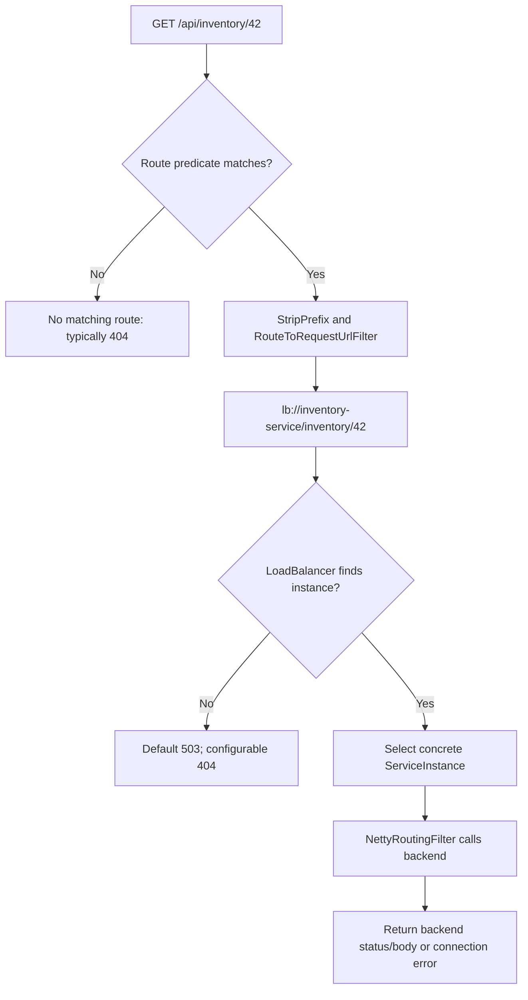
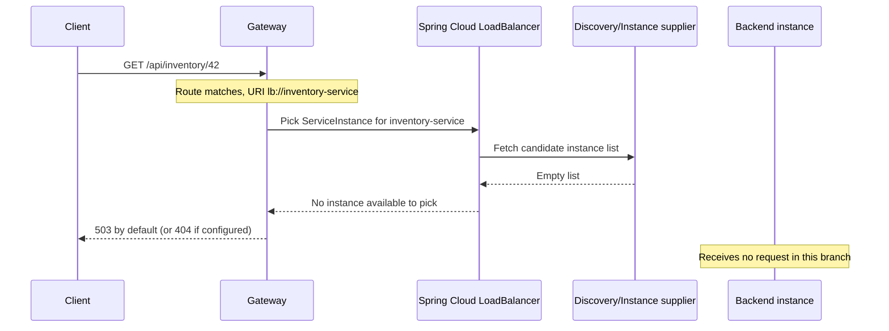
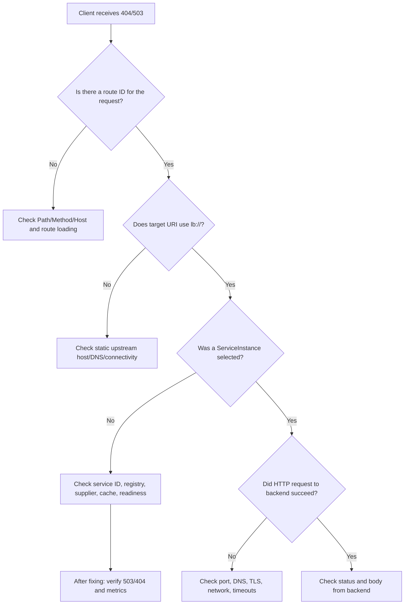

# Handling No Available Service Instances: Choosing 503 vs. 404 in Spring Cloud Gateway

In a microservices system, an API Gateway can select the **right route** and still **fail to send the request to a backend**. For instance, a client calls `GET /api/inventory/42`; both the `Path` and `Method` predicates match, the target URI is `lb://inventory-service`, yet the load balancer finds zero instances of `inventory-service`. This is a **no available service instance** situation, distinct from having no matching route or a backend receiving the request and returning an error.

In **Spring Cloud Gateway Server WebFlux**, when routing through `lb://`, Gateway uses Spring Cloud LoadBalancer to select a `ServiceInstance` from the list supplied by service discovery. If no instance is available to choose, the default behavior is typically **`503 Service Unavailable`**; in versions supporting the `use404` option, you can request **`404 Not Found`** instead.

This lesson belongs to the **Service Discovery and Load Balancing** chapter of module `SPRING_CLOUD_GATEWAY`. This topic helps define the exact responsibilities of route predicates, the filter chain, URI rewriting, service discovery, and load balancing; from there, you can coordinate authentication, rate limiting, circuit breakers, retries, TLS, and observability to operate the microservices entrypoint safely.

> **Scope:** Examples target **Spring Cloud Gateway Server WebFlux**. Starter structures and configuration namespaces vary across Spring Cloud Gateway/Spring Boot generations. Verify the documentation and configuration metadata for your exact version before copying a property. Addresses, service IDs, and response codes in simulated scenarios are for learning purposes only.

## 1. A Request May Match a Route Yet Have No Backend

Suppose a system has Gateway on `localhost:8080` and an Inventory Service expected to register under `inventory-service`. Route:

```yaml
spring:
  cloud:
    gateway:
      server:
        webflux:
          routes:
            - id: inventory-api
              uri: lb://inventory-service
              predicates:
                - Path=/api/inventory/**
                - Method=GET
              filters:
                - StripPrefix=1
```

Client calls:

```http
GET /api/inventory/42 HTTP/1.1
Host: localhost:8080
Accept: application/json
```

Under normal processing:

1. Gateway checks `Path=/api/inventory/**` and `Method=GET`: both match.
2. Route `inventory-api` is chosen; `StripPrefix=1` changes the path to `/inventory/42`.
3. `RouteToRequestUrlFilter` builds the logical URL, e.g., `lb://inventory-service/inventory/42`.
4. `ReactiveLoadBalancerClientFilter` asks Spring Cloud LoadBalancer for an instance of `inventory-service`.
5. If an instance exists, the URL is replaced with a concrete target like `http://10.0.0.21:8081/inventory/42`, and the routing filter sends the request.
6. **If the instance list has no candidates**, routing stops before calling upstream. Gateway produces an error response per the active policy, defaulting typically to `503`.



**Boundary of responsibility:** the `Path` predicate selects the route; `RouteToRequestUrlFilter` prepares the logical URL; Spring Cloud LoadBalancer chooses the instance; the routing filter makes the HTTP connection. A failure at step 4 does not mean the predicate or `StripPrefix` was wrong.

## 2. Three Kinds of 404/503 That Look Alike but Have Different Causes

When seeing an HTTP status code, you cannot determine the cause for certain from the number alone. Combine route info, instance info, and the point where the error occurred.

| Scenario | Did route match? | Was backend called? | Typical outcome |
| --- | --- | --- | --- |
| Request `GET /unknown`, no route matches. | No | No | `404 Not Found` from Gateway/WebFlux. |
| Route `lb://inventory-service` matches, but LoadBalancer has no instance to select. | Yes | No | **`503 Service Unavailable`** by standard default, or **`404`** if `use404` config is active. |
| Route matches, instance selected; backend returns `404` because resource does not exist. | Yes | Yes | `404` from backend, relayed by Gateway unless handled otherwise. |
| Route matches, instance selected; backend intentionally returns `503` due to overload. | Yes | Yes | `503` from backend. |
| Route matches, instance selected, but backend port refuses connection. | Yes | Attempted connection, may not have sent a complete HTTP request | Network error, often leading to 5xx depending on config and exception handling; not missing instance. |
| Route matches, but load balancer integration is missing or misconfigured. | Yes | Not guaranteed | Config/startup/routing error depending on version; not the same as a valid empty list. |

For example, two responses both returning `404` still mean different things:

- `404` from **route matching**: Gateway has no route matching the request.
- `404` from **load balancer using `use404`**: Gateway matched a route, but found no instance.
- `404` from **backend**: the destination is reachable at the network layer and processed HTTP, but the endpoint or resource does not exist per the backend contract.

An identical error page or JSON body does not prove the same error source. Observing route IDs, trace IDs, and upstream requests helps classify it.

### 2.1. HTTP status is an outcome, not a complete diagnosis

When clients see `503`, do not immediately increase timeouts or turn on retries. If LoadBalancer **has zero instances**, an immediate retry will usually fail again; check service registration, health, and the discovery source.

When clients see `404`, do not immediately rewrite `Path` either. First determine whether a route matched and whether the 404 came from Gateway, LoadBalancer, or the backend.

## 3. How Do `lb://`, DiscoveryClient, and LoadBalancer Coordinate?

The URI `lb://inventory-service` carries a **logical service name**, not a DNS host that an HTTP client can connect to directly. In Spring Cloud Gateway Server WebFlux:

- `Route` defines `uri=lb://inventory-service` alongside predicates and filters.
- `RouteToRequestUrlFilter` combines the route URI with the current path/query, storing it in internal attribute `GATEWAY_REQUEST_URL_ATTR`.
- `ReactiveLoadBalancerClientFilter` recognizes the `lb` scheme (or matching scheme prefix) and uses `ReactorLoadBalancer`/Spring Cloud LoadBalancer to request an instance.
- `ServiceInstanceListSupplier`, `DiscoveryClient`, or `ReactiveDiscoveryClient` supplies instance metadata depending on configuration.
- Once an instance is picked, the load-balancer filter replaces the logical URI with the instance URI so the routing filter can proceed.



Service names must be **registered and queried consistently**. Simply declaring `uri: lb://inventory-service` does not create instances, start backends, or replace a registry.

### 3.1. What is an Instance?

A `ServiceInstance` typically describes a concrete target including service ID, host, port, secure flag, and required metadata. One service ID can have multiple instances, e.g.:

| Service ID | Instance | Illustrative URI | Status in discovery source |
| --- | --- | --- | --- |
| `inventory-service` | A | `http://10.0.0.21:8081` | Eligible for selection |
| `inventory-service` | B | `http://10.0.0.22:8081` | Eligible for selection |
| `inventory-service` | C | `http://10.0.0.23:8081` | No longer in valid list |

If after lookup/filtering none of A/B/C are available, LoadBalancer has no concrete URL to build. That **differs** from instance A being in the list while A is dead: the latter causes connection refused or timeouts after selection.

### 3.2. Where can the instance source come from?

Depending on the project, the list can come from:

- A registry such as Eureka or a compatible discovery mechanism, when starter and client are configured.
- Kubernetes Service discovery or an appropriate Spring Cloud Kubernetes integration.
- `SimpleDiscoveryClient` with a statically configured instance list for test environments.
- A custom `ServiceInstanceListSupplier`, optionally with health checks, zone rules, or caching.

Do not assume two Spring Boot apps automatically discover each other. You must have a matching **instance list provider and Spring Cloud LoadBalancer**.

## 4. Why Does Gateway Return 503 When No Instance Exists?

`503 Service Unavailable` indicates the component serving the request is currently **unable to handle it**, often temporarily. When a route matches yet the backend has no instances, this signal is usually semantically clearer than `404`:

- The public URL and Gateway route still **exist**.
- The issue is missing **serving capacity** behind the route at instance-selection time.
- Clients and observability tools can treat this as an availability outage rather than a permanently deleted resource.
- Retry/circuit breaker policies can consider this failure when appropriate, bounded and mindful of discovery state.

Typical response example:

```http
HTTP/1.1 503 Service Unavailable
Content-Type: application/json
```

**Response body, headers, and error encoding are not fixed** merely by enabling Spring Cloud Gateway. They depend on version, error handlers, Spring Boot, and filters/adapters. Do not rely on a default JSON message as a long-term API contract.

When a maintenance window is known, you may consider including `Retry-After` on 503 responses at the appropriate error-handling layer. However, Gateway **cannot know on its own** when an instance will return just because the list is currently empty; never fabricate an ungrounded recovery timestamp.

## 5. When Should You Use 404 Instead of 503?

Some teams choose `404 Not Found` when a service ID has no instances to hide whether a service exists or to stay compatible with legacy API contracts. Spring Cloud Gateway provides the `use404` configuration option in supported versions.

This is a **semantic and operational** choice, not a fix for discovery failures.

| Consideration | Return 503 when out of instances | Return 404 when out of instances |
| --- | --- | --- |
| Interpretation for client | Service temporarily unavailable. | Resource not found (can be misleading). |
| Fit for dynamically deployed backends | Usually clearer. | Can fit if the API contract intentionally represents an absent service as a nonexistent resource. |
| Availability monitoring | Easy to spot 5xx incidents. | Risks drowning in 404s from bad URLs or missing resources. |
| Client automatic retries | Some clients treat 503 as transient; backoff still needed. | Many clients treat 404 as non-retryable. |
| Intermediate caches | Must check cache policy. | 404s can be cached per HTTP rules if cacheable; risk of serving stale negatives after recovery. |
| Security / system disclosure | Does not necessarily leak service names if error responses are well designed. | Does not replace authentication, authorization, or resource-hiding policies. |

**General design recommendation:** Keep `503` for an existing route temporarily missing upstreams. Switch to `404` only when the API contract, caching strategy, observability, and client handling are explicitly aligned.

### 5.1. Example of the `use404` property

In many Spring Cloud Gateway Server WebFlux versions using the legacy configuration namespace, documentation describes:

```yaml
spring:
  cloud:
    gateway:
      loadbalancer:
        use404: true
```

This property key was **used in earlier WebFlux lines**. Newer releases may reorganize the Gateway Server WebFlux namespace: **check configuration metadata for your exact running version** to find the full name of `use404` and confirm the property binds. Do not place both old and new namespaces arbitrarily and assume that proves configuration is valid.

When active, the **no-instance-found** branch can return `404` instead of `503`. It **does not** alter route predicate logic, create instances, or turn a backend 503 into a 404.

### 5.2. What `use404` does NOT do

- Does not make requests with the wrong `Path` or `Method` start matching a route.
- Does not find or start a missing backend.
- Does not change a `404` returned by a backend into another code.
- Does not cure connection-refused errors after an instance has been selected.
- Does not automatically update API error bodies, cache headers, or retry policies outside supported configuration scope.
- Does not turn every Gateway error into 404; its scope is strictly failed instance lookup in the supported load-balancing flow.

Therefore, when an `lb://` route fails, verify **whether execution reached instance selection** before toggling `use404`.

## 6. Minimal Route and Dependency Configuration for `lb://`

With Spring Cloud Gateway Server WebFlux, match **Spring Boot/Spring Cloud versions** and use the right Gateway starter. Some generations use `spring-cloud-starter-gateway`; newer generations separate the Server WebFlux starter.

To use `lb://` URIs, a project normally needs:

- Spring Cloud Gateway **Server WebFlux** matching your version.
- **Spring Cloud LoadBalancer** (typically via `spring-cloud-starter-loadbalancer` or an equivalent dependency).
- An instance source, such as a discovery client/registry, or `SimpleDiscoveryClient` in labs.
- A backend with real endpoints reachable from Gateway.

Illustrative route configuration:

```yaml
spring:
  cloud:
    gateway:
      server:
        webflux:
          routes:
            - id: inventory-api
              uri: lb://inventory-service
              predicates:
                - Path=/api/inventory/**
                - Method=GET
              filters:
                - StripPrefix=1
```

For `GET /api/inventory/42`:

- If an `inventory-service` instance exists and is callable, routing proceeds to `/inventory/42`.
- If LoadBalancer's list is empty, the response is produced **before HTTP routing**, typically 503.
- If essential dependencies/config are missing, another error may appear; do not label every startup/routing error as a no-instance 503.

### 6.1. Local testing with SimpleDiscoveryClient

If you do not want to run a registry for hands-on practice, you can use Spring Cloud Commons' preconfigured instance source. Example config for a learning environment:

```yaml
spring:
  cloud:
    discovery:
      client:
        simple:
          instances:
            inventory-service:
              - uri: http://localhost:8081
```

This defines one instance at `localhost:8081`, assuming **`SimpleDiscoveryClient` is the active source** and visible to LoadBalancer. It does not apply if another discovery client is enabled and supplies a different list. Never use `localhost` when Gateway runs in a separate container or host, because `localhost` points to Gateway's own environment.

To test the no-instance branch, in a test profile **omit instances for `inventory-service`** and ensure no other discovery source supplies that service ID. Never run this test on a production system.

> Note: Changing the instance list or discovery config may require a restart or waiting for caches and refresh cycles to expire. Outcomes do not necessarily change the instant you edit YAML.

## 7. Testing Workflow With and Without Instances

Assumed setup:

- Gateway listening at `http://localhost:8080`.
- Route `inventory-api` accepts `GET /api/inventory/**`.
- Sample backend exposes `GET /inventory/{id}`.
- No fallback `/**` route shadows the test scenario.

### 7.1. Step 1: verify the request matches the route

```bash
curl -i "http://localhost:8080/api/inventory/42"
```

Confirm Gateway selected `inventory-api` via the route ID in configured logs/tracing rather than inferring from the status code. If no route matches, whether LoadBalancer has instances is **irrelevant** to that response.

### 7.2. Step 2: simulate zero instances

In a test profile, remove the instance source for `inventory-service` (or use a mismatched service ID in a controlled test setup). After discovery/load balancer state updates, call:

```bash
curl -sS -o /dev/null -w "HTTP %{http_code}\n" \
  "http://localhost:8080/api/inventory/42"
```

With the route matched, LoadBalancer properly integrated, and standard defaults, you expect to see:

```text
HTTP 503
```

Do not look at that single line alone; also inspect logs/traces and confirm **no upstream request** reached the backend on this branch.

### 7.3. Step 3: enable `use404` on a supported version

Enable the `use404` property for your version and verify it bound properly; then retest while **still having zero instances**:

```text
HTTP 404
```

When you see 404, record clearly in metrics/tests that this is **route matched but no instance**, not a `404` from route mapping or the backend. If behavior does not change, check property binding, starters, active profiles, and how requests actually traverse LoadBalancer; do not immediately assume the feature is broken.

### 7.4. Step 4: restore one instance

Start Inventory Service on `localhost:8081` and ensure discovery provides that instance. `GET /api/inventory/42` can now be forwarded to the backend. The returned status depends on data/handlers:

- Backend has resource `42`: may return `200`.
- Backend lacks resource `42`: may return `404`.
- Backend throws a business error: returns the corresponding backend status.

This branch proves that **having an instance to pick does not mean the backend always returns 200**.

### 7.5. Diagnostic test matrix

| Test | Condition | Expected observation |
| --- | --- | --- |
| A | `GET /api/unknown`, no route matches | 404 at route-selection layer. |
| B | `POST /api/inventory/42`, route requires GET and no other route matches | Typically 404 from no route match; not no-instance. |
| C | `GET /api/inventory/42`, LoadBalancer gets empty list | Common default 503. |
| D | Same as C, `use404` active | 404 from no-instance branch. |
| E | Instance exists, backend returns `GET /inventory/999` = 404 | 404 from backend. |
| F | Instance exists, backend returns 503 | 503 from backend. |
| G | Instance points to non-listening port | Connection error/5xx per error handling, distinct from no-instance. |
| H | Instance exists, backend responds slowly | Timeout/latency error per config; not an empty list. |

**Testing rule:** Change only one variable per test. If you alter the route, service ID, and retry settings simultaneously, a 503/404 result becomes hard to interpret.

## 8. Real Root Causes of an Empty Instance List

"No instance" is a **symptom at Gateway**, not a single root cause.

| Cause category | Example | How to check |
| --- | --- | --- |
| Wrong **service ID** | Route uses `lb://inventory-service` while registry has `inventory-api`. | Compare registered name with the service ID requested by LoadBalancer. |
| Not yet registered | Backend just started and hasn't finished registering. | Check startup logs, registry, and registration timing. |
| Instance deregistered | Backend stopped or failed health checks. | Check health/readiness, rollout history, and current instance list. |
| Registry/discovery unreachable | Gateway cannot contact registry. | Check DNS, network, credentials, TLS, discovery client status, and caches. |
| Instance filter removes all candidates | `ServiceInstanceListSupplier` zone/metadata/health rules leave zero valid instances. | Compare raw list vs. list after each filtering step. |
| Stale discovery cache | Gateway holds an old snapshot or awaits refresh cycle. | Check TTL/cache and refresh timestamps; avoid infinite forced refreshes. |
| Wrong environment profile/namespace | Staging Gateway queries a different service set. | Check active profiles, namespaces, clusters, and service registrations. |
| No real instance source | Added `lb://` without LoadBalancer/discovery. | Check classpath, starters, and source config. |
| Registry access policies | Account or service account lacks read permission. | Check permissions and discovery client logs, without logging secrets. |

### 8.1. When the service is running yet Gateway says no instances

Never run `curl` directly against the backend and conclude Gateway must see it. A backend can return 200 at a direct address while not yet **registered under the exact service ID Gateway is querying**.

Distinguish two checks:

- **Reachable at direct address:** `http://host:port/actuator/health` responds from a specific location.
- **Selectable by discovery/LoadBalancer:** the `ServiceInstance` list for `inventory-service` contains a valid instance at call time.

These two conditions are related but not identical.

### 8.2. Health checks and readiness

In orchestrated environments, a newly started instance may not yet be ready for traffic. Excluding a **not-ready** instance from the list can be correct even while the container/process is running.

The operational goal is not "always have at least one address in the registry," but "have at least one **genuinely ready** instance serving." Forcing an unready instance into the list just to avoid 503 turns fast failures into timeouts or incorrect business responses.

### 8.3. Caching and eventual consistency

Registries and suppliers may use caching, polling, or watch events. Right after scale-up/scale-down, Gateway's view can lag behind actual backend state.

When debugging, record **timestamps** for deploy, startup, readiness, registration, and failed requests. Do not immediately blame route predicates for errors during the first few seconds of a rollout; if they persist, investigate refresh intervals and health/discovery policies.

## 9. Layer-by-Layer Diagnostic Workflow

When `GET /api/inventory/42` returns 503 or 404, walk the checklist in order:



Concrete steps:

1. **Did a route match?** Inspect route ID, predicates, and client URL; do not tune LoadBalancer if no route matched.
2. **What is the route's URI?** `lb://inventory-service` or `http://host`; each branch handles errors differently.
3. **What is `GATEWAY_REQUEST_URL_ATTR` when building the URL?** For `lb://`, the service name can still appear as the logical target before load balancing.
4. **How many instances are supplier/discovery providing?** Distinguish 0 instances from 1 unreachable instance.
5. **Are instance filters active?** Health, zone, weight, metadata, and caching can shrink the list seen by LoadBalancer.
6. **After instance selection, what is the target URL?** Check scheme, host, port, path after `StripPrefix`/`SetPath`, and TLS state.
7. **Where did the response originate?** Confirm whether the backend received the request, what original HTTP status it returned, and whether any fallback/error handler altered it.
8. **Are client policies aligned?** 503/404 affect retries, caching, and UX; test the caller side after fixes.

Never assume a log line showing `lb://inventory-service` means Gateway already connected to an instance. That may simply be the URL **before** load balancing.

## 10. Observing No-Instance Errors via Logs, Metrics, and Traces

A no-instance incident needs enough observability to answer three questions: **which route**, **which service ID**, and **why no instance was selected**. Also capture timestamps, frequency, and client impact.

### 10.1. Controlled logging

Useful fields:

- Route ID, HTTP method, status code, and latency;
- Logical service ID (e.g., `inventory-service`) if permitted in logs;
- Trusted correlation ID / trace ID;
- Valid instance count at an appropriate level and refresh timestamps;
- Error category: no instance, connection refused, timeout, TLS failure, or backend 503.

Never log access tokens, session cookies, personal data in paths/queries, or registry secrets. Prefer structured logs and enable `DEBUG` only during active investigation.

### 10.2. Metrics

Spring Cloud Gateway integrates observability/metrics through Micrometer and Actuator when matching dependencies and config are present. HTTP/Gateway metrics can usually be broken down by **route ID, status, method, and outcome**; exact tags depend on version and enabled components.

A dashboard should separate:

- Gateway 5xx rates by route.
- `404` rate from unmatched routes vs. `404` from other sources when categorized.
- Valid instance count per service ID, if exposed by discovery/LoadBalancer monitoring.
- Connection errors and timeouts after instance selection.
- Request latency and fallback rates.

If `use404` converts no-instance from 503 to 404, **5xx error metrics may drop while real availability has not improved**. Track no-instance failures via an independent signal; never treat "fewer 503s" as proof of recovery.

### 10.3. Sample GlobalFilter to observe request lifecycle

A `GlobalFilter` can log duration and status **after route matching** without blocking the response:

```java
import java.util.concurrent.TimeUnit;

import org.slf4j.Logger;
import org.slf4j.LoggerFactory;
import org.springframework.cloud.gateway.filter.GatewayFilterChain;
import org.springframework.cloud.gateway.filter.GlobalFilter;
import org.springframework.cloud.gateway.route.Route;
import org.springframework.cloud.gateway.support.ServerWebExchangeUtils;
import org.springframework.core.Ordered;
import org.springframework.stereotype.Component;
import org.springframework.web.server.ServerWebExchange;
import reactor.core.publisher.Mono;

@Component
public class RouteOutcomeFilter implements GlobalFilter, Ordered {

    private static final Logger log =
        LoggerFactory.getLogger(RouteOutcomeFilter.class);

    @Override
    public int getOrder() {
        return -100;
    }

    @Override
    public Mono<Void> filter(ServerWebExchange exchange,
                             GatewayFilterChain chain) {
        Route route = exchange.getAttribute(
            ServerWebExchangeUtils.GATEWAY_ROUTE_ATTR
        );
        String routeId = route == null ? "unknown" : route.getId();
        long started = System.nanoTime();

        return chain.filter(exchange)
            .doOnError(error -> log.warn(
                "routeId={} errorType={}",
                routeId, error.getClass().getSimpleName()
            ))
            .doFinally(signal -> log.info(
                "routeId={} status={} elapsedMs={} signal={}",
                routeId,
                exchange.getResponse().getStatusCode(),
                TimeUnit.NANOSECONDS.toMillis(
                    System.nanoTime() - started
                ),
                signal
            ));
    }
}
```

This example primarily illustrates **observability**. `doFinally` runs when the publisher completes/errors/cancels; it does not guarantee accurate no-instance classification from `status` alone, and it may fire before a response appears the way you expect. It does not add error headers after commit or heal backends. Requests rejected **before route matching** also never reach this `GlobalFilter`.

In production, favor Micrometer Observation/Tracing and standardized logging. To count **no available service instance** accurately, instrument at the load-balancer/discovery layer or use verified error classification; never infer solely from every `503`.

## 11. What to Do When No Instance Exists: Fallbacks, Circuit Breakers, and Retries

### 11.1. Never try to "fix" an empty list with infinite retries

If the instance list is currently empty, immediately resending the same request only increases load on Gateway and discovery. Some retry mechanisms act only on specific exceptions, status codes, or filter orders; **do not assume** a `Retry` filter always catches and retries every case where `ReactiveLoadBalancerClientFilter` finds no instance.

When there is solid reason to treat the outage as transient and retrying is safe:

- Retry only a small number of times, with backoff/jitter and an overall request time budget.
- Respect HTTP methods; avoid auto-retrying side-effecting operations without idempotency keys.
- Verify which exact exceptions/statuses trigger retry in your version and filter order.
- Keep timeouts and retry budgets aligned across client, Gateway, LoadBalancer, and backend.

For `POST /payments`, a backend may have processed payment before the network dropped; retrying without idempotency risks duplicate charges. **No instance** and **timeout after selecting an instance** do not carry the same retry risks.

### 11.2. Circuit breakers and fallbacks must match the API contract

Gateway can use a `CircuitBreaker` filter with Resilience4j/a matching extension to protect a route. Illustrative filter config on a route:

```yaml
filters:
  - StripPrefix=1
  - name: CircuitBreaker
    args:
      name: inventoryCircuit
      fallbackUri: forward:/fallback/inventory
```

This YAML snippet is **only part of a route**; `forward:/fallback/inventory` must correspond to a fallback handler **actually implemented in the Gateway app**. Factory/API names and dependencies must match your version. Without a fallback handler, this config will not synthesize a valid response.

Verify via tests that the circuit breaker filter intercepts the exact **no-instance failure mode** expected within the combined filter chain. Never assume a circuit breaker turns every `503` into a fallback; activation depends on filter ordering, error/status policies, and configuration.

A well-designed fallback should return:

- An appropriate HTTP status (`503` may still be right when unable to serve).
- A contract-compliant body that never leaks internal hosts/ports/stack traces to clients.
- A trace/correlation ID if safe and standardized.
- Substitute data only when **business rules allow**, such as a read-only catalog cache; never fake a "payment succeeded" response when the transaction backend is down.

### 11.3. Rate limiting and load shedding

`RequestRateLimiter` can curb requests hitting backends during overload. However, rate limiting **does not create instances** or repair a broken registry. During recovery, sensible rate limits can shield newly ready instances from sudden traffic spikes.

If all instances are unavailable, the system can fail **fast and predictably** instead of holding requests open uselessly. Still, weigh response semantics, client retry behavior, and operational observability.

## 12. Does Returning 404 Make the System More Secure?

Do not use `use404` as a security control in place of authentication/authorization. A 404 response can be used to **avoid disclosing resource existence** under certain security contracts, but swapping `503` for `404` in LoadBalancer does not check users, roles, or access rights.

Notable risks:

- **Masking outages:** dashboards tracking only 5xx may miss a complete upstream instance loss.
- **Negative caching:** some clients, proxies, or caches may store 404s; after recovery, clients keep seeing cached errors.
- **Violating API contracts:** clients receive 404 and conclude the resource does not exist instead of handling temporary unavailability.
- **Inconsistent retry behavior:** clients generally do not retry 404s, whereas 503s may trigger contract backoff.

If product conventions require 404, define clear cache policies (e.g., appropriate `Cache-Control` headers for this error type), separate no-instance observability outside HTTP status codes, and document how clients distinguish responses if needed. Adding custom headers/bodies must happen in the proper error handler before the response commits.

Another security rule: **never let clients dictate `lb://service-id` arbitrarily** via headers or query parameters. Target URLs and service IDs must come from trusted routes/policies; otherwise Gateway can be abused to reach unauthorized services. TLS/mTLS and backend authorization still require separate configuration.

## 13. Impact of HTTPS and Discovery on Instance Selection

With `lb://inventory-service`, once LoadBalancer picks a `ServiceInstance`, the final upstream scheme can depend on the instance's `secure` flag and intentional URI/prefix config. If an instance is listed yet HTTPS fails due to certificates, hostnames, or trust stores, that is a **post-selection TLS failure**, not "no instance."

Distinguish:

| Failure | Stage | Signals to inspect |
| --- | --- | --- |
| No `ServiceInstance` | When LoadBalancer chooses target | Valid list is empty; 503 or 404 per `use404`. |
| Host fails to resolve | Connecting to selected instance | DNS and instance hostname. |
| Connection refused | TCP connect | Port, process, firewall, service binding. |
| TLS handshake / certificate error | Establishing HTTPS upstream | Certificates, SAN/hostname, CA/trust store, mTLS requirements. |
| Upstream sends HTTP 503 | Backend processed request and returned status | Backend logs/metrics, overload/maintenance status. |

Never turn on TLS verification bypass just to "quick-fix" `lb://` errors. Instead, fix instance list quality and align certificate/hostname config with your trust model.

## 14. Example Multi-Instance Rollout Scenario

Inventory Service has three instances: `A`, `B`, and `C`. Operations deploys a new version via rolling update:

1. `A` temporarily leaves the ready list to upgrade.
2. `B` and `C` keep serving, so LoadBalancer still has candidates: requests do not return 503 for missing instances.
3. A misconfigured readiness probe knocks both `B` and `C` out simultaneously.
4. Gateway still matches route `inventory-api` yet has zero instances: no-instance errors occur.
5. After fixing readiness/registry, an instance rejoins the list and Gateway resumes routing.

Lessons from this scenario:

- Number of running processes **does not equal** number of ready instances selectable by LoadBalancer.
- Readiness probes, registration, and refresh cycles must be tested during deploys.
- Alerts should track **ready/valid instance counts**, 503/no-instance rates, and per-route error rates.
- If using `use404`, set up dedicated no-instance alerts so outages aren't missed when 5xx counts drop.

Use rolling updates with `maxUnavailable`, traffic draining, and readiness designed for your orchestrator. Never crank up retries to compensate for deployments that drain the entire instance list.

## 15. Common Issues and Fixes Table

| Symptom | Likely cause | First check |
| --- | --- | --- |
| `GET /api/inventory/42` returns 404, no route ID | Predicate mismatch or route not loaded. | Check config namespace, route ID, Path, and Method. |
| Route matches, returns default 503, no backend request | No instances for service ID. | Check LoadBalancer, supplier, discovery, and registration. |
| `use404` enabled yet still returns 503 | Wrong property namespace, unbound, wrong profile, or error outside no-instance branch. | Check version property name and real error cause. |
| Instance exists in registry, yet Gateway sees 0 | Cache, health/zone filter, or Gateway uses a different discovery source. | Compare raw list against what LoadBalancer actually sees. |
| Gateway sees 1 instance yet still returns 5xx | Backend down, wrong port, timeout, or TLS error. | Test connectivity from Gateway's environment and check backend logs/health. |
| Backend returns 404 for resource `999` | Resource does not exist in business domain. | Check endpoint/backend response; do not touch `use404`. |
| Retries spike errors when service is totally gone | Retries firing too fast while supplier remains empty. | Reduce retries, add backoff/budget; fix discovery source. |
| Gateway serves 404 long after service recovered | Client/proxy cached 404 response or discovery cache is stale. | Check HTTP caches and instance caches separately. |
| Requests fail for a few seconds after scale-up | Registration/refresh not yet complete. | Compare timestamps for readiness, registry, and TTL/cache. |
| Errors only in one zone/namespace | Misconfigured instance filter or inconsistent environment config. | Check zone metadata, namespace, service ID, and registry permissions. |
| Many 503s with unknown origin | Backend returning 503 vs. LoadBalancer having no instances. | Inspect route ID, upstream spans/logs, and error origin. |
| Replacing `lb://` with an IP address works | Service is directly reachable, but discovery/LoadBalancer is misconfigured. | Fix service registration; never treat hardcoded IPs as a permanent fix. |

## 16. Practice Exercises with Answers

### Exercise 1 — Classify the source of 404

Gateway has route `Path=/api/inventory/**` with URI `lb://inventory-service`. Request `GET /unknown` returns 404. Can you conclude `inventory-service` has no instances?

**Answer:** No. `/unknown` does not match the route in this example, so the response comes from the route-matching layer. There is no basis to say LoadBalancer was ever invoked.

### Exercise 2 — Classify the source of 503

Request `GET /api/inventory/42` matches the route. Logs show `ReactiveLoadBalancerClientFilter` failed to select a `ServiceInstance`, and the backend received no HTTP request. Should you check `StripPrefix=1` first?

**Answer:** Not as the top priority. `StripPrefix` transforms the path, whereas the failure occurred at instance lookup. Check service ID, supplier list, registry, readiness, and caches; verify the rewritten path once an instance is found.

### Exercise 3 — Choosing 503 vs. 404

A product API still has a valid route, but all backend instances are temporarily gone for 30 seconds during a rollout. Which status should be preferred if no special contract exists?

**Answer:** Usually **503** communicates temporary loss of serving capacity more clearly. If 404 is used, clients may think the resource doesn't exist and cache the error; it requires an explicit API contract rationale and separate observability.

### Exercise 4 — Why doesn't `use404` handle TCP errors?

Gateway selected instance `10.0.0.21:8081` yet hit connection refused. Does enabling `use404` convert this error into 404?

**Answer:** No. `use404` targets **failing to find an instance** in LoadBalancer; connection refused happens **after an instance was chosen**. Check process, port, network, and connection error policies.

### Exercise 5 — Is watching only 404 counts enough?

A dashboard tracks only 5xx error rates. Operations enables `use404`, sees 5xx drop sharply, and sees 404 rise. Can they declare availability restored?

**Answer:** No. That may just be re-labeling the same no-instance error with a different HTTP code. Track instance counts, successful upstream requests, latency, and errors broken down by source.

### Exercise 6 — Should retries be unlimited?

A read `GET` route has zero instances. Both clients and Gateway retry continuously without limits.

**Answer:** No. Retries saturate resources and discovery without creating instances. When retries are justified, use small counts, backoff/jitter, and time budgets; prioritize restoring the instance source.

### Exercise 7 — Service running yet still no-instance

Inventory Service returns 200 when called directly at `http://localhost:8081/health`, yet `lb://inventory-service` still returns 503.

**Answer:** Success on a direct URL does not prove the instance registered under `inventory-service` or was supplied to LoadBalancer. Check service ID, registration, discovery source, runtime environment, and health/metadata filters.

### Exercise 8 — Fallback for an order-creation API

Order Service loses all instances. A proposed fallback always returns `201 Created` so clients see "success" even though no order was created.

**Answer:** Unsafe. Returning `201` confirming resource creation when nothing was persisted breaks the contract and risks data loss. Fallbacks must reflect true state—typically returning a structured error or substitute data only when business rules allow.

## 17. API Gateway Operations Checklist for Missing Instances

- [ ] Clearly distinguish **no route**, **no instance**, **connection error**, **backend 404**, and **backend 503**.
- [ ] `lb://service-id` routes use the exact service ID and have Spring Cloud LoadBalancer integrated.
- [ ] Discovery/registry or `ServiceInstanceListSupplier` actually supplies the instance list Gateway needs.
- [ ] Readiness/health, zone/metadata, caching, and refresh cycles do not accidentally filter out all candidates.
- [ ] Default 503 behavior or `use404` option is verified for your exact **version and namespace**.
- [ ] Using 404 on no-instance has an explicit API contract, cache policy, and dedicated alerts.
- [ ] Metrics/traces distinguish 5xx from no-instance vs. 5xx from backend/transport.
- [ ] Retries use backoff/jitter, budgets, and apply only to safe/idempotent requests.
- [ ] Circuit breakers/fallbacks are tested on the **exact failure branch** and return truthful data.
- [ ] Timeouts and rate limiting protect Gateway when backends degrade.
- [ ] Scale-up/rollout traffic limits prevent overwhelming newly ready instances.
- [ ] Instance connections use the right scheme, DNS, port, TLS/mTLS, and trust store.
- [ ] No internal hostnames, tokens, or sensitive data leak in responses or logs.
- [ ] Clients handle 503/404 cleanly without retry loops or improper error caching.
- [ ] Tested zero instances, one instance, backend 404/503, and post-selection network errors.
- [ ] Incident runbooks prioritize finding **why instances disappeared** rather than merely swapping HTTP codes.

## 18. Summary

In **Spring Cloud Gateway Server WebFlux**, when an `lb://...` route matches yet Spring Cloud LoadBalancer **finds no available service instance**, Gateway typically returns **`503 Service Unavailable`**. Some versions support configuring `use404` to return **`404 Not Found`** in that exact situation. The two statuses communicate different semantics to clients, caches, and observability tools, yet **do not change the underlying cause** of having no instances.

To handle this properly, trace the chain **route matching → logical URL → discovery/supplier → instance selection → upstream connection → response**. Distinguish no-instance from backend 404/503 and TCP/TLS/timeout failures; enable retries/circuit breakers/fallbacks only under safe contracts, while monitoring instance counts, readiness, and client behavior.

When responsibility boundaries among predicates, the filter chain, service discovery, load balancing, and HTTP routing are clear, `SPRING_CLOUD_GATEWAY` can report errors consistently, limit blast radius when microservices become unavailable, and recover safely without hiding outages behind an HTTP status code.
