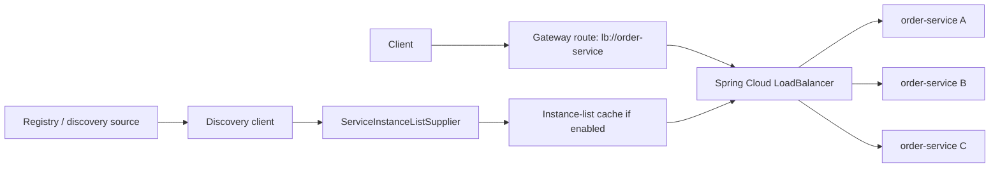
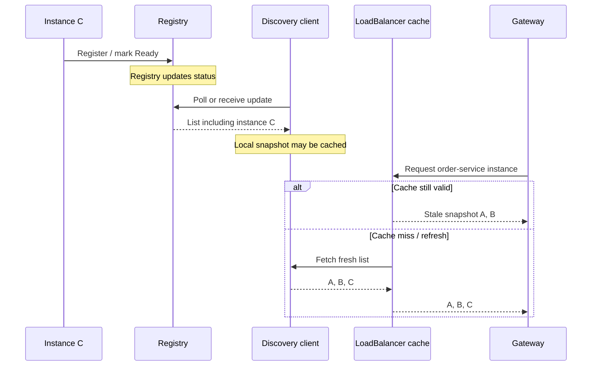
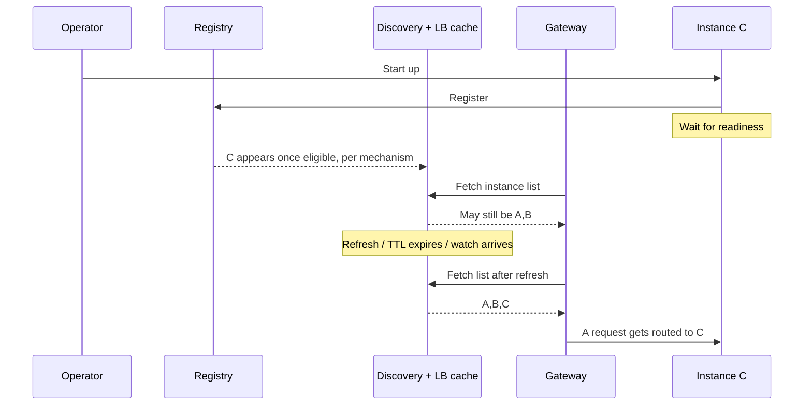

# Interactions Between Service Discovery, Caching, and Instance List Changes

In a microservices system, a service is no longer permanently tied to one `IP:port` address. `order-service` might run three instances normally, scale out to eight instances under heavy load, and then scale back down to two instances. A pod can flip from ready to not-ready, a node can lose connectivity, or a new version can roll out incrementally. **Spring Cloud Gateway** must keep routing requests to suitable instances while infrastructure metadata is continuously changing.

The challenge is not merely "fetching an instance list from the registry." That list can be **cached across multiple layers**, filtered by health/zone, mutate over time, and converge asynchronously across different Gateways. Without understanding these layers, it is easy to misdiagnose a failing route, blame `lb://` config, or assume the system automatically evicts failing instances the moment one request fails.

This lesson belongs to the **Service Discovery and Load Balancing** chapter, focusing on the **interaction between service discovery, caching, and the instance list lifecycle**. These concepts apply in an API Gateway architecture alongside route predicates, filter chains, service discovery, rate limiting, retries, circuit breakers, TLS, and request observability.

> **Scope:** Examples use **Spring Cloud Gateway Server WebFlux** with **Spring Cloud LoadBalancer**. Behavior and certain property prefixes vary by version/starter. TTL values, refresh intervals, and health policies shown below are **design examples**, not fixed defaults across all versions.

## 1. Three Concepts That Must Be Kept Separate

**Service discovery** answers *"Which endpoints currently exist for the service named `order-service`?"*. **Load balancing** answers *"Among known and eligible endpoints, which one should handle this request?"*. **Caching** answers *"How long is a fetched list kept, when is it re-read, and which layer is serving the data?"*.

| Component | What it manages | Example | Not primarily responsible for |
| --- | --- | --- | --- |
| Service registry / control plane | Instance registrations and state | `orders-A:8081`, `orders-B:8082` | Picking the final instance per HTTP request |
| Discovery client | Queries/watches data from discovery source | `DiscoveryClient` / `ReactiveDiscoveryClient` | HTTP auth or rewriting URI paths |
| Spring Cloud LoadBalancer | Supplies, filters, and picks `ServiceInstance` for a service ID | `lb://order-service` → `orders-A:8081` | Evaluating route `Path` predicates |
| Instance list cache | Snapshot of instances per service ID, if configured | Holds list for a TTL window | Guaranteeing the snapshot reflects real-time instant state |
| Spring Cloud Gateway route | Predicates, filters, logical target | `Path=/api/orders/**`, `uri=lb://order-service` | Keeping backend addresses continuously updated |
| HTTP connection pool | Open/reused network connections upstream | TCP/TLS connection to instance A | Providing the list of live instances |

**Never equate a route with an instance.** A single route can keep a stable logical URI `lb://order-service` for months while the backing instance count changes every minute.



The diagram shows the dependency flow; in real deployments, cache placement and suppliers depend on how Spring Cloud LoadBalancer is configured. **There is no single "universal cache" across all systems.**

## 2. How Does `lb://` Connect Gateway to LoadBalancer?

A simple Gateway route:

```yaml
spring:
  cloud:
    gateway:
      routes:
        - id: orders
          uri: lb://order-service
          predicates:
            - Path=/api/orders/**
          filters:
            - StripPrefix=1
```

For example, `GET /api/orders/42` goes through these steps:

1. Spring Security/WebFlux runs entrypoint filters. If not blocked, Gateway evaluates routes.
2. `Path=/api/orders/**` matches the request and selects route `orders`.
3. `StripPrefix=1` rewrites the forwarded path to `/orders/42`.
4. The routing/load-balancer filter sees logical target `lb://order-service` and asks LoadBalancer to pick a `ServiceInstance` for `order-service`.
5. LoadBalancer fetches instances through the `ServiceInstanceListSupplier` chain, optionally passing through the discovery client, cache, and filters.
6. An instance is chosen; Gateway builds the concrete physical URI (appropriate scheme/host/port) and the HTTP client opens or reuses a valid upstream connection.
7. The response flows back to the client through the filter chain.

```text
Public URL:
    GET https://api.example.test/api/orders/42

Logical route:
    id=orders
    uri=lb://order-service
    StripPrefix=1

Instance list currently seen by LoadBalancer:
    order-service-A:8081
    order-service-B:8082

One possible selection:
    GET http://order-service-B:8082/orders/42
```

**Key distinction:** `lb://` is not an ordinary DNS hostname. `order-service` is a **service ID** used by LoadBalancer to obtain an instance list. Discovery/load-balancer components must be installed and configured properly; declaring `lb://` alone does not create a registry.

In Spring Cloud Gateway Server WebFlux, address resolution is normally handled by a reactive load-balancer filter (such as `ReactiveLoadBalancerClientFilter` in lines with that component). Class names and implementation details may vary across versions, yet the conceptual order remains **select route → fetch instances → pick endpoint → proxy**.

### When no instance is found

Separate two cases:

| Scenario | Meaning | Where to investigate |
| --- | --- | --- |
| No Gateway route matched | `RoutePredicateHandlerMapping` could not select a route | Predicates, route order, Security, route config |
| Route matched, but LoadBalancer has no instances | Service ID exists, yet candidate list is empty/unavailable | Registry, discovery client, supplier, cache, health, service name |

In many Gateway versions, having no instances yields **HTTP 503 Service Unavailable**; some versions/configs allow `404` instead. So never look at the HTTP status code alone and conclude "no route matched." Observe the **route ID**, service ID, instance count, and load-balancer errors.

## 3. Discovery Data Lifecycle: From Real Change to What Gateway Sees

Suppose a new instance `order-service-C` appears at time `t0`. It will not necessarily receive traffic from every Gateway immediately at `t0`.



The diagram shows **convergence lag (eventual consistency)**. When the first request can reach C depends on many variables:

- Whether the instance is actually **ready** for HTTP traffic.
- Whether the registry/control plane has updated its state.
- Whether the discovery client polls, watches, or receives pushes, and whether it holds a local snapshot.
- Whether `ServiceInstanceListSupplier` has read the fresh result.
- Whether Spring Cloud LoadBalancer's cache has expired its TTL or refreshed.
- Whether zone/health/sticky filters allow selecting C.
- Whether the load-balancing algorithm happens to pick C on the next few requests.

Therefore, **"the registry shows instance C" does not mean "the very next request goes to C."**

### There is no single universal TTL

Several data layers can coexist simultaneously:

| Layer | Data stored | Usually configured by | Impact when stale |
| --- | --- | --- | --- |
| Registry / control plane | Registrations, leases, readiness, or endpoints | Eureka, Consul, Kubernetes, etc. | Registry still lists departed instances or omits new ones |
| Discovery client local | Poll/watch results from registry | Client integration & service discovery config | Gateway sees an old snapshot even after registry changed |
| Spring Cloud LoadBalancer cache | `ServiceInstance` list per service ID | LoadBalancer cache/supplier config | Continues picking candidates from prior list |
| Gateway route cache | List of **route definitions/route objects**, not instance lists | Route locator / Gateway refresh | Added/removed routes have not taken effect yet |
| HTTP connection pool & DNS | Open connections, or resolved addresses | Reactor Netty, HTTP client, DNS resolver | Old connections can fail even after instance list updates |

**Effective TTL** is the combined result of multiple mechanisms; you cannot lower one cache property and promise every Gateway immediately sees new instances.

## 4. Service Registry, DiscoveryClient, and ServiceInstanceListSupplier

### A registry is a data source, not millisecond-accurate absolute truth

Popular ecosystems organize state differently:

- **Eureka:** clients/instances register, maintain leases/heartbeats, and replicate registry info; lease expiration or status changes take time to converge.
- **Consul:** service registration and health checks govern available services; propagation to clients depends on configuration.
- **Kubernetes:** Services/EndpointSlices and readiness reflect eligible endpoints per controllers/control plane; Spring Cloud Kubernetes or discovery integrations read them in their own way.
- **`SimpleDiscoveryClient`:** static instance list in configuration, suitable for dev/testing; not a dynamic registry with heartbeats.

Do not treat one technology's behavior as universal. For instance, an unready instance may be removed from Kubernetes endpoints once status updates, while Gateway still holds an old snapshot in its client/LoadBalancer cache for a short window.

### `ServiceInstanceListSupplier` is the list pipeline

Spring Cloud LoadBalancer uses `ServiceInstanceListSupplier` to provide a `ServiceInstance` list for a service ID. Depending on setup, a supplier can:

1. Fetch raw lists from `DiscoveryClient` or `ReactiveDiscoveryClient`.
2. Cache list snapshots.
3. Filter instances by zone, health, or metadata.
4. Apply request-aware selection mechanisms.

Components such as `DiscoveryClientServiceInstanceListSupplier`, `CachingServiceInstanceListSupplier`, and `HealthCheckServiceInstanceListSupplier` illustrate distinct responsibilities. **Wrapper order matters greatly**: placing caching before vs. after health filtering produces different candidate sets and refresh cadences. When customizing the supplier chain, follow the exact guide for your Spring Cloud LoadBalancer version rather than stacking caches arbitrarily.

**Do not confuse discovery health checks with per-request HTTP health probes.** Registries or suppliers refresh health periodically. A new request can still hit a freshly failed instance before state updates.

## 5. Cache Configuration: Balancing Freshness, Cost, and Stability

Spring Cloud LoadBalancer supports instance-list caching. Some versions support properties like:

```yaml
spring:
  cloud:
    loadbalancer:
      cache:
        enabled: true
        ttl: 30s
```

`30s` here is an **example value**, not a fixed recommendation or guarantee that "instance changes appear after exactly 30 seconds." Check valid property names/units and cache usage in your **exact Spring Cloud LoadBalancer version**. When using Caffeine, examine how its dependency and cache spec interact with your policy; do not mechanically add TTLs without understanding the supplier chain.

### Shorter vs. longer cache TTL?

| Choice | Benefit | Trade-off |
| --- | --- | --- |
| Short TTL | Reduces stale windows, absorbs scale-in faster | Increases discovery query frequency; can add control-plane load |
| Long TTL | Fewer registry/client reads, fewer sudden shifts | Keeps departed instances longer, adopts new instances slower |
| Disable LoadBalancer cache | Removes one staleness layer | DiscoveryClient/registry caches still exist; increases supplier queries |
| Cache + watch/push | Can update efficiently on events | Depends on invalidation mechanism and event-source reliability |

**No single TTL is optimal everywhere.** Systems with frequent pod scale-in, short requests, and a healthy registry have different needs from stable systems or remote control planes. Measure convergence lag, instance churn rate, error rates during rolling deploys, and registry load before deciding.

### Avoid accidental cache stacking

Some discovery clients **already maintain their own cache**. Wrapping them externally with `CachingServiceInstanceListSupplier` can cause two layers to hold stale snapshots:

```text
Registry:                 [A, B, C]   (latest)
DiscoveryClient local:    [A, B]      (not yet refreshed)
LoadBalancer cache:       [A, B]      (cache hit)
Gateway selects:          A or B
```

Even when LoadBalancer's cache expires, it may query a `DiscoveryClient` **that still hasn't received C**. Thus the fix is not always "reduce Gateway TTL."

In many integrations, Spring Cloud LoadBalancer recommends considering **not enabling extra caching** when the discovery client already caches effectively. Evaluate against actual mechanisms and version docs rather than disabling blindly in production.

## 6. Distinguishing Route Cache from Instance Cache

Spring Cloud Gateway caches route definitions depending on the route locator/configuration. Two cases:

**Case A — Static route definitions:**

```yaml
- id: orders
  uri: lb://order-service
  predicates:
    - Path=/api/orders/**
```

Route `orders` remains valid when the instance list shifts from `[A,B]` to `[B,C,D]`. **You do not need a new route per instance** as long as LoadBalancer's supplier can fetch the updated instance list.

**Case B — Routes generated by the discovery locator:**

Some systems use `DiscoveryClientRouteDefinitionLocator` to generate routes from discovered **service IDs**. When a **new service** appears or a service name is removed, the generated route set can change. Refreshing the route cache must be handled separately from updating the instance list of an existing service.

| Change | Primary object changing | What to check |
| --- | --- | --- |
| `order-service` adds instance D | Instance list for existing service ID | Discovery, LoadBalancer supplier/cache |
| `order-service` loses instance A | Instance list for existing service ID | Readiness, deregistration, cache, pool |
| Brand-new `invoice-service` added when using discovery locator | Set of discovery-generated routes | Discovery locator, route refresh/cache |
| Editing `Path`/`RewritePath` of route `orders` | Route definition/config | Config source and route refresh |
| Backend changes IP while keeping service ID | Address of an instance | Discovery/client/supplier and connection pool |

**A "refresh Gateway routes" command does not necessarily clear LoadBalancer's instance cache.** Conversely, invalidating the instance cache does not create new route definitions. Confusing the two is a common reason operators think they refreshed yet symptoms stay unchanged.

If Actuator Gateway endpoints are enabled (e.g., route listing or refresh in supported versions), lock down admin endpoints with authentication/authorization and internal-network restrictions—never expose them to clients.

## 7. Scaling Out (Scale-Out): Why Isn't the New Instance Getting Traffic Yet?

Suppose at `t0` LoadBalancer knows `[A,B]`. An operator scales instances to `[A,B,C]`.



Three main reasons C receives no requests yet:

1. **C is not Ready:** registry/endpoints have not advertised C as usable yet, or health filtering still excludes C.
2. **Stale cache:** some layer still holds `[A,B]` even though the registry already has C.
3. **Selection algorithm:** C is in the list, yet LoadBalancer simply hasn't picked C across the observed sample.

Never look only at registry counts; inspect **the list Gateway actually sees and the instance LoadBalancer picks**.

### Observable convergence latency

This can be measured empirically using three timestamps:

```text
t0 = instance C is marked Ready at the discovery source
t1 = DiscoveryClient / supplier at Gateway sees C
t2 = first time a real request is actually routed to C

t1 - t0: discovery/cache update lag
t2 - t1: time influenced by selection algorithm / traffic volume
```

Never take `t2 - t0` and blame caching entirely: under very low traffic, C may already be ready without having been picked yet. Use supplier metrics/instrumentation or controlled tests to separate the two.

## 8. Scaling In (Scale-In): Risks Greater Than Stale Caching

When removing instance A from a cluster, requests can still hit A for a period because:

- Registry has not yet updated status/deregistration.
- `DiscoveryClient` or LoadBalancer cache still holds a snapshot with A.
- An instance selection occurred just before A began shutting down.
- Clients have in-flight requests or open HTTP connections to A.
- Readiness/termination windows lack enough time for in-flight requests.

A sound scale-in sequence in principle:

1. **Stop advertising A as ready** or deregister A via platform mechanisms.
2. Allow time for consumers—including active caches—to converge using a measured, configured **drain** window.
3. Reject new requests while finishing in-flight requests within reasonable timeout bounds.
4. Close connections/resources and terminate the instance once drained or at the hard deadline.

```text
Bad:
    kill A immediately -> registry/client/cache still know A -> connect/timeout errors

Better:
    A NotReady -> registry updates -> clients converge
       -> drain in-flight -> shutdown A
```

**Deregistering alone never guarantees "zero errors."** Gateway may have selected A moments before the registry updated, or clients may cancel. For smooth rolling deploys, combine readiness, preStop/termination grace (on Kubernetes), connection draining, safe retries, circuit breakers, and metrics.

### Open HTTP connections are a separate issue from list caching

Even after a supplier drops A from the list, a request **already dispatched** to A does not automatically move to B. Connection pools/Reactor Netty may also keep idle connections to A. Connection max-idle/lifetime settings, connect/response timeouts, and graceful shutdown must match your environment.

Do not assume "clearing LoadBalancer cache" means "closing all TCP/TLS connections." The two layers are independent; if errors happen only on reused connections or TLS handshakes, inspect the HTTP client/connection pool beyond discovery.

## 9. When the Instance List Is Empty or Contains Only Failing Instances

Two very different forms exist:

- **Empty list:** the supplier knows zero instances, or filters removed all of them.
- **Non-empty list that is practically unavailable:** supplier has A/B, yet TCP connects fail, time out, or backends lost readiness before clients updated.

| Observation | Primary likelihood | Action |
| --- | --- | --- |
| Route ID present, service ID valid, candidate count = 0 | Discovery issue, service ID mismatch, health/zone filter, empty cache | Check registry and supplier |
| Candidates include A/B, yet connection refused | Dead instance or wrong host/port, stale cache | Check endpoints, TTL, readiness, lifecycle |
| Immediate HTTP 503, no upstream request seen | Likely no instances or rejected by a filter | Check exceptions, filters, and metrics |
| HTTP 504 after long delay | Upstream timeout or timeout policy | Check connect/response timeouts and backend |
| Only some requests fail during rolling deploy | Readiness/cache/connection-drain transition | Measure by selected instance and deploy timestamps |
| Instances exist, yet one region loses traffic | Zone preference/filter policy | Check zone metadata and fallback policies |

**Never return a fake `200` response just because LoadBalancer found no instances.** The API contract should reflect service unavailability or provide a genuinely business-valid fallback.

### 503 and 404 are symptoms, not conclusions

Gateway can be configured to return `404` when LoadBalancer finds no service instance in some versions (e.g., via a `use404` option in Gateway's loadbalancer settings). Conversely, an unmatched route also typically ends in `404`. Thus when diagnosing, record explicitly: *Did Gateway assign a route ID?* and *Did LoadBalancer report zero instances?*

## 10. Service IDs, Addresses, Schemes, and TLS

A `ServiceInstance` carries more than host/port; depending on integration, it can carry service ID, metadata, zone, and a secure flag. When Gateway resolves an `lb://service-id` route, the routing layer builds the corresponding physical target.

Common configuration mistakes:

- **Wrong service ID or naming mismatch:** route uses `lb://order-service`, while discovery registered a different name; zero instances even though registry is healthy.
- **Wrong instance host/port:** registry advertises an address reachable only on another network.
- **Wrong scheme/secure metadata:** backend requires TLS while requests connect as plain HTTP, or vice versa.
- **mTLS unconfigured:** selecting the right instance does not guarantee Gateway trusts the certificate or presents a valid client certificate.
- **Certificate hostname/SNI mismatch:** IP/hostname returned by discovery may not match names in the certificate; align discovery addresses and TLS validation.

**Service discovery does not solve security by itself.** Protect registry data, enforce access control, and configure TLS between Gateway and services; never grant permissions from unverified metadata or headers. For JWT APIs, Spring Security handles authentication/authorization **before** routing hands off to LoadBalancer.

## 11. Interactions with Retries, Circuit Breakers, and Rate Limiting

### Retries do not replace instance-list freshness

If A fails to respond, a retry policy may re-attempt the request. Depending on filters, algorithms, and config, the next attempt **may** pick a different instance, yet never assume every retry automatically switches backends. If the snapshot contains only A, retries will keep failing even with multiple attempts.

Three things must be managed together:

1. **Instance-list freshness:** discovery/cache/health.
2. **Retry policy:** which failures are retried, attempt count, backoff, and time budget.
3. **Business safety:** idempotent GET/HEAD calls behave differently from payment-creating POSTs; a retry after timeout does not prove the backend didn't process it.

A `POST /payments` may already have persisted state on instance A before Gateway timed out. Retrying onto B can duplicate side effects. Require idempotency keys and deduplication in the business service.

### Circuit breakers protect when upstreams are unstable

A circuit breaker can reject requests or trigger fallbacks when error rates or latency cross thresholds, shedding load off failing backends. It **does not repair the instance list** in discovery and does not replace readiness. With a breaker scoped to a whole route/service, one bad instance can trip perception of the entire route; tune granularity, timeouts, and metrics carefully.

### Rate limiters and traffic distribution

`RequestRateLimiter` can reject requests per user/API key/policy axis before spending backend resources. However, "splitting requests evenly" across A/B does not mean "splitting CPU evenly," because requests vary in cost. Stale caches, session affinity, zone preference, instance weights, and traffic mix can skew distribution heavily.

**Separate metrics:** `429` from rate limiters, `503` from no instances found, and `5xx` from backends are three distinct causes that must be categorized separately in operations.

## 12. Example Test Configuration Without a Dynamic Registry

To learn `lb://`, you can configure a static instance list via `SimpleDiscoveryClient` alongside Spring Cloud LoadBalancer and Gateway:

```yaml
spring:
  cloud:
    discovery:
      client:
        simple:
          instances:
            order-service:
              - uri: http://localhost:8081
              - uri: http://localhost:8082

    loadbalancer:
      cache:
        enabled: true
        ttl: 30s

    gateway:
      routes:
        - id: orders
          uri: lb://order-service
          predicates:
            - Path=/api/orders/**
          filters:
            - StripPrefix=1
```

This example requires matching **Gateway WebFlux** and **Spring Cloud LoadBalancer** dependencies from a compatible Spring Cloud release train. Verify exact property names and `SimpleDiscoveryClient` behavior against your version; route property prefixes differ in newer Gateway releases.

How to test:

1. Have upstream A (`localhost:8081`) and B (`localhost:8082`) return distinct headers, e.g., `X-Test-Instance: A` or `B`.
2. Send multiple `GET /api/orders/42` requests to Gateway at `localhost:8080`.
3. Observe requests reaching A/B; do not deduce the algorithm from just a couple of sample requests.
4. Stop A and observe the error behavior, but **do not treat** this static config as a test of "registry evicted A"—A is still declared in config.
5. For genuine dynamic tests, use a mutable test discovery source or a real test registry and control readiness/deregistration milestones.

**Lab limitation:** `SimpleDiscoveryClient` from static configuration does not reflect process A stopping. Editing the YAML file while running also does not automatically reload lists without an explicit config/refresh mechanism.

## 13. Testing Data Freshness and Scale-In/Scale-Out

A test that merely checks Gateway returns `200` when two instances are up **is not enough**. Test state transitions too.

### Test matrix

| Scenario | Initial discovery data | Event | What to observe |
| --- | --- | --- | --- |
| Normal | `[A,B]` | Send multiple requests | Route matches properly; both upstreams can receive traffic |
| Scale-out | `[A,B]` | C becomes Ready and registers | When supplier sees C; when C starts getting traffic |
| Scale-in | `[A,B,C]` | B becomes NotReady / deregisters | Whether new requests still hit B afterward, and for how long |
| Sudden instance crash | `[A,B]` | B dies before deregistering | Connect/timeout errors, retries/fallbacks, hits to B |
| Slow registry | `[A,B]` | Registry hasn't added C yet | Gateway keeps using A/B without inventing C |
| Cache within TTL | `[A,B]` | Registry returns `[A,B,C]` | Whether supplier/cache sees C immediately or holds old snapshot |
| Empty list | `[]` | Request hits `lb://` route | Status/error classification for "no instance" |
| Zone metadata change | `[A,B]` | A changes zone/metadata | Whether zone filter updates candidates |
| Backend rolling update | `[A,B,C]` | Instances cycle NotReady then Ready | Per-phase errors/latency and connection draining |

### Designing tests with a controllable supplier

For WebFlux integration tests, provide a fake instance source or test `ServiceInstanceListSupplier`:

```text
T0: test supplier returns [A, B]
    -> Gateway GET /api/orders/42
    -> verify one of A/B receives the request

T1: test supplier changes to [A, B, C]
    -> if caching is enabled: wait or invalidate per test policy
    -> verify C appears in the candidate set

T2: test supplier changes to [A, C]
    -> verify B is no longer picked once cache/supplier converges

T3: test supplier returns []
    -> verify Gateway reports no-instance error per configuration
```

Key point: **tests must control caching**, otherwise assertions become clock-dependent and flaky. Use short test TTLs, explicit cache invalidation hooks, or virtual clocks if supported; avoid hardcoding long `sleep` delays as proof that a cluster converged.

### Sample test commands

```bash
# Assumes Gateway runs on port 8080.
curl -i http://localhost:8080/api/orders/42

# Send multiple requests to observe headers returned by each mock upstream.
for i in 1 2 3 4 5; do
  curl -sS -D - -o /dev/null http://localhost:8080/api/orders/42
done
```

On Windows PowerShell, adapt the loop syntax and use `curl.exe` when `curl` is a PowerShell alias. When Spring Security is enabled, include a valid token or configure test security properly; a `401` before Gateway routing does not test LoadBalancer.

## 14. Observing and Diagnosing Multiple Gateway Instances

Production normally runs **multiple Gateway replicas**. Each replica can own its own discovery client, cache, and connection pool:

```text
Registry at a point in time: [A, B, C]

Gateway-1 local snapshot: [A, B, C]
Gateway-2 local snapshot: [A, B]
Gateway-3 local snapshot: [B, C]
```

This can be a **transient convergence state**, not necessarily broken logic. A client request routed through an edge LB to replica-1 succeeds, while another reaching replica-2 fails by picking departed instance A. Inspect logs/metrics tagged with **Gateway instance ID** or node/pod identity, not route ID alone.

### Operational telemetry to collect

| Category | Useful fields/metrics | Question answered |
| --- | --- | --- |
| Route | Gateway replica, route ID, service ID, method, status | Which route did the request match? |
| Discovery | Snapshot time, instance count, registry errors | How many instances does the client currently know? |
| LoadBalancer | Selected instance name, selection/no-instance outcomes | Why did the request go to A instead of C? |
| Cache | Hit/miss, TTL/config, refresh timestamp | Is the list stale? |
| Health/readiness | Ready/NotReady, zone metadata | Are candidates fit to receive traffic? |
| HTTP client | Connect timeout, response timeout, connection reuse | Did failure occur in network I/O or lookup? |
| Retry/circuit breaker | Attempts, fallback, breaker state | Are retries or early rejections occurring? |
| Client outcome | `429`/`502`/`503`/`504` and latency | How are users affected? |

Not all of these metrics exist under fixed names in every version. Use Micrometer/Actuator, tracing, and custom instrumentation to fill gaps. Never log Bearer tokens, cookies, full request bodies, or sensitive client data; control exposure of route/instance metadata externally as well.

### Ordered diagnostic workflow

1. **Confirm a Gateway route matched.** If no route ID exists or Security rejected it, do not start at the registry.
2. **Confirm exact service ID** in the `lb://` URI vs. what is registered in discovery.
3. **Check the registry directly** at observation time: which instances are registered/ready?
4. **Check the list seen by one Gateway replica's `DiscoveryClient`.** Does it differ from the registry?
5. **Check LoadBalancer's supplier/filters/cache.** Where did the final list come from, and has it refreshed?
6. **Inspect the actually selected instance**, physical URI, host/port/TLS, and connect timeouts.
7. **Correlate scale-out/scale-in timestamps** against readiness, cache refreshes, retries, and network errors.
8. **Repeat across multiple Gateway replicas**, because snapshots/cached results can diverge.
9. **Make one small measurable change**, such as tuning TTL or drain; avoid flushing every cache and drawing conclusions without evidence.

## 15. Common Misconceptions

| Misconception | Why it is wrong | Accurate understanding |
| --- | --- | --- |
| "`lb://` routes must refresh when adding a pod" | Route points to service ID, not individual pods | Only the instance list changes; the route stays unchanged |
| "Registry has C so requests hit C immediately" | Discovery/client/supplier/cache may not have converged yet | Measure t0/t1/t2; separate list updates from selection |
| "Lowering LoadBalancer TTL eliminates staleness" | Registry and `DiscoveryClient` have their own caches/polls | Examine the entire data pipeline |
| "Not seeing C means LoadBalancer is broken" | C may not be Ready yet or simply wasn't picked by the algorithm | Inspect candidate set and selection |
| "Deregistering A stops traffic to A immediately" | In-flight requests and stale cache snapshots still exist | Use draining and graceful shutdown |
| "Retries always switch to another instance" | Depends on retry/supplier/algorithm and candidate list | Test actual policy; never assume |
| "Having an instance guarantees HTTP 200" | Backend may error, fail TLS, or time out | Monitor both lookup and HTTP client |
| "Actuator route refresh clears instance cache" | Two separate caches | Refresh the specific layer proven stale |
| "Expired instance cache closes old TCP connections" | Connection pools have their own lifecycle | Configure/monitor HTTP client independently |
| "Switching 503 to 404 fixes discovery" | Only changes HTTP error representation | Fix the missing-instance root cause |
| "Health filter guarantees never calling dead instances" | Health checks are periodic; races exist | Keep bounded timeouts/retries/fallbacks |

## 16. Case Study and Self-Check Questions

### Scenario: rolling deploy of order-service

Operations runs three Gateway replicas and two backend instances A/B. At 10:00, instance C becomes Ready; at 10:02, A is marked NotReady and begins shutting down. A batch of requests still hits connection refused via Gateway-2, while Gateway-1 works fine.

**Analysis questions:**

1. List the snapshots that could exist in the registry, `DiscoveryClient`, and Gateway-2's LoadBalancer cache.
2. Why can Gateway-1 and Gateway-2 produce different outcomes on the same `lb://order-service` route?
3. What measurement distinguishes "Gateway-2 still picked A due to stale cache" from "Gateway-2 picked B and B failed"?
4. If A's drain window is increased, which error types drop? Which errors remain unsolved?
5. If cache TTL is shortened, which layer takes the extra load? Can the registry handle the new query rate?
6. If the failing request is `POST /payments`, what business prerequisite is required before enabling retries?
7. If A has an expired TLS certificate, is refreshing the instance list enough to fix it?
8. Why might calling Actuator route refresh fail to solve a stale instance list?

**Guiding notes:** First verify *whether the request matched a route*, then collect the instance list **seen by the failing replica**, the chosen instance, readiness timestamps, and network error reasons. Never tweak TTLs or route caches solely from a generic HTTP `503` symptom.

### Pre-production deployment checklist

- [ ] Service ID aligns between `lb://` URIs and registry/discovery.
- [ ] Readiness probes and deregistration fit the deployment model.
- [ ] Every cache/snapshot layer and refresh cycle is mapped; no unnecessary stacked caches.
- [ ] Cache TTL is chosen from empirical observation, not copied blindly.
- [ ] Drain/termination grace windows exist for scale-in and rolling deploys.
- [ ] Connect/response timeouts, retries, and circuit breakers have separate, bounded policies.
- [ ] Write operations without idempotency are never retried.
- [ ] TLS/mTLS/hostname verification matches the selected physical URIs.
- [ ] Metrics/logs clearly separate route-not-found, no-instance, connect timeouts, and upstream 5xx.
- [ ] Tested `[A,B] → [A,B,C] → [B,C]` transitions across multiple Gateway replicas.

**Remember:** Service discovery supplies the instance list, LoadBalancer selects a candidate from the data it sees, and caching partly governs how fresh that data is. **Route caches, instance caches, and HTTP connection pools are separate layers.** As backends scale out and in, systems converge over time; for Spring Cloud Gateway to run reliably, coordinate readiness, draining, TTLs, health, timeouts, retries, TLS, and per-replica Gateway observability—rather than looking only at the service name in an `lb://` URI.
